# Agent transcript

- end: success, 152 turns, 28.8 min, estimated $5.6822658
- tool calls: {"mcp__maestro__take_screenshot": 59, "Read": 8, "mcp__maestro__run": 64, "mcp__maestro__inspect_screen": 15, "Write": 4}
- images the agent received: 60

**Start**: model claude-opus-5-5, MCP [{"name": "maestro", "status": "connected", "source": "dynamic"}]

→ `mcp__maestro__take_screenshot` `{"device_id": "99DEE653-946C-406D-8E9E-238D1FCE93C9"}`

→ `Read` `{"file_path": "/Users/runner/work/_temp/qa/app.log"}`

← mcp__maestro__take_screenshot: image  1500x2000

← Read: 1	getpwuid_r did not find a match for uid 501
2	Filtering the log data using "subsystem == "com.pbordjadze.paintbynumber""
3	Timestamp               Ty Process[PID:TID]
4	2026-10-23 00:12:15.929 Df PaintByNumber[37815:18a57] [com.pbordjadze.paintbynumber:tips] offer in shelf: , wanted
5	2026-10-23 00:12:18.527 Df PaintByNumber[37815:18aba] [com.pbordjadze.paintbynumber:canvas] Making the render co …

→ `mcp__maestro__run` `{"device_id": "99DEE653-946C-406D-8E9E-238D1FCE93C9", "yaml": "appId: com.pbordjadze.paintbynumber\n---\n- tapOn:\n    point: \"1075,78\"\n- waitForAnimationToEnd"}`

→ `mcp__maestro__inspect_screen` `{"device_id": "99DEE653-946C-406D-8E9E-238D1FCE93C9"}`

← mcp__maestro__run: {"success":true,"device_id":"99DEE653-946C-406D-8E9E-238D1FCE93C9","commands_executed":3,"message":"Flow executed successfully","env_vars":{"MAESTRO_CLI_ANALYSIS_NOTIFICATION_DISABLED":"true","MAESTRO_CLI_NO_ANALYTICS":"1","MAESTRO_DRIVER_STARTUP_TIMEOUT":"240000","MAESTRO_VERSION":"2.11.0"}}

← mcp__maestro__inspect_screen: {"ui_schema":{"platform":"ios","abbreviations":{"b":"bounds","txt":"text","rid":"resource-id","a11y":"accessibilityText","hint":"hintText","val":"value","c":"children"},"defaults":{"enabled":true,"focused":false,"selected":false,"checked":false,"txt":"","hint":"","rid":"","val":"","a11y":""}},"elements":[{"b":"[0,0][1032,1376]","a11y":"Paint by Moonlight","c":[{"b":"[0,0][1032,1376]","c":[{"b":"[0 …

→ `mcp__maestro__run` `{"device_id": "99DEE653-946C-406D-8E9E-238D1FCE93C9", "yaml": "appId: com.pbordjadze.paintbynumber\n---\n- tapOn: \"New Painting\""}`

→ `mcp__maestro__take_screenshot` `{"device_id": "99DEE653-946C-406D-8E9E-238D1FCE93C9"}`

← mcp__maestro__run: {"success":true,"device_id":"99DEE653-946C-406D-8E9E-238D1FCE93C9","commands_executed":2,"message":"Flow executed successfully","env_vars":{"MAESTRO_CLI_ANALYSIS_NOTIFICATION_DISABLED":"true","MAESTRO_CLI_NO_ANALYTICS":"1","MAESTRO_DRIVER_STARTUP_TIMEOUT":"240000","MAESTRO_VERSION":"2.11.0"}}

← mcp__maestro__take_screenshot: image  1500x2000

→ `mcp__maestro__run` `{"device_id": "99DEE653-946C-406D-8E9E-238D1FCE93C9", "yaml": "appId: com.pbordjadze.paintbynumber\n---\n- tapOn: \"The Great Wave.*\""}`

→ `mcp__maestro__take_screenshot` `{"device_id": "99DEE653-946C-406D-8E9E-238D1FCE93C9"}`

← mcp__maestro__run: {"success":true,"device_id":"99DEE653-946C-406D-8E9E-238D1FCE93C9","commands_executed":2,"message":"Flow executed successfully","env_vars":{"MAESTRO_CLI_ANALYSIS_NOTIFICATION_DISABLED":"true","MAESTRO_CLI_NO_ANALYTICS":"1","MAESTRO_DRIVER_STARTUP_TIMEOUT":"240000","MAESTRO_VERSION":"2.11.0"}}

← mcp__maestro__take_screenshot: image  1500x2000

→ `mcp__maestro__inspect_screen` `{"device_id": "99DEE653-946C-406D-8E9E-238D1FCE93C9"}`

← mcp__maestro__inspect_screen: {"ui_schema":{"platform":"ios","abbreviations":{"b":"bounds","txt":"text","rid":"resource-id","a11y":"accessibilityText","hint":"hintText","val":"value","c":"children"},"defaults":{"enabled":true,"focused":false,"selected":false,"checked":false,"txt":"","hint":"","rid":"","val":"","a11y":""}},"elements":[{"b":"[0,0][1032,1376]","a11y":"Paint by Moonlight","c":[{"b":"[0,0][1032,1376]","c":[{"b":"[0 …

> The preview is open and still choosing settings. I'll wait for it to finish, then open Refine.

→ `mcp__maestro__run` `{"device_id": "99DEE653-946C-406D-8E9E-238D1FCE93C9", "yaml": "appId: com.pbordjadze.paintbynumber\n---\n- extendedWaitUntil:\n    visible:\n      text: \"Start Painting\"\n      enabled: true\n    timeout: 120000\n- takeScreenshot: /Users/runner/work/_temp/qa/shots/01-preview"}`

← mcp__maestro__run: {"success":true,"device_id":"99DEE653-946C-406D-8E9E-238D1FCE93C9","commands_executed":3,"message":"Flow executed successfully","env_vars":{"MAESTRO_CLI_ANALYSIS_NOTIFICATION_DISABLED":"true","MAESTRO_CLI_NO_ANALYTICS":"1","MAESTRO_DRIVER_STARTUP_TIMEOUT":"240000","MAESTRO_VERSION":"2.11.0"}}

→ `mcp__maestro__take_screenshot` `{"device_id": "99DEE653-946C-406D-8E9E-238D1FCE93C9"}`

← mcp__maestro__take_screenshot: image  1500x2000

→ `mcp__maestro__run` `{"device_id": "99DEE653-946C-406D-8E9E-238D1FCE93C9", "yaml": "appId: com.pbordjadze.paintbynumber\n---\n- tapOn:\n    id: \"refine\"\n- waitForAnimationToEnd\n- takeScreenshot: /Users/runner/work/_temp/qa/shots/02-refine-open"}`

→ `mcp__maestro__inspect_screen` `{"device_id": "99DEE653-946C-406D-8E9E-238D1FCE93C9"}`

← mcp__maestro__run: {"success":true,"device_id":"99DEE653-946C-406D-8E9E-238D1FCE93C9","commands_executed":4,"message":"Flow executed successfully","env_vars":{"MAESTRO_CLI_ANALYSIS_NOTIFICATION_DISABLED":"true","MAESTRO_CLI_NO_ANALYTICS":"1","MAESTRO_DRIVER_STARTUP_TIMEOUT":"240000","MAESTRO_VERSION":"2.11.0"}}

← mcp__maestro__inspect_screen: {"ui_schema":{"platform":"ios","abbreviations":{"b":"bounds","txt":"text","rid":"resource-id","a11y":"accessibilityText","hint":"hintText","val":"value","c":"children"},"defaults":{"enabled":true,"focused":false,"selected":false,"checked":false,"txt":"","hint":"","rid":"","val":"","a11y":""}},"elements":[{"b":"[0,0][1032,1376]","a11y":"Paint by Moonlight","c":[{"b":"[0,0][1032,1376]","c":[{"b":"[0 …

→ `mcp__maestro__run` `{"device_id": "99DEE653-946C-406D-8E9E-238D1FCE93C9", "yaml": "appId: com.pbordjadze.paintbynumber\n---\n- tapOn: \"Close\"\n- waitForAnimationToEnd"}`

→ `mcp__maestro__take_screenshot` `{"device_id": "99DEE653-946C-406D-8E9E-238D1FCE93C9"}`

→ `mcp__maestro__inspect_screen` `{"device_id": "99DEE653-946C-406D-8E9E-238D1FCE93C9"}`

← mcp__maestro__run: {"success":true,"device_id":"99DEE653-946C-406D-8E9E-238D1FCE93C9","commands_executed":3,"message":"Flow executed successfully","env_vars":{"MAESTRO_CLI_ANALYSIS_NOTIFICATION_DISABLED":"true","MAESTRO_CLI_NO_ANALYTICS":"1","MAESTRO_DRIVER_STARTUP_TIMEOUT":"240000","MAESTRO_VERSION":"2.11.0"}}

← mcp__maestro__take_screenshot: image  1500x2000

← mcp__maestro__inspect_screen: {"ui_schema":{"platform":"ios","abbreviations":{"b":"bounds","txt":"text","rid":"resource-id","a11y":"accessibilityText","hint":"hintText","val":"value","c":"children"},"defaults":{"enabled":true,"focused":false,"selected":false,"checked":false,"txt":"","hint":"","rid":"","val":"","a11y":""}},"elements":[{"b":"[0,0][1032,1376]","a11y":"Paint by Moonlight","c":[{"b":"[0,0][1032,1376]","c":[{"b":"[0 …

→ `mcp__maestro__run` `{"device_id": "99DEE653-946C-406D-8E9E-238D1FCE93C9", "yaml": "appId: com.pbordjadze.paintbynumber\n---\n- tapOn: \"Blank\"\n- waitForAnimationToEnd\n- takeScreenshot: /Users/runner/work/_temp/qa/shots/03-blank"}`

→ `mcp__maestro__take_screenshot` `{"device_id": "99DEE653-946C-406D-8E9E-238D1FCE93C9"}`

← mcp__maestro__run: {"success":true,"device_id":"99DEE653-946C-406D-8E9E-238D1FCE93C9","commands_executed":4,"message":"Flow executed successfully","env_vars":{"MAESTRO_CLI_ANALYSIS_NOTIFICATION_DISABLED":"true","MAESTRO_CLI_NO_ANALYTICS":"1","MAESTRO_DRIVER_STARTUP_TIMEOUT":"240000","MAESTRO_VERSION":"2.11.0"}}

← mcp__maestro__take_screenshot: image  1500x2000

→ `mcp__maestro__run` `{"device_id": "99DEE653-946C-406D-8E9E-238D1FCE93C9", "yaml": "appId: com.pbordjadze.paintbynumber\n---\n- tapOn: \"Photo Behind\"\n- tapOn:\n    id: \"refine-tool-shapes\"\n- waitForAnimationToEnd"}`

→ `mcp__maestro__take_screenshot` `{"device_id": "99DEE653-946C-406D-8E9E-238D1FCE93C9"}`

← mcp__maestro__run: {"success":true,"device_id":"99DEE653-946C-406D-8E9E-238D1FCE93C9","commands_executed":4,"message":"Flow executed successfully","env_vars":{"MAESTRO_CLI_ANALYSIS_NOTIFICATION_DISABLED":"true","MAESTRO_CLI_NO_ANALYTICS":"1","MAESTRO_DRIVER_STARTUP_TIMEOUT":"240000","MAESTRO_VERSION":"2.11.0"}}

← mcp__maestro__take_screenshot: image  1500x2000

→ `mcp__maestro__inspect_screen` `{"device_id": "99DEE653-946C-406D-8E9E-238D1FCE93C9"}`

← mcp__maestro__inspect_screen: {"ui_schema":{"platform":"ios","abbreviations":{"b":"bounds","txt":"text","rid":"resource-id","a11y":"accessibilityText","hint":"hintText","val":"value","c":"children"},"defaults":{"enabled":true,"focused":false,"selected":false,"checked":false,"txt":"","hint":"","rid":"","val":"","a11y":""}},"elements":[{"b":"[0,0][1032,1376]","a11y":"Paint by Moonlight","c":[{"b":"[0,0][1032,1376]","c":[{"b":"[0 …

→ `mcp__maestro__run` `{"device_id": "99DEE653-946C-406D-8E9E-238D1FCE93C9", "yaml": "appId: com.pbordjadze.paintbynumber\n---\n- tapOn:\n    id: \"refine-shape-rectangle\"\n- swipe:\n    start: \"420,440\"\n    end: \"660,600\"\n    duration: 1000\n- waitForAnimationToEnd\n- takeScreenshot: /Users/runner/work/_temp/qa/shots/04-rect1"}`

→ `mcp__maestro__take_screenshot` `{"device_id": "99DEE653-946C-406D-8E9E-238D1FCE93C9"}`

← mcp__maestro__run: {"success":true,"device_id":"99DEE653-946C-406D-8E9E-238D1FCE93C9","commands_executed":5,"message":"Flow executed successfully","env_vars":{"MAESTRO_CLI_ANALYSIS_NOTIFICATION_DISABLED":"true","MAESTRO_CLI_NO_ANALYTICS":"1","MAESTRO_DRIVER_STARTUP_TIMEOUT":"240000","MAESTRO_VERSION":"2.11.0"}}

← mcp__maestro__take_screenshot: image  1500x2000

→ `Read` `{"file_path": "/Users/runner/work/_temp/qa/app.log", "offset": 12}`

← Read: 12	2026-10-23 00:18:01.501 Df PaintByNumber[37815:18a57] [com.pbordjadze.paintbynumber:tips] offer in newPainting: newPaintingSamples, wanted
13	2026-10-23 00:19:01.957 Df PaintByNumber[37815:18a57] [com.pbordjadze.paintbynumber:create] Draft #1 started for 22 colors, detail 0.73, lines 0.5 [adjusting false, full under way false, final false, phase generating]
14	2026-10-23 00:19:02.815 Df PaintBy …

→ `mcp__maestro__run` `{"device_id": "99DEE653-946C-406D-8E9E-238D1FCE93C9", "yaml": "appId: com.pbordjadze.paintbynumber\n---\n- tapOn:\n    id: \"refine-tool-pen\"\n- swipe:\n    start: \"460,436\"\n    end: \"460,602\"\n    duration: 800\n- waitForAnimationToEnd\n- takeScreenshot: /Users/runner/work/_temp/qa/shots/05-pen1"}`

→ `mcp__maestro__take_screenshot` `{"device_id": "99DEE653-946C-406D-8E9E-238D1FCE93C9"}`

← mcp__maestro__run: {"success":true,"device_id":"99DEE653-946C-406D-8E9E-238D1FCE93C9","commands_executed":5,"message":"Flow executed successfully","env_vars":{"MAESTRO_CLI_ANALYSIS_NOTIFICATION_DISABLED":"true","MAESTRO_CLI_NO_ANALYTICS":"1","MAESTRO_DRIVER_STARTUP_TIMEOUT":"240000","MAESTRO_VERSION":"2.11.0"}}

← mcp__maestro__take_screenshot: image  1500x2000

→ `mcp__maestro__run` `{"device_id": "99DEE653-946C-406D-8E9E-238D1FCE93C9", "yaml": "appId: com.pbordjadze.paintbynumber\n---\n- swipe:\n    start: \"500,441\"\n    end: \"500,597\"\n    duration: 800\n- swipe:\n    start: \"540,441\"\n    end: \"540,597\"\n    duration: 800\n- swipe:\n    start: \"580,441\"\n    end: \"580,597\"\n    duration: 800\n- swipe:\n    start: \"620,441\"\n    end: \"620,597\"\n    duration: 800\n- waitForAnimationToEnd\n- takeScreenshot: /Users/runner/work/_temp/qa/shots/06-verticals"}`

→ `mcp__maestro__take_screenshot` `{"device_id": "99DEE653-946C-406D-8E9E-238D1FCE93C9"}`

← mcp__maestro__run: {"success":true,"device_id":"99DEE653-946C-406D-8E9E-238D1FCE93C9","commands_executed":7,"message":"Flow executed successfully","env_vars":{"MAESTRO_CLI_ANALYSIS_NOTIFICATION_DISABLED":"true","MAESTRO_CLI_NO_ANALYTICS":"1","MAESTRO_DRIVER_STARTUP_TIMEOUT":"240000","MAESTRO_VERSION":"2.11.0"}}

← mcp__maestro__take_screenshot: image  1500x2000

→ `mcp__maestro__run` `{"device_id": "99DEE653-946C-406D-8E9E-238D1FCE93C9", "yaml": "appId: com.pbordjadze.paintbynumber\n---\n- swipe:\n    start: \"422,479\"\n    end: \"656,479\"\n    duration: 1000\n- swipe:\n    start: \"422,519\"\n    end: \"656,519\"\n    duration: 1000\n- swipe:\n    start: \"422,559\"\n    end: \"656,559\"\n    duration: 1000\n- waitForAnimationToEnd\n- takeScreenshot: /Users/runner/work/_temp/qa/shots/07-grid"}`

→ `mcp__maestro__take_screenshot` `{"device_id": "99DEE653-946C-406D-8E9E-238D1FCE93C9"}`

← mcp__maestro__run: {"success":true,"device_id":"99DEE653-946C-406D-8E9E-238D1FCE93C9","commands_executed":6,"message":"Flow executed successfully","env_vars":{"MAESTRO_CLI_ANALYSIS_NOTIFICATION_DISABLED":"true","MAESTRO_CLI_NO_ANALYTICS":"1","MAESTRO_DRIVER_STARTUP_TIMEOUT":"240000","MAESTRO_VERSION":"2.11.0"}}

← mcp__maestro__take_screenshot: image  1500x2000

→ `mcp__maestro__run` `{"device_id": "99DEE653-946C-406D-8E9E-238D1FCE93C9", "yaml": "appId: com.pbordjadze.paintbynumber\n---\n- tapOn: \"Painting\"\n- waitForAnimationToEnd\n- takeScreenshot: /Users/runner/work/_temp/qa/shots/08-grid-painting-view"}`

→ `Read` `{"file_path": "/Users/runner/work/_temp/qa/app.log", "offset": 27}`

← mcp__maestro__run: {"success":true,"device_id":"99DEE653-946C-406D-8E9E-238D1FCE93C9","commands_executed":4,"message":"Flow executed successfully","env_vars":{"MAESTRO_CLI_ANALYSIS_NOTIFICATION_DISABLED":"true","MAESTRO_CLI_NO_ANALYTICS":"1","MAESTRO_DRIVER_STARTUP_TIMEOUT":"240000","MAESTRO_VERSION":"2.11.0"}}

← Read: 27	2026-10-23 00:21:43.681 Df PaintByNumber[37815:18a57] [com.pbordjadze.paintbynumber:tips] offer in refine: refineFill, wanted
28	2026-10-23 00:22:16.673 Df PaintByNumber[37815:18a57] [com.pbordjadze.paintbynumber:tips] offer in refine: refineFill, wanted
29	2026-10-23 00:22:37.056 Df PaintByNumber[37815:18a57] [com.pbordjadze.paintbynumber:tips] offer in refine: refineFill, wanted
30	2026-10-23 …

→ `mcp__maestro__take_screenshot` `{"device_id": "99DEE653-946C-406D-8E9E-238D1FCE93C9"}`

← mcp__maestro__take_screenshot: image  1500x2000

→ `Write` `{"file_path": "/Users/runner/work/_temp/qa/report.md", "content": "# Paint by Moonlight \u2014 exploratory test report (Refine / glass mosaic session)\n\n## Summary\nIn progress. Started a new painting from The Great Wave sample, opened Refine, chose Start From \u203a Blank, and drew a 6\u00d74 grid (1 rectangle + 8 straight Pen lines = 9 gestures for 24 intended tiles) over the wave's crest. Placement was accurate to ~1\u20132 points. Fills, palette, Merge, Undo/Redo, Try Painting still to come.\n\n## Coverage\n- Create from sample \u2192 Refine \u2192 Blank: done.\n- Tiles with Shapes/Pen: r`

← Write: File created successfully at: /Users/runner/work/_temp/qa/report.md (file state is current in your context — no need to Read it back)

→ `mcp__maestro__run` `{"device_id": "99DEE653-946C-406D-8E9E-238D1FCE93C9", "yaml": "appId: com.pbordjadze.paintbynumber\n---\n- tapOn:\n    id: \"refine-tool-bucket\"\n- waitForAnimationToEnd\n- takeScreenshot: /Users/runner/work/_temp/qa/shots/09-bucket"}`

→ `mcp__maestro__take_screenshot` `{"device_id": "99DEE653-946C-406D-8E9E-238D1FCE93C9"}`

← mcp__maestro__run: {"success":true,"device_id":"99DEE653-946C-406D-8E9E-238D1FCE93C9","commands_executed":4,"message":"Flow executed successfully","env_vars":{"MAESTRO_CLI_ANALYSIS_NOTIFICATION_DISABLED":"true","MAESTRO_CLI_NO_ANALYTICS":"1","MAESTRO_DRIVER_STARTUP_TIMEOUT":"240000","MAESTRO_VERSION":"2.11.0"}}

← mcp__maestro__take_screenshot: image  1500x2000

→ `mcp__maestro__inspect_screen` `{"device_id": "99DEE653-946C-406D-8E9E-238D1FCE93C9"}`

← mcp__maestro__inspect_screen: {"ui_schema":{"platform":"ios","abbreviations":{"b":"bounds","txt":"text","rid":"resource-id","a11y":"accessibilityText","hint":"hintText","val":"value","c":"children"},"defaults":{"enabled":true,"focused":false,"selected":false,"checked":false,"txt":"","hint":"","rid":"","val":"","a11y":""}},"elements":[{"b":"[0,0][1032,1376]","a11y":"Paint by Moonlight","c":[{"b":"[0,0][1032,1376]","c":[{"b":"[0 …

> Grid drawn: 24 tiles from 9 gestures, placed within about 2 points. The palette starts with only one paint, so next I'm adding colors with New Paint.

→ `mcp__maestro__run` `{"device_id": "99DEE653-946C-406D-8E9E-238D1FCE93C9", "yaml": "appId: com.pbordjadze.paintbynumber\n---\n- tapOn:\n    id: \"refine-palette-new\"\n- waitForAnimationToEnd\n- takeScreenshot: /Users/runner/work/_temp/qa/shots/10-newpaint"}`

→ `mcp__maestro__take_screenshot` `{"device_id": "99DEE653-946C-406D-8E9E-238D1FCE93C9"}`

← mcp__maestro__run: {"success":true,"device_id":"99DEE653-946C-406D-8E9E-238D1FCE93C9","commands_executed":4,"message":"Flow executed successfully","env_vars":{"MAESTRO_CLI_ANALYSIS_NOTIFICATION_DISABLED":"true","MAESTRO_CLI_NO_ANALYTICS":"1","MAESTRO_DRIVER_STARTUP_TIMEOUT":"240000","MAESTRO_VERSION":"2.11.0"}}

← mcp__maestro__take_screenshot: image  1500x2000

→ `mcp__maestro__inspect_screen` `{"device_id": "99DEE653-946C-406D-8E9E-238D1FCE93C9"}`

← mcp__maestro__inspect_screen: {"ui_schema":{"platform":"ios","abbreviations":{"b":"bounds","txt":"text","rid":"resource-id","a11y":"accessibilityText","hint":"hintText","val":"value","c":"children"},"defaults":{"enabled":true,"focused":false,"selected":false,"checked":false,"txt":"","hint":"","rid":"","val":"","a11y":""}},"elements":[{"b":"[0,0][1032,1376]","a11y":"Paint by Moonlight","c":[{"b":"[0,0][1032,1376]","c":[{"b":"[0 …

→ `mcp__maestro__run` `{"device_id": "99DEE653-946C-406D-8E9E-238D1FCE93C9", "yaml": "appId: com.pbordjadze.paintbynumber\n---\n- tapOn:\n    point: \"944,1322\"\n- waitForAnimationToEnd"}`

→ `mcp__maestro__take_screenshot` `{"device_id": "99DEE653-946C-406D-8E9E-238D1FCE93C9"}`

← mcp__maestro__run: {"success":true,"device_id":"99DEE653-946C-406D-8E9E-238D1FCE93C9","commands_executed":3,"message":"Flow executed successfully","env_vars":{"MAESTRO_CLI_ANALYSIS_NOTIFICATION_DISABLED":"true","MAESTRO_CLI_NO_ANALYTICS":"1","MAESTRO_DRIVER_STARTUP_TIMEOUT":"240000","MAESTRO_VERSION":"2.11.0"}}

← mcp__maestro__take_screenshot: image  1500x2000

→ `mcp__maestro__run` `{"device_id": "99DEE653-946C-406D-8E9E-238D1FCE93C9", "yaml": "appId: com.pbordjadze.paintbynumber\n---\n- tapOn:\n    point: \"696,943\"\n- waitForAnimationToEnd"}`

→ `mcp__maestro__take_screenshot` `{"device_id": "99DEE653-946C-406D-8E9E-238D1FCE93C9"}`

← mcp__maestro__run: {"success":true,"device_id":"99DEE653-946C-406D-8E9E-238D1FCE93C9","commands_executed":3,"message":"Flow executed successfully","env_vars":{"MAESTRO_CLI_ANALYSIS_NOTIFICATION_DISABLED":"true","MAESTRO_CLI_NO_ANALYTICS":"1","MAESTRO_DRIVER_STARTUP_TIMEOUT":"240000","MAESTRO_VERSION":"2.11.0"}}

← mcp__maestro__take_screenshot: image  1500x2000

→ `mcp__maestro__run` `{"device_id": "99DEE653-946C-406D-8E9E-238D1FCE93C9", "yaml": "appId: com.pbordjadze.paintbynumber\n---\n- tapOn:\n    point: \"500,1150\"\n- waitForAnimationToEnd\n- tapOn:\n    point: \"440,459\"\n- waitForAnimationToEnd\n- takeScreenshot: /Users/runner/work/_temp/qa/shots/11-first-fill"}`

→ `mcp__maestro__take_screenshot` `{"device_id": "99DEE653-946C-406D-8E9E-238D1FCE93C9"}`

← mcp__maestro__run: {"success":true,"device_id":"99DEE653-946C-406D-8E9E-238D1FCE93C9","commands_executed":6,"message":"Flow executed successfully","env_vars":{"MAESTRO_CLI_ANALYSIS_NOTIFICATION_DISABLED":"true","MAESTRO_CLI_NO_ANALYTICS":"1","MAESTRO_DRIVER_STARTUP_TIMEOUT":"240000","MAESTRO_VERSION":"2.11.0"}}

← mcp__maestro__take_screenshot: image  1500x2000

→ `mcp__maestro__run` `{"device_id": "99DEE653-946C-406D-8E9E-238D1FCE93C9", "yaml": "appId: com.pbordjadze.paintbynumber\n---\n- tapOn:\n    point: \"639,459\"\n- tapOn:\n    point: \"480,579\"\n- tapOn:\n    point: \"520,499\"\n- waitForAnimationToEnd\n- takeScreenshot: /Users/runner/work/_temp/qa/shots/12-edge-fills"}`

→ `mcp__maestro__take_screenshot` `{"device_id": "99DEE653-946C-406D-8E9E-238D1FCE93C9"}`

← mcp__maestro__run: {"success":true,"device_id":"99DEE653-946C-406D-8E9E-238D1FCE93C9","commands_executed":6,"message":"Flow executed successfully","env_vars":{"MAESTRO_CLI_ANALYSIS_NOTIFICATION_DISABLED":"true","MAESTRO_CLI_NO_ANALYTICS":"1","MAESTRO_DRIVER_STARTUP_TIMEOUT":"240000","MAESTRO_VERSION":"2.11.0"}}

← mcp__maestro__take_screenshot: image  1500x2000

→ `Read` `{"file_path": "/Users/runner/work/_temp/qa/app.log", "offset": 36}`

← Read: 36

→ `mcp__maestro__run` `{"device_id": "99DEE653-946C-406D-8E9E-238D1FCE93C9", "yaml": "appId: com.pbordjadze.paintbynumber\n---\n- tapOn:\n    id: \"refine-undo\"\n- waitForAnimationToEnd\n- takeScreenshot: /Users/runner/work/_temp/qa/shots/13-undo1"}`

→ `mcp__maestro__take_screenshot` `{"device_id": "99DEE653-946C-406D-8E9E-238D1FCE93C9"}`

← mcp__maestro__run: {"success":true,"device_id":"99DEE653-946C-406D-8E9E-238D1FCE93C9","commands_executed":4,"message":"Flow executed successfully","env_vars":{"MAESTRO_CLI_ANALYSIS_NOTIFICATION_DISABLED":"true","MAESTRO_CLI_NO_ANALYTICS":"1","MAESTRO_DRIVER_STARTUP_TIMEOUT":"240000","MAESTRO_VERSION":"2.11.0"}}

← mcp__maestro__take_screenshot: image  1500x2000

→ `mcp__maestro__run` `{"device_id": "99DEE653-946C-406D-8E9E-238D1FCE93C9", "yaml": "appId: com.pbordjadze.paintbynumber\n---\n- tapOn:\n    id: \"refine-undo\"\n- waitForAnimationToEnd\n- takeScreenshot: /Users/runner/work/_temp/qa/shots/14-undo2"}`

→ `mcp__maestro__take_screenshot` `{"device_id": "99DEE653-946C-406D-8E9E-238D1FCE93C9"}`

← mcp__maestro__run: {"success":true,"device_id":"99DEE653-946C-406D-8E9E-238D1FCE93C9","commands_executed":4,"message":"Flow executed successfully","env_vars":{"MAESTRO_CLI_ANALYSIS_NOTIFICATION_DISABLED":"true","MAESTRO_CLI_NO_ANALYTICS":"1","MAESTRO_DRIVER_STARTUP_TIMEOUT":"240000","MAESTRO_VERSION":"2.11.0"}}

← mcp__maestro__take_screenshot: image  1500x2000

→ `mcp__maestro__run` `{"device_id": "99DEE653-946C-406D-8E9E-238D1FCE93C9", "yaml": "appId: com.pbordjadze.paintbynumber\n---\n- tapOn:\n    point: \"560,579\"\n- waitForAnimationToEnd\n- takeScreenshot: /Users/runner/work/_temp/qa/shots/15-leak-repro"}`

→ `mcp__maestro__take_screenshot` `{"device_id": "99DEE653-946C-406D-8E9E-238D1FCE93C9"}`

← mcp__maestro__run: {"success":true,"device_id":"99DEE653-946C-406D-8E9E-238D1FCE93C9","commands_executed":4,"message":"Flow executed successfully","env_vars":{"MAESTRO_CLI_ANALYSIS_NOTIFICATION_DISABLED":"true","MAESTRO_CLI_NO_ANALYTICS":"1","MAESTRO_DRIVER_STARTUP_TIMEOUT":"240000","MAESTRO_VERSION":"2.11.0"}}

← mcp__maestro__take_screenshot: image  1500x2000

→ `mcp__maestro__run` `{"device_id": "99DEE653-946C-406D-8E9E-238D1FCE93C9", "yaml": "appId: com.pbordjadze.paintbynumber\n---\n- tapOn:\n    point: \"440,539\"\n- tapOn:\n    point: \"560,459\"\n- waitForAnimationToEnd\n- takeScreenshot: /Users/runner/work/_temp/qa/shots/16-left-top"}`

→ `mcp__maestro__take_screenshot` `{"device_id": "99DEE653-946C-406D-8E9E-238D1FCE93C9"}`

← mcp__maestro__run: {"success":true,"device_id":"99DEE653-946C-406D-8E9E-238D1FCE93C9","commands_executed":5,"message":"Flow executed successfully","env_vars":{"MAESTRO_CLI_ANALYSIS_NOTIFICATION_DISABLED":"true","MAESTRO_CLI_NO_ANALYTICS":"1","MAESTRO_DRIVER_STARTUP_TIMEOUT":"240000","MAESTRO_VERSION":"2.11.0"}}

← mcp__maestro__take_screenshot: image  1500x2000

→ `mcp__maestro__run` `{"device_id": "99DEE653-946C-406D-8E9E-238D1FCE93C9", "yaml": "appId: com.pbordjadze.paintbynumber\n---\n- tapOn:\n    id: \"refine-tool-pen\"\n- swipe:\n    start: \"656,479\"\n    end: \"630,479\"\n    duration: 600\n- waitForAnimationToEnd\n- tapOn:\n    id: \"refine-tool-bucket\"\n- tapOn:\n    id: \"refine-paint-1\"\n- tapOn:\n    point: \"639,459\"\n- waitForAnimationToEnd\n- takeScreenshot: /Users/runner/work/_temp/qa/shots/17-repair-test"}`

→ `mcp__maestro__take_screenshot` `{"device_id": "99DEE653-946C-406D-8E9E-238D1FCE93C9"}`

← mcp__maestro__run: {"success":true,"device_id":"99DEE653-946C-406D-8E9E-238D1FCE93C9","commands_executed":9,"message":"Flow executed successfully","env_vars":{"MAESTRO_CLI_ANALYSIS_NOTIFICATION_DISABLED":"true","MAESTRO_CLI_NO_ANALYTICS":"1","MAESTRO_DRIVER_STARTUP_TIMEOUT":"240000","MAESTRO_VERSION":"2.11.0"}}

← mcp__maestro__take_screenshot: image  1500x2000

→ `mcp__maestro__inspect_screen` `{"device_id": "99DEE653-946C-406D-8E9E-238D1FCE93C9"}`

← mcp__maestro__inspect_screen: {"ui_schema":{"platform":"ios","abbreviations":{"b":"bounds","txt":"text","rid":"resource-id","a11y":"accessibilityText","hint":"hintText","val":"value","c":"children"},"defaults":{"enabled":true,"focused":false,"selected":false,"checked":false,"txt":"","hint":"","rid":"","val":"","a11y":""}},"elements":[{"b":"[0,0][1032,1376]","a11y":"Paint by Moonlight","c":[{"b":"[0,0][1032,1376]","c":[{"b":"[0 …

→ `mcp__maestro__run` `{"device_id": "99DEE653-946C-406D-8E9E-238D1FCE93C9", "yaml": "appId: com.pbordjadze.paintbynumber\n---\n- tapOn:\n    point: \"287,1322\"\n- waitForAnimationToEnd\n- tapOn:\n    point: \"639,459\"\n- waitForAnimationToEnd\n- takeScreenshot: /Users/runner/work/_temp/qa/shots/18-repair-test2"}`

→ `mcp__maestro__take_screenshot` `{"device_id": "99DEE653-946C-406D-8E9E-238D1FCE93C9"}`

← mcp__maestro__run: {"success":true,"device_id":"99DEE653-946C-406D-8E9E-238D1FCE93C9","commands_executed":6,"message":"Flow executed successfully","env_vars":{"MAESTRO_CLI_ANALYSIS_NOTIFICATION_DISABLED":"true","MAESTRO_CLI_NO_ANALYTICS":"1","MAESTRO_DRIVER_STARTUP_TIMEOUT":"240000","MAESTRO_VERSION":"2.11.0"}}

← mcp__maestro__take_screenshot: image  1500x2000

→ `Read` `{"file_path": "/Users/runner/work/_temp/qa/app.log", "offset": 35}`

← Read: 35	2026-10-23 00:23:24.457 Df PaintByNumber[37815:18a57] [com.pbordjadze.paintbynumber:tips] offer in refine: refineFill, wanted
36	2026-10-23 00:26:38.963 Df PaintByNumber[37815:18a57] [com.pbordjadze.paintbynumber:tips] offer in preview: newPaintingDivider, newPaintingSuggested, newPaintingSliders, newPaintingRefine, wanted
37	2026-10-23 00:26:56.481 Df PaintByNumber[37815:18a57] [com.pbordjadze …

→ `mcp__maestro__run` `{"device_id": "99DEE653-946C-406D-8E9E-238D1FCE93C9", "yaml": "appId: com.pbordjadze.paintbynumber\n---\n- tapOn: \"1 \u00b7 Light beige\"\n- waitForAnimationToEnd"}`

→ `mcp__maestro__inspect_screen` `{"device_id": "99DEE653-946C-406D-8E9E-238D1FCE93C9"}`

← mcp__maestro__run: {"success":true,"device_id":"99DEE653-946C-406D-8E9E-238D1FCE93C9","commands_executed":3,"message":"Flow executed successfully","env_vars":{"MAESTRO_CLI_ANALYSIS_NOTIFICATION_DISABLED":"true","MAESTRO_CLI_NO_ANALYTICS":"1","MAESTRO_DRIVER_STARTUP_TIMEOUT":"240000","MAESTRO_VERSION":"2.11.0"}}

← mcp__maestro__inspect_screen: {"ui_schema":{"platform":"ios","abbreviations":{"b":"bounds","txt":"text","rid":"resource-id","a11y":"accessibilityText","hint":"hintText","val":"value","c":"children"},"defaults":{"enabled":true,"focused":false,"selected":false,"checked":false,"txt":"","hint":"","rid":"","val":"","a11y":""}},"elements":[{"b":"[0,0][1032,1376]","a11y":"Paint by Moonlight","c":[{"b":"[0,0][1032,1376]","c":[{"b":"[0 …

> Swatch 1 (Light beige) won't select: 3 of 3 attempts, by id, by label and by point. To see whether swatch taps work at all, I'm adding a third paint and then switching back to swatch 2.

→ `mcp__maestro__run` `{"device_id": "99DEE653-946C-406D-8E9E-238D1FCE93C9", "yaml": "appId: com.pbordjadze.paintbynumber\n---\n- tapOn:\n    point: \"944,1322\"\n- waitForAnimationToEnd\n- tapOn:\n    point: \"696,1084\"\n- waitForAnimationToEnd\n- takeScreenshot: /Users/runner/work/_temp/qa/shots/19-newpaint2"}`

→ `mcp__maestro__take_screenshot` `{"device_id": "99DEE653-946C-406D-8E9E-238D1FCE93C9"}`

← mcp__maestro__run: {"success":true,"device_id":"99DEE653-946C-406D-8E9E-238D1FCE93C9","commands_executed":6,"message":"Flow executed successfully","env_vars":{"MAESTRO_CLI_ANALYSIS_NOTIFICATION_DISABLED":"true","MAESTRO_CLI_NO_ANALYTICS":"1","MAESTRO_DRIVER_STARTUP_TIMEOUT":"240000","MAESTRO_VERSION":"2.11.0"}}

← mcp__maestro__take_screenshot: image  1500x2000

> Close the picker, fill a few tiles light blue, then try selecting swatch 2.

→ `mcp__maestro__run` `{"device_id": "99DEE653-946C-406D-8E9E-238D1FCE93C9", "yaml": "appId: com.pbordjadze.paintbynumber\n---\n- tapOn:\n    point: \"500,1150\"\n- waitForAnimationToEnd\n- tapOn:\n    point: \"480,459\"\n- tapOn:\n    point: \"600,499\"\n- tapOn:\n    point: \"480,539\"\n- waitForAnimationToEnd\n- tapOn:\n    point: \"331,1322\"\n- waitForAnimationToEnd\n- tapOn:\n    point: \"520,539\"\n- waitForAnimationToEnd\n- takeScreenshot: /Users/runner/work/_temp/qa/shots/20-lightblue-then-navy"}`

→ `mcp__maestro__take_screenshot` `{"device_id": "99DEE653-946C-406D-8E9E-238D1FCE93C9"}`

← mcp__maestro__run: {"success":true,"device_id":"99DEE653-946C-406D-8E9E-238D1FCE93C9","commands_executed":12,"message":"Flow executed successfully","env_vars":{"MAESTRO_CLI_ANALYSIS_NOTIFICATION_DISABLED":"true","MAESTRO_CLI_NO_ANALYTICS":"1","MAESTRO_DRIVER_STARTUP_TIMEOUT":"240000","MAESTRO_VERSION":"2.11.0"}}

← mcp__maestro__take_screenshot: image  1500x2000

→ `Write` `{"file_path": "/Users/runner/work/_temp/qa/report.md", "content": "# Paint by Moonlight \u2014 exploratory test report (Refine / glass mosaic session)\n\n## Summary\nIn progress. New painting from The Great Wave \u2192 Refine \u2192 Start From \u203a Blank \u2192 a 6\u00d74 grid (1 rectangle + 8 straight Pen lines) over the crest. Two serious problems so far: Pen lines that end a couple of points short of a line are not snapped closed at their END (their start is), so 9 of the 24 intended tiles silently became one area; and tapping an existing swatch in the Refine palette does not select it, s`

← Write: The file /Users/runner/work/_temp/qa/report.md has been updated successfully. (file state is current in your context — no need to Read it back)

→ `mcp__maestro__run` `{"device_id": "99DEE653-946C-406D-8E9E-238D1FCE93C9", "yaml": "appId: com.pbordjadze.paintbynumber\n---\n- tapOn: \"2 \u00b7 Navy\"\n- waitForAnimationToEnd"}`

→ `mcp__maestro__inspect_screen` `{"device_id": "99DEE653-946C-406D-8E9E-238D1FCE93C9"}`

← mcp__maestro__run: {"success":true,"device_id":"99DEE653-946C-406D-8E9E-238D1FCE93C9","commands_executed":3,"message":"Flow executed successfully","env_vars":{"MAESTRO_CLI_ANALYSIS_NOTIFICATION_DISABLED":"true","MAESTRO_CLI_NO_ANALYTICS":"1","MAESTRO_DRIVER_STARTUP_TIMEOUT":"240000","MAESTRO_VERSION":"2.11.0"}}

← mcp__maestro__inspect_screen: {"ui_schema":{"platform":"ios","abbreviations":{"b":"bounds","txt":"text","rid":"resource-id","a11y":"accessibilityText","hint":"hintText","val":"value","c":"children"},"defaults":{"enabled":true,"focused":false,"selected":false,"checked":false,"txt":"","hint":"","rid":"","val":"","a11y":""}},"elements":[{"b":"[0,0][1032,1376]","a11y":"Paint by Moonlight","c":[{"b":"[0,0][1032,1376]","c":[{"b":"[0 …

→ `mcp__maestro__run` `{"device_id": "99DEE653-946C-406D-8E9E-238D1FCE93C9", "yaml": "appId: com.pbordjadze.paintbynumber\n---\n- longPressOn:\n    point: \"331,1322\"\n- waitForAnimationToEnd\n- takeScreenshot: /Users/runner/work/_temp/qa/shots/21-longpress-swatch2"}`

→ `mcp__maestro__take_screenshot` `{"device_id": "99DEE653-946C-406D-8E9E-238D1FCE93C9"}`

← mcp__maestro__run: {"success":true,"device_id":"99DEE653-946C-406D-8E9E-238D1FCE93C9","commands_executed":4,"message":"Flow executed successfully","env_vars":{"MAESTRO_CLI_ANALYSIS_NOTIFICATION_DISABLED":"true","MAESTRO_CLI_NO_ANALYTICS":"1","MAESTRO_DRIVER_STARTUP_TIMEOUT":"240000","MAESTRO_VERSION":"2.11.0"}}

← mcp__maestro__take_screenshot: image  1500x2000

> Long press on a swatch does nothing either. Next I'll try picking navy back with the Eyedropper as a workaround.

→ `mcp__maestro__run` `{"device_id": "99DEE653-946C-406D-8E9E-238D1FCE93C9", "yaml": "appId: com.pbordjadze.paintbynumber\n---\n- tapOn:\n    id: \"refine-tool-eyedropper\"\n- waitForAnimationToEnd\n- tapOn:\n    point: \"440,459\"\n- waitForAnimationToEnd\n- takeScreenshot: /Users/runner/work/_temp/qa/shots/22-eyedropper"}`

→ `mcp__maestro__take_screenshot` `{"device_id": "99DEE653-946C-406D-8E9E-238D1FCE93C9"}`

← mcp__maestro__run: {"success":true,"device_id":"99DEE653-946C-406D-8E9E-238D1FCE93C9","commands_executed":6,"message":"Flow executed successfully","env_vars":{"MAESTRO_CLI_ANALYSIS_NOTIFICATION_DISABLED":"true","MAESTRO_CLI_NO_ANALYTICS":"1","MAESTRO_DRIVER_STARTUP_TIMEOUT":"240000","MAESTRO_VERSION":"2.11.0"}}

← mcp__maestro__take_screenshot: image  1500x2000

→ `mcp__maestro__run` `{"device_id": "99DEE653-946C-406D-8E9E-238D1FCE93C9", "yaml": "appId: com.pbordjadze.paintbynumber\n---\n- tapOn:\n    point: \"374,1322\"\n- waitForAnimationToEnd\n- takeScreenshot: /Users/runner/work/_temp/qa/shots/23-swatch3-in-eyedropper"}`

→ `mcp__maestro__take_screenshot` `{"device_id": "99DEE653-946C-406D-8E9E-238D1FCE93C9"}`

← mcp__maestro__run: {"success":true,"device_id":"99DEE653-946C-406D-8E9E-238D1FCE93C9","commands_executed":4,"message":"Flow executed successfully","env_vars":{"MAESTRO_CLI_ANALYSIS_NOTIFICATION_DISABLED":"true","MAESTRO_CLI_NO_ANALYTICS":"1","MAESTRO_DRIVER_STARTUP_TIMEOUT":"240000","MAESTRO_VERSION":"2.11.0"}}

← mcp__maestro__take_screenshot: image  1500x2000

> Swatch taps work with the Eyedropper tool active. Now I'll check whether they fail only while the Bucket is active.

→ `mcp__maestro__run` `{"device_id": "99DEE653-946C-406D-8E9E-238D1FCE93C9", "yaml": "appId: com.pbordjadze.paintbynumber\n---\n- tapOn:\n    id: \"refine-tool-bucket\"\n- waitForAnimationToEnd\n- tapOn:\n    point: \"331,1322\"\n- waitForAnimationToEnd\n- takeScreenshot: /Users/runner/work/_temp/qa/shots/24-bucket-swatch2"}`

→ `mcp__maestro__take_screenshot` `{"device_id": "99DEE653-946C-406D-8E9E-238D1FCE93C9"}`

← mcp__maestro__run: {"success":true,"device_id":"99DEE653-946C-406D-8E9E-238D1FCE93C9","commands_executed":6,"message":"Flow executed successfully","env_vars":{"MAESTRO_CLI_ANALYSIS_NOTIFICATION_DISABLED":"true","MAESTRO_CLI_NO_ANALYTICS":"1","MAESTRO_DRIVER_STARTUP_TIMEOUT":"240000","MAESTRO_VERSION":"2.11.0"}}

← mcp__maestro__take_screenshot: image  1500x2000

→ `mcp__maestro__run` `{"device_id": "99DEE653-946C-406D-8E9E-238D1FCE93C9", "yaml": "appId: com.pbordjadze.paintbynumber\n---\n- tapOn:\n    id: \"refine-tool-eyedropper\"\n- waitForAnimationToEnd\n- tapOn:\n    point: \"331,1322\"\n- waitForAnimationToEnd\n- takeScreenshot: /Users/runner/work/_temp/qa/shots/25-eyedropper-swatch2"}`

→ `mcp__maestro__take_screenshot` `{"device_id": "99DEE653-946C-406D-8E9E-238D1FCE93C9"}`

← mcp__maestro__run: {"success":true,"device_id":"99DEE653-946C-406D-8E9E-238D1FCE93C9","commands_executed":6,"message":"Flow executed successfully","env_vars":{"MAESTRO_CLI_ANALYSIS_NOTIFICATION_DISABLED":"true","MAESTRO_CLI_NO_ANALYTICS":"1","MAESTRO_DRIVER_STARTUP_TIMEOUT":"240000","MAESTRO_VERSION":"2.11.0"}}

← mcp__maestro__take_screenshot: image  1500x2000

→ `mcp__maestro__run` `{"device_id": "99DEE653-946C-406D-8E9E-238D1FCE93C9", "yaml": "appId: com.pbordjadze.paintbynumber\n---\n- tapOn:\n    point: \"440,459\"\n- waitForAnimationToEnd\n- tapOn:\n    point: \"287,1322\"\n- waitForAnimationToEnd\n- takeScreenshot: /Users/runner/work/_temp/qa/shots/26-swatch1-after-sample"}`

→ `mcp__maestro__take_screenshot` `{"device_id": "99DEE653-946C-406D-8E9E-238D1FCE93C9"}`

← mcp__maestro__run: {"success":true,"device_id":"99DEE653-946C-406D-8E9E-238D1FCE93C9","commands_executed":6,"message":"Flow executed successfully","env_vars":{"MAESTRO_CLI_ANALYSIS_NOTIFICATION_DISABLED":"true","MAESTRO_CLI_NO_ANALYTICS":"1","MAESTRO_DRIVER_STARTUP_TIMEOUT":"240000","MAESTRO_VERSION":"2.11.0"}}

← mcp__maestro__take_screenshot: image  1500x2000

→ `mcp__maestro__run` `{"device_id": "99DEE653-946C-406D-8E9E-238D1FCE93C9", "yaml": "appId: com.pbordjadze.paintbynumber\n---\n- tapOn:\n    id: \"refine-tool-bucket\"\n- waitForAnimationToEnd\n- tapOn:\n    point: \"374,1322\"\n- waitForAnimationToEnd\n- takeScreenshot: /Users/runner/work/_temp/qa/shots/27-bucket-swatch3"}`

→ `mcp__maestro__take_screenshot` `{"device_id": "99DEE653-946C-406D-8E9E-238D1FCE93C9"}`

← mcp__maestro__run: {"success":true,"device_id":"99DEE653-946C-406D-8E9E-238D1FCE93C9","commands_executed":6,"message":"Flow executed successfully","env_vars":{"MAESTRO_CLI_ANALYSIS_NOTIFICATION_DISABLED":"true","MAESTRO_CLI_NO_ANALYTICS":"1","MAESTRO_DRIVER_STARTUP_TIMEOUT":"240000","MAESTRO_VERSION":"2.11.0"}}

← mcp__maestro__take_screenshot: image  1500x2000

→ `mcp__maestro__run` `{"device_id": "99DEE653-946C-406D-8E9E-238D1FCE93C9", "yaml": "appId: com.pbordjadze.paintbynumber\n---\n- tapOn:\n    point: \"309,1322\"\n- waitForAnimationToEnd"}`

→ `mcp__maestro__take_screenshot` `{"device_id": "99DEE653-946C-406D-8E9E-238D1FCE93C9"}`

← mcp__maestro__run: {"success":true,"device_id":"99DEE653-946C-406D-8E9E-238D1FCE93C9","commands_executed":3,"message":"Flow executed successfully","env_vars":{"MAESTRO_CLI_ANALYSIS_NOTIFICATION_DISABLED":"true","MAESTRO_CLI_NO_ANALYTICS":"1","MAESTRO_DRIVER_STARTUP_TIMEOUT":"240000","MAESTRO_VERSION":"2.11.0"}}

← mcp__maestro__take_screenshot: image  1500x2000

> Tapping at x=309, the left edge of swatch 2, did select it. So the swatches' tap targets seem shifted left of where they're drawn. To test that, I'll tap the far left edge of swatch 1.

→ `mcp__maestro__run` `{"device_id": "99DEE653-946C-406D-8E9E-238D1FCE93C9", "yaml": "appId: com.pbordjadze.paintbynumber\n---\n- tapOn:\n    point: \"273,1322\"\n- waitForAnimationToEnd\n- takeScreenshot: /Users/runner/work/_temp/qa/shots/28-swatch1-left-edge"}`

→ `mcp__maestro__inspect_screen` `{"device_id": "99DEE653-946C-406D-8E9E-238D1FCE93C9"}`

← mcp__maestro__run: {"success":true,"device_id":"99DEE653-946C-406D-8E9E-238D1FCE93C9","commands_executed":4,"message":"Flow executed successfully","env_vars":{"MAESTRO_CLI_ANALYSIS_NOTIFICATION_DISABLED":"true","MAESTRO_CLI_NO_ANALYTICS":"1","MAESTRO_DRIVER_STARTUP_TIMEOUT":"240000","MAESTRO_VERSION":"2.11.0"}}

← mcp__maestro__inspect_screen: {"ui_schema":{"platform":"ios","abbreviations":{"b":"bounds","txt":"text","rid":"resource-id","a11y":"accessibilityText","hint":"hintText","val":"value","c":"children"},"defaults":{"enabled":true,"focused":false,"selected":false,"checked":false,"txt":"","hint":"","rid":"","val":"","a11y":""}},"elements":[{"b":"[0,0][1032,1376]","a11y":"Paint by Moonlight","c":[{"b":"[0,0][1032,1376]","c":[{"b":"[0 …

→ `mcp__maestro__run` `{"device_id": "99DEE653-946C-406D-8E9E-238D1FCE93C9", "yaml": "appId: com.pbordjadze.paintbynumber\n---\n- tapOn:\n    id: \"refine-tool-editPaint\"\n- waitForAnimationToEnd\n- takeScreenshot: /Users/runner/work/_temp/qa/shots/29-editpaint"}`

→ `mcp__maestro__take_screenshot` `{"device_id": "99DEE653-946C-406D-8E9E-238D1FCE93C9"}`

← mcp__maestro__run: {"success":true,"device_id":"99DEE653-946C-406D-8E9E-238D1FCE93C9","commands_executed":4,"message":"Flow executed successfully","env_vars":{"MAESTRO_CLI_ANALYSIS_NOTIFICATION_DISABLED":"true","MAESTRO_CLI_NO_ANALYTICS":"1","MAESTRO_DRIVER_STARTUP_TIMEOUT":"240000","MAESTRO_VERSION":"2.11.0"}}

← mcp__maestro__take_screenshot: image  1500x2000

→ `mcp__maestro__run` `{"device_id": "99DEE653-946C-406D-8E9E-238D1FCE93C9", "yaml": "appId: com.pbordjadze.paintbynumber\n---\n- tapOn:\n    point: \"357,1322\"\n- waitForAnimationToEnd\n- takeScreenshot: /Users/runner/work/_temp/qa/shots/30-editpaint-sel3"}`

→ `mcp__maestro__take_screenshot` `{"device_id": "99DEE653-946C-406D-8E9E-238D1FCE93C9"}`

← mcp__maestro__run: {"success":true,"device_id":"99DEE653-946C-406D-8E9E-238D1FCE93C9","commands_executed":4,"message":"Flow executed successfully","env_vars":{"MAESTRO_CLI_ANALYSIS_NOTIFICATION_DISABLED":"true","MAESTRO_CLI_NO_ANALYTICS":"1","MAESTRO_DRIVER_STARTUP_TIMEOUT":"240000","MAESTRO_VERSION":"2.11.0"}}

← mcp__maestro__take_screenshot: image  1500x2000

→ `mcp__maestro__run` `{"device_id": "99DEE653-946C-406D-8E9E-238D1FCE93C9", "yaml": "appId: com.pbordjadze.paintbynumber\n---\n- tapOn:\n    point: \"342,1252\"\n- waitForAnimationToEnd\n- takeScreenshot: /Users/runner/work/_temp/qa/shots/31-editpaint-picker"}`

→ `mcp__maestro__take_screenshot` `{"device_id": "99DEE653-946C-406D-8E9E-238D1FCE93C9"}`

← mcp__maestro__run: {"success":true,"device_id":"99DEE653-946C-406D-8E9E-238D1FCE93C9","commands_executed":4,"message":"Flow executed successfully","env_vars":{"MAESTRO_CLI_ANALYSIS_NOTIFICATION_DISABLED":"true","MAESTRO_CLI_NO_ANALYTICS":"1","MAESTRO_DRIVER_STARTUP_TIMEOUT":"240000","MAESTRO_VERSION":"2.11.0"}}

← mcp__maestro__take_screenshot: image  1500x2000

→ `mcp__maestro__run` `{"device_id": "99DEE653-946C-406D-8E9E-238D1FCE93C9", "yaml": "appId: com.pbordjadze.paintbynumber\n---\n- tapOn:\n    point: \"185,984\"\n- waitForAnimationToEnd\n- tapOn:\n    point: \"800,1100\"\n- waitForAnimationToEnd\n- takeScreenshot: /Users/runner/work/_temp/qa/shots/32-editpaint-done"}`

→ `mcp__maestro__take_screenshot` `{"device_id": "99DEE653-946C-406D-8E9E-238D1FCE93C9"}`

← mcp__maestro__run: {"success":true,"device_id":"99DEE653-946C-406D-8E9E-238D1FCE93C9","commands_executed":6,"message":"Flow executed successfully","env_vars":{"MAESTRO_CLI_ANALYSIS_NOTIFICATION_DISABLED":"true","MAESTRO_CLI_NO_ANALYTICS":"1","MAESTRO_DRIVER_STARTUP_TIMEOUT":"240000","MAESTRO_VERSION":"2.11.0"}}

← mcp__maestro__take_screenshot: image  1500x2000

> The color picked in Edit Paint didn't change paint 3. Retrying with a cell nearer the middle of the picker and looking before I close it.

→ `mcp__maestro__run` `{"device_id": "99DEE653-946C-406D-8E9E-238D1FCE93C9", "yaml": "appId: com.pbordjadze.paintbynumber\n---\n- tapOn:\n    point: \"342,1252\"\n- waitForAnimationToEnd\n- tapOn:\n    point: \"413,956\"\n- waitForAnimationToEnd\n- takeScreenshot: /Users/runner/work/_temp/qa/shots/33-editpaint-orange"}`

→ `mcp__maestro__take_screenshot` `{"device_id": "99DEE653-946C-406D-8E9E-238D1FCE93C9"}`

← mcp__maestro__run: {"success":true,"device_id":"99DEE653-946C-406D-8E9E-238D1FCE93C9","commands_executed":6,"message":"Flow executed successfully","env_vars":{"MAESTRO_CLI_ANALYSIS_NOTIFICATION_DISABLED":"true","MAESTRO_CLI_NO_ANALYTICS":"1","MAESTRO_DRIVER_STARTUP_TIMEOUT":"240000","MAESTRO_VERSION":"2.11.0"}}

← mcp__maestro__take_screenshot: image  1500x2000

→ `mcp__maestro__inspect_screen` `{"device_id": "99DEE653-946C-406D-8E9E-238D1FCE93C9"}`

← mcp__maestro__inspect_screen: {"ui_schema":{"platform":"ios","abbreviations":{"b":"bounds","txt":"text","rid":"resource-id","a11y":"accessibilityText","hint":"hintText","val":"value","c":"children"},"defaults":{"enabled":true,"focused":false,"selected":false,"checked":false,"txt":"","hint":"","rid":"","val":"","a11y":""}},"elements":[{"b":"[0,0][1032,1376]","a11y":"Paint by Moonlight","c":[{"b":"[0,0][1032,1376]","c":[{"b":"[0 …

→ `mcp__maestro__run` `{"device_id": "99DEE653-946C-406D-8E9E-238D1FCE93C9", "yaml": "appId: com.pbordjadze.paintbynumber\n---\n- tapOn:\n    point: \"386,1142\"\n- waitForAnimationToEnd\n- takeScreenshot: /Users/runner/work/_temp/qa/shots/34-editpaint-green"}`

→ `mcp__maestro__take_screenshot` `{"device_id": "99DEE653-946C-406D-8E9E-238D1FCE93C9"}`

← mcp__maestro__run: {"success":true,"device_id":"99DEE653-946C-406D-8E9E-238D1FCE93C9","commands_executed":4,"message":"Flow executed successfully","env_vars":{"MAESTRO_CLI_ANALYSIS_NOTIFICATION_DISABLED":"true","MAESTRO_CLI_NO_ANALYTICS":"1","MAESTRO_DRIVER_STARTUP_TIMEOUT":"240000","MAESTRO_VERSION":"2.11.0"}}

← mcp__maestro__take_screenshot: image  1500x2000

→ `mcp__maestro__run` `{"device_id": "99DEE653-946C-406D-8E9E-238D1FCE93C9", "yaml": "appId: com.pbordjadze.paintbynumber\n---\n- tapOn:\n    point: \"800,1100\"\n- waitForAnimationToEnd\n- tapOn:\n    id: \"refine-undo\"\n- waitForAnimationToEnd\n- takeScreenshot: /Users/runner/work/_temp/qa/shots/35-editpaint-undo"}`

→ `mcp__maestro__take_screenshot` `{"device_id": "99DEE653-946C-406D-8E9E-238D1FCE93C9"}`

← mcp__maestro__run: {"success":true,"device_id":"99DEE653-946C-406D-8E9E-238D1FCE93C9","commands_executed":6,"message":"Flow executed successfully","env_vars":{"MAESTRO_CLI_ANALYSIS_NOTIFICATION_DISABLED":"true","MAESTRO_CLI_NO_ANALYTICS":"1","MAESTRO_DRIVER_STARTUP_TIMEOUT":"240000","MAESTRO_VERSION":"2.11.0"}}

← mcp__maestro__take_screenshot: image  1500x2000

> One Undo restored both paints. Now I'll turn "Similar colors too" off and pick green again, to confirm the toggle caused the change to paint 2.

→ `mcp__maestro__run` `{"device_id": "99DEE653-946C-406D-8E9E-238D1FCE93C9", "yaml": "appId: com.pbordjadze.paintbynumber\n---\n- tapOn:\n    point: \"930,1252\"\n- waitForAnimationToEnd\n- tapOn:\n    point: \"342,1252\"\n- waitForAnimationToEnd\n- tapOn:\n    point: \"386,1142\"\n- waitForAnimationToEnd\n- takeScreenshot: /Users/runner/work/_temp/qa/shots/36-editpaint-similar-off"}`

→ `mcp__maestro__take_screenshot` `{"device_id": "99DEE653-946C-406D-8E9E-238D1FCE93C9"}`

← mcp__maestro__run: {"success":true,"device_id":"99DEE653-946C-406D-8E9E-238D1FCE93C9","commands_executed":8,"message":"Flow executed successfully","env_vars":{"MAESTRO_CLI_ANALYSIS_NOTIFICATION_DISABLED":"true","MAESTRO_CLI_NO_ANALYTICS":"1","MAESTRO_DRIVER_STARTUP_TIMEOUT":"240000","MAESTRO_VERSION":"2.11.0"}}

← mcp__maestro__take_screenshot: image  1500x2000

> With the toggle off, only paint 3 changed, so the toggle caused it. Next: Merge two tiles.

→ `mcp__maestro__run` `{"device_id": "99DEE653-946C-406D-8E9E-238D1FCE93C9", "yaml": "appId: com.pbordjadze.paintbynumber\n---\n- tapOn:\n    point: \"800,1100\"\n- waitForAnimationToEnd\n- tapOn:\n    id: \"refine-tool-merge\"\n- waitForAnimationToEnd\n- takeScreenshot: /Users/runner/work/_temp/qa/shots/37-merge-tool"}`

→ `mcp__maestro__inspect_screen` `{"device_id": "99DEE653-946C-406D-8E9E-238D1FCE93C9"}`

← mcp__maestro__run: {"success":true,"device_id":"99DEE653-946C-406D-8E9E-238D1FCE93C9","commands_executed":6,"message":"Flow executed successfully","env_vars":{"MAESTRO_CLI_ANALYSIS_NOTIFICATION_DISABLED":"true","MAESTRO_CLI_NO_ANALYTICS":"1","MAESTRO_DRIVER_STARTUP_TIMEOUT":"240000","MAESTRO_VERSION":"2.11.0"}}

← mcp__maestro__inspect_screen: {"ui_schema":{"platform":"ios","abbreviations":{"b":"bounds","txt":"text","rid":"resource-id","a11y":"accessibilityText","hint":"hintText","val":"value","c":"children"},"defaults":{"enabled":true,"focused":false,"selected":false,"checked":false,"txt":"","hint":"","rid":"","val":"","a11y":""}},"elements":[{"b":"[0,0][1032,1376]","a11y":"Paint by Moonlight","c":[{"b":"[0,0][1032,1376]","c":[{"b":"[0 …

→ `mcp__maestro__run` `{"device_id": "99DEE653-946C-406D-8E9E-238D1FCE93C9", "yaml": "appId: com.pbordjadze.paintbynumber\n---\n- tapOn:\n    point: \"440,488\"\n- waitForAnimationToEnd\n- takeScreenshot: /Users/runner/work/_temp/qa/shots/38-merge-tap1"}`

→ `mcp__maestro__take_screenshot` `{"device_id": "99DEE653-946C-406D-8E9E-238D1FCE93C9"}`

← mcp__maestro__run: {"success":true,"device_id":"99DEE653-946C-406D-8E9E-238D1FCE93C9","commands_executed":4,"message":"Flow executed successfully","env_vars":{"MAESTRO_CLI_ANALYSIS_NOTIFICATION_DISABLED":"true","MAESTRO_CLI_NO_ANALYTICS":"1","MAESTRO_DRIVER_STARTUP_TIMEOUT":"240000","MAESTRO_VERSION":"2.11.0"}}

← mcp__maestro__take_screenshot: image  1500x2000

> No visible response to a single tap with Merge. Trying a drag from one tile into its neighbour.

→ `mcp__maestro__run` `{"device_id": "99DEE653-946C-406D-8E9E-238D1FCE93C9", "yaml": "appId: com.pbordjadze.paintbynumber\n---\n- swipe:\n    start: \"440,488\"\n    end: \"482,488\"\n    duration: 800\n- waitForAnimationToEnd\n- takeScreenshot: /Users/runner/work/_temp/qa/shots/39-merge-drag"}`

→ `mcp__maestro__take_screenshot` `{"device_id": "99DEE653-946C-406D-8E9E-238D1FCE93C9"}`

← mcp__maestro__run: {"success":true,"device_id":"99DEE653-946C-406D-8E9E-238D1FCE93C9","commands_executed":4,"message":"Flow executed successfully","env_vars":{"MAESTRO_CLI_ANALYSIS_NOTIFICATION_DISABLED":"true","MAESTRO_CLI_NO_ANALYTICS":"1","MAESTRO_DRIVER_STARTUP_TIMEOUT":"240000","MAESTRO_VERSION":"2.11.0"}}

← mcp__maestro__take_screenshot: image  1500x2000

> Merge works by dragging across the shared edge; a single tap did nothing and gave no hint. Testing Undo then Redo on the merge.

→ `mcp__maestro__run` `{"device_id": "99DEE653-946C-406D-8E9E-238D1FCE93C9", "yaml": "appId: com.pbordjadze.paintbynumber\n---\n- tapOn:\n    id: \"refine-undo\"\n- waitForAnimationToEnd\n- takeScreenshot: /Users/runner/work/_temp/qa/shots/40-merge-undone\n- tapOn:\n    id: \"refine-redo\"\n- waitForAnimationToEnd\n- takeScreenshot: /Users/runner/work/_temp/qa/shots/41-merge-redone"}`

→ `mcp__maestro__take_screenshot` `{"device_id": "99DEE653-946C-406D-8E9E-238D1FCE93C9"}`

← mcp__maestro__run: {"success":true,"device_id":"99DEE653-946C-406D-8E9E-238D1FCE93C9","commands_executed":7,"message":"Flow executed successfully","env_vars":{"MAESTRO_CLI_ANALYSIS_NOTIFICATION_DISABLED":"true","MAESTRO_CLI_NO_ANALYTICS":"1","MAESTRO_DRIVER_STARTUP_TIMEOUT":"240000","MAESTRO_VERSION":"2.11.0"}}

← mcp__maestro__take_screenshot: image 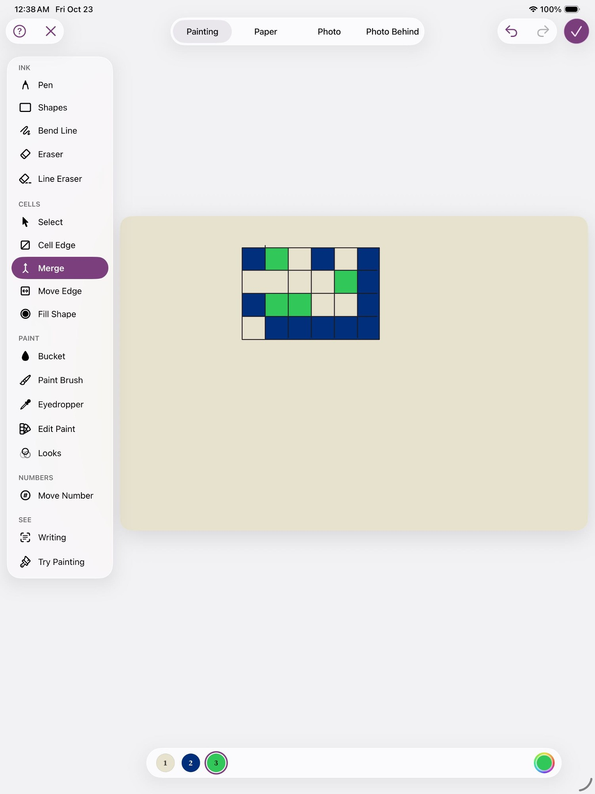 1500x2000

> Let me look at the in-between screenshot to confirm the undo actually restored the line.

→ `Read` `{"file_path": "/Users/runner/work/_temp/qa/shots/40-merge-undone.png"}`

← Read: image  1500x2000

> Undo and Redo of the merge both work. Next, the hexagon shape in an empty part of the canvas.

→ `mcp__maestro__run` `{"device_id": "99DEE653-946C-406D-8E9E-238D1FCE93C9", "yaml": "appId: com.pbordjadze.paintbynumber\n---\n- tapOn:\n    id: \"refine-tool-shapes\"\n- waitForAnimationToEnd\n- tapOn:\n    id: \"refine-shape-polygon\"\n- swipe:\n    start: \"740,470\"\n    end: \"820,550\"\n    duration: 1000\n- waitForAnimationToEnd\n- takeScreenshot: /Users/runner/work/_temp/qa/shots/42-hexagon"}`

→ `mcp__maestro__take_screenshot` `{"device_id": "99DEE653-946C-406D-8E9E-238D1FCE93C9"}`

← mcp__maestro__run: {"success":true,"device_id":"99DEE653-946C-406D-8E9E-238D1FCE93C9","commands_executed":7,"message":"Flow executed successfully","env_vars":{"MAESTRO_CLI_ANALYSIS_NOTIFICATION_DISABLED":"true","MAESTRO_CLI_NO_ANALYTICS":"1","MAESTRO_DRIVER_STARTUP_TIMEOUT":"240000","MAESTRO_VERSION":"2.11.0"}}

← mcp__maestro__take_screenshot: image 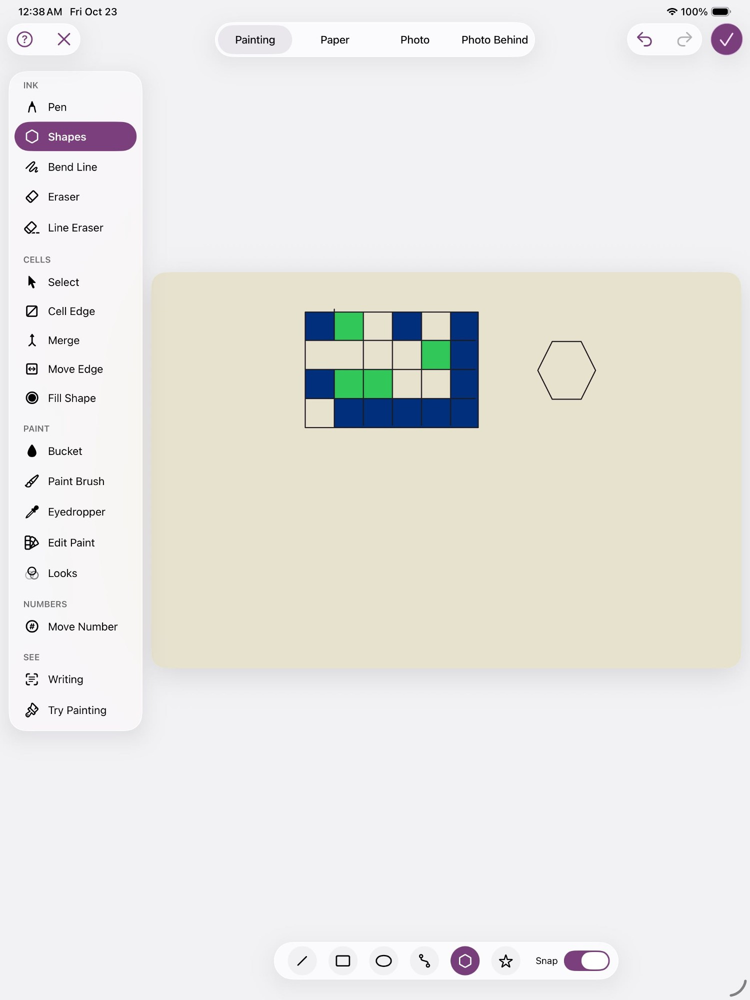 1500x2000

> The hexagon landed exactly on the dragged box (740–819, 470–549 pt). Now Try Painting.

→ `mcp__maestro__run` `{"device_id": "99DEE653-946C-406D-8E9E-238D1FCE93C9", "yaml": "appId: com.pbordjadze.paintbynumber\n---\n- tapOn:\n    id: \"refine-tool-tryPainting\"\n- waitForAnimationToEnd\n- takeScreenshot: /Users/runner/work/_temp/qa/shots/43-trypainting"}`

→ `mcp__maestro__take_screenshot` `{"device_id": "99DEE653-946C-406D-8E9E-238D1FCE93C9"}`

← mcp__maestro__run: {"success":true,"device_id":"99DEE653-946C-406D-8E9E-238D1FCE93C9","commands_executed":4,"message":"Flow executed successfully","env_vars":{"MAESTRO_CLI_ANALYSIS_NOTIFICATION_DISABLED":"true","MAESTRO_CLI_NO_ANALYTICS":"1","MAESTRO_DRIVER_STARTUP_TIMEOUT":"240000","MAESTRO_VERSION":"2.11.0"}}

← mcp__maestro__take_screenshot: image  1500x2000

→ `mcp__maestro__run` `{"device_id": "99DEE653-946C-406D-8E9E-238D1FCE93C9", "yaml": "appId: com.pbordjadze.paintbynumber\n---\n- tapOn:\n    point: \"516,1308\"\n- waitForAnimationToEnd\n- tapOn:\n    point: \"509,566\"\n- waitForAnimationToEnd\n- takeScreenshot: /Users/runner/work/_temp/qa/shots/44-try-fill-navy"}`

→ `mcp__maestro__take_screenshot` `{"device_id": "99DEE653-946C-406D-8E9E-238D1FCE93C9"}`

← mcp__maestro__run: {"success":true,"device_id":"99DEE653-946C-406D-8E9E-238D1FCE93C9","commands_executed":6,"message":"Flow executed successfully","env_vars":{"MAESTRO_CLI_ANALYSIS_NOTIFICATION_DISABLED":"true","MAESTRO_CLI_NO_ANALYTICS":"1","MAESTRO_DRIVER_STARTUP_TIMEOUT":"240000","MAESTRO_VERSION":"2.11.0"}}

← mcp__maestro__take_screenshot: image  1500x2000

→ `Read` `{"file_path": "/Users/runner/work/_temp/qa/app.log", "offset": 38}`

← Read: 38	2026-10-23 00:27:55.618 Df PaintByNumber[37815:18a57] [com.pbordjadze.paintbynumber:tips] offer in refine: refineFill, wanted
39	2026-10-23 00:35:20.816 Df PaintByNumber[37815:18a57] [com.pbordjadze.paintbynumber:tips] offer in preview: newPaintingDivider, newPaintingSuggested, newPaintingSliders, newPaintingRefine, wanted
40	2026-10-23 00:35:45.811 Df PaintByNumber[37815:18a57] [com.pbordjadze …

> No edit timings in the log. Next I'll go Back from Try Painting and check the Refine edits survive.

→ `mcp__maestro__run` `{"device_id": "99DEE653-946C-406D-8E9E-238D1FCE93C9", "yaml": "appId: com.pbordjadze.paintbynumber\n---\n- tapOn:\n    point: \"39,33\"\n- waitForAnimationToEnd\n- takeScreenshot: /Users/runner/work/_temp/qa/shots/45-back-from-try"}`

→ `mcp__maestro__take_screenshot` `{"device_id": "99DEE653-946C-406D-8E9E-238D1FCE93C9"}`

← mcp__maestro__run: {"success":true,"device_id":"99DEE653-946C-406D-8E9E-238D1FCE93C9","commands_executed":4,"message":"Flow executed successfully","env_vars":{"MAESTRO_CLI_ANALYSIS_NOTIFICATION_DISABLED":"true","MAESTRO_CLI_NO_ANALYTICS":"1","MAESTRO_DRIVER_STARTUP_TIMEOUT":"240000","MAESTRO_VERSION":"2.11.0"}}

← mcp__maestro__take_screenshot: image  1500x2000

> Edits survive the round trip. Now a third, clean repro of the Snap end-gap: a new rectangle plus one Pen stroke inside it.

→ `mcp__maestro__run` `{"device_id": "99DEE653-946C-406D-8E9E-238D1FCE93C9", "yaml": "appId: com.pbordjadze.paintbynumber\n---\n- tapOn:\n    id: \"refine-shape-rectangle\"\n- swipe:\n    start: \"700,620\"\n    end: \"800,700\"\n    duration: 1000\n- waitForAnimationToEnd\n- tapOn:\n    id: \"refine-tool-pen\"\n- swipe:\n    start: \"750,622\"\n    end: \"750,698\"\n    duration: 800\n- waitForAnimationToEnd\n- tapOn:\n    id: \"refine-tool-eyedropper\"\n- tapOn:\n    point: \"440,448\"\n- tapOn:\n    id: \"refine-tool-bucket\"\n- tapOn:\n    point: \"725,660\"\n- waitForAnimationToEnd\n- takeScreenshot: /Users/run`

→ `mcp__maestro__take_screenshot` `{"device_id": "99DEE653-946C-406D-8E9E-238D1FCE93C9"}`

← mcp__maestro__run: {"success":true,"device_id":"99DEE653-946C-406D-8E9E-238D1FCE93C9","commands_executed":13,"message":"Flow executed successfully","env_vars":{"MAESTRO_CLI_ANALYSIS_NOTIFICATION_DISABLED":"true","MAESTRO_CLI_NO_ANALYTICS":"1","MAESTRO_DRIVER_STARTUP_TIMEOUT":"240000","MAESTRO_VERSION":"2.11.0"}}

← mcp__maestro__take_screenshot: image 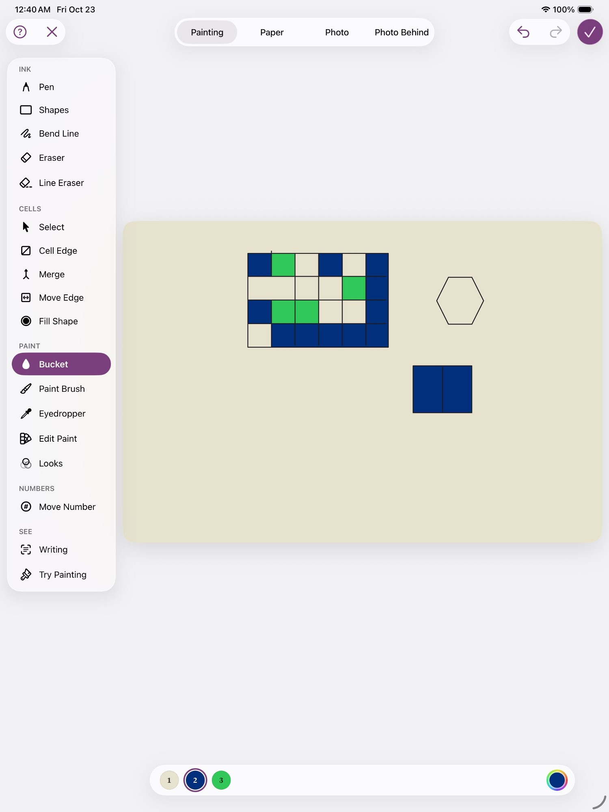 1500x2000

> Third repro of the leak: one Bucket tap filled both halves of the new rectangle. That's 3 of 3. Writing the full report now.

→ `Write` `{"file_path": "/Users/runner/work/_temp/qa/report.md", "content": "# Paint by Moonlight \u2014 exploratory test report (Refine / glass-mosaic session)\n\nDevice: iPad Pro 13-inch (M5) simulator, debug build. Session 00:17\u201300:42 (app.log times). Screenshots trusted over the scaled preview unless noted; coordinates below are points (screen 1032\u00d71376).\n\n## Summary\nI made a glass-mosaic draft from The Great Wave: Refine, Start From \u203a Blank, a 6\u00d74 grid over the crest (1 rectangle + 8 straight Pen lines = 9 gestures for 24 intended tiles), paints from New Paint, Bucket fills, `

← Write: The file /Users/runner/work/_temp/qa/report.md has been updated successfully. (file state is current in your context — no need to Read it back)

> Report saved. Next, the end-to-end check: Done, Start Painting, and the result in the gallery.

→ `mcp__maestro__run` `{"device_id": "99DEE653-946C-406D-8E9E-238D1FCE93C9", "yaml": "appId: com.pbordjadze.paintbynumber\n---\n- tapOn:\n    id: \"refine-done\"\n- waitForAnimationToEnd\n- takeScreenshot: /Users/runner/work/_temp/qa/shots/47-after-done"}`

→ `mcp__maestro__take_screenshot` `{"device_id": "99DEE653-946C-406D-8E9E-238D1FCE93C9"}`

← mcp__maestro__run: {"success":true,"device_id":"99DEE653-946C-406D-8E9E-238D1FCE93C9","commands_executed":4,"message":"Flow executed successfully","env_vars":{"MAESTRO_CLI_ANALYSIS_NOTIFICATION_DISABLED":"true","MAESTRO_CLI_NO_ANALYTICS":"1","MAESTRO_DRIVER_STARTUP_TIMEOUT":"240000","MAESTRO_VERSION":"2.11.0"}}

← mcp__maestro__take_screenshot: image 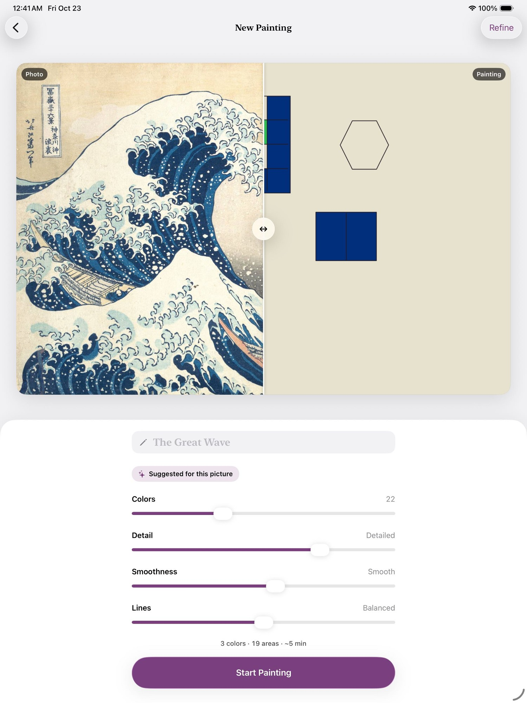 1500x2000

> The preview line reads "3 colors · 19 areas", one more than the 18 I count. Starting the painting:

→ `mcp__maestro__run` `{"device_id": "99DEE653-946C-406D-8E9E-238D1FCE93C9", "yaml": "appId: com.pbordjadze.paintbynumber\n---\n- tapOn: \"Start Painting\"\n- waitForAnimationToEnd:\n    timeout: 15000\n- takeScreenshot: /Users/runner/work/_temp/qa/shots/48-start-painting"}`

→ `mcp__maestro__take_screenshot` `{"device_id": "99DEE653-946C-406D-8E9E-238D1FCE93C9"}`

← mcp__maestro__run: {"success":true,"device_id":"99DEE653-946C-406D-8E9E-238D1FCE93C9","commands_executed":4,"message":"Flow executed successfully","env_vars":{"MAESTRO_CLI_ANALYSIS_NOTIFICATION_DISABLED":"true","MAESTRO_CLI_NO_ANALYTICS":"1","MAESTRO_DRIVER_STARTUP_TIMEOUT":"240000","MAESTRO_VERSION":"2.11.0"}}

← mcp__maestro__take_screenshot: image 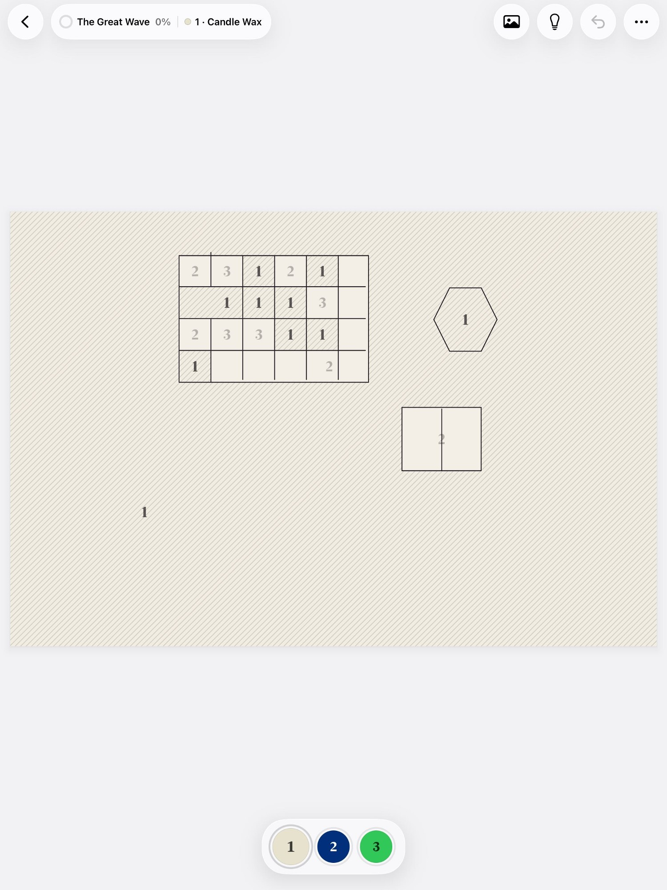 1500x2000

→ `mcp__maestro__run` `{"device_id": "99DEE653-946C-406D-8E9E-238D1FCE93C9", "yaml": "appId: com.pbordjadze.paintbynumber\n---\n- tapOn:\n    point: \"516,1308\"\n- waitForAnimationToEnd\n- tapOn:\n    point: \"509,566\"\n- waitForAnimationToEnd\n- tapOn:\n    point: \"301,419\"\n- waitForAnimationToEnd\n- takeScreenshot: /Users/runner/work/_temp/qa/shots/49-painted-two"}`

→ `mcp__maestro__take_screenshot` `{"device_id": "99DEE653-946C-406D-8E9E-238D1FCE93C9"}`

← mcp__maestro__run: {"success":true,"device_id":"99DEE653-946C-406D-8E9E-238D1FCE93C9","commands_executed":8,"message":"Flow executed successfully","env_vars":{"MAESTRO_CLI_ANALYSIS_NOTIFICATION_DISABLED":"true","MAESTRO_CLI_NO_ANALYTICS":"1","MAESTRO_DRIVER_STARTUP_TIMEOUT":"240000","MAESTRO_VERSION":"2.11.0"}}

← mcp__maestro__take_screenshot: image 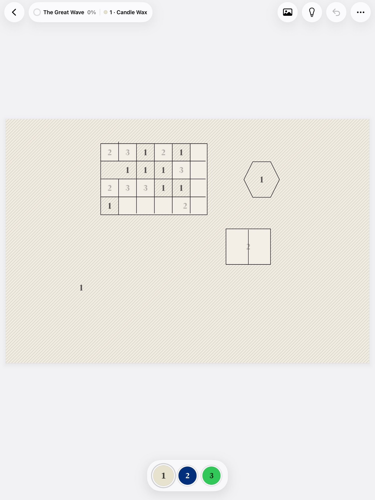 1500x2000

> Nothing happened: no swatch selected and no fills. Checking for an overlay.

→ `mcp__maestro__inspect_screen` `{"device_id": "99DEE653-946C-406D-8E9E-238D1FCE93C9"}`

← mcp__maestro__inspect_screen: {"ui_schema":{"platform":"ios","abbreviations":{"b":"bounds","txt":"text","rid":"resource-id","a11y":"accessibilityText","hint":"hintText","val":"value","c":"children"},"defaults":{"enabled":true,"focused":false,"selected":false,"checked":false,"txt":"","hint":"","rid":"","val":"","a11y":""}},"elements":[{"b":"[0,0][1032,1376]","a11y":"Paint by Moonlight","c":[{"b":"[0,0][1032,1376]","c":[{"b":"[0 …

> The palette and canvas ignored all three taps, though swatch 2's bounds match where I tapped. Trying a VoiceOver area element by id:

→ `mcp__maestro__run` `{"device_id": "99DEE653-946C-406D-8E9E-238D1FCE93C9", "yaml": "appId: com.pbordjadze.paintbynumber\n---\n- tapOn:\n    id: \"canvas-area-4\"\n- waitForAnimationToEnd\n- takeScreenshot: /Users/runner/work/_temp/qa/shots/50-tap-area4"}`

→ `mcp__maestro__take_screenshot` `{"device_id": "99DEE653-946C-406D-8E9E-238D1FCE93C9"}`

← mcp__maestro__run: {"success":true,"device_id":"99DEE653-946C-406D-8E9E-238D1FCE93C9","commands_executed":4,"message":"Flow executed successfully","env_vars":{"MAESTRO_CLI_ANALYSIS_NOTIFICATION_DISABLED":"true","MAESTRO_CLI_NO_ANALYTICS":"1","MAESTRO_DRIVER_STARTUP_TIMEOUT":"240000","MAESTRO_VERSION":"2.11.0"}}

← mcp__maestro__take_screenshot: image 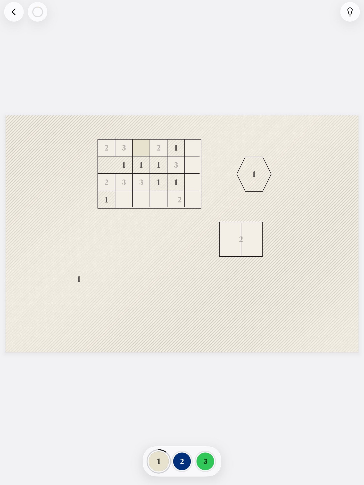 1500x2000

> The id tap painted. My earlier background tap had actually landed on a "2" tile, so that part was my mistake. Retrying swatch 2 by id:

→ `mcp__maestro__run` `{"device_id": "99DEE653-946C-406D-8E9E-238D1FCE93C9", "yaml": "appId: com.pbordjadze.paintbynumber\n---\n- tapOn:\n    id: \"swatch-2\"\n    index: 0\n- waitForAnimationToEnd\n- tapOn:\n    point: \"509,566\"\n- waitForAnimationToEnd\n- takeScreenshot: /Users/runner/work/_temp/qa/shots/51-navy-L"}`

→ `mcp__maestro__take_screenshot` `{"device_id": "99DEE653-946C-406D-8E9E-238D1FCE93C9"}`

← mcp__maestro__run: {"success":true,"device_id":"99DEE653-946C-406D-8E9E-238D1FCE93C9","commands_executed":6,"message":"Flow executed successfully","env_vars":{"MAESTRO_CLI_ANALYSIS_NOTIFICATION_DISABLED":"true","MAESTRO_CLI_NO_ANALYTICS":"1","MAESTRO_DRIVER_STARTUP_TIMEOUT":"240000","MAESTRO_VERSION":"2.11.0"}}

← mcp__maestro__take_screenshot: image 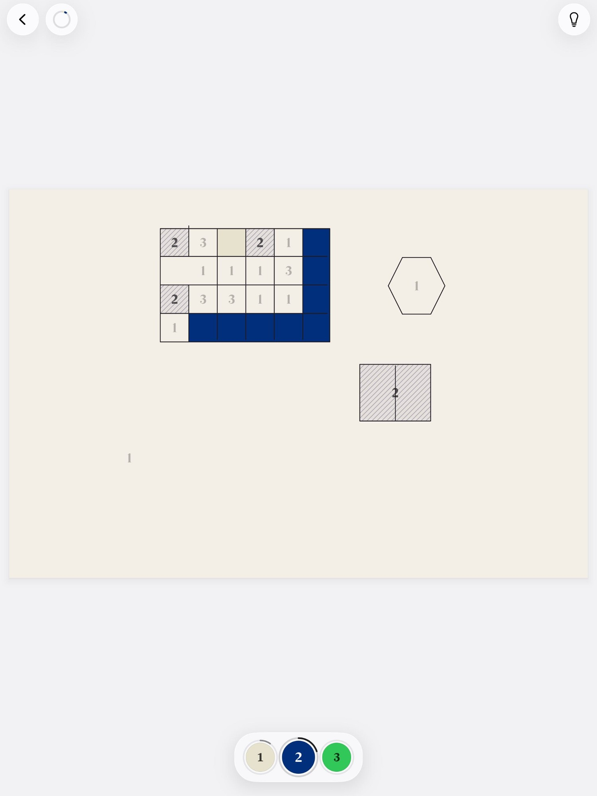 1500x2000

> Both fills worked (2 of 19 areas). Back to the gallery to check the thumbnail and progress:

→ `mcp__maestro__run` `{"device_id": "99DEE653-946C-406D-8E9E-238D1FCE93C9", "yaml": "appId: com.pbordjadze.paintbynumber\n---\n- tapOn: \"Back\"\n- waitForAnimationToEnd\n- takeScreenshot: /Users/runner/work/_temp/qa/shots/52-gallery"}`

→ `mcp__maestro__inspect_screen` `{"device_id": "99DEE653-946C-406D-8E9E-238D1FCE93C9"}`

← mcp__maestro__run: {"success":true,"device_id":"99DEE653-946C-406D-8E9E-238D1FCE93C9","commands_executed":4,"message":"Flow executed successfully","env_vars":{"MAESTRO_CLI_ANALYSIS_NOTIFICATION_DISABLED":"true","MAESTRO_CLI_NO_ANALYTICS":"1","MAESTRO_DRIVER_STARTUP_TIMEOUT":"240000","MAESTRO_VERSION":"2.11.0"}}

← mcp__maestro__inspect_screen: {"ui_schema":{"platform":"ios","abbreviations":{"b":"bounds","txt":"text","rid":"resource-id","a11y":"accessibilityText","hint":"hintText","val":"value","c":"children"},"defaults":{"enabled":true,"focused":false,"selected":false,"checked":false,"txt":"","hint":"","rid":"","val":"","a11y":""}},"elements":[{"b":"[0,0][1032,1376]","a11y":"Paint by Moonlight","c":[{"b":"[0,0][1032,1376]","c":[{"b":"[0 …

> The gallery shows 10% painted, which is right for 2 of 19. Checking the thumbnail:

→ `mcp__maestro__take_screenshot` `{"device_id": "99DEE653-946C-406D-8E9E-238D1FCE93C9"}`

← mcp__maestro__take_screenshot: image 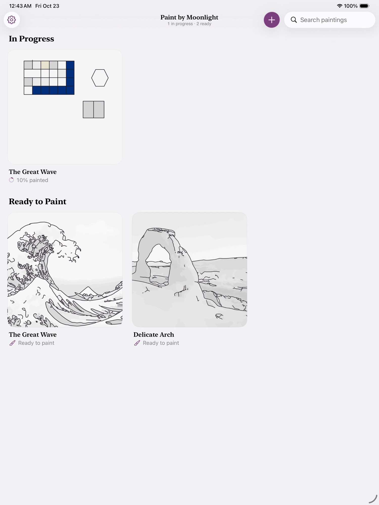 1500x2000

> The thumbnail matches. Note there are now two paintings named "The Great Wave". Next, quit through Home and relaunch:

→ `mcp__maestro__run` `{"device_id": "99DEE653-946C-406D-8E9E-238D1FCE93C9", "yaml": "appId: com.pbordjadze.paintbynumber\n---\n- pressKey: Home"}`

→ `mcp__maestro__take_screenshot` `{"device_id": "99DEE653-946C-406D-8E9E-238D1FCE93C9"}`

← mcp__maestro__run: {"success":true,"device_id":"99DEE653-946C-406D-8E9E-238D1FCE93C9","commands_executed":2,"message":"Flow executed successfully","env_vars":{"MAESTRO_CLI_ANALYSIS_NOTIFICATION_DISABLED":"true","MAESTRO_CLI_NO_ANALYTICS":"1","MAESTRO_DRIVER_STARTUP_TIMEOUT":"240000","MAESTRO_VERSION":"2.11.0"}}

← mcp__maestro__take_screenshot: image  1500x2000

→ `mcp__maestro__run` `{"device_id": "99DEE653-946C-406D-8E9E-238D1FCE93C9", "yaml": "appId: com.pbordjadze.paintbynumber\n---\n- stopApp\n- launchApp\n- waitForAnimationToEnd:\n    timeout: 10000\n- takeScreenshot: /Users/runner/work/_temp/qa/shots/53-relaunch"}`

→ `mcp__maestro__take_screenshot` `{"device_id": "99DEE653-946C-406D-8E9E-238D1FCE93C9"}`

← mcp__maestro__run: {"success":true,"device_id":"99DEE653-946C-406D-8E9E-238D1FCE93C9","commands_executed":5,"message":"Flow executed successfully","env_vars":{"MAESTRO_CLI_ANALYSIS_NOTIFICATION_DISABLED":"true","MAESTRO_CLI_NO_ANALYTICS":"1","MAESTRO_DRIVER_STARTUP_TIMEOUT":"240000","MAESTRO_VERSION":"2.11.0"}}

← mcp__maestro__take_screenshot: image 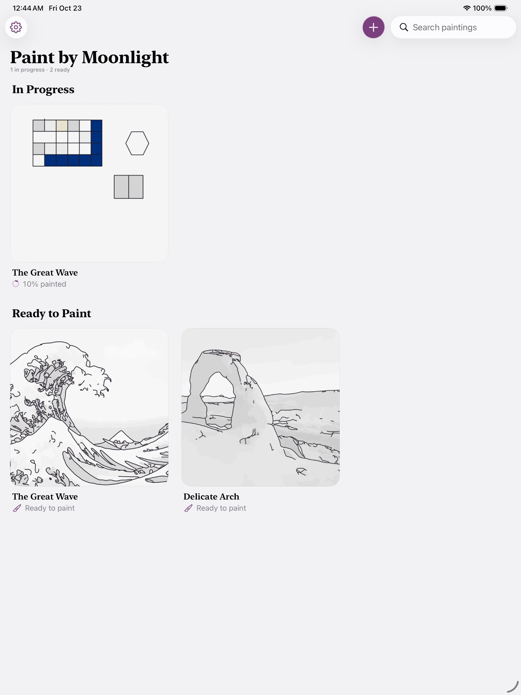 1500x2000

> The relaunch kept 10% and the thumbnail. Reopening the painting:

→ `mcp__maestro__run` `{"device_id": "99DEE653-946C-406D-8E9E-238D1FCE93C9", "yaml": "appId: com.pbordjadze.paintbynumber\n---\n- tapOn: \"10 percent painted\"\n- waitForAnimationToEnd:\n    timeout: 10000\n- takeScreenshot: /Users/runner/work/_temp/qa/shots/54-reopen-after-relaunch"}`

→ `mcp__maestro__take_screenshot` `{"device_id": "99DEE653-946C-406D-8E9E-238D1FCE93C9"}`

← mcp__maestro__run: {"success":true,"device_id":"99DEE653-946C-406D-8E9E-238D1FCE93C9","commands_executed":4,"message":"Flow executed successfully","env_vars":{"MAESTRO_CLI_ANALYSIS_NOTIFICATION_DISABLED":"true","MAESTRO_CLI_NO_ANALYTICS":"1","MAESTRO_DRIVER_STARTUP_TIMEOUT":"240000","MAESTRO_VERSION":"2.11.0"}}

← mcp__maestro__take_screenshot: image 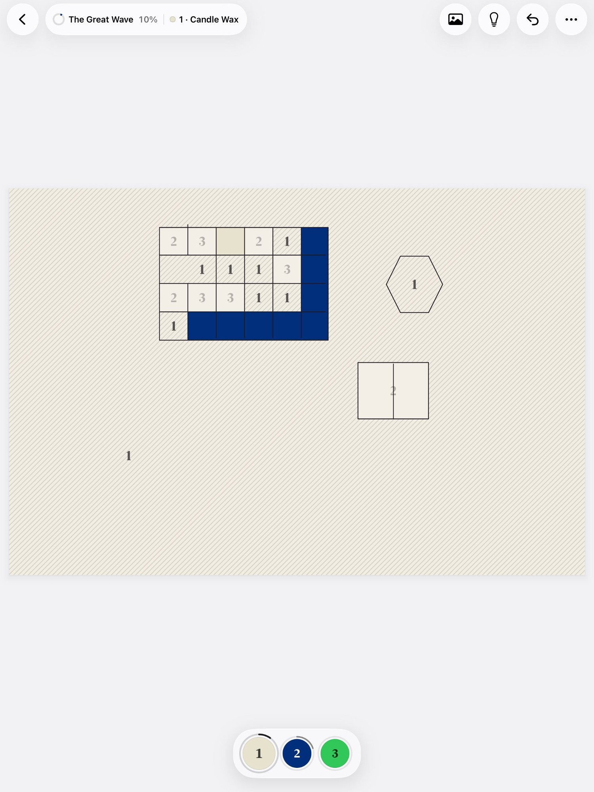 1500x2000

> After quit and relaunch, both fills and 10% are still there, in the painting and in the gallery. Updating the report with the end-to-end results.

→ `Write` `{"file_path": "/Users/runner/work/_temp/qa/report.md", "content": "# Paint by Moonlight \u2014 exploratory test report (Refine / glass-mosaic session)\n\nDevice: iPad Pro 13-inch (M5) simulator, debug build. Session 00:17\u201300:45 (app.log times). Coordinates are points (screen 1032\u00d71376). I trusted screenshots plus inspect_screen together; where they differ, it's noted.\n\n## Summary\nI made a glass-mosaic painting from The Great Wave: Refine, Start From \u203a Blank, a 6\u00d74 grid over the crest (1 rectangle + 8 straight Pen lines = 9 gestures for 24 intended tiles), paints from New`

← Write: The file /Users/runner/work/_temp/qa/report.md has been updated successfully. (file state is current in your context — no need to Read it back)

→ `Read` `{"file_path": "/Users/runner/work/_temp/qa/crashes.txt"}`

← Read: <system-reminder>Warning: the file exists but the contents are empty.</system-reminder>

> I built the mosaic end to end, but 24 intended tiles came out as only 17 areas. A Refine bug silently joined 8 of them into one, so the mosaic isn't usable as designed. The full report is in `/Users/runner/work/_temp/qa/report.md`, with screenshots in `shots/`. There were no crashes (`crashes.txt` is empty).
> 
> Path: The Great Wave → Refine → Blank → a 6×4 grid over the crest (one rectangle plus 8 straight Pen lines) → colours → Edit Paint, Merge, Undo/Redo, a hexagon → Try Painting → Done → Start Painting. Then I painted two areas, went back to the gallery, and quit through Home and relaunched. Both fills and the 10% progress (2 of 19 areas) were still there after the gallery round trip and after the relaunch.
> 
> **Bugs I reproduced:**
> 1. **Snap closes a Pen stroke's start but not its end (3 of 3).** Strokes I ended 2 points short of the frame stayed open, with no warning or message. In the finished painting those 8 tiles carry a single number while the open lines still divide them on screen.
> 2. **Refine palette swatches don't select when tapped in the centre** (about 8 failed taps). Their tap targets sit about 20–25 points left of where they're drawn, so the Bucket keeps laying the previous paint. Tapping a swatch's left edge works (3 of 3), and so does picking the colour off a filled tile with the Eyedropper.
> 3. **One paint gets three names:** "Light beige" in Refine, "Fresh Linen" in Try Painting, and "Candle Wax" in the saved painting. Paints 2 and 3 also change names between Refine and the painting.
> 
> **Your questions:**
> - **Placement:** yes, every shape and line landed within about 1–2 points of where I drew it.
> - **Refused edits:** none. No line, shape or fill was refused and no toast appeared all session, including for the open strokes.
> - **Which paint the Bucket lays:** often unclear, because of bug 2.
> - **Speed:** no visible slowdown up to about 30 edits. `app.log` has no timing lines for Refine edits, so I can't give numbers.
> - **Gestures per tile:** about 0.4 per tile for the 9-gesture grid. Each colour then took one tap per tile, plus 1–3 taps to choose the paint because of bug 2.
> - **What I wanted and couldn't find:** a grid or repeat-shape tool, any sign of which areas are joined, a way back to Generated after the first stroke, and a hint for Merge.
> 
> **Things seen once (suspicions):**
> - **Edit Paint dragged a second paint along:** "Similar colors too" is on by default, so changing paint 3 also turned navy dark green. With it off, only paint 3 changed.
> - **Merge needs a drag across the edge;** a single tap does nothing and nothing explains the gesture.
> - **The Refine canvas shifted 11 points up** when Edit Paint opened.
> - **There are now two gallery paintings both called "The Great Wave".**
> - **The Edit Paint colour grid ignored taps** while its preset circles worked; that may be Maestro.
> 
> **Not tried:** zoomed painting, Settings, and most of the other Refine tools. Maestro also can't pinch or draw curves, so I couldn't zoom in to see the 2-point gaps directly. I judged them from how the fills spread.
