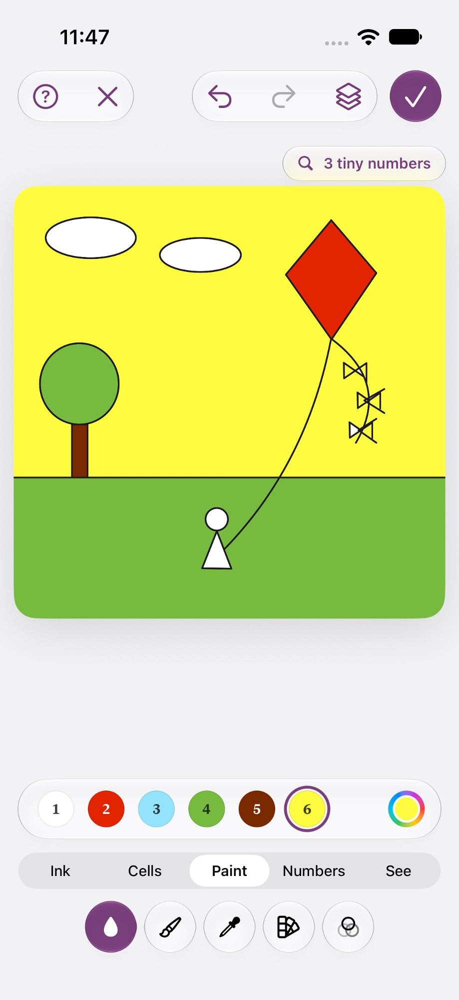
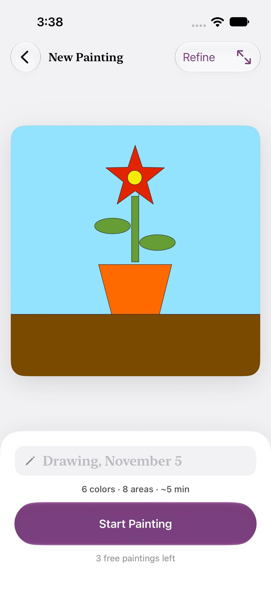
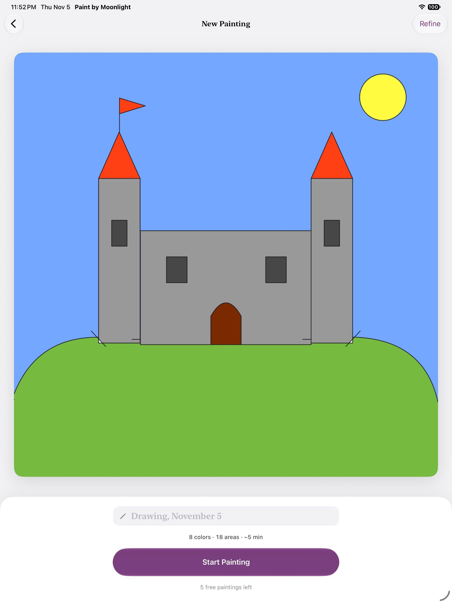
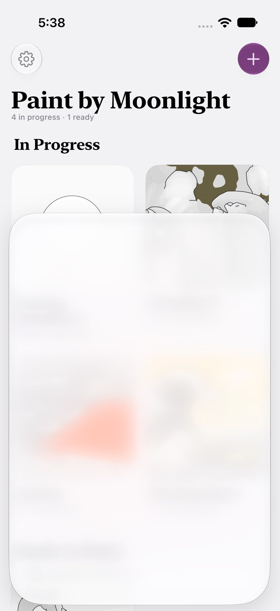
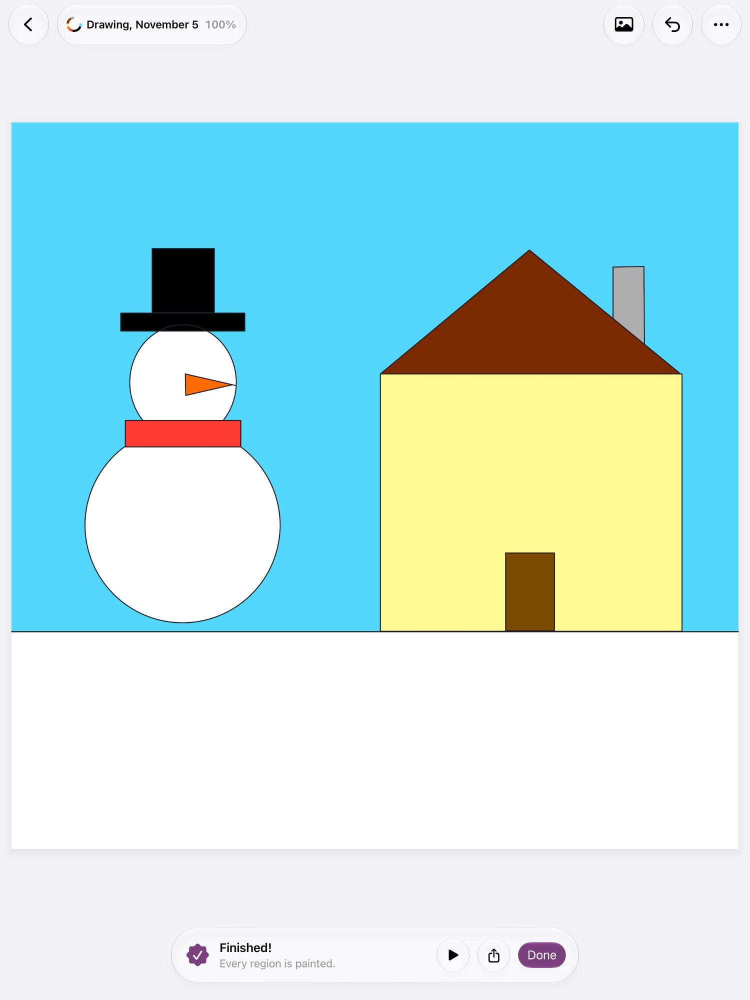
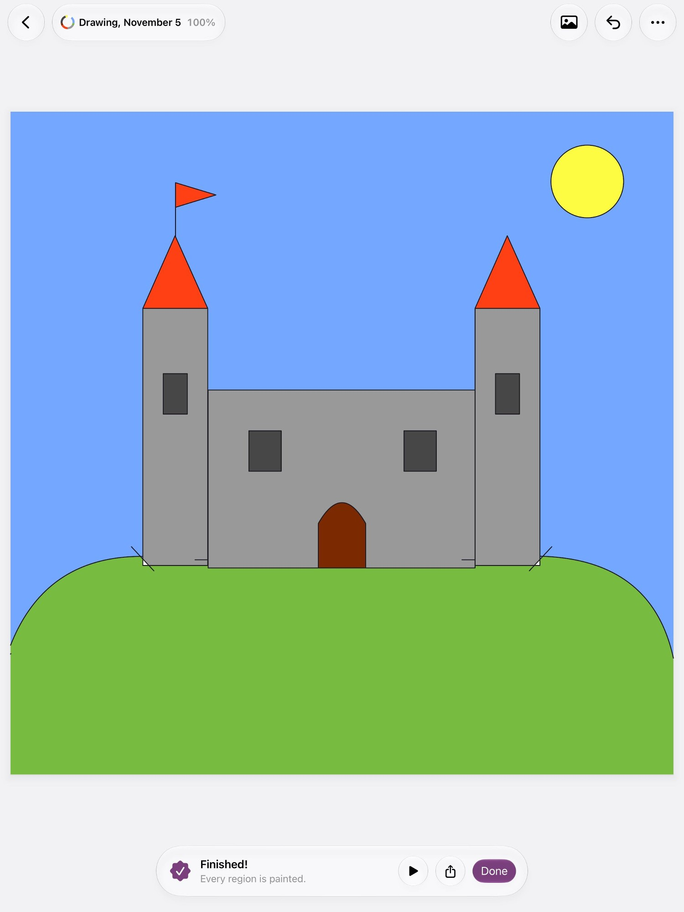
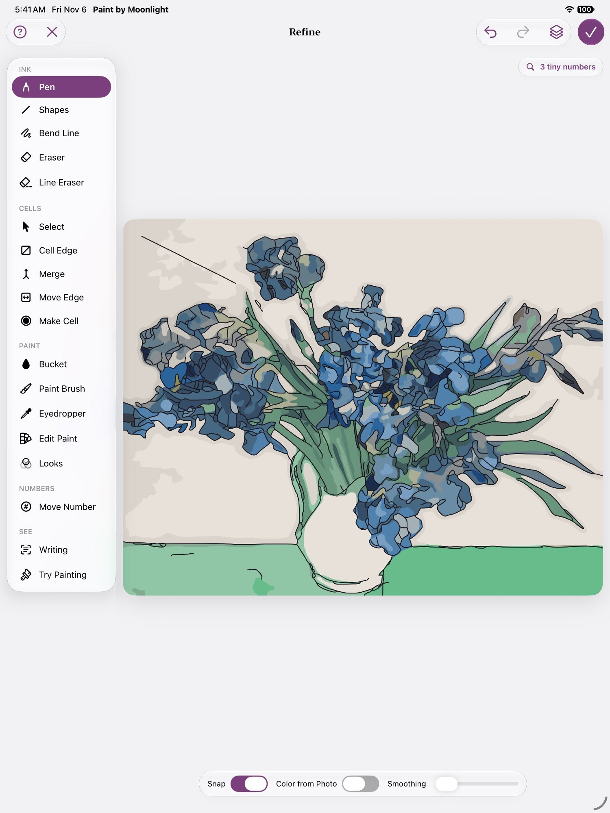

# Agent transcript

- end: success, 121 turns, 20.1 min, estimated $2.8375648000000004
- tool calls: {"mcp__maestro__take_screenshot": 42, "Read": 4, "mcp__maestro__run": 52, "mcp__maestro__inspect_screen": 17, "Write": 5}
- images the agent received: 42

**Start**: model claude-opus-5-5, MCP [{"name": "maestro", "status": "connected", "source": "dynamic"}]

→ `mcp__maestro__take_screenshot` `{"device_id": "6197F6D6-2F0B-42E4-AB06-C558BBAEC70F"}`

→ `Read` `{"file_path": "/Users/runner/.claude/projects/-Users-runner-work--temp-qa/memory/MEMORY.md"}`

← mcp__maestro__take_screenshot: image  919x2000

← Read (error): File does not exist. Note: your current working directory is /Users/runner/work/_temp/qa.

> Plan: a red car body (rectangle with cabin) with a light-blue window, two black round wheels, a grey road strip at the bottom, a yellow round sun top-right, light-blue sky.

→ `mcp__maestro__run` `{"device_id": "6197F6D6-2F0B-42E4-AB06-C558BBAEC70F", "yaml": "appId: com.pbordjadze.paintbynumber\n---\n- tapOn:\n    point: \"90%,10%\"\n- waitForAnimationToEnd\n- takeScreenshot: /Users/runner/work/_temp/qa/shots/plan-1"}`

→ `mcp__maestro__inspect_screen` `{"device_id": "6197F6D6-2F0B-42E4-AB06-C558BBAEC70F"}`

← mcp__maestro__run: {"success":true,"device_id":"6197F6D6-2F0B-42E4-AB06-C558BBAEC70F","commands_executed":4,"message":"Flow executed successfully","env_vars":{"MAESTRO_CLI_ANALYSIS_NOTIFICATION_DISABLED":"true","MAESTRO_CLI_NO_ANALYTICS":"1","MAESTRO_DRIVER_STARTUP_TIMEOUT":"240000","MAESTRO_VERSION":"2.11.0"}}

← mcp__maestro__inspect_screen: {"ui_schema":{"platform":"ios","abbreviations":{"b":"bounds","txt":"text","rid":"resource-id","a11y":"accessibilityText","hint":"hintText","val":"value","c":"children"},"defaults":{"enabled":true,"focused":false,"selected":false,"checked":false,"txt":"","hint":"","rid":"","val":"","a11y":""}},"elements":[{"b":"[0,0][402,874]","a11y":"Paint by Moonlight","c":[{"b":"[0,0][402,874]","c":[{"b":"[0,0][ …

> There's a "From Scratch" button at top right (icon only). Tapping it.

→ `mcp__maestro__run` `{"device_id": "6197F6D6-2F0B-42E4-AB06-C558BBAEC70F", "yaml": "appId: com.pbordjadze.paintbynumber\n---\n- tapOn:\n    id: \"from-scratch\"\n- waitForAnimationToEnd\n- takeScreenshot: /Users/runner/work/_temp/qa/shots/plan-2"}`

→ `mcp__maestro__take_screenshot` `{"device_id": "6197F6D6-2F0B-42E4-AB06-C558BBAEC70F"}`

← mcp__maestro__run: {"success":true,"device_id":"6197F6D6-2F0B-42E4-AB06-C558BBAEC70F","commands_executed":4,"message":"Flow executed successfully","env_vars":{"MAESTRO_CLI_ANALYSIS_NOTIFICATION_DISABLED":"true","MAESTRO_CLI_NO_ANALYTICS":"1","MAESTRO_DRIVER_STARTUP_TIMEOUT":"240000","MAESTRO_VERSION":"2.11.0"}}

← mcp__maestro__take_screenshot: image  919x2000

> Directly into Refine with a blank page. Let me inspect the tools.

→ `mcp__maestro__inspect_screen` `{"device_id": "6197F6D6-2F0B-42E4-AB06-C558BBAEC70F"}`

← mcp__maestro__inspect_screen: {"ui_schema":{"platform":"ios","abbreviations":{"b":"bounds","txt":"text","rid":"resource-id","a11y":"accessibilityText","hint":"hintText","val":"value","c":"children"},"defaults":{"enabled":true,"focused":false,"selected":false,"checked":false,"txt":"","hint":"","rid":"","val":"","a11y":""}},"elements":[{"b":"[0,0][402,874]","a11y":"Paint by Moonlight","c":[{"b":"[0,0][402,874]","c":[{"b":"[0,0][ …

> The picture is 378×378 pt at (12,190). The Shapes tool reads "Line"; let me see what shapes it offers.

→ `mcp__maestro__run` `{"device_id": "6197F6D6-2F0B-42E4-AB06-C558BBAEC70F", "yaml": "appId: com.pbordjadze.paintbynumber\n---\n- tapOn:\n    id: \"refine-tool-shapes\"\n- waitForAnimationToEnd"}`

→ `mcp__maestro__take_screenshot` `{"device_id": "6197F6D6-2F0B-42E4-AB06-C558BBAEC70F"}`

← mcp__maestro__run: {"success":true,"device_id":"6197F6D6-2F0B-42E4-AB06-C558BBAEC70F","commands_executed":3,"message":"Flow executed successfully","env_vars":{"MAESTRO_CLI_ANALYSIS_NOTIFICATION_DISABLED":"true","MAESTRO_CLI_NO_ANALYTICS":"1","MAESTRO_DRIVER_STARTUP_TIMEOUT":"240000","MAESTRO_VERSION":"2.11.0"}}

← mcp__maestro__take_screenshot: image  919x2000

> Line, rectangle, ellipse, a curve/path, polygon, star. Getting exact bounds.

→ `mcp__maestro__inspect_screen` `{"device_id": "6197F6D6-2F0B-42E4-AB06-C558BBAEC70F"}`

← mcp__maestro__inspect_screen: {"ui_schema":{"platform":"ios","abbreviations":{"b":"bounds","txt":"text","rid":"resource-id","a11y":"accessibilityText","hint":"hintText","val":"value","c":"children"},"defaults":{"enabled":true,"focused":false,"selected":false,"checked":false,"txt":"","hint":"","rid":"","val":"","a11y":""}},"elements":[{"b":"[0,0][402,874]","a11y":"Paint by Moonlight","c":[{"b":"[0,0][402,874]","c":[{"b":"[0,0][ …

→ `mcp__maestro__run` `{"device_id": "6197F6D6-2F0B-42E4-AB06-C558BBAEC70F", "yaml": "appId: com.pbordjadze.paintbynumber\n---\n- swipe:\n    start: \"14,520\"\n    end: \"388,520\"\n    duration: 800\n- waitForAnimationToEnd"}`

→ `mcp__maestro__take_screenshot` `{"device_id": "6197F6D6-2F0B-42E4-AB06-C558BBAEC70F"}`

← mcp__maestro__run: {"success":true,"device_id":"6197F6D6-2F0B-42E4-AB06-C558BBAEC70F","commands_executed":3,"message":"Flow executed successfully","env_vars":{"MAESTRO_CLI_ANALYSIS_NOTIFICATION_DISABLED":"true","MAESTRO_CLI_NO_ANALYTICS":"1","MAESTRO_DRIVER_STARTUP_TIMEOUT":"240000","MAESTRO_VERSION":"2.11.0"}}

← mcp__maestro__take_screenshot: image  919x2000

> Road line drawn edge-to-edge in one try (snapped to edges). Now rectangles: body, cabin, window.

→ `mcp__maestro__run` `{"device_id": "6197F6D6-2F0B-42E4-AB06-C558BBAEC70F", "yaml": "appId: com.pbordjadze.paintbynumber\n---\n- tapOn:\n    id: \"refine-shape-rectangle\"\n- swipe:\n    start: \"90,420\"\n    end: \"310,470\"\n    duration: 800\n- waitForAnimationToEnd\n- takeScreenshot: /Users/runner/work/_temp/qa/shots/plan-3"}`

→ `mcp__maestro__take_screenshot` `{"device_id": "6197F6D6-2F0B-42E4-AB06-C558BBAEC70F"}`

← mcp__maestro__run: {"success":true,"device_id":"6197F6D6-2F0B-42E4-AB06-C558BBAEC70F","commands_executed":5,"message":"Flow executed successfully","env_vars":{"MAESTRO_CLI_ANALYSIS_NOTIFICATION_DISABLED":"true","MAESTRO_CLI_NO_ANALYTICS":"1","MAESTRO_DRIVER_STARTUP_TIMEOUT":"240000","MAESTRO_VERSION":"2.11.0"}}

← mcp__maestro__take_screenshot: image  919x2000

> Body done. Cabin and window next.

→ `mcp__maestro__run` `{"device_id": "6197F6D6-2F0B-42E4-AB06-C558BBAEC70F", "yaml": "appId: com.pbordjadze.paintbynumber\n---\n- swipe:\n    start: \"140,370\"\n    end: \"260,420\"\n    duration: 800\n- waitForAnimationToEnd\n- swipe:\n    start: \"155,380\"\n    end: \"245,410\"\n    duration: 800\n- waitForAnimationToEnd"}`

→ `mcp__maestro__take_screenshot` `{"device_id": "6197F6D6-2F0B-42E4-AB06-C558BBAEC70F"}`

← mcp__maestro__run: {"success":true,"device_id":"6197F6D6-2F0B-42E4-AB06-C558BBAEC70F","commands_executed":5,"message":"Flow executed successfully","env_vars":{"MAESTRO_CLI_ANALYSIS_NOTIFICATION_DISABLED":"true","MAESTRO_CLI_NO_ANALYTICS":"1","MAESTRO_DRIVER_STARTUP_TIMEOUT":"240000","MAESTRO_VERSION":"2.11.0"}}

← mcp__maestro__take_screenshot: image  919x2000

> Car body and window look right. Now the wheels (oval, assuming corner-to-corner drag).

→ `mcp__maestro__run` `{"device_id": "6197F6D6-2F0B-42E4-AB06-C558BBAEC70F", "yaml": "appId: com.pbordjadze.paintbynumber\n---\n- tapOn:\n    id: \"refine-shape-oval\"\n- swipe:\n    start: \"118,468\"\n    end: \"162,512\"\n    duration: 800\n- waitForAnimationToEnd"}`

→ `mcp__maestro__take_screenshot` `{"device_id": "6197F6D6-2F0B-42E4-AB06-C558BBAEC70F"}`

← mcp__maestro__run: {"success":true,"device_id":"6197F6D6-2F0B-42E4-AB06-C558BBAEC70F","commands_executed":4,"message":"Flow executed successfully","env_vars":{"MAESTRO_CLI_ANALYSIS_NOTIFICATION_DISABLED":"true","MAESTRO_CLI_NO_ANALYTICS":"1","MAESTRO_DRIVER_STARTUP_TIMEOUT":"240000","MAESTRO_VERSION":"2.11.0"}}

← mcp__maestro__take_screenshot: image  919x2000

> Wheel circle as expected. Second wheel and the sun.

→ `mcp__maestro__run` `{"device_id": "6197F6D6-2F0B-42E4-AB06-C558BBAEC70F", "yaml": "appId: com.pbordjadze.paintbynumber\n---\n- swipe:\n    start: \"238,468\"\n    end: \"282,512\"\n    duration: 800\n- waitForAnimationToEnd\n- swipe:\n    start: \"290,220\"\n    end: \"350,280\"\n    duration: 800\n- waitForAnimationToEnd\n- takeScreenshot: /Users/runner/work/_temp/qa/shots/plan-4"}`

→ `mcp__maestro__take_screenshot` `{"device_id": "6197F6D6-2F0B-42E4-AB06-C558BBAEC70F"}`

← mcp__maestro__run: {"success":true,"device_id":"6197F6D6-2F0B-42E4-AB06-C558BBAEC70F","commands_executed":6,"message":"Flow executed successfully","env_vars":{"MAESTRO_CLI_ANALYSIS_NOTIFICATION_DISABLED":"true","MAESTRO_CLI_NO_ANALYTICS":"1","MAESTRO_DRIVER_STARTUP_TIMEOUT":"240000","MAESTRO_VERSION":"2.11.0"}}

← mcp__maestro__take_screenshot: image  919x2000

> All line art drew on the first try. Now color: open the Paint group.

→ `mcp__maestro__run` `{"device_id": "6197F6D6-2F0B-42E4-AB06-C558BBAEC70F", "yaml": "appId: com.pbordjadze.paintbynumber\n---\n- tapOn: \"Paint\"\n- waitForAnimationToEnd"}`

→ `mcp__maestro__take_screenshot` `{"device_id": "6197F6D6-2F0B-42E4-AB06-C558BBAEC70F"}`

→ `mcp__maestro__inspect_screen` `{"device_id": "6197F6D6-2F0B-42E4-AB06-C558BBAEC70F"}`

← mcp__maestro__run: {"success":true,"device_id":"6197F6D6-2F0B-42E4-AB06-C558BBAEC70F","commands_executed":3,"message":"Flow executed successfully","env_vars":{"MAESTRO_CLI_ANALYSIS_NOTIFICATION_DISABLED":"true","MAESTRO_CLI_NO_ANALYTICS":"1","MAESTRO_DRIVER_STARTUP_TIMEOUT":"240000","MAESTRO_VERSION":"2.11.0"}}

← mcp__maestro__take_screenshot: image  919x2000

← mcp__maestro__inspect_screen: {"ui_schema":{"platform":"ios","abbreviations":{"b":"bounds","txt":"text","rid":"resource-id","a11y":"accessibilityText","hint":"hintText","val":"value","c":"children"},"defaults":{"enabled":true,"focused":false,"selected":false,"checked":false,"txt":"","hint":"","rid":"","val":"","a11y":""}},"elements":[{"b":"[0,0][402,874]","a11y":"Paint by Moonlight","c":[{"b":"[0,0][402,874]","c":[{"b":"[0,0][ …

> Palette has only "1 · White". Tap New Paint to add red.

→ `mcp__maestro__run` `{"device_id": "6197F6D6-2F0B-42E4-AB06-C558BBAEC70F", "yaml": "appId: com.pbordjadze.paintbynumber\n---\n- tapOn:\n    id: \"refine-palette-new\"\n- waitForAnimationToEnd"}`

→ `mcp__maestro__take_screenshot` `{"device_id": "6197F6D6-2F0B-42E4-AB06-C558BBAEC70F"}`

← mcp__maestro__run: {"success":true,"device_id":"6197F6D6-2F0B-42E4-AB06-C558BBAEC70F","commands_executed":3,"message":"Flow executed successfully","env_vars":{"MAESTRO_CLI_ANALYSIS_NOTIFICATION_DISABLED":"true","MAESTRO_CLI_NO_ANALYTICS":"1","MAESTRO_DRIVER_STARTUP_TIMEOUT":"240000","MAESTRO_VERSION":"2.11.0"}}

← mcp__maestro__take_screenshot: image  919x2000

> Nothing visibly changed. Inspecting to check whether a picker is open.

→ `mcp__maestro__inspect_screen` `{"device_id": "6197F6D6-2F0B-42E4-AB06-C558BBAEC70F"}`

← mcp__maestro__inspect_screen: {"ui_schema":{"platform":"ios","abbreviations":{"b":"bounds","txt":"text","rid":"resource-id","a11y":"accessibilityText","hint":"hintText","val":"value","c":"children"},"defaults":{"enabled":true,"focused":false,"selected":false,"checked":false,"txt":"","hint":"","rid":"","val":"","a11y":""}},"elements":[{"b":"[0,0][402,874]","a11y":"Paint by Moonlight","c":[{"b":"[0,0][402,874]","c":[{"b":"[0,0][ …

> New Paint tap had no visible effect. Checking the log.

→ `Read` `{"file_path": "/Users/runner/work/_temp/qa/app.log"}`

← Read: 1	getpwuid_r did not find a match for uid 501
2	Filtering the log data using "subsystem == "com.pbordjadze.paintbynumber""
3	Timestamp               Ty Process[PID:TID]
4	2026-11-05 20:17:57.594 Df PaintByNumber[22590:10606] [com.pbordjadze.paintbynumber:tips] offer in shelf: , wanted
5	2026-11-05 20:18:00.592 Df PaintByNumber[22590:1085b] [com.pbordjadze.paintbynumber:canvas] Making the render co …

> A refineFill tip came and went while I drew (never seen on screen). Retry New Paint by point.

→ `mcp__maestro__run` `{"device_id": "6197F6D6-2F0B-42E4-AB06-C558BBAEC70F", "yaml": "appId: com.pbordjadze.paintbynumber\n---\n- tapOn:\n    point: \"360,707\"\n- waitForAnimationToEnd"}`

→ `mcp__maestro__take_screenshot` `{"device_id": "6197F6D6-2F0B-42E4-AB06-C558BBAEC70F"}`

← mcp__maestro__run: {"success":true,"device_id":"6197F6D6-2F0B-42E4-AB06-C558BBAEC70F","commands_executed":3,"message":"Flow executed successfully","env_vars":{"MAESTRO_CLI_ANALYSIS_NOTIFICATION_DISABLED":"true","MAESTRO_CLI_NO_ANALYTICS":"1","MAESTRO_DRIVER_STARTUP_TIMEOUT":"240000","MAESTRO_VERSION":"2.11.0"}}

← mcp__maestro__take_screenshot: image  919x2000

> New Paint does nothing on two tries. Writing an interim report, then opening the Tool Guide.

→ `Write` `{"file_path": "/Users/runner/work/_temp/qa/report.md", "content": "# Refine from scratch: red car (interim, iPhone 17 Pro)\n\n**Verdict**: In progress. Line art done; colouring blocked so far.\n\n**What I meant to draw**: A red car (rectangle body plus a smaller cabin with a light-blue window) on two round black wheels, on a grey road strip along the bottom, with a yellow round sun top-right in a light-blue sky.\n\n## Log so far\n1. + \u203a New Painting: an icon-only button at top right (`from-scratch`, label \"From Scratch\") opened Refine on a blank white page. 1 try. No text label on scree`

← Write: File created successfully at: /Users/runner/work/_temp/qa/report.md (file state is current in your context — no need to Read it back)

→ `mcp__maestro__run` `{"device_id": "6197F6D6-2F0B-42E4-AB06-C558BBAEC70F", "yaml": "appId: com.pbordjadze.paintbynumber\n---\n- tapOn:\n    id: \"refine-guide\"\n- waitForAnimationToEnd"}`

→ `mcp__maestro__take_screenshot` `{"device_id": "6197F6D6-2F0B-42E4-AB06-C558BBAEC70F"}`

← mcp__maestro__run: {"success":true,"device_id":"6197F6D6-2F0B-42E4-AB06-C558BBAEC70F","commands_executed":3,"message":"Flow executed successfully","env_vars":{"MAESTRO_CLI_ANALYSIS_NOTIFICATION_DISABLED":"true","MAESTRO_CLI_NO_ANALYTICS":"1","MAESTRO_DRIVER_STARTUP_TIMEOUT":"240000","MAESTRO_VERSION":"2.11.0"}}

← mcp__maestro__take_screenshot: image  919x2000

> The guide says the color wheel at the palette's end opens a picker. Let me test the guide's own demo wheel.

→ `mcp__maestro__run` `{"device_id": "6197F6D6-2F0B-42E4-AB06-C558BBAEC70F", "yaml": "appId: com.pbordjadze.paintbynumber\n---\n- tapOn:\n    point: \"348,510\"\n- waitForAnimationToEnd"}`

→ `mcp__maestro__take_screenshot` `{"device_id": "6197F6D6-2F0B-42E4-AB06-C558BBAEC70F"}`

← mcp__maestro__run: {"success":true,"device_id":"6197F6D6-2F0B-42E4-AB06-C558BBAEC70F","commands_executed":3,"message":"Flow executed successfully","env_vars":{"MAESTRO_CLI_ANALYSIS_NOTIFICATION_DISABLED":"true","MAESTRO_CLI_NO_ANALYTICS":"1","MAESTRO_DRIVER_STARTUP_TIMEOUT":"240000","MAESTRO_VERSION":"2.11.0"}}

← mcp__maestro__take_screenshot: image  919x2000

> The guide's wheel opens the picker ("New Paint", Grid/Spectrum/Sliders). So the real palette's wheel is the one failing. Close this, go back, and retry the real one.

→ `mcp__maestro__run` `{"device_id": "6197F6D6-2F0B-42E4-AB06-C558BBAEC70F", "yaml": "appId: com.pbordjadze.paintbynumber\n---\n- tapOn:\n    point: \"357,332\"\n- waitForAnimationToEnd\n- tapOn:\n    point: \"38,84\"\n- waitForAnimationToEnd"}`

→ `mcp__maestro__inspect_screen` `{"device_id": "6197F6D6-2F0B-42E4-AB06-C558BBAEC70F"}`

← mcp__maestro__run: {"success":true,"device_id":"6197F6D6-2F0B-42E4-AB06-C558BBAEC70F","commands_executed":5,"message":"Flow executed successfully","env_vars":{"MAESTRO_CLI_ANALYSIS_NOTIFICATION_DISABLED":"true","MAESTRO_CLI_NO_ANALYTICS":"1","MAESTRO_DRIVER_STARTUP_TIMEOUT":"240000","MAESTRO_VERSION":"2.11.0"}}

← mcp__maestro__inspect_screen: {"ui_schema":{"platform":"ios","abbreviations":{"b":"bounds","txt":"text","rid":"resource-id","a11y":"accessibilityText","hint":"hintText","val":"value","c":"children"},"defaults":{"enabled":true,"focused":false,"selected":false,"checked":false,"txt":"","hint":"","rid":"","val":"","a11y":""}},"elements":[{"b":"[0,0][402,874]","a11y":"Paint by Moonlight","c":[{"b":"[0,0][402,874]","c":[{"b":"[0,0][ …

→ `mcp__maestro__run` `{"device_id": "6197F6D6-2F0B-42E4-AB06-C558BBAEC70F", "yaml": "appId: com.pbordjadze.paintbynumber\n---\n- tapOn:\n    id: \"refine-guide-done\"\n- waitForAnimationToEnd"}`

→ `mcp__maestro__take_screenshot` `{"device_id": "6197F6D6-2F0B-42E4-AB06-C558BBAEC70F"}`

← mcp__maestro__run: {"success":true,"device_id":"6197F6D6-2F0B-42E4-AB06-C558BBAEC70F","commands_executed":3,"message":"Flow executed successfully","env_vars":{"MAESTRO_CLI_ANALYSIS_NOTIFICATION_DISABLED":"true","MAESTRO_CLI_NO_ANALYTICS":"1","MAESTRO_DRIVER_STARTUP_TIMEOUT":"240000","MAESTRO_VERSION":"2.11.0"}}

← mcp__maestro__take_screenshot: image  919x2000

> Drawing kept. Third try on the real wheel.

→ `mcp__maestro__run` `{"device_id": "6197F6D6-2F0B-42E4-AB06-C558BBAEC70F", "yaml": "appId: com.pbordjadze.paintbynumber\n---\n- tapOn:\n    point: \"359,708\"\n- waitForAnimationToEnd"}`

→ `mcp__maestro__take_screenshot` `{"device_id": "6197F6D6-2F0B-42E4-AB06-C558BBAEC70F"}`

← mcp__maestro__run: {"success":true,"device_id":"6197F6D6-2F0B-42E4-AB06-C558BBAEC70F","commands_executed":3,"message":"Flow executed successfully","env_vars":{"MAESTRO_CLI_ANALYSIS_NOTIFICATION_DISABLED":"true","MAESTRO_CLI_NO_ANALYTICS":"1","MAESTRO_DRIVER_STARTUP_TIMEOUT":"240000","MAESTRO_VERSION":"2.11.0"}}

← mcp__maestro__take_screenshot: image  919x2000

> Opened on the 3rd try (first two, at the same spot, did nothing). Pick the red swatch.

→ `mcp__maestro__run` `{"device_id": "6197F6D6-2F0B-42E4-AB06-C558BBAEC70F", "yaml": "appId: com.pbordjadze.paintbynumber\n---\n- tapOn:\n    point: \"315,773\"\n- waitForAnimationToEnd"}`

→ `mcp__maestro__take_screenshot` `{"device_id": "6197F6D6-2F0B-42E4-AB06-C558BBAEC70F"}`

← mcp__maestro__run: {"success":true,"device_id":"6197F6D6-2F0B-42E4-AB06-C558BBAEC70F","commands_executed":3,"message":"Flow executed successfully","env_vars":{"MAESTRO_CLI_ANALYSIS_NOTIFICATION_DISABLED":"true","MAESTRO_CLI_NO_ANALYTICS":"1","MAESTRO_DRIVER_STARTUP_TIMEOUT":"240000","MAESTRO_VERSION":"2.11.0"}}

← mcp__maestro__take_screenshot: image  919x2000

> Red selected. Close the picker and pour red into the car body.

→ `mcp__maestro__run` `{"device_id": "6197F6D6-2F0B-42E4-AB06-C558BBAEC70F", "yaml": "appId: com.pbordjadze.paintbynumber\n---\n- tapOn:\n    point: \"357,332\"\n- waitForAnimationToEnd"}`

→ `mcp__maestro__inspect_screen` `{"device_id": "6197F6D6-2F0B-42E4-AB06-C558BBAEC70F"}`

← mcp__maestro__run: {"success":true,"device_id":"6197F6D6-2F0B-42E4-AB06-C558BBAEC70F","commands_executed":3,"message":"Flow executed successfully","env_vars":{"MAESTRO_CLI_ANALYSIS_NOTIFICATION_DISABLED":"true","MAESTRO_CLI_NO_ANALYTICS":"1","MAESTRO_DRIVER_STARTUP_TIMEOUT":"240000","MAESTRO_VERSION":"2.11.0"}}

← mcp__maestro__inspect_screen: {"ui_schema":{"platform":"ios","abbreviations":{"b":"bounds","txt":"text","rid":"resource-id","a11y":"accessibilityText","hint":"hintText","val":"value","c":"children"},"defaults":{"enabled":true,"focused":false,"selected":false,"checked":false,"txt":"","hint":"","rid":"","val":"","a11y":""}},"elements":[{"b":"[0,0][402,874]","a11y":"Paint by Moonlight","c":[{"b":"[0,0][402,874]","c":[{"b":"[0,0][ …

> Pending red paint is selected. Pour it into the body.

→ `mcp__maestro__run` `{"device_id": "6197F6D6-2F0B-42E4-AB06-C558BBAEC70F", "yaml": "appId: com.pbordjadze.paintbynumber\n---\n- tapOn:\n    point: \"200,448\"\n- waitForAnimationToEnd"}`

→ `mcp__maestro__take_screenshot` `{"device_id": "6197F6D6-2F0B-42E4-AB06-C558BBAEC70F"}`

← mcp__maestro__run: {"success":true,"device_id":"6197F6D6-2F0B-42E4-AB06-C558BBAEC70F","commands_executed":3,"message":"Flow executed successfully","env_vars":{"MAESTRO_CLI_ANALYSIS_NOTIFICATION_DISABLED":"true","MAESTRO_CLI_NO_ANALYTICS":"1","MAESTRO_DRIVER_STARTUP_TIMEOUT":"240000","MAESTRO_VERSION":"2.11.0"}}

← mcp__maestro__take_screenshot: image  919x2000

> Body is red (paint 2). Now the cabin frame strip (left side, x≈147).

→ `mcp__maestro__run` `{"device_id": "6197F6D6-2F0B-42E4-AB06-C558BBAEC70F", "yaml": "appId: com.pbordjadze.paintbynumber\n---\n- tapOn:\n    point: \"147,398\"\n- waitForAnimationToEnd"}`

→ `mcp__maestro__take_screenshot` `{"device_id": "6197F6D6-2F0B-42E4-AB06-C558BBAEC70F"}`

← mcp__maestro__run: {"success":true,"device_id":"6197F6D6-2F0B-42E4-AB06-C558BBAEC70F","commands_executed":3,"message":"Flow executed successfully","env_vars":{"MAESTRO_CLI_ANALYSIS_NOTIFICATION_DISABLED":"true","MAESTRO_CLI_NO_ANALYTICS":"1","MAESTRO_DRIVER_STARTUP_TIMEOUT":"240000","MAESTRO_VERSION":"2.11.0"}}

← mcp__maestro__take_screenshot: image  919x2000

> Now black for the wheels.

→ `mcp__maestro__run` `{"device_id": "6197F6D6-2F0B-42E4-AB06-C558BBAEC70F", "yaml": "appId: com.pbordjadze.paintbynumber\n---\n- tapOn:\n    point: \"359,708\"\n- waitForAnimationToEnd\n- takeScreenshot: /Users/runner/work/_temp/qa/shots/plan-5-picker"}`

→ `mcp__maestro__take_screenshot` `{"device_id": "6197F6D6-2F0B-42E4-AB06-C558BBAEC70F"}`

← mcp__maestro__run: {"success":true,"device_id":"6197F6D6-2F0B-42E4-AB06-C558BBAEC70F","commands_executed":4,"message":"Flow executed successfully","env_vars":{"MAESTRO_CLI_ANALYSIS_NOTIFICATION_DISABLED":"true","MAESTRO_CLI_NO_ANALYTICS":"1","MAESTRO_DRIVER_STARTUP_TIMEOUT":"240000","MAESTRO_VERSION":"2.11.0"}}

← mcp__maestro__take_screenshot: image  919x2000

> Opened first try this time. Pick black, close, fill both wheels.

→ `mcp__maestro__run` `{"device_id": "6197F6D6-2F0B-42E4-AB06-C558BBAEC70F", "yaml": "appId: com.pbordjadze.paintbynumber\n---\n- tapOn:\n    point: \"131,773\"\n- waitForAnimationToEnd\n- tapOn:\n    point: \"357,332\"\n- waitForAnimationToEnd\n- tapOn:\n    point: \"140,492\"\n- waitForAnimationToEnd\n- tapOn:\n    point: \"260,492\"\n- waitForAnimationToEnd"}`

→ `mcp__maestro__take_screenshot` `{"device_id": "6197F6D6-2F0B-42E4-AB06-C558BBAEC70F"}`

← mcp__maestro__run: {"success":true,"device_id":"6197F6D6-2F0B-42E4-AB06-C558BBAEC70F","commands_executed":9,"message":"Flow executed successfully","env_vars":{"MAESTRO_CLI_ANALYSIS_NOTIFICATION_DISABLED":"true","MAESTRO_CLI_NO_ANALYTICS":"1","MAESTRO_DRIVER_STARTUP_TIMEOUT":"240000","MAESTRO_VERSION":"2.11.0"}}

← mcp__maestro__take_screenshot: image  919x2000

> Wheels black. Yellow sun next.

→ `mcp__maestro__run` `{"device_id": "6197F6D6-2F0B-42E4-AB06-C558BBAEC70F", "yaml": "appId: com.pbordjadze.paintbynumber\n---\n- tapOn:\n    point: \"359,708\"\n- waitForAnimationToEnd\n- assertVisible: \"New Paint\"\n- tapOn:\n    point: \"269,773\"\n- waitForAnimationToEnd\n- tapOn:\n    point: \"357,332\"\n- waitForAnimationToEnd\n- tapOn:\n    point: \"320,250\"\n- waitForAnimationToEnd"}`

→ `mcp__maestro__take_screenshot` `{"device_id": "6197F6D6-2F0B-42E4-AB06-C558BBAEC70F"}`

← mcp__maestro__run (error): Failed to run flow: Assertion is false: "New Paint" is visible

← mcp__maestro__take_screenshot: image  919x2000

> Picker opened (the assert failed only because the picker's title isn't exposed as text). Continue.

→ `mcp__maestro__run` `{"device_id": "6197F6D6-2F0B-42E4-AB06-C558BBAEC70F", "yaml": "appId: com.pbordjadze.paintbynumber\n---\n- tapOn:\n    point: \"269,773\"\n- waitForAnimationToEnd\n- tapOn:\n    point: \"357,332\"\n- waitForAnimationToEnd\n- tapOn:\n    point: \"320,250\"\n- waitForAnimationToEnd"}`

→ `mcp__maestro__take_screenshot` `{"device_id": "6197F6D6-2F0B-42E4-AB06-C558BBAEC70F"}`

← mcp__maestro__run: {"success":true,"device_id":"6197F6D6-2F0B-42E4-AB06-C558BBAEC70F","commands_executed":7,"message":"Flow executed successfully","env_vars":{"MAESTRO_CLI_ANALYSIS_NOTIFICATION_DISABLED":"true","MAESTRO_CLI_NO_ANALYTICS":"1","MAESTRO_DRIVER_STARTUP_TIMEOUT":"240000","MAESTRO_VERSION":"2.11.0"}}

← mcp__maestro__take_screenshot: image  919x2000

> Sun yellow. Grey road from the grid's grey row.

→ `mcp__maestro__run` `{"device_id": "6197F6D6-2F0B-42E4-AB06-C558BBAEC70F", "yaml": "appId: com.pbordjadze.paintbynumber\n---\n- tapOn:\n    point: \"359,708\"\n- waitForAnimationToEnd\n- tapOn:\n    point: \"157,439\"\n- waitForAnimationToEnd\n- tapOn:\n    point: \"357,332\"\n- waitForAnimationToEnd\n- tapOn:\n    point: \"200,545\"\n- waitForAnimationToEnd"}`

→ `mcp__maestro__take_screenshot` `{"device_id": "6197F6D6-2F0B-42E4-AB06-C558BBAEC70F"}`

← mcp__maestro__run: {"success":true,"device_id":"6197F6D6-2F0B-42E4-AB06-C558BBAEC70F","commands_executed":9,"message":"Flow executed successfully","env_vars":{"MAESTRO_CLI_ANALYSIS_NOTIFICATION_DISABLED":"true","MAESTRO_CLI_NO_ANALYTICS":"1","MAESTRO_DRIVER_STARTUP_TIMEOUT":"240000","MAESTRO_VERSION":"2.11.0"}}

← mcp__maestro__take_screenshot: image  919x2000

> Road grey. Light blue for sky and window.

→ `mcp__maestro__run` `{"device_id": "6197F6D6-2F0B-42E4-AB06-C558BBAEC70F", "yaml": "appId: com.pbordjadze.paintbynumber\n---\n- tapOn:\n    point: \"359,708\"\n- waitForAnimationToEnd\n- tapOn:\n    point: \"68,676\"\n- waitForAnimationToEnd\n- tapOn:\n    point: \"357,332\"\n- waitForAnimationToEnd\n- tapOn:\n    point: \"80,300\"\n- waitForAnimationToEnd\n- tapOn:\n    point: \"200,395\"\n- waitForAnimationToEnd"}`

→ `mcp__maestro__take_screenshot` `{"device_id": "6197F6D6-2F0B-42E4-AB06-C558BBAEC70F"}`

← mcp__maestro__run: {"success":true,"device_id":"6197F6D6-2F0B-42E4-AB06-C558BBAEC70F","commands_executed":11,"message":"Flow executed successfully","env_vars":{"MAESTRO_CLI_ANALYSIS_NOTIFICATION_DISABLED":"true","MAESTRO_CLI_NO_ANALYTICS":"1","MAESTRO_DRIVER_STARTUP_TIMEOUT":"240000","MAESTRO_VERSION":"2.11.0"}}

← mcp__maestro__take_screenshot: image  919x2000

> The picture matches the plan. White (paint 1) is now unused. Let me check the Numbers group to see how areas will be numbered.

→ `mcp__maestro__run` `{"device_id": "6197F6D6-2F0B-42E4-AB06-C558BBAEC70F", "yaml": "appId: com.pbordjadze.paintbynumber\n---\n- tapOn: \"Numbers\"\n- waitForAnimationToEnd"}`

→ `mcp__maestro__take_screenshot` `{"device_id": "6197F6D6-2F0B-42E4-AB06-C558BBAEC70F"}`

← mcp__maestro__run: {"success":true,"device_id":"6197F6D6-2F0B-42E4-AB06-C558BBAEC70F","commands_executed":3,"message":"Flow executed successfully","env_vars":{"MAESTRO_CLI_ANALYSIS_NOTIFICATION_DISABLED":"true","MAESTRO_CLI_NO_ANALYTICS":"1","MAESTRO_DRIVER_STARTUP_TIMEOUT":"240000","MAESTRO_VERSION":"2.11.0"}}

← mcp__maestro__take_screenshot: image  919x2000

> Eight areas, each with its number, no slivers. (The wheels' "3" is drawn dark on black and is barely legible.) Saving final-refine and tapping Done.

→ `mcp__maestro__run` `{"device_id": "6197F6D6-2F0B-42E4-AB06-C558BBAEC70F", "yaml": "appId: com.pbordjadze.paintbynumber\n---\n- takeScreenshot: /Users/runner/work/_temp/qa/shots/final-refine\n- tapOn:\n    id: \"refine-done\"\n- waitForAnimationToEnd"}`

→ `mcp__maestro__take_screenshot` `{"device_id": "6197F6D6-2F0B-42E4-AB06-C558BBAEC70F"}`

← mcp__maestro__run: {"success":true,"device_id":"6197F6D6-2F0B-42E4-AB06-C558BBAEC70F","commands_executed":4,"message":"Flow executed successfully","env_vars":{"MAESTRO_CLI_ANALYSIS_NOTIFICATION_DISABLED":"true","MAESTRO_CLI_NO_ANALYTICS":"1","MAESTRO_DRIVER_STARTUP_TIMEOUT":"240000","MAESTRO_VERSION":"2.11.0"}}

← mcp__maestro__take_screenshot: image  919x2000

→ `mcp__maestro__run` `{"device_id": "6197F6D6-2F0B-42E4-AB06-C558BBAEC70F", "yaml": "appId: com.pbordjadze.paintbynumber\n---\n- takeScreenshot: /Users/runner/work/_temp/qa/shots/plan-6-preview\n- tapOn: \"Start Painting\"\n- waitForAnimationToEnd"}`

→ `mcp__maestro__take_screenshot` `{"device_id": "6197F6D6-2F0B-42E4-AB06-C558BBAEC70F"}`

← mcp__maestro__run: {"success":true,"device_id":"6197F6D6-2F0B-42E4-AB06-C558BBAEC70F","commands_executed":4,"message":"Flow executed successfully","env_vars":{"MAESTRO_CLI_ANALYSIS_NOTIFICATION_DISABLED":"true","MAESTRO_CLI_NO_ANALYTICS":"1","MAESTRO_DRIVER_STARTUP_TIMEOUT":"240000","MAESTRO_VERSION":"2.11.0"}}

← mcp__maestro__take_screenshot: image  919x2000

> The template keeps paint 1 (white), which I never put in any visible area. Close the tip, save final-template, and inspect.

→ `mcp__maestro__run` `{"device_id": "6197F6D6-2F0B-42E4-AB06-C558BBAEC70F", "yaml": "appId: com.pbordjadze.paintbynumber\n---\n- tapOn: \"Close\"\n- waitForAnimationToEnd\n- takeScreenshot: /Users/runner/work/_temp/qa/shots/final-template"}`

→ `mcp__maestro__inspect_screen` `{"device_id": "6197F6D6-2F0B-42E4-AB06-C558BBAEC70F"}`

← mcp__maestro__run: {"success":true,"device_id":"6197F6D6-2F0B-42E4-AB06-C558BBAEC70F","commands_executed":4,"message":"Flow executed successfully","env_vars":{"MAESTRO_CLI_ANALYSIS_NOTIFICATION_DISABLED":"true","MAESTRO_CLI_NO_ANALYTICS":"1","MAESTRO_DRIVER_STARTUP_TIMEOUT":"240000","MAESTRO_VERSION":"2.11.0"}}

← mcp__maestro__inspect_screen: {"ui_schema":{"platform":"ios","abbreviations":{"b":"bounds","txt":"text","rid":"resource-id","a11y":"accessibilityText","hint":"hintText","val":"value","c":"children"},"defaults":{"enabled":true,"focused":false,"selected":false,"checked":false,"txt":"","hint":"","rid":"","val":"","a11y":""}},"elements":[{"b":"[0,0][402,874]","a11y":"Paint by Moonlight","c":[{"b":"[0,0][402,874]","c":[{"b":"[0,0][ …

> Paint 6 has two areas (canvas-area-0, -4). Painting them.

→ `mcp__maestro__run` `{"device_id": "6197F6D6-2F0B-42E4-AB06-C558BBAEC70F", "yaml": "appId: com.pbordjadze.paintbynumber\n---\n- tapOn:\n    id: \"canvas-area-0\"\n- waitForAnimationToEnd\n- tapOn:\n    id: \"canvas-area-4\"\n- waitForAnimationToEnd"}`

→ `mcp__maestro__take_screenshot` `{"device_id": "6197F6D6-2F0B-42E4-AB06-C558BBAEC70F"}`

← mcp__maestro__run: {"success":true,"device_id":"6197F6D6-2F0B-42E4-AB06-C558BBAEC70F","commands_executed":5,"message":"Flow executed successfully","env_vars":{"MAESTRO_CLI_ANALYSIS_NOTIFICATION_DISABLED":"true","MAESTRO_CLI_NO_ANALYTICS":"1","MAESTRO_DRIVER_STARTUP_TIMEOUT":"240000","MAESTRO_VERSION":"2.11.0"}}

← mcp__maestro__take_screenshot: image  919x2000

> Sky and window painted; paint 1 (white) is now selected. Find its areas.

→ `mcp__maestro__inspect_screen` `{"device_id": "6197F6D6-2F0B-42E4-AB06-C558BBAEC70F"}`

← mcp__maestro__inspect_screen: {"ui_schema":{"platform":"ios","abbreviations":{"b":"bounds","txt":"text","rid":"resource-id","a11y":"accessibilityText","hint":"hintText","val":"value","c":"children"},"defaults":{"enabled":true,"focused":false,"selected":false,"checked":false,"txt":"","hint":"","rid":"","val":"","a11y":""}},"elements":[{"b":"[0,0][402,874]","a11y":"Paint by Moonlight","c":[{"b":"[0,0][402,874]","c":[{"b":"[0,0][ …

> Paint 1's two areas sit at the tops of the wheels (centred about (141,516) and (258,516)): slivers I never saw in Refine, with no number drawn on the template. Painting them.

→ `mcp__maestro__run` `{"device_id": "6197F6D6-2F0B-42E4-AB06-C558BBAEC70F", "yaml": "appId: com.pbordjadze.paintbynumber\n---\n- takeScreenshot: /Users/runner/work/_temp/qa/shots/plan-7-slivers\n- tapOn:\n    id: \"canvas-area-6\"\n- waitForAnimationToEnd\n- tapOn:\n    id: \"canvas-area-8\"\n- waitForAnimationToEnd"}`

→ `mcp__maestro__inspect_screen` `{"device_id": "6197F6D6-2F0B-42E4-AB06-C558BBAEC70F"}`

← mcp__maestro__run: {"success":true,"device_id":"6197F6D6-2F0B-42E4-AB06-C558BBAEC70F","commands_executed":6,"message":"Flow executed successfully","env_vars":{"MAESTRO_CLI_ANALYSIS_NOTIFICATION_DISABLED":"true","MAESTRO_CLI_NO_ANALYTICS":"1","MAESTRO_DRIVER_STARTUP_TIMEOUT":"240000","MAESTRO_VERSION":"2.11.0"}}

← mcp__maestro__inspect_screen: {"ui_schema":{"platform":"ios","abbreviations":{"b":"bounds","txt":"text","rid":"resource-id","a11y":"accessibilityText","hint":"hintText","val":"value","c":"children"},"defaults":{"enabled":true,"focused":false,"selected":false,"checked":false,"txt":"","hint":"","rid":"","val":"","a11y":""}},"elements":[{"b":"[0,0][402,874]","a11y":"Paint by Moonlight","c":[{"b":"[0,0][402,874]","c":[{"b":"[0,0][ …

> 40% (4 of 10). Red, then black wheels, yellow sun, grey road. Finishing a color selects the next one, so I tap the areas in order.

→ `mcp__maestro__run` `{"device_id": "6197F6D6-2F0B-42E4-AB06-C558BBAEC70F", "yaml": "appId: com.pbordjadze.paintbynumber\n---\n- tapOn:\n    id: \"canvas-area-2\"\n- waitForAnimationToEnd\n- tapOn:\n    id: \"canvas-area-3\"\n- waitForAnimationToEnd\n- takeScreenshot: /Users/runner/work/_temp/qa/shots/plan-8-red"}`

→ `mcp__maestro__inspect_screen` `{"device_id": "6197F6D6-2F0B-42E4-AB06-C558BBAEC70F"}`

← mcp__maestro__run: {"success":true,"device_id":"6197F6D6-2F0B-42E4-AB06-C558BBAEC70F","commands_executed":6,"message":"Flow executed successfully","env_vars":{"MAESTRO_CLI_ANALYSIS_NOTIFICATION_DISABLED":"true","MAESTRO_CLI_NO_ANALYTICS":"1","MAESTRO_DRIVER_STARTUP_TIMEOUT":"240000","MAESTRO_VERSION":"2.11.0"}}

← mcp__maestro__inspect_screen: {"ui_schema":{"platform":"ios","abbreviations":{"b":"bounds","txt":"text","rid":"resource-id","a11y":"accessibilityText","hint":"hintText","val":"value","c":"children"},"defaults":{"enabled":true,"focused":false,"selected":false,"checked":false,"txt":"","hint":"","rid":"","val":"","a11y":""}},"elements":[{"b":"[0,0][402,874]","a11y":"Paint by Moonlight","c":[{"b":"[0,0][402,874]","c":[{"b":"[0,0][ …

→ `mcp__maestro__run` `{"device_id": "6197F6D6-2F0B-42E4-AB06-C558BBAEC70F", "yaml": "appId: com.pbordjadze.paintbynumber\n---\n- tapOn:\n    id: \"canvas-area-5\"\n- waitForAnimationToEnd\n- tapOn:\n    id: \"canvas-area-7\"\n- waitForAnimationToEnd"}`

→ `mcp__maestro__inspect_screen` `{"device_id": "6197F6D6-2F0B-42E4-AB06-C558BBAEC70F"}`

← mcp__maestro__run: {"success":true,"device_id":"6197F6D6-2F0B-42E4-AB06-C558BBAEC70F","commands_executed":5,"message":"Flow executed successfully","env_vars":{"MAESTRO_CLI_ANALYSIS_NOTIFICATION_DISABLED":"true","MAESTRO_CLI_NO_ANALYTICS":"1","MAESTRO_DRIVER_STARTUP_TIMEOUT":"240000","MAESTRO_VERSION":"2.11.0"}}

← mcp__maestro__inspect_screen: {"ui_schema":{"platform":"ios","abbreviations":{"b":"bounds","txt":"text","rid":"resource-id","a11y":"accessibilityText","hint":"hintText","val":"value","c":"children"},"defaults":{"enabled":true,"focused":false,"selected":false,"checked":false,"txt":"","hint":"","rid":"","val":"","a11y":""}},"elements":[{"b":"[0,0][402,874]","a11y":"Paint by Moonlight","c":[{"b":"[0,0][402,874]","c":[{"b":"[0,0][ …

→ `mcp__maestro__run` `{"device_id": "6197F6D6-2F0B-42E4-AB06-C558BBAEC70F", "yaml": "appId: com.pbordjadze.paintbynumber\n---\n- tapOn:\n    id: \"canvas-area-9\"\n- waitForAnimationToEnd"}`

→ `mcp__maestro__inspect_screen` `{"device_id": "6197F6D6-2F0B-42E4-AB06-C558BBAEC70F"}`

← mcp__maestro__run: {"success":true,"device_id":"6197F6D6-2F0B-42E4-AB06-C558BBAEC70F","commands_executed":3,"message":"Flow executed successfully","env_vars":{"MAESTRO_CLI_ANALYSIS_NOTIFICATION_DISABLED":"true","MAESTRO_CLI_NO_ANALYTICS":"1","MAESTRO_DRIVER_STARTUP_TIMEOUT":"240000","MAESTRO_VERSION":"2.11.0"}}

← mcp__maestro__inspect_screen: {"ui_schema":{"platform":"ios","abbreviations":{"b":"bounds","txt":"text","rid":"resource-id","a11y":"accessibilityText","hint":"hintText","val":"value","c":"children"},"defaults":{"enabled":true,"focused":false,"selected":false,"checked":false,"txt":"","hint":"","rid":"","val":"","a11y":""}},"elements":[{"b":"[0,0][402,874]","a11y":"Paint by Moonlight","c":[{"b":"[0,0][402,874]","c":[{"b":"[0,0][ …

→ `mcp__maestro__run` `{"device_id": "6197F6D6-2F0B-42E4-AB06-C558BBAEC70F", "yaml": "appId: com.pbordjadze.paintbynumber\n---\n- tapOn:\n    id: \"canvas-area-1\"\n- waitForAnimationToEnd"}`

→ `mcp__maestro__take_screenshot` `{"device_id": "6197F6D6-2F0B-42E4-AB06-C558BBAEC70F"}`

← mcp__maestro__run: {"success":true,"device_id":"6197F6D6-2F0B-42E4-AB06-C558BBAEC70F","commands_executed":3,"message":"Flow executed successfully","env_vars":{"MAESTRO_CLI_ANALYSIS_NOTIFICATION_DISABLED":"true","MAESTRO_CLI_NO_ANALYTICS":"1","MAESTRO_DRIVER_STARTUP_TIMEOUT":"240000","MAESTRO_VERSION":"2.11.0"}}

← mcp__maestro__take_screenshot: image  919x2000

> Finished at 100%. Saving final-painting, then zooming on a wheel top (double tap) to see the white sliver.

→ `mcp__maestro__run` `{"device_id": "6197F6D6-2F0B-42E4-AB06-C558BBAEC70F", "yaml": "appId: com.pbordjadze.paintbynumber\n---\n- takeScreenshot: /Users/runner/work/_temp/qa/shots/final-painting\n- doubleTapOn:\n    point: \"141,530\"\n- waitForAnimationToEnd"}`

→ `mcp__maestro__take_screenshot` `{"device_id": "6197F6D6-2F0B-42E4-AB06-C558BBAEC70F"}`

← mcp__maestro__run: {"success":true,"device_id":"6197F6D6-2F0B-42E4-AB06-C558BBAEC70F","commands_executed":4,"message":"Flow executed successfully","env_vars":{"MAESTRO_CLI_ANALYSIS_NOTIFICATION_DISABLED":"true","MAESTRO_CLI_NO_ANALYTICS":"1","MAESTRO_DRIVER_STARTUP_TIMEOUT":"240000","MAESTRO_VERSION":"2.11.0"}}

← mcp__maestro__take_screenshot: image  919x2000

> The double tap didn't zoom (finished painting; a known automation limit too). Checking the log, then the gallery.

→ `Read` `{"file_path": "/Users/runner/work/_temp/qa/app.log", "offset": 24}`

← Read: 24	2026-11-05 20:25:20.560 Df PaintByNumber[22590:10606] [com.pbordjadze.paintbynumber:create] Tool Guide page shown: bucket
25	2026-11-05 20:30:31.751 Df PaintByNumber[22590:10606] [com.pbordjadze.paintbynumber:create] Hand-off: the page is expected at Optional((16.0, 239.0, 370.0, 370.0))
26	2026-11-05 20:30:33.834 Df PaintByNumber[22590:10606] [com.pbordjadze.paintbynumber:library] Opened 158D2 …

→ `Read` `{"file_path": "/Users/runner/work/_temp/qa/crashes.txt"}`

← Read: <system-reminder>Warning: the file exists but the contents are empty.</system-reminder>

> Log confirms "10 regions". Back to the gallery.

→ `mcp__maestro__run` `{"device_id": "6197F6D6-2F0B-42E4-AB06-C558BBAEC70F", "yaml": "appId: com.pbordjadze.paintbynumber\n---\n- tapOn: \"Done\"\n- waitForAnimationToEnd"}`

→ `mcp__maestro__take_screenshot` `{"device_id": "6197F6D6-2F0B-42E4-AB06-C558BBAEC70F"}`

← mcp__maestro__run: {"success":true,"device_id":"6197F6D6-2F0B-42E4-AB06-C558BBAEC70F","commands_executed":3,"message":"Flow executed successfully","env_vars":{"MAESTRO_CLI_ANALYSIS_NOTIFICATION_DISABLED":"true","MAESTRO_CLI_NO_ANALYTICS":"1","MAESTRO_DRIVER_STARTUP_TIMEOUT":"240000","MAESTRO_VERSION":"2.11.0"}}

← mcp__maestro__take_screenshot: image  919x2000

> The finished car shows in the gallery. Updating the report before trying to reproduce the two oddities.

→ `Write` `{"file_path": "/Users/runner/work/_temp/qa/report.md", "content": "# Refine from scratch: a red car (iPhone 17 Pro simulator, debug build)\n\n**Verdict**: Yes. I got the picture I wanted and painted it to 100%. Two catches: the color wheel ignored my first two taps, and the painting came out with two invisible white sliver areas I never meant to draw.\n\n**What I meant to draw**: A red car (a long rectangle body with a smaller cabin on top holding a light-blue window) on two round black wheels, standing above a grey road strip along the bottom, with a round yellow sun top-right in a light-blue`

← Write: The file /Users/runner/work/_temp/qa/report.md has been updated successfully. (file state is current in your context — no need to Read it back)

> Reproducing both: a fresh From Scratch page, a rectangle plus an oval touching its bottom edge, then the color wheel.

→ `mcp__maestro__run` `{"device_id": "6197F6D6-2F0B-42E4-AB06-C558BBAEC70F", "yaml": "appId: com.pbordjadze.paintbynumber\n---\n- tapOn:\n    point: \"90%,10%\"\n- waitForAnimationToEnd\n- tapOn:\n    id: \"from-scratch\"\n- waitForAnimationToEnd\n- tapOn:\n    id: \"refine-tool-shapes\"\n- waitForAnimationToEnd\n- tapOn:\n    id: \"refine-shape-rectangle\"\n- swipe:\n    start: \"90,420\"\n    end: \"310,470\"\n    duration: 800\n- waitForAnimationToEnd\n- tapOn:\n    id: \"refine-shape-oval\"\n- swipe:\n    start: \"118,468\"\n    end: \"162,512\"\n    duration: 800\n- waitForAnimationToEnd\n- tapOn: \"Paint\"\n- `

→ `mcp__maestro__take_screenshot` `{"device_id": "6197F6D6-2F0B-42E4-AB06-C558BBAEC70F"}`

← mcp__maestro__run: {"success":true,"device_id":"6197F6D6-2F0B-42E4-AB06-C558BBAEC70F","commands_executed":18,"message":"Flow executed successfully","env_vars":{"MAESTRO_CLI_ANALYSIS_NOTIFICATION_DISABLED":"true","MAESTRO_CLI_NO_ANALYTICS":"1","MAESTRO_DRIVER_STARTUP_TIMEOUT":"240000","MAESTRO_VERSION":"2.11.0"}}

← mcp__maestro__take_screenshot: image  919x2000

> This time the wheel opened on the first tap, so that one isn't reproduced. Now the sliver: close the picker and look at the Cells tools.

→ `mcp__maestro__run` `{"device_id": "6197F6D6-2F0B-42E4-AB06-C558BBAEC70F", "yaml": "appId: com.pbordjadze.paintbynumber\n---\n- tapOn:\n    point: \"357,332\"\n- waitForAnimationToEnd\n- tapOn: \"Cells\"\n- waitForAnimationToEnd"}`

→ `mcp__maestro__inspect_screen` `{"device_id": "6197F6D6-2F0B-42E4-AB06-C558BBAEC70F"}`

← mcp__maestro__run: {"success":true,"device_id":"6197F6D6-2F0B-42E4-AB06-C558BBAEC70F","commands_executed":5,"message":"Flow executed successfully","env_vars":{"MAESTRO_CLI_ANALYSIS_NOTIFICATION_DISABLED":"true","MAESTRO_CLI_NO_ANALYTICS":"1","MAESTRO_DRIVER_STARTUP_TIMEOUT":"240000","MAESTRO_VERSION":"2.11.0"}}

← mcp__maestro__inspect_screen: {"ui_schema":{"platform":"ios","abbreviations":{"b":"bounds","txt":"text","rid":"resource-id","a11y":"accessibilityText","hint":"hintText","val":"value","c":"children"},"defaults":{"enabled":true,"focused":false,"selected":false,"checked":false,"txt":"","hint":"","rid":"","val":"","a11y":""}},"elements":[{"b":"[0,0][402,874]","a11y":"Paint by Moonlight","c":[{"b":"[0,0][402,874]","c":[{"b":"[0,0][ …

> With Select, tap the spot where the wheel's top meets the body (140,469).

→ `mcp__maestro__run` `{"device_id": "6197F6D6-2F0B-42E4-AB06-C558BBAEC70F", "yaml": "appId: com.pbordjadze.paintbynumber\n---\n- tapOn:\n    point: \"140,469\"\n- waitForAnimationToEnd\n- takeScreenshot: /Users/runner/work/_temp/qa/shots/repro-sliver-select"}`

→ `mcp__maestro__take_screenshot` `{"device_id": "6197F6D6-2F0B-42E4-AB06-C558BBAEC70F"}`

← mcp__maestro__run: {"success":true,"device_id":"6197F6D6-2F0B-42E4-AB06-C558BBAEC70F","commands_executed":4,"message":"Flow executed successfully","env_vars":{"MAESTRO_CLI_ANALYSIS_NOTIFICATION_DISABLED":"true","MAESTRO_CLI_NO_ANALYTICS":"1","MAESTRO_DRIVER_STARTUP_TIMEOUT":"240000","MAESTRO_VERSION":"2.11.0"}}

← mcp__maestro__take_screenshot: image  919x2000

→ `mcp__maestro__run` `{"device_id": "6197F6D6-2F0B-42E4-AB06-C558BBAEC70F", "yaml": "appId: com.pbordjadze.paintbynumber\n---\n- tapOn:\n    id: \"refine-tool-merge\"\n- waitForAnimationToEnd\n- swipe:\n    start: \"140,469\"\n    end: \"140,492\"\n    duration: 800\n- waitForAnimationToEnd\n- tapOn:\n    id: \"refine-tool-select\"\n- waitForAnimationToEnd\n- tapOn:\n    point: \"140,492\"\n- waitForAnimationToEnd\n- takeScreenshot: /Users/runner/work/_temp/qa/shots/repro-sliver-merge"}`

→ `mcp__maestro__take_screenshot` `{"device_id": "6197F6D6-2F0B-42E4-AB06-C558BBAEC70F"}`

← mcp__maestro__run: {"success":true,"device_id":"6197F6D6-2F0B-42E4-AB06-C558BBAEC70F","commands_executed":10,"message":"Flow executed successfully","env_vars":{"MAESTRO_CLI_ANALYSIS_NOTIFICATION_DISABLED":"true","MAESTRO_CLI_NO_ANALYTICS":"1","MAESTRO_DRIVER_STARTUP_TIMEOUT":"240000","MAESTRO_VERSION":"2.11.0"}}

← mcp__maestro__take_screenshot: image  919x2000

> Still "4 areas" for paint 1. Checking whether the Merge counted as a change.

→ `mcp__maestro__inspect_screen` `{"device_id": "6197F6D6-2F0B-42E4-AB06-C558BBAEC70F"}`

← mcp__maestro__inspect_screen: {"ui_schema":{"platform":"ios","abbreviations":{"b":"bounds","txt":"text","rid":"resource-id","a11y":"accessibilityText","hint":"hintText","val":"value","c":"children"},"defaults":{"enabled":true,"focused":false,"selected":false,"checked":false,"txt":"","hint":"","rid":"","val":"","a11y":""}},"elements":[{"b":"[0,0][402,874]","a11y":"Paint by Moonlight","c":[{"b":"[0,0][402,874]","c":[{"b":"[0,0][ …

> Merge didn't register (still "2 changes"). Checking the guide's Merge page to see how it's meant to be used.

→ `mcp__maestro__run` `{"device_id": "6197F6D6-2F0B-42E4-AB06-C558BBAEC70F", "yaml": "appId: com.pbordjadze.paintbynumber\n---\n- tapOn:\n    id: \"refine-guide\"\n- waitForAnimationToEnd\n- scrollUntilVisible:\n    element:\n      id: \"refine-guide-topic-merge\"\n    direction: DOWN\n- tapOn:\n    id: \"refine-guide-topic-merge\"\n- waitForAnimationToEnd\n- scroll"}`

→ `mcp__maestro__take_screenshot` `{"device_id": "6197F6D6-2F0B-42E4-AB06-C558BBAEC70F"}`

← mcp__maestro__run (error): Failed to run flow: No visible element found: id: refine-guide-topic-merge

← mcp__maestro__take_screenshot: image  919x2000

> The guide opens on the current tool (Select). Back to its list to find Merge.

→ `mcp__maestro__run` `{"device_id": "6197F6D6-2F0B-42E4-AB06-C558BBAEC70F", "yaml": "appId: com.pbordjadze.paintbynumber\n---\n- tapOn:\n    point: \"38,84\"\n- waitForAnimationToEnd\n- scrollUntilVisible:\n    element:\n      text: \"Merge.*\"\n    direction: DOWN\n- tapOn:\n    text: \"Merge.*\"\n- waitForAnimationToEnd\n- scroll"}`

→ `mcp__maestro__take_screenshot` `{"device_id": "6197F6D6-2F0B-42E4-AB06-C558BBAEC70F"}`

← mcp__maestro__run: {"success":true,"device_id":"6197F6D6-2F0B-42E4-AB06-C558BBAEC70F","commands_executed":7,"message":"Flow executed successfully","env_vars":{"MAESTRO_CLI_ANALYSIS_NOTIFICATION_DISABLED":"true","MAESTRO_CLI_NO_ANALYTICS":"1","MAESTRO_DRIVER_STARTUP_TIMEOUT":"240000","MAESTRO_VERSION":"2.11.0"}}

← mcp__maestro__take_screenshot: image  919x2000

> The guide says to start in the cell whose paint you keep (the wheel) and drag across the cells to join. My drag started in the sliver. Retry from the wheel's centre up to the sliver's line.

→ `mcp__maestro__run` `{"device_id": "6197F6D6-2F0B-42E4-AB06-C558BBAEC70F", "yaml": "appId: com.pbordjadze.paintbynumber\n---\n- tapOn:\n    id: \"refine-guide-done\"\n- waitForAnimationToEnd\n- tapOn:\n    id: \"refine-tool-merge\"\n- waitForAnimationToEnd\n- swipe:\n    start: \"140,492\"\n    end: \"140,469\"\n    duration: 1000\n- waitForAnimationToEnd\n- tapOn:\n    id: \"refine-tool-select\"\n- waitForAnimationToEnd\n- tapOn:\n    point: \"140,492\"\n- waitForAnimationToEnd\n- takeScreenshot: /Users/runner/work/_temp/qa/shots/repro-sliver-merge2"}`

→ `mcp__maestro__inspect_screen` `{"device_id": "6197F6D6-2F0B-42E4-AB06-C558BBAEC70F"}`

← mcp__maestro__run: {"success":true,"device_id":"6197F6D6-2F0B-42E4-AB06-C558BBAEC70F","commands_executed":12,"message":"Flow executed successfully","env_vars":{"MAESTRO_CLI_ANALYSIS_NOTIFICATION_DISABLED":"true","MAESTRO_CLI_NO_ANALYTICS":"1","MAESTRO_DRIVER_STARTUP_TIMEOUT":"240000","MAESTRO_VERSION":"2.11.0"}}

← mcp__maestro__inspect_screen: {"ui_schema":{"platform":"ios","abbreviations":{"b":"bounds","txt":"text","rid":"resource-id","a11y":"accessibilityText","hint":"hintText","val":"value","c":"children"},"defaults":{"enabled":true,"focused":false,"selected":false,"checked":false,"txt":"","hint":"","rid":"","val":"","a11y":""}},"elements":[{"b":"[0,0][402,874]","a11y":"Paint by Moonlight","c":[{"b":"[0,0][402,874]","c":[{"b":"[0,0][ …

> Merge still did nothing ("2 changes"). A bigger control test: Merge from the page into the body, which should erase the rectangle's line.

→ `mcp__maestro__run` `{"device_id": "6197F6D6-2F0B-42E4-AB06-C558BBAEC70F", "yaml": "appId: com.pbordjadze.paintbynumber\n---\n- tapOn:\n    id: \"refine-tool-merge\"\n- waitForAnimationToEnd\n- swipe:\n    start: \"60,350\"\n    end: \"200,440\"\n    duration: 1200\n- waitForAnimationToEnd"}`

→ `mcp__maestro__take_screenshot` `{"device_id": "6197F6D6-2F0B-42E4-AB06-C558BBAEC70F"}`

← mcp__maestro__run: {"success":true,"device_id":"6197F6D6-2F0B-42E4-AB06-C558BBAEC70F","commands_executed":5,"message":"Flow executed successfully","env_vars":{"MAESTRO_CLI_ANALYSIS_NOTIFICATION_DISABLED":"true","MAESTRO_CLI_NO_ANALYTICS":"1","MAESTRO_DRIVER_STARTUP_TIMEOUT":"240000","MAESTRO_VERSION":"2.11.0"}}

← mcp__maestro__take_screenshot: image  919x2000

→ `mcp__maestro__run` `{"device_id": "6197F6D6-2F0B-42E4-AB06-C558BBAEC70F", "yaml": "appId: com.pbordjadze.paintbynumber\n---\n- swipe:\n    start: \"140,495\"\n    end: \"140,455\"\n    duration: 1200\n- waitForAnimationToEnd\n- takeScreenshot: /Users/runner/work/_temp/qa/shots/repro-sliver-merge3"}`

→ `mcp__maestro__take_screenshot` `{"device_id": "6197F6D6-2F0B-42E4-AB06-C558BBAEC70F"}`

← mcp__maestro__run: {"success":true,"device_id":"6197F6D6-2F0B-42E4-AB06-C558BBAEC70F","commands_executed":4,"message":"Flow executed successfully","env_vars":{"MAESTRO_CLI_ANALYSIS_NOTIFICATION_DISABLED":"true","MAESTRO_CLI_NO_ANALYTICS":"1","MAESTRO_DRIVER_STARTUP_TIMEOUT":"240000","MAESTRO_VERSION":"2.11.0"}}

← mcp__maestro__take_screenshot: image  919x2000

→ `mcp__maestro__run` `{"device_id": "6197F6D6-2F0B-42E4-AB06-C558BBAEC70F", "yaml": "appId: com.pbordjadze.paintbynumber\n---\n- tapOn:\n    id: \"refine-cancel\"\n- waitForAnimationToEnd"}`

→ `mcp__maestro__inspect_screen` `{"device_id": "6197F6D6-2F0B-42E4-AB06-C558BBAEC70F"}`

← mcp__maestro__run: {"success":true,"device_id":"6197F6D6-2F0B-42E4-AB06-C558BBAEC70F","commands_executed":3,"message":"Flow executed successfully","env_vars":{"MAESTRO_CLI_ANALYSIS_NOTIFICATION_DISABLED":"true","MAESTRO_CLI_NO_ANALYTICS":"1","MAESTRO_DRIVER_STARTUP_TIMEOUT":"240000","MAESTRO_VERSION":"2.11.0"}}

← mcp__maestro__inspect_screen: {"ui_schema":{"platform":"ios","abbreviations":{"b":"bounds","txt":"text","rid":"resource-id","a11y":"accessibilityText","hint":"hintText","val":"value","c":"children"},"defaults":{"enabled":true,"focused":false,"selected":false,"checked":false,"txt":"","hint":"","rid":"","val":"","a11y":""}},"elements":[{"b":"[0,0][402,874]","a11y":"Paint by Moonlight","c":[{"b":"[0,0][402,874]","c":[{"b":"[0,0][ …

→ `mcp__maestro__run` `{"device_id": "6197F6D6-2F0B-42E4-AB06-C558BBAEC70F", "yaml": "appId: com.pbordjadze.paintbynumber\n---\n- tapOn: \"Discard Changes\"\n- waitForAnimationToEnd"}`

→ `mcp__maestro__take_screenshot` `{"device_id": "6197F6D6-2F0B-42E4-AB06-C558BBAEC70F"}`

← mcp__maestro__run: {"success":true,"device_id":"6197F6D6-2F0B-42E4-AB06-C558BBAEC70F","commands_executed":3,"message":"Flow executed successfully","env_vars":{"MAESTRO_CLI_ANALYSIS_NOTIFICATION_DISABLED":"true","MAESTRO_CLI_NO_ANALYTICS":"1","MAESTRO_DRIVER_STARTUP_TIMEOUT":"240000","MAESTRO_VERSION":"2.11.0"}}

← mcp__maestro__take_screenshot: image  919x2000

> "2 free paintings left": the car used one, and the discarded page did not. Back to the gallery, then quit through Home and relaunch to check the car persists.

→ `mcp__maestro__run` `{"device_id": "6197F6D6-2F0B-42E4-AB06-C558BBAEC70F", "yaml": "appId: com.pbordjadze.paintbynumber\n---\n- tapOn:\n    point: \"38,84\"\n- waitForAnimationToEnd\n- pressKey: Home"}`

→ `mcp__maestro__take_screenshot` `{"device_id": "6197F6D6-2F0B-42E4-AB06-C558BBAEC70F"}`

← mcp__maestro__run: {"success":true,"device_id":"6197F6D6-2F0B-42E4-AB06-C558BBAEC70F","commands_executed":4,"message":"Flow executed successfully","env_vars":{"MAESTRO_CLI_ANALYSIS_NOTIFICATION_DISABLED":"true","MAESTRO_CLI_NO_ANALYTICS":"1","MAESTRO_DRIVER_STARTUP_TIMEOUT":"240000","MAESTRO_VERSION":"2.11.0"}}

← mcp__maestro__take_screenshot: image  919x2000

→ `mcp__maestro__run` `{"device_id": "6197F6D6-2F0B-42E4-AB06-C558BBAEC70F", "yaml": "appId: com.pbordjadze.paintbynumber\n---\n- stopApp\n- launchApp\n- waitForAnimationToEnd\n- takeScreenshot: /Users/runner/work/_temp/qa/shots/relaunch-gallery"}`

→ `mcp__maestro__take_screenshot` `{"device_id": "6197F6D6-2F0B-42E4-AB06-C558BBAEC70F"}`

← mcp__maestro__run: {"success":true,"device_id":"6197F6D6-2F0B-42E4-AB06-C558BBAEC70F","commands_executed":5,"message":"Flow executed successfully","env_vars":{"MAESTRO_CLI_ANALYSIS_NOTIFICATION_DISABLED":"true","MAESTRO_CLI_NO_ANALYTICS":"1","MAESTRO_DRIVER_STARTUP_TIMEOUT":"240000","MAESTRO_VERSION":"2.11.0"}}

← mcp__maestro__take_screenshot: image  919x2000

> Blank screen right after launch; looking again after a moment.

→ `mcp__maestro__run` `{"device_id": "6197F6D6-2F0B-42E4-AB06-C558BBAEC70F", "yaml": "appId: com.pbordjadze.paintbynumber\n---\n- waitForAnimationToEnd:\n    timeout: 5000"}`

→ `mcp__maestro__take_screenshot` `{"device_id": "6197F6D6-2F0B-42E4-AB06-C558BBAEC70F"}`

← mcp__maestro__run: {"success":true,"device_id":"6197F6D6-2F0B-42E4-AB06-C558BBAEC70F","commands_executed":2,"message":"Flow executed successfully","env_vars":{"MAESTRO_CLI_ANALYSIS_NOTIFICATION_DISABLED":"true","MAESTRO_CLI_NO_ANALYTICS":"1","MAESTRO_DRIVER_STARTUP_TIMEOUT":"240000","MAESTRO_VERSION":"2.11.0"}}

← mcp__maestro__take_screenshot: image  919x2000

> The car persisted through Home, stop and relaunch (gallery after a moment of blank screen during launch). Writing the final report.

→ `Write` `{"file_path": "/Users/runner/work/_temp/qa/report.md", "content": "# Refine from scratch: a red car (iPhone 17 Pro simulator, debug build)\n\n**Verdict**: Yes. I got the picture I wanted and painted it to 100%. Two catches: the color wheel ignored my first two taps (once, not reproduced), and touching shapes made hair-thin extra areas I couldn't see (reproduced).\n\n**What I meant to draw**: A red car (a long rectangle body with a smaller cabin on top holding a light-blue window) on two round black wheels, standing above a grey road strip along the bottom, with a round yellow sun top-right in `

← Write: The file /Users/runner/work/_temp/qa/report.md has been updated successfully. (file state is current in your context — no need to Read it back)

→ `Write` `{"file_path": "/Users/runner/.claude/projects/-Users-runner-work--temp-qa/memory/refine-from-scratch-notes.md", "content": "---\nname: refine-from-scratch-notes\ndescription: How to draw from scratch in Paint by Moonlight's Refine via Maestro on iPhone (ids, coordinates, pitfalls seen 2026-11-05)\nmetadata:\n  type: reference\n---\n\n- Blank page: New Painting's top-right icon, id `from-scratch`, opens Refine directly.\n- Ink \u203a `refine-tool-shapes` \u203a `refine-shape-rectangle` / `-oval` (corner-to-corner swipe) give clean shapes; picture \u2248 (12,185)-(390,563) pt on iPhone 17 Pro.\n`

← Write: File created successfully at: /Users/runner/.claude/projects/-Users-runner-work--temp-qa/memory/refine-from-scratch-notes.md

→ `Write` `{"file_path": "/Users/runner/.claude/projects/-Users-runner-work--temp-qa/memory/MEMORY.md", "content": "- [Refine from scratch notes](refine-from-scratch-notes.md) \u2014 ids, coordinates, sliver-cell pitfall for drawing in Refine via Maestro\n"}`

← Write: File created successfully at: /Users/runner/.claude/projects/-Users-runner-work--temp-qa/memory/MEMORY.md (file state is current in your context — no need to Read it back)

> I got the picture I wanted: a red car with a light-blue window and two round black wheels, on a grey road, with a yellow sun in a light-blue sky. I drew it in Refine and painted it to 100% on the painting screen. It also survived quitting through Home and relaunching. The report is at `/Users/runner/work/_temp/qa/report.md`.
> 
> **How it went:**
> - **Blank page:** in New Painting, the unlabeled icon at top right ("From Scratch") opens Refine on an empty page. It worked first try, but I only knew what the icon was from the accessibility labels; a newcomer would have to guess.
> - **Drawing:** the Shapes tool (line, rectangle, oval) drew the road, body, cabin, window, wheels and sun, each on the first try. I needed no curves, so straight swipes were enough.
> - **Coloring:** tapping the color wheel at the end of the palette opens a picker, and pouring each new color makes it a numbered paint.
> 
> **Findings:**
> 1. **Bug, reproduced 3 of 3 times:** where a wheel's circle touches the body's bottom edge, the app makes a hair-thin extra area. Refine's numbers view doesn't show it and the painting screen draws no number in it. The only clue was the preview saying "6 colors · 10 areas" when I had drawn 8 areas in 5 colors. You still have to paint those slivers to reach 100%. Select lights one up only if you tap exactly on it. Merge can't join just the sliver: the drag would have to end inside an area about 1 point tall, and going slightly past merged the whole wheel into the page.
> 2. **Suspicion, not reproduced:** the first time I used it, the color wheel ignored two taps, and the third tap opened the picker. On a second fresh page it opened on the first tap.
> 3. **Small:** in Refine's numbers view, the wheels' "3" is dark on black and nearly unreadable.
> 
> **Automation limits (Maestro, not the app):** the color picker's title isn't visible to Maestro, so I tapped it by position. Double-tap zoom didn't work on the finished painting.
> 
> Screenshots are in `shots/`: `final-refine`, `final-template`, `final-painting`, the `plan-*` steps, and the `repro-*` shots for the sliver. I also saved a short memory note on drawing in Refine (button ids, coordinates, the sliver pitfall) for later sessions.
