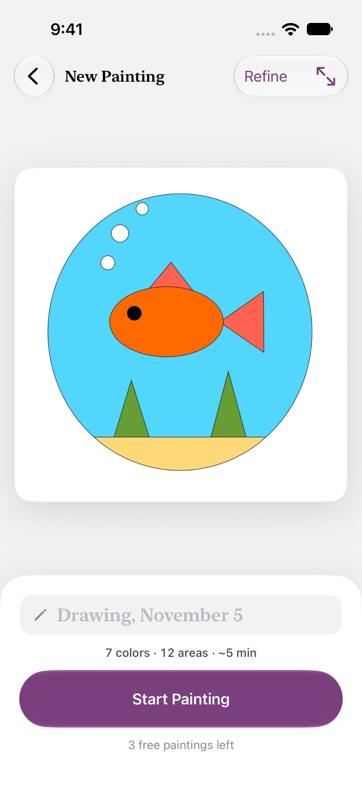
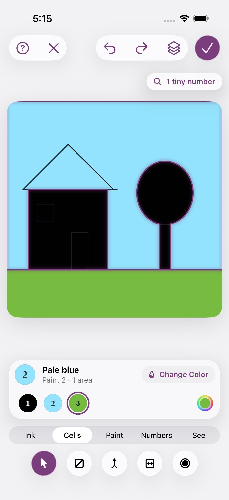
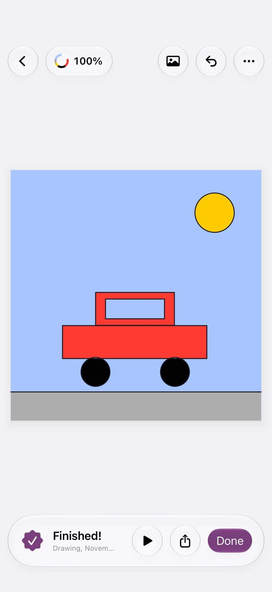
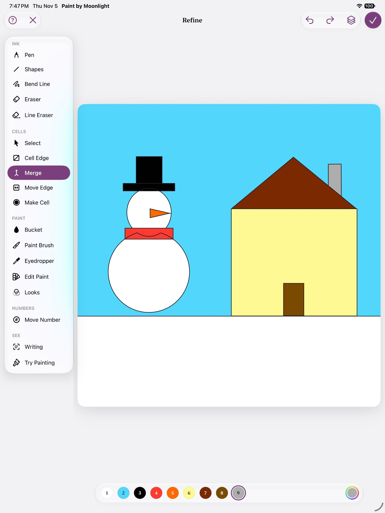
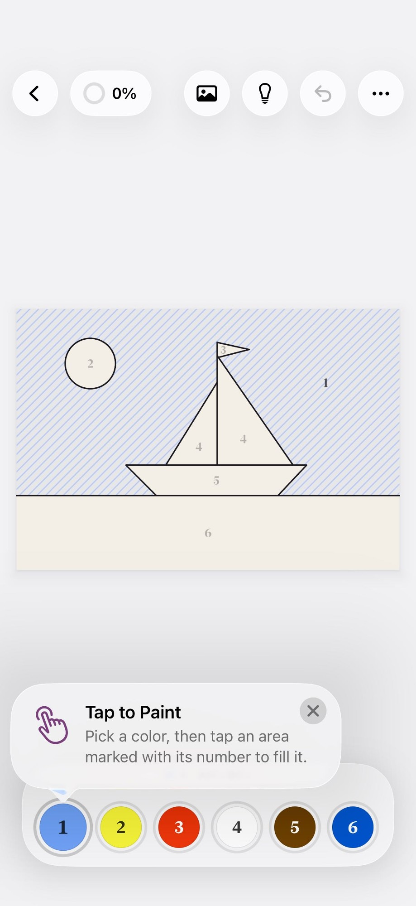
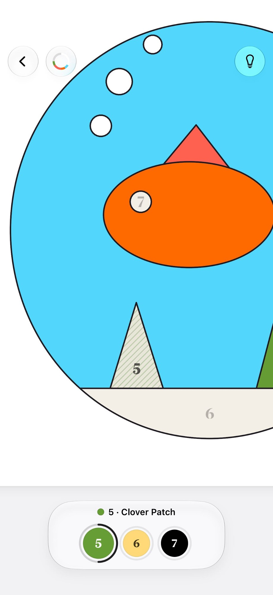
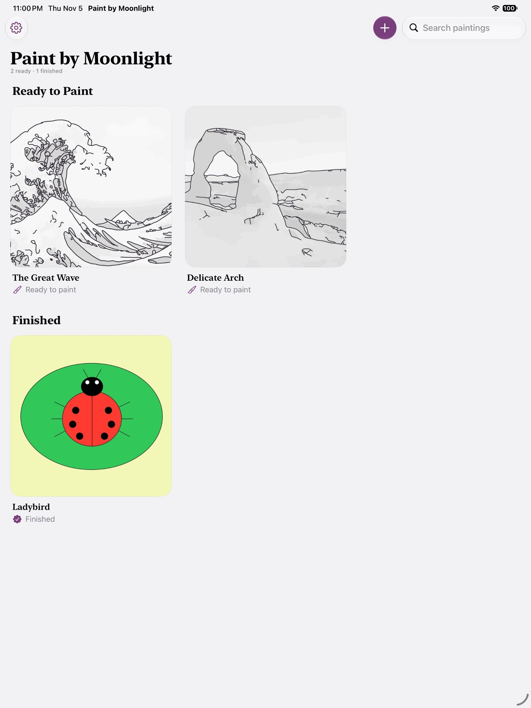

# Agent transcript

- end: error_during_execution, 80 turns, 17.9 min, estimated $2.2532372
- tool calls: {"mcp__maestro__take_screenshot": 35, "Read": 3, "mcp__maestro__run": 33, "mcp__maestro__inspect_screen": 4, "Write": 3}
- images the agent received: 34

**Start**: model claude-opus-5-5, MCP [{"name": "maestro", "status": "connected", "source": "dynamic"}]

→ `mcp__maestro__take_screenshot` `{"device_id": "3593632A-CE78-4177-B6DD-E03EA2DEDFB7"}`

→ `Read` `{"file_path": "/Users/runner/work/_temp/qa/crashes.txt"}`

← mcp__maestro__take_screenshot: image  1500x2000

← Read: <system-reminder>Warning: the file exists but the contents are empty.</system-reminder>

→ `mcp__maestro__run` `{"device_id": "3593632A-CE78-4177-B6DD-E03EA2DEDFB7", "yaml": "appId: com.pbordjadze.paintbynumber\n---\n- tapOn:\n    point: \"72%,4%\"\n- waitForAnimationToEnd"}`

→ `mcp__maestro__take_screenshot` `{"device_id": "3593632A-CE78-4177-B6DD-E03EA2DEDFB7"}`

← mcp__maestro__run: {"success":true,"device_id":"3593632A-CE78-4177-B6DD-E03EA2DEDFB7","commands_executed":3,"message":"Flow executed successfully","env_vars":{"MAESTRO_CLI_ANALYSIS_NOTIFICATION_DISABLED":"true","MAESTRO_CLI_NO_ANALYTICS":"1","MAESTRO_DRIVER_STARTUP_TIMEOUT":"240000","MAESTRO_VERSION":"2.11.0"}}

← mcp__maestro__take_screenshot: image  1500x2000

> Nothing happened. Let me inspect.

→ `mcp__maestro__inspect_screen` `{"device_id": "3593632A-CE78-4177-B6DD-E03EA2DEDFB7"}`

← mcp__maestro__inspect_screen: {"ui_schema":{"platform":"ios","abbreviations":{"b":"bounds","txt":"text","rid":"resource-id","a11y":"accessibilityText","hint":"hintText","val":"value","c":"children"},"defaults":{"enabled":true,"focused":false,"selected":false,"checked":false,"txt":"","hint":"","rid":"","val":"","a11y":""}},"elements":[{"b":"[0,0][1032,1376]","a11y":"Paint by Moonlight","c":[{"b":"[0,0][1032,1376]","c":[{"b":"[0 …

→ `mcp__maestro__run` `{"device_id": "3593632A-CE78-4177-B6DD-E03EA2DEDFB7", "yaml": "appId: com.pbordjadze.paintbynumber\n---\n- tapOn: \"New Painting\"\n- waitForAnimationToEnd"}`

→ `mcp__maestro__take_screenshot` `{"device_id": "3593632A-CE78-4177-B6DD-E03EA2DEDFB7"}`

← mcp__maestro__run: {"success":true,"device_id":"3593632A-CE78-4177-B6DD-E03EA2DEDFB7","commands_executed":3,"message":"Flow executed successfully","env_vars":{"MAESTRO_CLI_ANALYSIS_NOTIFICATION_DISABLED":"true","MAESTRO_CLI_NO_ANALYTICS":"1","MAESTRO_DRIVER_STARTUP_TIMEOUT":"240000","MAESTRO_VERSION":"2.11.0"}}

← mcp__maestro__take_screenshot: image  1500x2000

→ `Read` `{"file_path": "/Users/runner/work/_temp/qa/app.log"}`

← Read: 1	getpwuid_r did not find a match for uid 501
2	Filtering the log data using "subsystem == "com.pbordjadze.paintbynumber""
3	Timestamp               Ty Process[PID:TID]
4	2026-11-03 05:39:27.867 Df PaintByNumber[10699:96d3] [com.pbordjadze.paintbynumber:tips] offer in shelf: , wanted
5	2026-11-03 05:39:29.736 Df PaintByNumber[10699:970a] [com.pbordjadze.paintbynumber:canvas] Making the render cont …

→ `mcp__maestro__take_screenshot` `{"device_id": "3593632A-CE78-4177-B6DD-E03EA2DEDFB7"}`

← mcp__maestro__take_screenshot: image  1500x2000

→ `mcp__maestro__run` `{"device_id": "3593632A-CE78-4177-B6DD-E03EA2DEDFB7", "yaml": "appId: com.pbordjadze.paintbynumber\n---\n- swipe:\n    start: \"78%,85%\"\n    end: \"78%,20%\"\n    duration: 800\n- waitForAnimationToEnd"}`

→ `mcp__maestro__take_screenshot` `{"device_id": "3593632A-CE78-4177-B6DD-E03EA2DEDFB7"}`

← mcp__maestro__run: {"success":true,"device_id":"3593632A-CE78-4177-B6DD-E03EA2DEDFB7","commands_executed":3,"message":"Flow executed successfully","env_vars":{"MAESTRO_CLI_ANALYSIS_NOTIFICATION_DISABLED":"true","MAESTRO_CLI_NO_ANALYTICS":"1","MAESTRO_DRIVER_STARTUP_TIMEOUT":"240000","MAESTRO_VERSION":"2.11.0"}}

← mcp__maestro__take_screenshot: image  1500x2000

→ `mcp__maestro__run` `{"device_id": "3593632A-CE78-4177-B6DD-E03EA2DEDFB7", "yaml": "appId: com.pbordjadze.paintbynumber\n---\n- swipe:\n    start: \"78%,85%\"\n    end: \"78%,30%\"\n    duration: 800\n- waitForAnimationToEnd"}`

→ `mcp__maestro__take_screenshot` `{"device_id": "3593632A-CE78-4177-B6DD-E03EA2DEDFB7"}`

← mcp__maestro__run: {"success":true,"device_id":"3593632A-CE78-4177-B6DD-E03EA2DEDFB7","commands_executed":3,"message":"Flow executed successfully","env_vars":{"MAESTRO_CLI_ANALYSIS_NOTIFICATION_DISABLED":"true","MAESTRO_CLI_NO_ANALYTICS":"1","MAESTRO_DRIVER_STARTUP_TIMEOUT":"240000","MAESTRO_VERSION":"2.11.0"}}

← mcp__maestro__take_screenshot: image  1500x2000

> The New Painting sheet opened several seconds late. I'm choosing the mostly black "Earth" sample as the emptiest starting point.

→ `mcp__maestro__run` `{"device_id": "3593632A-CE78-4177-B6DD-E03EA2DEDFB7", "yaml": "appId: com.pbordjadze.paintbynumber\n---\n- tapOn:\n    point: \"68%,93%\"\n- waitForAnimationToEnd"}`

→ `mcp__maestro__take_screenshot` `{"device_id": "3593632A-CE78-4177-B6DD-E03EA2DEDFB7"}`

← mcp__maestro__run: {"success":true,"device_id":"3593632A-CE78-4177-B6DD-E03EA2DEDFB7","commands_executed":3,"message":"Flow executed successfully","env_vars":{"MAESTRO_CLI_ANALYSIS_NOTIFICATION_DISABLED":"true","MAESTRO_CLI_NO_ANALYTICS":"1","MAESTRO_DRIVER_STARTUP_TIMEOUT":"240000","MAESTRO_VERSION":"2.11.0"}}

← mcp__maestro__take_screenshot: image  1500x2000

→ `mcp__maestro__run` `{"device_id": "3593632A-CE78-4177-B6DD-E03EA2DEDFB7", "yaml": "appId: com.pbordjadze.paintbynumber\n---\n- extendedWaitUntil:\n    notVisible: \"Finding the subject.*\"\n    timeout: 60000\n- tapOn: \"Adjust\"\n- waitForAnimationToEnd"}`

→ `mcp__maestro__take_screenshot` `{"device_id": "3593632A-CE78-4177-B6DD-E03EA2DEDFB7"}`

← mcp__maestro__run (error): Failed to run flow: Element not found: Text matching regex: Adjust

← mcp__maestro__take_screenshot: image  1500x2000

→ `mcp__maestro__run` `{"device_id": "3593632A-CE78-4177-B6DD-E03EA2DEDFB7", "yaml": "appId: com.pbordjadze.paintbynumber\n---\n- tapOn: \"Close\"\n- waitForAnimationToEnd\n- tapOn: \"Adjust\"\n- waitForAnimationToEnd"}`

→ `mcp__maestro__take_screenshot` `{"device_id": "3593632A-CE78-4177-B6DD-E03EA2DEDFB7"}`

← mcp__maestro__run: {"success":true,"device_id":"3593632A-CE78-4177-B6DD-E03EA2DEDFB7","commands_executed":5,"message":"Flow executed successfully","env_vars":{"MAESTRO_CLI_ANALYSIS_NOTIFICATION_DISABLED":"true","MAESTRO_CLI_NO_ANALYTICS":"1","MAESTRO_DRIVER_STARTUP_TIMEOUT":"240000","MAESTRO_VERSION":"2.11.0"}}

← mcp__maestro__take_screenshot: image  1500x2000

→ `mcp__maestro__run` `{"device_id": "3593632A-CE78-4177-B6DD-E03EA2DEDFB7", "yaml": "appId: com.pbordjadze.paintbynumber\n---\n- swipe:\n    start: \"426,1004\"\n    end: \"200,1004\"\n    duration: 800\n- swipe:\n    start: \"674,1076\"\n    end: \"200,1076\"\n    duration: 800\n- waitForAnimationToEnd"}`

← mcp__maestro__run: {"success":true,"device_id":"3593632A-CE78-4177-B6DD-E03EA2DEDFB7","commands_executed":4,"message":"Flow executed successfully","env_vars":{"MAESTRO_CLI_ANALYSIS_NOTIFICATION_DISABLED":"true","MAESTRO_CLI_NO_ANALYTICS":"1","MAESTRO_DRIVER_STARTUP_TIMEOUT":"240000","MAESTRO_VERSION":"2.11.0"}}

→ `mcp__maestro__take_screenshot` `{"device_id": "3593632A-CE78-4177-B6DD-E03EA2DEDFB7"}`

← mcp__maestro__take_screenshot: image  1500x2000

> 6 colors, 10 areas. Now Refine.

→ `mcp__maestro__run` `{"device_id": "3593632A-CE78-4177-B6DD-E03EA2DEDFB7", "yaml": "appId: com.pbordjadze.paintbynumber\n---\n- tapOn: \"Refine\"\n- waitForAnimationToEnd\n- takeScreenshot: /Users/runner/work/_temp/qa/shots/plan-1"}`

→ `mcp__maestro__take_screenshot` `{"device_id": "3593632A-CE78-4177-B6DD-E03EA2DEDFB7"}`

← mcp__maestro__run: {"success":true,"device_id":"3593632A-CE78-4177-B6DD-E03EA2DEDFB7","commands_executed":4,"message":"Flow executed successfully","env_vars":{"MAESTRO_CLI_ANALYSIS_NOTIFICATION_DISABLED":"true","MAESTRO_CLI_NO_ANALYTICS":"1","MAESTRO_DRIVER_STARTUP_TIMEOUT":"240000","MAESTRO_VERSION":"2.11.0"}}

← mcp__maestro__take_screenshot: image  1500x2000

> Refine is open with 10 cells. I'll close the tip and look at the layers button for a way to clear the canvas.

→ `mcp__maestro__run` `{"device_id": "3593632A-CE78-4177-B6DD-E03EA2DEDFB7", "yaml": "appId: com.pbordjadze.paintbynumber\n---\n- tapOn: \"Close\"\n- waitForAnimationToEnd\n- tapOn:\n    point: \"941,54\"\n- waitForAnimationToEnd"}`

→ `mcp__maestro__take_screenshot` `{"device_id": "3593632A-CE78-4177-B6DD-E03EA2DEDFB7"}`

← mcp__maestro__run: {"success":true,"device_id":"3593632A-CE78-4177-B6DD-E03EA2DEDFB7","commands_executed":5,"message":"Flow executed successfully","env_vars":{"MAESTRO_CLI_ANALYSIS_NOTIFICATION_DISABLED":"true","MAESTRO_CLI_NO_ANALYTICS":"1","MAESTRO_DRIVER_STARTUP_TIMEOUT":"240000","MAESTRO_VERSION":"2.11.0"}}

← mcp__maestro__take_screenshot: image  1500x2000

> A "Generated | Blank" switch was hidden behind the tip. I'll close the layers popover and pick Blank.

→ `mcp__maestro__run` `{"device_id": "3593632A-CE78-4177-B6DD-E03EA2DEDFB7", "yaml": "appId: com.pbordjadze.paintbynumber\n---\n- tapOn:\n    point: \"500,60\"\n- waitForAnimationToEnd\n- tapOn: \"Blank\"\n- waitForAnimationToEnd"}`

→ `mcp__maestro__take_screenshot` `{"device_id": "3593632A-CE78-4177-B6DD-E03EA2DEDFB7"}`

← mcp__maestro__run: {"success":true,"device_id":"3593632A-CE78-4177-B6DD-E03EA2DEDFB7","commands_executed":5,"message":"Flow executed successfully","env_vars":{"MAESTRO_CLI_ANALYSIS_NOTIFICATION_DISABLED":"true","MAESTRO_CLI_NO_ANALYTICS":"1","MAESTRO_DRIVER_STARTUP_TIMEOUT":"240000","MAESTRO_VERSION":"2.11.0"}}

← mcp__maestro__take_screenshot: image  1500x2000

> Blank gave a single all-black canvas. Writing an early report before drawing.

→ `Write` `{"file_path": "/Users/runner/work/_temp/qa/report.md", "content": "# Refine: drawing a face from scratch (exploratory session, 2026-11-03)\n\n**Verdict**: In progress.\n\n**What I meant to draw**: A front-facing oval face in peach on a light-blue background, two white eyes with dark pupils, a small brown nose, a red upper lip and a pink lower lip, and a dark-brown cap of hair on top.\n\n## Log so far\n1. Gallery \u203a + : my first tap on + (by point) seemed to do nothing; a second tap by label (\"New Painting\") and the sheet showed only on the screenshot after (about 5\u201310 s late). It wa`

← Write: File created successfully at: /Users/runner/work/_temp/qa/report.md (file state is current in your context — no need to Read it back)

→ `mcp__maestro__run` `{"device_id": "3593632A-CE78-4177-B6DD-E03EA2DEDFB7", "yaml": "appId: com.pbordjadze.paintbynumber\n---\n- tapOn: \"Bucket\"\n- waitForAnimationToEnd\n- takeScreenshot: /Users/runner/work/_temp/qa/shots/plan-2"}`

→ `mcp__maestro__inspect_screen` `{"device_id": "3593632A-CE78-4177-B6DD-E03EA2DEDFB7"}`

← mcp__maestro__run: {"success":true,"device_id":"3593632A-CE78-4177-B6DD-E03EA2DEDFB7","commands_executed":4,"message":"Flow executed successfully","env_vars":{"MAESTRO_CLI_ANALYSIS_NOTIFICATION_DISABLED":"true","MAESTRO_CLI_NO_ANALYTICS":"1","MAESTRO_DRIVER_STARTUP_TIMEOUT":"240000","MAESTRO_VERSION":"2.11.0"}}

← mcp__maestro__inspect_screen: {"ui_schema":{"platform":"ios","abbreviations":{"b":"bounds","txt":"text","rid":"resource-id","a11y":"accessibilityText","hint":"hintText","val":"value","c":"children"},"defaults":{"enabled":true,"focused":false,"selected":false,"checked":false,"txt":"","hint":"","rid":"","val":"","a11y":""}},"elements":[{"b":"[0,0][1032,1376]","a11y":"Paint by Moonlight","c":[{"b":"[0,0][1032,1376]","c":[{"b":"[0 …

> The palette has only "1 · Black". I'll add a new paint for the background.

→ `mcp__maestro__run` `{"device_id": "3593632A-CE78-4177-B6DD-E03EA2DEDFB7", "yaml": "appId: com.pbordjadze.paintbynumber\n---\n- tapOn:\n    id: \"refine-palette-new\"\n- waitForAnimationToEnd"}`

→ `mcp__maestro__take_screenshot` `{"device_id": "3593632A-CE78-4177-B6DD-E03EA2DEDFB7"}`

← mcp__maestro__run: {"success":true,"device_id":"3593632A-CE78-4177-B6DD-E03EA2DEDFB7","commands_executed":3,"message":"Flow executed successfully","env_vars":{"MAESTRO_CLI_ANALYSIS_NOTIFICATION_DISABLED":"true","MAESTRO_CLI_NO_ANALYTICS":"1","MAESTRO_DRIVER_STARTUP_TIMEOUT":"240000","MAESTRO_VERSION":"2.11.0"}}

← mcp__maestro__take_screenshot: image  1500x2000

→ `mcp__maestro__inspect_screen` `{"device_id": "3593632A-CE78-4177-B6DD-E03EA2DEDFB7"}`

← mcp__maestro__inspect_screen: {"ui_schema":{"platform":"ios","abbreviations":{"b":"bounds","txt":"text","rid":"resource-id","a11y":"accessibilityText","hint":"hintText","val":"value","c":"children"},"defaults":{"enabled":true,"focused":false,"selected":false,"checked":false,"txt":"","hint":"","rid":"","val":"","a11y":""}},"elements":[{"b":"[0,0][1032,1376]","a11y":"Paint by Moonlight","c":[{"b":"[0,0][1032,1376]","c":[{"b":"[0 …

→ `mcp__maestro__take_screenshot` `{"device_id": "3593632A-CE78-4177-B6DD-E03EA2DEDFB7"}`

← mcp__maestro__take_screenshot: image  1500x2000

→ `Read` `{"file_path": "/Users/runner/work/_temp/qa/app.log", "offset": 12}`

← Read: 12	2026-11-03 05:44:15.195 Df PaintByNumber[10699:96d3] [com.pbordjadze.paintbynumber:tips] offer in newPainting: newPaintingSamples, wanted
13	2026-11-03 05:45:58.262 Df PaintByNumber[10699:96d3] [com.pbordjadze.paintbynumber:create] Draft #1 started for 20 colors, detail 0.83, lines 0.5 [adjusting false, full under way false, final false, phase generating]
14	2026-11-03 05:45:59.090 Df PaintByNu …

→ `mcp__maestro__run` `{"device_id": "3593632A-CE78-4177-B6DD-E03EA2DEDFB7", "yaml": "appId: com.pbordjadze.paintbynumber\n---\n- tapOn:\n    point: \"944,1322\"\n- waitForAnimationToEnd"}`

→ `mcp__maestro__take_screenshot` `{"device_id": "3593632A-CE78-4177-B6DD-E03EA2DEDFB7"}`

← mcp__maestro__run: {"success":true,"device_id":"3593632A-CE78-4177-B6DD-E03EA2DEDFB7","commands_executed":3,"message":"Flow executed successfully","env_vars":{"MAESTRO_CLI_ANALYSIS_NOTIFICATION_DISABLED":"true","MAESTRO_CLI_NO_ANALYTICS":"1","MAESTRO_DRIVER_STARTUP_TIMEOUT":"240000","MAESTRO_VERSION":"2.11.0"}}

← mcp__maestro__take_screenshot: image  1500x2000

> The color picker opened on my second tap (point), not the first (by id). Picking a light blue.

→ `mcp__maestro__run` `{"device_id": "3593632A-CE78-4177-B6DD-E03EA2DEDFB7", "yaml": "appId: com.pbordjadze.paintbynumber\n---\n- tapOn:\n    point: \"668,1115\"\n- waitForAnimationToEnd"}`

→ `mcp__maestro__take_screenshot` `{"device_id": "3593632A-CE78-4177-B6DD-E03EA2DEDFB7"}`

← mcp__maestro__run: {"success":true,"device_id":"3593632A-CE78-4177-B6DD-E03EA2DEDFB7","commands_executed":3,"message":"Flow executed successfully","env_vars":{"MAESTRO_CLI_ANALYSIS_NOTIFICATION_DISABLED":"true","MAESTRO_CLI_NO_ANALYTICS":"1","MAESTRO_DRIVER_STARTUP_TIMEOUT":"240000","MAESTRO_VERSION":"2.11.0"}}

← mcp__maestro__take_screenshot: image  1500x2000

> A light-blue swatch was added. Closing the picker and pouring it on the canvas.

→ `mcp__maestro__run` `{"device_id": "3593632A-CE78-4177-B6DD-E03EA2DEDFB7", "yaml": "appId: com.pbordjadze.paintbynumber\n---\n- tapOn:\n    point: \"600,180\"\n- waitForAnimationToEnd\n- tapOn:\n    point: \"400,400\"\n- waitForAnimationToEnd"}`

→ `mcp__maestro__take_screenshot` `{"device_id": "3593632A-CE78-4177-B6DD-E03EA2DEDFB7"}`

← mcp__maestro__run: {"success":true,"device_id":"3593632A-CE78-4177-B6DD-E03EA2DEDFB7","commands_executed":5,"message":"Flow executed successfully","env_vars":{"MAESTRO_CLI_ANALYSIS_NOTIFICATION_DISABLED":"true","MAESTRO_CLI_NO_ANALYTICS":"1","MAESTRO_DRIVER_STARTUP_TIMEOUT":"240000","MAESTRO_VERSION":"2.11.0"}}

← mcp__maestro__take_screenshot: image  1500x2000

> Background is light blue (black left the palette, as designed). Now the Shapes tool, to see if it offers an ellipse for the head.

→ `mcp__maestro__run` `{"device_id": "3593632A-CE78-4177-B6DD-E03EA2DEDFB7", "yaml": "appId: com.pbordjadze.paintbynumber\n---\n- tapOn:\n    id: \"refine-tool-shapes\"\n- waitForAnimationToEnd"}`

→ `mcp__maestro__take_screenshot` `{"device_id": "3593632A-CE78-4177-B6DD-E03EA2DEDFB7"}`

← mcp__maestro__run: {"success":true,"device_id":"3593632A-CE78-4177-B6DD-E03EA2DEDFB7","commands_executed":3,"message":"Flow executed successfully","env_vars":{"MAESTRO_CLI_ANALYSIS_NOTIFICATION_DISABLED":"true","MAESTRO_CLI_NO_ANALYTICS":"1","MAESTRO_DRIVER_STARTUP_TIMEOUT":"240000","MAESTRO_VERSION":"2.11.0"}}

← mcp__maestro__take_screenshot: image  1500x2000

> Shapes offers line, rectangle, ellipse, curve(?), polygon, star. Drawing the head as an ellipse.

→ `mcp__maestro__run` `{"device_id": "3593632A-CE78-4177-B6DD-E03EA2DEDFB7", "yaml": "appId: com.pbordjadze.paintbynumber\n---\n- tapOn:\n    point: \"434,1322\"\n- waitForAnimationToEnd\n- swipe:\n    start: \"424,430\"\n    end: \"804,1010\"\n    duration: 1000\n- waitForAnimationToEnd\n- takeScreenshot: /Users/runner/work/_temp/qa/shots/plan-3"}`

→ `mcp__maestro__take_screenshot` `{"device_id": "3593632A-CE78-4177-B6DD-E03EA2DEDFB7"}`

← mcp__maestro__run: {"success":true,"device_id":"3593632A-CE78-4177-B6DD-E03EA2DEDFB7","commands_executed":6,"message":"Flow executed successfully","env_vars":{"MAESTRO_CLI_ANALYSIS_NOTIFICATION_DISABLED":"true","MAESTRO_CLI_NO_ANALYTICS":"1","MAESTRO_DRIVER_STARTUP_TIMEOUT":"240000","MAESTRO_VERSION":"2.11.0"}}

← mcp__maestro__take_screenshot: image  1500x2000

> Head ellipse drawn exactly where I dragged (1 try). Now two eyes as ellipses.

→ `mcp__maestro__run` `{"device_id": "3593632A-CE78-4177-B6DD-E03EA2DEDFB7", "yaml": "appId: com.pbordjadze.paintbynumber\n---\n- swipe:\n    start: \"515,615\"\n    end: \"585,665\"\n    duration: 800\n- waitForAnimationToEnd\n- swipe:\n    start: \"640,615\"\n    end: \"710,665\"\n    duration: 800\n- waitForAnimationToEnd"}`

→ `mcp__maestro__take_screenshot` `{"device_id": "3593632A-CE78-4177-B6DD-E03EA2DEDFB7"}`

← mcp__maestro__run: {"success":true,"device_id":"3593632A-CE78-4177-B6DD-E03EA2DEDFB7","commands_executed":5,"message":"Flow executed successfully","env_vars":{"MAESTRO_CLI_ANALYSIS_NOTIFICATION_DISABLED":"true","MAESTRO_CLI_NO_ANALYTICS":"1","MAESTRO_DRIVER_STARTUP_TIMEOUT":"240000","MAESTRO_VERSION":"2.11.0"}}

← mcp__maestro__take_screenshot: image  1500x2000

> Eyes good. Adding pupils (small ellipses) and a triangular nose with three lines.

→ `mcp__maestro__run` `{"device_id": "3593632A-CE78-4177-B6DD-E03EA2DEDFB7", "yaml": "appId: com.pbordjadze.paintbynumber\n---\n- swipe:\n    start: \"538,628\"\n    end: \"562,652\"\n    duration: 800\n- waitForAnimationToEnd\n- swipe:\n    start: \"663,628\"\n    end: \"687,652\"\n    duration: 800\n- waitForAnimationToEnd\n- tapOn:\n    point: \"322,1322\"\n- waitForAnimationToEnd\n- swipe:\n    start: \"612,700\"\n    end: \"592,775\"\n    duration: 800\n- waitForAnimationToEnd\n- swipe:\n    start: \"592,775\"\n    end: \"634,775\"\n    duration: 800\n- waitForAnimationToEnd\n- swipe:\n    start: \"634,775\"\n `

→ `mcp__maestro__take_screenshot` `{"device_id": "3593632A-CE78-4177-B6DD-E03EA2DEDFB7"}`

← mcp__maestro__run: {"success":true,"device_id":"3593632A-CE78-4177-B6DD-E03EA2DEDFB7","commands_executed":13,"message":"Flow executed successfully","env_vars":{"MAESTRO_CLI_ANALYSIS_NOTIFICATION_DISABLED":"true","MAESTRO_CLI_NO_ANALYTICS":"1","MAESTRO_DRIVER_STARTUP_TIMEOUT":"240000","MAESTRO_VERSION":"2.11.0"}}

← mcp__maestro__take_screenshot: image  1500x2000

> Pupils and nose done in 1 try each. Now the mouth with the Pen, as separate short strokes: upper lip outline, middle line, lower lip outline.

→ `mcp__maestro__run` `{"device_id": "3593632A-CE78-4177-B6DD-E03EA2DEDFB7", "yaml": "appId: com.pbordjadze.paintbynumber\n---\n- tapOn:\n    id: \"refine-tool-pen\"\n- waitForAnimationToEnd\n- swipe:\n    start: \"565,860\"\n    end: \"590,843\"\n    duration: 600\n- swipe:\n    start: \"590,843\"\n    end: \"612,852\"\n    duration: 600\n- swipe:\n    start: \"612,852\"\n    end: \"635,843\"\n    duration: 600\n- swipe:\n    start: \"635,843\"\n    end: \"660,860\"\n    duration: 600\n- swipe:\n    start: \"565,860\"\n    end: \"660,860\"\n    duration: 800\n- swipe:\n    start: \"565,860\"\n    end: \"592,882\"\n`

→ `mcp__maestro__take_screenshot` `{"device_id": "3593632A-CE78-4177-B6DD-E03EA2DEDFB7"}`

← mcp__maestro__run: {"success":true,"device_id":"3593632A-CE78-4177-B6DD-E03EA2DEDFB7","commands_executed":13,"message":"Flow executed successfully","env_vars":{"MAESTRO_CLI_ANALYSIS_NOTIFICATION_DISABLED":"true","MAESTRO_CLI_NO_ANALYTICS":"1","MAESTRO_DRIVER_STARTUP_TIMEOUT":"240000","MAESTRO_VERSION":"2.11.0"}}

← mcp__maestro__take_screenshot: image  1500x2000

→ `mcp__maestro__run` `{"device_id": "3593632A-CE78-4177-B6DD-E03EA2DEDFB7", "yaml": "appId: com.pbordjadze.paintbynumber\n---\n- swipe:\n    start: \"452,565\"\n    end: \"500,540\"\n    duration: 600\n- swipe:\n    start: \"500,540\"\n    end: \"550,556\"\n    duration: 600\n- swipe:\n    start: \"550,556\"\n    end: \"612,535\"\n    duration: 600\n- swipe:\n    start: \"612,535\"\n    end: \"675,556\"\n    duration: 600\n- swipe:\n    start: \"675,556\"\n    end: \"725,540\"\n    duration: 600\n- swipe:\n    start: \"725,540\"\n    end: \"772,565\"\n    duration: 600\n- swipe:\n    start: \"452,565\"\n    end: \"`

→ `mcp__maestro__take_screenshot` `{"device_id": "3593632A-CE78-4177-B6DD-E03EA2DEDFB7"}`

← mcp__maestro__run: {"success":true,"device_id":"3593632A-CE78-4177-B6DD-E03EA2DEDFB7","commands_executed":16,"message":"Flow executed successfully","env_vars":{"MAESTRO_CLI_ANALYSIS_NOTIFICATION_DISABLED":"true","MAESTRO_CLI_NO_ANALYTICS":"1","MAESTRO_DRIVER_STARTUP_TIMEOUT":"240000","MAESTRO_VERSION":"2.11.0"}}

← mcp__maestro__take_screenshot: image  1500x2000

> The hair outline closed (1 try). The polyline corners show, since only straight strokes are possible. Updating the report before I color.

→ `Write` `{"file_path": "/Users/runner/work/_temp/qa/report.md", "content": "# Refine: drawing a face from scratch (exploratory session, 2026-11-03)\n\n**Verdict**: In progress. The line drawing is done, coloring is next.\n\n**What I meant to draw**: A front-facing oval face in peach on a light-blue background, two white eyes with dark pupils, a small brown nose, a red upper lip and a pink lower lip, and a dark-brown cap of hair on top.\n\n## Log so far\n1. Gallery \u203a + : my first tap on + (by point) seemed to do nothing. A second tap by label (\"New Painting\") worked, but the sheet showed only a s`

← Write: The file /Users/runner/work/_temp/qa/report.md has been updated successfully. (file state is current in your context — no need to Read it back)

> Merging the two hair cells: Merge tool, dragging from the inner cap to the outer band.

→ `mcp__maestro__run` `{"device_id": "3593632A-CE78-4177-B6DD-E03EA2DEDFB7", "yaml": "appId: com.pbordjadze.paintbynumber\n---\n- tapOn:\n    id: \"refine-tool-merge\"\n- waitForAnimationToEnd\n- swipe:\n    start: \"612,490\"\n    end: \"612,405\"\n    duration: 800\n- waitForAnimationToEnd"}`

→ `mcp__maestro__take_screenshot` `{"device_id": "3593632A-CE78-4177-B6DD-E03EA2DEDFB7"}`

← mcp__maestro__run: {"success":true,"device_id":"3593632A-CE78-4177-B6DD-E03EA2DEDFB7","commands_executed":5,"message":"Flow executed successfully","env_vars":{"MAESTRO_CLI_ANALYSIS_NOTIFICATION_DISABLED":"true","MAESTRO_CLI_NO_ANALYTICS":"1","MAESTRO_DRIVER_STARTUP_TIMEOUT":"240000","MAESTRO_VERSION":"2.11.0"}}

← mcp__maestro__take_screenshot: image  1500x2000

> Merge removed the whole head ellipse, not just the arc between the two hair cells, so the face is now open to the background. Undoing, and checking it happened.

→ `mcp__maestro__run` `{"device_id": "3593632A-CE78-4177-B6DD-E03EA2DEDFB7", "yaml": "appId: com.pbordjadze.paintbynumber\n---\n- takeScreenshot: /Users/runner/work/_temp/qa/shots/merge-erased-head\n- tapOn:\n    id: \"refine-undo\"\n- waitForAnimationToEnd"}`

→ `mcp__maestro__take_screenshot` `{"device_id": "3593632A-CE78-4177-B6DD-E03EA2DEDFB7"}`

← mcp__maestro__run: {"success":true,"device_id":"3593632A-CE78-4177-B6DD-E03EA2DEDFB7","commands_executed":4,"message":"Flow executed successfully","env_vars":{"MAESTRO_CLI_ANALYSIS_NOTIFICATION_DISABLED":"true","MAESTRO_CLI_NO_ANALYTICS":"1","MAESTRO_DRIVER_STARTUP_TIMEOUT":"240000","MAESTRO_VERSION":"2.11.0"}}

← mcp__maestro__take_screenshot: image  1500x2000

> Undo brought the head line back. Repeating the merge once more to confirm, then undoing.

→ `mcp__maestro__run` `{"device_id": "3593632A-CE78-4177-B6DD-E03EA2DEDFB7", "yaml": "appId: com.pbordjadze.paintbynumber\n---\n- swipe:\n    start: \"500,450\"\n    end: \"455,470\"\n    duration: 800\n- waitForAnimationToEnd\n- takeScreenshot: /Users/runner/work/_temp/qa/shots/merge-erased-head-2"}`

→ `mcp__maestro__take_screenshot` `{"device_id": "3593632A-CE78-4177-B6DD-E03EA2DEDFB7"}`

← mcp__maestro__run: {"success":true,"device_id":"3593632A-CE78-4177-B6DD-E03EA2DEDFB7","commands_executed":4,"message":"Flow executed successfully","env_vars":{"MAESTRO_CLI_ANALYSIS_NOTIFICATION_DISABLED":"true","MAESTRO_CLI_NO_ANALYTICS":"1","MAESTRO_DRIVER_STARTUP_TIMEOUT":"240000","MAESTRO_VERSION":"2.11.0"}}

← mcp__maestro__take_screenshot: image  1500x2000

> That swipe stayed inside a single cell (my mistake). Trying the repro properly: cap (612,470) to band (612,400).

→ `mcp__maestro__run` `{"device_id": "3593632A-CE78-4177-B6DD-E03EA2DEDFB7", "yaml": "appId: com.pbordjadze.paintbynumber\n---\n- swipe:\n    start: \"612,470\"\n    end: \"612,400\"\n    duration: 800\n- waitForAnimationToEnd\n- takeScreenshot: /Users/runner/work/_temp/qa/shots/merge-erased-head-2"}`

→ `mcp__maestro__take_screenshot` `{"device_id": "3593632A-CE78-4177-B6DD-E03EA2DEDFB7"}`

← mcp__maestro__run: {"success":true,"device_id":"3593632A-CE78-4177-B6DD-E03EA2DEDFB7","commands_executed":4,"message":"Flow executed successfully","env_vars":{"MAESTRO_CLI_ANALYSIS_NOTIFICATION_DISABLED":"true","MAESTRO_CLI_NO_ANALYTICS":"1","MAESTRO_DRIVER_STARTUP_TIMEOUT":"240000","MAESTRO_VERSION":"2.11.0"}}

← mcp__maestro__take_screenshot: image  1500x2000

> Reproduced (2 of 2). Undoing. Next I'll color the face first, then retry Merge to see whether different paints on either side keep the head line.

→ `mcp__maestro__run` `{"device_id": "3593632A-CE78-4177-B6DD-E03EA2DEDFB7", "yaml": "appId: com.pbordjadze.paintbynumber\n---\n- tapOn:\n    id: \"refine-undo\"\n- waitForAnimationToEnd\n- tapOn:\n    id: \"refine-tool-bucket\"\n- waitForAnimationToEnd\n- tapOn:\n    point: \"944,1322\"\n- waitForAnimationToEnd"}`

→ `mcp__maestro__take_screenshot` `{"device_id": "3593632A-CE78-4177-B6DD-E03EA2DEDFB7"}`

← mcp__maestro__run: {"success":true,"device_id":"3593632A-CE78-4177-B6DD-E03EA2DEDFB7","commands_executed":7,"message":"Flow executed successfully","env_vars":{"MAESTRO_CLI_ANALYSIS_NOTIFICATION_DISABLED":"true","MAESTRO_CLI_NO_ANALYTICS":"1","MAESTRO_DRIVER_STARTUP_TIMEOUT":"240000","MAESTRO_VERSION":"2.11.0"}}

← mcp__maestro__take_screenshot: image  1500x2000

> Picker opened on the first tap by point this time. Picking peach and pouring it on the face.

→ `mcp__maestro__run` `{"device_id": "3593632A-CE78-4177-B6DD-E03EA2DEDFB7", "yaml": "appId: com.pbordjadze.paintbynumber\n---\n- tapOn:\n    point: \"840,1115\"\n- waitForAnimationToEnd\n- tapOn:\n    point: \"600,180\"\n- waitForAnimationToEnd\n- tapOn:\n    point: \"530,700\"\n- waitForAnimationToEnd"}`

→ `mcp__maestro__take_screenshot` `{"device_id": "3593632A-CE78-4177-B6DD-E03EA2DEDFB7"}`

← mcp__maestro__run: {"success":true,"device_id":"3593632A-CE78-4177-B6DD-E03EA2DEDFB7","commands_executed":7,"message":"Flow executed successfully","env_vars":{"MAESTRO_CLI_ANALYSIS_NOTIFICATION_DISABLED":"true","MAESTRO_CLI_NO_ANALYTICS":"1","MAESTRO_DRIVER_STARTUP_TIMEOUT":"240000","MAESTRO_VERSION":"2.11.0"}}

← mcp__maestro__take_screenshot: image  1500x2000

> The pour painted the face and also the hair cap above the zigzag hairline. So the hairline probably doesn't close against the head outline. Turning on Numbers in Layers to see the cells.

→ `mcp__maestro__run` `{"device_id": "3593632A-CE78-4177-B6DD-E03EA2DEDFB7", "yaml": "appId: com.pbordjadze.paintbynumber\n---\n- tapOn:\n    id: \"refine-layers\"\n- waitForAnimationToEnd\n- tapOn:\n    point: \"962,128\"\n- waitForAnimationToEnd\n- tapOn:\n    point: \"600,180\"\n- waitForAnimationToEnd"}`

→ `mcp__maestro__take_screenshot` `{"device_id": "3593632A-CE78-4177-B6DD-E03EA2DEDFB7"}`

← mcp__maestro__run: {"success":true,"device_id":"3593632A-CE78-4177-B6DD-E03EA2DEDFB7","commands_executed":7,"message":"Flow executed successfully","env_vars":{"MAESTRO_CLI_ANALYSIS_NOTIFICATION_DISABLED":"true","MAESTRO_CLI_NO_ANALYTICS":"1","MAESTRO_DRIVER_STARTUP_TIMEOUT":"240000","MAESTRO_VERSION":"2.11.0"}}

← mcp__maestro__take_screenshot: image  1500x2000

→ `mcp__maestro__run` `{"device_id": "3593632A-CE78-4177-B6DD-E03EA2DEDFB7", "yaml": "appId: com.pbordjadze.paintbynumber\n---\n- takeScreenshot: /Users/runner/work/_temp/qa/shots/pen-strokes-not-cells\n- tapOn:\n    id: \"refine-tool-fill\"\n- waitForAnimationToEnd"}`

→ `mcp__maestro__take_screenshot` `{"device_id": "3593632A-CE78-4177-B6DD-E03EA2DEDFB7"}`

← mcp__maestro__run: {"success":true,"device_id":"3593632A-CE78-4177-B6DD-E03EA2DEDFB7","commands_executed":4,"message":"Flow executed successfully","env_vars":{"MAESTRO_CLI_ANALYSIS_NOTIFICATION_DISABLED":"true","MAESTRO_CLI_NO_ANALYTICS":"1","MAESTRO_DRIVER_STARTUP_TIMEOUT":"240000","MAESTRO_VERSION":"2.11.0"}}

← mcp__maestro__take_screenshot: image  1500x2000

> Make Cell selected (no palette or hint shown). Tapping inside the lower lip.

→ `mcp__maestro__run` `{"device_id": "3593632A-CE78-4177-B6DD-E03EA2DEDFB7", "yaml": "appId: com.pbordjadze.paintbynumber\n---\n- tapOn:\n    point: \"612,871\"\n- waitForAnimationToEnd"}`

→ `mcp__maestro__take_screenshot` `{"device_id": "3593632A-CE78-4177-B6DD-E03EA2DEDFB7"}`

← mcp__maestro__run: {"success":true,"device_id":"3593632A-CE78-4177-B6DD-E03EA2DEDFB7","commands_executed":3,"message":"Flow executed successfully","env_vars":{"MAESTRO_CLI_ANALYSIS_NOTIFICATION_DISABLED":"true","MAESTRO_CLI_NO_ANALYTICS":"1","MAESTRO_DRIVER_STARTUP_TIMEOUT":"240000","MAESTRO_VERSION":"2.11.0"}}

← mcp__maestro__take_screenshot: image  1500x2000

> The whole face turned black after the Make Cell tap, and the palette is gone. Inspecting.

→ `mcp__maestro__inspect_screen` `{"device_id": "3593632A-CE78-4177-B6DD-E03EA2DEDFB7"}`

← mcp__maestro__inspect_screen: {"ui_schema":{"platform":"ios","abbreviations":{"b":"bounds","txt":"text","rid":"resource-id","a11y":"accessibilityText","hint":"hintText","val":"value","c":"children"},"defaults":{"enabled":true,"focused":false,"selected":false,"checked":false,"txt":"","hint":"","rid":"","val":"","a11y":""}},"elements":[{"b":"[0,0][1032,1376]","a11y":"Paint by Moonlight","c":[{"b":"[0,0][1032,1376]","c":[{"b":"[0 …

> Make Cell filled the whole face cell with black ink and the palette disappeared. Time is short, so I'll undo, save the final Refine shot, and finish.

→ `mcp__maestro__run` `{"device_id": "3593632A-CE78-4177-B6DD-E03EA2DEDFB7", "yaml": "appId: com.pbordjadze.paintbynumber\n---\n- takeScreenshot: /Users/runner/work/_temp/qa/shots/make-cell-black\n- tapOn:\n    id: \"refine-undo\"\n- waitForAnimationToEnd\n- takeScreenshot: /Users/runner/work/_temp/qa/shots/final-refine\n- tapOn:\n    id: \"refine-done\"\n- waitForAnimationToEnd"}`

→ `mcp__maestro__take_screenshot` `{"device_id": "3593632A-CE78-4177-B6DD-E03EA2DEDFB7"}`

← mcp__maestro__run: {"success":true,"device_id":"3593632A-CE78-4177-B6DD-E03EA2DEDFB7","commands_executed":7,"message":"Flow executed successfully","env_vars":{"MAESTRO_CLI_ANALYSIS_NOTIFICATION_DISABLED":"true","MAESTRO_CLI_NO_ANALYTICS":"1","MAESTRO_DRIVER_STARTUP_TIMEOUT":"240000","MAESTRO_VERSION":"2.11.0"}}

← mcp__maestro__take_screenshot: image  1500x2000

> Back on the preview: "2 colors · 7 areas" (background, face, 2 eyes, 2 pupils, nose). The lips and hair are not areas. Writing the report now.

→ `Write` `{"file_path": "/Users/runner/work/_temp/qa/report.md", "content": "# Refine: drawing a face from scratch (exploratory session, 2026-11-03)\n\n**Verdict**: Partly. The line drawing looks like the face I planned, but as a paint-by-numbers picture it isn't one: the mouth and the hair, both drawn with separate Pen strokes, never became areas. I didn't finish coloring and didn't get to paint it on the painting screen.\n\n**What I meant to draw**: A front-facing oval face in peach on a light-blue background, two white eyes with dark pupils, a small brown nose, a red upper lip and a pink lower lip, a`

← Write: The file /Users/runner/work/_temp/qa/report.md has been updated successfully. (file state is current in your context — no need to Read it back)

> Trying to reach the painting screen in the time left.

→ `mcp__maestro__run` `{"device_id": "3593632A-CE78-4177-B6DD-E03EA2DEDFB7", "yaml": "appId: com.pbordjadze.paintbynumber\n---\n- tapOn: \"Start Painting\"\n- extendedWaitUntil:\n    visible:\n      id: \"quiet-ring|Back\"\n    timeout: 60000\n- waitForAnimationToEnd\n- takeScreenshot: /Users/runner/work/_temp/qa/shots/final-template"}`

→ `mcp__maestro__take_screenshot` `{"device_id": "3593632A-CE78-4177-B6DD-E03EA2DEDFB7"}`

← mcp__maestro__run (error): The user doesn't want to proceed with this tool use. The tool use was rejected (eg. if it was a file edit, the new_string was NOT written to the file). STOP what you are doing and wait for the user to tell you how to proceed.

← mcp__maestro__take_screenshot (error): The user doesn't want to proceed with this tool use. The tool use was rejected (eg. if it was a file edit, the new_string was NOT written to the file). STOP what you are doing and wait for the user to tell you how to proceed.
