# Agent transcript

- end: success, 212 turns, 29.8 min, estimated $6.8835066
- tool calls: {"mcp__maestro__take_screenshot": 74, "Read": 28, "mcp__maestro__run": 84, "mcp__maestro__inspect_screen": 20, "Write": 5}
- images the agent received: 74

**Start**: model claude-opus-5-5, MCP [{"name": "maestro", "status": "connected", "source": "dynamic"}]

→ `mcp__maestro__take_screenshot` `{"device_id": "715C5E8F-B843-4B4F-B511-8F6A22D3DBE6"}`

→ `Read` `{"file_path": "/Users/runner/work/_temp/qa/app.log"}`

← mcp__maestro__take_screenshot: image  919x2000

← Read: 1	getpwuid_r did not find a match for uid 501
2	Filtering the log data using "subsystem == "com.pbordjadze.paintbynumber""
3	Timestamp               Ty Process[PID:TID]
4	2026-11-06 05:22:48.890 Df PaintByNumber[29695:14454] [com.pbordjadze.paintbynumber:tips] offer in shelf: , wanted
5	2026-11-06 05:22:50.402 Df PaintByNumber[29695:14531] [com.pbordjadze.paintbynumber:canvas] Making the render co …

→ `mcp__maestro__run` `{"device_id": "715C5E8F-B843-4B4F-B511-8F6A22D3DBE6", "yaml": "appId: com.pbordjadze.paintbynumber\n---\n- takeScreenshot: /Users/runner/work/_temp/qa/shots/gallery-first\n- tapOn: \"The Great Wave\"\n- waitForAnimationToEnd"}`

→ `mcp__maestro__take_screenshot` `{"device_id": "715C5E8F-B843-4B4F-B511-8F6A22D3DBE6"}`

← mcp__maestro__run: {"success":true,"device_id":"715C5E8F-B843-4B4F-B511-8F6A22D3DBE6","commands_executed":4,"message":"Flow executed successfully","env_vars":{"MAESTRO_CLI_ANALYSIS_NOTIFICATION_DISABLED":"true","MAESTRO_CLI_NO_ANALYTICS":"1","MAESTRO_DRIVER_STARTUP_TIMEOUT":"240000","MAESTRO_VERSION":"2.11.0"}}

← mcp__maestro__take_screenshot: image  919x2000

> Tip 1 appeared. Saving it, then looking again after a few seconds.

→ `mcp__maestro__run` `{"device_id": "715C5E8F-B843-4B4F-B511-8F6A22D3DBE6", "yaml": "appId: com.pbordjadze.paintbynumber\n---\n- takeScreenshot: /Users/runner/work/_temp/qa/shots/tip-1-tap-to-paint"}`

← mcp__maestro__run: {"success":true,"device_id":"715C5E8F-B843-4B4F-B511-8F6A22D3DBE6","commands_executed":2,"message":"Flow executed successfully","env_vars":{"MAESTRO_CLI_ANALYSIS_NOTIFICATION_DISABLED":"true","MAESTRO_CLI_NO_ANALYTICS":"1","MAESTRO_DRIVER_STARTUP_TIMEOUT":"240000","MAESTRO_VERSION":"2.11.0"}}

→ `mcp__maestro__inspect_screen` `{"device_id": "715C5E8F-B843-4B4F-B511-8F6A22D3DBE6"}`

← mcp__maestro__inspect_screen: {"ui_schema":{"platform":"ios","abbreviations":{"b":"bounds","txt":"text","rid":"resource-id","a11y":"accessibilityText","hint":"hintText","val":"value","c":"children"},"defaults":{"enabled":true,"focused":false,"selected":false,"checked":false,"txt":"","hint":"","rid":"","val":"","a11y":""}},"elements":[{"b":"[0,0][402,874]","a11y":"Paint by Moonlight","c":[{"b":"[0,0][402,874]","c":[{"b":"[0,0][ …

→ `mcp__maestro__take_screenshot` `{"device_id": "715C5E8F-B843-4B4F-B511-8F6A22D3DBE6"}`

← mcp__maestro__take_screenshot: image  919x2000

→ `mcp__maestro__run` `{"device_id": "715C5E8F-B843-4B4F-B511-8F6A22D3DBE6", "yaml": "appId: com.pbordjadze.paintbynumber\n---\n- tapOn:\n    id: \"xmark.circle.fill\""}`

→ `mcp__maestro__inspect_screen` `{"device_id": "715C5E8F-B843-4B4F-B511-8F6A22D3DBE6"}`

← mcp__maestro__run: {"success":true,"device_id":"715C5E8F-B843-4B4F-B511-8F6A22D3DBE6","commands_executed":2,"message":"Flow executed successfully","env_vars":{"MAESTRO_CLI_ANALYSIS_NOTIFICATION_DISABLED":"true","MAESTRO_CLI_NO_ANALYTICS":"1","MAESTRO_DRIVER_STARTUP_TIMEOUT":"240000","MAESTRO_VERSION":"2.11.0"}}

← mcp__maestro__inspect_screen: {"ui_schema":{"platform":"ios","abbreviations":{"b":"bounds","txt":"text","rid":"resource-id","a11y":"accessibilityText","hint":"hintText","val":"value","c":"children"},"defaults":{"enabled":true,"focused":false,"selected":false,"checked":false,"txt":"","hint":"","rid":"","val":"","a11y":""}},"elements":[{"b":"[0,0][402,874]","a11y":"Paint by Moonlight","c":[{"b":"[0,0][402,874]","c":[{"b":"[0,0][ …

→ `mcp__maestro__run` `{"device_id": "715C5E8F-B843-4B4F-B511-8F6A22D3DBE6", "yaml": "appId: com.pbordjadze.paintbynumber\n---\n- tapOn:\n    id: \"canvas-area-2\"\n- tapOn:\n    id: \"canvas-area-270\""}`

→ `mcp__maestro__take_screenshot` `{"device_id": "715C5E8F-B843-4B4F-B511-8F6A22D3DBE6"}`

← mcp__maestro__run: {"success":true,"device_id":"715C5E8F-B843-4B4F-B511-8F6A22D3DBE6","commands_executed":3,"message":"Flow executed successfully","env_vars":{"MAESTRO_CLI_ANALYSIS_NOTIFICATION_DISABLED":"true","MAESTRO_CLI_NO_ANALYTICS":"1","MAESTRO_DRIVER_STARTUP_TIMEOUT":"240000","MAESTRO_VERSION":"2.11.0"}}

← mcp__maestro__take_screenshot: image  919x2000

→ `mcp__maestro__inspect_screen` `{"device_id": "715C5E8F-B843-4B4F-B511-8F6A22D3DBE6"}`

← mcp__maestro__inspect_screen: {"ui_schema":{"platform":"ios","abbreviations":{"b":"bounds","txt":"text","rid":"resource-id","a11y":"accessibilityText","hint":"hintText","val":"value","c":"children"},"defaults":{"enabled":true,"focused":false,"selected":false,"checked":false,"txt":"","hint":"","rid":"","val":"","a11y":""}},"elements":[{"b":"[0,0][402,874]","a11y":"Paint by Moonlight","c":[{"b":"[0,0][402,874]","c":[{"b":"[0,0][ …

→ `mcp__maestro__run` `{"device_id": "715C5E8F-B843-4B4F-B511-8F6A22D3DBE6", "yaml": "appId: com.pbordjadze.paintbynumber\n---\n- tapOn:\n    id: \"canvas-area-238\"\n- tapOn:\n    id: \"canvas-area-14\"\n- tapOn:\n    id: \"swatch-5\"\n    index: 0\n- takeScreenshot: /Users/runner/work/_temp/qa/shots/wave-swatch5"}`

→ `mcp__maestro__inspect_screen` `{"device_id": "715C5E8F-B843-4B4F-B511-8F6A22D3DBE6"}`

← mcp__maestro__run: {"success":true,"device_id":"715C5E8F-B843-4B4F-B511-8F6A22D3DBE6","commands_executed":5,"message":"Flow executed successfully","env_vars":{"MAESTRO_CLI_ANALYSIS_NOTIFICATION_DISABLED":"true","MAESTRO_CLI_NO_ANALYTICS":"1","MAESTRO_DRIVER_STARTUP_TIMEOUT":"240000","MAESTRO_VERSION":"2.11.0"}}

← mcp__maestro__inspect_screen: {"ui_schema":{"platform":"ios","abbreviations":{"b":"bounds","txt":"text","rid":"resource-id","a11y":"accessibilityText","hint":"hintText","val":"value","c":"children"},"defaults":{"enabled":true,"focused":false,"selected":false,"checked":false,"txt":"","hint":"","rid":"","val":"","a11y":""}},"elements":[{"b":"[0,0][402,874]","a11y":"Paint by Moonlight","c":[{"b":"[0,0][402,874]","c":[{"b":"[0,0][ …

→ `mcp__maestro__run` `{"device_id": "715C5E8F-B843-4B4F-B511-8F6A22D3DBE6", "yaml": "appId: com.pbordjadze.paintbynumber\n---\n- tapOn:\n    id: \"canvas-area-1\"\n- takeScreenshot: /Users/runner/work/_temp/qa/shots/wave-painted5"}`

→ `mcp__maestro__take_screenshot` `{"device_id": "715C5E8F-B843-4B4F-B511-8F6A22D3DBE6"}`

← mcp__maestro__run: {"success":true,"device_id":"715C5E8F-B843-4B4F-B511-8F6A22D3DBE6","commands_executed":3,"message":"Flow executed successfully","env_vars":{"MAESTRO_CLI_ANALYSIS_NOTIFICATION_DISABLED":"true","MAESTRO_CLI_NO_ANALYTICS":"1","MAESTRO_DRIVER_STARTUP_TIMEOUT":"240000","MAESTRO_VERSION":"2.11.0"}}

← mcp__maestro__take_screenshot: image  919x2000

→ `mcp__maestro__run` `{"device_id": "715C5E8F-B843-4B4F-B511-8F6A22D3DBE6", "yaml": "appId: com.pbordjadze.paintbynumber\n---\n- tapOn: \"Back\"\n- waitForAnimationToEnd"}`

→ `mcp__maestro__take_screenshot` `{"device_id": "715C5E8F-B843-4B4F-B511-8F6A22D3DBE6"}`

← mcp__maestro__run: {"success":true,"device_id":"715C5E8F-B843-4B4F-B511-8F6A22D3DBE6","commands_executed":3,"message":"Flow executed successfully","env_vars":{"MAESTRO_CLI_ANALYSIS_NOTIFICATION_DISABLED":"true","MAESTRO_CLI_NO_ANALYTICS":"1","MAESTRO_DRIVER_STARTUP_TIMEOUT":"240000","MAESTRO_VERSION":"2.11.0"}}

← mcp__maestro__take_screenshot: image  919x2000

→ `mcp__maestro__inspect_screen` `{"device_id": "715C5E8F-B843-4B4F-B511-8F6A22D3DBE6"}`

← mcp__maestro__inspect_screen: {"ui_schema":{"platform":"ios","abbreviations":{"b":"bounds","txt":"text","rid":"resource-id","a11y":"accessibilityText","hint":"hintText","val":"value","c":"children"},"defaults":{"enabled":true,"focused":false,"selected":false,"checked":false,"txt":"","hint":"","rid":"","val":"","a11y":""}},"elements":[{"b":"[0,0][402,874]","a11y":"Paint by Moonlight","c":[{"b":"[0,0][402,874]","c":[{"b":"[0,0][ …

→ `mcp__maestro__run` `{"device_id": "715C5E8F-B843-4B4F-B511-8F6A22D3DBE6", "yaml": "appId: com.pbordjadze.paintbynumber\n---\n- tapOn: \"New Painting\"\n- waitForAnimationToEnd"}`

→ `mcp__maestro__take_screenshot` `{"device_id": "715C5E8F-B843-4B4F-B511-8F6A22D3DBE6"}`

← mcp__maestro__run: {"success":true,"device_id":"715C5E8F-B843-4B4F-B511-8F6A22D3DBE6","commands_executed":3,"message":"Flow executed successfully","env_vars":{"MAESTRO_CLI_ANALYSIS_NOTIFICATION_DISABLED":"true","MAESTRO_CLI_NO_ANALYTICS":"1","MAESTRO_DRIVER_STARTUP_TIMEOUT":"240000","MAESTRO_VERSION":"2.11.0"}}

← mcp__maestro__take_screenshot: image  919x2000

→ `mcp__maestro__run` `{"device_id": "715C5E8F-B843-4B4F-B511-8F6A22D3DBE6", "yaml": "appId: com.pbordjadze.paintbynumber\n---\n- tapOn: \"Samples\"\n- waitForAnimationToEnd"}`

→ `mcp__maestro__take_screenshot` `{"device_id": "715C5E8F-B843-4B4F-B511-8F6A22D3DBE6"}`

← mcp__maestro__run: {"success":true,"device_id":"715C5E8F-B843-4B4F-B511-8F6A22D3DBE6","commands_executed":3,"message":"Flow executed successfully","env_vars":{"MAESTRO_CLI_ANALYSIS_NOTIFICATION_DISABLED":"true","MAESTRO_CLI_NO_ANALYTICS":"1","MAESTRO_DRIVER_STARTUP_TIMEOUT":"240000","MAESTRO_VERSION":"2.11.0"}}

← mcp__maestro__take_screenshot: image  919x2000

> Picking Red Fuji (simple shapes).

→ `mcp__maestro__run` `{"device_id": "715C5E8F-B843-4B4F-B511-8F6A22D3DBE6", "yaml": "appId: com.pbordjadze.paintbynumber\n---\n- tapOn:\n    point: \"72%,47%\"\n- waitForAnimationToEnd"}`

→ `mcp__maestro__take_screenshot` `{"device_id": "715C5E8F-B843-4B4F-B511-8F6A22D3DBE6"}`

← mcp__maestro__run: {"success":true,"device_id":"715C5E8F-B843-4B4F-B511-8F6A22D3DBE6","commands_executed":3,"message":"Flow executed successfully","env_vars":{"MAESTRO_CLI_ANALYSIS_NOTIFICATION_DISABLED":"true","MAESTRO_CLI_NO_ANALYTICS":"1","MAESTRO_DRIVER_STARTUP_TIMEOUT":"240000","MAESTRO_VERSION":"2.11.0"}}

← mcp__maestro__take_screenshot: image  919x2000

→ `mcp__maestro__run` `{"device_id": "715C5E8F-B843-4B4F-B511-8F6A22D3DBE6", "yaml": "appId: com.pbordjadze.paintbynumber\n---\n- takeScreenshot: /Users/runner/work/_temp/qa/shots/redfuji-preview\n- tapOn: \"Start Painting\"\n- waitForAnimationToEnd"}`

→ `mcp__maestro__take_screenshot` `{"device_id": "715C5E8F-B843-4B4F-B511-8F6A22D3DBE6"}`

← mcp__maestro__run: {"success":true,"device_id":"715C5E8F-B843-4B4F-B511-8F6A22D3DBE6","commands_executed":4,"message":"Flow executed successfully","env_vars":{"MAESTRO_CLI_ANALYSIS_NOTIFICATION_DISABLED":"true","MAESTRO_CLI_NO_ANALYTICS":"1","MAESTRO_DRIVER_STARTUP_TIMEOUT":"240000","MAESTRO_VERSION":"2.11.0"}}

← mcp__maestro__take_screenshot: image  919x2000

→ `mcp__maestro__take_screenshot` `{"device_id": "715C5E8F-B843-4B4F-B511-8F6A22D3DBE6"}`

← mcp__maestro__take_screenshot: image  919x2000

→ `mcp__maestro__run` `{"device_id": "715C5E8F-B843-4B4F-B511-8F6A22D3DBE6", "yaml": "appId: com.pbordjadze.paintbynumber\n---\n- tapOn:\n    point: \"262,459\"\n- tapOn: \"Hint\"\n- takeScreenshot: /Users/runner/work/_temp/qa/shots/redfuji-hint"}`

→ `mcp__maestro__take_screenshot` `{"device_id": "715C5E8F-B843-4B4F-B511-8F6A22D3DBE6"}`

← mcp__maestro__run: {"success":true,"device_id":"715C5E8F-B843-4B4F-B511-8F6A22D3DBE6","commands_executed":4,"message":"Flow executed successfully","env_vars":{"MAESTRO_CLI_ANALYSIS_NOTIFICATION_DISABLED":"true","MAESTRO_CLI_NO_ANALYTICS":"1","MAESTRO_DRIVER_STARTUP_TIMEOUT":"240000","MAESTRO_VERSION":"2.11.0"}}

← mcp__maestro__take_screenshot: image  919x2000

→ `mcp__maestro__inspect_screen` `{"device_id": "715C5E8F-B843-4B4F-B511-8F6A22D3DBE6"}`

← mcp__maestro__inspect_screen: {"ui_schema":{"platform":"ios","abbreviations":{"b":"bounds","txt":"text","rid":"resource-id","a11y":"accessibilityText","hint":"hintText","val":"value","c":"children"},"defaults":{"enabled":true,"focused":false,"selected":false,"checked":false,"txt":"","hint":"","rid":"","val":"","a11y":""}},"elements":[{"b":"[0,0][402,874]","a11y":"Paint by Moonlight","c":[{"b":"[0,0][402,874]","c":[{"b":"[0,0][ …

→ `mcp__maestro__run` `{"device_id": "715C5E8F-B843-4B4F-B511-8F6A22D3DBE6", "yaml": "appId: com.pbordjadze.paintbynumber\n---\n- tapOn:\n    id: \"canvas-area-237\"\n- tapOn:\n    id: \"canvas-area-241\"\n- tapOn:\n    id: \"quiet-ring\""}`

→ `mcp__maestro__take_screenshot` `{"device_id": "715C5E8F-B843-4B4F-B511-8F6A22D3DBE6"}`

← mcp__maestro__run: {"success":true,"device_id":"715C5E8F-B843-4B4F-B511-8F6A22D3DBE6","commands_executed":4,"message":"Flow executed successfully","env_vars":{"MAESTRO_CLI_ANALYSIS_NOTIFICATION_DISABLED":"true","MAESTRO_CLI_NO_ANALYTICS":"1","MAESTRO_DRIVER_STARTUP_TIMEOUT":"240000","MAESTRO_VERSION":"2.11.0"}}

← mcp__maestro__take_screenshot: image  919x2000

> Status: Red Fuji, made from a sample picture, works. The preview opened, Start Painting was quick, and fills and Hint work. Only one tip so far. Writing a first report now.

→ `Write` `{"file_path": "/Users/runner/work/_temp/qa/report.md", "content": "# Paint by Moonlight: newcomer's first hour (iPhone 17 Pro simulator, debug build)\n\n## Summary\n(In progress.) Gallery, opening a starter painting, painting and making a painting from a sample all worked. One tip seen so far (\"Tap to Paint\").\n\n## Coverage\n1. Gallery + paint a starter: done (The Great Wave, 5 areas, back; gallery shows \"1% painted\" and a coloured thumbnail).\n2. Sample painting: in progress (Red Fuji made and painted).\n3\u20136: not yet.\n\n## Tips\n0. (Before session) `shelfStarter` tip: per app.log i`

← Write: File created successfully at: /Users/runner/work/_temp/qa/report.md (file state is current in your context — no need to Read it back)

→ `mcp__maestro__run` `{"device_id": "715C5E8F-B843-4B4F-B511-8F6A22D3DBE6", "yaml": "appId: com.pbordjadze.paintbynumber\n---\n- tapOn: \"More\"\n- waitForAnimationToEnd"}`

→ `mcp__maestro__take_screenshot` `{"device_id": "715C5E8F-B843-4B4F-B511-8F6A22D3DBE6"}`

← mcp__maestro__run: {"success":true,"device_id":"715C5E8F-B843-4B4F-B511-8F6A22D3DBE6","commands_executed":3,"message":"Flow executed successfully","env_vars":{"MAESTRO_CLI_ANALYSIS_NOTIFICATION_DISABLED":"true","MAESTRO_CLI_NO_ANALYTICS":"1","MAESTRO_DRIVER_STARTUP_TIMEOUT":"240000","MAESTRO_VERSION":"2.11.0"}}

← mcp__maestro__take_screenshot: image  919x2000

→ `mcp__maestro__inspect_screen` `{"device_id": "715C5E8F-B843-4B4F-B511-8F6A22D3DBE6"}`

← mcp__maestro__inspect_screen: {"ui_schema":{"platform":"ios","abbreviations":{"b":"bounds","txt":"text","rid":"resource-id","a11y":"accessibilityText","hint":"hintText","val":"value","c":"children"},"defaults":{"enabled":true,"focused":false,"selected":false,"checked":false,"txt":"","hint":"","rid":"","val":"","a11y":""}},"elements":[{"b":"[0,0][402,874]","a11y":"Paint by Moonlight","c":[{"b":"[0,0][402,874]","c":[{"b":"[0,0][ …

→ `mcp__maestro__take_screenshot` `{"device_id": "715C5E8F-B843-4B4F-B511-8F6A22D3DBE6"}`

← mcp__maestro__take_screenshot: image  919x2000

→ `mcp__maestro__run` `{"device_id": "715C5E8F-B843-4B4F-B511-8F6A22D3DBE6", "yaml": "appId: com.pbordjadze.paintbynumber\n---\n- tapOn: \"Fit to Screen\"\n- waitForAnimationToEnd"}`

→ `mcp__maestro__take_screenshot` `{"device_id": "715C5E8F-B843-4B4F-B511-8F6A22D3DBE6"}`

← mcp__maestro__run: {"success":true,"device_id":"715C5E8F-B843-4B4F-B511-8F6A22D3DBE6","commands_executed":3,"message":"Flow executed successfully","env_vars":{"MAESTRO_CLI_ANALYSIS_NOTIFICATION_DISABLED":"true","MAESTRO_CLI_NO_ANALYTICS":"1","MAESTRO_DRIVER_STARTUP_TIMEOUT":"240000","MAESTRO_VERSION":"2.11.0"}}

← mcp__maestro__take_screenshot: image  919x2000

→ `mcp__maestro__run` `{"device_id": "715C5E8F-B843-4B4F-B511-8F6A22D3DBE6", "yaml": "appId: com.pbordjadze.paintbynumber\n---\n- tapOn: \"Back\"\n- waitForAnimationToEnd\n- tapOn: \"New Painting\"\n- waitForAnimationToEnd\n- tapOn: \"Photos\"\n- tapOn: \"Choose Photo\"\n- waitForAnimationToEnd"}`

→ `mcp__maestro__take_screenshot` `{"device_id": "715C5E8F-B843-4B4F-B511-8F6A22D3DBE6"}`

← mcp__maestro__run: {"success":true,"device_id":"715C5E8F-B843-4B4F-B511-8F6A22D3DBE6","commands_executed":8,"message":"Flow executed successfully","env_vars":{"MAESTRO_CLI_ANALYSIS_NOTIFICATION_DISABLED":"true","MAESTRO_CLI_NO_ANALYTICS":"1","MAESTRO_DRIVER_STARTUP_TIMEOUT":"240000","MAESTRO_VERSION":"2.11.0"}}

← mcp__maestro__take_screenshot: image  919x2000

→ `mcp__maestro__run` `{"device_id": "715C5E8F-B843-4B4F-B511-8F6A22D3DBE6", "yaml": "appId: com.pbordjadze.paintbynumber\n---\n- tapOn:\n    point: \"16%,42%\"\n- waitForAnimationToEnd"}`

→ `mcp__maestro__take_screenshot` `{"device_id": "715C5E8F-B843-4B4F-B511-8F6A22D3DBE6"}`

← mcp__maestro__run: {"success":true,"device_id":"715C5E8F-B843-4B4F-B511-8F6A22D3DBE6","commands_executed":3,"message":"Flow executed successfully","env_vars":{"MAESTRO_CLI_ANALYSIS_NOTIFICATION_DISABLED":"true","MAESTRO_CLI_NO_ANALYTICS":"1","MAESTRO_DRIVER_STARTUP_TIMEOUT":"240000","MAESTRO_VERSION":"2.11.0"}}

← mcp__maestro__take_screenshot: image  919x2000

> The parrot photo's preview opened ("39 colors · 180 areas"). The count went from "5 free paintings left" to "4", so each painting uses up one. Starting it now.

→ `mcp__maestro__run` `{"device_id": "715C5E8F-B843-4B4F-B511-8F6A22D3DBE6", "yaml": "appId: com.pbordjadze.paintbynumber\n---\n- takeScreenshot: /Users/runner/work/_temp/qa/shots/parrot-preview\n- tapOn: \"Start Painting\"\n- waitForAnimationToEnd"}`

→ `mcp__maestro__take_screenshot` `{"device_id": "715C5E8F-B843-4B4F-B511-8F6A22D3DBE6"}`

← mcp__maestro__run: {"success":true,"device_id":"715C5E8F-B843-4B4F-B511-8F6A22D3DBE6","commands_executed":4,"message":"Flow executed successfully","env_vars":{"MAESTRO_CLI_ANALYSIS_NOTIFICATION_DISABLED":"true","MAESTRO_CLI_NO_ANALYTICS":"1","MAESTRO_DRIVER_STARTUP_TIMEOUT":"240000","MAESTRO_VERSION":"2.11.0"}}

← mcp__maestro__take_screenshot: image  919x2000

→ `mcp__maestro__run` `{"device_id": "715C5E8F-B843-4B4F-B511-8F6A22D3DBE6", "yaml": "appId: com.pbordjadze.paintbynumber\n---\n- tapOn:\n    point: \"219,330\"\n- takeScreenshot: /Users/runner/work/_temp/qa/shots/parrot-first-fill"}`

→ `mcp__maestro__take_screenshot` `{"device_id": "715C5E8F-B843-4B4F-B511-8F6A22D3DBE6"}`

← mcp__maestro__run: {"success":true,"device_id":"715C5E8F-B843-4B4F-B511-8F6A22D3DBE6","commands_executed":3,"message":"Flow executed successfully","env_vars":{"MAESTRO_CLI_ANALYSIS_NOTIFICATION_DISABLED":"true","MAESTRO_CLI_NO_ANALYTICS":"1","MAESTRO_DRIVER_STARTUP_TIMEOUT":"240000","MAESTRO_VERSION":"2.11.0"}}

← mcp__maestro__take_screenshot: image  919x2000

→ `mcp__maestro__run` `{"device_id": "715C5E8F-B843-4B4F-B511-8F6A22D3DBE6", "yaml": "appId: com.pbordjadze.paintbynumber\n---\n- tapOn:\n    point: \"64,472\"\n- tapOn:\n    point: \"336,370\"\n- takeScreenshot: /Users/runner/work/_temp/qa/shots/parrot-3-fills"}`

→ `mcp__maestro__take_screenshot` `{"device_id": "715C5E8F-B843-4B4F-B511-8F6A22D3DBE6"}`

← mcp__maestro__run: {"success":true,"device_id":"715C5E8F-B843-4B4F-B511-8F6A22D3DBE6","commands_executed":4,"message":"Flow executed successfully","env_vars":{"MAESTRO_CLI_ANALYSIS_NOTIFICATION_DISABLED":"true","MAESTRO_CLI_NO_ANALYTICS":"1","MAESTRO_DRIVER_STARTUP_TIMEOUT":"240000","MAESTRO_VERSION":"2.11.0"}}

← mcp__maestro__take_screenshot: image  919x2000

→ `mcp__maestro__run` `{"device_id": "715C5E8F-B843-4B4F-B511-8F6A22D3DBE6", "yaml": "appId: com.pbordjadze.paintbynumber\n---\n- tapOn: \"Back\"\n- waitForAnimationToEnd"}`

→ `mcp__maestro__take_screenshot` `{"device_id": "715C5E8F-B843-4B4F-B511-8F6A22D3DBE6"}`

→ `Read` `{"file_path": "/Users/runner/work/_temp/qa/app.log", "offset": 12}`

← mcp__maestro__run: {"success":true,"device_id":"715C5E8F-B843-4B4F-B511-8F6A22D3DBE6","commands_executed":3,"message":"Flow executed successfully","env_vars":{"MAESTRO_CLI_ANALYSIS_NOTIFICATION_DISABLED":"true","MAESTRO_CLI_NO_ANALYTICS":"1","MAESTRO_DRIVER_STARTUP_TIMEOUT":"240000","MAESTRO_VERSION":"2.11.0"}}

← mcp__maestro__take_screenshot: image  919x2000

← Read: 12	2026-11-06 05:28:50.843 Df PaintByNumber[29695:14454] [com.pbordjadze.paintbynumber:library] Opened 8936F8A6-B654-492D-9655-25F234CD790B: 333 regions
13	2026-11-06 05:28:51.614 Df PaintByNumber[29695:14454] [com.pbordjadze.paintbynumber:library] Painting screen recognizers: UIKitHoverGestureRecognizer, _UIParallaxTransitionPanGestureRecognizer, _UIContentSwipeDismissGestureRecognizer (disabled) …

→ `mcp__maestro__run` `{"device_id": "715C5E8F-B843-4B4F-B511-8F6A22D3DBE6", "yaml": "appId: com.pbordjadze.paintbynumber\n---\n- tapOn: \"New Painting\"\n- waitForAnimationToEnd\n- tapOn: \"From Scratch\"\n- waitForAnimationToEnd"}`

→ `mcp__maestro__take_screenshot` `{"device_id": "715C5E8F-B843-4B4F-B511-8F6A22D3DBE6"}`

← mcp__maestro__run: {"success":true,"device_id":"715C5E8F-B843-4B4F-B511-8F6A22D3DBE6","commands_executed":5,"message":"Flow executed successfully","env_vars":{"MAESTRO_CLI_ANALYSIS_NOTIFICATION_DISABLED":"true","MAESTRO_CLI_NO_ANALYTICS":"1","MAESTRO_DRIVER_STARTUP_TIMEOUT":"240000","MAESTRO_VERSION":"2.11.0"}}

← mcp__maestro__take_screenshot: image  919x2000

→ `mcp__maestro__inspect_screen` `{"device_id": "715C5E8F-B843-4B4F-B511-8F6A22D3DBE6"}`

← mcp__maestro__inspect_screen: {"ui_schema":{"platform":"ios","abbreviations":{"b":"bounds","txt":"text","rid":"resource-id","a11y":"accessibilityText","hint":"hintText","val":"value","c":"children"},"defaults":{"enabled":true,"focused":false,"selected":false,"checked":false,"txt":"","hint":"","rid":"","val":"","a11y":""}},"elements":[{"b":"[0,0][402,874]","a11y":"Paint by Moonlight","c":[{"b":"[0,0][402,874]","c":[{"b":"[0,0][ …

→ `mcp__maestro__run` `{"device_id": "715C5E8F-B843-4B4F-B511-8F6A22D3DBE6", "yaml": "appId: com.pbordjadze.paintbynumber\n---\n- tapOn:\n    id: \"refine-tool-shapes\"\n- waitForAnimationToEnd"}`

→ `mcp__maestro__take_screenshot` `{"device_id": "715C5E8F-B843-4B4F-B511-8F6A22D3DBE6"}`

← mcp__maestro__run: {"success":true,"device_id":"715C5E8F-B843-4B4F-B511-8F6A22D3DBE6","commands_executed":3,"message":"Flow executed successfully","env_vars":{"MAESTRO_CLI_ANALYSIS_NOTIFICATION_DISABLED":"true","MAESTRO_CLI_NO_ANALYTICS":"1","MAESTRO_DRIVER_STARTUP_TIMEOUT":"240000","MAESTRO_VERSION":"2.11.0"}}

← mcp__maestro__take_screenshot: image  919x2000

→ `mcp__maestro__run` `{"device_id": "715C5E8F-B843-4B4F-B511-8F6A22D3DBE6", "yaml": "appId: com.pbordjadze.paintbynumber\n---\n- tapOn:\n    point: \"177,668\"\n- swipe:\n    start: \"100,280\"\n    end: \"300,480\"\n    duration: 800\n- waitForAnimationToEnd\n- takeScreenshot: /Users/runner/work/_temp/qa/shots/scratch-ellipse"}`

→ `mcp__maestro__take_screenshot` `{"device_id": "715C5E8F-B843-4B4F-B511-8F6A22D3DBE6"}`

← mcp__maestro__run: {"success":true,"device_id":"715C5E8F-B843-4B4F-B511-8F6A22D3DBE6","commands_executed":5,"message":"Flow executed successfully","env_vars":{"MAESTRO_CLI_ANALYSIS_NOTIFICATION_DISABLED":"true","MAESTRO_CLI_NO_ANALYTICS":"1","MAESTRO_DRIVER_STARTUP_TIMEOUT":"240000","MAESTRO_VERSION":"2.11.0"}}

← mcp__maestro__take_screenshot: image  919x2000

> A circle is drawn. Tapping Done.

→ `mcp__maestro__run` `{"device_id": "715C5E8F-B843-4B4F-B511-8F6A22D3DBE6", "yaml": "appId: com.pbordjadze.paintbynumber\n---\n- tapOn:\n    id: \"refine-done\"\n- waitForAnimationToEnd"}`

→ `mcp__maestro__take_screenshot` `{"device_id": "715C5E8F-B843-4B4F-B511-8F6A22D3DBE6"}`

← mcp__maestro__run: {"success":true,"device_id":"715C5E8F-B843-4B4F-B511-8F6A22D3DBE6","commands_executed":3,"message":"Flow executed successfully","env_vars":{"MAESTRO_CLI_ANALYSIS_NOTIFICATION_DISABLED":"true","MAESTRO_CLI_NO_ANALYTICS":"1","MAESTRO_DRIVER_STARTUP_TIMEOUT":"240000","MAESTRO_VERSION":"2.11.0"}}

← mcp__maestro__take_screenshot: image  919x2000

→ `mcp__maestro__run` `{"device_id": "715C5E8F-B843-4B4F-B511-8F6A22D3DBE6", "yaml": "appId: com.pbordjadze.paintbynumber\n---\n- takeScreenshot: /Users/runner/work/_temp/qa/shots/scratch-preview\n- tapOn: \"Start Painting\"\n- waitForAnimationToEnd"}`

→ `mcp__maestro__take_screenshot` `{"device_id": "715C5E8F-B843-4B4F-B511-8F6A22D3DBE6"}`

← mcp__maestro__run: {"success":true,"device_id":"715C5E8F-B843-4B4F-B511-8F6A22D3DBE6","commands_executed":4,"message":"Flow executed successfully","env_vars":{"MAESTRO_CLI_ANALYSIS_NOTIFICATION_DISABLED":"true","MAESTRO_CLI_NO_ANALYTICS":"1","MAESTRO_DRIVER_STARTUP_TIMEOUT":"240000","MAESTRO_VERSION":"2.11.0"}}

← mcp__maestro__take_screenshot: image  919x2000

→ `mcp__maestro__run` `{"device_id": "715C5E8F-B843-4B4F-B511-8F6A22D3DBE6", "yaml": "appId: com.pbordjadze.paintbynumber\n---\n- tapOn:\n    point: \"201,400\"\n- takeScreenshot: /Users/runner/work/_temp/qa/shots/scratch-painted-circle"}`

→ `mcp__maestro__take_screenshot` `{"device_id": "715C5E8F-B843-4B4F-B511-8F6A22D3DBE6"}`

← mcp__maestro__run: {"success":true,"device_id":"715C5E8F-B843-4B4F-B511-8F6A22D3DBE6","commands_executed":3,"message":"Flow executed successfully","env_vars":{"MAESTRO_CLI_ANALYSIS_NOTIFICATION_DISABLED":"true","MAESTRO_CLI_NO_ANALYTICS":"1","MAESTRO_DRIVER_STARTUP_TIMEOUT":"240000","MAESTRO_VERSION":"2.11.0"}}

← mcp__maestro__take_screenshot: image  919x2000

→ `Read` `{"file_path": "/Users/runner/work/_temp/qa/app.log", "offset": 53}`

← Read: 53	2026-11-06 05:34:20.839 Df PaintByNumber[29695:14454] [com.pbordjadze.paintbynumber:tips] offer in newPainting: newPaintingSamples, wanted
54	2026-11-06 05:34:24.979 Df PaintByNumber[29695:14454] [com.pbordjadze.paintbynumber:create] A blank page: Refine asked for [adjusting false, full under way false, final false, phase loading]
55	2026-11-06 05:34:24.980 Df PaintByNumber[29695:14454] [com.pb …

→ `mcp__maestro__run` `{"device_id": "715C5E8F-B843-4B4F-B511-8F6A22D3DBE6", "yaml": "appId: com.pbordjadze.paintbynumber\n---\n- tapOn:\n    id: \"quiet-ring\"\n- tapOn:\n    id: \"Photo\"\n- takeScreenshot: /Users/runner/work/_temp/qa/shots/scratch-photo-button"}`

→ `mcp__maestro__take_screenshot` `{"device_id": "715C5E8F-B843-4B4F-B511-8F6A22D3DBE6"}`

← mcp__maestro__run: {"success":true,"device_id":"715C5E8F-B843-4B4F-B511-8F6A22D3DBE6","commands_executed":4,"message":"Flow executed successfully","env_vars":{"MAESTRO_CLI_ANALYSIS_NOTIFICATION_DISABLED":"true","MAESTRO_CLI_NO_ANALYTICS":"1","MAESTRO_DRIVER_STARTUP_TIMEOUT":"240000","MAESTRO_VERSION":"2.11.0"}}

← mcp__maestro__take_screenshot: image  919x2000

→ `mcp__maestro__run` `{"device_id": "715C5E8F-B843-4B4F-B511-8F6A22D3DBE6", "yaml": "appId: com.pbordjadze.paintbynumber\n---\n- tapOn:\n    id: \"Photo\"\n- tapOn: \"Back\"\n- waitForAnimationToEnd\n- takeScreenshot: /Users/runner/work/_temp/qa/shots/gallery-after-scratch"}`

← mcp__maestro__run: {"success":true,"device_id":"715C5E8F-B843-4B4F-B511-8F6A22D3DBE6","commands_executed":5,"message":"Flow executed successfully","env_vars":{"MAESTRO_CLI_ANALYSIS_NOTIFICATION_DISABLED":"true","MAESTRO_CLI_NO_ANALYTICS":"1","MAESTRO_DRIVER_STARTUP_TIMEOUT":"240000","MAESTRO_VERSION":"2.11.0"}}

→ `Write` `{"file_path": "/Users/runner/work/_temp/qa/report.md", "content": "# Paint by Moonlight: newcomer's first hour (iPhone 17 Pro simulator, debug build)\n\n## Summary\n(In progress.) Gallery, painting a starter, making paintings from a sample, a photo and an empty page all worked. On screen I saw only one tip (\"Tap to Paint\"). The log says a second (benchZen) was \"shown\" for 30 s while nothing appeared, and after that the session was full, so no more tips came.\n\n## Coverage\n1. Gallery + paint a starter: done (The Great Wave, 5 areas, back; gallery shows \"1% painted\" and a coloured thumbn`

← Write: The file /Users/runner/work/_temp/qa/report.md has been updated successfully. (file state is current in your context — no need to Read it back)

> Goals 1–4 are done and the report is saved. Now goal 5: Refine on a preview, before Start Painting.

→ `mcp__maestro__run` `{"device_id": "715C5E8F-B843-4B4F-B511-8F6A22D3DBE6", "yaml": "appId: com.pbordjadze.paintbynumber\n---\n- tapOn: \"New Painting\"\n- waitForAnimationToEnd\n- tapOn: \"Samples\"\n- tapOn:\n    point: \"26%,63%\"\n- waitForAnimationToEnd\n- takeScreenshot: /Users/runner/work/_temp/qa/shots/irises-preview\n- tapOn: \"Refine\"\n- waitForAnimationToEnd"}`

→ `mcp__maestro__take_screenshot` `{"device_id": "715C5E8F-B843-4B4F-B511-8F6A22D3DBE6"}`

← mcp__maestro__run: {"success":true,"device_id":"715C5E8F-B843-4B4F-B511-8F6A22D3DBE6","commands_executed":9,"message":"Flow executed successfully","env_vars":{"MAESTRO_CLI_ANALYSIS_NOTIFICATION_DISABLED":"true","MAESTRO_CLI_NO_ANALYTICS":"1","MAESTRO_DRIVER_STARTUP_TIMEOUT":"240000","MAESTRO_VERSION":"2.11.0"}}

← mcp__maestro__take_screenshot: image  919x2000

→ `mcp__maestro__run` `{"device_id": "715C5E8F-B843-4B4F-B511-8F6A22D3DBE6", "yaml": "appId: com.pbordjadze.paintbynumber\n---\n- swipe:\n    start: \"30,420\"\n    end: \"140,470\"\n    duration: 800\n- waitForAnimationToEnd\n- takeScreenshot: /Users/runner/work/_temp/qa/shots/refine-line"}`

→ `mcp__maestro__take_screenshot` `{"device_id": "715C5E8F-B843-4B4F-B511-8F6A22D3DBE6"}`

← mcp__maestro__run: {"success":true,"device_id":"715C5E8F-B843-4B4F-B511-8F6A22D3DBE6","commands_executed":4,"message":"Flow executed successfully","env_vars":{"MAESTRO_CLI_ANALYSIS_NOTIFICATION_DISABLED":"true","MAESTRO_CLI_NO_ANALYTICS":"1","MAESTRO_DRIVER_STARTUP_TIMEOUT":"240000","MAESTRO_VERSION":"2.11.0"}}

← mcp__maestro__take_screenshot: image  919x2000

> A line is drawn. Now leaving with the X (Cancel).

→ `mcp__maestro__run` `{"device_id": "715C5E8F-B843-4B4F-B511-8F6A22D3DBE6", "yaml": "appId: com.pbordjadze.paintbynumber\n---\n- tapOn:\n    id: \"refine-cancel\"\n- waitForAnimationToEnd"}`

→ `mcp__maestro__take_screenshot` `{"device_id": "715C5E8F-B843-4B4F-B511-8F6A22D3DBE6"}`

← mcp__maestro__run: {"success":true,"device_id":"715C5E8F-B843-4B4F-B511-8F6A22D3DBE6","commands_executed":3,"message":"Flow executed successfully","env_vars":{"MAESTRO_CLI_ANALYSIS_NOTIFICATION_DISABLED":"true","MAESTRO_CLI_NO_ANALYTICS":"1","MAESTRO_DRIVER_STARTUP_TIMEOUT":"240000","MAESTRO_VERSION":"2.11.0"}}

← mcp__maestro__take_screenshot: image  919x2000

→ `mcp__maestro__run` `{"device_id": "715C5E8F-B843-4B4F-B511-8F6A22D3DBE6", "yaml": "appId: com.pbordjadze.paintbynumber\n---\n- tapOn: \"Discard Changes\"\n- waitForAnimationToEnd"}`

→ `mcp__maestro__take_screenshot` `{"device_id": "715C5E8F-B843-4B4F-B511-8F6A22D3DBE6"}`

← mcp__maestro__run: {"success":true,"device_id":"715C5E8F-B843-4B4F-B511-8F6A22D3DBE6","commands_executed":3,"message":"Flow executed successfully","env_vars":{"MAESTRO_CLI_ANALYSIS_NOTIFICATION_DISABLED":"true","MAESTRO_CLI_NO_ANALYTICS":"1","MAESTRO_DRIVER_STARTUP_TIMEOUT":"240000","MAESTRO_VERSION":"2.11.0"}}

← mcp__maestro__take_screenshot: image  919x2000

> Goal 5 done. Next, printing. Before looking: I expect it in a painting's More (…) menu as "Print" or "Share/Export", or in the gallery card's long-press menu. I start looking at about 05:37.

→ `mcp__maestro__run` `{"device_id": "715C5E8F-B843-4B4F-B511-8F6A22D3DBE6", "yaml": "appId: com.pbordjadze.paintbynumber\n---\n- tapOn:\n    point: \"9%,10%\"\n- waitForAnimationToEnd"}`

→ `mcp__maestro__take_screenshot` `{"device_id": "715C5E8F-B843-4B4F-B511-8F6A22D3DBE6"}`

← mcp__maestro__run: {"success":true,"device_id":"715C5E8F-B843-4B4F-B511-8F6A22D3DBE6","commands_executed":3,"message":"Flow executed successfully","env_vars":{"MAESTRO_CLI_ANALYSIS_NOTIFICATION_DISABLED":"true","MAESTRO_CLI_NO_ANALYTICS":"1","MAESTRO_DRIVER_STARTUP_TIMEOUT":"240000","MAESTRO_VERSION":"2.11.0"}}

← mcp__maestro__take_screenshot: image  919x2000

→ `mcp__maestro__run` `{"device_id": "715C5E8F-B843-4B4F-B511-8F6A22D3DBE6", "yaml": "appId: com.pbordjadze.paintbynumber\n---\n- tapOn:\n    point: \"9%,10%\"\n- waitForAnimationToEnd\n- longPressOn: \"Red Fuji\"\n- waitForAnimationToEnd"}`

→ `mcp__maestro__take_screenshot` `{"device_id": "715C5E8F-B843-4B4F-B511-8F6A22D3DBE6"}`

← mcp__maestro__run: {"success":true,"device_id":"715C5E8F-B843-4B4F-B511-8F6A22D3DBE6","commands_executed":5,"message":"Flow executed successfully","env_vars":{"MAESTRO_CLI_ANALYSIS_NOTIFICATION_DISABLED":"true","MAESTRO_CLI_NO_ANALYTICS":"1","MAESTRO_DRIVER_STARTUP_TIMEOUT":"240000","MAESTRO_VERSION":"2.11.0"}}

← mcp__maestro__take_screenshot: image  919x2000

→ `mcp__maestro__run` `{"device_id": "715C5E8F-B843-4B4F-B511-8F6A22D3DBE6", "yaml": "appId: com.pbordjadze.paintbynumber\n---\n- takeScreenshot: /Users/runner/work/_temp/qa/shots/print-1-gallery-card-menu\n- tapOn: \"Share\"\n- waitForAnimationToEnd"}`

→ `mcp__maestro__take_screenshot` `{"device_id": "715C5E8F-B843-4B4F-B511-8F6A22D3DBE6"}`

← mcp__maestro__run: {"success":true,"device_id":"715C5E8F-B843-4B4F-B511-8F6A22D3DBE6","commands_executed":4,"message":"Flow executed successfully","env_vars":{"MAESTRO_CLI_ANALYSIS_NOTIFICATION_DISABLED":"true","MAESTRO_CLI_NO_ANALYTICS":"1","MAESTRO_DRIVER_STARTUP_TIMEOUT":"240000","MAESTRO_VERSION":"2.11.0"}}

← mcp__maestro__take_screenshot: image  919x2000

→ `mcp__maestro__run` `{"device_id": "715C5E8F-B843-4B4F-B511-8F6A22D3DBE6", "yaml": "appId: com.pbordjadze.paintbynumber\n---\n- takeScreenshot: /Users/runner/work/_temp/qa/shots/print-2-share-submenu\n- tapOn: \"Print Template\u2026\"\n- waitForAnimationToEnd"}`

→ `mcp__maestro__take_screenshot` `{"device_id": "715C5E8F-B843-4B4F-B511-8F6A22D3DBE6"}`

← mcp__maestro__run: {"success":true,"device_id":"715C5E8F-B843-4B4F-B511-8F6A22D3DBE6","commands_executed":4,"message":"Flow executed successfully","env_vars":{"MAESTRO_CLI_ANALYSIS_NOTIFICATION_DISABLED":"true","MAESTRO_CLI_NO_ANALYTICS":"1","MAESTRO_DRIVER_STARTUP_TIMEOUT":"240000","MAESTRO_VERSION":"2.11.0"}}

← mcp__maestro__take_screenshot: image  919x2000

→ `mcp__maestro__take_screenshot` `{"device_id": "715C5E8F-B843-4B4F-B511-8F6A22D3DBE6"}`

→ `Read` `{"file_path": "/Users/runner/work/_temp/qa/app.log", "offset": 68}`

← mcp__maestro__take_screenshot: image  919x2000

← Read: 68	2026-11-06 05:35:56.265 Df PaintByNumber[29695:14454] [com.pbordjadze.paintbynumber:tips] offer in bench: benchZen, wanted
69	2026-11-06 05:36:23.505 Df PaintByNumber[29695:14454] [com.pbordjadze.paintbynumber:tips] offer in newPainting: newPaintingSamples, wanted
70	2026-11-06 05:36:42.953 Df PaintByNumber[29695:14454] [com.pbordjadze.paintbynumber:create] Draft #1 started for 24 colors, detai …

→ `mcp__maestro__take_screenshot` `{"device_id": "715C5E8F-B843-4B4F-B511-8F6A22D3DBE6"}`

← mcp__maestro__take_screenshot: image  919x2000

→ `mcp__maestro__run` `{"device_id": "715C5E8F-B843-4B4F-B511-8F6A22D3DBE6", "yaml": "appId: com.pbordjadze.paintbynumber\n---\n- takeScreenshot: /Users/runner/work/_temp/qa/shots/print-3-share-sheet\n- tapOn: \"Print\"\n- waitForAnimationToEnd"}`

→ `mcp__maestro__take_screenshot` `{"device_id": "715C5E8F-B843-4B4F-B511-8F6A22D3DBE6"}`

← mcp__maestro__run: {"success":true,"device_id":"715C5E8F-B843-4B4F-B511-8F6A22D3DBE6","commands_executed":4,"message":"Flow executed successfully","env_vars":{"MAESTRO_CLI_ANALYSIS_NOTIFICATION_DISABLED":"true","MAESTRO_CLI_NO_ANALYTICS":"1","MAESTRO_DRIVER_STARTUP_TIMEOUT":"240000","MAESTRO_VERSION":"2.11.0"}}

← mcp__maestro__take_screenshot: image  919x2000

→ `mcp__maestro__take_screenshot` `{"device_id": "715C5E8F-B843-4B4F-B511-8F6A22D3DBE6"}`

← mcp__maestro__take_screenshot: image  919x2000

→ `Read` `{"file_path": "/Users/runner/work/_temp/qa/app.log", "offset": 79}`

← Read: 79

→ `mcp__maestro__run` `{"device_id": "715C5E8F-B843-4B4F-B511-8F6A22D3DBE6", "yaml": "appId: com.pbordjadze.paintbynumber\n---\n- longPressOn: \"Red Fuji\"\n- waitForAnimationToEnd\n- tapOn: \"Share\"\n- waitForAnimationToEnd\n- tapOn: \"Print Template\u2026\"\n- waitForAnimationToEnd\n- extendedWaitUntil:\n    visible: \"Print\"\n    timeout: 10000"}`

→ `mcp__maestro__inspect_screen` `{"device_id": "715C5E8F-B843-4B4F-B511-8F6A22D3DBE6"}`

← mcp__maestro__run: {"success":true,"device_id":"715C5E8F-B843-4B4F-B511-8F6A22D3DBE6","commands_executed":8,"message":"Flow executed successfully","env_vars":{"MAESTRO_CLI_ANALYSIS_NOTIFICATION_DISABLED":"true","MAESTRO_CLI_NO_ANALYTICS":"1","MAESTRO_DRIVER_STARTUP_TIMEOUT":"240000","MAESTRO_VERSION":"2.11.0"}}

← mcp__maestro__inspect_screen: {"ui_schema":{"platform":"ios","abbreviations":{"b":"bounds","txt":"text","rid":"resource-id","a11y":"accessibilityText","hint":"hintText","val":"value","c":"children"},"defaults":{"enabled":true,"focused":false,"selected":false,"checked":false,"txt":"","hint":"","rid":"","val":"","a11y":""}},"elements":[{"b":"[0,0][402,874]","a11y":"Paint by Moonlight","c":[{"b":"[0,0][402,874]","c":[{"b":"[0,0][ …

→ `mcp__maestro__run` `{"device_id": "715C5E8F-B843-4B4F-B511-8F6A22D3DBE6", "yaml": "appId: com.pbordjadze.paintbynumber\n---\n- tapOn:\n    point: \"245,780\"\n- waitForAnimationToEnd"}`

→ `mcp__maestro__take_screenshot` `{"device_id": "715C5E8F-B843-4B4F-B511-8F6A22D3DBE6"}`

← mcp__maestro__run: {"success":true,"device_id":"715C5E8F-B843-4B4F-B511-8F6A22D3DBE6","commands_executed":3,"message":"Flow executed successfully","env_vars":{"MAESTRO_CLI_ANALYSIS_NOTIFICATION_DISABLED":"true","MAESTRO_CLI_NO_ANALYTICS":"1","MAESTRO_DRIVER_STARTUP_TIMEOUT":"240000","MAESTRO_VERSION":"2.11.0"}}

← mcp__maestro__take_screenshot: image  919x2000

→ `mcp__maestro__run` `{"device_id": "715C5E8F-B843-4B4F-B511-8F6A22D3DBE6", "yaml": "appId: com.pbordjadze.paintbynumber\n---\n- takeScreenshot: /Users/runner/work/_temp/qa/shots/print-4-print-options\n- tapOn:\n    point: \"38,100\"\n- waitForAnimationToEnd"}`

→ `mcp__maestro__take_screenshot` `{"device_id": "715C5E8F-B843-4B4F-B511-8F6A22D3DBE6"}`

← mcp__maestro__run: {"success":true,"device_id":"715C5E8F-B843-4B4F-B511-8F6A22D3DBE6","commands_executed":4,"message":"Flow executed successfully","env_vars":{"MAESTRO_CLI_ANALYSIS_NOTIFICATION_DISABLED":"true","MAESTRO_CLI_NO_ANALYTICS":"1","MAESTRO_DRIVER_STARTUP_TIMEOUT":"240000","MAESTRO_VERSION":"2.11.0"}}

← mcp__maestro__take_screenshot: image  919x2000

→ `mcp__maestro__run` `{"device_id": "715C5E8F-B843-4B4F-B511-8F6A22D3DBE6", "yaml": "appId: com.pbordjadze.paintbynumber\n---\n- pressKey: Home"}`

→ `mcp__maestro__take_screenshot` `{"device_id": "715C5E8F-B843-4B4F-B511-8F6A22D3DBE6"}`

← mcp__maestro__run: {"success":true,"device_id":"715C5E8F-B843-4B4F-B511-8F6A22D3DBE6","commands_executed":2,"message":"Flow executed successfully","env_vars":{"MAESTRO_CLI_ANALYSIS_NOTIFICATION_DISABLED":"true","MAESTRO_CLI_NO_ANALYTICS":"1","MAESTRO_DRIVER_STARTUP_TIMEOUT":"240000","MAESTRO_VERSION":"2.11.0"}}

← mcp__maestro__take_screenshot: image  919x2000

→ `mcp__maestro__run` `{"device_id": "715C5E8F-B843-4B4F-B511-8F6A22D3DBE6", "yaml": "appId: com.pbordjadze.paintbynumber\n---\n- stopApp\n- launchApp\n- waitForAnimationToEnd"}`

→ `mcp__maestro__take_screenshot` `{"device_id": "715C5E8F-B843-4B4F-B511-8F6A22D3DBE6"}`

← mcp__maestro__run: {"success":true,"device_id":"715C5E8F-B843-4B4F-B511-8F6A22D3DBE6","commands_executed":4,"message":"Flow executed successfully","env_vars":{"MAESTRO_CLI_ANALYSIS_NOTIFICATION_DISABLED":"true","MAESTRO_CLI_NO_ANALYTICS":"1","MAESTRO_DRIVER_STARTUP_TIMEOUT":"240000","MAESTRO_VERSION":"2.11.0"}}

← mcp__maestro__take_screenshot: image  919x2000

→ `mcp__maestro__take_screenshot` `{"device_id": "715C5E8F-B843-4B4F-B511-8F6A22D3DBE6"}`

← mcp__maestro__take_screenshot: image  919x2000

→ `Write` `{"file_path": "/Users/runner/work/_temp/qa/report.md", "content": "# Paint by Moonlight: newcomer's first hour (iPhone 17 Pro simulator, debug build)\n\n## Summary\n(In progress.) Gallery, painting a starter, making paintings from a sample, a photo and an empty page, Refine on a preview and printing all worked. Printing took about 3 minutes to find. On screen I saw one tip (\"Tap to Paint\"). The log says a second (benchZen) was \"shown\" for 30 s while nothing appeared, and the session then counted as full, so no more tips came that session.\n\n## Coverage\n1. Gallery + paint a starter: done `

← Write: The file /Users/runner/work/_temp/qa/report.md has been updated successfully. (file state is current in your context — no need to Read it back)

→ `Read` `{"file_path": "/Users/runner/work/_temp/qa/app.log", "offset": 79}`

← Read: 79	2026-11-06 05:41:09.061 Df PaintByNumber[79318:30e6c] [com.pbordjadze.paintbynumber:tips] offer in shelf: shelfNewPainting, wanted
80	2026-11-06 05:41:09.368 Df PaintByNumber[79318:30eef] [com.pbordjadze.paintbynumber:canvas] Making the render context took 0.313514834 seconds
81

> The report now covers goals 1–6 and printing. Relaunching kept all progress. Next I'll open Settings › Show Tips Again to try to reproduce the invisible Zen tip.

→ `mcp__maestro__run` `{"device_id": "715C5E8F-B843-4B4F-B511-8F6A22D3DBE6", "yaml": "appId: com.pbordjadze.paintbynumber\n---\n- tapOn: \"Settings\"\n- waitForAnimationToEnd"}`

→ `mcp__maestro__take_screenshot` `{"device_id": "715C5E8F-B843-4B4F-B511-8F6A22D3DBE6"}`

← mcp__maestro__run: {"success":true,"device_id":"715C5E8F-B843-4B4F-B511-8F6A22D3DBE6","commands_executed":3,"message":"Flow executed successfully","env_vars":{"MAESTRO_CLI_ANALYSIS_NOTIFICATION_DISABLED":"true","MAESTRO_CLI_NO_ANALYTICS":"1","MAESTRO_DRIVER_STARTUP_TIMEOUT":"240000","MAESTRO_VERSION":"2.11.0"}}

← mcp__maestro__take_screenshot: image 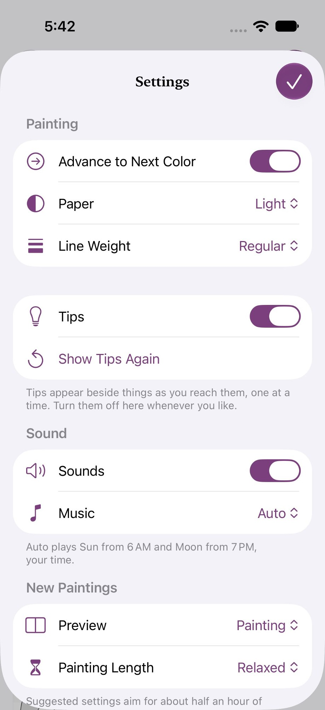 919x2000

→ `mcp__maestro__run` `{"device_id": "715C5E8F-B843-4B4F-B511-8F6A22D3DBE6", "yaml": "appId: com.pbordjadze.paintbynumber\n---\n- tapOn: \"Show Tips Again\"\n- waitForAnimationToEnd\n- takeScreenshot: /Users/runner/work/_temp/qa/shots/settings-show-tips-again"}`

→ `mcp__maestro__take_screenshot` `{"device_id": "715C5E8F-B843-4B4F-B511-8F6A22D3DBE6"}`

← mcp__maestro__run: {"success":true,"device_id":"715C5E8F-B843-4B4F-B511-8F6A22D3DBE6","commands_executed":4,"message":"Flow executed successfully","env_vars":{"MAESTRO_CLI_ANALYSIS_NOTIFICATION_DISABLED":"true","MAESTRO_CLI_NO_ANALYTICS":"1","MAESTRO_DRIVER_STARTUP_TIMEOUT":"240000","MAESTRO_VERSION":"2.11.0"}}

← mcp__maestro__take_screenshot: image 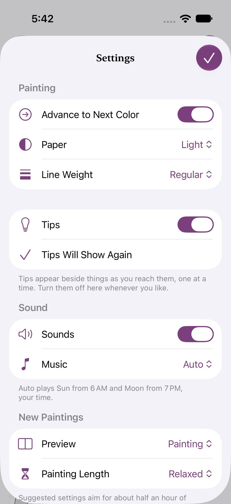 919x2000

→ `mcp__maestro__run` `{"device_id": "715C5E8F-B843-4B4F-B511-8F6A22D3DBE6", "yaml": "appId: com.pbordjadze.paintbynumber\n---\n- tapOn:\n    point: \"362,100\"\n- waitForAnimationToEnd"}`

→ `mcp__maestro__take_screenshot` `{"device_id": "715C5E8F-B843-4B4F-B511-8F6A22D3DBE6"}`

→ `Read` `{"file_path": "/Users/runner/work/_temp/qa/app.log", "offset": 81}`

← mcp__maestro__run: {"success":true,"device_id":"715C5E8F-B843-4B4F-B511-8F6A22D3DBE6","commands_executed":3,"message":"Flow executed successfully","env_vars":{"MAESTRO_CLI_ANALYSIS_NOTIFICATION_DISABLED":"true","MAESTRO_CLI_NO_ANALYTICS":"1","MAESTRO_DRIVER_STARTUP_TIMEOUT":"240000","MAESTRO_VERSION":"2.11.0"}}

← mcp__maestro__take_screenshot: image  919x2000

← Read: 81	2026-11-06 05:41:58.813 Df PaintByNumber[79318:30e6c] [com.pbordjadze.paintbynumber:tips] offer in drawer: drawerWorthALook, wanted
82

→ `mcp__maestro__run` `{"device_id": "715C5E8F-B843-4B4F-B511-8F6A22D3DBE6", "yaml": "appId: com.pbordjadze.paintbynumber\n---\n- scrollUntilVisible:\n    element: \"Delicate Arch\"\n- tapOn: \"Delicate Arch\"\n- waitForAnimationToEnd"}`

→ `mcp__maestro__take_screenshot` `{"device_id": "715C5E8F-B843-4B4F-B511-8F6A22D3DBE6"}`

← mcp__maestro__run: {"success":true,"device_id":"715C5E8F-B843-4B4F-B511-8F6A22D3DBE6","commands_executed":4,"message":"Flow executed successfully","env_vars":{"MAESTRO_CLI_ANALYSIS_NOTIFICATION_DISABLED":"true","MAESTRO_CLI_NO_ANALYTICS":"1","MAESTRO_DRIVER_STARTUP_TIMEOUT":"240000","MAESTRO_VERSION":"2.11.0"}}

← mcp__maestro__take_screenshot: image 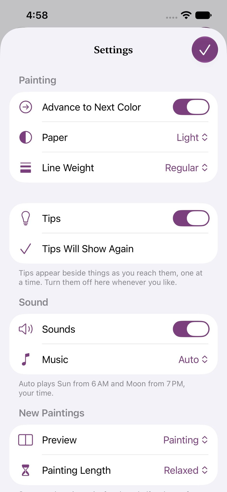 919x2000

→ `mcp__maestro__run` `{"device_id": "715C5E8F-B843-4B4F-B511-8F6A22D3DBE6", "yaml": "appId: com.pbordjadze.paintbynumber\n---\n- takeScreenshot: /Users/runner/work/_temp/qa/shots/tip-3-tap-to-paint-again"}`

← mcp__maestro__run: {"success":true,"device_id":"715C5E8F-B843-4B4F-B511-8F6A22D3DBE6","commands_executed":2,"message":"Flow executed successfully","env_vars":{"MAESTRO_CLI_ANALYSIS_NOTIFICATION_DISABLED":"true","MAESTRO_CLI_NO_ANALYTICS":"1","MAESTRO_DRIVER_STARTUP_TIMEOUT":"240000","MAESTRO_VERSION":"2.11.0"}}

→ `mcp__maestro__take_screenshot` `{"device_id": "715C5E8F-B843-4B4F-B511-8F6A22D3DBE6"}`

← mcp__maestro__take_screenshot: image 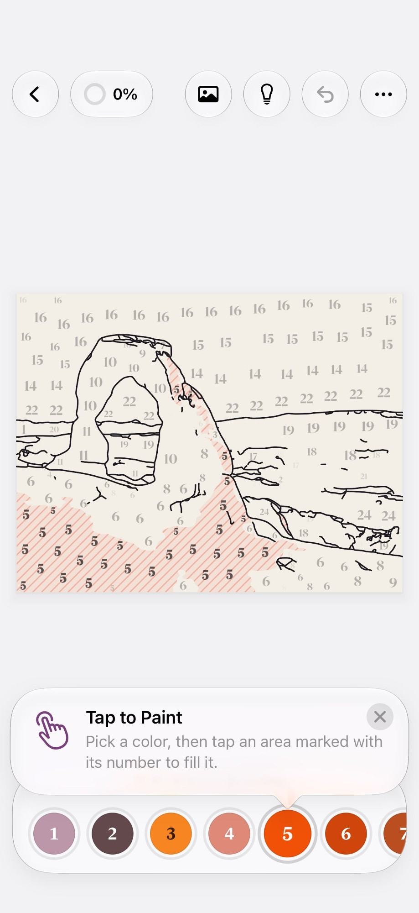 919x2000

→ `mcp__maestro__run` `{"device_id": "715C5E8F-B843-4B4F-B511-8F6A22D3DBE6", "yaml": "appId: com.pbordjadze.paintbynumber\n---\n- tapOn:\n    id: \"xmark.circle.fill\"\n- tapOn:\n    point: \"131,540\"\n- tapOn: \"Hint\"\n- takeScreenshot: /Users/runner/work/_temp/qa/shots/arch-after-hint"}`

→ `Read` `{"file_path": "/Users/runner/work/_temp/qa/app.log", "offset": 82}`

← mcp__maestro__run: {"success":true,"device_id":"715C5E8F-B843-4B4F-B511-8F6A22D3DBE6","commands_executed":5,"message":"Flow executed successfully","env_vars":{"MAESTRO_CLI_ANALYSIS_NOTIFICATION_DISABLED":"true","MAESTRO_CLI_NO_ANALYTICS":"1","MAESTRO_DRIVER_STARTUP_TIMEOUT":"240000","MAESTRO_VERSION":"2.11.0"}}

← Read: 82	2026-11-06 05:42:45.018 Df PaintByNumber[79318:30e6c] [com.pbordjadze.paintbynumber:library] Opened 62E00C5C-E9CF-46C2-9303-DC6205EB5F21: 161 regions
83	2026-11-06 05:42:45.892 Df PaintByNumber[79318:30e6c] [com.pbordjadze.paintbynumber:library] Painting screen recognizers: UIKitHoverGestureRecognizer, _UIParallaxTransitionPanGestureRecognizer, _UIContentSwipeDismissGestureRecognizer (disabled) …

→ `mcp__maestro__inspect_screen` `{"device_id": "715C5E8F-B843-4B4F-B511-8F6A22D3DBE6"}`

← mcp__maestro__inspect_screen: {"ui_schema":{"platform":"ios","abbreviations":{"b":"bounds","txt":"text","rid":"resource-id","a11y":"accessibilityText","hint":"hintText","val":"value","c":"children"},"defaults":{"enabled":true,"focused":false,"selected":false,"checked":false,"txt":"","hint":"","rid":"","val":"","a11y":""}},"elements":[{"b":"[0,0][402,874]","a11y":"Paint by Moonlight","c":[{"b":"[0,0][402,874]","c":[{"b":"[0,0][ …

→ `mcp__maestro__run` `{"device_id": "715C5E8F-B843-4B4F-B511-8F6A22D3DBE6", "yaml": "appId: com.pbordjadze.paintbynumber\n---\n- tapOn:\n    id: \"canvas-area-15\"\n- tapOn:\n    id: \"canvas-area-58\"\n- tapOn:\n    id: \"canvas-area-130\""}`

→ `mcp__maestro__take_screenshot` `{"device_id": "715C5E8F-B843-4B4F-B511-8F6A22D3DBE6"}`

← mcp__maestro__run: {"success":true,"device_id":"715C5E8F-B843-4B4F-B511-8F6A22D3DBE6","commands_executed":4,"message":"Flow executed successfully","env_vars":{"MAESTRO_CLI_ANALYSIS_NOTIFICATION_DISABLED":"true","MAESTRO_CLI_NO_ANALYTICS":"1","MAESTRO_DRIVER_STARTUP_TIMEOUT":"240000","MAESTRO_VERSION":"2.11.0"}}

← mcp__maestro__take_screenshot: image 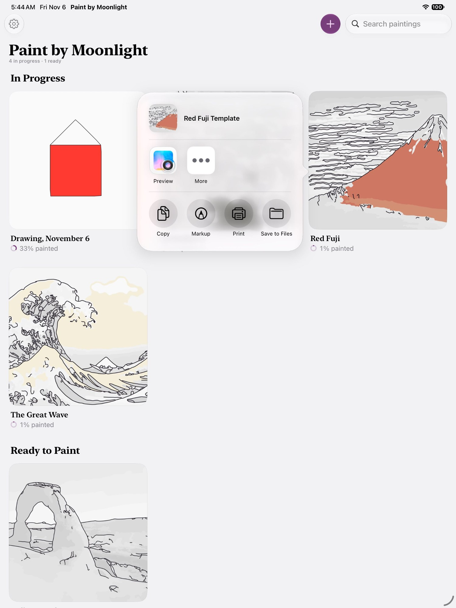 919x2000

→ `mcp__maestro__run` `{"device_id": "715C5E8F-B843-4B4F-B511-8F6A22D3DBE6", "yaml": "appId: com.pbordjadze.paintbynumber\n---\n- doubleTapOn:\n    point: \"200,200\"\n- waitForAnimationToEnd"}`

→ `mcp__maestro__take_screenshot` `{"device_id": "715C5E8F-B843-4B4F-B511-8F6A22D3DBE6"}`

← mcp__maestro__run: {"success":true,"device_id":"715C5E8F-B843-4B4F-B511-8F6A22D3DBE6","commands_executed":3,"message":"Flow executed successfully","env_vars":{"MAESTRO_CLI_ANALYSIS_NOTIFICATION_DISABLED":"true","MAESTRO_CLI_NO_ANALYTICS":"1","MAESTRO_DRIVER_STARTUP_TIMEOUT":"240000","MAESTRO_VERSION":"2.11.0"}}

← mcp__maestro__take_screenshot: image 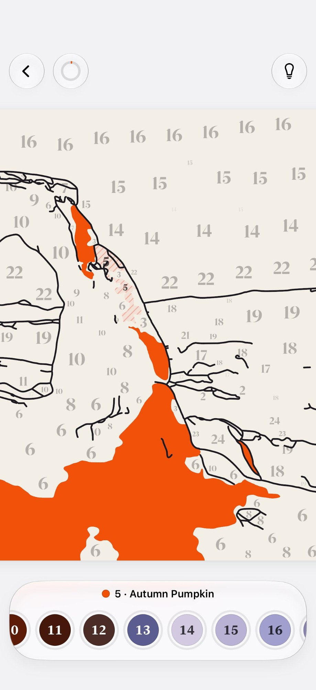 919x2000

→ `Read` `{"file_path": "/Users/runner/work/_temp/qa/app.log", "offset": 89}`

← Read: 89

→ `mcp__maestro__run` `{"device_id": "715C5E8F-B843-4B4F-B511-8F6A22D3DBE6", "yaml": "appId: com.pbordjadze.paintbynumber\n---\n- tapOn: \"Hint\"\n- takeScreenshot: /Users/runner/work/_temp/qa/shots/arch-hint-2"}`

→ `mcp__maestro__inspect_screen` `{"device_id": "715C5E8F-B843-4B4F-B511-8F6A22D3DBE6"}`

← mcp__maestro__run: {"success":true,"device_id":"715C5E8F-B843-4B4F-B511-8F6A22D3DBE6","commands_executed":3,"message":"Flow executed successfully","env_vars":{"MAESTRO_CLI_ANALYSIS_NOTIFICATION_DISABLED":"true","MAESTRO_CLI_NO_ANALYTICS":"1","MAESTRO_DRIVER_STARTUP_TIMEOUT":"240000","MAESTRO_VERSION":"2.11.0"}}

← mcp__maestro__inspect_screen: {"ui_schema":{"platform":"ios","abbreviations":{"b":"bounds","txt":"text","rid":"resource-id","a11y":"accessibilityText","hint":"hintText","val":"value","c":"children"},"defaults":{"enabled":true,"focused":false,"selected":false,"checked":false,"txt":"","hint":"","rid":"","val":"","a11y":""}},"elements":[{"b":"[0,0][402,874]","a11y":"Paint by Moonlight","c":[{"b":"[0,0][402,874]","c":[{"b":"[0,0][ …

→ `mcp__maestro__run` `{"device_id": "715C5E8F-B843-4B4F-B511-8F6A22D3DBE6", "yaml": "appId: com.pbordjadze.paintbynumber\n---\n- tapOn:\n    id: \"canvas-area-20\"\n- tapOn:\n    id: \"canvas-area-25\""}`

→ `Read` `{"file_path": "/Users/runner/work/_temp/qa/app.log", "offset": 89}`

← mcp__maestro__run: {"success":true,"device_id":"715C5E8F-B843-4B4F-B511-8F6A22D3DBE6","commands_executed":3,"message":"Flow executed successfully","env_vars":{"MAESTRO_CLI_ANALYSIS_NOTIFICATION_DISABLED":"true","MAESTRO_CLI_NO_ANALYTICS":"1","MAESTRO_DRIVER_STARTUP_TIMEOUT":"240000","MAESTRO_VERSION":"2.11.0"}}

← Read: 89	2026-11-06 05:44:16.491 Df PaintByNumber[79318:30e6c] [com.pbordjadze.paintbynumber:tips] offer in bench: benchDrag, wanted benchDrag
90	2026-11-06 05:44:19.593 Df PaintByNumber[79318:30e6c] [com.pbordjadze.paintbynumber:tips] nothing was eligible in time: benchDrag pending
91

→ `mcp__maestro__run` `{"device_id": "715C5E8F-B843-4B4F-B511-8F6A22D3DBE6", "yaml": "appId: com.pbordjadze.paintbynumber\n---\n- tapOn: \"Hint\""}`

→ `mcp__maestro__inspect_screen` `{"device_id": "715C5E8F-B843-4B4F-B511-8F6A22D3DBE6"}`

← mcp__maestro__run: {"success":true,"device_id":"715C5E8F-B843-4B4F-B511-8F6A22D3DBE6","commands_executed":2,"message":"Flow executed successfully","env_vars":{"MAESTRO_CLI_ANALYSIS_NOTIFICATION_DISABLED":"true","MAESTRO_CLI_NO_ANALYTICS":"1","MAESTRO_DRIVER_STARTUP_TIMEOUT":"240000","MAESTRO_VERSION":"2.11.0"}}

← mcp__maestro__inspect_screen: {"ui_schema":{"platform":"ios","abbreviations":{"b":"bounds","txt":"text","rid":"resource-id","a11y":"accessibilityText","hint":"hintText","val":"value","c":"children"},"defaults":{"enabled":true,"focused":false,"selected":false,"checked":false,"txt":"","hint":"","rid":"","val":"","a11y":""}},"elements":[{"b":"[0,0][402,874]","a11y":"Paint by Moonlight","c":[{"b":"[0,0][402,874]","c":[{"b":"[0,0][ …

→ `Read` `{"file_path": "/Users/runner/work/_temp/qa/app.log", "offset": 91}`

← Read: 91

→ `mcp__maestro__run` `{"device_id": "715C5E8F-B843-4B4F-B511-8F6A22D3DBE6", "yaml": "appId: com.pbordjadze.paintbynumber\n---\n- tapOn:\n    id: \"canvas-area-21\"\n- tapOn:\n    id: \"swatch-16\"\n    index: 0"}`

→ `mcp__maestro__inspect_screen` `{"device_id": "715C5E8F-B843-4B4F-B511-8F6A22D3DBE6"}`

← mcp__maestro__run (error): Failed to run flow: Element not found: Id matching regex: swatch-16, Index: 0

← mcp__maestro__inspect_screen: {"ui_schema":{"platform":"ios","abbreviations":{"b":"bounds","txt":"text","rid":"resource-id","a11y":"accessibilityText","hint":"hintText","val":"value","c":"children"},"defaults":{"enabled":true,"focused":false,"selected":false,"checked":false,"txt":"","hint":"","rid":"","val":"","a11y":""}},"elements":[{"b":"[0,0][402,874]","a11y":"Paint by Moonlight","c":[{"b":"[0,0][402,874]","c":[{"b":"[0,0][ …

→ `Read` `{"file_path": "/Users/runner/work/_temp/qa/app.log", "offset": 91}`

← Read: 91	2026-11-06 05:45:01.507 Df PaintByNumber[79318:30e6c] [com.pbordjadze.paintbynumber:tips] offer in bench: benchZen, wanted
92

→ `mcp__maestro__take_screenshot` `{"device_id": "715C5E8F-B843-4B4F-B511-8F6A22D3DBE6"}`

← mcp__maestro__take_screenshot: image 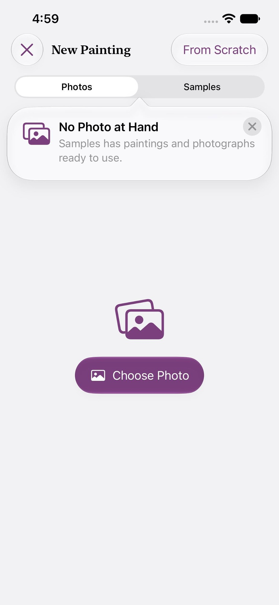 919x2000

→ `mcp__maestro__run` `{"device_id": "715C5E8F-B843-4B4F-B511-8F6A22D3DBE6", "yaml": "appId: com.pbordjadze.paintbynumber\n---\n- tapOn:\n    id: \"canvas-area-33\"\n- tapOn: \"Hint\""}`

→ `Read` `{"file_path": "/Users/runner/work/_temp/qa/app.log", "offset": 92}`

← mcp__maestro__run: {"success":true,"device_id":"715C5E8F-B843-4B4F-B511-8F6A22D3DBE6","commands_executed":3,"message":"Flow executed successfully","env_vars":{"MAESTRO_CLI_ANALYSIS_NOTIFICATION_DISABLED":"true","MAESTRO_CLI_NO_ANALYTICS":"1","MAESTRO_DRIVER_STARTUP_TIMEOUT":"240000","MAESTRO_VERSION":"2.11.0"}}

← Read: 92

→ `mcp__maestro__run` `{"device_id": "715C5E8F-B843-4B4F-B511-8F6A22D3DBE6", "yaml": "appId: com.pbordjadze.paintbynumber\n---\n- tapOn:\n    id: \"quiet-ring\""}`

→ `mcp__maestro__take_screenshot` `{"device_id": "715C5E8F-B843-4B4F-B511-8F6A22D3DBE6"}`

→ `Read` `{"file_path": "/Users/runner/work/_temp/qa/app.log", "offset": 92}`

← mcp__maestro__run: {"success":true,"device_id":"715C5E8F-B843-4B4F-B511-8F6A22D3DBE6","commands_executed":2,"message":"Flow executed successfully","env_vars":{"MAESTRO_CLI_ANALYSIS_NOTIFICATION_DISABLED":"true","MAESTRO_CLI_NO_ANALYTICS":"1","MAESTRO_DRIVER_STARTUP_TIMEOUT":"240000","MAESTRO_VERSION":"2.11.0"}}

← mcp__maestro__take_screenshot: image 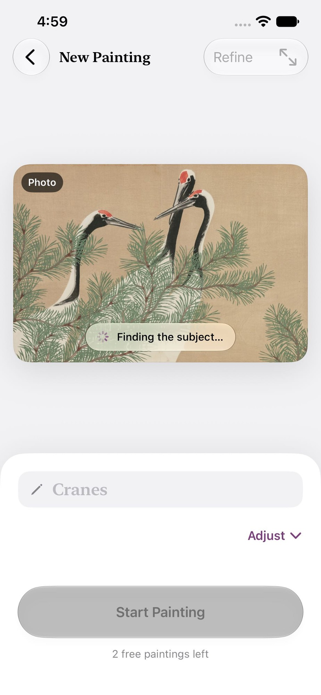 919x2000

← Read: Wasted call — file unchanged since your last Read. Refer to that earlier tool_result instead.

→ `mcp__maestro__run` `{"device_id": "715C5E8F-B843-4B4F-B511-8F6A22D3DBE6", "yaml": "appId: com.pbordjadze.paintbynumber\n---\n- tapOn:\n    point: \"201,425\"\n- tapOn: \"More\"\n- waitForAnimationToEnd\n- tapOn: \"Fit to Screen\"\n- waitForAnimationToEnd"}`

→ `Read` `{"file_path": "/Users/runner/work/_temp/qa/app.log", "offset": 92}`

→ `mcp__maestro__take_screenshot` `{"device_id": "715C5E8F-B843-4B4F-B511-8F6A22D3DBE6"}`

← mcp__maestro__run (error): Failed to run flow: Element not found: Text matching regex: More

← Read: 92	2026-11-06 05:45:43.660 Df PaintByNumber[79318:30e6c] [com.pbordjadze.paintbynumber:tips] offer in bench: benchZen, wanted
93

← mcp__maestro__take_screenshot: image 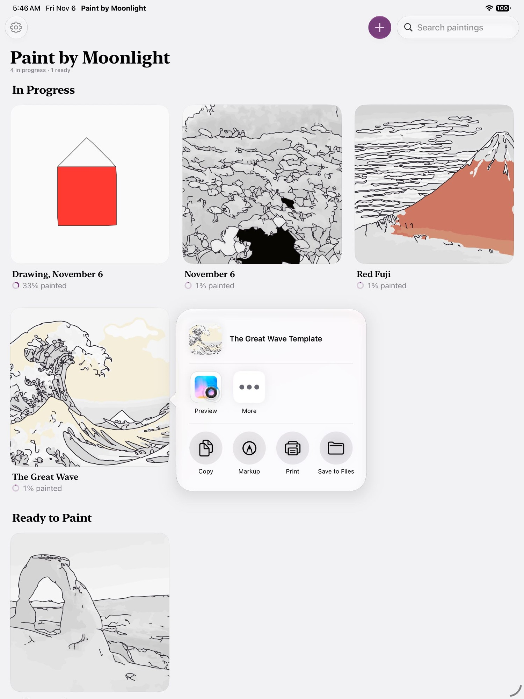 919x2000

→ `mcp__maestro__run` `{"device_id": "715C5E8F-B843-4B4F-B511-8F6A22D3DBE6", "yaml": "appId: com.pbordjadze.paintbynumber\n---\n- tapOn:\n    id: \"quiet-ring\"\n- tapOn: \"More\"\n- waitForAnimationToEnd\n- tapOn: \"Fit to Screen\"\n- waitForAnimationToEnd"}`

→ `mcp__maestro__inspect_screen` `{"device_id": "715C5E8F-B843-4B4F-B511-8F6A22D3DBE6"}`

← mcp__maestro__run: {"success":true,"device_id":"715C5E8F-B843-4B4F-B511-8F6A22D3DBE6","commands_executed":6,"message":"Flow executed successfully","env_vars":{"MAESTRO_CLI_ANALYSIS_NOTIFICATION_DISABLED":"true","MAESTRO_CLI_NO_ANALYTICS":"1","MAESTRO_DRIVER_STARTUP_TIMEOUT":"240000","MAESTRO_VERSION":"2.11.0"}}

← mcp__maestro__inspect_screen: {"ui_schema":{"platform":"ios","abbreviations":{"b":"bounds","txt":"text","rid":"resource-id","a11y":"accessibilityText","hint":"hintText","val":"value","c":"children"},"defaults":{"enabled":true,"focused":false,"selected":false,"checked":false,"txt":"","hint":"","rid":"","val":"","a11y":""}},"elements":[{"b":"[0,0][402,874]","a11y":"Paint by Moonlight","c":[{"b":"[0,0][402,874]","c":[{"b":"[0,0][ …

→ `mcp__maestro__run` `{"device_id": "715C5E8F-B843-4B4F-B511-8F6A22D3DBE6", "yaml": "appId: com.pbordjadze.paintbynumber\n---\n- tapOn:\n    id: \"canvas-area-87\"\n- tapOn:\n    id: \"canvas-area-133\"\n- tapOn:\n    id: \"canvas-area-159\""}`

→ `Read` `{"file_path": "/Users/runner/work/_temp/qa/app.log", "offset": 93}`

← mcp__maestro__run: {"success":true,"device_id":"715C5E8F-B843-4B4F-B511-8F6A22D3DBE6","commands_executed":4,"message":"Flow executed successfully","env_vars":{"MAESTRO_CLI_ANALYSIS_NOTIFICATION_DISABLED":"true","MAESTRO_CLI_NO_ANALYTICS":"1","MAESTRO_DRIVER_STARTUP_TIMEOUT":"240000","MAESTRO_VERSION":"2.11.0"}}

← Read: 93	2026-11-06 05:46:03.709 Df PaintByNumber[79318:30e6c] [com.pbordjadze.paintbynumber:tips] offer in bench: benchZen, wanted benchZen
94	2026-11-06 05:46:06.794 Df PaintByNumber[79318:30e6c] [com.pbordjadze.paintbynumber:tips] nothing was eligible in time: benchZen pending
95	2026-11-06 05:46:29.374 Df PaintByNumber[79318:30e6c] [com.pbordjadze.paintbynumber:tips] offer in bench: benchDrag, wante …

→ `mcp__maestro__run` `{"device_id": "715C5E8F-B843-4B4F-B511-8F6A22D3DBE6", "yaml": "appId: com.pbordjadze.paintbynumber\n---\n- tapOn: \"Back\"\n- waitForAnimationToEnd\n- tapOn: \"New Painting\"\n- waitForAnimationToEnd"}`

→ `mcp__maestro__take_screenshot` `{"device_id": "715C5E8F-B843-4B4F-B511-8F6A22D3DBE6"}`

← mcp__maestro__run: {"success":true,"device_id":"715C5E8F-B843-4B4F-B511-8F6A22D3DBE6","commands_executed":5,"message":"Flow executed successfully","env_vars":{"MAESTRO_CLI_ANALYSIS_NOTIFICATION_DISABLED":"true","MAESTRO_CLI_NO_ANALYTICS":"1","MAESTRO_DRIVER_STARTUP_TIMEOUT":"240000","MAESTRO_VERSION":"2.11.0"}}

← mcp__maestro__take_screenshot: image 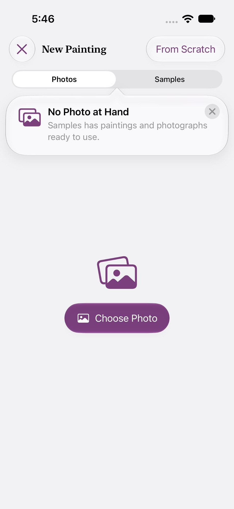 919x2000

→ `mcp__maestro__run` `{"device_id": "715C5E8F-B843-4B4F-B511-8F6A22D3DBE6", "yaml": "appId: com.pbordjadze.paintbynumber\n---\n- takeScreenshot: /Users/runner/work/_temp/qa/shots/tip-4-no-photo-at-hand"}`

← mcp__maestro__run: {"success":true,"device_id":"715C5E8F-B843-4B4F-B511-8F6A22D3DBE6","commands_executed":2,"message":"Flow executed successfully","env_vars":{"MAESTRO_CLI_ANALYSIS_NOTIFICATION_DISABLED":"true","MAESTRO_CLI_NO_ANALYTICS":"1","MAESTRO_DRIVER_STARTUP_TIMEOUT":"240000","MAESTRO_VERSION":"2.11.0"}}

→ `mcp__maestro__inspect_screen` `{"device_id": "715C5E8F-B843-4B4F-B511-8F6A22D3DBE6"}`

← mcp__maestro__inspect_screen: {"ui_schema":{"platform":"ios","abbreviations":{"b":"bounds","txt":"text","rid":"resource-id","a11y":"accessibilityText","hint":"hintText","val":"value","c":"children"},"defaults":{"enabled":true,"focused":false,"selected":false,"checked":false,"txt":"","hint":"","rid":"","val":"","a11y":""}},"elements":[{"b":"[0,0][402,874]","a11y":"Paint by Moonlight","c":[{"b":"[0,0][402,874]","c":[{"b":"[0,0][ …

→ `mcp__maestro__take_screenshot` `{"device_id": "715C5E8F-B843-4B4F-B511-8F6A22D3DBE6"}`

← mcp__maestro__take_screenshot: image 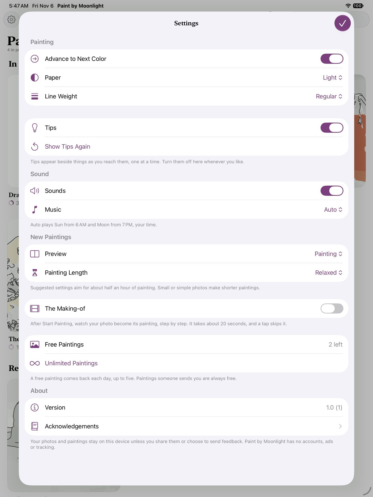 919x2000

→ `mcp__maestro__run` `{"device_id": "715C5E8F-B843-4B4F-B511-8F6A22D3DBE6", "yaml": "appId: com.pbordjadze.paintbynumber\n---\n- tapOn:\n    id: \"xmark.circle.fill\"\n- tapOn: \"Samples\"\n- tapOn:\n    point: \"26%,79%\"\n- waitForAnimationToEnd"}`

→ `mcp__maestro__take_screenshot` `{"device_id": "715C5E8F-B843-4B4F-B511-8F6A22D3DBE6"}`

← mcp__maestro__run: {"success":true,"device_id":"715C5E8F-B843-4B4F-B511-8F6A22D3DBE6","commands_executed":5,"message":"Flow executed successfully","env_vars":{"MAESTRO_CLI_ANALYSIS_NOTIFICATION_DISABLED":"true","MAESTRO_CLI_NO_ANALYTICS":"1","MAESTRO_DRIVER_STARTUP_TIMEOUT":"240000","MAESTRO_VERSION":"2.11.0"}}

← mcp__maestro__take_screenshot: image 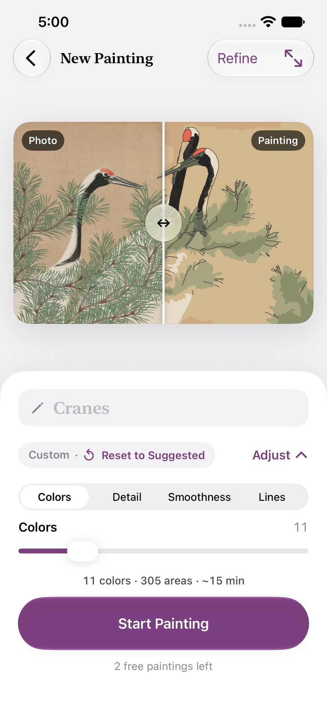 919x2000

→ `Read` `{"file_path": "/Users/runner/work/_temp/qa/app.log", "offset": 97}`

← Read: 97	2026-11-06 05:46:51.737 Df PaintByNumber[79318:30e6c] [com.pbordjadze.paintbynumber:tips] offer in newPainting: newPaintingSamples, wanted newPaintingSamples
98	2026-11-06 05:46:52.998 Df PaintByNumber[79318:30e6c] [com.pbordjadze.paintbynumber:tips] turn: newPaintingSamples
99	2026-11-06 05:47:21.894 Df PaintByNumber[79318:30e6c] [com.pbordjadze.paintbynumber:tips] turn over: newPaintingSample …

→ `mcp__maestro__run` `{"device_id": "715C5E8F-B843-4B4F-B511-8F6A22D3DBE6", "yaml": "appId: com.pbordjadze.paintbynumber\n---\n- tapOn: \"Adjust\"\n- waitForAnimationToEnd"}`

→ `mcp__maestro__take_screenshot` `{"device_id": "715C5E8F-B843-4B4F-B511-8F6A22D3DBE6"}`

← mcp__maestro__run: {"success":true,"device_id":"715C5E8F-B843-4B4F-B511-8F6A22D3DBE6","commands_executed":3,"message":"Flow executed successfully","env_vars":{"MAESTRO_CLI_ANALYSIS_NOTIFICATION_DISABLED":"true","MAESTRO_CLI_NO_ANALYTICS":"1","MAESTRO_DRIVER_STARTUP_TIMEOUT":"240000","MAESTRO_VERSION":"2.11.0"}}

← mcp__maestro__take_screenshot: image 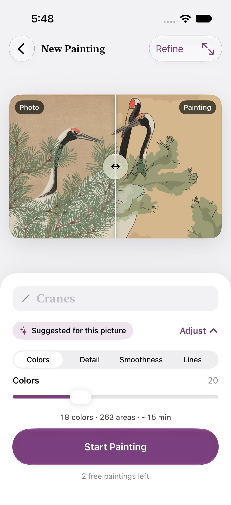 919x2000

→ `mcp__maestro__run` `{"device_id": "715C5E8F-B843-4B4F-B511-8F6A22D3DBE6", "yaml": "appId: com.pbordjadze.paintbynumber\n---\n- swipe:\n    start: \"201,288\"\n    end: \"300,288\"\n    duration: 800\n- waitForAnimationToEnd\n- tapOn: \"Detail\"\n- waitForAnimationToEnd"}`

→ `mcp__maestro__take_screenshot` `{"device_id": "715C5E8F-B843-4B4F-B511-8F6A22D3DBE6"}`

← mcp__maestro__run: {"success":true,"device_id":"715C5E8F-B843-4B4F-B511-8F6A22D3DBE6","commands_executed":5,"message":"Flow executed successfully","env_vars":{"MAESTRO_CLI_ANALYSIS_NOTIFICATION_DISABLED":"true","MAESTRO_CLI_NO_ANALYTICS":"1","MAESTRO_DRIVER_STARTUP_TIMEOUT":"240000","MAESTRO_VERSION":"2.11.0"}}

← mcp__maestro__take_screenshot: image 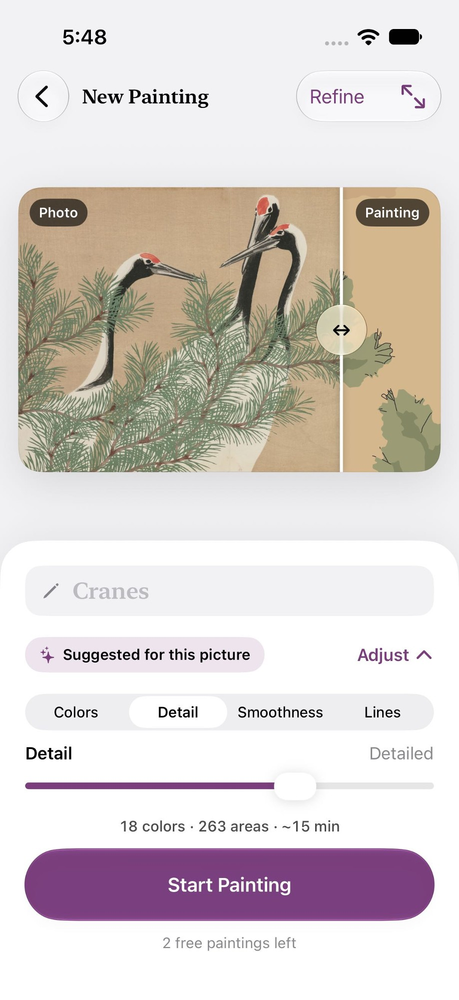 919x2000

→ `Write` `{"file_path": "/Users/runner/work/_temp/qa/report.md", "content": "# Paint by Moonlight: newcomer's first hour (iPhone 17 Pro simulator, debug build)\n\n## Summary\nAll six journey goals worked: the gallery, painting a starter, making paintings from a sample, a photo and an empty page, Refine on a preview, and printing (found in about 3 minutes, via long-press \u203a Share \u203a Print Template\u2026). Tips I saw on screen: \"Tap to Paint\" (twice, once per tip reset) and \"No Photo at Hand\". In the first session the log says a Zen tip had a 30 s \"turn\" while nothing was on screen, and the `

← Write: The file /Users/runner/work/_temp/qa/report.md has been updated successfully. (file state is current in your context — no need to Read it back)

→ `Read` `{"file_path": "/Users/runner/work/_temp/qa/app.log", "offset": 105}`

← Read: 105

→ `mcp__maestro__run` `{"device_id": "715C5E8F-B843-4B4F-B511-8F6A22D3DBE6", "yaml": "appId: com.pbordjadze.paintbynumber\n---\n- tapOn: \"Lines\"\n- waitForAnimationToEnd"}`

→ `mcp__maestro__take_screenshot` `{"device_id": "715C5E8F-B843-4B4F-B511-8F6A22D3DBE6"}`

← mcp__maestro__run: {"success":true,"device_id":"715C5E8F-B843-4B4F-B511-8F6A22D3DBE6","commands_executed":3,"message":"Flow executed successfully","env_vars":{"MAESTRO_CLI_ANALYSIS_NOTIFICATION_DISABLED":"true","MAESTRO_CLI_NO_ANALYTICS":"1","MAESTRO_DRIVER_STARTUP_TIMEOUT":"240000","MAESTRO_VERSION":"2.11.0"}}

← mcp__maestro__take_screenshot: image  919x2000

→ `mcp__maestro__run` `{"device_id": "715C5E8F-B843-4B4F-B511-8F6A22D3DBE6", "yaml": "appId: com.pbordjadze.paintbynumber\n---\n- swipe:\n    start: \"201,686\"\n    end: \"300,686\"\n    duration: 800\n- waitForAnimationToEnd\n- takeScreenshot: /Users/runner/work/_temp/qa/shots/cranes-lines-slider"}`

→ `Read` `{"file_path": "/Users/runner/work/_temp/qa/app.log", "offset": 105}`

← mcp__maestro__run: {"success":true,"device_id":"715C5E8F-B843-4B4F-B511-8F6A22D3DBE6","commands_executed":4,"message":"Flow executed successfully","env_vars":{"MAESTRO_CLI_ANALYSIS_NOTIFICATION_DISABLED":"true","MAESTRO_CLI_NO_ANALYTICS":"1","MAESTRO_DRIVER_STARTUP_TIMEOUT":"240000","MAESTRO_VERSION":"2.11.0"}}

← Read: 105	2026-11-06 05:49:16.729 Df PaintByNumber[79318:30e6c] [com.pbordjadze.paintbynumber:create] A slider was touched [adjusting true, full under way false, final true, phase ready]
106	2026-11-06 05:49:16.805 Df PaintByNumber[79318:30e6c] [com.pbordjadze.paintbynumber:create] Settings changed to 20 colors, detail 0.68, lines 0.5288640856742859 [adjusting true, full under way false, final false, ph …

→ `mcp__maestro__run` `{"device_id": "715C5E8F-B843-4B4F-B511-8F6A22D3DBE6", "yaml": "appId: com.pbordjadze.paintbynumber\n---\n- tapOn:\n    text: \"zzz-nothing\"\n    optional: true\n- tapOn:\n    text: \"zzz-nothing\"\n    optional: true\n- tapOn:\n    text: \"zzz-nothing\"\n    optional: true\n- swipe:\n    start: \"300,686\"\n    end: \"220,686\"\n    duration: 800\n- waitForAnimationToEnd"}`

→ `mcp__maestro__take_screenshot` `{"device_id": "715C5E8F-B843-4B4F-B511-8F6A22D3DBE6"}`

← mcp__maestro__run: {"success":true,"device_id":"715C5E8F-B843-4B4F-B511-8F6A22D3DBE6","commands_executed":6,"message":"Flow executed successfully","env_vars":{"MAESTRO_CLI_ANALYSIS_NOTIFICATION_DISABLED":"true","MAESTRO_CLI_NO_ANALYTICS":"1","MAESTRO_DRIVER_STARTUP_TIMEOUT":"240000","MAESTRO_VERSION":"2.11.0"}}

← mcp__maestro__take_screenshot: image 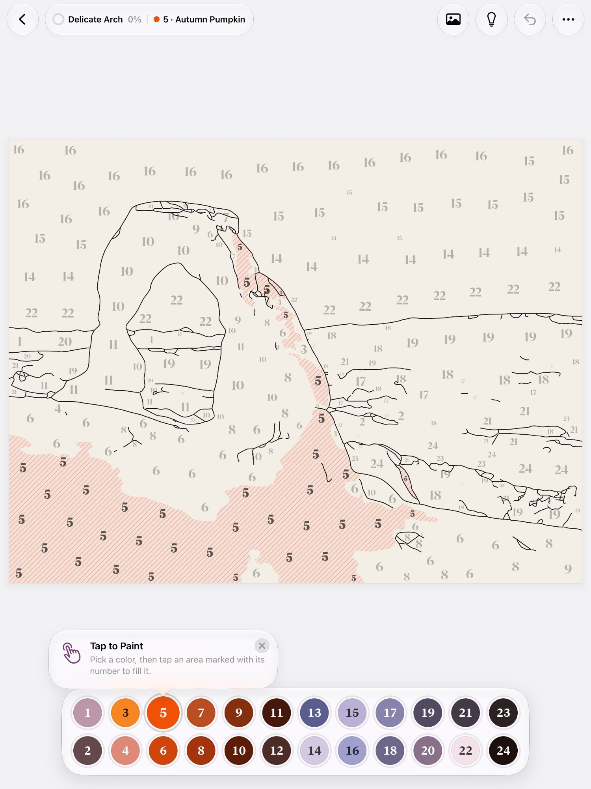 919x2000

→ `mcp__maestro__run` `{"device_id": "715C5E8F-B843-4B4F-B511-8F6A22D3DBE6", "yaml": "appId: com.pbordjadze.paintbynumber\n---\n- extendedWaitUntil:\n    visible: \"zzz-nothing\"\n    timeout: 50000\n    optional: true\n- swipe:\n    start: \"218,686\"\n    end: \"180,686\"\n    duration: 800\n- waitForAnimationToEnd"}`

→ `mcp__maestro__take_screenshot` `{"device_id": "715C5E8F-B843-4B4F-B511-8F6A22D3DBE6"}`

← mcp__maestro__run: {"success":true,"device_id":"715C5E8F-B843-4B4F-B511-8F6A22D3DBE6","commands_executed":4,"message":"Flow executed successfully","env_vars":{"MAESTRO_CLI_ANALYSIS_NOTIFICATION_DISABLED":"true","MAESTRO_CLI_NO_ANALYTICS":"1","MAESTRO_DRIVER_STARTUP_TIMEOUT":"240000","MAESTRO_VERSION":"2.11.0"}}

← mcp__maestro__take_screenshot: image 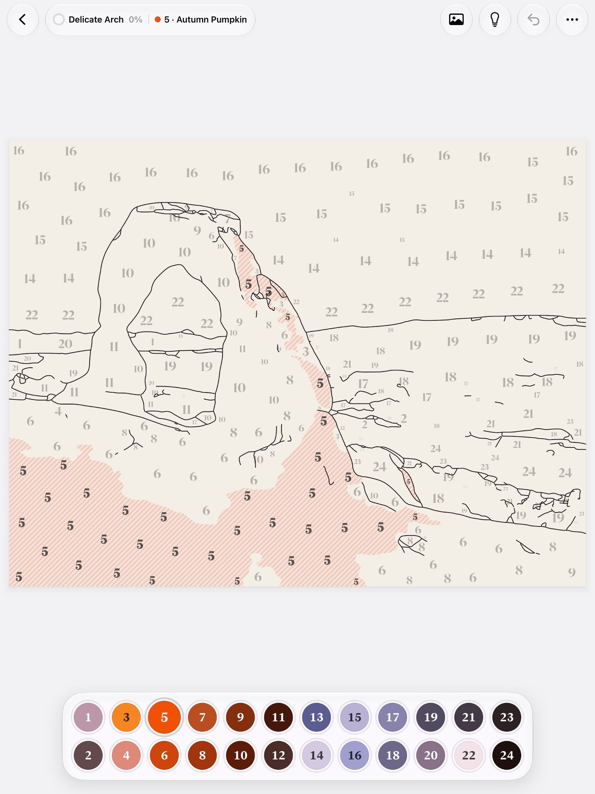 919x2000

> Still waiting for a preview tip: it is 05:50 and none yet. Maestro's waits return early, so I'm nudging the sliders to give the app moments to offer one.

→ `Read` `{"file_path": "/Users/runner/work/_temp/qa/app.log", "offset": 144, "limit": 80}`

← Read: 144	2026-11-06 05:49:45.364 Df PaintByNumber[79318:30e6c] [com.pbordjadze.paintbynumber:create] Settings changed to 20 colors, detail 0.68, lines 0.7411545515060425 [adjusting true, full under way false, final false, phase ready]
145	2026-11-06 05:49:45.378 Df PaintByNumber[79318:30e6c] [com.pbordjadze.paintbynumber:create] Draft #7 started for 20 colors, detail 0.68, lines 0.7411545515060425 [adj …

→ `mcp__maestro__run` `{"device_id": "715C5E8F-B843-4B4F-B511-8F6A22D3DBE6", "yaml": "appId: com.pbordjadze.paintbynumber\n---\n- tapOn:\n    point: \"38,84\"\n- waitForAnimationToEnd\n- tapOn:\n    point: \"72%,63%\"\n- waitForAnimationToEnd"}`

→ `mcp__maestro__take_screenshot` `{"device_id": "715C5E8F-B843-4B4F-B511-8F6A22D3DBE6"}`

← mcp__maestro__run: {"success":true,"device_id":"715C5E8F-B843-4B4F-B511-8F6A22D3DBE6","commands_executed":5,"message":"Flow executed successfully","env_vars":{"MAESTRO_CLI_ANALYSIS_NOTIFICATION_DISABLED":"true","MAESTRO_CLI_NO_ANALYTICS":"1","MAESTRO_DRIVER_STARTUP_TIMEOUT":"240000","MAESTRO_VERSION":"2.11.0"}}

← mcp__maestro__take_screenshot: image 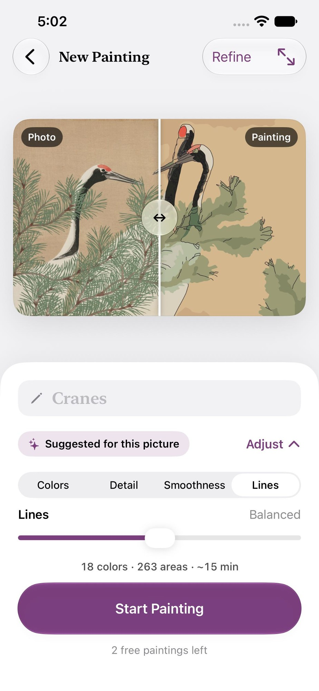 919x2000

→ `mcp__maestro__run` `{"device_id": "715C5E8F-B843-4B4F-B511-8F6A22D3DBE6", "yaml": "appId: com.pbordjadze.paintbynumber\n---\n- tapOn: \"Adjust\"\n- waitForAnimationToEnd"}`

→ `mcp__maestro__take_screenshot` `{"device_id": "715C5E8F-B843-4B4F-B511-8F6A22D3DBE6"}`

→ `Read` `{"file_path": "/Users/runner/work/_temp/qa/app.log", "offset": 224}`

← mcp__maestro__run: {"success":true,"device_id":"715C5E8F-B843-4B4F-B511-8F6A22D3DBE6","commands_executed":3,"message":"Flow executed successfully","env_vars":{"MAESTRO_CLI_ANALYSIS_NOTIFICATION_DISABLED":"true","MAESTRO_CLI_NO_ANALYTICS":"1","MAESTRO_DRIVER_STARTUP_TIMEOUT":"240000","MAESTRO_VERSION":"2.11.0"}}

← mcp__maestro__take_screenshot: image 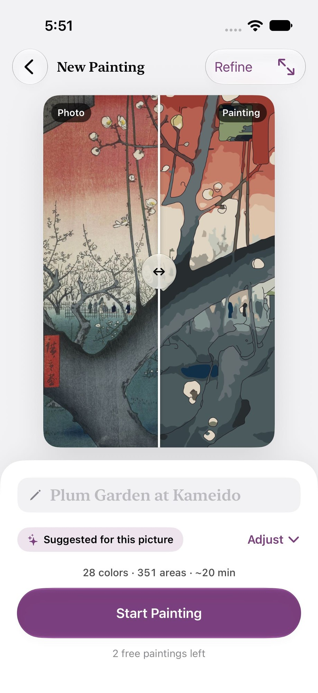 919x2000

← Read: 224	2026-11-06 05:51:19.710 Df PaintByNumber[79318:30e6c] [com.pbordjadze.paintbynumber:tips] offer in newPainting: newPaintingSamples, wanted newPaintingSamples
225	2026-11-06 05:51:19.986 Df PaintByNumber[79318:30e6c] [com.pbordjadze.paintbynumber:tips] no tip of newPaintingSamples is eligible: newPaintingSamples invalidated(TipKit.Tips.InvalidationReason.tipClosed)
226	2026-11-06 05:51:35.501 D …

→ `mcp__maestro__run` `{"device_id": "715C5E8F-B843-4B4F-B511-8F6A22D3DBE6", "yaml": "appId: com.pbordjadze.paintbynumber\n---\n- tapOn:\n    point: \"38,84\"\n- waitForAnimationToEnd\n- tapOn:\n    point: \"72%,79%\"\n- waitForAnimationToEnd"}`

→ `mcp__maestro__take_screenshot` `{"device_id": "715C5E8F-B843-4B4F-B511-8F6A22D3DBE6"}`

← mcp__maestro__run: {"success":true,"device_id":"715C5E8F-B843-4B4F-B511-8F6A22D3DBE6","commands_executed":5,"message":"Flow executed successfully","env_vars":{"MAESTRO_CLI_ANALYSIS_NOTIFICATION_DISABLED":"true","MAESTRO_CLI_NO_ANALYTICS":"1","MAESTRO_DRIVER_STARTUP_TIMEOUT":"240000","MAESTRO_VERSION":"2.11.0"}}

← mcp__maestro__take_screenshot: image 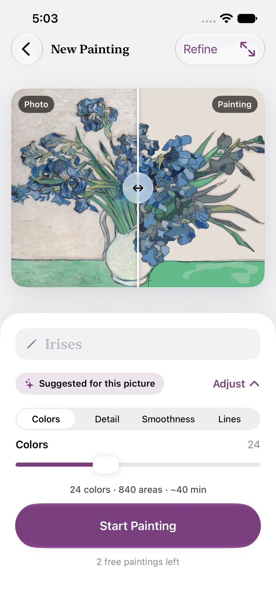 919x2000

→ `Read` `{"file_path": "/Users/runner/work/_temp/qa/app.log", "offset": 232}`

← Read: 232	2026-11-06 05:52:03.760 Df PaintByNumber[79318:30e6c] [com.pbordjadze.paintbynumber:tips] offer in newPainting: newPaintingSamples, wanted newPaintingSamples
233	2026-11-06 05:52:03.850 Df PaintByNumber[79318:30e6c] [com.pbordjadze.paintbynumber:tips] no tip of newPaintingSamples is eligible: newPaintingSamples invalidated(TipKit.Tips.InvalidationReason.tipClosed)
234	2026-11-06 05:52:17.389 D …

→ `mcp__maestro__run` `{"device_id": "715C5E8F-B843-4B4F-B511-8F6A22D3DBE6", "yaml": "appId: com.pbordjadze.paintbynumber\n---\n- tapOn: \"Refine\"\n- waitForAnimationToEnd"}`

→ `mcp__maestro__take_screenshot` `{"device_id": "715C5E8F-B843-4B4F-B511-8F6A22D3DBE6"}`

← mcp__maestro__run: {"success":true,"device_id":"715C5E8F-B843-4B4F-B511-8F6A22D3DBE6","commands_executed":3,"message":"Flow executed successfully","env_vars":{"MAESTRO_CLI_ANALYSIS_NOTIFICATION_DISABLED":"true","MAESTRO_CLI_NO_ANALYTICS":"1","MAESTRO_DRIVER_STARTUP_TIMEOUT":"240000","MAESTRO_VERSION":"2.11.0"}}

← mcp__maestro__take_screenshot: image 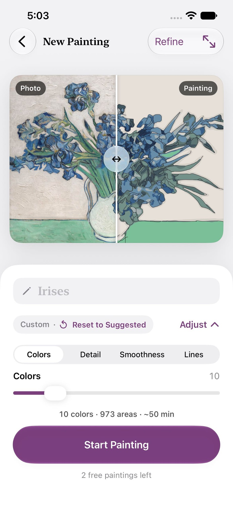 919x2000

→ `mcp__maestro__run` `{"device_id": "715C5E8F-B843-4B4F-B511-8F6A22D3DBE6", "yaml": "appId: com.pbordjadze.paintbynumber\n---\n- takeScreenshot: /Users/runner/work/_temp/qa/shots/tip-5-draw-your-own-lines"}`

← mcp__maestro__run: {"success":true,"device_id":"715C5E8F-B843-4B4F-B511-8F6A22D3DBE6","commands_executed":2,"message":"Flow executed successfully","env_vars":{"MAESTRO_CLI_ANALYSIS_NOTIFICATION_DISABLED":"true","MAESTRO_CLI_NO_ANALYTICS":"1","MAESTRO_DRIVER_STARTUP_TIMEOUT":"240000","MAESTRO_VERSION":"2.11.0"}}

→ `mcp__maestro__inspect_screen` `{"device_id": "715C5E8F-B843-4B4F-B511-8F6A22D3DBE6"}`

← mcp__maestro__inspect_screen: {"ui_schema":{"platform":"ios","abbreviations":{"b":"bounds","txt":"text","rid":"resource-id","a11y":"accessibilityText","hint":"hintText","val":"value","c":"children"},"defaults":{"enabled":true,"focused":false,"selected":false,"checked":false,"txt":"","hint":"","rid":"","val":"","a11y":""}},"elements":[{"b":"[0,0][402,874]","a11y":"Paint by Moonlight","c":[{"b":"[0,0][402,874]","c":[{"b":"[0,0][ …

→ `mcp__maestro__take_screenshot` `{"device_id": "715C5E8F-B843-4B4F-B511-8F6A22D3DBE6"}`

← mcp__maestro__take_screenshot: image 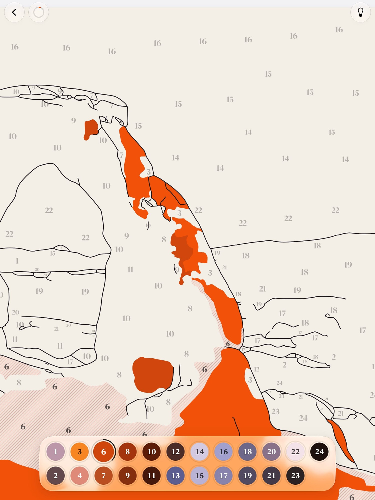 919x2000

→ `mcp__maestro__run` `{"device_id": "715C5E8F-B843-4B4F-B511-8F6A22D3DBE6", "yaml": "appId: com.pbordjadze.paintbynumber\n---\n- tapOn:\n    id: \"xmark.circle.fill\"\n- takeScreenshot: /Users/runner/work/_temp/qa/shots/refine-portrait-generated-blank-overlap"}`

→ `mcp__maestro__inspect_screen` `{"device_id": "715C5E8F-B843-4B4F-B511-8F6A22D3DBE6"}`

← mcp__maestro__run: {"success":true,"device_id":"715C5E8F-B843-4B4F-B511-8F6A22D3DBE6","commands_executed":3,"message":"Flow executed successfully","env_vars":{"MAESTRO_CLI_ANALYSIS_NOTIFICATION_DISABLED":"true","MAESTRO_CLI_NO_ANALYTICS":"1","MAESTRO_DRIVER_STARTUP_TIMEOUT":"240000","MAESTRO_VERSION":"2.11.0"}}

← mcp__maestro__inspect_screen: {"ui_schema":{"platform":"ios","abbreviations":{"b":"bounds","txt":"text","rid":"resource-id","a11y":"accessibilityText","hint":"hintText","val":"value","c":"children"},"defaults":{"enabled":true,"focused":false,"selected":false,"checked":false,"txt":"","hint":"","rid":"","val":"","a11y":""}},"elements":[{"b":"[0,0][402,874]","a11y":"Paint by Moonlight","c":[{"b":"[0,0][402,874]","c":[{"b":"[0,0][ …

→ `mcp__maestro__run` `{"device_id": "715C5E8F-B843-4B4F-B511-8F6A22D3DBE6", "yaml": "appId: com.pbordjadze.paintbynumber\n---\n- tapOn:\n    id: \"refine-cancel\"\n- waitForAnimationToEnd\n- tapOn:\n    point: \"38,84\"\n- waitForAnimationToEnd\n- tapOn:\n    point: \"72%,63%\"\n- waitForAnimationToEnd\n- tapOn: \"Refine\"\n- waitForAnimationToEnd\n- takeScreenshot: /Users/runner/work/_temp/qa/shots/refine-plum-generated-blank-overlap"}`

→ `mcp__maestro__take_screenshot` `{"device_id": "715C5E8F-B843-4B4F-B511-8F6A22D3DBE6"}`

← mcp__maestro__run: {"success":true,"device_id":"715C5E8F-B843-4B4F-B511-8F6A22D3DBE6","commands_executed":10,"message":"Flow executed successfully","env_vars":{"MAESTRO_CLI_ANALYSIS_NOTIFICATION_DISABLED":"true","MAESTRO_CLI_NO_ANALYTICS":"1","MAESTRO_DRIVER_STARTUP_TIMEOUT":"240000","MAESTRO_VERSION":"2.11.0"}}

← mcp__maestro__take_screenshot: image 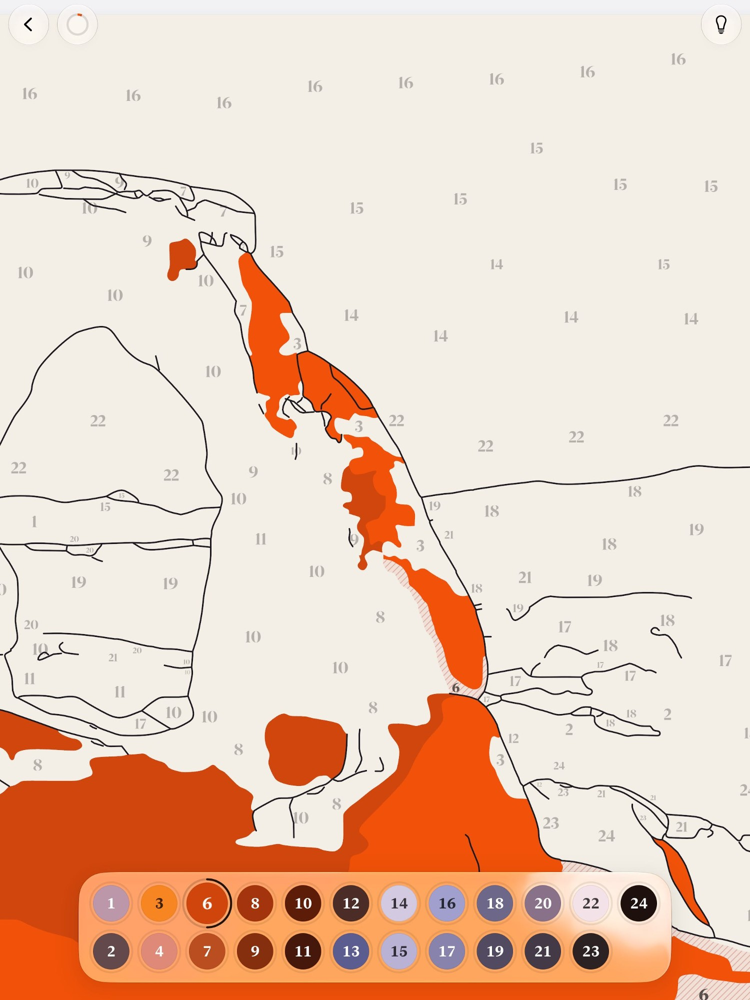 919x2000

→ `mcp__maestro__run` `{"device_id": "715C5E8F-B843-4B4F-B511-8F6A22D3DBE6", "yaml": "appId: com.pbordjadze.paintbynumber\n---\n- tapOn:\n    id: \"refine-cancel\"\n- waitForAnimationToEnd\n- tapOn:\n    point: \"38,84\"\n- waitForAnimationToEnd\n- tapOn:\n    point: \"38,84\"\n- waitForAnimationToEnd\n- scrollUntilVisible:\n    element: \"Delicate Arch\"\n- tapOn: \"Delicate Arch\"\n- waitForAnimationToEnd"}`

→ `mcp__maestro__take_screenshot` `{"device_id": "715C5E8F-B843-4B4F-B511-8F6A22D3DBE6"}`

← mcp__maestro__run: {"success":true,"device_id":"715C5E8F-B843-4B4F-B511-8F6A22D3DBE6","commands_executed":10,"message":"Flow executed successfully","env_vars":{"MAESTRO_CLI_ANALYSIS_NOTIFICATION_DISABLED":"true","MAESTRO_CLI_NO_ANALYTICS":"1","MAESTRO_DRIVER_STARTUP_TIMEOUT":"240000","MAESTRO_VERSION":"2.11.0"}}

← mcp__maestro__take_screenshot: image 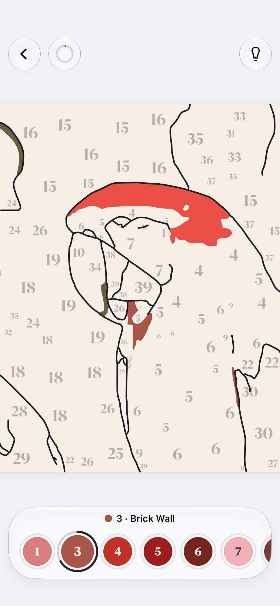 919x2000

→ `mcp__maestro__run` `{"device_id": "715C5E8F-B843-4B4F-B511-8F6A22D3DBE6", "yaml": "appId: com.pbordjadze.paintbynumber\n---\n- pressKey: Home"}`

→ `mcp__maestro__take_screenshot` `{"device_id": "715C5E8F-B843-4B4F-B511-8F6A22D3DBE6"}`

← mcp__maestro__run: {"success":true,"device_id":"715C5E8F-B843-4B4F-B511-8F6A22D3DBE6","commands_executed":2,"message":"Flow executed successfully","env_vars":{"MAESTRO_CLI_ANALYSIS_NOTIFICATION_DISABLED":"true","MAESTRO_CLI_NO_ANALYTICS":"1","MAESTRO_DRIVER_STARTUP_TIMEOUT":"240000","MAESTRO_VERSION":"2.11.0"}}

← mcp__maestro__take_screenshot: image 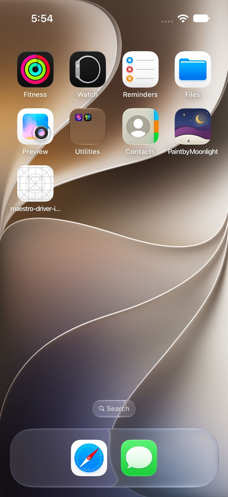 919x2000

→ `mcp__maestro__run` `{"device_id": "715C5E8F-B843-4B4F-B511-8F6A22D3DBE6", "yaml": "appId: com.pbordjadze.paintbynumber\n---\n- stopApp\n- launchApp\n- waitForAnimationToEnd\n- extendedWaitUntil:\n    visible: \"Back\"\n    timeout: 15000\n    optional: true\n- takeScreenshot: /Users/runner/work/_temp/qa/shots/relaunch-from-painting"}`

→ `mcp__maestro__take_screenshot` `{"device_id": "715C5E8F-B843-4B4F-B511-8F6A22D3DBE6"}`

← mcp__maestro__run: {"success":true,"device_id":"715C5E8F-B843-4B4F-B511-8F6A22D3DBE6","commands_executed":6,"message":"Flow executed successfully","env_vars":{"MAESTRO_CLI_ANALYSIS_NOTIFICATION_DISABLED":"true","MAESTRO_CLI_NO_ANALYTICS":"1","MAESTRO_DRIVER_STARTUP_TIMEOUT":"240000","MAESTRO_VERSION":"2.11.0"}}

← mcp__maestro__take_screenshot: image 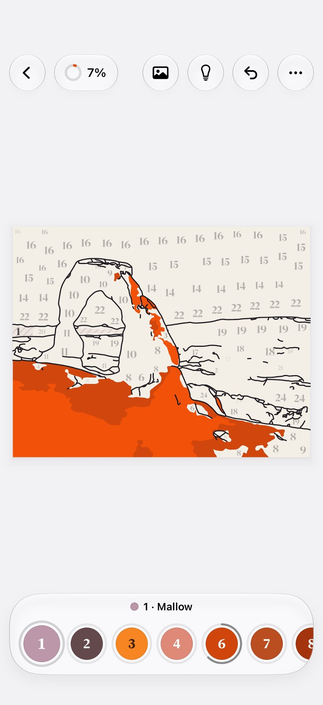 919x2000

→ `Read` `{"file_path": "/Users/runner/work/_temp/qa/app.log", "offset": 240}`

← Read: 240	2026-11-06 05:52:44.481 Df PaintByNumber[79318:30e6c] [com.pbordjadze.paintbynumber:create] Refine opens [adjusting false, full under way false, final true, phase ready]
241	2026-11-06 05:52:45.408 Df PaintByNumber[79318:30e6c] [com.pbordjadze.paintbynumber:tips] offer in refine: refineDraw, wanted refineDraw
242	2026-11-06 05:52:46.698 Df PaintByNumber[79318:30e6c] [com.pbordjadze.paintbynumb …

→ `Read` `{"file_path": "/Users/runner/work/_temp/qa/crashes.txt"}`

← Read: <system-reminder>Warning: the file exists but the contents are empty.</system-reminder>

→ `mcp__maestro__run` `{"device_id": "715C5E8F-B843-4B4F-B511-8F6A22D3DBE6", "yaml": "appId: com.pbordjadze.paintbynumber\n---\n- tapOn:\n    point: \"44,410\"\n- tapOn: \"Hint\""}`

→ `mcp__maestro__inspect_screen` `{"device_id": "715C5E8F-B843-4B4F-B511-8F6A22D3DBE6"}`

← mcp__maestro__run: {"success":true,"device_id":"715C5E8F-B843-4B4F-B511-8F6A22D3DBE6","commands_executed":3,"message":"Flow executed successfully","env_vars":{"MAESTRO_CLI_ANALYSIS_NOTIFICATION_DISABLED":"true","MAESTRO_CLI_NO_ANALYTICS":"1","MAESTRO_DRIVER_STARTUP_TIMEOUT":"240000","MAESTRO_VERSION":"2.11.0"}}

← mcp__maestro__inspect_screen: {"ui_schema":{"platform":"ios","abbreviations":{"b":"bounds","txt":"text","rid":"resource-id","a11y":"accessibilityText","hint":"hintText","val":"value","c":"children"},"defaults":{"enabled":true,"focused":false,"selected":false,"checked":false,"txt":"","hint":"","rid":"","val":"","a11y":""}},"elements":[{"b":"[0,0][402,874]","a11y":"Paint by Moonlight","c":[{"b":"[0,0][402,874]","c":[{"b":"[0,0][ …

→ `mcp__maestro__run` `{"device_id": "715C5E8F-B843-4B4F-B511-8F6A22D3DBE6", "yaml": "appId: com.pbordjadze.paintbynumber\n---\n- tapOn:\n    id: \"canvas-area-43\"\n- tapOn:\n    id: \"quiet-ring\"\n- takeScreenshot: /Users/runner/work/_temp/qa/shots/arch-full-bar"}`

→ `Read` `{"file_path": "/Users/runner/work/_temp/qa/app.log", "offset": 265}`

← mcp__maestro__run: {"success":true,"device_id":"715C5E8F-B843-4B4F-B511-8F6A22D3DBE6","commands_executed":4,"message":"Flow executed successfully","env_vars":{"MAESTRO_CLI_ANALYSIS_NOTIFICATION_DISABLED":"true","MAESTRO_CLI_NO_ANALYTICS":"1","MAESTRO_DRIVER_STARTUP_TIMEOUT":"240000","MAESTRO_VERSION":"2.11.0"}}

← Read: 265	2026-11-06 05:55:15.399 Df PaintByNumber[24951:4964e] [com.pbordjadze.paintbynumber:tips] offer in bench: benchZen, wanted
266

→ `mcp__maestro__run` `{"device_id": "715C5E8F-B843-4B4F-B511-8F6A22D3DBE6", "yaml": "appId: com.pbordjadze.paintbynumber\n---\n- tapOn: \"More\"\n- waitForAnimationToEnd\n- tapOn: \"Fit to Screen\"\n- waitForAnimationToEnd"}`

→ `mcp__maestro__inspect_screen` `{"device_id": "715C5E8F-B843-4B4F-B511-8F6A22D3DBE6"}`

← mcp__maestro__run: {"success":true,"device_id":"715C5E8F-B843-4B4F-B511-8F6A22D3DBE6","commands_executed":5,"message":"Flow executed successfully","env_vars":{"MAESTRO_CLI_ANALYSIS_NOTIFICATION_DISABLED":"true","MAESTRO_CLI_NO_ANALYTICS":"1","MAESTRO_DRIVER_STARTUP_TIMEOUT":"240000","MAESTRO_VERSION":"2.11.0"}}

← mcp__maestro__inspect_screen: {"ui_schema":{"platform":"ios","abbreviations":{"b":"bounds","txt":"text","rid":"resource-id","a11y":"accessibilityText","hint":"hintText","val":"value","c":"children"},"defaults":{"enabled":true,"focused":false,"selected":false,"checked":false,"txt":"","hint":"","rid":"","val":"","a11y":""}},"elements":[{"b":"[0,0][402,874]","a11y":"Paint by Moonlight","c":[{"b":"[0,0][402,874]","c":[{"b":"[0,0][ …

→ `mcp__maestro__run` `{"device_id": "715C5E8F-B843-4B4F-B511-8F6A22D3DBE6", "yaml": "appId: com.pbordjadze.paintbynumber\n---\n- tapOn: \"Hint\"\n- takeScreenshot: /Users/runner/work/_temp/qa/shots/arch-hint-full-bar"}`

→ `Read` `{"file_path": "/Users/runner/work/_temp/qa/app.log", "offset": 266}`

← mcp__maestro__run: {"success":true,"device_id":"715C5E8F-B843-4B4F-B511-8F6A22D3DBE6","commands_executed":3,"message":"Flow executed successfully","env_vars":{"MAESTRO_CLI_ANALYSIS_NOTIFICATION_DISABLED":"true","MAESTRO_CLI_NO_ANALYTICS":"1","MAESTRO_DRIVER_STARTUP_TIMEOUT":"240000","MAESTRO_VERSION":"2.11.0"}}

← Read: 266	2026-11-06 05:55:52.690 Df PaintByNumber[24951:4964e] [com.pbordjadze.paintbynumber:tips] offer in bench: benchZen, wanted
267

→ `mcp__maestro__inspect_screen` `{"device_id": "715C5E8F-B843-4B4F-B511-8F6A22D3DBE6"}`

← mcp__maestro__inspect_screen: {"ui_schema":{"platform":"ios","abbreviations":{"b":"bounds","txt":"text","rid":"resource-id","a11y":"accessibilityText","hint":"hintText","val":"value","c":"children"},"defaults":{"enabled":true,"focused":false,"selected":false,"checked":false,"txt":"","hint":"","rid":"","val":"","a11y":""}},"elements":[{"b":"[0,0][402,874]","a11y":"Paint by Moonlight","c":[{"b":"[0,0][402,874]","c":[{"b":"[0,0][ …

→ `mcp__maestro__run` `{"device_id": "715C5E8F-B843-4B4F-B511-8F6A22D3DBE6", "yaml": "appId: com.pbordjadze.paintbynumber\n---\n- tapOn:\n    id: \"canvas-area-94\"\n- tapOn:\n    id: \"quiet-ring\"\n- tapOn: \"Hint\""}`

→ `Read` `{"file_path": "/Users/runner/work/_temp/qa/app.log", "offset": 267}`

← mcp__maestro__run: {"success":true,"device_id":"715C5E8F-B843-4B4F-B511-8F6A22D3DBE6","commands_executed":4,"message":"Flow executed successfully","env_vars":{"MAESTRO_CLI_ANALYSIS_NOTIFICATION_DISABLED":"true","MAESTRO_CLI_NO_ANALYTICS":"1","MAESTRO_DRIVER_STARTUP_TIMEOUT":"240000","MAESTRO_VERSION":"2.11.0"}}

← Read: 267

→ `mcp__maestro__take_screenshot` `{"device_id": "715C5E8F-B843-4B4F-B511-8F6A22D3DBE6"}`

← mcp__maestro__take_screenshot: image 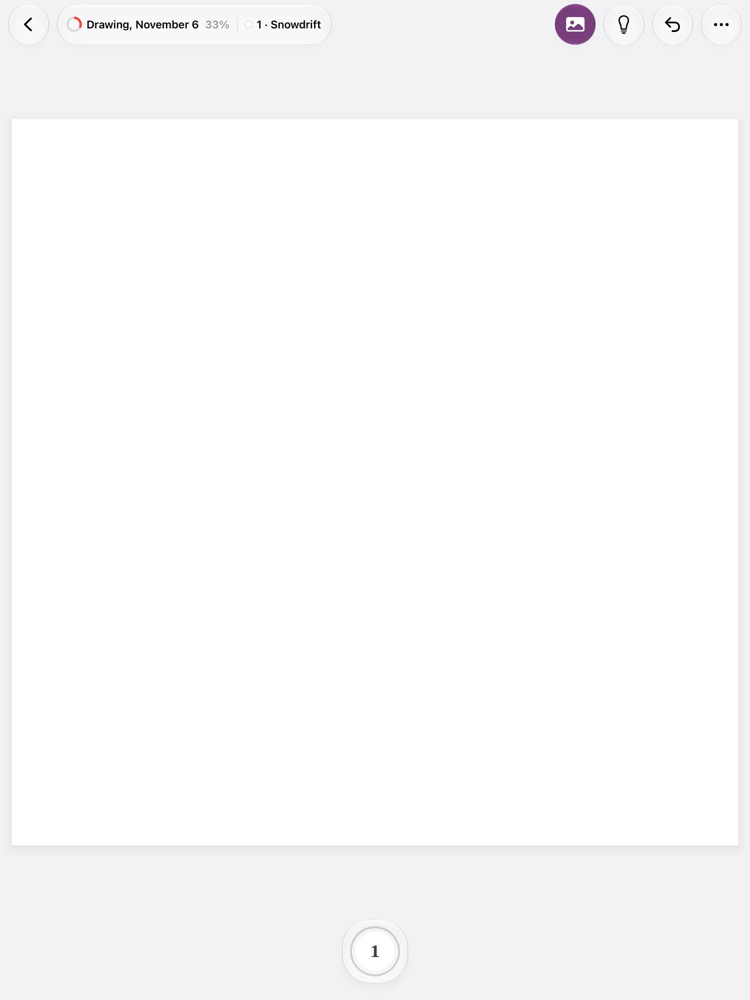 919x2000

> No Zen tip came in this third session (the log has `benchZen, wanted` with nothing chosen up to 05:55:52). I'm stopping here and finishing the report.

→ `Read` `{"file_path": "/Users/runner/work/_temp/qa/app.log", "offset": 267}`

← Read: Wasted call — file unchanged since your last Read. Refer to that earlier tool_result instead.

→ `Write` `{"file_path": "/Users/runner/work/_temp/qa/report.md", "content": "# Paint by Moonlight: newcomer's first hour (iPhone 17 Pro simulator, debug build, 05:28\u201305:58)\n\n## Summary\nAll six journey goals worked: the gallery, painting a starter, making paintings from a sample, a photo and an empty page, Refine on a preview, and printing (found in about 3 minutes, via long-press on a gallery card \u203a Share \u203a Print Template\u2026). Five tips showed on screen: \"Tap to Paint\" (twice, once per tip reset), \"No Photo at Hand\" and \"Draw Your Own Lines\". All were readable, stayed put and `

← Write: The file /Users/runner/work/_temp/qa/report.md has been updated successfully. (file state is current in your context — no need to Read it back)

> I finished the session (05:28–05:58) and wrote the report to `/Users/runner/work/_temp/qa/report.md`. All six goals worked and nothing crashed (`crashes.txt` is empty). Progress survived both quit-and-relaunch checks; both times I went to Home first.
> 
> **Tips seen on screen** (screenshots `shots/tip-1`, `tip-3`, `tip-4`, `tip-5`):
> - **"Tap to Paint"**, twice (once again after Settings › Show Tips Again). It points at the selected swatch, as it should, but covers the current-color label both times.
> - **"No Photo at Hand"**: its arrow points at the middle of the Photos/Samples control, not at Samples, which is what it talks about.
> - **"Draw Your Own Lines"**: the title promises drawing, but the text only explains two-finger zoom and undo, never how to draw.
> 
> All of them were readable, stayed put when I looked again, and closed cleanly.
> 
> **Problems seen more than once:**
> - **Refine on portrait pictures:** the Generated/Blank switch and the "tiny numbers" badge sit on top of the picture and hide part of it (2 of 2 portrait pictures). On the landscape Irises they sat above it.
> - **Two preview tips never come:** the tips for the sliders and for Refine were wanted three times. Each time the log says "nothing was eligible in time … pending", and nothing appeared. The Refine one matters, because a newcomer can't guess what Refine does.
> 
> **Seen once (in Suspicions):**
> - In the first session the log gave a Zen tip a 30-second turn while nothing showed on screen. It was most likely tied to the More button, which was hidden then. The session then counted as full and refused all later tips. Two later sessions held that tip back instead, so I couldn't reproduce it.
> - Two preview tips were marked as already acted on, though I never tapped what they point at.
> - A drawing made on an empty page has a Photo button that shows a blank page, and comes out with a single white paint, so painting it means filling white with white.
> 
> **Printing:** I expected it in the painting's More menu; it isn't there. It's under long-press on a gallery card › Share › Print Template…. It took about 1 minute to find and about 3 to reach the print options. "Print Template…" opens a share sheet first, and its thumbnail shows my paint although the printed pages are clean. I wouldn't have given up, but someone who never long-presses might. I'd also put it in the painting's More menu.
> 
> **Not tested:** Maestro can't pinch, two-finger pan, drag-paint, or double-tap zoom on the canvas. I didn't actually print, and didn't touch Send Template, Share Progress or Give Feedback, since they send things out.
