# Agent transcript

- end: success, 62 turns, 15.7 min, estimated $1.7231259999999997
- tool calls: {"mcp__maestro__take_screenshot": 26, "mcp__maestro__run": 26, "mcp__maestro__inspect_screen": 3, "Read": 4, "Write": 2}
- images the agent received: 26

**Start**: model claude-opus-5-5, MCP [{"name": "maestro", "status": "connected", "source": "dynamic"}]

→ `mcp__maestro__take_screenshot` `{"device_id": "3CE49892-DF52-49A7-9D5F-68E49A7DD048"}`

← mcp__maestro__take_screenshot: image 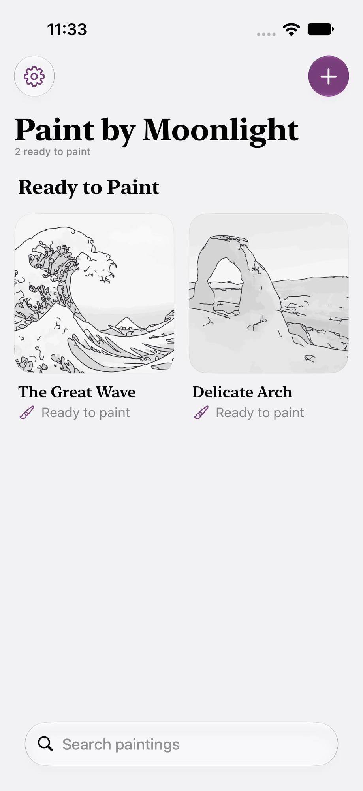 1500x2000

→ `mcp__maestro__run` `{"device_id": "3CE49892-DF52-49A7-9D5F-68E49A7DD048", "yaml": "appId: com.pbordjadze.paintbynumber\n---\n- tapOn:\n    point: \"72%,4%\"\n- waitForAnimationToEnd\n- takeScreenshot: /Users/runner/work/_temp/qa/shots/plan-1"}`

→ `mcp__maestro__inspect_screen` `{"device_id": "3CE49892-DF52-49A7-9D5F-68E49A7DD048"}`

← mcp__maestro__run: {"success":true,"device_id":"3CE49892-DF52-49A7-9D5F-68E49A7DD048","commands_executed":4,"message":"Flow executed successfully","env_vars":{"MAESTRO_CLI_ANALYSIS_NOTIFICATION_DISABLED":"true","MAESTRO_CLI_NO_ANALYTICS":"1","MAESTRO_DRIVER_STARTUP_TIMEOUT":"240000","MAESTRO_VERSION":"2.11.0"}}

← mcp__maestro__inspect_screen: {"ui_schema":{"platform":"ios","abbreviations":{"b":"bounds","txt":"text","rid":"resource-id","a11y":"accessibilityText","hint":"hintText","val":"value","c":"children"},"defaults":{"enabled":true,"focused":false,"selected":false,"checked":false,"txt":"","hint":"","rid":"","val":"","a11y":""}},"elements":[{"b":"[0,0][1032,1376]","a11y":"Paint by Moonlight","c":[{"b":"[0,0][1032,1376]","c":[{"b":"[0 …

> There's a "From Scratch" button. Tapping it.

→ `mcp__maestro__run` `{"device_id": "3CE49892-DF52-49A7-9D5F-68E49A7DD048", "yaml": "appId: com.pbordjadze.paintbynumber\n---\n- tapOn:\n    id: \"from-scratch\"\n- waitForAnimationToEnd\n- takeScreenshot: /Users/runner/work/_temp/qa/shots/plan-2"}`

→ `mcp__maestro__take_screenshot` `{"device_id": "3CE49892-DF52-49A7-9D5F-68E49A7DD048"}`

← mcp__maestro__run: {"success":true,"device_id":"3CE49892-DF52-49A7-9D5F-68E49A7DD048","commands_executed":4,"message":"Flow executed successfully","env_vars":{"MAESTRO_CLI_ANALYSIS_NOTIFICATION_DISABLED":"true","MAESTRO_CLI_NO_ANALYTICS":"1","MAESTRO_DRIVER_STARTUP_TIMEOUT":"240000","MAESTRO_VERSION":"2.11.0"}}

← mcp__maestro__take_screenshot: image 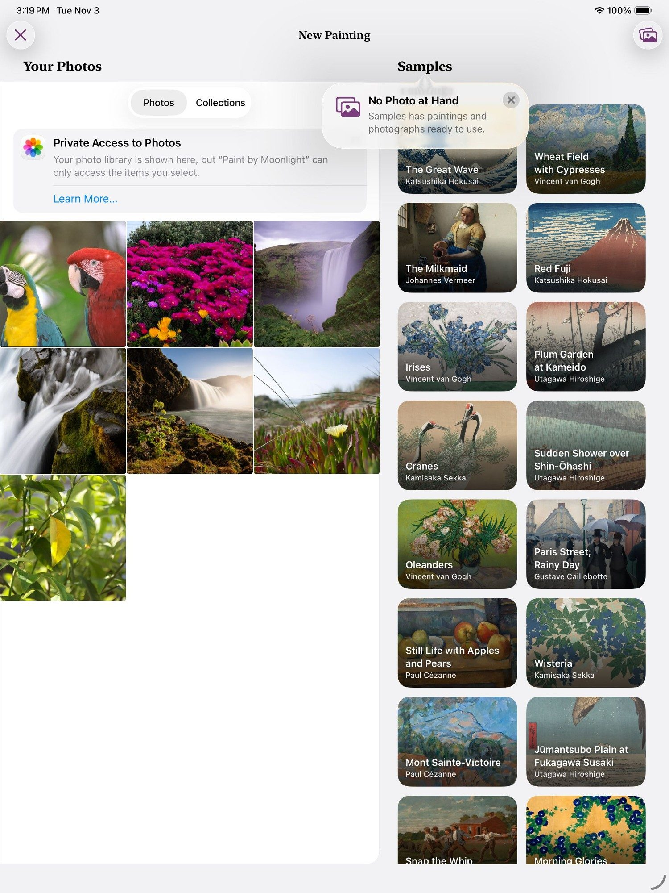 1500x2000

→ `mcp__maestro__inspect_screen` `{"device_id": "3CE49892-DF52-49A7-9D5F-68E49A7DD048"}`

← mcp__maestro__inspect_screen: {"ui_schema":{"platform":"ios","abbreviations":{"b":"bounds","txt":"text","rid":"resource-id","a11y":"accessibilityText","hint":"hintText","val":"value","c":"children"},"defaults":{"enabled":true,"focused":false,"selected":false,"checked":false,"txt":"","hint":"","rid":"","val":"","a11y":""}},"elements":[{"b":"[0,0][1032,1376]","a11y":"Paint by Moonlight","c":[{"b":"[0,0][1032,1376]","c":[{"b":"[0 …

→ `Read` `{"file_path": "/Users/runner/work/_temp/qa/app.log"}`

← Read: 1	getpwuid_r did not find a match for uid 501
2	Filtering the log data using "subsystem == "com.pbordjadze.paintbynumber""
3	Timestamp               Ty Process[PID:TID]
4	2026-11-05 14:10:45.299 Df PaintByNumber[31592:156a7] [com.pbordjadze.paintbynumber:tips] offer in shelf: , wanted
5	2026-11-05 14:10:46.702 Df PaintByNumber[31592:157fd] [com.pbordjadze.paintbynumber:canvas] Making the render co …

→ `mcp__maestro__run` `{"device_id": "3CE49892-DF52-49A7-9D5F-68E49A7DD048", "yaml": "appId: com.pbordjadze.paintbynumber\n---\n- tapOn:\n    point: \"443,982\"\n- waitForAnimationToEnd\n- takeScreenshot: /Users/runner/work/_temp/qa/shots/plan-3"}`

→ `mcp__maestro__take_screenshot` `{"device_id": "3CE49892-DF52-49A7-9D5F-68E49A7DD048"}`

← mcp__maestro__run: {"success":true,"device_id":"3CE49892-DF52-49A7-9D5F-68E49A7DD048","commands_executed":4,"message":"Flow executed successfully","env_vars":{"MAESTRO_CLI_ANALYSIS_NOTIFICATION_DISABLED":"true","MAESTRO_CLI_NO_ANALYTICS":"1","MAESTRO_DRIVER_STARTUP_TIMEOUT":"240000","MAESTRO_VERSION":"2.11.0"}}

← mcp__maestro__take_screenshot: image 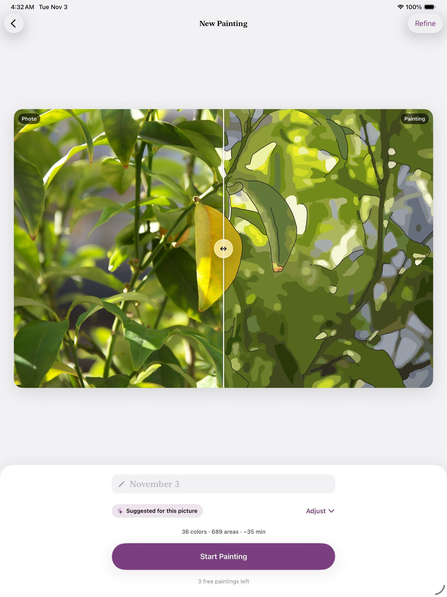 1500x2000

→ `mcp__maestro__run` `{"device_id": "3CE49892-DF52-49A7-9D5F-68E49A7DD048", "yaml": "appId: com.pbordjadze.paintbynumber\n---\n- tapOn:\n    point: \"1000,54\"\n- waitForAnimationToEnd"}`

→ `mcp__maestro__take_screenshot` `{"device_id": "3CE49892-DF52-49A7-9D5F-68E49A7DD048"}`

← mcp__maestro__run: {"success":true,"device_id":"3CE49892-DF52-49A7-9D5F-68E49A7DD048","commands_executed":3,"message":"Flow executed successfully","env_vars":{"MAESTRO_CLI_ANALYSIS_NOTIFICATION_DISABLED":"true","MAESTRO_CLI_NO_ANALYTICS":"1","MAESTRO_DRIVER_STARTUP_TIMEOUT":"240000","MAESTRO_VERSION":"2.11.0"}}

← mcp__maestro__take_screenshot: image 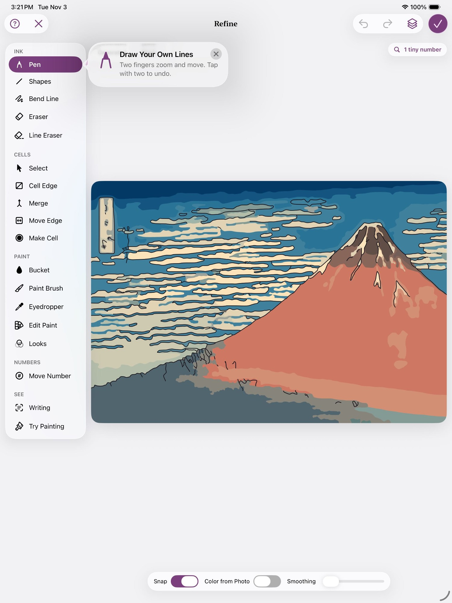 1500x2000

→ `mcp__maestro__run` `{"device_id": "3CE49892-DF52-49A7-9D5F-68E49A7DD048", "yaml": "appId: com.pbordjadze.paintbynumber\n---\n- tapOn: \"Close\"\n- waitForAnimationToEnd\n- tapOn:\n    point: \"32,54\"\n- waitForAnimationToEnd"}`

→ `mcp__maestro__take_screenshot` `{"device_id": "3CE49892-DF52-49A7-9D5F-68E49A7DD048"}`

← mcp__maestro__run: {"success":true,"device_id":"3CE49892-DF52-49A7-9D5F-68E49A7DD048","commands_executed":5,"message":"Flow executed successfully","env_vars":{"MAESTRO_CLI_ANALYSIS_NOTIFICATION_DISABLED":"true","MAESTRO_CLI_NO_ANALYTICS":"1","MAESTRO_DRIVER_STARTUP_TIMEOUT":"240000","MAESTRO_VERSION":"2.11.0"}}

← mcp__maestro__take_screenshot: image 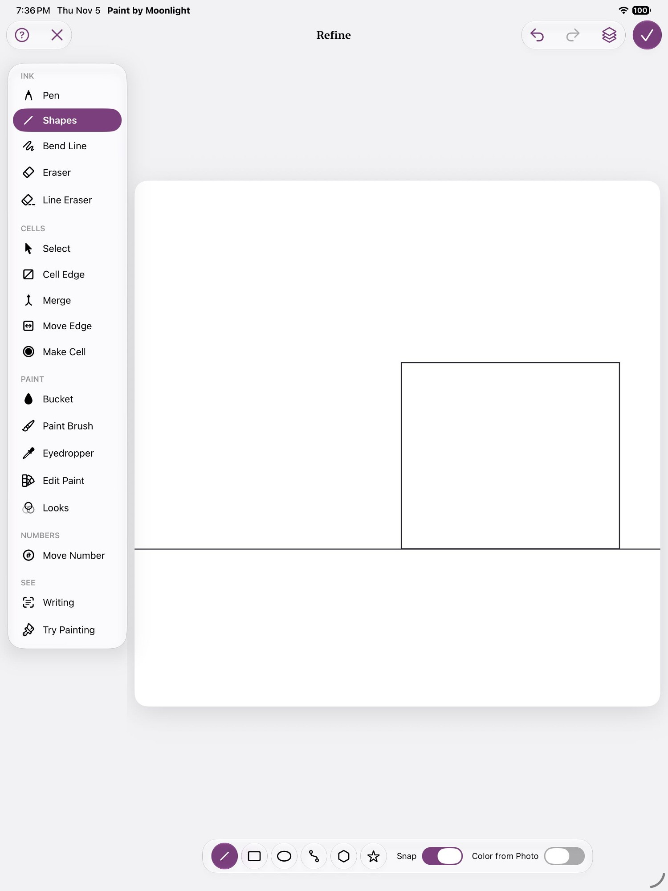 1500x2000

→ `mcp__maestro__run` `{"device_id": "3CE49892-DF52-49A7-9D5F-68E49A7DD048", "yaml": "appId: com.pbordjadze.paintbynumber\n---\n- takeScreenshot: /Users/runner/work/_temp/qa/shots/plan-4-settings\n- tapOn:\n    point: \"688,805\"\n- waitForAnimationToEnd\n- tapOn:\n    point: \"947,63\"\n- waitForAnimationToEnd\n- tapOn: \"The Great Wave\"\n- waitForAnimationToEnd"}`

→ `mcp__maestro__take_screenshot` `{"device_id": "3CE49892-DF52-49A7-9D5F-68E49A7DD048"}`

← mcp__maestro__run: {"success":true,"device_id":"3CE49892-DF52-49A7-9D5F-68E49A7DD048","commands_executed":8,"message":"Flow executed successfully","env_vars":{"MAESTRO_CLI_ANALYSIS_NOTIFICATION_DISABLED":"true","MAESTRO_CLI_NO_ANALYTICS":"1","MAESTRO_DRIVER_STARTUP_TIMEOUT":"240000","MAESTRO_VERSION":"2.11.0"}}

← mcp__maestro__take_screenshot: image 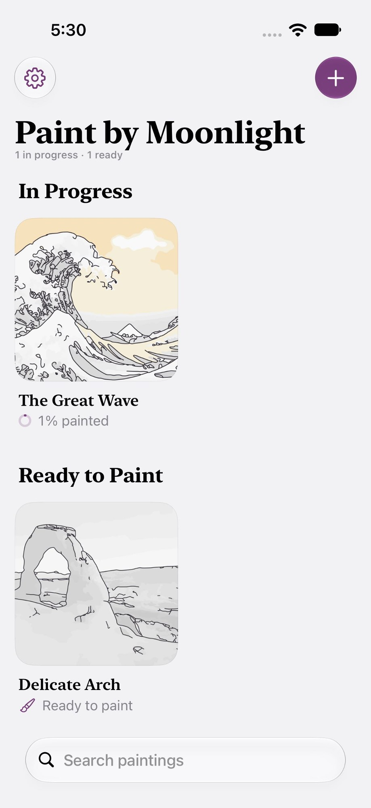 1500x2000

> Closing the tip and opening More.

→ `mcp__maestro__run` `{"device_id": "3CE49892-DF52-49A7-9D5F-68E49A7DD048", "yaml": "appId: com.pbordjadze.paintbynumber\n---\n- tapOn:\n    point: \"391,1192\"\n- waitForAnimationToEnd\n- tapOn:\n    point: \"992,33\"\n- waitForAnimationToEnd"}`

→ `mcp__maestro__take_screenshot` `{"device_id": "3CE49892-DF52-49A7-9D5F-68E49A7DD048"}`

← mcp__maestro__run: {"success":true,"device_id":"3CE49892-DF52-49A7-9D5F-68E49A7DD048","commands_executed":5,"message":"Flow executed successfully","env_vars":{"MAESTRO_CLI_ANALYSIS_NOTIFICATION_DISABLED":"true","MAESTRO_CLI_NO_ANALYTICS":"1","MAESTRO_DRIVER_STARTUP_TIMEOUT":"240000","MAESTRO_VERSION":"2.11.0"}}

← mcp__maestro__take_screenshot: image 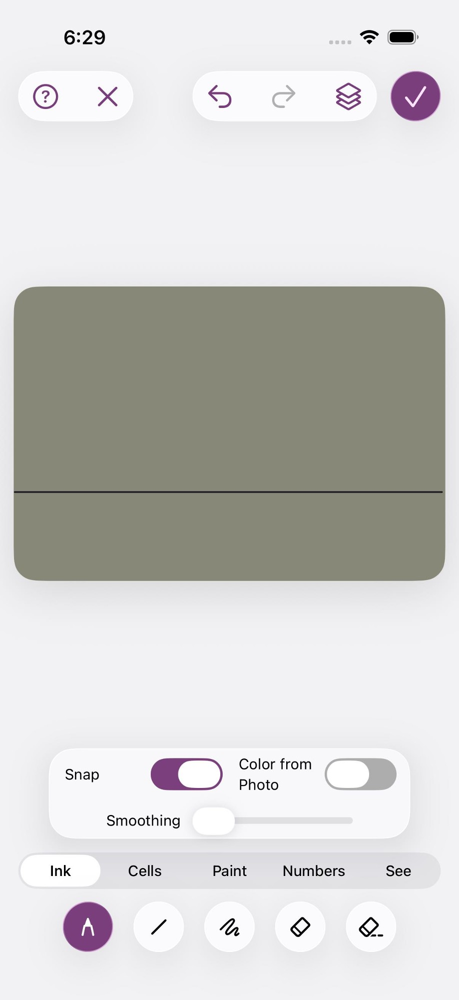 1500x2000

> No Refine in the painting's More menu. Next I'll try the gallery card's context menu.

→ `mcp__maestro__run` `{"device_id": "3CE49892-DF52-49A7-9D5F-68E49A7DD048", "yaml": "appId: com.pbordjadze.paintbynumber\n---\n- tapOn:\n    point: \"400,200\"\n- waitForAnimationToEnd\n- tapOn:\n    point: \"38,33\"\n- waitForAnimationToEnd\n- longPressOn:\n    point: \"516,360\"\n- waitForAnimationToEnd"}`

→ `mcp__maestro__take_screenshot` `{"device_id": "3CE49892-DF52-49A7-9D5F-68E49A7DD048"}`

← mcp__maestro__run: {"success":true,"device_id":"3CE49892-DF52-49A7-9D5F-68E49A7DD048","commands_executed":7,"message":"Flow executed successfully","env_vars":{"MAESTRO_CLI_ANALYSIS_NOTIFICATION_DISABLED":"true","MAESTRO_CLI_NO_ANALYTICS":"1","MAESTRO_DRIVER_STARTUP_TIMEOUT":"240000","MAESTRO_VERSION":"2.11.0"}}

← mcp__maestro__take_screenshot: image 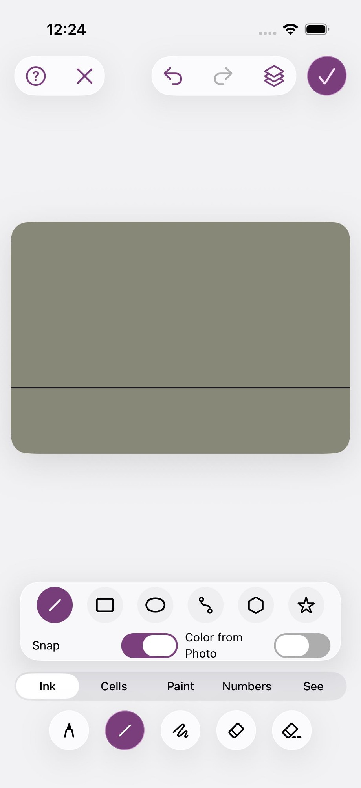 1500x2000

> No Refine there either. Next: a sample's New Painting preview.

→ `mcp__maestro__run` `{"device_id": "3CE49892-DF52-49A7-9D5F-68E49A7DD048", "yaml": "appId: com.pbordjadze.paintbynumber\n---\n- tapOn:\n    point: \"200,1100\"\n- waitForAnimationToEnd\n- tapOn:\n    point: \"747,54\"\n- waitForAnimationToEnd\n- tapOn: \"Sample: Red Fuji, Katsushika Hokusai\"\n- waitForAnimationToEnd"}`

→ `mcp__maestro__take_screenshot` `{"device_id": "3CE49892-DF52-49A7-9D5F-68E49A7DD048"}`

← mcp__maestro__run: {"success":true,"device_id":"3CE49892-DF52-49A7-9D5F-68E49A7DD048","commands_executed":7,"message":"Flow executed successfully","env_vars":{"MAESTRO_CLI_ANALYSIS_NOTIFICATION_DISABLED":"true","MAESTRO_CLI_NO_ANALYTICS":"1","MAESTRO_DRIVER_STARTUP_TIMEOUT":"240000","MAESTRO_VERSION":"2.11.0"}}

← mcp__maestro__take_screenshot: image 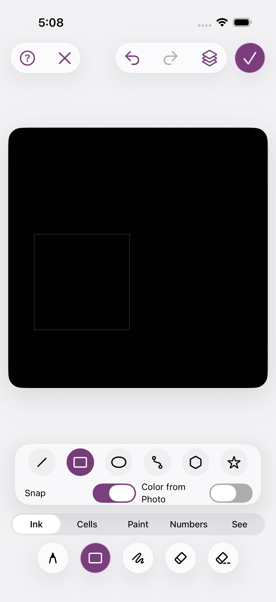 1500x2000

> A Refine button on a sample's preview. Tapping it to see whether it's paywalled too.

→ `mcp__maestro__run` `{"device_id": "3CE49892-DF52-49A7-9D5F-68E49A7DD048", "yaml": "appId: com.pbordjadze.paintbynumber\n---\n- tapOn: \"Refine\"\n- waitForAnimationToEnd"}`

→ `mcp__maestro__take_screenshot` `{"device_id": "3CE49892-DF52-49A7-9D5F-68E49A7DD048"}`

← mcp__maestro__run: {"success":true,"device_id":"3CE49892-DF52-49A7-9D5F-68E49A7DD048","commands_executed":3,"message":"Flow executed successfully","env_vars":{"MAESTRO_CLI_ANALYSIS_NOTIFICATION_DISABLED":"true","MAESTRO_CLI_NO_ANALYTICS":"1","MAESTRO_DRIVER_STARTUP_TIMEOUT":"240000","MAESTRO_VERSION":"2.11.0"}}

← mcp__maestro__take_screenshot: image 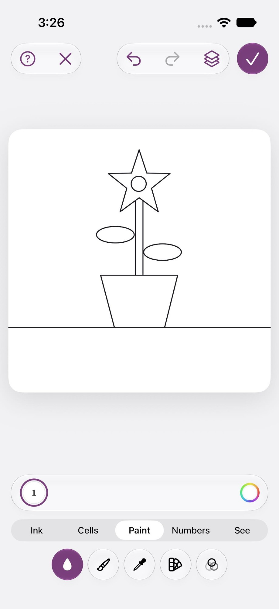 1500x2000

→ `Read` `{"file_path": "/Users/runner/work/_temp/qa/app.log", "offset": 12}`

← Read: 12	2026-11-05 14:14:10.185 Df PaintByNumber[31592:156a7] [com.pbordjadze.paintbynumber:tips] offer in newPainting: newPaintingSamples, wanted
13	2026-11-05 14:15:35.740 Df PaintByNumber[31592:156a7] [com.pbordjadze.paintbynumber:create] Tool Guide page shown: basics
14	2026-11-05 14:16:52.143 Df PaintByNumber[31592:156a7] [com.pbordjadze.paintbynumber:tips] offer in drawer: drawerWorthALook, wante …

> The log says "Refine opens" even though the paywall is up. To check whether "Not Now" lets me through, I'll try it.

→ `mcp__maestro__run` `{"device_id": "3CE49892-DF52-49A7-9D5F-68E49A7DD048", "yaml": "appId: com.pbordjadze.paintbynumber\n---\n- tapOn:\n    point: \"429,935\"\n- waitForAnimationToEnd"}`

→ `mcp__maestro__take_screenshot` `{"device_id": "3CE49892-DF52-49A7-9D5F-68E49A7DD048"}`

← mcp__maestro__run: {"success":true,"device_id":"3CE49892-DF52-49A7-9D5F-68E49A7DD048","commands_executed":3,"message":"Flow executed successfully","env_vars":{"MAESTRO_CLI_ANALYSIS_NOTIFICATION_DISABLED":"true","MAESTRO_CLI_NO_ANALYTICS":"1","MAESTRO_DRIVER_STARTUP_TIMEOUT":"240000","MAESTRO_VERSION":"2.11.0"}}

← mcp__maestro__take_screenshot: image 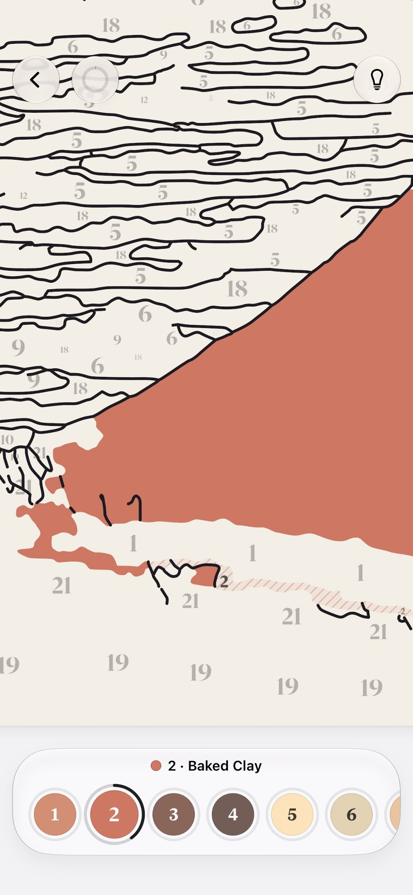 1500x2000

→ `Write` `{"file_path": "/Users/runner/work/_temp/qa/report.md", "content": "# Paint by Moonlight: Refine \"draw from scratch\" session (iPad Pro 13\", debug build)\n\n**Verdict**: No. Every way into Refine and the blank page is behind a $4.99 paywall on a fresh install, so I couldn't make a painting of my own. (Draft report; drawing in the Tool Guide's practice canvas is next.)\n\n**What I meant to draw**: A tall white-and-red-striped lighthouse with a yellow lamp, on a grey-brown rock, with a blue sea band behind it and a sunset sky above: orange near the horizon, pink-purple higher up. Five paints or`

← Write: File created successfully at: /Users/runner/work/_temp/qa/report.md (file state is current in your context — no need to Read it back)

> Now I'll draw in the Tool Guide's practice canvas, starting with its Pen page.

→ `mcp__maestro__run` `{"device_id": "3CE49892-DF52-49A7-9D5F-68E49A7DD048", "yaml": "appId: com.pbordjadze.paintbynumber\n---\n- tapOn: \"Refine\"\n- waitForAnimationToEnd\n- tapOn:\n    point: \"443,982\"\n- waitForAnimationToEnd\n- tapOn: \"Pen\"\n- waitForAnimationToEnd"}`

→ `mcp__maestro__take_screenshot` `{"device_id": "3CE49892-DF52-49A7-9D5F-68E49A7DD048"}`

← mcp__maestro__run: {"success":true,"device_id":"3CE49892-DF52-49A7-9D5F-68E49A7DD048","commands_executed":7,"message":"Flow executed successfully","env_vars":{"MAESTRO_CLI_ANALYSIS_NOTIFICATION_DISABLED":"true","MAESTRO_CLI_NO_ANALYTICS":"1","MAESTRO_DRIVER_STARTUP_TIMEOUT":"240000","MAESTRO_VERSION":"2.11.0"}}

← mcp__maestro__take_screenshot: image 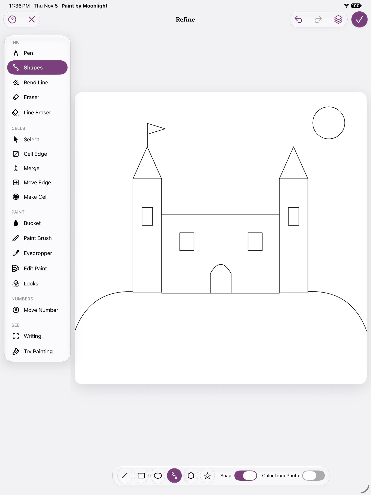 1500x2000

→ `mcp__maestro__run` `{"device_id": "3CE49892-DF52-49A7-9D5F-68E49A7DD048", "yaml": "appId: com.pbordjadze.paintbynumber\n---\n- tapOn: \"Shapes\"\n- waitForAnimationToEnd"}`

→ `mcp__maestro__take_screenshot` `{"device_id": "3CE49892-DF52-49A7-9D5F-68E49A7DD048"}`

← mcp__maestro__run: {"success":true,"device_id":"3CE49892-DF52-49A7-9D5F-68E49A7DD048","commands_executed":3,"message":"Flow executed successfully","env_vars":{"MAESTRO_CLI_ANALYSIS_NOTIFICATION_DISABLED":"true","MAESTRO_CLI_NO_ANALYTICS":"1","MAESTRO_DRIVER_STARTUP_TIMEOUT":"240000","MAESTRO_VERSION":"2.11.0"}}

← mcp__maestro__take_screenshot: image 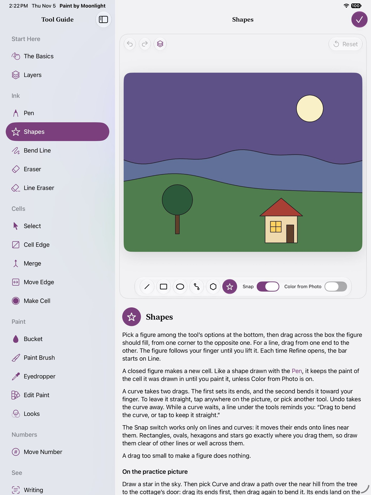 1500x2000

> Shapes has Rectangle, Oval and a two-drag Curve, so curves are possible. I'll draw the rock with an oval on the practice picture's left hill.

→ `mcp__maestro__run` `{"device_id": "3CE49892-DF52-49A7-9D5F-68E49A7DD048", "yaml": "appId: com.pbordjadze.paintbynumber\n---\n- tapOn:\n    point: \"500,796\"\n- waitForAnimationToEnd\n- swipe:\n    start: \"358,605\"\n    end: \"478,684\"\n    duration: 900\n- waitForAnimationToEnd\n- takeScreenshot: /Users/runner/work/_temp/qa/shots/plan-5-rock"}`

→ `mcp__maestro__take_screenshot` `{"device_id": "3CE49892-DF52-49A7-9D5F-68E49A7DD048"}`

← mcp__maestro__run: {"success":true,"device_id":"3CE49892-DF52-49A7-9D5F-68E49A7DD048","commands_executed":6,"message":"Flow executed successfully","env_vars":{"MAESTRO_CLI_ANALYSIS_NOTIFICATION_DISABLED":"true","MAESTRO_CLI_NO_ANALYTICS":"1","MAESTRO_DRIVER_STARTUP_TIMEOUT":"240000","MAESTRO_VERSION":"2.11.0"}}

← mcp__maestro__take_screenshot: image  1500x2000

> Rock oval drawn on the first try. Next, the lighthouse body (a rectangle) and the lamp room (a smaller rectangle on top).

→ `mcp__maestro__run` `{"device_id": "3CE49892-DF52-49A7-9D5F-68E49A7DD048", "yaml": "appId: com.pbordjadze.paintbynumber\n---\n- tapOn:\n    point: \"454,796\"\n- waitForAnimationToEnd\n- swipe:\n    start: \"398,400\"\n    end: \"438,628\"\n    duration: 900\n- waitForAnimationToEnd\n- swipe:\n    start: \"402,362\"\n    end: \"434,400\"\n    duration: 900\n- waitForAnimationToEnd"}`

→ `mcp__maestro__take_screenshot` `{"device_id": "3CE49892-DF52-49A7-9D5F-68E49A7DD048"}`

← mcp__maestro__run: {"success":true,"device_id":"3CE49892-DF52-49A7-9D5F-68E49A7DD048","commands_executed":7,"message":"Flow executed successfully","env_vars":{"MAESTRO_CLI_ANALYSIS_NOTIFICATION_DISABLED":"true","MAESTRO_CLI_NO_ANALYTICS":"1","MAESTRO_DRIVER_STARTUP_TIMEOUT":"240000","MAESTRO_VERSION":"2.11.0"}}

← mcp__maestro__take_screenshot: image 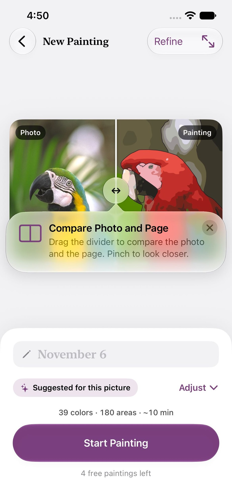 1500x2000

> Both rectangles are in. Now two stripes across the tower with the Line tool. Snap should join their ends to the tower's sides.

→ `mcp__maestro__run` `{"device_id": "3CE49892-DF52-49A7-9D5F-68E49A7DD048", "yaml": "appId: com.pbordjadze.paintbynumber\n---\n- tapOn:\n    point: \"409,796\"\n- waitForAnimationToEnd\n- swipe:\n    start: \"396,470\"\n    end: \"440,470\"\n    duration: 700\n- waitForAnimationToEnd\n- swipe:\n    start: \"396,500\"\n    end: \"440,500\"\n    duration: 700\n- waitForAnimationToEnd\n- takeScreenshot: /Users/runner/work/_temp/qa/shots/plan-6-stripes"}`

→ `mcp__maestro__take_screenshot` `{"device_id": "3CE49892-DF52-49A7-9D5F-68E49A7DD048"}`

← mcp__maestro__run: {"success":true,"device_id":"3CE49892-DF52-49A7-9D5F-68E49A7DD048","commands_executed":8,"message":"Flow executed successfully","env_vars":{"MAESTRO_CLI_ANALYSIS_NOTIFICATION_DISABLED":"true","MAESTRO_CLI_NO_ANALYTICS":"1","MAESTRO_DRIVER_STARTUP_TIMEOUT":"240000","MAESTRO_VERSION":"2.11.0"}}

← mcp__maestro__take_screenshot: image 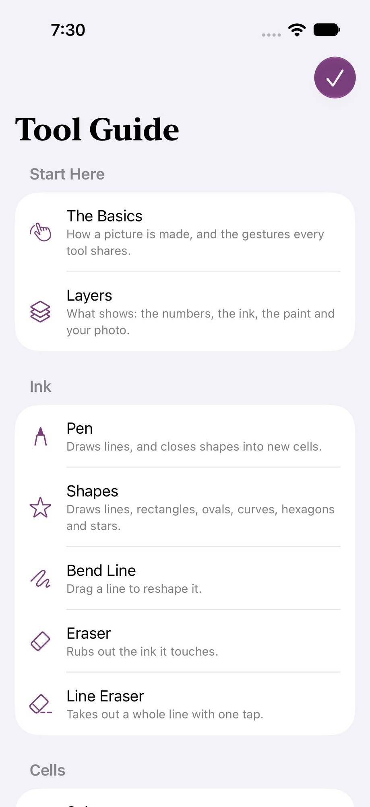 1500x2000

> Stripes snapped cleanly to the sides. Now the Bucket page, to paint. I'll check whether my drawing carries over between guide pages.

→ `mcp__maestro__run` `{"device_id": "3CE49892-DF52-49A7-9D5F-68E49A7DD048", "yaml": "appId: com.pbordjadze.paintbynumber\n---\n- tapOn: \"Bucket\"\n- waitForAnimationToEnd"}`

→ `mcp__maestro__take_screenshot` `{"device_id": "3CE49892-DF52-49A7-9D5F-68E49A7DD048"}`

← mcp__maestro__run: {"success":true,"device_id":"3CE49892-DF52-49A7-9D5F-68E49A7DD048","commands_executed":3,"message":"Flow executed successfully","env_vars":{"MAESTRO_CLI_ANALYSIS_NOTIFICATION_DISABLED":"true","MAESTRO_CLI_NO_ANALYTICS":"1","MAESTRO_DRIVER_STARTUP_TIMEOUT":"240000","MAESTRO_VERSION":"2.11.0"}}

← mcp__maestro__take_screenshot: image 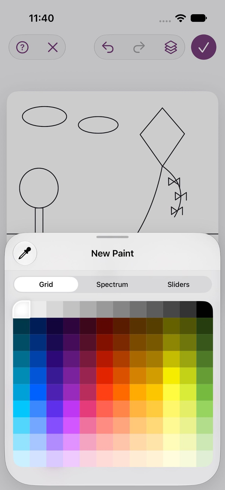 1500x2000

> My drawing didn't carry over: each Tool Guide page has its own practice picture, so the lighthouse was lost. I'll look at the "See" group's "Try Painting" page.

→ `mcp__maestro__run` `{"device_id": "3CE49892-DF52-49A7-9D5F-68E49A7DD048", "yaml": "appId: com.pbordjadze.paintbynumber\n---\n- swipe:\n    start: \"160,1200\"\n    end: \"160,600\"\n    duration: 600\n- waitForAnimationToEnd"}`

→ `mcp__maestro__take_screenshot` `{"device_id": "3CE49892-DF52-49A7-9D5F-68E49A7DD048"}`

← mcp__maestro__run: {"success":true,"device_id":"3CE49892-DF52-49A7-9D5F-68E49A7DD048","commands_executed":3,"message":"Flow executed successfully","env_vars":{"MAESTRO_CLI_ANALYSIS_NOTIFICATION_DISABLED":"true","MAESTRO_CLI_NO_ANALYTICS":"1","MAESTRO_DRIVER_STARTUP_TIMEOUT":"240000","MAESTRO_VERSION":"2.11.0"}}

← mcp__maestro__take_screenshot: image 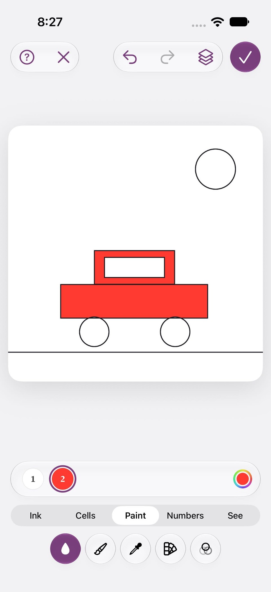 1500x2000

→ `mcp__maestro__run` `{"device_id": "3CE49892-DF52-49A7-9D5F-68E49A7DD048", "yaml": "appId: com.pbordjadze.paintbynumber\n---\n- tapOn: \"Try Painting\"\n- waitForAnimationToEnd"}`

→ `mcp__maestro__take_screenshot` `{"device_id": "3CE49892-DF52-49A7-9D5F-68E49A7DD048"}`

← mcp__maestro__run: {"success":true,"device_id":"3CE49892-DF52-49A7-9D5F-68E49A7DD048","commands_executed":3,"message":"Flow executed successfully","env_vars":{"MAESTRO_CLI_ANALYSIS_NOTIFICATION_DISABLED":"true","MAESTRO_CLI_NO_ANALYTICS":"1","MAESTRO_DRIVER_STARTUP_TIMEOUT":"240000","MAESTRO_VERSION":"2.11.0"}}

← mcp__maestro__take_screenshot: image 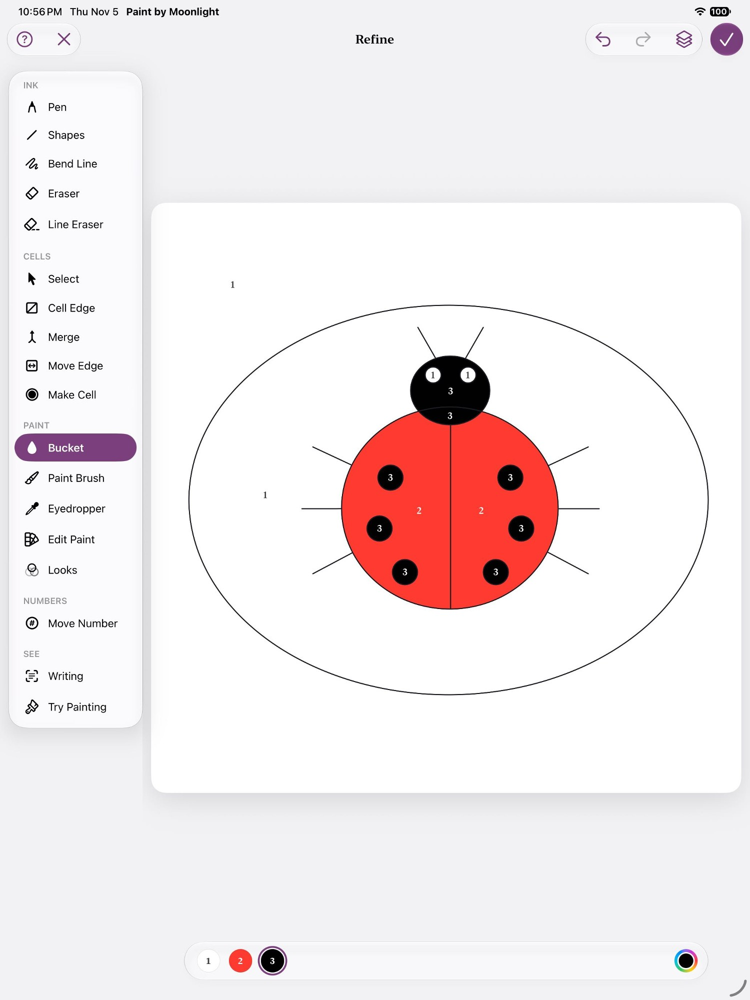 1500x2000

> Each guide page has a single tool. Before going further, I'll check whether going back to Shapes brings my drawing back.

→ `mcp__maestro__run` `{"device_id": "3CE49892-DF52-49A7-9D5F-68E49A7DD048", "yaml": "appId: com.pbordjadze.paintbynumber\n---\n- tapOn: \"Shapes\"\n- waitForAnimationToEnd"}`

→ `mcp__maestro__take_screenshot` `{"device_id": "3CE49892-DF52-49A7-9D5F-68E49A7DD048"}`

← mcp__maestro__run: {"success":true,"device_id":"3CE49892-DF52-49A7-9D5F-68E49A7DD048","commands_executed":3,"message":"Flow executed successfully","env_vars":{"MAESTRO_CLI_ANALYSIS_NOTIFICATION_DISABLED":"true","MAESTRO_CLI_NO_ANALYTICS":"1","MAESTRO_DRIVER_STARTUP_TIMEOUT":"240000","MAESTRO_VERSION":"2.11.0"}}

← mcp__maestro__take_screenshot: image 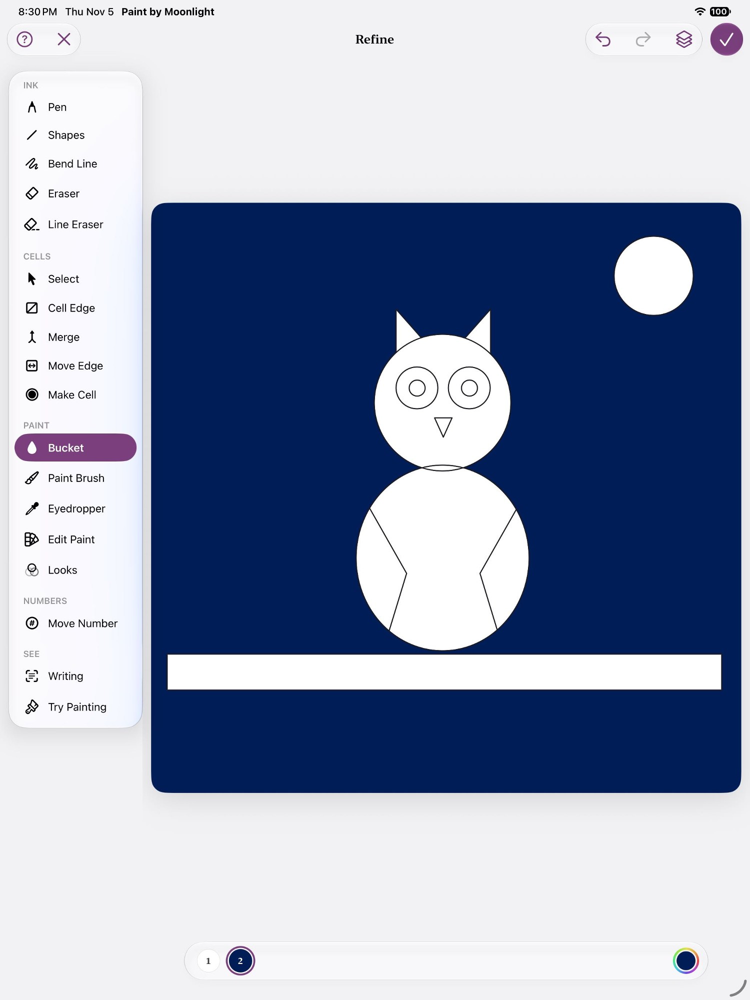 1500x2000

→ `mcp__maestro__run` `{"device_id": "3CE49892-DF52-49A7-9D5F-68E49A7DD048", "yaml": "appId: com.pbordjadze.paintbynumber\n---\n- tapOn: \"Try Painting\"\n- waitForAnimationToEnd\n- swipe: {start: \"398,380\", end: \"398,612\", duration: 700}\n- swipe: {start: \"398,380\", end: \"438,380\", duration: 700}\n- swipe: {start: \"438,380\", end: \"438,612\", duration: 700}\n- swipe: {start: \"380,612\", end: \"460,612\", duration: 700}\n- swipe: {start: \"380,612\", end: \"362,640\", duration: 700}\n- swipe: {start: \"362,640\", end: \"382,668\", duration: 700}\n- swipe: {start: \"382,668\", end: \"458,668\", duration: 7`

→ `mcp__maestro__take_screenshot` `{"device_id": "3CE49892-DF52-49A7-9D5F-68E49A7DD048"}`

← mcp__maestro__run: {"success":true,"device_id":"3CE49892-DF52-49A7-9D5F-68E49A7DD048","commands_executed":14,"message":"Flow executed successfully","env_vars":{"MAESTRO_CLI_ANALYSIS_NOTIFICATION_DISABLED":"true","MAESTRO_CLI_NO_ANALYTICS":"1","MAESTRO_DRIVER_STARTUP_TIMEOUT":"240000","MAESTRO_VERSION":"2.11.0"}}

← mcp__maestro__take_screenshot: image 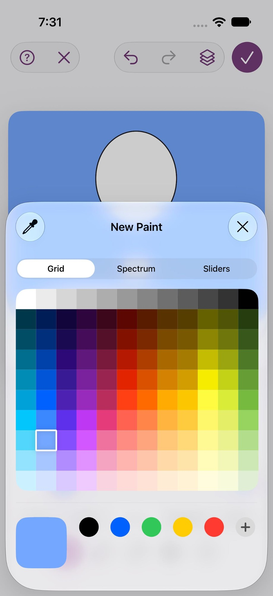 1500x2000

> Body and rock are drawn and their ends joined. Next: the lamp room and two stripes.

→ `mcp__maestro__run` `{"device_id": "3CE49892-DF52-49A7-9D5F-68E49A7DD048", "yaml": "appId: com.pbordjadze.paintbynumber\n---\n- swipe: {start: \"403,380\", end: \"403,350\", duration: 700}\n- swipe: {start: \"403,350\", end: \"433,350\", duration: 700}\n- swipe: {start: \"433,350\", end: \"433,380\", duration: 700}\n- swipe: {start: \"394,400\", end: \"442,400\", duration: 700}\n- swipe: {start: \"394,520\", end: \"442,520\", duration: 700}\n- swipe: {start: \"394,545\", end: \"442,545\", duration: 700}\n- waitForAnimationToEnd\n- takeScreenshot: /Users/runner/work/_temp/qa/shots/final-refine"}`

→ `mcp__maestro__take_screenshot` `{"device_id": "3CE49892-DF52-49A7-9D5F-68E49A7DD048"}`

← mcp__maestro__run: {"success":true,"device_id":"3CE49892-DF52-49A7-9D5F-68E49A7DD048","commands_executed":9,"message":"Flow executed successfully","env_vars":{"MAESTRO_CLI_ANALYSIS_NOTIFICATION_DISABLED":"true","MAESTRO_CLI_NO_ANALYTICS":"1","MAESTRO_DRIVER_STARTUP_TIMEOUT":"240000","MAESTRO_VERSION":"2.11.0"}}

← mcp__maestro__take_screenshot: image 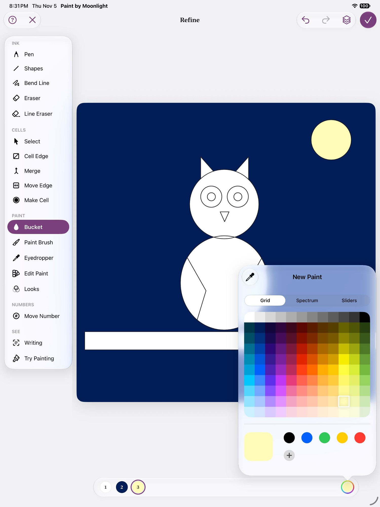 1500x2000

> Line art is done. It's all in the practice picture's existing paints, because this page has no palette. Tapping Try Painting.

→ `mcp__maestro__run` `{"device_id": "3CE49892-DF52-49A7-9D5F-68E49A7DD048", "yaml": "appId: com.pbordjadze.paintbynumber\n---\n- tapOn:\n    point: \"676,804\"\n- waitForAnimationToEnd\n- takeScreenshot: /Users/runner/work/_temp/qa/shots/final-template"}`

→ `mcp__maestro__take_screenshot` `{"device_id": "3CE49892-DF52-49A7-9D5F-68E49A7DD048"}`

← mcp__maestro__run: {"success":true,"device_id":"3CE49892-DF52-49A7-9D5F-68E49A7DD048","commands_executed":4,"message":"Flow executed successfully","env_vars":{"MAESTRO_CLI_ANALYSIS_NOTIFICATION_DISABLED":"true","MAESTRO_CLI_NO_ANALYTICS":"1","MAESTRO_DRIVER_STARTUP_TIMEOUT":"240000","MAESTRO_VERSION":"2.11.0"}}

← mcp__maestro__take_screenshot: image 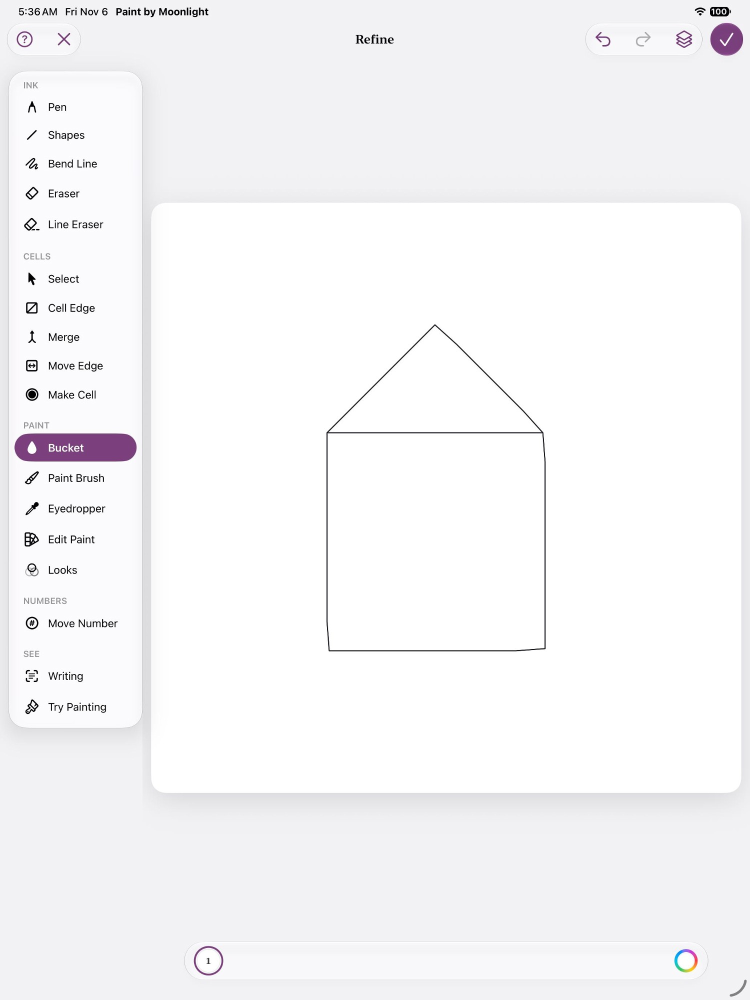 1500x2000

→ `mcp__maestro__inspect_screen` `{"device_id": "3CE49892-DF52-49A7-9D5F-68E49A7DD048"}`

← mcp__maestro__inspect_screen: {"ui_schema":{"platform":"ios","abbreviations":{"b":"bounds","txt":"text","rid":"resource-id","a11y":"accessibilityText","hint":"hintText","val":"value","c":"children"},"defaults":{"enabled":true,"focused":false,"selected":false,"checked":false,"txt":"","hint":"","rid":"","val":"","a11y":""}},"elements":[{"b":"[0,0][1032,1376]","a11y":"Paint by Moonlight","c":[{"b":"[0,0][1032,1376]","c":[{"b":"[0 …

→ `mcp__maestro__run` `{"device_id": "3CE49892-DF52-49A7-9D5F-68E49A7DD048", "yaml": "appId: com.pbordjadze.paintbynumber\n---\n- tapOn: {id: \"canvas-area-1\"}\n- tapOn: {id: \"canvas-area-18\"}\n- tapOn: {id: \"canvas-area-19\"}\n- tapOn: {id: \"canvas-area-14\"}\n- waitForAnimationToEnd"}`

→ `mcp__maestro__take_screenshot` `{"device_id": "3CE49892-DF52-49A7-9D5F-68E49A7DD048"}`

← mcp__maestro__run: {"success":true,"device_id":"3CE49892-DF52-49A7-9D5F-68E49A7DD048","commands_executed":6,"message":"Flow executed successfully","env_vars":{"MAESTRO_CLI_ANALYSIS_NOTIFICATION_DISABLED":"true","MAESTRO_CLI_NO_ANALYTICS":"1","MAESTRO_DRIVER_STARTUP_TIMEOUT":"240000","MAESTRO_VERSION":"2.11.0"}}

← mcp__maestro__take_screenshot: image 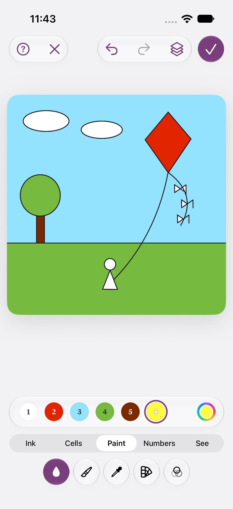 1500x2000

> Color 2 is done (4 areas) and the palette moved on to 3. My lamp and stripe are now the sky's purple, so the lighthouse top shows only as lines. Continuing with the rest.

→ `mcp__maestro__run` `{"device_id": "3CE49892-DF52-49A7-9D5F-68E49A7DD048", "yaml": "appId: com.pbordjadze.paintbynumber\n---\n- tapOn: {point: \"52,700\"}\n- tapOn: {point: \"124,695\"}\n- tapOn: {point: \"534,690\"}\n- waitForAnimationToEnd\n- tapOn: {id: \"swatch-1\", index: 0}\n- tapOn: {point: \"127,757\"}\n- tapOn: {point: \"127,816\"}\n- tapOn: {point: \"127,885\"}\n- tapOn: {point: \"158,976\"}\n- tapOn: {point: \"433,894\"}\n- waitForAnimationToEnd"}`

→ `mcp__maestro__take_screenshot` `{"device_id": "3CE49892-DF52-49A7-9D5F-68E49A7DD048"}`

← mcp__maestro__run: {"success":true,"device_id":"3CE49892-DF52-49A7-9D5F-68E49A7DD048","commands_executed":12,"message":"Flow executed successfully","env_vars":{"MAESTRO_CLI_ANALYSIS_NOTIFICATION_DISABLED":"true","MAESTRO_CLI_NO_ANALYTICS":"1","MAESTRO_DRIVER_STARTUP_TIMEOUT":"240000","MAESTRO_VERSION":"2.11.0"}}

← mcp__maestro__take_screenshot: image 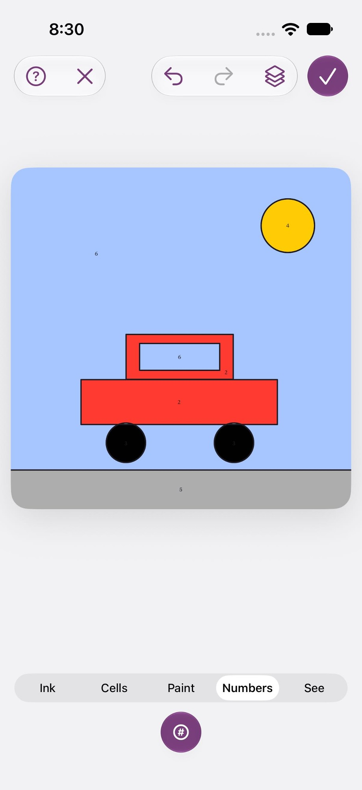 1500x2000

> Colors 1 and 3 are done. My lighthouse and rock now have the same paint as the sky, sea and grass around them, so they show only as outlines. Finishing the rest.

→ `mcp__maestro__run` `{"device_id": "3CE49892-DF52-49A7-9D5F-68E49A7DD048", "yaml": "appId: com.pbordjadze.paintbynumber\n---\n- tapOn: {point: \"796,438\"}\n- waitForAnimationToEnd\n- tapOn: {point: \"241,820\"}\n- waitForAnimationToEnd\n- tapOn: {point: \"241,924\"}\n- tapOn: {point: \"713,963\"}\n- waitForAnimationToEnd\n- tapOn: {point: \"676,856\"}\n- waitForAnimationToEnd\n- tapOn: {point: \"620,985\"}\n- waitForAnimationToEnd\n- tapOn: {point: \"642,920\"}\n- tapOn: {point: \"665,920\"}\n- tapOn: {point: \"642,944\"}\n- tapOn: {point: \"665,944\"}\n- waitForAnimationToEnd\n- takeScreenshot: /Users/runner/wor`

→ `mcp__maestro__take_screenshot` `{"device_id": "3CE49892-DF52-49A7-9D5F-68E49A7DD048"}`

← mcp__maestro__run: {"success":true,"device_id":"3CE49892-DF52-49A7-9D5F-68E49A7DD048","commands_executed":18,"message":"Flow executed successfully","env_vars":{"MAESTRO_CLI_ANALYSIS_NOTIFICATION_DISABLED":"true","MAESTRO_CLI_NO_ANALYTICS":"1","MAESTRO_DRIVER_STARTUP_TIMEOUT":"240000","MAESTRO_VERSION":"2.11.0"}}

← mcp__maestro__take_screenshot: image 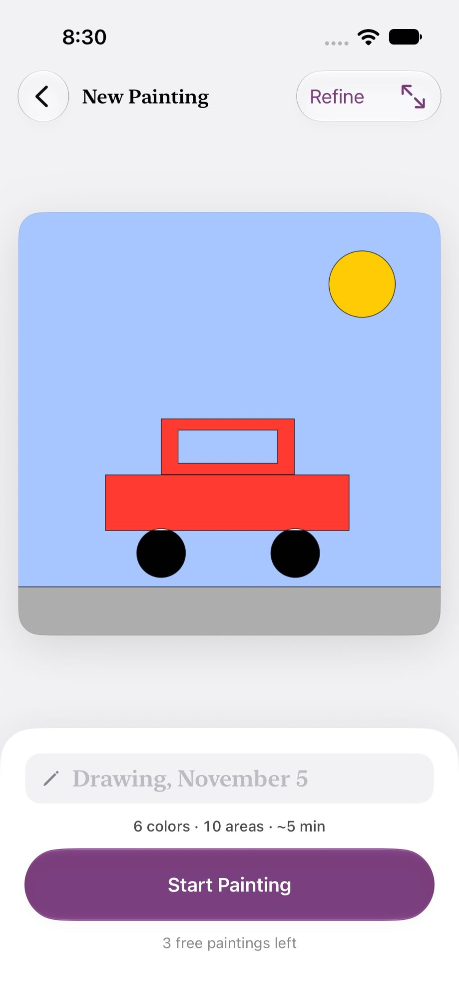 1500x2000

→ `Read` `{"file_path": "/Users/runner/work/_temp/qa/app.log", "offset": 31}`

← Read: 31	2026-11-05 14:20:27.819 Df PaintByNumber[31592:156a7] [com.pbordjadze.paintbynumber:create] Refine opens [adjusting false, full under way false, final true, phase ready]
32	2026-11-05 14:21:23.880 Df PaintByNumber[31592:156a7] [com.pbordjadze.paintbynumber:create] Refine opens [adjusting false, full under way false, final true, phase ready]
33	2026-11-05 14:21:31.683 Df PaintByNumber[31592:156a …

→ `Read` `{"file_path": "/Users/runner/work/_temp/qa/crashes.txt"}`

← Read: <system-reminder>Warning: the file exists but the contents are empty.</system-reminder>

→ `Write` `{"file_path": "/Users/runner/work/_temp/qa/report.md", "content": "# Paint by Moonlight: Refine \"draw from scratch\" session (iPad Pro 13\" (M5) simulator, debug build, 2026-11-05)\n\n**Verdict**: No. On a fresh install, From Scratch and Refine are both behind a $4.99 \"Unlimited Paintings\" paywall. The only free drawing space I found, the Tool Guide's practice pages, gave me a lighthouse outline that I could try-paint but not color or keep.\n\n**What I meant to draw**: A tall white-and-red-striped lighthouse with a yellow lamp room, on a grey-brown rock, with a blue sea band behind it and a`

← Write: The file /Users/runner/work/_temp/qa/report.md has been updated successfully. (file state is current in your context — no need to Read it back)

> I didn't get the lighthouse I planned. On this fresh install, both From Scratch and Refine are behind a $4.99 "Unlimited Paintings" paywall. I didn't tap Unlock or Restore Purchases, because one is a purchase and the other contacts the App Store.
> 
> **What I planned:** a red-and-white striped lighthouse with a yellow lamp, on a grey rock, with a blue sea behind it and an orange-to-pink sunset sky.
> 
> **What I got:** the only free place to draw is the paywall's "Try It in the Tool Guide", which has a practice page for each tool.
> - **Shapes page:** I drew the rock, tower, lamp room and stripes cleanly on the first try (oval, rectangles, lines that joined at the ends). The drawing disappeared without warning when I opened the Bucket page to color it.
> - **Try Painting page:** I redrew the lighthouse with the Pen in 15 straight strokes, and every shape closed into its own area. This page has no palette, so each new area kept the paint of the practice scene around it.
> - **Painting:** I painted all of it to 100%. The lighthouse ends up purple, blue and green like its surroundings and shows only as outlines. None of my sunset colors are there, and Try Painting keeps nothing.
> 
> **Findings:**
> 1. **The paywall blocks the whole task.** The + sheet doesn't say drawing your own picture is paid until you tap it.
> 2. **The log says "Refine opens" when Refine doesn't open.** It was logged both times the paywall appeared instead.
> 3. **Guide drawings are lost when you change pages.** No warning, and Undo is greyed out afterwards.
> 4. **From Scratch is an icon-only button.** I found its name only by inspecting the screen.
> 
> No crashes. Everything inside Refine itself is listed under Not tested.
> 
> Files are in /Users/runner/work/_temp/qa:
> - report.md
> - shots/final-refine.png
> - shots/final-template.png
> - shots/final-painting.png
> - shots/plan-1.png … plan-7-pen-body-rock.png
