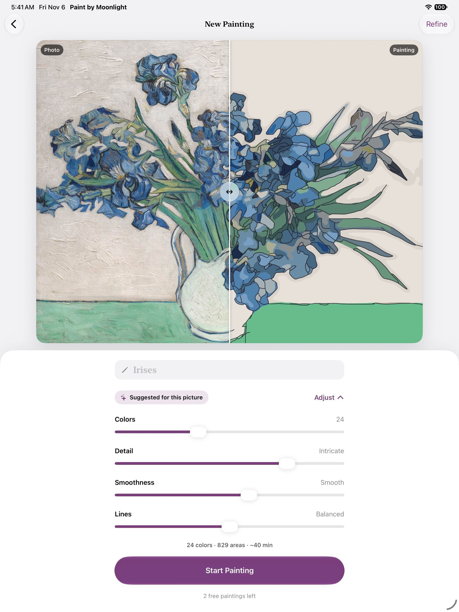
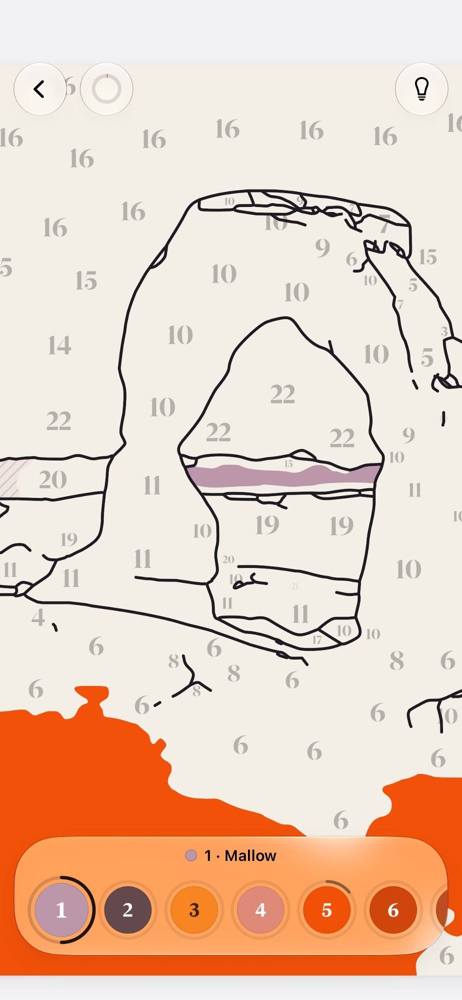
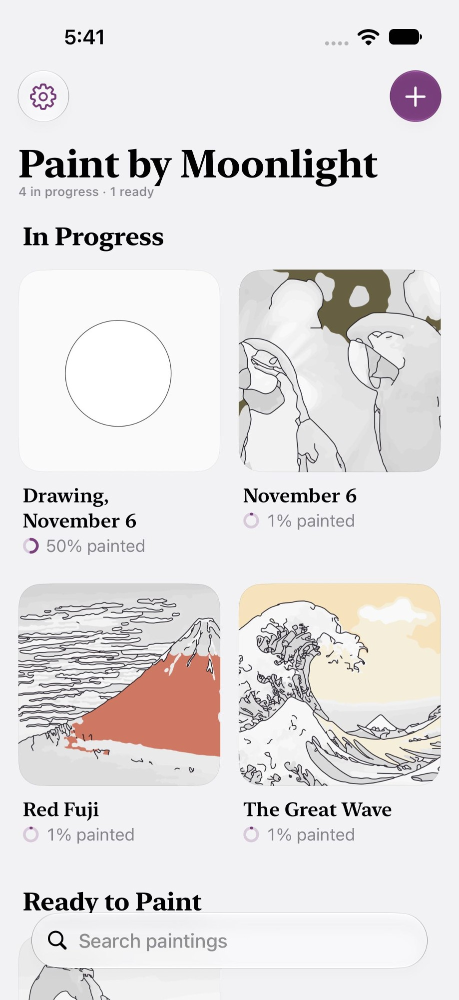

# Agent transcript

- end: success, 105 turns, 17.8 min, estimated $3.267469600000001
- tool calls: {"mcp__maestro__take_screenshot": 46, "mcp__maestro__run": 49, "mcp__maestro__inspect_screen": 4, "Write": 3, "Read": 2}
- images the agent received: 46

**Start**: model claude-opus-5-5, MCP [{"name": "maestro", "status": "connected", "source": "dynamic"}]

→ `mcp__maestro__take_screenshot` `{"device_id": "E247944A-EF3A-4ACA-99BF-97F59D694F71"}`

← mcp__maestro__take_screenshot: image  1500x2000

> Plan: a white lighthouse with a red top on a dark grey rock, a blue sea below, and an orange sunset sky above with a yellow sun.

→ `mcp__maestro__run` `{"device_id": "E247944A-EF3A-4ACA-99BF-97F59D694F71", "yaml": "appId: com.pbordjadze.paintbynumber\n---\n- tapOn:\n    point: \"72%,4%\"\n- waitForAnimationToEnd\n- takeScreenshot: /Users/runner/work/_temp/qa/shots/plan-1"}`

→ `mcp__maestro__inspect_screen` `{"device_id": "E247944A-EF3A-4ACA-99BF-97F59D694F71"}`

← mcp__maestro__run: {"success":true,"device_id":"E247944A-EF3A-4ACA-99BF-97F59D694F71","commands_executed":4,"message":"Flow executed successfully","env_vars":{"MAESTRO_CLI_ANALYSIS_NOTIFICATION_DISABLED":"true","MAESTRO_CLI_NO_ANALYTICS":"1","MAESTRO_DRIVER_STARTUP_TIMEOUT":"240000","MAESTRO_VERSION":"2.11.0"}}

← mcp__maestro__inspect_screen: {"ui_schema":{"platform":"ios","abbreviations":{"b":"bounds","txt":"text","rid":"resource-id","a11y":"accessibilityText","hint":"hintText","val":"value","c":"children"},"defaults":{"enabled":true,"focused":false,"selected":false,"checked":false,"txt":"","hint":"","rid":"","val":"","a11y":""}},"elements":[{"b":"[0,0][1032,1376]","a11y":"Paint by Moonlight","c":[{"b":"[0,0][1032,1376]","c":[{"b":"[0 …

> There's a "From Scratch" button (top-right icon, found within one try via inspect). Tapping it.

→ `mcp__maestro__run` `{"device_id": "E247944A-EF3A-4ACA-99BF-97F59D694F71", "yaml": "appId: com.pbordjadze.paintbynumber\n---\n- tapOn:\n    id: \"from-scratch\"\n- waitForAnimationToEnd\n- takeScreenshot: /Users/runner/work/_temp/qa/shots/plan-2"}`

→ `mcp__maestro__take_screenshot` `{"device_id": "E247944A-EF3A-4ACA-99BF-97F59D694F71"}`

← mcp__maestro__run: {"success":true,"device_id":"E247944A-EF3A-4ACA-99BF-97F59D694F71","commands_executed":4,"message":"Flow executed successfully","env_vars":{"MAESTRO_CLI_ANALYSIS_NOTIFICATION_DISABLED":"true","MAESTRO_CLI_NO_ANALYTICS":"1","MAESTRO_DRIVER_STARTUP_TIMEOUT":"240000","MAESTRO_VERSION":"2.11.0"}}

← mcp__maestro__take_screenshot: image  1500x2000

> Blank page on the first try. Let me see what Shapes offers.

→ `mcp__maestro__run` `{"device_id": "E247944A-EF3A-4ACA-99BF-97F59D694F71", "yaml": "appId: com.pbordjadze.paintbynumber\n---\n- tapOn: \"Shapes\"\n- waitForAnimationToEnd"}`

→ `mcp__maestro__take_screenshot` `{"device_id": "E247944A-EF3A-4ACA-99BF-97F59D694F71"}`

← mcp__maestro__run: {"success":true,"device_id":"E247944A-EF3A-4ACA-99BF-97F59D694F71","commands_executed":3,"message":"Flow executed successfully","env_vars":{"MAESTRO_CLI_ANALYSIS_NOTIFICATION_DISABLED":"true","MAESTRO_CLI_NO_ANALYTICS":"1","MAESTRO_DRIVER_STARTUP_TIMEOUT":"240000","MAESTRO_VERSION":"2.11.0"}}

← mcp__maestro__take_screenshot: image  1500x2000

> Shapes has line, rectangle, ellipse, a curve/path tool, polygon and star — good. Start with the horizon line across the page.

→ `mcp__maestro__run` `{"device_id": "E247944A-EF3A-4ACA-99BF-97F59D694F71", "yaml": "appId: com.pbordjadze.paintbynumber\n---\n- swipe:\n    start: \"211,700\"\n    end: \"1017,700\"\n    duration: 800\n- waitForAnimationToEnd\n- takeScreenshot: /Users/runner/work/_temp/qa/shots/plan-3"}`

→ `mcp__maestro__take_screenshot` `{"device_id": "E247944A-EF3A-4ACA-99BF-97F59D694F71"}`

← mcp__maestro__run: {"success":true,"device_id":"E247944A-EF3A-4ACA-99BF-97F59D694F71","commands_executed":4,"message":"Flow executed successfully","env_vars":{"MAESTRO_CLI_ANALYSIS_NOTIFICATION_DISABLED":"true","MAESTRO_CLI_NO_ANALYTICS":"1","MAESTRO_DRIVER_STARTUP_TIMEOUT":"240000","MAESTRO_VERSION":"2.11.0"}}

← mcp__maestro__take_screenshot: image  1500x2000

> Horizon drawn (left end reached the edge; right end stops at ~1468 px vs. edge 1482 px — will check if it closes). Now the sun with the ellipse tool.

→ `mcp__maestro__run` `{"device_id": "E247944A-EF3A-4ACA-99BF-97F59D694F71", "yaml": "appId: com.pbordjadze.paintbynumber\n---\n- tapOn:\n    point: \"439,1322\"\n- swipe:\n    start: \"310,470\"\n    end: \"440,600\"\n    duration: 800\n- waitForAnimationToEnd"}`

→ `mcp__maestro__take_screenshot` `{"device_id": "E247944A-EF3A-4ACA-99BF-97F59D694F71"}`

← mcp__maestro__run: {"success":true,"device_id":"E247944A-EF3A-4ACA-99BF-97F59D694F71","commands_executed":4,"message":"Flow executed successfully","env_vars":{"MAESTRO_CLI_ANALYSIS_NOTIFICATION_DISABLED":"true","MAESTRO_CLI_NO_ANALYTICS":"1","MAESTRO_DRIVER_STARTUP_TIMEOUT":"240000","MAESTRO_VERSION":"2.11.0"}}

← mcp__maestro__take_screenshot: image  1500x2000

> Sun is a clean circle. Now the rock as three straight lines rising from the bottom edge.

→ `mcp__maestro__run` `{"device_id": "E247944A-EF3A-4ACA-99BF-97F59D694F71", "yaml": "appId: com.pbordjadze.paintbynumber\n---\n- tapOn:\n    point: \"347,1322\"\n- swipe:\n    start: \"560,1088\"\n    end: \"600,880\"\n    duration: 800\n- swipe:\n    start: \"600,880\"\n    end: \"840,880\"\n    duration: 800\n- swipe:\n    start: \"840,880\"\n    end: \"880,1088\"\n    duration: 800\n- waitForAnimationToEnd"}`

→ `mcp__maestro__take_screenshot` `{"device_id": "E247944A-EF3A-4ACA-99BF-97F59D694F71"}`

← mcp__maestro__run: {"success":true,"device_id":"E247944A-EF3A-4ACA-99BF-97F59D694F71","commands_executed":6,"message":"Flow executed successfully","env_vars":{"MAESTRO_CLI_ANALYSIS_NOTIFICATION_DISABLED":"true","MAESTRO_CLI_NO_ANALYTICS":"1","MAESTRO_DRIVER_STARTUP_TIMEOUT":"240000","MAESTRO_VERSION":"2.11.0"}}

← mcp__maestro__take_screenshot: image  1500x2000

> Rock done, corners joined. Now the tower as a rectangle standing on the rock top.

→ `mcp__maestro__run` `{"device_id": "E247944A-EF3A-4ACA-99BF-97F59D694F71", "yaml": "appId: com.pbordjadze.paintbynumber\n---\n- tapOn:\n    point: \"393,1322\"\n- swipe:\n    start: \"675,620\"\n    end: \"765,880\"\n    duration: 800\n- waitForAnimationToEnd"}`

→ `mcp__maestro__take_screenshot` `{"device_id": "E247944A-EF3A-4ACA-99BF-97F59D694F71"}`

← mcp__maestro__run: {"success":true,"device_id":"E247944A-EF3A-4ACA-99BF-97F59D694F71","commands_executed":4,"message":"Flow executed successfully","env_vars":{"MAESTRO_CLI_ANALYSIS_NOTIFICATION_DISABLED":"true","MAESTRO_CLI_NO_ANALYTICS":"1","MAESTRO_DRIVER_STARTUP_TIMEOUT":"240000","MAESTRO_VERSION":"2.11.0"}}

← mcp__maestro__take_screenshot: image  1500x2000

→ `mcp__maestro__run` `{"device_id": "E247944A-EF3A-4ACA-99BF-97F59D694F71", "yaml": "appId: com.pbordjadze.paintbynumber\n---\n- tapOn:\n    point: \"829,54\"\n- tapOn:\n    point: \"347,1322\"\n- swipe:\n    start: \"675,881\"\n    end: \"675,620\"\n    duration: 800\n- swipe:\n    start: \"675,620\"\n    end: \"765,620\"\n    duration: 800\n- swipe:\n    start: \"765,620\"\n    end: \"765,880\"\n    duration: 800\n- waitForAnimationToEnd"}`

→ `mcp__maestro__take_screenshot` `{"device_id": "E247944A-EF3A-4ACA-99BF-97F59D694F71"}`

← mcp__maestro__run: {"success":true,"device_id":"E247944A-EF3A-4ACA-99BF-97F59D694F71","commands_executed":7,"message":"Flow executed successfully","env_vars":{"MAESTRO_CLI_ANALYSIS_NOTIFICATION_DISABLED":"true","MAESTRO_CLI_NO_ANALYTICS":"1","MAESTRO_DRIVER_STARTUP_TIMEOUT":"240000","MAESTRO_VERSION":"2.11.0"}}

← mcp__maestro__take_screenshot: image  1500x2000

> Tower meets the rock. Now the lamp room and a triangular roof, all with lines.

→ `mcp__maestro__run` `{"device_id": "E247944A-EF3A-4ACA-99BF-97F59D694F71", "yaml": "appId: com.pbordjadze.paintbynumber\n---\n- swipe:\n    start: \"676,620\"\n    end: \"676,568\"\n    duration: 800\n- swipe:\n    start: \"764,620\"\n    end: \"764,568\"\n    duration: 800\n- swipe:\n    start: \"655,568\"\n    end: \"785,568\"\n    duration: 800\n- swipe:\n    start: \"655,568\"\n    end: \"720,515\"\n    duration: 800\n- swipe:\n    start: \"720,515\"\n    end: \"785,568\"\n    duration: 800\n- waitForAnimationToEnd\n- takeScreenshot: /Users/runner/work/_temp/qa/shots/plan-4"}`

→ `mcp__maestro__take_screenshot` `{"device_id": "E247944A-EF3A-4ACA-99BF-97F59D694F71"}`

← mcp__maestro__run: {"success":true,"device_id":"E247944A-EF3A-4ACA-99BF-97F59D694F71","commands_executed":8,"message":"Flow executed successfully","env_vars":{"MAESTRO_CLI_ANALYSIS_NOTIFICATION_DISABLED":"true","MAESTRO_CLI_NO_ANALYTICS":"1","MAESTRO_DRIVER_STARTUP_TIMEOUT":"240000","MAESTRO_VERSION":"2.11.0"}}

← mcp__maestro__take_screenshot: image  1500x2000

> The whole outline is drawn. One problem: the horizon runs through the tower and would split it into two areas. Trying the Eraser on just that segment.

→ `mcp__maestro__run` `{"device_id": "E247944A-EF3A-4ACA-99BF-97F59D694F71", "yaml": "appId: com.pbordjadze.paintbynumber\n---\n- tapOn: \"Eraser\"\n- waitForAnimationToEnd"}`

→ `mcp__maestro__take_screenshot` `{"device_id": "E247944A-EF3A-4ACA-99BF-97F59D694F71"}`

← mcp__maestro__run: {"success":true,"device_id":"E247944A-EF3A-4ACA-99BF-97F59D694F71","commands_executed":3,"message":"Flow executed successfully","env_vars":{"MAESTRO_CLI_ANALYSIS_NOTIFICATION_DISABLED":"true","MAESTRO_CLI_NO_ANALYTICS":"1","MAESTRO_DRIVER_STARTUP_TIMEOUT":"240000","MAESTRO_VERSION":"2.11.0"}}

← mcp__maestro__take_screenshot: image  1500x2000

→ `mcp__maestro__run` `{"device_id": "E247944A-EF3A-4ACA-99BF-97F59D694F71", "yaml": "appId: com.pbordjadze.paintbynumber\n---\n- swipe:\n    start: \"684,700\"\n    end: \"756,700\"\n    duration: 800\n- waitForAnimationToEnd"}`

→ `mcp__maestro__take_screenshot` `{"device_id": "E247944A-EF3A-4ACA-99BF-97F59D694F71"}`

← mcp__maestro__run: {"success":true,"device_id":"E247944A-EF3A-4ACA-99BF-97F59D694F71","commands_executed":3,"message":"Flow executed successfully","env_vars":{"MAESTRO_CLI_ANALYSIS_NOTIFICATION_DISABLED":"true","MAESTRO_CLI_NO_ANALYTICS":"1","MAESTRO_DRIVER_STARTUP_TIMEOUT":"240000","MAESTRO_VERSION":"2.11.0"}}

← mcp__maestro__take_screenshot: image  1500x2000

> The eraser's footprint (~15 pt radius) was bigger than I guessed and cut gaps in both tower walls too. Undo, shrink the size, and erase a shorter stroke.

→ `mcp__maestro__run` `{"device_id": "E247944A-EF3A-4ACA-99BF-97F59D694F71", "yaml": "appId: com.pbordjadze.paintbynumber\n---\n- tapOn:\n    point: \"829,54\"\n- swipe:\n    start: \"590,1326\"\n    end: \"540,1326\"\n    duration: 400\n- swipe:\n    start: \"692,700\"\n    end: \"748,700\"\n    duration: 800\n- waitForAnimationToEnd"}`

→ `mcp__maestro__take_screenshot` `{"device_id": "E247944A-EF3A-4ACA-99BF-97F59D694F71"}`

← mcp__maestro__run: {"success":true,"device_id":"E247944A-EF3A-4ACA-99BF-97F59D694F71","commands_executed":5,"message":"Flow executed successfully","env_vars":{"MAESTRO_CLI_ANALYSIS_NOTIFICATION_DISABLED":"true","MAESTRO_CLI_NO_ANALYTICS":"1","MAESTRO_DRIVER_STARTUP_TIMEOUT":"240000","MAESTRO_VERSION":"2.11.0"}}

← mcp__maestro__take_screenshot: image  1500x2000

→ `mcp__maestro__run` `{"device_id": "E247944A-EF3A-4ACA-99BF-97F59D694F71", "yaml": "appId: com.pbordjadze.paintbynumber\n---\n- tapOn: \"Writing\"\n- waitForAnimationToEnd\n- takeScreenshot: /Users/runner/work/_temp/qa/shots/plan-5"}`

→ `mcp__maestro__take_screenshot` `{"device_id": "E247944A-EF3A-4ACA-99BF-97F59D694F71"}`

← mcp__maestro__run: {"success":true,"device_id":"E247944A-EF3A-4ACA-99BF-97F59D694F71","commands_executed":4,"message":"Flow executed successfully","env_vars":{"MAESTRO_CLI_ANALYSIS_NOTIFICATION_DISABLED":"true","MAESTRO_CLI_NO_ANALYTICS":"1","MAESTRO_DRIVER_STARTUP_TIMEOUT":"240000","MAESTRO_VERSION":"2.11.0"}}

← mcp__maestro__take_screenshot: image  1500x2000

> "Writing" showed no visible change at all — confusing for a newcomer. Saving an initial report before continuing.

→ `Write` `{"file_path": "/Users/runner/work/_temp/qa/report.md", "content": "# Refine session report \u2014 lighthouse (in progress)\n\n**Verdict**: in progress \u2014 outline drawn, not yet colored.\n\n**What I meant to draw**: a white lighthouse tower with a red lamp room and dark roof on a grey rock, a blue sea below the horizon, an orange sunset sky with a yellow sun.\n\n## The steps (so far)\n| Step | Tries | Stuck | What worked | Expected instead |\n|---|---|---|---|---|\n| Find a blank canvas | 1 | 0 | + \u2192 \"From Scratch\" (icon button, top right of New Painting; found via its label) | \u201`

← Write: File created successfully at: /Users/runner/work/_temp/qa/report.md (file state is current in your context — no need to Read it back)

→ `mcp__maestro__run` `{"device_id": "E247944A-EF3A-4ACA-99BF-97F59D694F71", "yaml": "appId: com.pbordjadze.paintbynumber\n---\n- tapOn: \"Bucket\"\n- waitForAnimationToEnd"}`

→ `mcp__maestro__take_screenshot` `{"device_id": "E247944A-EF3A-4ACA-99BF-97F59D694F71"}`

← mcp__maestro__run: {"success":true,"device_id":"E247944A-EF3A-4ACA-99BF-97F59D694F71","commands_executed":3,"message":"Flow executed successfully","env_vars":{"MAESTRO_CLI_ANALYSIS_NOTIFICATION_DISABLED":"true","MAESTRO_CLI_NO_ANALYTICS":"1","MAESTRO_DRIVER_STARTUP_TIMEOUT":"240000","MAESTRO_VERSION":"2.11.0"}}

← mcp__maestro__take_screenshot: image  1500x2000

> Palette shows one white paint "1" and a color-wheel button. Opening the color wheel to add orange.

→ `mcp__maestro__run` `{"device_id": "E247944A-EF3A-4ACA-99BF-97F59D694F71", "yaml": "appId: com.pbordjadze.paintbynumber\n---\n- tapOn:\n    point: \"943,1322\"\n- waitForAnimationToEnd"}`

→ `mcp__maestro__take_screenshot` `{"device_id": "E247944A-EF3A-4ACA-99BF-97F59D694F71"}`

← mcp__maestro__run: {"success":true,"device_id":"E247944A-EF3A-4ACA-99BF-97F59D694F71","commands_executed":3,"message":"Flow executed successfully","env_vars":{"MAESTRO_CLI_ANALYSIS_NOTIFICATION_DISABLED":"true","MAESTRO_CLI_NO_ANALYTICS":"1","MAESTRO_DRIVER_STARTUP_TIMEOUT":"240000","MAESTRO_VERSION":"2.11.0"}}

← mcp__maestro__take_screenshot: image  1500x2000

> Nothing opened. Let me inspect the palette bar.

→ `mcp__maestro__inspect_screen` `{"device_id": "E247944A-EF3A-4ACA-99BF-97F59D694F71"}`

← mcp__maestro__inspect_screen: {"ui_schema":{"platform":"ios","abbreviations":{"b":"bounds","txt":"text","rid":"resource-id","a11y":"accessibilityText","hint":"hintText","val":"value","c":"children"},"defaults":{"enabled":true,"focused":false,"selected":false,"checked":false,"txt":"","hint":"","rid":"","val":"","a11y":""}},"elements":[{"b":"[0,0][1032,1376]","a11y":"Paint by Moonlight","c":[{"b":"[0,0][1032,1376]","c":[{"b":"[0 …

> The New Paint button is exactly where I tapped. Trying it by id.

→ `mcp__maestro__run` `{"device_id": "E247944A-EF3A-4ACA-99BF-97F59D694F71", "yaml": "appId: com.pbordjadze.paintbynumber\n---\n- tapOn:\n    id: \"refine-palette-new\"\n- waitForAnimationToEnd"}`

→ `mcp__maestro__take_screenshot` `{"device_id": "E247944A-EF3A-4ACA-99BF-97F59D694F71"}`

← mcp__maestro__run: {"success":true,"device_id":"E247944A-EF3A-4ACA-99BF-97F59D694F71","commands_executed":3,"message":"Flow executed successfully","env_vars":{"MAESTRO_CLI_ANALYSIS_NOTIFICATION_DISABLED":"true","MAESTRO_CLI_NO_ANALYTICS":"1","MAESTRO_DRIVER_STARTUP_TIMEOUT":"240000","MAESTRO_VERSION":"2.11.0"}}

← mcp__maestro__take_screenshot: image  1500x2000

> Still nothing visible after two taps. Checking the app log.

→ `Read` `{"file_path": "/Users/runner/work/_temp/qa/app.log", "offset": 1, "limit": 400}`

← Read: 1	getpwuid_r did not find a match for uid 501
2	Filtering the log data using "subsystem == "com.pbordjadze.paintbynumber""
3	Timestamp               Ty Process[PID:TID]
4	2026-11-05 14:44:42.056 Df PaintByNumber[23067:10ae7] [com.pbordjadze.paintbynumber:tips] offer in shelf: , wanted
5	2026-11-05 14:44:43.517 Df PaintByNumber[23067:10c85] [com.pbordjadze.paintbynumber:canvas] Making the render co …

> The log shows nothing for the New Paint taps. I'll try the "Edit Paint" tool instead.

→ `mcp__maestro__run` `{"device_id": "E247944A-EF3A-4ACA-99BF-97F59D694F71", "yaml": "appId: com.pbordjadze.paintbynumber\n---\n- tapOn: \"Edit Paint\"\n- waitForAnimationToEnd"}`

→ `mcp__maestro__take_screenshot` `{"device_id": "E247944A-EF3A-4ACA-99BF-97F59D694F71"}`

← mcp__maestro__run: {"success":true,"device_id":"E247944A-EF3A-4ACA-99BF-97F59D694F71","commands_executed":3,"message":"Flow executed successfully","env_vars":{"MAESTRO_CLI_ANALYSIS_NOTIFICATION_DISABLED":"true","MAESTRO_CLI_NO_ANALYTICS":"1","MAESTRO_DRIVER_STARTUP_TIMEOUT":"240000","MAESTRO_VERSION":"2.11.0"}}

← mcp__maestro__take_screenshot: image  1500x2000

→ `mcp__maestro__run` `{"device_id": "E247944A-EF3A-4ACA-99BF-97F59D694F71", "yaml": "appId: com.pbordjadze.paintbynumber\n---\n- tapOn: \"Shapes\"\n- waitForAnimationToEnd\n- takeScreenshot: /Users/runner/work/_temp/qa/shots/plan-6"}`

→ `mcp__maestro__take_screenshot` `{"device_id": "E247944A-EF3A-4ACA-99BF-97F59D694F71"}`

← mcp__maestro__run: {"success":true,"device_id":"E247944A-EF3A-4ACA-99BF-97F59D694F71","commands_executed":4,"message":"Flow executed successfully","env_vars":{"MAESTRO_CLI_ANALYSIS_NOTIFICATION_DISABLED":"true","MAESTRO_CLI_NO_ANALYTICS":"1","MAESTRO_DRIVER_STARTUP_TIMEOUT":"240000","MAESTRO_VERSION":"2.11.0"}}

← mcp__maestro__take_screenshot: image  1500x2000

→ `mcp__maestro__run` `{"device_id": "E247944A-EF3A-4ACA-99BF-97F59D694F71", "yaml": "appId: com.pbordjadze.paintbynumber\n---\n- swipe:\n    start: \"1008,662\"\n    end: \"1019,662\"\n    duration: 600\n- waitForAnimationToEnd\n- tapOn: \"Edit Paint\"\n- waitForAnimationToEnd"}`

→ `mcp__maestro__take_screenshot` `{"device_id": "E247944A-EF3A-4ACA-99BF-97F59D694F71"}`

← mcp__maestro__run: {"success":true,"device_id":"E247944A-EF3A-4ACA-99BF-97F59D694F71","commands_executed":5,"message":"Flow executed successfully","env_vars":{"MAESTRO_CLI_ANALYSIS_NOTIFICATION_DISABLED":"true","MAESTRO_CLI_NO_ANALYTICS":"1","MAESTRO_DRIVER_STARTUP_TIMEOUT":"240000","MAESTRO_VERSION":"2.11.0"}}

← mcp__maestro__take_screenshot: image  1500x2000

> Horizon now closes (whole line outlined). Next, colors: since New Paint didn't open, try Select › tap the sky to see what an area offers.

→ `mcp__maestro__run` `{"device_id": "E247944A-EF3A-4ACA-99BF-97F59D694F71", "yaml": "appId: com.pbordjadze.paintbynumber\n---\n- tapOn: \"Select\"\n- tapOn:\n    point: \"500,320\"\n- waitForAnimationToEnd"}`

→ `mcp__maestro__take_screenshot` `{"device_id": "E247944A-EF3A-4ACA-99BF-97F59D694F71"}`

← mcp__maestro__run: {"success":true,"device_id":"E247944A-EF3A-4ACA-99BF-97F59D694F71","commands_executed":4,"message":"Flow executed successfully","env_vars":{"MAESTRO_CLI_ANALYSIS_NOTIFICATION_DISABLED":"true","MAESTRO_CLI_NO_ANALYTICS":"1","MAESTRO_DRIVER_STARTUP_TIMEOUT":"240000","MAESTRO_VERSION":"2.11.0"}}

← mcp__maestro__take_screenshot: image  1500x2000

> Sky selected as one area; paint 1 has 8 areas — exactly what I expected (sky, sun, roof, lamp room, tower, rock, sea left, sea right). Tapping Change Color.

→ `mcp__maestro__run` `{"device_id": "E247944A-EF3A-4ACA-99BF-97F59D694F71", "yaml": "appId: com.pbordjadze.paintbynumber\n---\n- tapOn: \"Change Color\"\n- waitForAnimationToEnd"}`

→ `mcp__maestro__take_screenshot` `{"device_id": "E247944A-EF3A-4ACA-99BF-97F59D694F71"}`

← mcp__maestro__run: {"success":true,"device_id":"E247944A-EF3A-4ACA-99BF-97F59D694F71","commands_executed":3,"message":"Flow executed successfully","env_vars":{"MAESTRO_CLI_ANALYSIS_NOTIFICATION_DISABLED":"true","MAESTRO_CLI_NO_ANALYTICS":"1","MAESTRO_DRIVER_STARTUP_TIMEOUT":"240000","MAESTRO_VERSION":"2.11.0"}}

← mcp__maestro__take_screenshot: image  1500x2000

> Area card opened. Tapping the color wheel next to "Only This Area".

→ `mcp__maestro__run` `{"device_id": "E247944A-EF3A-4ACA-99BF-97F59D694F71", "yaml": "appId: com.pbordjadze.paintbynumber\n---\n- tapOn:\n    point: \"612,178\"\n- waitForAnimationToEnd"}`

→ `mcp__maestro__take_screenshot` `{"device_id": "E247944A-EF3A-4ACA-99BF-97F59D694F71"}`

← mcp__maestro__run: {"success":true,"device_id":"E247944A-EF3A-4ACA-99BF-97F59D694F71","commands_executed":3,"message":"Flow executed successfully","env_vars":{"MAESTRO_CLI_ANALYSIS_NOTIFICATION_DISABLED":"true","MAESTRO_CLI_NO_ANALYTICS":"1","MAESTRO_DRIVER_STARTUP_TIMEOUT":"240000","MAESTRO_VERSION":"2.11.0"}}

← mcp__maestro__take_screenshot: image  1500x2000

> System color picker opened. Picking an orange for the sky.

→ `mcp__maestro__run` `{"device_id": "E247944A-EF3A-4ACA-99BF-97F59D694F71", "yaml": "appId: com.pbordjadze.paintbynumber\n---\n- tapOn:\n    point: \"611,520\"\n- waitForAnimationToEnd"}`

→ `mcp__maestro__take_screenshot` `{"device_id": "E247944A-EF3A-4ACA-99BF-97F59D694F71"}`

← mcp__maestro__run: {"success":true,"device_id":"E247944A-EF3A-4ACA-99BF-97F59D694F71","commands_executed":3,"message":"Flow executed successfully","env_vars":{"MAESTRO_CLI_ANALYSIS_NOTIFICATION_DISABLED":"true","MAESTRO_CLI_NO_ANALYTICS":"1","MAESTRO_DRIVER_STARTUP_TIMEOUT":"240000","MAESTRO_VERSION":"2.11.0"}}

← mcp__maestro__take_screenshot: image  1500x2000

> Sky is now paint 2 "Vivid red" (a coral — I wanted orange; my tap landed one cell off). Picking the orange cell in the same picker.

→ `mcp__maestro__run` `{"device_id": "E247944A-EF3A-4ACA-99BF-97F59D694F71", "yaml": "appId: com.pbordjadze.paintbynumber\n---\n- tapOn:\n    point: \"641,461\"\n- waitForAnimationToEnd"}`

→ `mcp__maestro__take_screenshot` `{"device_id": "E247944A-EF3A-4ACA-99BF-97F59D694F71"}`

← mcp__maestro__run: {"success":true,"device_id":"E247944A-EF3A-4ACA-99BF-97F59D694F71","commands_executed":3,"message":"Flow executed successfully","env_vars":{"MAESTRO_CLI_ANALYSIS_NOTIFICATION_DISABLED":"true","MAESTRO_CLI_NO_ANALYTICS":"1","MAESTRO_DRIVER_STARTUP_TIMEOUT":"240000","MAESTRO_VERSION":"2.11.0"}}

← mcp__maestro__take_screenshot: image  1500x2000

> Sky is orange (paint 2 updated in place, no extra paint). Closing the picker by tapping the grey margin below the canvas.

→ `mcp__maestro__run` `{"device_id": "E247944A-EF3A-4ACA-99BF-97F59D694F71", "yaml": "appId: com.pbordjadze.paintbynumber\n---\n- tapOn:\n    point: \"600,1150\"\n- waitForAnimationToEnd"}`

→ `mcp__maestro__take_screenshot` `{"device_id": "E247944A-EF3A-4ACA-99BF-97F59D694F71"}`

← mcp__maestro__run: {"success":true,"device_id":"E247944A-EF3A-4ACA-99BF-97F59D694F71","commands_executed":3,"message":"Flow executed successfully","env_vars":{"MAESTRO_CLI_ANALYSIS_NOTIFICATION_DISABLED":"true","MAESTRO_CLI_NO_ANALYTICS":"1","MAESTRO_DRIVER_STARTUP_TIMEOUT":"240000","MAESTRO_VERSION":"2.11.0"}}

← mcp__maestro__take_screenshot: image  1500x2000

> Picker closed; card remains. Now the sun: select it and open its card.

→ `mcp__maestro__run` `{"device_id": "E247944A-EF3A-4ACA-99BF-97F59D694F71", "yaml": "appId: com.pbordjadze.paintbynumber\n---\n- tapOn:\n    point: \"374,497\"\n- waitForAnimationToEnd\n- tapOn: \"Change Color\"\n- waitForAnimationToEnd"}`

→ `mcp__maestro__take_screenshot` `{"device_id": "E247944A-EF3A-4ACA-99BF-97F59D694F71"}`

← mcp__maestro__run: {"success":true,"device_id":"E247944A-EF3A-4ACA-99BF-97F59D694F71","commands_executed":5,"message":"Flow executed successfully","env_vars":{"MAESTRO_CLI_ANALYSIS_NOTIFICATION_DISABLED":"true","MAESTRO_CLI_NO_ANALYTICS":"1","MAESTRO_DRIVER_STARTUP_TIMEOUT":"240000","MAESTRO_VERSION":"2.11.0"}}

← mcp__maestro__take_screenshot: image  1500x2000

> The tap on the sun only dismissed the card (popover ate the tap), so the sky's card reopened. Dismiss first, then select the sun.

→ `mcp__maestro__run` `{"device_id": "E247944A-EF3A-4ACA-99BF-97F59D694F71", "yaml": "appId: com.pbordjadze.paintbynumber\n---\n- tapOn:\n    point: \"600,1150\"\n- waitForAnimationToEnd\n- tapOn:\n    point: \"374,497\"\n- waitForAnimationToEnd"}`

→ `mcp__maestro__take_screenshot` `{"device_id": "E247944A-EF3A-4ACA-99BF-97F59D694F71"}`

← mcp__maestro__run: {"success":true,"device_id":"E247944A-EF3A-4ACA-99BF-97F59D694F71","commands_executed":5,"message":"Flow executed successfully","env_vars":{"MAESTRO_CLI_ANALYSIS_NOTIFICATION_DISABLED":"true","MAESTRO_CLI_NO_ANALYTICS":"1","MAESTRO_DRIVER_STARTUP_TIMEOUT":"240000","MAESTRO_VERSION":"2.11.0"}}

← mcp__maestro__take_screenshot: image  1500x2000

> Sun selected. Opening its card.

→ `mcp__maestro__run` `{"device_id": "E247944A-EF3A-4ACA-99BF-97F59D694F71", "yaml": "appId: com.pbordjadze.paintbynumber\n---\n- tapOn: \"Change Color\"\n- waitForAnimationToEnd"}`

→ `mcp__maestro__take_screenshot` `{"device_id": "E247944A-EF3A-4ACA-99BF-97F59D694F71"}`

← mcp__maestro__run: {"success":true,"device_id":"E247944A-EF3A-4ACA-99BF-97F59D694F71","commands_executed":3,"message":"Flow executed successfully","env_vars":{"MAESTRO_CLI_ANALYSIS_NOTIFICATION_DISABLED":"true","MAESTRO_CLI_NO_ANALYTICS":"1","MAESTRO_DRIVER_STARTUP_TIMEOUT":"240000","MAESTRO_VERSION":"2.11.0"}}

← mcp__maestro__take_screenshot: image  1500x2000

→ `mcp__maestro__run` `{"device_id": "E247944A-EF3A-4ACA-99BF-97F59D694F71", "yaml": "appId: com.pbordjadze.paintbynumber\n---\n- tapOn:\n    point: \"486,323\"\n- waitForAnimationToEnd"}`

→ `mcp__maestro__take_screenshot` `{"device_id": "E247944A-EF3A-4ACA-99BF-97F59D694F71"}`

← mcp__maestro__run: {"success":true,"device_id":"E247944A-EF3A-4ACA-99BF-97F59D694F71","commands_executed":3,"message":"Flow executed successfully","env_vars":{"MAESTRO_CLI_ANALYSIS_NOTIFICATION_DISABLED":"true","MAESTRO_CLI_NO_ANALYTICS":"1","MAESTRO_DRIVER_STARTUP_TIMEOUT":"240000","MAESTRO_VERSION":"2.11.0"}}

← mcp__maestro__take_screenshot: image  1500x2000

> Picking bright yellow for the sun.

→ `mcp__maestro__run` `{"device_id": "E247944A-EF3A-4ACA-99BF-97F59D694F71", "yaml": "appId: com.pbordjadze.paintbynumber\n---\n- tapOn:\n    point: \"722,638\"\n- waitForAnimationToEnd"}`

→ `mcp__maestro__take_screenshot` `{"device_id": "E247944A-EF3A-4ACA-99BF-97F59D694F71"}`

← mcp__maestro__run: {"success":true,"device_id":"E247944A-EF3A-4ACA-99BF-97F59D694F71","commands_executed":3,"message":"Flow executed successfully","env_vars":{"MAESTRO_CLI_ANALYSIS_NOTIFICATION_DISABLED":"true","MAESTRO_CLI_NO_ANALYTICS":"1","MAESTRO_DRIVER_STARTUP_TIMEOUT":"240000","MAESTRO_VERSION":"2.11.0"}}

← mcp__maestro__take_screenshot: image  1500x2000

> The picker closed without applying yellow — the sun is still white. Retry: open the wheel and inspect what's on screen before tapping.

→ `mcp__maestro__run` `{"device_id": "E247944A-EF3A-4ACA-99BF-97F59D694F71", "yaml": "appId: com.pbordjadze.paintbynumber\n---\n- tapOn:\n    point: \"486,323\"\n- waitForAnimationToEnd"}`

→ `mcp__maestro__inspect_screen` `{"device_id": "E247944A-EF3A-4ACA-99BF-97F59D694F71"}`

← mcp__maestro__run: {"success":true,"device_id":"E247944A-EF3A-4ACA-99BF-97F59D694F71","commands_executed":3,"message":"Flow executed successfully","env_vars":{"MAESTRO_CLI_ANALYSIS_NOTIFICATION_DISABLED":"true","MAESTRO_CLI_NO_ANALYTICS":"1","MAESTRO_DRIVER_STARTUP_TIMEOUT":"240000","MAESTRO_VERSION":"2.11.0"}}

← mcp__maestro__inspect_screen: {"ui_schema":{"platform":"ios","abbreviations":{"b":"bounds","txt":"text","rid":"resource-id","a11y":"accessibilityText","hint":"hintText","val":"value","c":"children"},"defaults":{"enabled":true,"focused":false,"selected":false,"checked":false,"txt":"","hint":"","rid":"","val":"","a11y":""}},"elements":[{"b":"[0,0][1032,1376]","a11y":"Paint by Moonlight","c":[{"b":"[0,0][1032,1376]","c":[{"b":"[0 …

> My tap was outside the picker (x 299–674 pt) — my mistake converting coordinates; tapping outside dismisses it. Tapping yellow inside the grid now.

→ `mcp__maestro__run` `{"device_id": "E247944A-EF3A-4ACA-99BF-97F59D694F71", "yaml": "appId: com.pbordjadze.paintbynumber\n---\n- tapOn:\n    point: \"585,632\"\n- waitForAnimationToEnd"}`

→ `mcp__maestro__take_screenshot` `{"device_id": "E247944A-EF3A-4ACA-99BF-97F59D694F71"}`

← mcp__maestro__run: {"success":true,"device_id":"E247944A-EF3A-4ACA-99BF-97F59D694F71","commands_executed":3,"message":"Flow executed successfully","env_vars":{"MAESTRO_CLI_ANALYSIS_NOTIFICATION_DISABLED":"true","MAESTRO_CLI_NO_ANALYTICS":"1","MAESTRO_DRIVER_STARTUP_TIMEOUT":"240000","MAESTRO_VERSION":"2.11.0"}}

← mcp__maestro__take_screenshot: image  1500x2000

> Sun is yellow (paint 3). Next: sea, left part.

→ `mcp__maestro__run` `{"device_id": "E247944A-EF3A-4ACA-99BF-97F59D694F71", "yaml": "appId: com.pbordjadze.paintbynumber\n---\n- tapOn:\n    point: \"600,1150\"\n- waitForAnimationToEnd\n- tapOn:\n    point: \"600,1150\"\n- waitForAnimationToEnd\n- tapOn:\n    point: \"380,850\"\n- waitForAnimationToEnd\n- tapOn: \"Change Color\"\n- waitForAnimationToEnd"}`

→ `mcp__maestro__take_screenshot` `{"device_id": "E247944A-EF3A-4ACA-99BF-97F59D694F71"}`

← mcp__maestro__run: {"success":true,"device_id":"E247944A-EF3A-4ACA-99BF-97F59D694F71","commands_executed":9,"message":"Flow executed successfully","env_vars":{"MAESTRO_CLI_ANALYSIS_NOTIFICATION_DISABLED":"true","MAESTRO_CLI_NO_ANALYTICS":"1","MAESTRO_DRIVER_STARTUP_TIMEOUT":"240000","MAESTRO_VERSION":"2.11.0"}}

← mcp__maestro__take_screenshot: image  1500x2000

→ `mcp__maestro__run` `{"device_id": "E247944A-EF3A-4ACA-99BF-97F59D694F71", "yaml": "appId: com.pbordjadze.paintbynumber\n---\n- tapOn:\n    point: \"492,676\"\n- waitForAnimationToEnd"}`

→ `mcp__maestro__take_screenshot` `{"device_id": "E247944A-EF3A-4ACA-99BF-97F59D694F71"}`

← mcp__maestro__run: {"success":true,"device_id":"E247944A-EF3A-4ACA-99BF-97F59D694F71","commands_executed":3,"message":"Flow executed successfully","env_vars":{"MAESTRO_CLI_ANALYSIS_NOTIFICATION_DISABLED":"true","MAESTRO_CLI_NO_ANALYTICS":"1","MAESTRO_DRIVER_STARTUP_TIMEOUT":"240000","MAESTRO_VERSION":"2.11.0"}}

← mcp__maestro__take_screenshot: image  1500x2000

→ `mcp__maestro__run` `{"device_id": "E247944A-EF3A-4ACA-99BF-97F59D694F71", "yaml": "appId: com.pbordjadze.paintbynumber\n---\n- tapOn:\n    point: \"583,645\"\n- waitForAnimationToEnd\n- tapOn:\n    point: \"600,1150\"\n- waitForAnimationToEnd"}`

→ `mcp__maestro__take_screenshot` `{"device_id": "E247944A-EF3A-4ACA-99BF-97F59D694F71"}`

← mcp__maestro__run: {"success":true,"device_id":"E247944A-EF3A-4ACA-99BF-97F59D694F71","commands_executed":5,"message":"Flow executed successfully","env_vars":{"MAESTRO_CLI_ANALYSIS_NOTIFICATION_DISABLED":"true","MAESTRO_CLI_NO_ANALYTICS":"1","MAESTRO_DRIVER_STARTUP_TIMEOUT":"240000","MAESTRO_VERSION":"2.11.0"}}

← mcp__maestro__take_screenshot: image  1500x2000

> Sea (left) is blue, paint 4. For the right sea I'll try the Bucket with paint 4 instead of another card round-trip.

→ `mcp__maestro__run` `{"device_id": "E247944A-EF3A-4ACA-99BF-97F59D694F71", "yaml": "appId: com.pbordjadze.paintbynumber\n---\n- tapOn:\n    point: \"600,1150\"\n- waitForAnimationToEnd\n- tapOn: \"Bucket\"\n- waitForAnimationToEnd"}`

→ `mcp__maestro__inspect_screen` `{"device_id": "E247944A-EF3A-4ACA-99BF-97F59D694F71"}`

← mcp__maestro__run: {"success":true,"device_id":"E247944A-EF3A-4ACA-99BF-97F59D694F71","commands_executed":5,"message":"Flow executed successfully","env_vars":{"MAESTRO_CLI_ANALYSIS_NOTIFICATION_DISABLED":"true","MAESTRO_CLI_NO_ANALYTICS":"1","MAESTRO_DRIVER_STARTUP_TIMEOUT":"240000","MAESTRO_VERSION":"2.11.0"}}

← mcp__maestro__inspect_screen: {"ui_schema":{"platform":"ios","abbreviations":{"b":"bounds","txt":"text","rid":"resource-id","a11y":"accessibilityText","hint":"hintText","val":"value","c":"children"},"defaults":{"enabled":true,"focused":false,"selected":false,"checked":false,"txt":"","hint":"","rid":"","val":"","a11y":""}},"elements":[{"b":"[0,0][1032,1376]","a11y":"Paint by Moonlight","c":[{"b":"[0,0][1032,1376]","c":[{"b":"[0 …

→ `mcp__maestro__run` `{"device_id": "E247944A-EF3A-4ACA-99BF-97F59D694F71", "yaml": "appId: com.pbordjadze.paintbynumber\n---\n- tapOn:\n    point: \"412,1322\"\n- waitForAnimationToEnd\n- assertVisible:\n    id: \"refine-paint-4\"\n    selected: true\n- tapOn:\n    point: \"960,760\"\n- waitForAnimationToEnd"}`

→ `mcp__maestro__take_screenshot` `{"device_id": "E247944A-EF3A-4ACA-99BF-97F59D694F71"}`

← mcp__maestro__run: {"success":true,"device_id":"E247944A-EF3A-4ACA-99BF-97F59D694F71","commands_executed":6,"message":"Flow executed successfully","env_vars":{"MAESTRO_CLI_ANALYSIS_NOTIFICATION_DISABLED":"true","MAESTRO_CLI_NO_ANALYTICS":"1","MAESTRO_DRIVER_STARTUP_TIMEOUT":"240000","MAESTRO_VERSION":"2.11.0"}}

← mcp__maestro__take_screenshot: image  1500x2000

> Bucket worked for the right sea. Now the rock (grey) via Select › Change Color.

→ `mcp__maestro__run` `{"device_id": "E247944A-EF3A-4ACA-99BF-97F59D694F71", "yaml": "appId: com.pbordjadze.paintbynumber\n---\n- tapOn: \"Select\"\n- tapOn:\n    point: \"720,960\"\n- waitForAnimationToEnd\n- tapOn: \"Change Color\"\n- waitForAnimationToEnd"}`

→ `mcp__maestro__take_screenshot` `{"device_id": "E247944A-EF3A-4ACA-99BF-97F59D694F71"}`

← mcp__maestro__run: {"success":true,"device_id":"E247944A-EF3A-4ACA-99BF-97F59D694F71","commands_executed":6,"message":"Flow executed successfully","env_vars":{"MAESTRO_CLI_ANALYSIS_NOTIFICATION_DISABLED":"true","MAESTRO_CLI_NO_ANALYTICS":"1","MAESTRO_DRIVER_STARTUP_TIMEOUT":"240000","MAESTRO_VERSION":"2.11.0"}}

← mcp__maestro__take_screenshot: image  1500x2000

→ `mcp__maestro__run` `{"device_id": "E247944A-EF3A-4ACA-99BF-97F59D694F71", "yaml": "appId: com.pbordjadze.paintbynumber\n---\n- tapOn:\n    point: \"832,786\"\n- waitForAnimationToEnd"}`

→ `mcp__maestro__take_screenshot` `{"device_id": "E247944A-EF3A-4ACA-99BF-97F59D694F71"}`

← mcp__maestro__run: {"success":true,"device_id":"E247944A-EF3A-4ACA-99BF-97F59D694F71","commands_executed":3,"message":"Flow executed successfully","env_vars":{"MAESTRO_CLI_ANALYSIS_NOTIFICATION_DISABLED":"true","MAESTRO_CLI_NO_ANALYTICS":"1","MAESTRO_DRIVER_STARTUP_TIMEOUT":"240000","MAESTRO_VERSION":"2.11.0"}}

← mcp__maestro__take_screenshot: image  1500x2000

> Picking a dark grey for the rock.

→ `mcp__maestro__run` `{"device_id": "E247944A-EF3A-4ACA-99BF-97F59D694F71", "yaml": "appId: com.pbordjadze.paintbynumber\n---\n- tapOn:\n    point: \"680,636\"\n- waitForAnimationToEnd\n- tapOn:\n    point: \"600,1150\"\n- waitForAnimationToEnd\n- tapOn:\n    point: \"600,1150\"\n- waitForAnimationToEnd\n- tapOn:\n    point: \"720,555\"\n- waitForAnimationToEnd\n- tapOn: \"Change Color\"\n- waitForAnimationToEnd"}`

→ `mcp__maestro__take_screenshot` `{"device_id": "E247944A-EF3A-4ACA-99BF-97F59D694F71"}`

← mcp__maestro__run: {"success":true,"device_id":"E247944A-EF3A-4ACA-99BF-97F59D694F71","commands_executed":11,"message":"Flow executed successfully","env_vars":{"MAESTRO_CLI_ANALYSIS_NOTIFICATION_DISABLED":"true","MAESTRO_CLI_NO_ANALYTICS":"1","MAESTRO_DRIVER_STARTUP_TIMEOUT":"240000","MAESTRO_VERSION":"2.11.0"}}

← mcp__maestro__take_screenshot: image  1500x2000

> Rock is grey (paint 5). Lamp room is selected; opening its picker for red.

→ `mcp__maestro__run` `{"device_id": "E247944A-EF3A-4ACA-99BF-97F59D694F71", "yaml": "appId: com.pbordjadze.paintbynumber\n---\n- tapOn:\n    point: \"832,382\"\n- waitForAnimationToEnd"}`

→ `mcp__maestro__take_screenshot` `{"device_id": "E247944A-EF3A-4ACA-99BF-97F59D694F71"}`

← mcp__maestro__run: {"success":true,"device_id":"E247944A-EF3A-4ACA-99BF-97F59D694F71","commands_executed":3,"message":"Flow executed successfully","env_vars":{"MAESTRO_CLI_ANALYSIS_NOTIFICATION_DISABLED":"true","MAESTRO_CLI_NO_ANALYTICS":"1","MAESTRO_DRIVER_STARTUP_TIMEOUT":"240000","MAESTRO_VERSION":"2.11.0"}}

← mcp__maestro__take_screenshot: image  1500x2000

> Picking red for the lamp room, then selecting the roof.

→ `mcp__maestro__run` `{"device_id": "E247944A-EF3A-4ACA-99BF-97F59D694F71", "yaml": "appId: com.pbordjadze.paintbynumber\n---\n- tapOn:\n    point: \"591,351\"\n- waitForAnimationToEnd\n- tapOn:\n    point: \"600,1150\"\n- waitForAnimationToEnd\n- tapOn:\n    point: \"600,1150\"\n- waitForAnimationToEnd\n- tapOn:\n    point: \"720,517\"\n- waitForAnimationToEnd\n- tapOn: \"Change Color\"\n- waitForAnimationToEnd"}`

→ `mcp__maestro__take_screenshot` `{"device_id": "E247944A-EF3A-4ACA-99BF-97F59D694F71"}`

← mcp__maestro__run: {"success":true,"device_id":"E247944A-EF3A-4ACA-99BF-97F59D694F71","commands_executed":11,"message":"Flow executed successfully","env_vars":{"MAESTRO_CLI_ANALYSIS_NOTIFICATION_DISABLED":"true","MAESTRO_CLI_NO_ANALYTICS":"1","MAESTRO_DRIVER_STARTUP_TIMEOUT":"240000","MAESTRO_VERSION":"2.11.0"}}

← mcp__maestro__take_screenshot: image  1500x2000

> Lamp room is red (paint 6). Roof selected — using existing grey paint 5 from "Or Use a Paint".

→ `mcp__maestro__run` `{"device_id": "E247944A-EF3A-4ACA-99BF-97F59D694F71", "yaml": "appId: com.pbordjadze.paintbynumber\n---\n- tapOn:\n    point: \"720,418\"\n- waitForAnimationToEnd\n- tapOn:\n    point: \"600,1150\"\n- waitForAnimationToEnd"}`

→ `mcp__maestro__take_screenshot` `{"device_id": "E247944A-EF3A-4ACA-99BF-97F59D694F71"}`

← mcp__maestro__run: {"success":true,"device_id":"E247944A-EF3A-4ACA-99BF-97F59D694F71","commands_executed":5,"message":"Flow executed successfully","env_vars":{"MAESTRO_CLI_ANALYSIS_NOTIFICATION_DISABLED":"true","MAESTRO_CLI_NO_ANALYTICS":"1","MAESTRO_DRIVER_STARTUP_TIMEOUT":"240000","MAESTRO_VERSION":"2.11.0"}}

← mcp__maestro__take_screenshot: image  1500x2000

> The picture matches my plan: orange sky, yellow sun, blue sea, grey rock and roof, red lamp room, white tower. Saving final-refine and updating the report before leaving Refine.

→ `mcp__maestro__run` `{"device_id": "E247944A-EF3A-4ACA-99BF-97F59D694F71", "yaml": "appId: com.pbordjadze.paintbynumber\n---\n- takeScreenshot: /Users/runner/work/_temp/qa/shots/final-refine"}`

← mcp__maestro__run: {"success":true,"device_id":"E247944A-EF3A-4ACA-99BF-97F59D694F71","commands_executed":2,"message":"Flow executed successfully","env_vars":{"MAESTRO_CLI_ANALYSIS_NOTIFICATION_DISABLED":"true","MAESTRO_CLI_NO_ANALYTICS":"1","MAESTRO_DRIVER_STARTUP_TIMEOUT":"240000","MAESTRO_VERSION":"2.11.0"}}

→ `Write` `{"file_path": "/Users/runner/work/_temp/qa/report.md", "content": "# Refine session report \u2014 lighthouse (in progress)\n\n**Verdict**: in progress \u2014 drawn and colored in Refine as planned; not yet painted.\n\n**What I meant to draw**: a white lighthouse tower with a red lamp room and dark roof on a grey rock, a blue sea below the horizon, an orange sunset sky with a yellow sun.\n\n**What I got (Refine)**: `shots/final-refine.png` \u2014 exactly that: orange sky, yellow round sun, blue sea (two areas, left and right of the rock), grey trapezoid rock, white tower, red lamp room, grey tr`

← Write: The file /Users/runner/work/_temp/qa/report.md has been updated successfully. (file state is current in your context — no need to Read it back)

> Now tapping Done to leave Refine.

→ `mcp__maestro__run` `{"device_id": "E247944A-EF3A-4ACA-99BF-97F59D694F71", "yaml": "appId: com.pbordjadze.paintbynumber\n---\n- tapOn:\n    id: \"refine-done\"\n- waitForAnimationToEnd"}`

→ `mcp__maestro__take_screenshot` `{"device_id": "E247944A-EF3A-4ACA-99BF-97F59D694F71"}`

← mcp__maestro__run: {"success":true,"device_id":"E247944A-EF3A-4ACA-99BF-97F59D694F71","commands_executed":3,"message":"Flow executed successfully","env_vars":{"MAESTRO_CLI_ANALYSIS_NOTIFICATION_DISABLED":"true","MAESTRO_CLI_NO_ANALYTICS":"1","MAESTRO_DRIVER_STARTUP_TIMEOUT":"240000","MAESTRO_VERSION":"2.11.0"}}

← mcp__maestro__take_screenshot: image  1500x2000

> Preview says "6 colors · 8 areas" — matches. Start Painting.

→ `mcp__maestro__run` `{"device_id": "E247944A-EF3A-4ACA-99BF-97F59D694F71", "yaml": "appId: com.pbordjadze.paintbynumber\n---\n- tapOn: \"Start Painting\"\n- waitForAnimationToEnd\n- takeScreenshot: /Users/runner/work/_temp/qa/shots/final-template"}`

→ `mcp__maestro__take_screenshot` `{"device_id": "E247944A-EF3A-4ACA-99BF-97F59D694F71"}`

← mcp__maestro__run: {"success":true,"device_id":"E247944A-EF3A-4ACA-99BF-97F59D694F71","commands_executed":4,"message":"Flow executed successfully","env_vars":{"MAESTRO_CLI_ANALYSIS_NOTIFICATION_DISABLED":"true","MAESTRO_CLI_NO_ANALYTICS":"1","MAESTRO_DRIVER_STARTUP_TIMEOUT":"240000","MAESTRO_VERSION":"2.11.0"}}

← mcp__maestro__take_screenshot: image  1500x2000

> The template looks right, but the tower shows **two "1" numbers** (above and below the old horizon line). Closing the tip, then painting; the tower will tell whether it's one area or two.

→ `mcp__maestro__run` `{"device_id": "E247944A-EF3A-4ACA-99BF-97F59D694F71", "yaml": "appId: com.pbordjadze.paintbynumber\n---\n- tapOn:\n    point: \"589,1192\"\n- waitForAnimationToEnd\n- tapOn:\n    point: \"300,300\"\n- waitForAnimationToEnd\n- tapOn:\n    point: \"351,1309\"\n- waitForAnimationToEnd\n- tapOn:\n    point: \"650,640\"\n- waitForAnimationToEnd"}`

→ `mcp__maestro__take_screenshot` `{"device_id": "E247944A-EF3A-4ACA-99BF-97F59D694F71"}`

← mcp__maestro__run: {"success":true,"device_id":"E247944A-EF3A-4ACA-99BF-97F59D694F71","commands_executed":9,"message":"Flow executed successfully","env_vars":{"MAESTRO_CLI_ANALYSIS_NOTIFICATION_DISABLED":"true","MAESTRO_CLI_NO_ANALYTICS":"1","MAESTRO_DRIVER_STARTUP_TIMEOUT":"240000","MAESTRO_VERSION":"2.11.0"}}

← mcp__maestro__take_screenshot: image  1500x2000

→ `mcp__maestro__run` `{"device_id": "E247944A-EF3A-4ACA-99BF-97F59D694F71", "yaml": "appId: com.pbordjadze.paintbynumber\n---\n- tapOn:\n    point: \"221,477\"\n- waitForAnimationToEnd\n- tapOn:\n    point: \"254,919\"\n- waitForAnimationToEnd\n- tapOn:\n    point: \"885,812\"\n- waitForAnimationToEnd\n- tapOn:\n    point: \"645,490\"\n- waitForAnimationToEnd\n- tapOn:\n    point: \"686,1033\"\n- waitForAnimationToEnd"}`

→ `mcp__maestro__take_screenshot` `{"device_id": "E247944A-EF3A-4ACA-99BF-97F59D694F71"}`

← mcp__maestro__run: {"success":true,"device_id":"E247944A-EF3A-4ACA-99BF-97F59D694F71","commands_executed":11,"message":"Flow executed successfully","env_vars":{"MAESTRO_CLI_ANALYSIS_NOTIFICATION_DISABLED":"true","MAESTRO_CLI_NO_ANALYTICS":"1","MAESTRO_DRIVER_STARTUP_TIMEOUT":"240000","MAESTRO_VERSION":"2.11.0"}}

← mcp__maestro__take_screenshot: image  1500x2000

> All went as expected. Last area: the lamp room.

→ `mcp__maestro__run` `{"device_id": "E247944A-EF3A-4ACA-99BF-97F59D694F71", "yaml": "appId: com.pbordjadze.paintbynumber\n---\n- tapOn:\n    point: \"645,552\"\n- waitForAnimationToEnd\n- takeScreenshot: /Users/runner/work/_temp/qa/shots/final-painting"}`

→ `mcp__maestro__take_screenshot` `{"device_id": "E247944A-EF3A-4ACA-99BF-97F59D694F71"}`

← mcp__maestro__run: {"success":true,"device_id":"E247944A-EF3A-4ACA-99BF-97F59D694F71","commands_executed":4,"message":"Flow executed successfully","env_vars":{"MAESTRO_CLI_ANALYSIS_NOTIFICATION_DISABLED":"true","MAESTRO_CLI_NO_ANALYTICS":"1","MAESTRO_DRIVER_STARTUP_TIMEOUT":"240000","MAESTRO_VERSION":"2.11.0"}}

← mcp__maestro__take_screenshot: image  1500x2000

> Finished, 100%. Checking for crash reports, then writing the final report.

→ `Read` `{"file_path": "/Users/runner/work/_temp/qa/crashes.txt"}`

← Read: <system-reminder>Warning: the file exists but the contents are empty.</system-reminder>

→ `Write` `{"file_path": "/Users/runner/work/_temp/qa/report.md", "content": "# Refine session report: lighthouse at sunset (iPad Pro 13\", debug build)\n\n**Verdict**: Yes. I got the picture I wanted and painted it to 100%. Two things cost me time: the horizon looked closed but wasn't, and the palette's \"New Paint\" button did nothing.\n\n**What I meant to draw**: a white lighthouse tower with a red lamp room and a dark roof, on a grey rock, with a blue sea below the horizon and an orange sunset sky holding a yellow sun.\n\n**What I got**:\n- `shots/final-refine.png`: the drawing in Refine. Orange sky,`

← Write: The file /Users/runner/work/_temp/qa/report.md has been updated successfully. (file state is current in your context — no need to Read it back)

> I drew the lighthouse in Refine as planned and painted it to 100%: orange sky, yellow sun, blue sea, grey rock, white tower, red lamp room and grey roof. That's 6 paints and 8 areas. There were no crashes. The full report is in `/Users/runner/work/_temp/qa/report.md`.
> 
> **Getting there:** + → "From Scratch" opened a blank page on the first try. Shapes (line, ellipse) plus Snap did most of the drawing. New colors came only through Select → Change Color → the area's card → the system color picker.
> 
> **Where I got stuck, worst first:**
> 1. **The horizon looked closed but wasn't.** I drew it edge to edge, but it stopped about 10 pt short of the right edge and Snap didn't close it, so the right side of the sky and sea was one area. Nothing warned me; I only noticed because Edit Paint's purple outline left that piece out. A short extra line fixed it.
> 2. **The palette's "New Paint" button did nothing.** Two taps (by point and by id) opened no picker and left nothing in the log. That's the main reproduced bug.
> 3. **The Eraser showed no size before erasing.** My first stroke cut through both tower walls; Undo fixed it, and a shorter second stroke worked.
> 
> **Smaller findings:**
> - "Writing" (under SEE) changed nothing on screen.
> - The rectangle tool didn't snap its bottom onto the rock line, so I redrew the tower as three lines.
> - On the painting screen the tower showed two "1" labels, though one tap filled all of it.
> - While an area's card is open, a tap on another area only closes the card.
> 
> **Not tested:** the other Refine tools, naming the painting, Replay and Share, and quitting and relaunching to check the painting was saved.
> 
> Screenshots are in `shots/`: `final-refine`, `final-template`, `final-painting`, and `plan-1` to `plan-6`.
