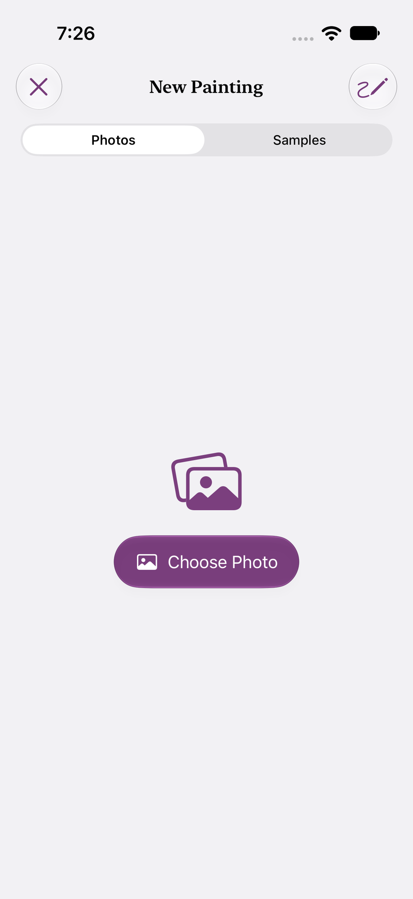

# Agent transcript

- end: success, 91 turns, 11.5 min, estimated $1.9605407999999998
- tool calls: {"mcp__maestro__take_screenshot": 37, "Read": 4, "mcp__maestro__run": 38, "mcp__maestro__inspect_screen": 8, "Write": 2}
- images the agent received: 38

**Start**: model claude-opus-5-5, MCP [{"name": "maestro", "status": "connected", "source": "dynamic"}]

→ `mcp__maestro__take_screenshot` `{"device_id": "5049F85D-1EFB-47DB-B4B7-33B204D4C9F1"}`

→ `Read` `{"file_path": "/Users/runner/.claude/projects/-Users-runner-work--temp-qa/memory/MEMORY.md"}`

← mcp__maestro__take_screenshot: image  919x2000

← Read (error): File does not exist. Note: your current working directory is /Users/runner/work/_temp/qa.

→ `mcp__maestro__run` `{"device_id": "5049F85D-1EFB-47DB-B4B7-33B204D4C9F1", "yaml": "appId: com.pbordjadze.paintbynumber\n---\n- tapOn:\n    point: \"90%,10%\"\n- waitForAnimationToEnd"}`

→ `mcp__maestro__inspect_screen` `{"device_id": "5049F85D-1EFB-47DB-B4B7-33B204D4C9F1"}`

← mcp__maestro__run: {"success":true,"device_id":"5049F85D-1EFB-47DB-B4B7-33B204D4C9F1","commands_executed":3,"message":"Flow executed successfully","env_vars":{"MAESTRO_CLI_ANALYSIS_NOTIFICATION_DISABLED":"true","MAESTRO_CLI_NO_ANALYTICS":"1","MAESTRO_DRIVER_STARTUP_TIMEOUT":"240000","MAESTRO_VERSION":"2.11.0"}}

← mcp__maestro__inspect_screen: {"ui_schema":{"platform":"ios","abbreviations":{"b":"bounds","txt":"text","rid":"resource-id","a11y":"accessibilityText","hint":"hintText","val":"value","c":"children"},"defaults":{"enabled":true,"focused":false,"selected":false,"checked":false,"txt":"","hint":"","rid":"","val":"","a11y":""}},"elements":[{"b":"[0,0][402,874]","a11y":"Paint by Moonlight","c":[{"b":"[0,0][402,874]","c":[{"b":"[0,0][ …

> "From Scratch" button at top right. Let me screenshot first to see what it looks like to a newcomer.

→ `mcp__maestro__run` `{"device_id": "5049F85D-1EFB-47DB-B4B7-33B204D4C9F1", "yaml": "appId: com.pbordjadze.paintbynumber\n---\n- takeScreenshot: /Users/runner/work/_temp/qa/shots/plan-1\n- tapOn:\n    id: \"from-scratch\"\n- waitForAnimationToEnd\n- takeScreenshot: /Users/runner/work/_temp/qa/shots/plan-2"}`

→ `mcp__maestro__take_screenshot` `{"device_id": "5049F85D-1EFB-47DB-B4B7-33B204D4C9F1"}`

← mcp__maestro__run: {"success":true,"device_id":"5049F85D-1EFB-47DB-B4B7-33B204D4C9F1","commands_executed":5,"message":"Flow executed successfully","env_vars":{"MAESTRO_CLI_ANALYSIS_NOTIFICATION_DISABLED":"true","MAESTRO_CLI_NO_ANALYTICS":"1","MAESTRO_DRIVER_STARTUP_TIMEOUT":"240000","MAESTRO_VERSION":"2.11.0"}}

← mcp__maestro__take_screenshot: image  919x2000

→ `mcp__maestro__inspect_screen` `{"device_id": "5049F85D-1EFB-47DB-B4B7-33B204D4C9F1"}`

→ `Read` `{"file_path": "/Users/runner/work/_temp/qa/shots/plan-1.png"}`

← mcp__maestro__inspect_screen: {"ui_schema":{"platform":"ios","abbreviations":{"b":"bounds","txt":"text","rid":"resource-id","a11y":"accessibilityText","hint":"hintText","val":"value","c":"children"},"defaults":{"enabled":true,"focused":false,"selected":false,"checked":false,"txt":"","hint":"","rid":"","val":"","a11y":""}},"elements":[{"b":"[0,0][402,874]","a11y":"Paint by Moonlight","c":[{"b":"[0,0][402,874]","c":[{"b":"[0,0][ …

← Read: image  920x2000

→ `mcp__maestro__run` `{"device_id": "5049F85D-1EFB-47DB-B4B7-33B204D4C9F1", "yaml": "appId: com.pbordjadze.paintbynumber\n---\n- tapOn:\n    id: \"refine-tool-shapes\"\n- waitForAnimationToEnd"}`

→ `mcp__maestro__take_screenshot` `{"device_id": "5049F85D-1EFB-47DB-B4B7-33B204D4C9F1"}`

← mcp__maestro__run: {"success":true,"device_id":"5049F85D-1EFB-47DB-B4B7-33B204D4C9F1","commands_executed":3,"message":"Flow executed successfully","env_vars":{"MAESTRO_CLI_ANALYSIS_NOTIFICATION_DISABLED":"true","MAESTRO_CLI_NO_ANALYTICS":"1","MAESTRO_DRIVER_STARTUP_TIMEOUT":"240000","MAESTRO_VERSION":"2.11.0"}}

← mcp__maestro__take_screenshot: image  919x2000

→ `mcp__maestro__inspect_screen` `{"device_id": "5049F85D-1EFB-47DB-B4B7-33B204D4C9F1"}`

← mcp__maestro__inspect_screen: {"ui_schema":{"platform":"ios","abbreviations":{"b":"bounds","txt":"text","rid":"resource-id","a11y":"accessibilityText","hint":"hintText","val":"value","c":"children"},"defaults":{"enabled":true,"focused":false,"selected":false,"checked":false,"txt":"","hint":"","rid":"","val":"","a11y":""}},"elements":[{"b":"[0,0][402,874]","a11y":"Paint by Moonlight","c":[{"b":"[0,0][402,874]","c":[{"b":"[0,0][ …

→ `mcp__maestro__run` `{"device_id": "5049F85D-1EFB-47DB-B4B7-33B204D4C9F1", "yaml": "appId: com.pbordjadze.paintbynumber\n---\n- tapOn:\n    id: \"refine-shape-oval\"\n- swipe:\n    start: \"141,215\"\n    end: \"261,355\"\n    duration: 800\n- waitForAnimationToEnd\n- takeScreenshot: /Users/runner/work/_temp/qa/shots/plan-3"}`

→ `mcp__maestro__take_screenshot` `{"device_id": "5049F85D-1EFB-47DB-B4B7-33B204D4C9F1"}`

← mcp__maestro__run: {"success":true,"device_id":"5049F85D-1EFB-47DB-B4B7-33B204D4C9F1","commands_executed":5,"message":"Flow executed successfully","env_vars":{"MAESTRO_CLI_ANALYSIS_NOTIFICATION_DISABLED":"true","MAESTRO_CLI_NO_ANALYTICS":"1","MAESTRO_DRIVER_STARTUP_TIMEOUT":"240000","MAESTRO_VERSION":"2.11.0"}}

← mcp__maestro__take_screenshot: image  919x2000

→ `mcp__maestro__run` `{"device_id": "5049F85D-1EFB-47DB-B4B7-33B204D4C9F1", "yaml": "appId: com.pbordjadze.paintbynumber\n---\n- tapOn:\n    id: \"refine-shape-rectangle\"\n- swipe:\n    start: \"180,400\"\n    end: \"222,432\"\n    duration: 800\n- waitForAnimationToEnd\n- tapOn:\n    id: \"refine-shape-line\"\n- swipe:\n    start: \"171,345\"\n    end: \"184,400\"\n    duration: 800\n- waitForAnimationToEnd\n- swipe:\n    start: \"230,345\"\n    end: \"218,400\"\n    duration: 800\n- waitForAnimationToEnd\n- takeScreenshot: /Users/runner/work/_temp/qa/shots/plan-4"}`

→ `mcp__maestro__take_screenshot` `{"device_id": "5049F85D-1EFB-47DB-B4B7-33B204D4C9F1"}`

← mcp__maestro__run: {"success":true,"device_id":"5049F85D-1EFB-47DB-B4B7-33B204D4C9F1","commands_executed":10,"message":"Flow executed successfully","env_vars":{"MAESTRO_CLI_ANALYSIS_NOTIFICATION_DISABLED":"true","MAESTRO_CLI_NO_ANALYTICS":"1","MAESTRO_DRIVER_STARTUP_TIMEOUT":"240000","MAESTRO_VERSION":"2.11.0"}}

← mcp__maestro__take_screenshot: image  919x2000

→ `mcp__maestro__run` `{"device_id": "5049F85D-1EFB-47DB-B4B7-33B204D4C9F1", "yaml": "appId: com.pbordjadze.paintbynumber\n---\n- tapOn:\n    id: \"refine-shape-curve\"\n- swipe:\n    start: \"12,480\"\n    end: \"390,470\"\n    duration: 900\n- waitForAnimationToEnd"}`

→ `mcp__maestro__take_screenshot` `{"device_id": "5049F85D-1EFB-47DB-B4B7-33B204D4C9F1"}`

← mcp__maestro__run: {"success":true,"device_id":"5049F85D-1EFB-47DB-B4B7-33B204D4C9F1","commands_executed":4,"message":"Flow executed successfully","env_vars":{"MAESTRO_CLI_ANALYSIS_NOTIFICATION_DISABLED":"true","MAESTRO_CLI_NO_ANALYTICS":"1","MAESTRO_DRIVER_STARTUP_TIMEOUT":"240000","MAESTRO_VERSION":"2.11.0"}}

← mcp__maestro__take_screenshot: image  919x2000

→ `mcp__maestro__inspect_screen` `{"device_id": "5049F85D-1EFB-47DB-B4B7-33B204D4C9F1"}`

← mcp__maestro__inspect_screen: {"ui_schema":{"platform":"ios","abbreviations":{"b":"bounds","txt":"text","rid":"resource-id","a11y":"accessibilityText","hint":"hintText","val":"value","c":"children"},"defaults":{"enabled":true,"focused":false,"selected":false,"checked":false,"txt":"","hint":"","rid":"","val":"","a11y":""}},"elements":[{"b":"[0,0][402,874]","a11y":"Paint by Moonlight","c":[{"b":"[0,0][402,874]","c":[{"b":"[0,0][ …

→ `mcp__maestro__run` `{"device_id": "5049F85D-1EFB-47DB-B4B7-33B204D4C9F1", "yaml": "appId: com.pbordjadze.paintbynumber\n---\n- swipe:\n    start: \"120,470\"\n    end: \"120,420\"\n    duration: 800\n- waitForAnimationToEnd"}`

→ `mcp__maestro__take_screenshot` `{"device_id": "5049F85D-1EFB-47DB-B4B7-33B204D4C9F1"}`

← mcp__maestro__run: {"success":true,"device_id":"5049F85D-1EFB-47DB-B4B7-33B204D4C9F1","commands_executed":3,"message":"Flow executed successfully","env_vars":{"MAESTRO_CLI_ANALYSIS_NOTIFICATION_DISABLED":"true","MAESTRO_CLI_NO_ANALYTICS":"1","MAESTRO_DRIVER_STARTUP_TIMEOUT":"240000","MAESTRO_VERSION":"2.11.0"}}

← mcp__maestro__take_screenshot: image  919x2000

→ `mcp__maestro__run` `{"device_id": "5049F85D-1EFB-47DB-B4B7-33B204D4C9F1", "yaml": "appId: com.pbordjadze.paintbynumber\n---\n- swipe:\n    start: \"170,540\"\n    end: \"390,505\"\n    duration: 900\n- waitForAnimationToEnd\n- takeScreenshot: /Users/runner/work/_temp/qa/shots/plan-5"}`

→ `mcp__maestro__take_screenshot` `{"device_id": "5049F85D-1EFB-47DB-B4B7-33B204D4C9F1"}`

← mcp__maestro__run: {"success":true,"device_id":"5049F85D-1EFB-47DB-B4B7-33B204D4C9F1","commands_executed":4,"message":"Flow executed successfully","env_vars":{"MAESTRO_CLI_ANALYSIS_NOTIFICATION_DISABLED":"true","MAESTRO_CLI_NO_ANALYTICS":"1","MAESTRO_DRIVER_STARTUP_TIMEOUT":"240000","MAESTRO_VERSION":"2.11.0"}}

← mcp__maestro__take_screenshot: image  919x2000

→ `mcp__maestro__run` `{"device_id": "5049F85D-1EFB-47DB-B4B7-33B204D4C9F1", "yaml": "appId: com.pbordjadze.paintbynumber\n---\n- swipe:\n    start: \"290,521\"\n    end: \"300,478\"\n    duration: 800\n- waitForAnimationToEnd"}`

→ `mcp__maestro__take_screenshot` `{"device_id": "5049F85D-1EFB-47DB-B4B7-33B204D4C9F1"}`

← mcp__maestro__run: {"success":true,"device_id":"5049F85D-1EFB-47DB-B4B7-33B204D4C9F1","commands_executed":3,"message":"Flow executed successfully","env_vars":{"MAESTRO_CLI_ANALYSIS_NOTIFICATION_DISABLED":"true","MAESTRO_CLI_NO_ANALYTICS":"1","MAESTRO_DRIVER_STARTUP_TIMEOUT":"240000","MAESTRO_VERSION":"2.11.0"}}

← mcp__maestro__take_screenshot: image  919x2000

→ `mcp__maestro__run` `{"device_id": "5049F85D-1EFB-47DB-B4B7-33B204D4C9F1", "yaml": "appId: com.pbordjadze.paintbynumber\n---\n- takeScreenshot: /Users/runner/work/_temp/qa/shots/plan-6\n- tapOn: \"Paint\"\n- waitForAnimationToEnd"}`

→ `mcp__maestro__take_screenshot` `{"device_id": "5049F85D-1EFB-47DB-B4B7-33B204D4C9F1"}`

→ `mcp__maestro__inspect_screen` `{"device_id": "5049F85D-1EFB-47DB-B4B7-33B204D4C9F1"}`

← mcp__maestro__run: {"success":true,"device_id":"5049F85D-1EFB-47DB-B4B7-33B204D4C9F1","commands_executed":4,"message":"Flow executed successfully","env_vars":{"MAESTRO_CLI_ANALYSIS_NOTIFICATION_DISABLED":"true","MAESTRO_CLI_NO_ANALYTICS":"1","MAESTRO_DRIVER_STARTUP_TIMEOUT":"240000","MAESTRO_VERSION":"2.11.0"}}

← mcp__maestro__take_screenshot: image  919x2000

← mcp__maestro__inspect_screen: {"ui_schema":{"platform":"ios","abbreviations":{"b":"bounds","txt":"text","rid":"resource-id","a11y":"accessibilityText","hint":"hintText","val":"value","c":"children"},"defaults":{"enabled":true,"focused":false,"selected":false,"checked":false,"txt":"","hint":"","rid":"","val":"","a11y":""}},"elements":[{"b":"[0,0][402,874]","a11y":"Paint by Moonlight","c":[{"b":"[0,0][402,874]","c":[{"b":"[0,0][ …

→ `Write` `{"file_path": "/Users/runner/work/_temp/qa/report.md", "content": "# Paint by Moonlight: Refine from scratch, hot-air balloon (iPhone 17 Pro sim, debug build)\n\n**Verdict**: in progress. The drawing is done; coloring hasn't started yet.\n\n**What I meant to draw**: A red oval balloon at the top centre with a small brown square basket hanging below on two straight ropes, a blue sky, and two overlapping green hills (light green behind, dark green in front) across the bottom.\n\n## Log so far\n1. + \u2192 New Painting. A pen-squiggle button at the top right is labeled \"From Scratch\" for access`

← Write: File created successfully at: /Users/runner/work/_temp/qa/report.md (file state is current in your context — no need to Read it back)

→ `mcp__maestro__run` `{"device_id": "5049F85D-1EFB-47DB-B4B7-33B204D4C9F1", "yaml": "appId: com.pbordjadze.paintbynumber\n---\n- tapOn:\n    id: \"refine-palette-new\"\n- waitForAnimationToEnd"}`

→ `mcp__maestro__take_screenshot` `{"device_id": "5049F85D-1EFB-47DB-B4B7-33B204D4C9F1"}`

← mcp__maestro__run: {"success":true,"device_id":"5049F85D-1EFB-47DB-B4B7-33B204D4C9F1","commands_executed":3,"message":"Flow executed successfully","env_vars":{"MAESTRO_CLI_ANALYSIS_NOTIFICATION_DISABLED":"true","MAESTRO_CLI_NO_ANALYTICS":"1","MAESTRO_DRIVER_STARTUP_TIMEOUT":"240000","MAESTRO_VERSION":"2.11.0"}}

← mcp__maestro__take_screenshot: image  919x2000

→ `mcp__maestro__inspect_screen` `{"device_id": "5049F85D-1EFB-47DB-B4B7-33B204D4C9F1"}`

← mcp__maestro__inspect_screen: {"ui_schema":{"platform":"ios","abbreviations":{"b":"bounds","txt":"text","rid":"resource-id","a11y":"accessibilityText","hint":"hintText","val":"value","c":"children"},"defaults":{"enabled":true,"focused":false,"selected":false,"checked":false,"txt":"","hint":"","rid":"","val":"","a11y":""}},"elements":[{"b":"[0,0][402,874]","a11y":"Paint by Moonlight","c":[{"b":"[0,0][402,874]","c":[{"b":"[0,0][ …

→ `Read` `{"file_path": "/Users/runner/work/_temp/qa/app.log", "offset": 0}`

← Read: 0	getpwuid_r did not find a match for uid 501
1	Filtering the log data using "subsystem == "com.pbordjadze.paintbynumber""
2	Timestamp               Ty Process[PID:TID]
3	2026-11-05 19:22:17.234 Df PaintByNumber[28957:14492] [com.pbordjadze.paintbynumber:tips] offer in shelf: , wanted
4	2026-11-05 19:22:19.704 Df PaintByNumber[28957:1470f] [com.pbordjadze.paintbynumber:canvas] Making the render co …

→ `mcp__maestro__run` `{"device_id": "5049F85D-1EFB-47DB-B4B7-33B204D4C9F1", "yaml": "appId: com.pbordjadze.paintbynumber\n---\n- tapOn:\n    point: \"360,707\"\n- waitForAnimationToEnd"}`

→ `mcp__maestro__take_screenshot` `{"device_id": "5049F85D-1EFB-47DB-B4B7-33B204D4C9F1"}`

← mcp__maestro__run: {"success":true,"device_id":"5049F85D-1EFB-47DB-B4B7-33B204D4C9F1","commands_executed":3,"message":"Flow executed successfully","env_vars":{"MAESTRO_CLI_ANALYSIS_NOTIFICATION_DISABLED":"true","MAESTRO_CLI_NO_ANALYTICS":"1","MAESTRO_DRIVER_STARTUP_TIMEOUT":"240000","MAESTRO_VERSION":"2.11.0"}}

← mcp__maestro__take_screenshot: image  919x2000

→ `mcp__maestro__run` `{"device_id": "5049F85D-1EFB-47DB-B4B7-33B204D4C9F1", "yaml": "appId: com.pbordjadze.paintbynumber\n---\n- tapOn:\n    id: \"refine-guide\"\n- waitForAnimationToEnd"}`

→ `mcp__maestro__take_screenshot` `{"device_id": "5049F85D-1EFB-47DB-B4B7-33B204D4C9F1"}`

← mcp__maestro__run: {"success":true,"device_id":"5049F85D-1EFB-47DB-B4B7-33B204D4C9F1","commands_executed":3,"message":"Flow executed successfully","env_vars":{"MAESTRO_CLI_ANALYSIS_NOTIFICATION_DISABLED":"true","MAESTRO_CLI_NO_ANALYTICS":"1","MAESTRO_DRIVER_STARTUP_TIMEOUT":"240000","MAESTRO_VERSION":"2.11.0"}}

← mcp__maestro__take_screenshot: image  919x2000

→ `mcp__maestro__run` `{"device_id": "5049F85D-1EFB-47DB-B4B7-33B204D4C9F1", "yaml": "appId: com.pbordjadze.paintbynumber\n---\n- takeScreenshot: /Users/runner/work/_temp/qa/shots/plan-7-guide\n- tapOn:\n    point: \"348,510\"\n- waitForAnimationToEnd"}`

→ `mcp__maestro__take_screenshot` `{"device_id": "5049F85D-1EFB-47DB-B4B7-33B204D4C9F1"}`

← mcp__maestro__run: {"success":true,"device_id":"5049F85D-1EFB-47DB-B4B7-33B204D4C9F1","commands_executed":4,"message":"Flow executed successfully","env_vars":{"MAESTRO_CLI_ANALYSIS_NOTIFICATION_DISABLED":"true","MAESTRO_CLI_NO_ANALYTICS":"1","MAESTRO_DRIVER_STARTUP_TIMEOUT":"240000","MAESTRO_VERSION":"2.11.0"}}

← mcp__maestro__take_screenshot: image  919x2000

→ `mcp__maestro__run` `{"device_id": "5049F85D-1EFB-47DB-B4B7-33B204D4C9F1", "yaml": "appId: com.pbordjadze.paintbynumber\n---\n- tapOn:\n    point: \"355,332\"\n- waitForAnimationToEnd\n- tapOn:\n    point: \"37,83\"\n- waitForAnimationToEnd"}`

→ `mcp__maestro__take_screenshot` `{"device_id": "5049F85D-1EFB-47DB-B4B7-33B204D4C9F1"}`

← mcp__maestro__run: {"success":true,"device_id":"5049F85D-1EFB-47DB-B4B7-33B204D4C9F1","commands_executed":5,"message":"Flow executed successfully","env_vars":{"MAESTRO_CLI_ANALYSIS_NOTIFICATION_DISABLED":"true","MAESTRO_CLI_NO_ANALYTICS":"1","MAESTRO_DRIVER_STARTUP_TIMEOUT":"240000","MAESTRO_VERSION":"2.11.0"}}

← mcp__maestro__take_screenshot: image  919x2000

→ `mcp__maestro__run` `{"device_id": "5049F85D-1EFB-47DB-B4B7-33B204D4C9F1", "yaml": "appId: com.pbordjadze.paintbynumber\n---\n- tapOn:\n    point: \"362,83\"\n- waitForAnimationToEnd"}`

→ `mcp__maestro__take_screenshot` `{"device_id": "5049F85D-1EFB-47DB-B4B7-33B204D4C9F1"}`

← mcp__maestro__run: {"success":true,"device_id":"5049F85D-1EFB-47DB-B4B7-33B204D4C9F1","commands_executed":3,"message":"Flow executed successfully","env_vars":{"MAESTRO_CLI_ANALYSIS_NOTIFICATION_DISABLED":"true","MAESTRO_CLI_NO_ANALYTICS":"1","MAESTRO_DRIVER_STARTUP_TIMEOUT":"240000","MAESTRO_VERSION":"2.11.0"}}

← mcp__maestro__take_screenshot: image  919x2000

→ `mcp__maestro__run` `{"device_id": "5049F85D-1EFB-47DB-B4B7-33B204D4C9F1", "yaml": "appId: com.pbordjadze.paintbynumber\n---\n- tapOn:\n    point: \"357,708\"\n- takeScreenshot: /Users/runner/work/_temp/qa/shots/wheel-tap-3"}`

→ `mcp__maestro__take_screenshot` `{"device_id": "5049F85D-1EFB-47DB-B4B7-33B204D4C9F1"}`

← mcp__maestro__run: {"success":true,"device_id":"5049F85D-1EFB-47DB-B4B7-33B204D4C9F1","commands_executed":3,"message":"Flow executed successfully","env_vars":{"MAESTRO_CLI_ANALYSIS_NOTIFICATION_DISABLED":"true","MAESTRO_CLI_NO_ANALYTICS":"1","MAESTRO_DRIVER_STARTUP_TIMEOUT":"240000","MAESTRO_VERSION":"2.11.0"}}

← mcp__maestro__take_screenshot: image  919x2000

→ `mcp__maestro__run` `{"device_id": "5049F85D-1EFB-47DB-B4B7-33B204D4C9F1", "yaml": "appId: com.pbordjadze.paintbynumber\n---\n- tapOn:\n    point: \"68,645\"\n- waitForAnimationToEnd"}`

→ `mcp__maestro__take_screenshot` `{"device_id": "5049F85D-1EFB-47DB-B4B7-33B204D4C9F1"}`

← mcp__maestro__run: {"success":true,"device_id":"5049F85D-1EFB-47DB-B4B7-33B204D4C9F1","commands_executed":3,"message":"Flow executed successfully","env_vars":{"MAESTRO_CLI_ANALYSIS_NOTIFICATION_DISABLED":"true","MAESTRO_CLI_NO_ANALYTICS":"1","MAESTRO_DRIVER_STARTUP_TIMEOUT":"240000","MAESTRO_VERSION":"2.11.0"}}

← mcp__maestro__take_screenshot: image  919x2000

> Picked light blue. Close the picker and pour it into the sky.

→ `mcp__maestro__run` `{"device_id": "5049F85D-1EFB-47DB-B4B7-33B204D4C9F1", "yaml": "appId: com.pbordjadze.paintbynumber\n---\n- tapOn:\n    point: \"357,333\"\n- waitForAnimationToEnd"}`

→ `mcp__maestro__inspect_screen` `{"device_id": "5049F85D-1EFB-47DB-B4B7-33B204D4C9F1"}`

← mcp__maestro__run: {"success":true,"device_id":"5049F85D-1EFB-47DB-B4B7-33B204D4C9F1","commands_executed":3,"message":"Flow executed successfully","env_vars":{"MAESTRO_CLI_ANALYSIS_NOTIFICATION_DISABLED":"true","MAESTRO_CLI_NO_ANALYTICS":"1","MAESTRO_DRIVER_STARTUP_TIMEOUT":"240000","MAESTRO_VERSION":"2.11.0"}}

← mcp__maestro__inspect_screen: {"ui_schema":{"platform":"ios","abbreviations":{"b":"bounds","txt":"text","rid":"resource-id","a11y":"accessibilityText","hint":"hintText","val":"value","c":"children"},"defaults":{"enabled":true,"focused":false,"selected":false,"checked":false,"txt":"","hint":"","rid":"","val":"","a11y":""}},"elements":[{"b":"[0,0][402,874]","a11y":"Paint by Moonlight","c":[{"b":"[0,0][402,874]","c":[{"b":"[0,0][ …

→ `mcp__maestro__run` `{"device_id": "5049F85D-1EFB-47DB-B4B7-33B204D4C9F1", "yaml": "appId: com.pbordjadze.paintbynumber\n---\n- tapOn:\n    point: \"60,220\"\n- waitForAnimationToEnd"}`

→ `mcp__maestro__take_screenshot` `{"device_id": "5049F85D-1EFB-47DB-B4B7-33B204D4C9F1"}`

← mcp__maestro__run: {"success":true,"device_id":"5049F85D-1EFB-47DB-B4B7-33B204D4C9F1","commands_executed":3,"message":"Flow executed successfully","env_vars":{"MAESTRO_CLI_ANALYSIS_NOTIFICATION_DISABLED":"true","MAESTRO_CLI_NO_ANALYTICS":"1","MAESTRO_DRIVER_STARTUP_TIMEOUT":"240000","MAESTRO_VERSION":"2.11.0"}}

← mcp__maestro__take_screenshot: image  919x2000

→ `mcp__maestro__run` `{"device_id": "5049F85D-1EFB-47DB-B4B7-33B204D4C9F1", "yaml": "appId: com.pbordjadze.paintbynumber\n---\n- tapOn:\n    point: \"200,350\"\n- waitForAnimationToEnd\n- tapOn:\n    point: \"357,708\"\n- waitForAnimationToEnd\n- takeScreenshot: /Users/runner/work/_temp/qa/shots/wheel-2"}`

→ `mcp__maestro__take_screenshot` `{"device_id": "5049F85D-1EFB-47DB-B4B7-33B204D4C9F1"}`

← mcp__maestro__run: {"success":true,"device_id":"5049F85D-1EFB-47DB-B4B7-33B204D4C9F1","commands_executed":6,"message":"Flow executed successfully","env_vars":{"MAESTRO_CLI_ANALYSIS_NOTIFICATION_DISABLED":"true","MAESTRO_CLI_NO_ANALYTICS":"1","MAESTRO_DRIVER_STARTUP_TIMEOUT":"240000","MAESTRO_VERSION":"2.11.0"}}

← mcp__maestro__take_screenshot: image  919x2000

→ `mcp__maestro__run` `{"device_id": "5049F85D-1EFB-47DB-B4B7-33B204D4C9F1", "yaml": "appId: com.pbordjadze.paintbynumber\n---\n- tapOn:\n    point: \"187,586\"\n- waitForAnimationToEnd\n- tapOn:\n    point: \"357,333\"\n- waitForAnimationToEnd\n- tapOn:\n    point: \"200,262\"\n- waitForAnimationToEnd"}`

→ `mcp__maestro__take_screenshot` `{"device_id": "5049F85D-1EFB-47DB-B4B7-33B204D4C9F1"}`

← mcp__maestro__run: {"success":true,"device_id":"5049F85D-1EFB-47DB-B4B7-33B204D4C9F1","commands_executed":7,"message":"Flow executed successfully","env_vars":{"MAESTRO_CLI_ANALYSIS_NOTIFICATION_DISABLED":"true","MAESTRO_CLI_NO_ANALYTICS":"1","MAESTRO_DRIVER_STARTUP_TIMEOUT":"240000","MAESTRO_VERSION":"2.11.0"}}

← mcp__maestro__take_screenshot: image  919x2000

→ `mcp__maestro__run` `{"device_id": "5049F85D-1EFB-47DB-B4B7-33B204D4C9F1", "yaml": "appId: com.pbordjadze.paintbynumber\n---\n- tapOn:\n    point: \"357,708\"\n- waitForAnimationToEnd\n- tapOn:\n    point: \"247,496\"\n- waitForAnimationToEnd\n- tapOn:\n    point: \"357,333\"\n- waitForAnimationToEnd\n- tapOn:\n    point: \"200,385\"\n- waitForAnimationToEnd\n- takeScreenshot: /Users/runner/work/_temp/qa/shots/plan-8"}`

→ `mcp__maestro__take_screenshot` `{"device_id": "5049F85D-1EFB-47DB-B4B7-33B204D4C9F1"}`

← mcp__maestro__run: {"success":true,"device_id":"5049F85D-1EFB-47DB-B4B7-33B204D4C9F1","commands_executed":10,"message":"Flow executed successfully","env_vars":{"MAESTRO_CLI_ANALYSIS_NOTIFICATION_DISABLED":"true","MAESTRO_CLI_NO_ANALYTICS":"1","MAESTRO_DRIVER_STARTUP_TIMEOUT":"240000","MAESTRO_VERSION":"2.11.0"}}

← mcp__maestro__take_screenshot: image  919x2000

→ `mcp__maestro__run` `{"device_id": "5049F85D-1EFB-47DB-B4B7-33B204D4C9F1", "yaml": "appId: com.pbordjadze.paintbynumber\n---\n- tapOn:\n    point: \"357,708\"\n- waitForAnimationToEnd\n- tapOn:\n    point: \"365,617\"\n- waitForAnimationToEnd\n- tapOn:\n    point: \"357,333\"\n- waitForAnimationToEnd\n- tapOn:\n    point: \"80,490\"\n- waitForAnimationToEnd\n- tapOn:\n    point: \"357,708\"\n- waitForAnimationToEnd\n- tapOn:\n    point: \"365,527\"\n- waitForAnimationToEnd\n- tapOn:\n    point: \"357,333\"\n- waitForAnimationToEnd\n- tapOn:\n    point: \"330,525\"\n- waitForAnimationToEnd\n- takeScreenshot: /Users`

→ `mcp__maestro__take_screenshot` `{"device_id": "5049F85D-1EFB-47DB-B4B7-33B204D4C9F1"}`

← mcp__maestro__run: {"success":true,"device_id":"5049F85D-1EFB-47DB-B4B7-33B204D4C9F1","commands_executed":18,"message":"Flow executed successfully","env_vars":{"MAESTRO_CLI_ANALYSIS_NOTIFICATION_DISABLED":"true","MAESTRO_CLI_NO_ANALYTICS":"1","MAESTRO_DRIVER_STARTUP_TIMEOUT":"240000","MAESTRO_VERSION":"2.11.0"}}

← mcp__maestro__take_screenshot: image  919x2000

> The picture now matches my plan: blue sky, red balloon, brown basket, light-green and dark-green hills. Checking the Numbers tab before leaving Refine.

→ `mcp__maestro__run` `{"device_id": "5049F85D-1EFB-47DB-B4B7-33B204D4C9F1", "yaml": "appId: com.pbordjadze.paintbynumber\n---\n- tapOn: \"Numbers\"\n- waitForAnimationToEnd"}`

→ `mcp__maestro__take_screenshot` `{"device_id": "5049F85D-1EFB-47DB-B4B7-33B204D4C9F1"}`

← mcp__maestro__run: {"success":true,"device_id":"5049F85D-1EFB-47DB-B4B7-33B204D4C9F1","commands_executed":3,"message":"Flow executed successfully","env_vars":{"MAESTRO_CLI_ANALYSIS_NOTIFICATION_DISABLED":"true","MAESTRO_CLI_NO_ANALYTICS":"1","MAESTRO_DRIVER_STARTUP_TIMEOUT":"240000","MAESTRO_VERSION":"2.11.0"}}

← mcp__maestro__take_screenshot: image  919x2000

→ `mcp__maestro__run` `{"device_id": "5049F85D-1EFB-47DB-B4B7-33B204D4C9F1", "yaml": "appId: com.pbordjadze.paintbynumber\n---\n- takeScreenshot: /Users/runner/work/_temp/qa/shots/final-refine\n- tapOn:\n    id: \"refine-done\"\n- waitForAnimationToEnd"}`

→ `mcp__maestro__take_screenshot` `{"device_id": "5049F85D-1EFB-47DB-B4B7-33B204D4C9F1"}`

← mcp__maestro__run: {"success":true,"device_id":"5049F85D-1EFB-47DB-B4B7-33B204D4C9F1","commands_executed":4,"message":"Flow executed successfully","env_vars":{"MAESTRO_CLI_ANALYSIS_NOTIFICATION_DISABLED":"true","MAESTRO_CLI_NO_ANALYTICS":"1","MAESTRO_DRIVER_STARTUP_TIMEOUT":"240000","MAESTRO_VERSION":"2.11.0"}}

← mcp__maestro__take_screenshot: image  919x2000

> Back on the preview: "5 colors · 6 areas · ~5 min". Starting the painting.

→ `mcp__maestro__run` `{"device_id": "5049F85D-1EFB-47DB-B4B7-33B204D4C9F1", "yaml": "appId: com.pbordjadze.paintbynumber\n---\n- tapOn: \"Start Painting\"\n- waitForAnimationToEnd\n- extendedWaitUntil:\n    notVisible: \"Start Painting\"\n    timeout: 60000"}`

→ `mcp__maestro__take_screenshot` `{"device_id": "5049F85D-1EFB-47DB-B4B7-33B204D4C9F1"}`

← mcp__maestro__run: {"success":true,"device_id":"5049F85D-1EFB-47DB-B4B7-33B204D4C9F1","commands_executed":4,"message":"Flow executed successfully","env_vars":{"MAESTRO_CLI_ANALYSIS_NOTIFICATION_DISABLED":"true","MAESTRO_CLI_NO_ANALYTICS":"1","MAESTRO_DRIVER_STARTUP_TIMEOUT":"240000","MAESTRO_VERSION":"2.11.0"}}

← mcp__maestro__take_screenshot: image  919x2000

→ `mcp__maestro__run` `{"device_id": "5049F85D-1EFB-47DB-B4B7-33B204D4C9F1", "yaml": "appId: com.pbordjadze.paintbynumber\n---\n- tapOn: \"Close\"\n- waitForAnimationToEnd\n- takeScreenshot: /Users/runner/work/_temp/qa/shots/final-template"}`

→ `mcp__maestro__inspect_screen` `{"device_id": "5049F85D-1EFB-47DB-B4B7-33B204D4C9F1"}`

← mcp__maestro__run: {"success":true,"device_id":"5049F85D-1EFB-47DB-B4B7-33B204D4C9F1","commands_executed":4,"message":"Flow executed successfully","env_vars":{"MAESTRO_CLI_ANALYSIS_NOTIFICATION_DISABLED":"true","MAESTRO_CLI_NO_ANALYTICS":"1","MAESTRO_DRIVER_STARTUP_TIMEOUT":"240000","MAESTRO_VERSION":"2.11.0"}}

← mcp__maestro__inspect_screen: {"ui_schema":{"platform":"ios","abbreviations":{"b":"bounds","txt":"text","rid":"resource-id","a11y":"accessibilityText","hint":"hintText","val":"value","c":"children"},"defaults":{"enabled":true,"focused":false,"selected":false,"checked":false,"txt":"","hint":"","rid":"","val":"","a11y":""}},"elements":[{"b":"[0,0][402,874]","a11y":"Paint by Moonlight","c":[{"b":"[0,0][402,874]","c":[{"b":"[0,0][ …

→ `mcp__maestro__run` `{"device_id": "5049F85D-1EFB-47DB-B4B7-33B204D4C9F1", "yaml": "appId: com.pbordjadze.paintbynumber\n---\n- tapOn:\n    id: \"canvas-area-0\"\n- waitForAnimationToEnd\n- tapOn:\n    point: \"200,425\"\n- waitForAnimationToEnd\n- takeScreenshot: /Users/runner/work/_temp/qa/shots/paint-1"}`

→ `mcp__maestro__take_screenshot` `{"device_id": "5049F85D-1EFB-47DB-B4B7-33B204D4C9F1"}`

← mcp__maestro__run: {"success":true,"device_id":"5049F85D-1EFB-47DB-B4B7-33B204D4C9F1","commands_executed":6,"message":"Flow executed successfully","env_vars":{"MAESTRO_CLI_ANALYSIS_NOTIFICATION_DISABLED":"true","MAESTRO_CLI_NO_ANALYTICS":"1","MAESTRO_DRIVER_STARTUP_TIMEOUT":"240000","MAESTRO_VERSION":"2.11.0"}}

← mcp__maestro__take_screenshot: image  919x2000

> Both sky areas are painted, and the app moved on to color 2 by itself. Painting the rest.

→ `mcp__maestro__run` `{"device_id": "5049F85D-1EFB-47DB-B4B7-33B204D4C9F1", "yaml": "appId: com.pbordjadze.paintbynumber\n---\n- tapOn:\n    point: \"200,336\"\n- waitForAnimationToEnd\n- tapOn:\n    point: \"200,465\"\n- waitForAnimationToEnd\n- tapOn:\n    point: \"130,550\"\n- waitForAnimationToEnd\n- tapOn:\n    point: \"320,578\"\n- waitForAnimationToEnd\n- takeScreenshot: /Users/runner/work/_temp/qa/shots/paint-2"}`

→ `mcp__maestro__take_screenshot` `{"device_id": "5049F85D-1EFB-47DB-B4B7-33B204D4C9F1"}`

← mcp__maestro__run: {"success":true,"device_id":"5049F85D-1EFB-47DB-B4B7-33B204D4C9F1","commands_executed":10,"message":"Flow executed successfully","env_vars":{"MAESTRO_CLI_ANALYSIS_NOTIFICATION_DISABLED":"true","MAESTRO_CLI_NO_ANALYTICS":"1","MAESTRO_DRIVER_STARTUP_TIMEOUT":"240000","MAESTRO_VERSION":"2.11.0"}}

← mcp__maestro__take_screenshot: image  919x2000

> The painting is finished at 100%. Saving the final shot, then checking the gallery.

→ `mcp__maestro__run` `{"device_id": "5049F85D-1EFB-47DB-B4B7-33B204D4C9F1", "yaml": "appId: com.pbordjadze.paintbynumber\n---\n- takeScreenshot: /Users/runner/work/_temp/qa/shots/final-painting\n- tapOn: \"Done\"\n- waitForAnimationToEnd\n- takeScreenshot: /Users/runner/work/_temp/qa/shots/gallery-after"}`

→ `mcp__maestro__take_screenshot` `{"device_id": "5049F85D-1EFB-47DB-B4B7-33B204D4C9F1"}`

← mcp__maestro__run: {"success":true,"device_id":"5049F85D-1EFB-47DB-B4B7-33B204D4C9F1","commands_executed":5,"message":"Flow executed successfully","env_vars":{"MAESTRO_CLI_ANALYSIS_NOTIFICATION_DISABLED":"true","MAESTRO_CLI_NO_ANALYTICS":"1","MAESTRO_DRIVER_STARTUP_TIMEOUT":"240000","MAESTRO_VERSION":"2.11.0"}}

← mcp__maestro__take_screenshot: image  919x2000

> The gallery shows the finished balloon. Next I'm trying to reproduce the color-wheel taps that did nothing, on a fresh blank page that I'll cancel.

→ `mcp__maestro__run` `{"device_id": "5049F85D-1EFB-47DB-B4B7-33B204D4C9F1", "yaml": "appId: com.pbordjadze.paintbynumber\n---\n- tapOn:\n    point: \"90%,10%\"\n- waitForAnimationToEnd\n- tapOn:\n    id: \"from-scratch\"\n- waitForAnimationToEnd\n- tapOn: \"Paint\"\n- waitForAnimationToEnd\n- tapOn:\n    id: \"refine-palette-new\"\n- takeScreenshot: /Users/runner/work/_temp/qa/shots/wheel-repro-1"}`

→ `mcp__maestro__take_screenshot` `{"device_id": "5049F85D-1EFB-47DB-B4B7-33B204D4C9F1"}`

← mcp__maestro__run: {"success":true,"device_id":"5049F85D-1EFB-47DB-B4B7-33B204D4C9F1","commands_executed":9,"message":"Flow executed successfully","env_vars":{"MAESTRO_CLI_ANALYSIS_NOTIFICATION_DISABLED":"true","MAESTRO_CLI_NO_ANALYTICS":"1","MAESTRO_DRIVER_STARTUP_TIMEOUT":"240000","MAESTRO_VERSION":"2.11.0"}}

← mcp__maestro__take_screenshot: image  919x2000

→ `Read` `{"file_path": "/Users/runner/work/_temp/qa/app.log", "offset": 20}`

← Read: 20	2026-11-05 19:27:36.638 Df PaintByNumber[28957:14492] [com.pbordjadze.paintbynumber:tips] turn over: refineFill
21	2026-11-05 19:27:55.176 Df PaintByNumber[28957:14492] [com.pbordjadze.paintbynumber:tips] offer in refine: refineFill, wanted
22	2026-11-05 19:28:30.064 Df PaintByNumber[28957:14492] [com.pbordjadze.paintbynumber:tips] offer in refine: refineFill, wanted
23	2026-11-05 19:29:30.524  …

> Not reproduced on a blank page: the picker opened on the first tap. Now I'll recreate the original state (a bent curve drawn in Ink, then the Paint tab) and tap the wheel again.

→ `mcp__maestro__run` `{"device_id": "5049F85D-1EFB-47DB-B4B7-33B204D4C9F1", "yaml": "appId: com.pbordjadze.paintbynumber\n---\n- tapOn:\n    point: \"357,336\"\n- waitForAnimationToEnd\n- tapOn: \"Ink\"\n- waitForAnimationToEnd\n- tapOn:\n    id: \"refine-tool-shapes\"\n- waitForAnimationToEnd\n- tapOn:\n    id: \"refine-shape-curve\"\n- swipe:\n    start: \"12,450\"\n    end: \"390,450\"\n    duration: 900\n- waitForAnimationToEnd\n- swipe:\n    start: \"200,450\"\n    end: \"200,400\"\n    duration: 800\n- waitForAnimationToEnd\n- tapOn: \"Paint\"\n- waitForAnimationToEnd\n- tapOn:\n    id: \"refine-palette-new\"`

→ `mcp__maestro__take_screenshot` `{"device_id": "5049F85D-1EFB-47DB-B4B7-33B204D4C9F1"}`

← mcp__maestro__run: {"success":true,"device_id":"5049F85D-1EFB-47DB-B4B7-33B204D4C9F1","commands_executed":16,"message":"Flow executed successfully","env_vars":{"MAESTRO_CLI_ANALYSIS_NOTIFICATION_DISABLED":"true","MAESTRO_CLI_NO_ANALYTICS":"1","MAESTRO_DRIVER_STARTUP_TIMEOUT":"240000","MAESTRO_VERSION":"2.11.0"}}

← mcp__maestro__take_screenshot: image  919x2000

→ `mcp__maestro__run` `{"device_id": "5049F85D-1EFB-47DB-B4B7-33B204D4C9F1", "yaml": "appId: com.pbordjadze.paintbynumber\n---\n- tapOn:\n    point: \"357,333\"\n- waitForAnimationToEnd\n- tapOn:\n    id: \"refine-cancel\"\n- waitForAnimationToEnd"}`

→ `mcp__maestro__take_screenshot` `{"device_id": "5049F85D-1EFB-47DB-B4B7-33B204D4C9F1"}`

← mcp__maestro__run: {"success":true,"device_id":"5049F85D-1EFB-47DB-B4B7-33B204D4C9F1","commands_executed":5,"message":"Flow executed successfully","env_vars":{"MAESTRO_CLI_ANALYSIS_NOTIFICATION_DISABLED":"true","MAESTRO_CLI_NO_ANALYTICS":"1","MAESTRO_DRIVER_STARTUP_TIMEOUT":"240000","MAESTRO_VERSION":"2.11.0"}}

← mcp__maestro__take_screenshot: image  919x2000

→ `mcp__maestro__run` `{"device_id": "5049F85D-1EFB-47DB-B4B7-33B204D4C9F1", "yaml": "appId: com.pbordjadze.paintbynumber\n---\n- tapOn: \"Discard Changes\"\n- waitForAnimationToEnd"}`

→ `mcp__maestro__take_screenshot` `{"device_id": "5049F85D-1EFB-47DB-B4B7-33B204D4C9F1"}`

← mcp__maestro__run: {"success":true,"device_id":"5049F85D-1EFB-47DB-B4B7-33B204D4C9F1","commands_executed":3,"message":"Flow executed successfully","env_vars":{"MAESTRO_CLI_ANALYSIS_NOTIFICATION_DISABLED":"true","MAESTRO_CLI_NO_ANALYTICS":"1","MAESTRO_DRIVER_STARTUP_TIMEOUT":"240000","MAESTRO_VERSION":"2.11.0"}}

← mcp__maestro__take_screenshot: image  919x2000

→ `mcp__maestro__run` `{"device_id": "5049F85D-1EFB-47DB-B4B7-33B204D4C9F1", "yaml": "appId: com.pbordjadze.paintbynumber\n---\n- takeScreenshot: /Users/runner/work/_temp/qa/shots/after-discard\n- tapOn:\n    point: \"37,83\"\n- waitForAnimationToEnd"}`

→ `mcp__maestro__take_screenshot` `{"device_id": "5049F85D-1EFB-47DB-B4B7-33B204D4C9F1"}`

← mcp__maestro__run: {"success":true,"device_id":"5049F85D-1EFB-47DB-B4B7-33B204D4C9F1","commands_executed":4,"message":"Flow executed successfully","env_vars":{"MAESTRO_CLI_ANALYSIS_NOTIFICATION_DISABLED":"true","MAESTRO_CLI_NO_ANALYTICS":"1","MAESTRO_DRIVER_STARTUP_TIMEOUT":"240000","MAESTRO_VERSION":"2.11.0"}}

← mcp__maestro__take_screenshot: image  919x2000

→ `mcp__maestro__run` `{"device_id": "5049F85D-1EFB-47DB-B4B7-33B204D4C9F1", "yaml": "appId: com.pbordjadze.paintbynumber\n---\n- tapOn:\n    point: \"37,83\"\n- waitForAnimationToEnd\n- pressKey: Home"}`

→ `mcp__maestro__take_screenshot` `{"device_id": "5049F85D-1EFB-47DB-B4B7-33B204D4C9F1"}`

← mcp__maestro__run: {"success":true,"device_id":"5049F85D-1EFB-47DB-B4B7-33B204D4C9F1","commands_executed":4,"message":"Flow executed successfully","env_vars":{"MAESTRO_CLI_ANALYSIS_NOTIFICATION_DISABLED":"true","MAESTRO_CLI_NO_ANALYTICS":"1","MAESTRO_DRIVER_STARTUP_TIMEOUT":"240000","MAESTRO_VERSION":"2.11.0"}}

← mcp__maestro__take_screenshot: image  919x2000

→ `mcp__maestro__run` `{"device_id": "5049F85D-1EFB-47DB-B4B7-33B204D4C9F1", "yaml": "appId: com.pbordjadze.paintbynumber\n---\n- stopApp\n- launchApp\n- waitForAnimationToEnd\n- takeScreenshot: /Users/runner/work/_temp/qa/shots/after-relaunch"}`

→ `mcp__maestro__take_screenshot` `{"device_id": "5049F85D-1EFB-47DB-B4B7-33B204D4C9F1"}`

← mcp__maestro__run: {"success":true,"device_id":"5049F85D-1EFB-47DB-B4B7-33B204D4C9F1","commands_executed":5,"message":"Flow executed successfully","env_vars":{"MAESTRO_CLI_ANALYSIS_NOTIFICATION_DISABLED":"true","MAESTRO_CLI_NO_ANALYTICS":"1","MAESTRO_DRIVER_STARTUP_TIMEOUT":"240000","MAESTRO_VERSION":"2.11.0"}}

← mcp__maestro__take_screenshot: image  919x2000

> I quit through Home and relaunched. The screen is still blank (probably loading), so I'm looking again.

→ `mcp__maestro__take_screenshot` `{"device_id": "5049F85D-1EFB-47DB-B4B7-33B204D4C9F1"}`

← mcp__maestro__take_screenshot: image  919x2000

> The relaunch kept the finished balloon; the thumbnails were still fading in when I took the screenshot. Writing the final report.

→ `Write` `{"file_path": "/Users/runner/work/_temp/qa/report.md", "content": "# Paint by Moonlight: Refine from scratch, hot-air balloon (iPhone 17 Pro simulator, debug build, 2026-11-05)\n\n**Verdict**: Yes. I got the picture I meant to draw, a red balloon on two ropes with a brown basket over two green hills under a blue sky, and painted it to 100%. Two moments were rough: the color wheel twice did nothing, and the canvas jumped when I first used Curve.\n\n**What I meant to draw**: A red oval balloon at the top centre with a small brown square basket hanging below on two straight ropes, a blue sky, and`

← Write: The file /Users/runner/work/_temp/qa/report.md has been updated successfully. (file state is current in your context — no need to Read it back)

> Yes, I got the picture I planned and painted it to 100%: a red balloon with a brown basket on two ropes, over a light-green and a dark-green hill under a blue sky. Every shape went down on the first try.
> 
> **Where I struggled:**
> 1. **Bug, seen 2 of 2 times:** the first time I used Ink › Shapes › Curve, the canvas jumped up about 23 pt between drawing the line and bending it. That happened on two separate blank pages, although the design says the picture never moves under a finger.
> 2. **Suspicion, not reproduced:** my first two taps on the palette's color wheel did nothing. The app logged nothing for them. Only the Tool Guide (I needed it here, and it helped) told me the wheel was the right control; the third tap opened the picker. Two later attempts both opened on the first tap. The log shows a tip ("refineFill") having its turn while I drew that never appeared on screen; it may be connected to the dead taps or the jump, but that's unproven.
> 3. **Hard to find:** "From Scratch" on the New Painting screen is only a squiggle icon with no text. I found it from the accessibility labels; a newcomer would have to guess.
> 
> **Smaller suspicions:**
> - Discarding a new blank page lands on the preview of an empty page, not back on New Painting.
> - A blank one-area page gets the same "~5 min" estimate as my six-area drawing.
> - The light blue I picked is named "Lavender Fields" on the painting screen.
> 
> Quitting through Home and relaunching kept the finished painting in the gallery. I didn't try the other Refine tools (Pen, Bend Line, the erasers, Cells, Edit Paint, Looks, Layers), zooming, drag painting, Replay, or the finishing moon; the report lists them under Not tested.
> 
> Everything is in `/Users/runner/work/_temp/qa/report.md`, with the screenshots in `shots/` (`final-refine`, `final-template`, `final-painting`, the `plan-*` steps, and the attempts to reproduce the color-wheel problem).
