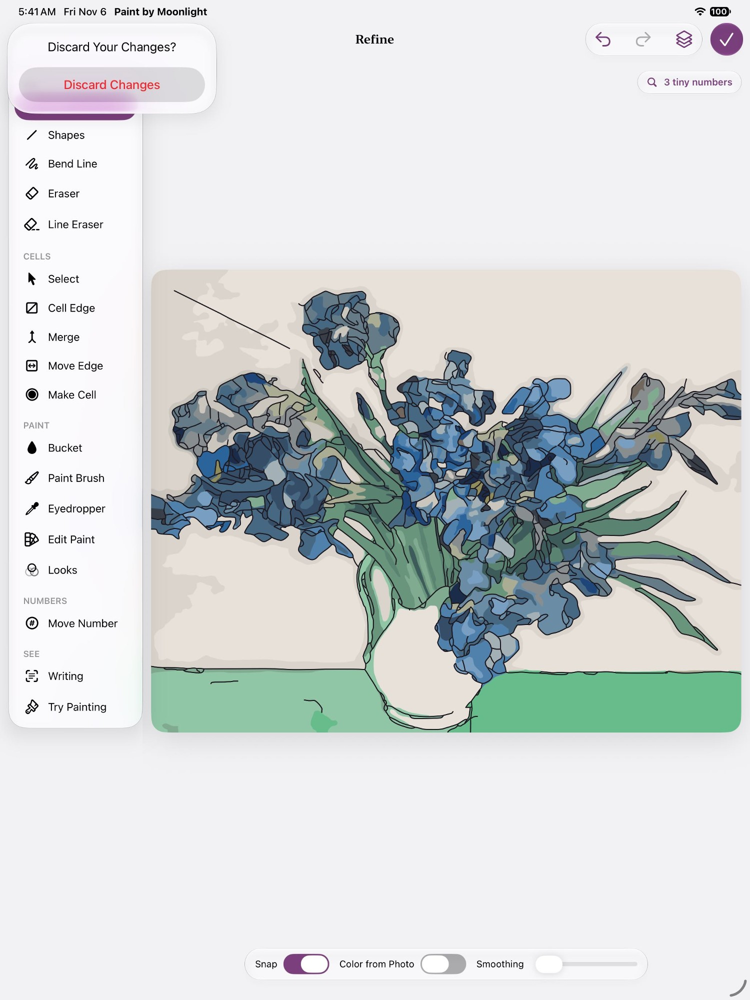

# Agent transcript

- end: success, 123 turns, 19.8 min, estimated $3.2484712000000004
- tool calls: {"Read": 3, "mcp__maestro__take_screenshot": 43, "mcp__maestro__run": 56, "mcp__maestro__inspect_screen": 15, "Write": 5}
- images the agent received: 43

**Start**: model claude-opus-5-5, MCP [{"name": "maestro", "status": "connected", "source": "dynamic"}]

→ `Read` `{"file_path": "/Users/runner/.claude/projects/-Users-runner-work--temp-qa/memory/MEMORY.md"}`

→ `mcp__maestro__take_screenshot` `{"device_id": "3CA7F57F-88B4-4C91-976E-28049B0C2A86"}`

← Read (error): File does not exist. Note: your current working directory is /Users/runner/work/_temp/qa.

← mcp__maestro__take_screenshot: image  919x2000

> Plan: a terracotta pot on a brown table, green stem and two green leaves, a red flower with yellow centre and petals, light blue background.

→ `mcp__maestro__run` `{"device_id": "3CA7F57F-88B4-4C91-976E-28049B0C2A86", "yaml": "appId: com.pbordjadze.paintbynumber\n---\n- tapOn:\n    point: \"90%,10%\"\n- waitForAnimationToEnd\n- takeScreenshot: /Users/runner/work/_temp/qa/shots/plan-1"}`

→ `mcp__maestro__inspect_screen` `{"device_id": "3CA7F57F-88B4-4C91-976E-28049B0C2A86"}`

← mcp__maestro__run: {"success":true,"device_id":"3CA7F57F-88B4-4C91-976E-28049B0C2A86","commands_executed":4,"message":"Flow executed successfully","env_vars":{"MAESTRO_CLI_ANALYSIS_NOTIFICATION_DISABLED":"true","MAESTRO_CLI_NO_ANALYTICS":"1","MAESTRO_DRIVER_STARTUP_TIMEOUT":"240000","MAESTRO_VERSION":"2.11.0"}}

← mcp__maestro__inspect_screen: {"ui_schema":{"platform":"ios","abbreviations":{"b":"bounds","txt":"text","rid":"resource-id","a11y":"accessibilityText","hint":"hintText","val":"value","c":"children"},"defaults":{"enabled":true,"focused":false,"selected":false,"checked":false,"txt":"","hint":"","rid":"","val":"","a11y":""}},"elements":[{"b":"[0,0][402,874]","a11y":"Paint by Moonlight","c":[{"b":"[0,0][402,874]","c":[{"b":"[0,0][ …

> There's a "From Scratch" button top right.

→ `mcp__maestro__run` `{"device_id": "3CA7F57F-88B4-4C91-976E-28049B0C2A86", "yaml": "appId: com.pbordjadze.paintbynumber\n---\n- tapOn:\n    id: \"from-scratch\"\n- waitForAnimationToEnd\n- takeScreenshot: /Users/runner/work/_temp/qa/shots/plan-2"}`

→ `mcp__maestro__take_screenshot` `{"device_id": "3CA7F57F-88B4-4C91-976E-28049B0C2A86"}`

← mcp__maestro__run: {"success":true,"device_id":"3CA7F57F-88B4-4C91-976E-28049B0C2A86","commands_executed":4,"message":"Flow executed successfully","env_vars":{"MAESTRO_CLI_ANALYSIS_NOTIFICATION_DISABLED":"true","MAESTRO_CLI_NO_ANALYTICS":"1","MAESTRO_DRIVER_STARTUP_TIMEOUT":"240000","MAESTRO_VERSION":"2.11.0"}}

← mcp__maestro__take_screenshot: image  919x2000

→ `mcp__maestro__inspect_screen` `{"device_id": "3CA7F57F-88B4-4C91-976E-28049B0C2A86"}`

← mcp__maestro__inspect_screen: {"ui_schema":{"platform":"ios","abbreviations":{"b":"bounds","txt":"text","rid":"resource-id","a11y":"accessibilityText","hint":"hintText","val":"value","c":"children"},"defaults":{"enabled":true,"focused":false,"selected":false,"checked":false,"txt":"","hint":"","rid":"","val":"","a11y":""}},"elements":[{"b":"[0,0][402,874]","a11y":"Paint by Moonlight","c":[{"b":"[0,0][402,874]","c":[{"b":"[0,0][ …

> Blank page found in one tap (From Scratch). Canvas picture is 378×378 pt at (12,190). Let me see what Shapes offers.

→ `mcp__maestro__run` `{"device_id": "3CA7F57F-88B4-4C91-976E-28049B0C2A86", "yaml": "appId: com.pbordjadze.paintbynumber\n---\n- tapOn:\n    id: \"refine-tool-shapes\"\n- waitForAnimationToEnd"}`

→ `mcp__maestro__take_screenshot` `{"device_id": "3CA7F57F-88B4-4C91-976E-28049B0C2A86"}`

← mcp__maestro__run: {"success":true,"device_id":"3CA7F57F-88B4-4C91-976E-28049B0C2A86","commands_executed":3,"message":"Flow executed successfully","env_vars":{"MAESTRO_CLI_ANALYSIS_NOTIFICATION_DISABLED":"true","MAESTRO_CLI_NO_ANALYTICS":"1","MAESTRO_DRIVER_STARTUP_TIMEOUT":"240000","MAESTRO_VERSION":"2.11.0"}}

← mcp__maestro__take_screenshot: image  919x2000

→ `mcp__maestro__inspect_screen` `{"device_id": "3CA7F57F-88B4-4C91-976E-28049B0C2A86"}`

← mcp__maestro__inspect_screen: {"ui_schema":{"platform":"ios","abbreviations":{"b":"bounds","txt":"text","rid":"resource-id","a11y":"accessibilityText","hint":"hintText","val":"value","c":"children"},"defaults":{"enabled":true,"focused":false,"selected":false,"checked":false,"txt":"","hint":"","rid":"","val":"","a11y":""}},"elements":[{"b":"[0,0][402,874]","a11y":"Paint by Moonlight","c":[{"b":"[0,0][402,874]","c":[{"b":"[0,0][ …

→ `mcp__maestro__run` `{"device_id": "3CA7F57F-88B4-4C91-976E-28049B0C2A86", "yaml": "appId: com.pbordjadze.paintbynumber\n---\n- swipe:\n    start: \"14,470\"\n    end: \"388,470\"\n    duration: 800\n- waitForAnimationToEnd\n- takeScreenshot: /Users/runner/work/_temp/qa/shots/plan-3-table"}`

→ `mcp__maestro__take_screenshot` `{"device_id": "3CA7F57F-88B4-4C91-976E-28049B0C2A86"}`

← mcp__maestro__run: {"success":true,"device_id":"3CA7F57F-88B4-4C91-976E-28049B0C2A86","commands_executed":4,"message":"Flow executed successfully","env_vars":{"MAESTRO_CLI_ANALYSIS_NOTIFICATION_DISABLED":"true","MAESTRO_CLI_NO_ANALYTICS":"1","MAESTRO_DRIVER_STARTUP_TIMEOUT":"240000","MAESTRO_VERSION":"2.11.0"}}

← mcp__maestro__take_screenshot: image  919x2000

> Table line: 1 try, snapped edge to edge. Now the pot as a trapezoid with three lines resting on the table line.

→ `mcp__maestro__run` `{"device_id": "3CA7F57F-88B4-4C91-976E-28049B0C2A86", "yaml": "appId: com.pbordjadze.paintbynumber\n---\n- swipe:\n    start: \"145,395\"\n    end: \"257,395\"\n    duration: 800\n- swipe:\n    start: \"145,395\"\n    end: \"165,470\"\n    duration: 800\n- swipe:\n    start: \"257,395\"\n    end: \"237,470\"\n    duration: 800\n- waitForAnimationToEnd\n- takeScreenshot: /Users/runner/work/_temp/qa/shots/plan-4-pot"}`

→ `mcp__maestro__take_screenshot` `{"device_id": "3CA7F57F-88B4-4C91-976E-28049B0C2A86"}`

← mcp__maestro__run: {"success":true,"device_id":"3CA7F57F-88B4-4C91-976E-28049B0C2A86","commands_executed":6,"message":"Flow executed successfully","env_vars":{"MAESTRO_CLI_ANALYSIS_NOTIFICATION_DISABLED":"true","MAESTRO_CLI_NO_ANALYTICS":"1","MAESTRO_DRIVER_STARTUP_TIMEOUT":"240000","MAESTRO_VERSION":"2.11.0"}}

← mcp__maestro__take_screenshot: image  919x2000

> Pot: 1 try, closed. Now the flower: try the Star shape (unknown whether it drags corner-to-corner or centre-out).

→ `mcp__maestro__run` `{"device_id": "3CA7F57F-88B4-4C91-976E-28049B0C2A86", "yaml": "appId: com.pbordjadze.paintbynumber\n---\n- tapOn:\n    id: \"refine-shape-star\"\n- swipe:\n    start: \"156,215\"\n    end: \"246,305\"\n    duration: 800\n- waitForAnimationToEnd\n- takeScreenshot: /Users/runner/work/_temp/qa/shots/plan-5-star"}`

→ `mcp__maestro__take_screenshot` `{"device_id": "3CA7F57F-88B4-4C91-976E-28049B0C2A86"}`

← mcp__maestro__run: {"success":true,"device_id":"3CA7F57F-88B4-4C91-976E-28049B0C2A86","commands_executed":5,"message":"Flow executed successfully","env_vars":{"MAESTRO_CLI_ANALYSIS_NOTIFICATION_DISABLED":"true","MAESTRO_CLI_NO_ANALYTICS":"1","MAESTRO_DRIVER_STARTUP_TIMEOUT":"240000","MAESTRO_VERSION":"2.11.0"}}

← mcp__maestro__take_screenshot: image  919x2000

> Star works corner-to-corner (1 try). Now the yellow centre oval and the stem (two lines from star to pot rim).

→ `mcp__maestro__run` `{"device_id": "3CA7F57F-88B4-4C91-976E-28049B0C2A86", "yaml": "appId: com.pbordjadze.paintbynumber\n---\n- tapOn:\n    id: \"refine-shape-oval\"\n- swipe:\n    start: \"189,253\"\n    end: \"211,275\"\n    duration: 800\n- tapOn:\n    id: \"refine-shape-line\"\n- swipe:\n    start: \"195,290\"\n    end: \"195,397\"\n    duration: 800\n- swipe:\n    start: \"206,290\"\n    end: \"206,397\"\n    duration: 800\n- waitForAnimationToEnd\n- takeScreenshot: /Users/runner/work/_temp/qa/shots/plan-6-stem"}`

→ `mcp__maestro__take_screenshot` `{"device_id": "3CA7F57F-88B4-4C91-976E-28049B0C2A86"}`

← mcp__maestro__run: {"success":true,"device_id":"3CA7F57F-88B4-4C91-976E-28049B0C2A86","commands_executed":8,"message":"Flow executed successfully","env_vars":{"MAESTRO_CLI_ANALYSIS_NOTIFICATION_DISABLED":"true","MAESTRO_CLI_NO_ANALYTICS":"1","MAESTRO_DRIVER_STARTUP_TIMEOUT":"240000","MAESTRO_VERSION":"2.11.0"}}

← mcp__maestro__take_screenshot: image  919x2000

> Stem: 1 try, snapped to the star and the pot rim. Now two leaf ovals beside the stem.

→ `mcp__maestro__run` `{"device_id": "3CA7F57F-88B4-4C91-976E-28049B0C2A86", "yaml": "appId: com.pbordjadze.paintbynumber\n---\n- tapOn:\n    id: \"refine-shape-oval\"\n- swipe:\n    start: \"139,325\"\n    end: \"194,349\"\n    duration: 800\n- swipe:\n    start: \"207,350\"\n    end: \"262,374\"\n    duration: 800\n- waitForAnimationToEnd\n- takeScreenshot: /Users/runner/work/_temp/qa/shots/plan-7-leaves"}`

→ `mcp__maestro__take_screenshot` `{"device_id": "3CA7F57F-88B4-4C91-976E-28049B0C2A86"}`

← mcp__maestro__run: {"success":true,"device_id":"3CA7F57F-88B4-4C91-976E-28049B0C2A86","commands_executed":6,"message":"Flow executed successfully","env_vars":{"MAESTRO_CLI_ANALYSIS_NOTIFICATION_DISABLED":"true","MAESTRO_CLI_NO_ANALYTICS":"1","MAESTRO_DRIVER_STARTUP_TIMEOUT":"240000","MAESTRO_VERSION":"2.11.0"}}

← mcp__maestro__take_screenshot: image  919x2000

> Leaves drawn (1 try), though they're plain ovals rather than pointed leaves. Let me look at the Cells and Paint groups.

→ `mcp__maestro__run` `{"device_id": "3CA7F57F-88B4-4C91-976E-28049B0C2A86", "yaml": "appId: com.pbordjadze.paintbynumber\n---\n- tapOn: \"Cells\"\n- waitForAnimationToEnd"}`

→ `mcp__maestro__take_screenshot` `{"device_id": "3CA7F57F-88B4-4C91-976E-28049B0C2A86"}`

← mcp__maestro__run: {"success":true,"device_id":"3CA7F57F-88B4-4C91-976E-28049B0C2A86","commands_executed":3,"message":"Flow executed successfully","env_vars":{"MAESTRO_CLI_ANALYSIS_NOTIFICATION_DISABLED":"true","MAESTRO_CLI_NO_ANALYTICS":"1","MAESTRO_DRIVER_STARTUP_TIMEOUT":"240000","MAESTRO_VERSION":"2.11.0"}}

← mcp__maestro__take_screenshot: image  919x2000

→ `mcp__maestro__run` `{"device_id": "3CA7F57F-88B4-4C91-976E-28049B0C2A86", "yaml": "appId: com.pbordjadze.paintbynumber\n---\n- tapOn: \"Paint\"\n- waitForAnimationToEnd"}`

→ `mcp__maestro__inspect_screen` `{"device_id": "3CA7F57F-88B4-4C91-976E-28049B0C2A86"}`

← mcp__maestro__run: {"success":true,"device_id":"3CA7F57F-88B4-4C91-976E-28049B0C2A86","commands_executed":3,"message":"Flow executed successfully","env_vars":{"MAESTRO_CLI_ANALYSIS_NOTIFICATION_DISABLED":"true","MAESTRO_CLI_NO_ANALYTICS":"1","MAESTRO_DRIVER_STARTUP_TIMEOUT":"240000","MAESTRO_VERSION":"2.11.0"}}

← mcp__maestro__inspect_screen: {"ui_schema":{"platform":"ios","abbreviations":{"b":"bounds","txt":"text","rid":"resource-id","a11y":"accessibilityText","hint":"hintText","val":"value","c":"children"},"defaults":{"enabled":true,"focused":false,"selected":false,"checked":false,"txt":"","hint":"","rid":"","val":"","a11y":""}},"elements":[{"b":"[0,0][402,874]","a11y":"Paint by Moonlight","c":[{"b":"[0,0][402,874]","c":[{"b":"[0,0][ …

> Let me add a new paint.

→ `mcp__maestro__run` `{"device_id": "3CA7F57F-88B4-4C91-976E-28049B0C2A86", "yaml": "appId: com.pbordjadze.paintbynumber\n---\n- tapOn:\n    id: \"refine-palette-new\"\n- waitForAnimationToEnd"}`

→ `mcp__maestro__take_screenshot` `{"device_id": "3CA7F57F-88B4-4C91-976E-28049B0C2A86"}`

← mcp__maestro__run: {"success":true,"device_id":"3CA7F57F-88B4-4C91-976E-28049B0C2A86","commands_executed":3,"message":"Flow executed successfully","env_vars":{"MAESTRO_CLI_ANALYSIS_NOTIFICATION_DISABLED":"true","MAESTRO_CLI_NO_ANALYTICS":"1","MAESTRO_DRIVER_STARTUP_TIMEOUT":"240000","MAESTRO_VERSION":"2.11.0"}}

← mcp__maestro__take_screenshot: image  919x2000

> Nothing visibly opened. Inspecting.

→ `mcp__maestro__inspect_screen` `{"device_id": "3CA7F57F-88B4-4C91-976E-28049B0C2A86"}`

← mcp__maestro__inspect_screen: {"ui_schema":{"platform":"ios","abbreviations":{"b":"bounds","txt":"text","rid":"resource-id","a11y":"accessibilityText","hint":"hintText","val":"value","c":"children"},"defaults":{"enabled":true,"focused":false,"selected":false,"checked":false,"txt":"","hint":"","rid":"","val":"","a11y":""}},"elements":[{"b":"[0,0][402,874]","a11y":"Paint by Moonlight","c":[{"b":"[0,0][402,874]","c":[{"b":"[0,0][ …

> The New Paint tap did nothing visible. Checking the log.

→ `Read` `{"file_path": "/Users/runner/work/_temp/qa/app.log"}`

← Read: 1	getpwuid_r did not find a match for uid 501
2	Filtering the log data using "subsystem == "com.pbordjadze.paintbynumber""
3	Timestamp               Ty Process[PID:TID]
4	2026-11-05 15:19:21.857 Df PaintByNumber[35720:17580] [com.pbordjadze.paintbynumber:tips] offer in shelf: , wanted
5	2026-11-05 15:19:23.576 Df PaintByNumber[35720:17667] [com.pbordjadze.paintbynumber:canvas] Making the render co …

> A tip (refineFill) was shown 15:24:47–15:25:32 while I drew, but I never saw it in a screenshot. Retry New Paint by point.

→ `mcp__maestro__run` `{"device_id": "3CA7F57F-88B4-4C91-976E-28049B0C2A86", "yaml": "appId: com.pbordjadze.paintbynumber\n---\n- tapOn:\n    point: \"360,707\"\n- waitForAnimationToEnd"}`

→ `mcp__maestro__take_screenshot` `{"device_id": "3CA7F57F-88B4-4C91-976E-28049B0C2A86"}`

← mcp__maestro__run: {"success":true,"device_id":"3CA7F57F-88B4-4C91-976E-28049B0C2A86","commands_executed":3,"message":"Flow executed successfully","env_vars":{"MAESTRO_CLI_ANALYSIS_NOTIFICATION_DISABLED":"true","MAESTRO_CLI_NO_ANALYTICS":"1","MAESTRO_DRIVER_STARTUP_TIMEOUT":"240000","MAESTRO_VERSION":"2.11.0"}}

← mcp__maestro__take_screenshot: image  919x2000

> New Paint did nothing twice (by id and by point). Let me read the Tool Guide.

→ `mcp__maestro__run` `{"device_id": "3CA7F57F-88B4-4C91-976E-28049B0C2A86", "yaml": "appId: com.pbordjadze.paintbynumber\n---\n- tapOn:\n    id: \"refine-guide\"\n- waitForAnimationToEnd"}`

→ `mcp__maestro__inspect_screen` `{"device_id": "3CA7F57F-88B4-4C91-976E-28049B0C2A86"}`

← mcp__maestro__run: {"success":true,"device_id":"3CA7F57F-88B4-4C91-976E-28049B0C2A86","commands_executed":3,"message":"Flow executed successfully","env_vars":{"MAESTRO_CLI_ANALYSIS_NOTIFICATION_DISABLED":"true","MAESTRO_CLI_NO_ANALYTICS":"1","MAESTRO_DRIVER_STARTUP_TIMEOUT":"240000","MAESTRO_VERSION":"2.11.0"}}

← mcp__maestro__inspect_screen: {"ui_schema":{"platform":"ios","abbreviations":{"b":"bounds","txt":"text","rid":"resource-id","a11y":"accessibilityText","hint":"hintText","val":"value","c":"children"},"defaults":{"enabled":true,"focused":false,"selected":false,"checked":false,"txt":"","hint":"","rid":"","val":"","a11y":""}},"elements":[{"b":"[0,0][402,874]","a11y":"Paint by Moonlight","c":[{"b":"[0,0][402,874]","c":[{"b":"[0,0][ …

> The guide says the colour wheel at the end of the palette opens a colour chooser. Let me write the initial report now, then retry.

→ `Write` `{"file_path": "/Users/runner/work/_temp/qa/report.md", "content": "# Refine exploratory session \u2014 potted flower (iPhone 17 Pro sim, debug build) \u2014 IN PROGRESS\n\n**Verdict**: (in progress) line drawing done; colouring blocked so far.\n\n**What I meant to draw**: a terracotta-orange trapezoid pot on a brown table (a line across the page), a green stem and two green leaves, a red five-pointed flower with a yellow round centre, light-blue background.\n\n## The steps (so far)\n| Step | Tries | Stuck | What worked | Expected |\n|---|---|---|---|---|\n| Find a blank page | 1 | 0 | + \u2192`

← Write: File created successfully at: /Users/runner/work/_temp/qa/report.md (file state is current in your context — no need to Read it back)

→ `mcp__maestro__run` `{"device_id": "3CA7F57F-88B4-4C91-976E-28049B0C2A86", "yaml": "appId: com.pbordjadze.paintbynumber\n---\n- tapOn:\n    id: \"refine-guide-done\"\n- waitForAnimationToEnd\n- tapOn:\n    id: \"refine-palette-new\"\n- takeScreenshot: /Users/runner/work/_temp/qa/shots/plan-8-newpaint"}`

← mcp__maestro__run: {"success":true,"device_id":"3CA7F57F-88B4-4C91-976E-28049B0C2A86","commands_executed":5,"message":"Flow executed successfully","env_vars":{"MAESTRO_CLI_ANALYSIS_NOTIFICATION_DISABLED":"true","MAESTRO_CLI_NO_ANALYTICS":"1","MAESTRO_DRIVER_STARTUP_TIMEOUT":"240000","MAESTRO_VERSION":"2.11.0"}}

→ `mcp__maestro__take_screenshot` `{"device_id": "3CA7F57F-88B4-4C91-976E-28049B0C2A86"}`

← mcp__maestro__take_screenshot: image  919x2000

> Third try opened the New Paint chooser (the earlier two did nothing). Picking red.

→ `mcp__maestro__run` `{"device_id": "3CA7F57F-88B4-4C91-976E-28049B0C2A86", "yaml": "appId: com.pbordjadze.paintbynumber\n---\n- tapOn:\n    point: \"187,557\"\n- waitForAnimationToEnd\n- tapOn:\n    point: \"357,332\"\n- waitForAnimationToEnd"}`

→ `mcp__maestro__take_screenshot` `{"device_id": "3CA7F57F-88B4-4C91-976E-28049B0C2A86"}`

← mcp__maestro__run: {"success":true,"device_id":"3CA7F57F-88B4-4C91-976E-28049B0C2A86","commands_executed":5,"message":"Flow executed successfully","env_vars":{"MAESTRO_CLI_ANALYSIS_NOTIFICATION_DISABLED":"true","MAESTRO_CLI_NO_ANALYTICS":"1","MAESTRO_DRIVER_STARTUP_TIMEOUT":"240000","MAESTRO_VERSION":"2.11.0"}}

← mcp__maestro__take_screenshot: image  919x2000

> Red waits with a +. Pour it into the star (top petal).

→ `mcp__maestro__run` `{"device_id": "3CA7F57F-88B4-4C91-976E-28049B0C2A86", "yaml": "appId: com.pbordjadze.paintbynumber\n---\n- tapOn:\n    point: \"201,235\"\n- waitForAnimationToEnd"}`

→ `mcp__maestro__take_screenshot` `{"device_id": "3CA7F57F-88B4-4C91-976E-28049B0C2A86"}`

← mcp__maestro__run: {"success":true,"device_id":"3CA7F57F-88B4-4C91-976E-28049B0C2A86","commands_executed":3,"message":"Flow executed successfully","env_vars":{"MAESTRO_CLI_ANALYSIS_NOTIFICATION_DISABLED":"true","MAESTRO_CLI_NO_ANALYTICS":"1","MAESTRO_DRIVER_STARTUP_TIMEOUT":"240000","MAESTRO_VERSION":"2.11.0"}}

← mcp__maestro__take_screenshot: image  919x2000

> Red star: 1 try. Next yellow for the centre.

→ `mcp__maestro__run` `{"device_id": "3CA7F57F-88B4-4C91-976E-28049B0C2A86", "yaml": "appId: com.pbordjadze.paintbynumber\n---\n- tapOn:\n    id: \"refine-palette-new\"\n- assertVisible: \"New Paint\"\n- tapOn:\n    point: \"306,557\"\n- tapOn:\n    point: \"357,332\"\n- tapOn:\n    point: \"201,264\"\n- waitForAnimationToEnd\n- takeScreenshot: /Users/runner/work/_temp/qa/shots/plan-9-yellow"}`

← mcp__maestro__run: {"success":true,"device_id":"3CA7F57F-88B4-4C91-976E-28049B0C2A86","commands_executed":8,"message":"Flow executed successfully","env_vars":{"MAESTRO_CLI_ANALYSIS_NOTIFICATION_DISABLED":"true","MAESTRO_CLI_NO_ANALYTICS":"1","MAESTRO_DRIVER_STARTUP_TIMEOUT":"240000","MAESTRO_VERSION":"2.11.0"}}

→ `mcp__maestro__take_screenshot` `{"device_id": "3CA7F57F-88B4-4C91-976E-28049B0C2A86"}`

← mcp__maestro__take_screenshot: image  919x2000

> Works. Now green (stem + both leaves) and orange (pot).

→ `mcp__maestro__run` `{"device_id": "3CA7F57F-88B4-4C91-976E-28049B0C2A86", "yaml": "appId: com.pbordjadze.paintbynumber\n---\n- tapOn:\n    id: \"refine-palette-new\"\n- assertVisible: \"New Paint\"\n- tapOn:\n    point: \"365,557\"\n- tapOn:\n    point: \"357,332\"\n- tapOn:\n    point: \"200,340\"\n- tapOn:\n    point: \"166,337\"\n- tapOn:\n    point: \"234,362\"\n- tapOn:\n    id: \"refine-palette-new\"\n- assertVisible: \"New Paint\"\n- tapOn:\n    point: \"217,587\"\n- tapOn:\n    point: \"357,332\"\n- tapOn:\n    point: \"201,432\"\n- waitForAnimationToEnd\n- takeScreenshot: /Users/runner/work/_temp/qa/shot`

← mcp__maestro__run: {"success":true,"device_id":"3CA7F57F-88B4-4C91-976E-28049B0C2A86","commands_executed":15,"message":"Flow executed successfully","env_vars":{"MAESTRO_CLI_ANALYSIS_NOTIFICATION_DISABLED":"true","MAESTRO_CLI_NO_ANALYTICS":"1","MAESTRO_DRIVER_STARTUP_TIMEOUT":"240000","MAESTRO_VERSION":"2.11.0"}}

→ `mcp__maestro__take_screenshot` `{"device_id": "3CA7F57F-88B4-4C91-976E-28049B0C2A86"}`

← mcp__maestro__take_screenshot: image  919x2000

> Surprise: the green pour into the stem filled the whole background too — the stem isn't a closed area of its own. Let me look at the Numbers view to see the cells.

→ `mcp__maestro__run` `{"device_id": "3CA7F57F-88B4-4C91-976E-28049B0C2A86", "yaml": "appId: com.pbordjadze.paintbynumber\n---\n- tapOn: \"Numbers\"\n- waitForAnimationToEnd\n- takeScreenshot: /Users/runner/work/_temp/qa/shots/plan-11-numbers"}`

→ `mcp__maestro__take_screenshot` `{"device_id": "3CA7F57F-88B4-4C91-976E-28049B0C2A86"}`

← mcp__maestro__run: {"success":true,"device_id":"3CA7F57F-88B4-4C91-976E-28049B0C2A86","commands_executed":4,"message":"Flow executed successfully","env_vars":{"MAESTRO_CLI_ANALYSIS_NOTIFICATION_DISABLED":"true","MAESTRO_CLI_NO_ANALYTICS":"1","MAESTRO_DRIVER_STARTUP_TIMEOUT":"240000","MAESTRO_VERSION":"2.11.0"}}

← mcp__maestro__take_screenshot: image  919x2000

→ `mcp__maestro__run` `{"device_id": "3CA7F57F-88B4-4C91-976E-28049B0C2A86", "yaml": "appId: com.pbordjadze.paintbynumber\n---\n- tapOn: \"Ink\"\n- tapOn:\n    id: \"refine-tool-shapes\"\n- tapOn:\n    id: \"refine-shape-line\"\n- tapOn:\n    id: \"refine-snap\"\n- waitForAnimationToEnd"}`

→ `mcp__maestro__inspect_screen` `{"device_id": "3CA7F57F-88B4-4C91-976E-28049B0C2A86"}`

← mcp__maestro__run: {"success":true,"device_id":"3CA7F57F-88B4-4C91-976E-28049B0C2A86","commands_executed":6,"message":"Flow executed successfully","env_vars":{"MAESTRO_CLI_ANALYSIS_NOTIFICATION_DISABLED":"true","MAESTRO_CLI_NO_ANALYTICS":"1","MAESTRO_DRIVER_STARTUP_TIMEOUT":"240000","MAESTRO_VERSION":"2.11.0"}}

← mcp__maestro__inspect_screen: {"ui_schema":{"platform":"ios","abbreviations":{"b":"bounds","txt":"text","rid":"resource-id","a11y":"accessibilityText","hint":"hintText","val":"value","c":"children"},"defaults":{"enabled":true,"focused":false,"selected":false,"checked":false,"txt":"","hint":"","rid":"","val":"","a11y":""}},"elements":[{"b":"[0,0][402,874]","a11y":"Paint by Moonlight","c":[{"b":"[0,0][402,874]","c":[{"b":"[0,0][ …

> Snap still on after tapping its row; tapping the switch itself.

→ `mcp__maestro__run` `{"device_id": "3CA7F57F-88B4-4C91-976E-28049B0C2A86", "yaml": "appId: com.pbordjadze.paintbynumber\n---\n- tapOn:\n    point: \"166,716\"\n- waitForAnimationToEnd"}`

→ `mcp__maestro__take_screenshot` `{"device_id": "3CA7F57F-88B4-4C91-976E-28049B0C2A86"}`

← mcp__maestro__run: {"success":true,"device_id":"3CA7F57F-88B4-4C91-976E-28049B0C2A86","commands_executed":3,"message":"Flow executed successfully","env_vars":{"MAESTRO_CLI_ANALYSIS_NOTIFICATION_DISABLED":"true","MAESTRO_CLI_NO_ANALYTICS":"1","MAESTRO_DRIVER_STARTUP_TIMEOUT":"240000","MAESTRO_VERSION":"2.11.0"}}

← mcp__maestro__take_screenshot: image  919x2000

> Snap is off now (tapping the row by id didn't toggle it; the switch itself did). Drawing short overshooting segments over the stem ends.

→ `mcp__maestro__run` `{"device_id": "3CA7F57F-88B4-4C91-976E-28049B0C2A86", "yaml": "appId: com.pbordjadze.paintbynumber\n---\n- swipe:\n    start: \"195,278\"\n    end: \"195,302\"\n    duration: 600\n- swipe:\n    start: \"206,278\"\n    end: \"206,302\"\n    duration: 600\n- swipe:\n    start: \"195,383\"\n    end: \"195,405\"\n    duration: 600\n- swipe:\n    start: \"206,383\"\n    end: \"206,405\"\n    duration: 600\n- tapOn: \"Numbers\"\n- waitForAnimationToEnd\n- takeScreenshot: /Users/runner/work/_temp/qa/shots/plan-12-stemfix"}`

→ `mcp__maestro__take_screenshot` `{"device_id": "3CA7F57F-88B4-4C91-976E-28049B0C2A86"}`

← mcp__maestro__run: {"success":true,"device_id":"3CA7F57F-88B4-4C91-976E-28049B0C2A86","commands_executed":8,"message":"Flow executed successfully","env_vars":{"MAESTRO_CLI_ANALYSIS_NOTIFICATION_DISABLED":"true","MAESTRO_CLI_NO_ANALYTICS":"1","MAESTRO_DRIVER_STARTUP_TIMEOUT":"240000","MAESTRO_VERSION":"2.11.0"}}

← mcp__maestro__take_screenshot: image  919x2000

> Overshoot ends now show inside the star and pot, and the stem still has no number. Test it by pouring light blue into the background.

→ `mcp__maestro__run` `{"device_id": "3CA7F57F-88B4-4C91-976E-28049B0C2A86", "yaml": "appId: com.pbordjadze.paintbynumber\n---\n- tapOn: \"Paint\"\n- tapOn:\n    id: \"refine-tool-bucket\"\n- tapOn:\n    id: \"refine-palette-new\"\n- assertVisible: \"New Paint\"\n- tapOn:\n    point: \"38,676\"\n- tapOn:\n    point: \"357,332\"\n- tapOn:\n    point: \"330,260\"\n- waitForAnimationToEnd\n- takeScreenshot: /Users/runner/work/_temp/qa/shots/plan-13-blue"}`

→ `mcp__maestro__take_screenshot` `{"device_id": "3CA7F57F-88B4-4C91-976E-28049B0C2A86"}`

← mcp__maestro__run: {"success":true,"device_id":"3CA7F57F-88B4-4C91-976E-28049B0C2A86","commands_executed":10,"message":"Flow executed successfully","env_vars":{"MAESTRO_CLI_ANALYSIS_NOTIFICATION_DISABLED":"true","MAESTRO_CLI_NO_ANALYTICS":"1","MAESTRO_DRIVER_STARTUP_TIMEOUT":"240000","MAESTRO_VERSION":"2.11.0"}}

← mcp__maestro__take_screenshot: image  919x2000

> Stem still merges with the background even though lines visibly cross into star and pot. Maybe thin areas get absorbed. Let me read the guide for Cells › Make Cell.

→ `mcp__maestro__run` `{"device_id": "3CA7F57F-88B4-4C91-976E-28049B0C2A86", "yaml": "appId: com.pbordjadze.paintbynumber\n---\n- tapOn: \"Cells\"\n- tapOn:\n    point: \"303,810\"\n- tapOn:\n    id: \"refine-guide\"\n- waitForAnimationToEnd"}`

→ `mcp__maestro__inspect_screen` `{"device_id": "3CA7F57F-88B4-4C91-976E-28049B0C2A86"}`

← mcp__maestro__run: {"success":true,"device_id":"3CA7F57F-88B4-4C91-976E-28049B0C2A86","commands_executed":5,"message":"Flow executed successfully","env_vars":{"MAESTRO_CLI_ANALYSIS_NOTIFICATION_DISABLED":"true","MAESTRO_CLI_NO_ANALYTICS":"1","MAESTRO_DRIVER_STARTUP_TIMEOUT":"240000","MAESTRO_VERSION":"2.11.0"}}

← mcp__maestro__inspect_screen: {"ui_schema":{"platform":"ios","abbreviations":{"b":"bounds","txt":"text","rid":"resource-id","a11y":"accessibilityText","hint":"hintText","val":"value","c":"children"},"defaults":{"enabled":true,"focused":false,"selected":false,"checked":false,"txt":"","hint":"","rid":"","val":"","a11y":""}},"elements":[{"b":"[0,0][402,874]","a11y":"Paint by Moonlight","c":[{"b":"[0,0][402,874]","c":[{"b":"[0,0][ …

> Guide: Make Cell turns an ink-outlined shape into its own cell ("suits small shapes"). That's what I need. Trying it on the stem.

→ `mcp__maestro__run` `{"device_id": "3CA7F57F-88B4-4C91-976E-28049B0C2A86", "yaml": "appId: com.pbordjadze.paintbynumber\n---\n- tapOn:\n    id: \"refine-guide-done\"\n- waitForAnimationToEnd\n- tapOn:\n    point: \"200,345\"\n- waitForAnimationToEnd\n- takeScreenshot: /Users/runner/work/_temp/qa/shots/plan-14-makecell"}`

→ `mcp__maestro__take_screenshot` `{"device_id": "3CA7F57F-88B4-4C91-976E-28049B0C2A86"}`

← mcp__maestro__run: {"success":true,"device_id":"3CA7F57F-88B4-4C91-976E-28049B0C2A86","commands_executed":6,"message":"Flow executed successfully","env_vars":{"MAESTRO_CLI_ANALYSIS_NOTIFICATION_DISABLED":"true","MAESTRO_CLI_NO_ANALYTICS":"1","MAESTRO_DRIVER_STARTUP_TIMEOUT":"240000","MAESTRO_VERSION":"2.11.0"}}

← mcp__maestro__take_screenshot: image  919x2000

> Make Cell flooded the stem *and* the whole background (turned white), so the ink truly doesn't enclose the stem. Undo, then inspect with Select.

→ `mcp__maestro__run` `{"device_id": "3CA7F57F-88B4-4C91-976E-28049B0C2A86", "yaml": "appId: com.pbordjadze.paintbynumber\n---\n- tapOn:\n    id: \"refine-undo\"\n- waitForAnimationToEnd\n- tapOn:\n    point: \"97,810\"\n- tapOn:\n    point: \"200,345\"\n- waitForAnimationToEnd\n- takeScreenshot: /Users/runner/work/_temp/qa/shots/plan-15-select-stem"}`

→ `mcp__maestro__take_screenshot` `{"device_id": "3CA7F57F-88B4-4C91-976E-28049B0C2A86"}`

← mcp__maestro__run: {"success":true,"device_id":"3CA7F57F-88B4-4C91-976E-28049B0C2A86","commands_executed":7,"message":"Flow executed successfully","env_vars":{"MAESTRO_CLI_ANALYSIS_NOTIFICATION_DISABLED":"true","MAESTRO_CLI_NO_ANALYTICS":"1","MAESTRO_DRIVER_STARTUP_TIMEOUT":"240000","MAESTRO_VERSION":"2.11.0"}}

← mcp__maestro__take_screenshot: image  919x2000

> The Select outline traces the star, leaves and pot, but ignores both stem lines entirely: they're ink but not cell borders. Test whether it's thinness: a lone 11-pt-wide rectangle in the background.

→ `mcp__maestro__run` `{"device_id": "3CA7F57F-88B4-4C91-976E-28049B0C2A86", "yaml": "appId: com.pbordjadze.paintbynumber\n---\n- tapOn: \"Ink\"\n- tapOn:\n    id: \"refine-shape-rectangle\"\n- swipe:\n    start: \"320,400\"\n    end: \"331,450\"\n    duration: 600\n- swipe:\n    start: \"340,400\"\n    end: \"370,450\"\n    duration: 600\n- tapOn: \"Numbers\"\n- waitForAnimationToEnd\n- takeScreenshot: /Users/runner/work/_temp/qa/shots/plan-16-thin-test"}`

→ `mcp__maestro__take_screenshot` `{"device_id": "3CA7F57F-88B4-4C91-976E-28049B0C2A86"}`

← mcp__maestro__run: {"success":true,"device_id":"3CA7F57F-88B4-4C91-976E-28049B0C2A86","commands_executed":8,"message":"Flow executed successfully","env_vars":{"MAESTRO_CLI_ANALYSIS_NOTIFICATION_DISABLED":"true","MAESTRO_CLI_NO_ANALYTICS":"1","MAESTRO_DRIVER_STARTUP_TIMEOUT":"240000","MAESTRO_VERSION":"2.11.0"}}

← mcp__maestro__take_screenshot: image  919x2000

→ `mcp__maestro__run` `{"device_id": "3CA7F57F-88B4-4C91-976E-28049B0C2A86", "yaml": "appId: com.pbordjadze.paintbynumber\n---\n- tapOn:\n    id: \"refine-undo\"\n- waitForAnimationToEnd\n- tapOn:\n    id: \"refine-undo\"\n- waitForAnimationToEnd\n- tapOn: \"Ink\"\n- tapOn:\n    id: \"refine-tool-smartEraser\"\n- tapOn:\n    point: \"195,340\"\n- waitForAnimationToEnd\n- takeScreenshot: /Users/runner/work/_temp/qa/shots/plan-17-lineeraser"}`

→ `mcp__maestro__take_screenshot` `{"device_id": "3CA7F57F-88B4-4C91-976E-28049B0C2A86"}`

← mcp__maestro__run: {"success":true,"device_id":"3CA7F57F-88B4-4C91-976E-28049B0C2A86","commands_executed":10,"message":"Flow executed successfully","env_vars":{"MAESTRO_CLI_ANALYSIS_NOTIFICATION_DISABLED":"true","MAESTRO_CLI_NO_ANALYTICS":"1","MAESTRO_DRIVER_STARTUP_TIMEOUT":"240000","MAESTRO_VERSION":"2.11.0"}}

← mcp__maestro__take_screenshot: image  919x2000

> Line Eraser removed the long left stem line on one tap (stubs remain). Note the picture moved up 8 pt as the panel changed. Erasing the rest.

→ `mcp__maestro__run` `{"device_id": "3CA7F57F-88B4-4C91-976E-28049B0C2A86", "yaml": "appId: com.pbordjadze.paintbynumber\n---\n- tapOn:\n    point: \"206,330\"\n- waitForAnimationToEnd\n- tapOn:\n    point: \"195,275\"\n- waitForAnimationToEnd\n- tapOn:\n    point: \"195,392\"\n- waitForAnimationToEnd\n- takeScreenshot: /Users/runner/work/_temp/qa/shots/plan-18-erase"}`

→ `mcp__maestro__take_screenshot` `{"device_id": "3CA7F57F-88B4-4C91-976E-28049B0C2A86"}`

← mcp__maestro__run: {"success":true,"device_id":"3CA7F57F-88B4-4C91-976E-28049B0C2A86","commands_executed":8,"message":"Flow executed successfully","env_vars":{"MAESTRO_CLI_ANALYSIS_NOTIFICATION_DISABLED":"true","MAESTRO_CLI_NO_ANALYTICS":"1","MAESTRO_DRIVER_STARTUP_TIMEOUT":"240000","MAESTRO_VERSION":"2.11.0"}}

← mcp__maestro__take_screenshot: image  919x2000

> Two stubs left at x=206. Erase them, then draw the stem as one closed rectangle (Snap off), from just under the star to the pot rim.

→ `mcp__maestro__run` `{"device_id": "3CA7F57F-88B4-4C91-976E-28049B0C2A86", "yaml": "appId: com.pbordjadze.paintbynumber\n---\n- tapOn:\n    point: \"206,276\"\n- waitForAnimationToEnd\n- tapOn:\n    point: \"206,392\"\n- waitForAnimationToEnd\n- tapOn:\n    id: \"refine-tool-shapes\"\n- tapOn:\n    id: \"refine-shape-rectangle\"\n- swipe:\n    start: \"195,280\"\n    end: \"206,387\"\n    duration: 700\n- tapOn: \"Numbers\"\n- waitForAnimationToEnd\n- takeScreenshot: /Users/runner/work/_temp/qa/shots/plan-19-rectstem"}`

→ `mcp__maestro__take_screenshot` `{"device_id": "3CA7F57F-88B4-4C91-976E-28049B0C2A86"}`

← mcp__maestro__run: {"success":true,"device_id":"3CA7F57F-88B4-4C91-976E-28049B0C2A86","commands_executed":11,"message":"Flow executed successfully","env_vars":{"MAESTRO_CLI_ANALYSIS_NOTIFICATION_DISABLED":"true","MAESTRO_CLI_NO_ANALYTICS":"1","MAESTRO_DRIVER_STARTUP_TIMEOUT":"240000","MAESTRO_VERSION":"2.11.0"}}

← mcp__maestro__take_screenshot: image  919x2000

> Stem rectangle drawn cleanly. Now pour green (paint 4) into it.

→ `mcp__maestro__run` `{"device_id": "3CA7F57F-88B4-4C91-976E-28049B0C2A86", "yaml": "appId: com.pbordjadze.paintbynumber\n---\n- tapOn: \"Paint\"\n- tapOn:\n    id: \"refine-tool-bucket\"\n- waitForAnimationToEnd"}`

→ `mcp__maestro__inspect_screen` `{"device_id": "3CA7F57F-88B4-4C91-976E-28049B0C2A86"}`

← mcp__maestro__run: {"success":true,"device_id":"3CA7F57F-88B4-4C91-976E-28049B0C2A86","commands_executed":4,"message":"Flow executed successfully","env_vars":{"MAESTRO_CLI_ANALYSIS_NOTIFICATION_DISABLED":"true","MAESTRO_CLI_NO_ANALYTICS":"1","MAESTRO_DRIVER_STARTUP_TIMEOUT":"240000","MAESTRO_VERSION":"2.11.0"}}

← mcp__maestro__inspect_screen: {"ui_schema":{"platform":"ios","abbreviations":{"b":"bounds","txt":"text","rid":"resource-id","a11y":"accessibilityText","hint":"hintText","val":"value","c":"children"},"defaults":{"enabled":true,"focused":false,"selected":false,"checked":false,"txt":"","hint":"","rid":"","val":"","a11y":""}},"elements":[{"b":"[0,0][402,874]","a11y":"Paint by Moonlight","c":[{"b":"[0,0][402,874]","c":[{"b":"[0,0][ …

→ `mcp__maestro__run` `{"device_id": "3CA7F57F-88B4-4C91-976E-28049B0C2A86", "yaml": "appId: com.pbordjadze.paintbynumber\n---\n- tapOn:\n    point: \"170,707\"\n- waitForAnimationToEnd\n- assertVisible:\n    id: \"refine-paint-4\"\n    selected: true\n- tapOn:\n    point: \"200,330\"\n- waitForAnimationToEnd\n- takeScreenshot: /Users/runner/work/_temp/qa/shots/plan-20-stemgreen"}`

→ `mcp__maestro__take_screenshot` `{"device_id": "3CA7F57F-88B4-4C91-976E-28049B0C2A86"}`

← mcp__maestro__run: {"success":true,"device_id":"3CA7F57F-88B4-4C91-976E-28049B0C2A86","commands_executed":7,"message":"Flow executed successfully","env_vars":{"MAESTRO_CLI_ANALYSIS_NOTIFICATION_DISABLED":"true","MAESTRO_CLI_NO_ANALYTICS":"1","MAESTRO_DRIVER_STARTUP_TIMEOUT":"240000","MAESTRO_VERSION":"2.11.0"}}

← mcp__maestro__take_screenshot: image  919x2000

> Unexpected twice over: the green pour into the closed stem rectangle again flooded the whole background, the two leaves now look white, and Pale blue (6) left the palette. Checking Numbers.

→ `mcp__maestro__run` `{"device_id": "3CA7F57F-88B4-4C91-976E-28049B0C2A86", "yaml": "appId: com.pbordjadze.paintbynumber\n---\n- tapOn: \"Numbers\"\n- waitForAnimationToEnd\n- takeScreenshot: /Users/runner/work/_temp/qa/shots/plan-21-after-stem-pour"}`

→ `mcp__maestro__take_screenshot` `{"device_id": "3CA7F57F-88B4-4C91-976E-28049B0C2A86"}`

← mcp__maestro__run: {"success":true,"device_id":"3CA7F57F-88B4-4C91-976E-28049B0C2A86","commands_executed":4,"message":"Flow executed successfully","env_vars":{"MAESTRO_CLI_ANALYSIS_NOTIFICATION_DISABLED":"true","MAESTRO_CLI_NO_ANALYTICS":"1","MAESTRO_DRIVER_STARTUP_TIMEOUT":"240000","MAESTRO_VERSION":"2.11.0"}}

← mcp__maestro__take_screenshot: image  919x2000

> In Numbers the leaves show green again (in the Paint view a moment earlier they looked white — maybe a pour animation mid-way). Check the stem with Select.

→ `mcp__maestro__run` `{"device_id": "3CA7F57F-88B4-4C91-976E-28049B0C2A86", "yaml": "appId: com.pbordjadze.paintbynumber\n---\n- tapOn: \"Cells\"\n- tapOn:\n    point: \"97,810\"\n- tapOn:\n    point: \"200,330\"\n- waitForAnimationToEnd\n- takeScreenshot: /Users/runner/work/_temp/qa/shots/plan-22-select-rectstem"}`

→ `mcp__maestro__take_screenshot` `{"device_id": "3CA7F57F-88B4-4C91-976E-28049B0C2A86"}`

← mcp__maestro__run: {"success":true,"device_id":"3CA7F57F-88B4-4C91-976E-28049B0C2A86","commands_executed":6,"message":"Flow executed successfully","env_vars":{"MAESTRO_CLI_ANALYSIS_NOTIFICATION_DISABLED":"true","MAESTRO_CLI_NO_ANALYTICS":"1","MAESTRO_DRIVER_STARTUP_TIMEOUT":"240000","MAESTRO_VERSION":"2.11.0"}}

← mcp__maestro__take_screenshot: image  919x2000

> Paint 4 has 3 areas (background + 2 leaves); the stem rectangle is again not a cell border. Try Make Cell inside the now fully closed rectangle.

→ `mcp__maestro__run` `{"device_id": "3CA7F57F-88B4-4C91-976E-28049B0C2A86", "yaml": "appId: com.pbordjadze.paintbynumber\n---\n- tapOn:\n    point: \"303,810\"\n- tapOn:\n    point: \"200,330\"\n- waitForAnimationToEnd\n- takeScreenshot: /Users/runner/work/_temp/qa/shots/plan-23-makecell-rect"}`

→ `mcp__maestro__take_screenshot` `{"device_id": "3CA7F57F-88B4-4C91-976E-28049B0C2A86"}`

← mcp__maestro__run: {"success":true,"device_id":"3CA7F57F-88B4-4C91-976E-28049B0C2A86","commands_executed":5,"message":"Flow executed successfully","env_vars":{"MAESTRO_CLI_ANALYSIS_NOTIFICATION_DISABLED":"true","MAESTRO_CLI_NO_ANALYTICS":"1","MAESTRO_DRIVER_STARTUP_TIMEOUT":"240000","MAESTRO_VERSION":"2.11.0"}}

← mcp__maestro__take_screenshot: image  919x2000

> Make Cell spread past the closed rectangle again (background now white). Updating the report before continuing.

→ `Write` `{"file_path": "/Users/runner/work/_temp/qa/report.md", "content": "# Refine exploratory session \u2014 potted flower (iPhone 17 Pro sim, debug build) \u2014 IN PROGRESS\n\n**Verdict**: (in progress) outline drawn and mostly coloured, but the stem cannot be made its own area.\n\n**What I meant to draw**: a terracotta-orange trapezoid pot on a brown table (a line across the page), a green stem and two green leaves, a red five-pointed flower with a yellow round centre, light-blue background.\n\n## The steps (so far)\n| Step | Tries | Stuck | What worked | Expected |\n|---|---|---|---|---|\n| Find`

← Write: The file /Users/runner/work/_temp/qa/report.md has been updated successfully. (file state is current in your context — no need to Read it back)

→ `mcp__maestro__run` `{"device_id": "3CA7F57F-88B4-4C91-976E-28049B0C2A86", "yaml": "appId: com.pbordjadze.paintbynumber\n---\n- tapOn:\n    id: \"refine-undo\"\n- waitForAnimationToEnd\n- tapOn: \"Ink\"\n- tapOn:\n    id: \"refine-tool-smartEraser\"\n- tapOn:\n    point: \"195,330\"\n- waitForAnimationToEnd\n- takeScreenshot: /Users/runner/work/_temp/qa/shots/plan-24-erase-rect"}`

← mcp__maestro__run: {"success":true,"device_id":"3CA7F57F-88B4-4C91-976E-28049B0C2A86","commands_executed":8,"message":"Flow executed successfully","env_vars":{"MAESTRO_CLI_ANALYSIS_NOTIFICATION_DISABLED":"true","MAESTRO_CLI_NO_ANALYTICS":"1","MAESTRO_DRIVER_STARTUP_TIMEOUT":"240000","MAESTRO_VERSION":"2.11.0"}}

→ `mcp__maestro__take_screenshot` `{"device_id": "3CA7F57F-88B4-4C91-976E-28049B0C2A86"}`

← mcp__maestro__take_screenshot: image  919x2000

> Rectangle erased. Now a stem rectangle that doesn't touch anything (≈3 pt gaps to star and pot) to test the "touching" theory.

→ `mcp__maestro__run` `{"device_id": "3CA7F57F-88B4-4C91-976E-28049B0C2A86", "yaml": "appId: com.pbordjadze.paintbynumber\n---\n- tapOn:\n    point: \"206,277\"\n- waitForAnimationToEnd\n- tapOn:\n    id: \"refine-tool-shapes\"\n- tapOn:\n    id: \"refine-shape-rectangle\"\n- swipe:\n    start: \"195,284\"\n    end: \"206,384\"\n    duration: 700\n- tapOn: \"Numbers\"\n- waitForAnimationToEnd\n- takeScreenshot: /Users/runner/work/_temp/qa/shots/plan-25-isolated-stem"}`

→ `mcp__maestro__take_screenshot` `{"device_id": "3CA7F57F-88B4-4C91-976E-28049B0C2A86"}`

← mcp__maestro__run: {"success":true,"device_id":"3CA7F57F-88B4-4C91-976E-28049B0C2A86","commands_executed":9,"message":"Flow executed successfully","env_vars":{"MAESTRO_CLI_ANALYSIS_NOTIFICATION_DISABLED":"true","MAESTRO_CLI_NO_ANALYTICS":"1","MAESTRO_DRIVER_STARTUP_TIMEOUT":"240000","MAESTRO_VERSION":"2.11.0"}}

← mcp__maestro__take_screenshot: image  919x2000

→ `mcp__maestro__run` `{"device_id": "3CA7F57F-88B4-4C91-976E-28049B0C2A86", "yaml": "appId: com.pbordjadze.paintbynumber\n---\n- tapOn:\n    id: \"refine-undo\"\n- waitForAnimationToEnd\n- tapOn:\n    id: \"refine-undo\"\n- waitForAnimationToEnd\n- takeScreenshot: /Users/runner/work/_temp/qa/shots/plan-26-undo2"}`

→ `mcp__maestro__take_screenshot` `{"device_id": "3CA7F57F-88B4-4C91-976E-28049B0C2A86"}`

← mcp__maestro__run: {"success":true,"device_id":"3CA7F57F-88B4-4C91-976E-28049B0C2A86","commands_executed":6,"message":"Flow executed successfully","env_vars":{"MAESTRO_CLI_ANALYSIS_NOTIFICATION_DISABLED":"true","MAESTRO_CLI_NO_ANALYTICS":"1","MAESTRO_DRIVER_STARTUP_TIMEOUT":"240000","MAESTRO_VERSION":"2.11.0"}}

← mcp__maestro__take_screenshot: image  919x2000

> Star back. Draw the gapped stem rectangle again.

→ `mcp__maestro__run` `{"device_id": "3CA7F57F-88B4-4C91-976E-28049B0C2A86", "yaml": "appId: com.pbordjadze.paintbynumber\n---\n- tapOn: \"Ink\"\n- tapOn:\n    id: \"refine-tool-shapes\"\n- tapOn:\n    id: \"refine-shape-rectangle\"\n- swipe:\n    start: \"195,284\"\n    end: \"206,384\"\n    duration: 700\n- tapOn: \"Numbers\"\n- waitForAnimationToEnd\n- takeScreenshot: /Users/runner/work/_temp/qa/shots/plan-27-gapped-stem"}`

→ `mcp__maestro__take_screenshot` `{"device_id": "3CA7F57F-88B4-4C91-976E-28049B0C2A86"}`

← mcp__maestro__run: {"success":true,"device_id":"3CA7F57F-88B4-4C91-976E-28049B0C2A86","commands_executed":8,"message":"Flow executed successfully","env_vars":{"MAESTRO_CLI_ANALYSIS_NOTIFICATION_DISABLED":"true","MAESTRO_CLI_NO_ANALYTICS":"1","MAESTRO_DRIVER_STARTUP_TIMEOUT":"240000","MAESTRO_VERSION":"2.11.0"}}

← mcp__maestro__take_screenshot: image  919x2000

> The gapped stem now has its own number (4): it's a cell. Now pale-blue background and brown table.

→ `mcp__maestro__run` `{"device_id": "3CA7F57F-88B4-4C91-976E-28049B0C2A86", "yaml": "appId: com.pbordjadze.paintbynumber\n---\n- tapOn: \"Paint\"\n- tapOn:\n    id: \"refine-tool-bucket\"\n- tapOn:\n    id: \"refine-palette-new\"\n- assertVisible: \"New Paint\"\n- tapOn:\n    point: \"38,676\"\n- tapOn:\n    point: \"357,332\"\n- tapOn:\n    point: \"330,250\"\n- waitForAnimationToEnd\n- tapOn:\n    id: \"refine-palette-new\"\n- assertVisible: \"New Paint\"\n- tapOn:\n    point: \"246,498\"\n- tapOn:\n    point: \"357,332\"\n- tapOn:\n    point: \"100,510\"\n- waitForAnimationToEnd\n- takeScreenshot: /Users/runner/`

→ `mcp__maestro__take_screenshot` `{"device_id": "3CA7F57F-88B4-4C91-976E-28049B0C2A86"}`

← mcp__maestro__run: {"success":true,"device_id":"3CA7F57F-88B4-4C91-976E-28049B0C2A86","commands_executed":16,"message":"Flow executed successfully","env_vars":{"MAESTRO_CLI_ANALYSIS_NOTIFICATION_DISABLED":"true","MAESTRO_CLI_NO_ANALYTICS":"1","MAESTRO_DRIVER_STARTUP_TIMEOUT":"240000","MAESTRO_VERSION":"2.11.0"}}

← mcp__maestro__take_screenshot: image  919x2000

> That matches my plan (with ~3-pt blue slivers between stem and star/pot, and a tiny leftover stub). Saving final-refine and tapping Done.

→ `mcp__maestro__run` `{"device_id": "3CA7F57F-88B4-4C91-976E-28049B0C2A86", "yaml": "appId: com.pbordjadze.paintbynumber\n---\n- takeScreenshot: /Users/runner/work/_temp/qa/shots/final-refine\n- tapOn:\n    id: \"refine-done\"\n- waitForAnimationToEnd"}`

→ `mcp__maestro__take_screenshot` `{"device_id": "3CA7F57F-88B4-4C91-976E-28049B0C2A86"}`

← mcp__maestro__run: {"success":true,"device_id":"3CA7F57F-88B4-4C91-976E-28049B0C2A86","commands_executed":4,"message":"Flow executed successfully","env_vars":{"MAESTRO_CLI_ANALYSIS_NOTIFICATION_DISABLED":"true","MAESTRO_CLI_NO_ANALYTICS":"1","MAESTRO_DRIVER_STARTUP_TIMEOUT":"240000","MAESTRO_VERSION":"2.11.0"}}

← mcp__maestro__take_screenshot: image  919x2000

> Preview: "6 colors · 8 areas · ~5 min" — exactly my 8 shapes. Start Painting.

→ `mcp__maestro__run` `{"device_id": "3CA7F57F-88B4-4C91-976E-28049B0C2A86", "yaml": "appId: com.pbordjadze.paintbynumber\n---\n- tapOn: \"Start Painting\"\n- waitForAnimationToEnd\n- extendedWaitUntil:\n    visible: \"Back\"\n    timeout: 60000"}`

→ `mcp__maestro__take_screenshot` `{"device_id": "3CA7F57F-88B4-4C91-976E-28049B0C2A86"}`

← mcp__maestro__run: {"success":true,"device_id":"3CA7F57F-88B4-4C91-976E-28049B0C2A86","commands_executed":4,"message":"Flow executed successfully","env_vars":{"MAESTRO_CLI_ANALYSIS_NOTIFICATION_DISABLED":"true","MAESTRO_CLI_NO_ANALYTICS":"1","MAESTRO_DRIVER_STARTUP_TIMEOUT":"240000","MAESTRO_VERSION":"2.11.0"}}

← mcp__maestro__take_screenshot: image  919x2000

> Painting screen: clean template with 8 numbered areas, opened on paint 5 (largest area), as designed. Saving final-template and inspecting.

→ `mcp__maestro__run` `{"device_id": "3CA7F57F-88B4-4C91-976E-28049B0C2A86", "yaml": "appId: com.pbordjadze.paintbynumber\n---\n- takeScreenshot: /Users/runner/work/_temp/qa/shots/final-template"}`

← mcp__maestro__run: {"success":true,"device_id":"3CA7F57F-88B4-4C91-976E-28049B0C2A86","commands_executed":2,"message":"Flow executed successfully","env_vars":{"MAESTRO_CLI_ANALYSIS_NOTIFICATION_DISABLED":"true","MAESTRO_CLI_NO_ANALYTICS":"1","MAESTRO_DRIVER_STARTUP_TIMEOUT":"240000","MAESTRO_VERSION":"2.11.0"}}

→ `mcp__maestro__inspect_screen` `{"device_id": "3CA7F57F-88B4-4C91-976E-28049B0C2A86"}`

← mcp__maestro__inspect_screen: {"ui_schema":{"platform":"ios","abbreviations":{"b":"bounds","txt":"text","rid":"resource-id","a11y":"accessibilityText","hint":"hintText","val":"value","c":"children"},"defaults":{"enabled":true,"focused":false,"selected":false,"checked":false,"txt":"","hint":"","rid":"","val":"","a11y":""}},"elements":[{"b":"[0,0][402,874]","a11y":"Paint by Moonlight","c":[{"b":"[0,0][402,874]","c":[{"b":"[0,0][ …

> A "Tap to Paint" tip appeared. Close it, re-save final-template, inspect.

→ `mcp__maestro__run` `{"device_id": "3CA7F57F-88B4-4C91-976E-28049B0C2A86", "yaml": "appId: com.pbordjadze.paintbynumber\n---\n- tapOn: \"Close\"\n- waitForAnimationToEnd\n- takeScreenshot: /Users/runner/work/_temp/qa/shots/final-template"}`

→ `mcp__maestro__inspect_screen` `{"device_id": "3CA7F57F-88B4-4C91-976E-28049B0C2A86"}`

← mcp__maestro__run: {"success":true,"device_id":"3CA7F57F-88B4-4C91-976E-28049B0C2A86","commands_executed":4,"message":"Flow executed successfully","env_vars":{"MAESTRO_CLI_ANALYSIS_NOTIFICATION_DISABLED":"true","MAESTRO_CLI_NO_ANALYTICS":"1","MAESTRO_DRIVER_STARTUP_TIMEOUT":"240000","MAESTRO_VERSION":"2.11.0"}}

← mcp__maestro__inspect_screen: {"ui_schema":{"platform":"ios","abbreviations":{"b":"bounds","txt":"text","rid":"resource-id","a11y":"accessibilityText","hint":"hintText","val":"value","c":"children"},"defaults":{"enabled":true,"focused":false,"selected":false,"checked":false,"txt":"","hint":"","rid":"","val":"","a11y":""}},"elements":[{"b":"[0,0][402,874]","a11y":"Paint by Moonlight","c":[{"b":"[0,0][402,874]","c":[{"b":"[0,0][ …

> Painting all 8 areas, one colour at a time.

→ `mcp__maestro__run` `{"device_id": "3CA7F57F-88B4-4C91-976E-28049B0C2A86", "yaml": "appId: com.pbordjadze.paintbynumber\n---\n- tapOn:\n    point: \"307,346\"\n- tapOn:\n    id: \"swatch-1\"\n    index: 0\n- tapOn:\n    point: \"200,282\"\n- tapOn:\n    id: \"swatch-2\"\n    index: 0\n- tapOn:\n    point: \"200,315\"\n- tapOn:\n    id: \"swatch-3\"\n    index: 0\n- tapOn:\n    point: \"166,388\"\n- tapOn:\n    point: \"233,412\"\n- tapOn:\n    point: \"200,400\"\n- waitForAnimationToEnd\n- takeScreenshot: /Users/runner/work/_temp/qa/shots/plan-29-painting-mid"}`

→ `mcp__maestro__take_screenshot` `{"device_id": "3CA7F57F-88B4-4C91-976E-28049B0C2A86"}`

← mcp__maestro__run: {"success":true,"device_id":"3CA7F57F-88B4-4C91-976E-28049B0C2A86","commands_executed":12,"message":"Flow executed successfully","env_vars":{"MAESTRO_CLI_ANALYSIS_NOTIFICATION_DISABLED":"true","MAESTRO_CLI_NO_ANALYTICS":"1","MAESTRO_DRIVER_STARTUP_TIMEOUT":"240000","MAESTRO_VERSION":"2.11.0"}}

← mcp__maestro__take_screenshot: image  919x2000

> The canvas zoomed in at some point during that run, so my right-leaf tap missed; finished colours have left the palette. Continue: right leaf, pot, table.

→ `mcp__maestro__run` `{"device_id": "3CA7F57F-88B4-4C91-976E-28049B0C2A86", "yaml": "appId: com.pbordjadze.paintbynumber\n---\n- tapOn:\n    point: \"267,464\"\n- waitForAnimationToEnd\n- takeScreenshot: /Users/runner/work/_temp/qa/shots/plan-30-leaf2"}`

→ `mcp__maestro__inspect_screen` `{"device_id": "3CA7F57F-88B4-4C91-976E-28049B0C2A86"}`

← mcp__maestro__run: {"success":true,"device_id":"3CA7F57F-88B4-4C91-976E-28049B0C2A86","commands_executed":4,"message":"Flow executed successfully","env_vars":{"MAESTRO_CLI_ANALYSIS_NOTIFICATION_DISABLED":"true","MAESTRO_CLI_NO_ANALYTICS":"1","MAESTRO_DRIVER_STARTUP_TIMEOUT":"240000","MAESTRO_VERSION":"2.11.0"}}

← mcp__maestro__inspect_screen: {"ui_schema":{"platform":"ios","abbreviations":{"b":"bounds","txt":"text","rid":"resource-id","a11y":"accessibilityText","hint":"hintText","val":"value","c":"children"},"defaults":{"enabled":true,"focused":false,"selected":false,"checked":false,"txt":"","hint":"","rid":"","val":"","a11y":""}},"elements":[{"b":"[0,0][402,874]","a11y":"Paint by Moonlight","c":[{"b":"[0,0][402,874]","c":[{"b":"[0,0][ …

> 75% (6 of 8), orange auto-selected. Pot next, then brown.

→ `mcp__maestro__run` `{"device_id": "3CA7F57F-88B4-4C91-976E-28049B0C2A86", "yaml": "appId: com.pbordjadze.paintbynumber\n---\n- tapOn:\n    id: \"canvas-area-2\"\n- waitForAnimationToEnd"}`

→ `mcp__maestro__inspect_screen` `{"device_id": "3CA7F57F-88B4-4C91-976E-28049B0C2A86"}`

← mcp__maestro__run: {"success":true,"device_id":"3CA7F57F-88B4-4C91-976E-28049B0C2A86","commands_executed":3,"message":"Flow executed successfully","env_vars":{"MAESTRO_CLI_ANALYSIS_NOTIFICATION_DISABLED":"true","MAESTRO_CLI_NO_ANALYTICS":"1","MAESTRO_DRIVER_STARTUP_TIMEOUT":"240000","MAESTRO_VERSION":"2.11.0"}}

← mcp__maestro__inspect_screen: {"ui_schema":{"platform":"ios","abbreviations":{"b":"bounds","txt":"text","rid":"resource-id","a11y":"accessibilityText","hint":"hintText","val":"value","c":"children"},"defaults":{"enabled":true,"focused":false,"selected":false,"checked":false,"txt":"","hint":"","rid":"","val":"","a11y":""}},"elements":[{"b":"[0,0][402,874]","a11y":"Paint by Moonlight","c":[{"b":"[0,0][402,874]","c":[{"b":"[0,0][ …

> 87%. The table is out of view ("No areas of 6 … in view"); use Hint.

→ `mcp__maestro__run` `{"device_id": "3CA7F57F-88B4-4C91-976E-28049B0C2A86", "yaml": "appId: com.pbordjadze.paintbynumber\n---\n- tapOn:\n    id: \"lightbulb\"\n- waitForAnimationToEnd"}`

→ `mcp__maestro__inspect_screen` `{"device_id": "3CA7F57F-88B4-4C91-976E-28049B0C2A86"}`

← mcp__maestro__run: {"success":true,"device_id":"3CA7F57F-88B4-4C91-976E-28049B0C2A86","commands_executed":3,"message":"Flow executed successfully","env_vars":{"MAESTRO_CLI_ANALYSIS_NOTIFICATION_DISABLED":"true","MAESTRO_CLI_NO_ANALYTICS":"1","MAESTRO_DRIVER_STARTUP_TIMEOUT":"240000","MAESTRO_VERSION":"2.11.0"}}

← mcp__maestro__inspect_screen: {"ui_schema":{"platform":"ios","abbreviations":{"b":"bounds","txt":"text","rid":"resource-id","a11y":"accessibilityText","hint":"hintText","val":"value","c":"children"},"defaults":{"enabled":true,"focused":false,"selected":false,"checked":false,"txt":"","hint":"","rid":"","val":"","a11y":""}},"elements":[{"b":"[0,0][402,874]","a11y":"Paint by Moonlight","c":[{"b":"[0,0][402,874]","c":[{"b":"[0,0][ …

→ `mcp__maestro__run` `{"device_id": "3CA7F57F-88B4-4C91-976E-28049B0C2A86", "yaml": "appId: com.pbordjadze.paintbynumber\n---\n- tapOn:\n    id: \"canvas-area-1\"\n- waitForAnimationToEnd"}`

→ `mcp__maestro__take_screenshot` `{"device_id": "3CA7F57F-88B4-4C91-976E-28049B0C2A86"}`

← mcp__maestro__run: {"success":true,"device_id":"3CA7F57F-88B4-4C91-976E-28049B0C2A86","commands_executed":3,"message":"Flow executed successfully","env_vars":{"MAESTRO_CLI_ANALYSIS_NOTIFICATION_DISABLED":"true","MAESTRO_CLI_NO_ANALYTICS":"1","MAESTRO_DRIVER_STARTUP_TIMEOUT":"240000","MAESTRO_VERSION":"2.11.0"}}

← mcp__maestro__take_screenshot: image  919x2000

> Finished at 100%. Saving final-painting and checking the log for the unexpected zoom.

→ `mcp__maestro__run` `{"device_id": "3CA7F57F-88B4-4C91-976E-28049B0C2A86", "yaml": "appId: com.pbordjadze.paintbynumber\n---\n- takeScreenshot: /Users/runner/work/_temp/qa/shots/final-painting"}`

← mcp__maestro__run: {"success":true,"device_id":"3CA7F57F-88B4-4C91-976E-28049B0C2A86","commands_executed":2,"message":"Flow executed successfully","env_vars":{"MAESTRO_CLI_ANALYSIS_NOTIFICATION_DISABLED":"true","MAESTRO_CLI_NO_ANALYTICS":"1","MAESTRO_DRIVER_STARTUP_TIMEOUT":"240000","MAESTRO_VERSION":"2.11.0"}}

→ `Read` `{"file_path": "/Users/runner/work/_temp/qa/app.log", "offset": 26}`

← Read: 26	2026-11-05 15:27:13.871 Df PaintByNumber[35720:17580] [com.pbordjadze.paintbynumber:create] Tool Guide page shown: bucket
27	2026-11-05 15:30:03.785 Df PaintByNumber[35720:17580] [com.pbordjadze.paintbynumber:tips] offer in refine: refineFill, wanted refineFill
28	2026-11-05 15:30:04.247 Df PaintByNumber[35720:17580] [com.pbordjadze.paintbynumber:tips] refineFill refused: nothingDone
29	2026-11 …

> Quick persistence check: Done, Home, relaunch.

→ `mcp__maestro__run` `{"device_id": "3CA7F57F-88B4-4C91-976E-28049B0C2A86", "yaml": "appId: com.pbordjadze.paintbynumber\n---\n- tapOn: \"Done\"\n- waitForAnimationToEnd\n- pressKey: Home"}`

→ `mcp__maestro__take_screenshot` `{"device_id": "3CA7F57F-88B4-4C91-976E-28049B0C2A86"}`

← mcp__maestro__run: {"success":true,"device_id":"3CA7F57F-88B4-4C91-976E-28049B0C2A86","commands_executed":4,"message":"Flow executed successfully","env_vars":{"MAESTRO_CLI_ANALYSIS_NOTIFICATION_DISABLED":"true","MAESTRO_CLI_NO_ANALYTICS":"1","MAESTRO_DRIVER_STARTUP_TIMEOUT":"240000","MAESTRO_VERSION":"2.11.0"}}

← mcp__maestro__take_screenshot: image  919x2000

→ `mcp__maestro__run` `{"device_id": "3CA7F57F-88B4-4C91-976E-28049B0C2A86", "yaml": "appId: com.pbordjadze.paintbynumber\n---\n- stopApp\n- launchApp\n- waitForAnimationToEnd\n- takeScreenshot: /Users/runner/work/_temp/qa/shots/plan-31-relaunch"}`

→ `mcp__maestro__take_screenshot` `{"device_id": "3CA7F57F-88B4-4C91-976E-28049B0C2A86"}`

← mcp__maestro__run: {"success":true,"device_id":"3CA7F57F-88B4-4C91-976E-28049B0C2A86","commands_executed":5,"message":"Flow executed successfully","env_vars":{"MAESTRO_CLI_ANALYSIS_NOTIFICATION_DISABLED":"true","MAESTRO_CLI_NO_ANALYTICS":"1","MAESTRO_DRIVER_STARTUP_TIMEOUT":"240000","MAESTRO_VERSION":"2.11.0"}}

← mcp__maestro__take_screenshot: image  919x2000

> Blank screen right after launch; waiting a moment and looking again.

→ `mcp__maestro__run` `{"device_id": "3CA7F57F-88B4-4C91-976E-28049B0C2A86", "yaml": "appId: com.pbordjadze.paintbynumber\n---\n- waitForAnimationToEnd:\n    timeout: 5000\n- takeScreenshot: /Users/runner/work/_temp/qa/shots/plan-32-relaunch-later"}`

→ `mcp__maestro__take_screenshot` `{"device_id": "3CA7F57F-88B4-4C91-976E-28049B0C2A86"}`

← mcp__maestro__run: {"success":true,"device_id":"3CA7F57F-88B4-4C91-976E-28049B0C2A86","commands_executed":3,"message":"Flow executed successfully","env_vars":{"MAESTRO_CLI_ANALYSIS_NOTIFICATION_DISABLED":"true","MAESTRO_CLI_NO_ANALYTICS":"1","MAESTRO_DRIVER_STARTUP_TIMEOUT":"240000","MAESTRO_VERSION":"2.11.0"}}

← mcp__maestro__take_screenshot: image  919x2000

> Saved and shown under Finished after a Home + relaunch. One minimal repro of the main bug on a fresh page: two rectangles joined by two lines.

→ `mcp__maestro__run` `{"device_id": "3CA7F57F-88B4-4C91-976E-28049B0C2A86", "yaml": "appId: com.pbordjadze.paintbynumber\n---\n- tapOn:\n    point: \"90%,10%\"\n- waitForAnimationToEnd\n- tapOn:\n    id: \"from-scratch\"\n- waitForAnimationToEnd\n- tapOn:\n    id: \"refine-tool-shapes\"\n- tapOn:\n    id: \"refine-shape-rectangle\"\n- swipe:\n    start: \"60,240\"\n    end: \"160,290\"\n    duration: 700\n- swipe:\n    start: \"60,420\"\n    end: \"160,470\"\n    duration: 700\n- tapOn:\n    id: \"refine-shape-line\"\n- swipe:\n    start: \"90,290\"\n    end: \"90,420\"\n    duration: 700\n- swipe:\n    start: \"13`

→ `mcp__maestro__take_screenshot` `{"device_id": "3CA7F57F-88B4-4C91-976E-28049B0C2A86"}`

← mcp__maestro__run: {"success":true,"device_id":"3CA7F57F-88B4-4C91-976E-28049B0C2A86","commands_executed":15,"message":"Flow executed successfully","env_vars":{"MAESTRO_CLI_ANALYSIS_NOTIFICATION_DISABLED":"true","MAESTRO_CLI_NO_ANALYTICS":"1","MAESTRO_DRIVER_STARTUP_TIMEOUT":"240000","MAESTRO_VERSION":"2.11.0"}}

← mcp__maestro__take_screenshot: image  919x2000

> Reproduced on a fresh page: the 40-pt strip between the two rectangles gets no number while each rectangle and the background do (`shots/repro-1-bridge`). Leaving without saving.

→ `mcp__maestro__run` `{"device_id": "3CA7F57F-88B4-4C91-976E-28049B0C2A86", "yaml": "appId: com.pbordjadze.paintbynumber\n---\n- tapOn:\n    id: \"refine-cancel\"\n- waitForAnimationToEnd"}`

→ `mcp__maestro__inspect_screen` `{"device_id": "3CA7F57F-88B4-4C91-976E-28049B0C2A86"}`

← mcp__maestro__run: {"success":true,"device_id":"3CA7F57F-88B4-4C91-976E-28049B0C2A86","commands_executed":3,"message":"Flow executed successfully","env_vars":{"MAESTRO_CLI_ANALYSIS_NOTIFICATION_DISABLED":"true","MAESTRO_CLI_NO_ANALYTICS":"1","MAESTRO_DRIVER_STARTUP_TIMEOUT":"240000","MAESTRO_VERSION":"2.11.0"}}

← mcp__maestro__inspect_screen: {"ui_schema":{"platform":"ios","abbreviations":{"b":"bounds","txt":"text","rid":"resource-id","a11y":"accessibilityText","hint":"hintText","val":"value","c":"children"},"defaults":{"enabled":true,"focused":false,"selected":false,"checked":false,"txt":"","hint":"","rid":"","val":"","a11y":""}},"elements":[{"b":"[0,0][402,874]","a11y":"Paint by Moonlight","c":[{"b":"[0,0][402,874]","c":[{"b":"[0,0][ …

→ `mcp__maestro__run` `{"device_id": "3CA7F57F-88B4-4C91-976E-28049B0C2A86", "yaml": "appId: com.pbordjadze.paintbynumber\n---\n- tapOn: \"Discard Changes\"\n- waitForAnimationToEnd"}`

← mcp__maestro__run: {"success":true,"device_id":"3CA7F57F-88B4-4C91-976E-28049B0C2A86","commands_executed":3,"message":"Flow executed successfully","env_vars":{"MAESTRO_CLI_ANALYSIS_NOTIFICATION_DISABLED":"true","MAESTRO_CLI_NO_ANALYTICS":"1","MAESTRO_DRIVER_STARTUP_TIMEOUT":"240000","MAESTRO_VERSION":"2.11.0"}}

> Writing the final report.

→ `Write` `{"file_path": "/Users/runner/work/_temp/qa/report.md", "content": "# Refine exploratory session: potted flower (iPhone 17 Pro simulator, debug build, 2026-11-05)\n\n**Verdict**: Yes, mostly. I got the picture I planned and painted it to 100%, but only after about 10 minutes stuck on the stem. Lines that join two shapes never close an area, so I had to draw the stem as a separate rectangle that doesn't touch the flower or the pot. That leaves hairline gaps of background showing between them.\n\n**What I meant to draw**: an orange trapezoid pot on a brown table (a line across the page), a green `

← Write: The file /Users/runner/work/_temp/qa/report.md has been updated successfully. (file state is current in your context — no need to Read it back)

→ `Write` `{"file_path": "/Users/runner/.claude/projects/-Users-runner-work--temp-qa/memory/refine-ink-joins-dont-split-cells.md", "content": "---\nname: refine-ink-joins-dont-split-cells\ndescription: Paint by Moonlight Refine (debug) \u2014 lines joining two shapes never make a cell; workaround and repro\nmetadata:\n  type: project\n---\nAs of 2026-11-05, in Refine (From Scratch page), ink that joins existing ink (two lines between two shapes, or a rectangle touching both) never becomes its own cell. Bucket/Make Cell flood the background instead. A shape touching no other ink becomes a cell at once. Mi`

← Write: File created successfully at: /Users/runner/.claude/projects/-Users-runner-work--temp-qa/memory/refine-ink-joins-dont-split-cells.md

→ `Write` `{"file_path": "/Users/runner/.claude/projects/-Users-runner-work--temp-qa/memory/MEMORY.md", "content": "- [Refine: ink joins don't split cells](refine-ink-joins-dont-split-cells.md) \u2014 Paint by Moonlight Refine bug, repro, and the free-standing-shape workaround\n"}`

← Write: File created successfully at: /Users/runner/.claude/projects/-Users-runner-work--temp-qa/memory/MEMORY.md (file state is current in your context — no need to Read it back)

> I drew and painted the potted flower: 6 colours, 8 areas, painted to 100%. It looks the way I planned except for one flaw: the stem doesn't quite touch the flower or the pot.
> 
> **What I meant to draw:** an orange trapezoid pot on a brown table, a green stem and two green leaves, a red five-pointed flower with a yellow centre, on a light-blue background.
> 
> **What I got:** that picture, with three flaws. There are gaps of about 3 points between the stem and both the flower and the pot. A short leftover line sits by the bottom of the flower. The leaves are plain ovals, not pointed leaves. After going Home and relaunching, the painting stayed saved and shows under Finished in the gallery. Evidence is in `shots/final-refine`, `shots/final-template` and `shots/final-painting`.
> 
> **How it went:**
> - **Easy parts:** the blank page is one tap away (+, then the From Scratch icon). The table, pot, star-shaped flower, centre and leaves each worked first try with the Line, Star and Oval shapes. Snap joined the lines neatly.
> - **The stem (about 10 minutes, 7 tries):** a strip between two lines drawn from the flower to the pot never became its own area. Pouring paint into it filled the whole background. I also tried a closed rectangle touching both shapes, overshooting lines with Snap off, and Make Cell. All failed the same way. Only a rectangle that touches nothing worked, which is where the gaps come from.
> 
> **Main bug (reproduced on a fresh page):** draw two rectangles, then two lines joining them. The strip between the lines gets no number, while each rectangle and the background do (`shots/repro-1-bridge`). A rectangle drawn on its own becomes an area at once, even 11 points wide, so width isn't the cause. Touching other lines seems to be. Make Cell also floods past these lines, though the Tool Guide says it fills only out to the surrounding lines.
> 
> **Suspicions, each seen once:**
> - The colour wheel for adding a new paint ignored its first two taps; afterwards it worked every time.
> - The two leaves looked unfilled right after a pour, but showed green a few seconds later.
> - The painting screen zoomed in by itself while I tapped six different spots, so one tap missed a leaf. The log doesn't explain it.
> - Tapping the Snap setting by its id didn't switch it off; tapping the switch itself did.
> - A tip ran while I was drawing (per the log) but never appeared in any screenshot.
> 
> **My mistake:** a Line Eraser tap aimed at a short leftover line erased the whole flower outline instead. Undo brought it back. Nothing shows which line the eraser will take.
> 
> **Not tested:** freehand and curve drawing, the Bend Line, Split, Merge and Move Edge tools, Looks, Layers, pinch and two-finger gestures, the Pencil, and Replay and Share on the finished painting.
> 
> Everything is in `/Users/runner/work/_temp/qa/report.md`, with the step-by-step table and screenshots in `shots/`. I also saved a short memory note with the bug and the gap workaround for future sessions.
