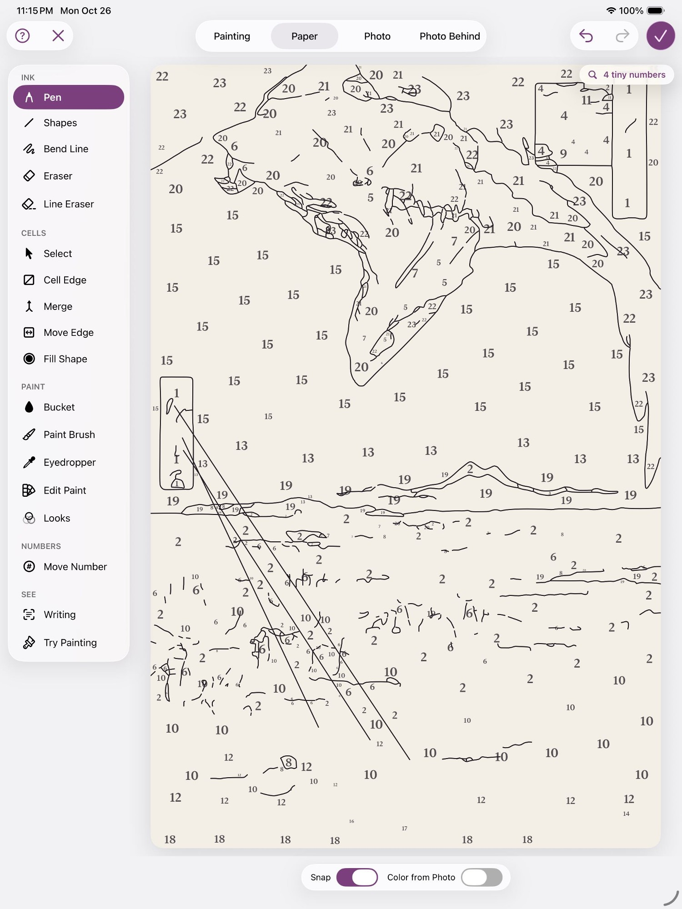

# Agent transcript

- end: success, 105 turns, 19.7 min, estimated $3.1477409999999995
- tool calls: {"mcp__maestro__take_screenshot": 37, "mcp__maestro__run": 39, "mcp__maestro__inspect_screen": 6, "Read": 10, "Write": 5}
- images the agent received: 44

**Start**: model claude-opus-5-5, MCP [{"name": "maestro", "status": "connected", "source": "dynamic"}]

→ `mcp__maestro__take_screenshot` `{"device_id": "99DEE653-946C-406D-8E9E-238D1FCE93C9"}`

← mcp__maestro__take_screenshot: image  1500x2000

→ `mcp__maestro__run` `{"device_id": "99DEE653-946C-406D-8E9E-238D1FCE93C9", "yaml": "appId: com.pbordjadze.paintbynumber\n---\n- tapOn:\n    point: \"1075,78\"\n- waitForAnimationToEnd"}`

→ `mcp__maestro__inspect_screen` `{"device_id": "99DEE653-946C-406D-8E9E-238D1FCE93C9"}`

← mcp__maestro__run: {"success":true,"device_id":"99DEE653-946C-406D-8E9E-238D1FCE93C9","commands_executed":3,"message":"Flow executed successfully","env_vars":{"MAESTRO_CLI_ANALYSIS_NOTIFICATION_DISABLED":"true","MAESTRO_CLI_NO_ANALYTICS":"1","MAESTRO_DRIVER_STARTUP_TIMEOUT":"240000","MAESTRO_VERSION":"2.11.0"}}

← mcp__maestro__inspect_screen: {"ui_schema":{"platform":"ios","abbreviations":{"b":"bounds","txt":"text","rid":"resource-id","a11y":"accessibilityText","hint":"hintText","val":"value","c":"children"},"defaults":{"enabled":true,"focused":false,"selected":false,"checked":false,"txt":"","hint":"","rid":"","val":"","a11y":""}},"elements":[{"b":"[0,0][1032,1376]","a11y":"Paint by Moonlight","c":[{"b":"[0,0][1032,1376]","c":[{"b":"[0 …

→ `mcp__maestro__run` `{"device_id": "99DEE653-946C-406D-8E9E-238D1FCE93C9", "yaml": "appId: com.pbordjadze.paintbynumber\n---\n- tapOn: \"New Painting\"\n- waitForAnimationToEnd"}`

→ `mcp__maestro__take_screenshot` `{"device_id": "99DEE653-946C-406D-8E9E-238D1FCE93C9"}`

← mcp__maestro__run: {"success":true,"device_id":"99DEE653-946C-406D-8E9E-238D1FCE93C9","commands_executed":3,"message":"Flow executed successfully","env_vars":{"MAESTRO_CLI_ANALYSIS_NOTIFICATION_DISABLED":"true","MAESTRO_CLI_NO_ANALYTICS":"1","MAESTRO_DRIVER_STARTUP_TIMEOUT":"240000","MAESTRO_VERSION":"2.11.0"}}

← mcp__maestro__take_screenshot: image  1500x2000

> Close the tip, then tap the Jūmantsubo sample.

→ `mcp__maestro__run` `{"device_id": "99DEE653-946C-406D-8E9E-238D1FCE93C9", "yaml": "appId: com.pbordjadze.paintbynumber\n---\n- tapOn: \"Close\"\n- waitForAnimationToEnd\n- tapOn:\n    point: \"905,1140\"\n- waitForAnimationToEnd"}`

→ `mcp__maestro__take_screenshot` `{"device_id": "99DEE653-946C-406D-8E9E-238D1FCE93C9"}`

← mcp__maestro__run: {"success":true,"device_id":"99DEE653-946C-406D-8E9E-238D1FCE93C9","commands_executed":5,"message":"Flow executed successfully","env_vars":{"MAESTRO_CLI_ANALYSIS_NOTIFICATION_DISABLED":"true","MAESTRO_CLI_NO_ANALYTICS":"1","MAESTRO_DRIVER_STARTUP_TIMEOUT":"240000","MAESTRO_VERSION":"2.11.0"}}

← mcp__maestro__take_screenshot: image  1500x2000

→ `mcp__maestro__run` `{"device_id": "99DEE653-946C-406D-8E9E-238D1FCE93C9", "yaml": "appId: com.pbordjadze.paintbynumber\n---\n- tapOn: \"New Painting\"\n- waitForAnimationToEnd"}`

→ `mcp__maestro__inspect_screen` `{"device_id": "99DEE653-946C-406D-8E9E-238D1FCE93C9"}`

← mcp__maestro__run: {"success":true,"device_id":"99DEE653-946C-406D-8E9E-238D1FCE93C9","commands_executed":3,"message":"Flow executed successfully","env_vars":{"MAESTRO_CLI_ANALYSIS_NOTIFICATION_DISABLED":"true","MAESTRO_CLI_NO_ANALYTICS":"1","MAESTRO_DRIVER_STARTUP_TIMEOUT":"240000","MAESTRO_VERSION":"2.11.0"}}

← mcp__maestro__inspect_screen: {"ui_schema":{"platform":"ios","abbreviations":{"b":"bounds","txt":"text","rid":"resource-id","a11y":"accessibilityText","hint":"hintText","val":"value","c":"children"},"defaults":{"enabled":true,"focused":false,"selected":false,"checked":false,"txt":"","hint":"","rid":"","val":"","a11y":""}},"elements":[{"b":"[0,0][1032,1376]","a11y":"Paint by Moonlight","c":[{"b":"[0,0][1032,1376]","c":[{"b":"[0 …

→ `mcp__maestro__run` `{"device_id": "99DEE653-946C-406D-8E9E-238D1FCE93C9", "yaml": "appId: com.pbordjadze.paintbynumber\n---\n- tapOn: \"Sample: J\u016bmantsubo Plain at Fukagawa Susaki, Utagawa Hiroshige\"\n- waitForAnimationToEnd"}`

→ `mcp__maestro__take_screenshot` `{"device_id": "99DEE653-946C-406D-8E9E-238D1FCE93C9"}`

← mcp__maestro__run: {"success":true,"device_id":"99DEE653-946C-406D-8E9E-238D1FCE93C9","commands_executed":3,"message":"Flow executed successfully","env_vars":{"MAESTRO_CLI_ANALYSIS_NOTIFICATION_DISABLED":"true","MAESTRO_CLI_NO_ANALYTICS":"1","MAESTRO_DRIVER_STARTUP_TIMEOUT":"240000","MAESTRO_VERSION":"2.11.0"}}

← mcp__maestro__take_screenshot: image  1500x2000

→ `mcp__maestro__run` `{"device_id": "99DEE653-946C-406D-8E9E-238D1FCE93C9", "yaml": "appId: com.pbordjadze.paintbynumber\n---\n- tapOn: \"Refine\"\n- waitForAnimationToEnd\n- takeScreenshot: /Users/runner/work/_temp/qa/shots/refine-open"}`

→ `mcp__maestro__take_screenshot` `{"device_id": "99DEE653-946C-406D-8E9E-238D1FCE93C9"}`

← mcp__maestro__run: {"success":true,"device_id":"99DEE653-946C-406D-8E9E-238D1FCE93C9","commands_executed":4,"message":"Flow executed successfully","env_vars":{"MAESTRO_CLI_ANALYSIS_NOTIFICATION_DISABLED":"true","MAESTRO_CLI_NO_ANALYTICS":"1","MAESTRO_DRIVER_STARTUP_TIMEOUT":"240000","MAESTRO_VERSION":"2.11.0"}}

← mcp__maestro__take_screenshot: image  1500x2000

→ `mcp__maestro__run` `{"device_id": "99DEE653-946C-406D-8E9E-238D1FCE93C9", "yaml": "appId: com.pbordjadze.paintbynumber\n---\n- tapOn:\n    point: \"493,103\"\n- waitForAnimationToEnd\n- tapOn: \"Paper\"\n- waitForAnimationToEnd\n- takeScreenshot: /Users/runner/work/_temp/qa/shots/paper-fitted-1"}`

→ `mcp__maestro__take_screenshot` `{"device_id": "99DEE653-946C-406D-8E9E-238D1FCE93C9"}`

← mcp__maestro__run: {"success":true,"device_id":"99DEE653-946C-406D-8E9E-238D1FCE93C9","commands_executed":6,"message":"Flow executed successfully","env_vars":{"MAESTRO_CLI_ANALYSIS_NOTIFICATION_DISABLED":"true","MAESTRO_CLI_NO_ANALYTICS":"1","MAESTRO_DRIVER_STARTUP_TIMEOUT":"240000","MAESTRO_VERSION":"2.11.0"}}

← mcp__maestro__take_screenshot: image  1500x2000

→ `mcp__maestro__run` `{"device_id": "99DEE653-946C-406D-8E9E-238D1FCE93C9", "yaml": "appId: com.pbordjadze.paintbynumber\n---\n- tapOn: \"Painting\"\n- waitForAnimationToEnd\n- tapOn: \"Paper\"\n- waitForAnimationToEnd\n- takeScreenshot: /Users/runner/work/_temp/qa/shots/paper-fitted-2"}`

→ `mcp__maestro__take_screenshot` `{"device_id": "99DEE653-946C-406D-8E9E-238D1FCE93C9"}`

← mcp__maestro__run: {"success":true,"device_id":"99DEE653-946C-406D-8E9E-238D1FCE93C9","commands_executed":6,"message":"Flow executed successfully","env_vars":{"MAESTRO_CLI_ANALYSIS_NOTIFICATION_DISABLED":"true","MAESTRO_CLI_NO_ANALYTICS":"1","MAESTRO_DRIVER_STARTUP_TIMEOUT":"240000","MAESTRO_VERSION":"2.11.0"}}

← mcp__maestro__take_screenshot: image  1500x2000

→ `mcp__maestro__run` `{"device_id": "99DEE653-946C-406D-8E9E-238D1FCE93C9", "yaml": "appId: com.pbordjadze.paintbynumber\n---\n- tapOn: \"Painting\"\n- waitForAnimationToEnd\n- tapOn: \"Edit Paint\"\n- waitForAnimationToEnd"}`

→ `mcp__maestro__take_screenshot` `{"device_id": "99DEE653-946C-406D-8E9E-238D1FCE93C9"}`

← mcp__maestro__run: {"success":true,"device_id":"99DEE653-946C-406D-8E9E-238D1FCE93C9","commands_executed":5,"message":"Flow executed successfully","env_vars":{"MAESTRO_CLI_ANALYSIS_NOTIFICATION_DISABLED":"true","MAESTRO_CLI_NO_ANALYTICS":"1","MAESTRO_DRIVER_STARTUP_TIMEOUT":"240000","MAESTRO_VERSION":"2.11.0"}}

← mcp__maestro__take_screenshot: image  1500x2000

→ `mcp__maestro__run` `{"device_id": "99DEE653-946C-406D-8E9E-238D1FCE93C9", "yaml": "appId: com.pbordjadze.paintbynumber\n---\n- tapOn:\n    point: \"339,1252\"\n- waitForAnimationToEnd"}`

→ `mcp__maestro__take_screenshot` `{"device_id": "99DEE653-946C-406D-8E9E-238D1FCE93C9"}`

← mcp__maestro__run: {"success":true,"device_id":"99DEE653-946C-406D-8E9E-238D1FCE93C9","commands_executed":3,"message":"Flow executed successfully","env_vars":{"MAESTRO_CLI_ANALYSIS_NOTIFICATION_DISABLED":"true","MAESTRO_CLI_NO_ANALYTICS":"1","MAESTRO_DRIVER_STARTUP_TIMEOUT":"240000","MAESTRO_VERSION":"2.11.0"}}

← mcp__maestro__take_screenshot: image  1500x2000

→ `mcp__maestro__inspect_screen` `{"device_id": "99DEE653-946C-406D-8E9E-238D1FCE93C9"}`

← mcp__maestro__inspect_screen: {"ui_schema":{"platform":"ios","abbreviations":{"b":"bounds","txt":"text","rid":"resource-id","a11y":"accessibilityText","hint":"hintText","val":"value","c":"children"},"defaults":{"enabled":true,"focused":false,"selected":false,"checked":false,"txt":"","hint":"","rid":"","val":"","a11y":""}},"elements":[{"b":"[0,0][1032,1376]","a11y":"Paint by Moonlight","c":[{"b":"[0,0][1032,1376]","c":[{"b":"[0 …

→ `mcp__maestro__run` `{"device_id": "99DEE653-946C-406D-8E9E-238D1FCE93C9", "yaml": "appId: com.pbordjadze.paintbynumber\n---\n- tapOn:\n    id: \"refine-colors-picker\"\n- waitForAnimationToEnd"}`

→ `mcp__maestro__take_screenshot` `{"device_id": "99DEE653-946C-406D-8E9E-238D1FCE93C9"}`

← mcp__maestro__run: {"success":true,"device_id":"99DEE653-946C-406D-8E9E-238D1FCE93C9","commands_executed":3,"message":"Flow executed successfully","env_vars":{"MAESTRO_CLI_ANALYSIS_NOTIFICATION_DISABLED":"true","MAESTRO_CLI_NO_ANALYTICS":"1","MAESTRO_DRIVER_STARTUP_TIMEOUT":"240000","MAESTRO_VERSION":"2.11.0"}}

← mcp__maestro__take_screenshot: image  1500x2000

→ `Read` `{"file_path": "/Users/runner/work/_temp/qa/app.log"}`

← Read: 1	getpwuid_r did not find a match for uid 501
2	Filtering the log data using "subsystem == "com.pbordjadze.paintbynumber""
3	Timestamp               Ty Process[PID:TID]
4	2026-10-26 22:53:17.176 Df PaintByNumber[23297:106d8] [com.pbordjadze.paintbynumber:tips] offer in shelf: , wanted
5	2026-10-26 22:53:19.066 Df PaintByNumber[23297:1083b] [com.pbordjadze.paintbynumber:canvas] Making the render co …

→ `mcp__maestro__run` `{"device_id": "99DEE653-946C-406D-8E9E-238D1FCE93C9", "yaml": "appId: com.pbordjadze.paintbynumber\n---\n- tapOn:\n    point: \"336,1248\"\n- takeScreenshot: /Users/runner/work/_temp/qa/shots/ep-well-tap"}`

→ `mcp__maestro__inspect_screen` `{"device_id": "99DEE653-946C-406D-8E9E-238D1FCE93C9"}`

← mcp__maestro__run: {"success":true,"device_id":"99DEE653-946C-406D-8E9E-238D1FCE93C9","commands_executed":3,"message":"Flow executed successfully","env_vars":{"MAESTRO_CLI_ANALYSIS_NOTIFICATION_DISABLED":"true","MAESTRO_CLI_NO_ANALYTICS":"1","MAESTRO_DRIVER_STARTUP_TIMEOUT":"240000","MAESTRO_VERSION":"2.11.0"}}

← mcp__maestro__inspect_screen: {"ui_schema":{"platform":"ios","abbreviations":{"b":"bounds","txt":"text","rid":"resource-id","a11y":"accessibilityText","hint":"hintText","val":"value","c":"children"},"defaults":{"enabled":true,"focused":false,"selected":false,"checked":false,"txt":"","hint":"","rid":"","val":"","a11y":""}},"elements":[{"b":"[0,0][1032,1376]","a11y":"Paint by Moonlight","c":[{"b":"[0,0][1032,1376]","c":[{"b":"[0 …

> The color picker opened on the third try. The first two taps on the color well showed no picker, so I'll count those as possible Automation problems.

→ `mcp__maestro__take_screenshot` `{"device_id": "99DEE653-946C-406D-8E9E-238D1FCE93C9"}`

← mcp__maestro__take_screenshot: image  1500x2000

→ `mcp__maestro__run` `{"device_id": "99DEE653-946C-406D-8E9E-238D1FCE93C9", "yaml": "appId: com.pbordjadze.paintbynumber\n---\n- tapOn:\n    point: \"212,929\"\n- takeScreenshot: /Users/runner/work/_temp/qa/shots/ep1-pick1\n- tapOn:\n    point: \"440,929\"\n- takeScreenshot: /Users/runner/work/_temp/qa/shots/ep1-pick2\n- tapOn:\n    point: \"268,960\"\n- takeScreenshot: /Users/runner/work/_temp/qa/shots/ep1-pick3"}`

→ `mcp__maestro__take_screenshot` `{"device_id": "99DEE653-946C-406D-8E9E-238D1FCE93C9"}`

← mcp__maestro__run: {"success":true,"device_id":"99DEE653-946C-406D-8E9E-238D1FCE93C9","commands_executed":7,"message":"Flow executed successfully","env_vars":{"MAESTRO_CLI_ANALYSIS_NOTIFICATION_DISABLED":"true","MAESTRO_CLI_NO_ANALYTICS":"1","MAESTRO_DRIVER_STARTUP_TIMEOUT":"240000","MAESTRO_VERSION":"2.11.0"}}

← mcp__maestro__take_screenshot: image  1500x2000

→ `Read` `{"file_path": "/Users/runner/work/_temp/qa/shots/ep1-pick1.png"}`

→ `Read` `{"file_path": "/Users/runner/work/_temp/qa/shots/ep1-pick2.png"}`

← Read: image  1500x2000

← Read: image  1500x2000

→ `Read` `{"file_path": "/Users/runner/work/_temp/qa/app.log", "offset": 24}`

← Read: 24	2026-10-26 23:01:05.357 Df PaintByNumber[23297:106d8] [com.pbordjadze.paintbynumber:tips] turn over: refineDraw
25

→ `mcp__maestro__run` `{"device_id": "99DEE653-946C-406D-8E9E-238D1FCE93C9", "yaml": "appId: com.pbordjadze.paintbynumber\n---\n- tapOn:\n    point: \"800,60\"\n- waitForAnimationToEnd\n- takeScreenshot: /Users/runner/work/_temp/qa/shots/ep1-closed"}`

→ `mcp__maestro__inspect_screen` `{"device_id": "99DEE653-946C-406D-8E9E-238D1FCE93C9"}`

← mcp__maestro__run: {"success":true,"device_id":"99DEE653-946C-406D-8E9E-238D1FCE93C9","commands_executed":4,"message":"Flow executed successfully","env_vars":{"MAESTRO_CLI_ANALYSIS_NOTIFICATION_DISABLED":"true","MAESTRO_CLI_NO_ANALYTICS":"1","MAESTRO_DRIVER_STARTUP_TIMEOUT":"240000","MAESTRO_VERSION":"2.11.0"}}

← mcp__maestro__inspect_screen: {"ui_schema":{"platform":"ios","abbreviations":{"b":"bounds","txt":"text","rid":"resource-id","a11y":"accessibilityText","hint":"hintText","val":"value","c":"children"},"defaults":{"enabled":true,"focused":false,"selected":false,"checked":false,"txt":"","hint":"","rid":"","val":"","a11y":""}},"elements":[{"b":"[0,0][1032,1376]","a11y":"Paint by Moonlight","c":[{"b":"[0,0][1032,1376]","c":[{"b":"[0 …

→ `Write` `{"file_path": "/Users/runner/work/_temp/qa/report.md", "content": "# QA report: Refine recheck (debug build), J\u016bmantsubo Plain at Fukagawa Susaki\n\n*Work in progress; I'll update this as I go.*\n\n## Summary\nI opened Refine on the J\u016bmantsubo sample. Paper at the fitted zoom looks fixed: no piles of numbers. In Edit Paint with Similar colors too on, only the first of three picks in one picker session took effect; the 2nd and 3rd recolored nothing (seen once so far, retesting).\n\n## Coverage\n- (1) Edit Paint, 3 picks in a row: in progress.\n- (2) Area card, picks A then B: not yet.`

← Write: File created successfully at: /Users/runner/work/_temp/qa/report.md (file state is current in your context — no need to Read it back)

→ `mcp__maestro__run` `{"device_id": "99DEE653-946C-406D-8E9E-238D1FCE93C9", "yaml": "appId: com.pbordjadze.paintbynumber\n---\n- tapOn:\n    point: \"625,1322\"\n- waitForAnimationToEnd\n- takeScreenshot: /Users/runner/work/_temp/qa/shots/ep2-select"}`

← mcp__maestro__run: {"success":true,"device_id":"99DEE653-946C-406D-8E9E-238D1FCE93C9","commands_executed":4,"message":"Flow executed successfully","env_vars":{"MAESTRO_CLI_ANALYSIS_NOTIFICATION_DISABLED":"true","MAESTRO_CLI_NO_ANALYTICS":"1","MAESTRO_DRIVER_STARTUP_TIMEOUT":"240000","MAESTRO_VERSION":"2.11.0"}}

→ `mcp__maestro__take_screenshot` `{"device_id": "99DEE653-946C-406D-8E9E-238D1FCE93C9"}`

← mcp__maestro__take_screenshot: image  1500x2000

→ `mcp__maestro__run` `{"device_id": "99DEE653-946C-406D-8E9E-238D1FCE93C9", "yaml": "appId: com.pbordjadze.paintbynumber\n---\n- tapOn:\n    id: \"refine-colors-picker\"\n- waitForAnimationToEnd\n- takeScreenshot: /Users/runner/work/_temp/qa/shots/ep2-open"}`

→ `mcp__maestro__take_screenshot` `{"device_id": "99DEE653-946C-406D-8E9E-238D1FCE93C9"}`

← mcp__maestro__run: {"success":true,"device_id":"99DEE653-946C-406D-8E9E-238D1FCE93C9","commands_executed":4,"message":"Flow executed successfully","env_vars":{"MAESTRO_CLI_ANALYSIS_NOTIFICATION_DISABLED":"true","MAESTRO_CLI_NO_ANALYTICS":"1","MAESTRO_DRIVER_STARTUP_TIMEOUT":"240000","MAESTRO_VERSION":"2.11.0"}}

← mcp__maestro__take_screenshot: image  1500x2000

→ `mcp__maestro__run` `{"device_id": "99DEE653-946C-406D-8E9E-238D1FCE93C9", "yaml": "appId: com.pbordjadze.paintbynumber\n---\n- tapOn:\n    point: \"323,929\"\n- takeScreenshot: /Users/runner/work/_temp/qa/shots/ep2-pick1\n- tapOn:\n    point: \"399,929\"\n- takeScreenshot: /Users/runner/work/_temp/qa/shots/ep2-pick2\n- tapOn:\n    point: \"296,987\"\n- takeScreenshot: /Users/runner/work/_temp/qa/shots/ep2-pick3\n- tapOn:\n    point: \"800,60\"\n- waitForAnimationToEnd\n- takeScreenshot: /Users/runner/work/_temp/qa/shots/ep2-closed"}`

→ `mcp__maestro__inspect_screen` `{"device_id": "99DEE653-946C-406D-8E9E-238D1FCE93C9"}`

← mcp__maestro__run: {"success":true,"device_id":"99DEE653-946C-406D-8E9E-238D1FCE93C9","commands_executed":10,"message":"Flow executed successfully","env_vars":{"MAESTRO_CLI_ANALYSIS_NOTIFICATION_DISABLED":"true","MAESTRO_CLI_NO_ANALYTICS":"1","MAESTRO_DRIVER_STARTUP_TIMEOUT":"240000","MAESTRO_VERSION":"2.11.0"}}

← mcp__maestro__inspect_screen: {"ui_schema":{"platform":"ios","abbreviations":{"b":"bounds","txt":"text","rid":"resource-id","a11y":"accessibilityText","hint":"hintText","val":"value","c":"children"},"defaults":{"enabled":true,"focused":false,"selected":false,"checked":false,"txt":"","hint":"","rid":"","val":"","a11y":""}},"elements":[{"b":"[0,0][1032,1376]","a11y":"Paint by Moonlight","c":[{"b":"[0,0][1032,1376]","c":[{"b":"[0 …

→ `mcp__maestro__take_screenshot` `{"device_id": "99DEE653-946C-406D-8E9E-238D1FCE93C9"}`

← mcp__maestro__take_screenshot: image  1500x2000

→ `Read` `{"file_path": "/Users/runner/work/_temp/qa/shots/ep2-pick3.png"}`

← Read: image  1500x2000

→ `mcp__maestro__run` `{"device_id": "99DEE653-946C-406D-8E9E-238D1FCE93C9", "yaml": "appId: com.pbordjadze.paintbynumber\n---\n- tapOn:\n    id: \"refine-paint-14\"\n- waitForAnimationToEnd\n- tapOn:\n    id: \"refine-colors-picker\"\n- waitForAnimationToEnd\n- takeScreenshot: /Users/runner/work/_temp/qa/shots/ep3-open"}`

→ `mcp__maestro__take_screenshot` `{"device_id": "99DEE653-946C-406D-8E9E-238D1FCE93C9"}`

← mcp__maestro__run: {"success":true,"device_id":"99DEE653-946C-406D-8E9E-238D1FCE93C9","commands_executed":6,"message":"Flow executed successfully","env_vars":{"MAESTRO_CLI_ANALYSIS_NOTIFICATION_DISABLED":"true","MAESTRO_CLI_NO_ANALYTICS":"1","MAESTRO_DRIVER_STARTUP_TIMEOUT":"240000","MAESTRO_VERSION":"2.11.0"}}

← mcp__maestro__take_screenshot: image  1500x2000

→ `mcp__maestro__run` `{"device_id": "99DEE653-946C-406D-8E9E-238D1FCE93C9", "yaml": "appId: com.pbordjadze.paintbynumber\n---\n- tapOn:\n    point: \"396,1142\"\n- takeScreenshot: /Users/runner/work/_temp/qa/shots/ep3-pick1\n- tapOn:\n    point: \"444,1142\"\n- takeScreenshot: /Users/runner/work/_temp/qa/shots/ep3-pick2\n- tapOn:\n    point: \"300,1142\"\n- takeScreenshot: /Users/runner/work/_temp/qa/shots/ep3-pick3\n- tapOn:\n    point: \"800,60\"\n- waitForAnimationToEnd\n- takeScreenshot: /Users/runner/work/_temp/qa/shots/ep3-closed"}`

→ `mcp__maestro__take_screenshot` `{"device_id": "99DEE653-946C-406D-8E9E-238D1FCE93C9"}`

← mcp__maestro__run: {"success":true,"device_id":"99DEE653-946C-406D-8E9E-238D1FCE93C9","commands_executed":10,"message":"Flow executed successfully","env_vars":{"MAESTRO_CLI_ANALYSIS_NOTIFICATION_DISABLED":"true","MAESTRO_CLI_NO_ANALYTICS":"1","MAESTRO_DRIVER_STARTUP_TIMEOUT":"240000","MAESTRO_VERSION":"2.11.0"}}

← mcp__maestro__take_screenshot: image  1500x2000

→ `Read` `{"file_path": "/Users/runner/work/_temp/qa/shots/ep3-pick3.png"}`

← Read: image  1500x2000

→ `Write` `{"file_path": "/Users/runner/work/_temp/qa/report.md", "content": "# QA report: Refine recheck (debug build), J\u016bmantsubo Plain at Fukagawa Susaki\n\n*Work in progress; I'll update this as I go.*\n\n## Summary\nI opened Refine on the J\u016bmantsubo sample. Fix (3), Paper at the fitted zoom, looks fixed: no piles of numbers. Fix (1), Edit Paint with Similar colors too on, is **not** fixed differently than expected: in every try, only the first pick in a picker session recolored anything, and the 2nd and 3rd picks were ignored (3 of 3). Also, Similar colors too recolors paints that don't lo`

← Write: The file /Users/runner/work/_temp/qa/report.md has been updated successfully. (file state is current in your context — no need to Read it back)

→ `mcp__maestro__run` `{"device_id": "99DEE653-946C-406D-8E9E-238D1FCE93C9", "yaml": "appId: com.pbordjadze.paintbynumber\n---\n- tapOn:\n    id: \"refine-cancel\"\n- waitForAnimationToEnd"}`

→ `mcp__maestro__take_screenshot` `{"device_id": "99DEE653-946C-406D-8E9E-238D1FCE93C9"}`

← mcp__maestro__run: {"success":true,"device_id":"99DEE653-946C-406D-8E9E-238D1FCE93C9","commands_executed":3,"message":"Flow executed successfully","env_vars":{"MAESTRO_CLI_ANALYSIS_NOTIFICATION_DISABLED":"true","MAESTRO_CLI_NO_ANALYTICS":"1","MAESTRO_DRIVER_STARTUP_TIMEOUT":"240000","MAESTRO_VERSION":"2.11.0"}}

← mcp__maestro__take_screenshot: image  1500x2000

→ `mcp__maestro__run` `{"device_id": "99DEE653-946C-406D-8E9E-238D1FCE93C9", "yaml": "appId: com.pbordjadze.paintbynumber\n---\n- tapOn: \"Refine\"\n- waitForAnimationToEnd\n- tapOn:\n    id: \"refine-tool-select\"\n- waitForAnimationToEnd\n- longPressOn:\n    point: \"688,998\"\n- waitForAnimationToEnd\n- takeScreenshot: /Users/runner/work/_temp/qa/shots/card1-open"}`

→ `mcp__maestro__take_screenshot` `{"device_id": "99DEE653-946C-406D-8E9E-238D1FCE93C9"}`

← mcp__maestro__run: {"success":true,"device_id":"99DEE653-946C-406D-8E9E-238D1FCE93C9","commands_executed":8,"message":"Flow executed successfully","env_vars":{"MAESTRO_CLI_ANALYSIS_NOTIFICATION_DISABLED":"true","MAESTRO_CLI_NO_ANALYTICS":"1","MAESTRO_DRIVER_STARTUP_TIMEOUT":"240000","MAESTRO_VERSION":"2.11.0"}}

← mcp__maestro__take_screenshot: image  1500x2000

→ `mcp__maestro__run` `{"device_id": "99DEE653-946C-406D-8E9E-238D1FCE93C9", "yaml": "appId: com.pbordjadze.paintbynumber\n---\n- tapOn:\n    point: \"859,825\"\n- waitForAnimationToEnd\n- takeScreenshot: /Users/runner/work/_temp/qa/shots/card1-picker"}`

→ `mcp__maestro__take_screenshot` `{"device_id": "99DEE653-946C-406D-8E9E-238D1FCE93C9"}`

← mcp__maestro__run: {"success":true,"device_id":"99DEE653-946C-406D-8E9E-238D1FCE93C9","commands_executed":4,"message":"Flow executed successfully","env_vars":{"MAESTRO_CLI_ANALYSIS_NOTIFICATION_DISABLED":"true","MAESTRO_CLI_NO_ANALYTICS":"1","MAESTRO_DRIVER_STARTUP_TIMEOUT":"240000","MAESTRO_VERSION":"2.11.0"}}

← mcp__maestro__take_screenshot: image  1500x2000

→ `mcp__maestro__run` `{"device_id": "99DEE653-946C-406D-8E9E-238D1FCE93C9", "yaml": "appId: com.pbordjadze.paintbynumber\n---\n- tapOn:\n    point: \"640,1007\"\n- takeScreenshot: /Users/runner/work/_temp/qa/shots/card1-pickA\n- tapOn:\n    point: \"784,1007\"\n- takeScreenshot: /Users/runner/work/_temp/qa/shots/card1-pickB"}`

→ `mcp__maestro__take_screenshot` `{"device_id": "99DEE653-946C-406D-8E9E-238D1FCE93C9"}`

← mcp__maestro__run: {"success":true,"device_id":"99DEE653-946C-406D-8E9E-238D1FCE93C9","commands_executed":5,"message":"Flow executed successfully","env_vars":{"MAESTRO_CLI_ANALYSIS_NOTIFICATION_DISABLED":"true","MAESTRO_CLI_NO_ANALYTICS":"1","MAESTRO_DRIVER_STARTUP_TIMEOUT":"240000","MAESTRO_VERSION":"2.11.0"}}

← mcp__maestro__take_screenshot: image  1500x2000

→ `Read` `{"file_path": "/Users/runner/work/_temp/qa/shots/card1-pickA.png"}`

← Read: image  1500x2000

→ `mcp__maestro__run` `{"device_id": "99DEE653-946C-406D-8E9E-238D1FCE93C9", "yaml": "appId: com.pbordjadze.paintbynumber\n---\n- tapOn:\n    point: \"800,60\"\n- waitForAnimationToEnd\n- takeScreenshot: /Users/runner/work/_temp/qa/shots/card1-afterclose"}`

→ `mcp__maestro__take_screenshot` `{"device_id": "99DEE653-946C-406D-8E9E-238D1FCE93C9"}`

← mcp__maestro__run: {"success":true,"device_id":"99DEE653-946C-406D-8E9E-238D1FCE93C9","commands_executed":4,"message":"Flow executed successfully","env_vars":{"MAESTRO_CLI_ANALYSIS_NOTIFICATION_DISABLED":"true","MAESTRO_CLI_NO_ANALYTICS":"1","MAESTRO_DRIVER_STARTUP_TIMEOUT":"240000","MAESTRO_VERSION":"2.11.0"}}

← mcp__maestro__take_screenshot: image  1500x2000

→ `mcp__maestro__run` `{"device_id": "99DEE653-946C-406D-8E9E-238D1FCE93C9", "yaml": "appId: com.pbordjadze.paintbynumber\n---\n- tapOn:\n    point: \"800,60\"\n- waitForAnimationToEnd\n- longPressOn:\n    point: \"757,1170\"\n- waitForAnimationToEnd\n- takeScreenshot: /Users/runner/work/_temp/qa/shots/card2-open"}`

→ `mcp__maestro__take_screenshot` `{"device_id": "99DEE653-946C-406D-8E9E-238D1FCE93C9"}`

← mcp__maestro__run: {"success":true,"device_id":"99DEE653-946C-406D-8E9E-238D1FCE93C9","commands_executed":6,"message":"Flow executed successfully","env_vars":{"MAESTRO_CLI_ANALYSIS_NOTIFICATION_DISABLED":"true","MAESTRO_CLI_NO_ANALYTICS":"1","MAESTRO_DRIVER_STARTUP_TIMEOUT":"240000","MAESTRO_VERSION":"2.11.0"}}

← mcp__maestro__take_screenshot: image  1500x2000

→ `mcp__maestro__run` `{"device_id": "99DEE653-946C-406D-8E9E-238D1FCE93C9", "yaml": "appId: com.pbordjadze.paintbynumber\n---\n- tapOn:\n    point: \"600,420\"\n- waitForAnimationToEnd\n- takeScreenshot: /Users/runner/work/_temp/qa/shots/card-dismiss"}`

→ `mcp__maestro__take_screenshot` `{"device_id": "99DEE653-946C-406D-8E9E-238D1FCE93C9"}`

← mcp__maestro__run: {"success":true,"device_id":"99DEE653-946C-406D-8E9E-238D1FCE93C9","commands_executed":4,"message":"Flow executed successfully","env_vars":{"MAESTRO_CLI_ANALYSIS_NOTIFICATION_DISABLED":"true","MAESTRO_CLI_NO_ANALYTICS":"1","MAESTRO_DRIVER_STARTUP_TIMEOUT":"240000","MAESTRO_VERSION":"2.11.0"}}

← mcp__maestro__take_screenshot: image  1500x2000

→ `mcp__maestro__run` `{"device_id": "99DEE653-946C-406D-8E9E-238D1FCE93C9", "yaml": "appId: com.pbordjadze.paintbynumber\n---\n- longPressOn:\n    point: \"688,1150\"\n- waitForAnimationToEnd\n- takeScreenshot: /Users/runner/work/_temp/qa/shots/card2-open"}`

→ `mcp__maestro__take_screenshot` `{"device_id": "99DEE653-946C-406D-8E9E-238D1FCE93C9"}`

← mcp__maestro__run: {"success":true,"device_id":"99DEE653-946C-406D-8E9E-238D1FCE93C9","commands_executed":4,"message":"Flow executed successfully","env_vars":{"MAESTRO_CLI_ANALYSIS_NOTIFICATION_DISABLED":"true","MAESTRO_CLI_NO_ANALYTICS":"1","MAESTRO_DRIVER_STARTUP_TIMEOUT":"240000","MAESTRO_VERSION":"2.11.0"}}

← mcp__maestro__take_screenshot: image  1500x2000

→ `mcp__maestro__run` `{"device_id": "99DEE653-946C-406D-8E9E-238D1FCE93C9", "yaml": "appId: com.pbordjadze.paintbynumber\n---\n- tapOn:\n    point: \"859,975\"\n- waitForAnimationToEnd\n- takeScreenshot: /Users/runner/work/_temp/qa/shots/card2-picker"}`

→ `mcp__maestro__take_screenshot` `{"device_id": "99DEE653-946C-406D-8E9E-238D1FCE93C9"}`

← mcp__maestro__run: {"success":true,"device_id":"99DEE653-946C-406D-8E9E-238D1FCE93C9","commands_executed":4,"message":"Flow executed successfully","env_vars":{"MAESTRO_CLI_ANALYSIS_NOTIFICATION_DISABLED":"true","MAESTRO_CLI_NO_ANALYTICS":"1","MAESTRO_DRIVER_STARTUP_TIMEOUT":"240000","MAESTRO_VERSION":"2.11.0"}}

← mcp__maestro__take_screenshot: image  1500x2000

→ `mcp__maestro__run` `{"device_id": "99DEE653-946C-406D-8E9E-238D1FCE93C9", "yaml": "appId: com.pbordjadze.paintbynumber\n---\n- tapOn:\n    point: \"640,1158\"\n- takeScreenshot: /Users/runner/work/_temp/qa/shots/card2-pickA\n- tapOn:\n    point: \"784,1158\"\n- takeScreenshot: /Users/runner/work/_temp/qa/shots/card2-pickB"}`

→ `Read` `{"file_path": "/Users/runner/work/_temp/qa/shots/card2-pickA.png"}`

→ `mcp__maestro__take_screenshot` `{"device_id": "99DEE653-946C-406D-8E9E-238D1FCE93C9"}`

← mcp__maestro__run: {"success":true,"device_id":"99DEE653-946C-406D-8E9E-238D1FCE93C9","commands_executed":5,"message":"Flow executed successfully","env_vars":{"MAESTRO_CLI_ANALYSIS_NOTIFICATION_DISABLED":"true","MAESTRO_CLI_NO_ANALYTICS":"1","MAESTRO_DRIVER_STARTUP_TIMEOUT":"240000","MAESTRO_VERSION":"2.11.0"}}

← Read: image  1500x2000

← mcp__maestro__take_screenshot: image  1500x2000

→ `mcp__maestro__run` `{"device_id": "99DEE653-946C-406D-8E9E-238D1FCE93C9", "yaml": "appId: com.pbordjadze.paintbynumber\n---\n- tapOn:\n    point: \"800,60\"\n- waitForAnimationToEnd\n- takeScreenshot: /Users/runner/work/_temp/qa/shots/card2-afterclose"}`

→ `mcp__maestro__take_screenshot` `{"device_id": "99DEE653-946C-406D-8E9E-238D1FCE93C9"}`

← mcp__maestro__run: {"success":true,"device_id":"99DEE653-946C-406D-8E9E-238D1FCE93C9","commands_executed":4,"message":"Flow executed successfully","env_vars":{"MAESTRO_CLI_ANALYSIS_NOTIFICATION_DISABLED":"true","MAESTRO_CLI_NO_ANALYTICS":"1","MAESTRO_DRIVER_STARTUP_TIMEOUT":"240000","MAESTRO_VERSION":"2.11.0"}}

← mcp__maestro__take_screenshot: image  1500x2000

→ `mcp__maestro__run` `{"device_id": "99DEE653-946C-406D-8E9E-238D1FCE93C9", "yaml": "appId: com.pbordjadze.paintbynumber\n---\n- tapOn:\n    point: \"600,420\"\n- waitForAnimationToEnd\n- longPressOn:\n    point: \"880,560\"\n- waitForAnimationToEnd\n- takeScreenshot: /Users/runner/work/_temp/qa/shots/card3-open"}`

→ `mcp__maestro__take_screenshot` `{"device_id": "99DEE653-946C-406D-8E9E-238D1FCE93C9"}`

← mcp__maestro__run: {"success":true,"device_id":"99DEE653-946C-406D-8E9E-238D1FCE93C9","commands_executed":6,"message":"Flow executed successfully","env_vars":{"MAESTRO_CLI_ANALYSIS_NOTIFICATION_DISABLED":"true","MAESTRO_CLI_NO_ANALYTICS":"1","MAESTRO_DRIVER_STARTUP_TIMEOUT":"240000","MAESTRO_VERSION":"2.11.0"}}

← mcp__maestro__take_screenshot: image  1500x2000

→ `mcp__maestro__run` `{"device_id": "99DEE653-946C-406D-8E9E-238D1FCE93C9", "yaml": "appId: com.pbordjadze.paintbynumber\n---\n- tapOn:\n    point: \"817,535\"\n- waitForAnimationToEnd\n- takeScreenshot: /Users/runner/work/_temp/qa/shots/card3-picker"}`

→ `mcp__maestro__take_screenshot` `{"device_id": "99DEE653-946C-406D-8E9E-238D1FCE93C9"}`

← mcp__maestro__run: {"success":true,"device_id":"99DEE653-946C-406D-8E9E-238D1FCE93C9","commands_executed":4,"message":"Flow executed successfully","env_vars":{"MAESTRO_CLI_ANALYSIS_NOTIFICATION_DISABLED":"true","MAESTRO_CLI_NO_ANALYTICS":"1","MAESTRO_DRIVER_STARTUP_TIMEOUT":"240000","MAESTRO_VERSION":"2.11.0"}}

← mcp__maestro__take_screenshot: image  1500x2000

→ `mcp__maestro__run` `{"device_id": "99DEE653-946C-406D-8E9E-238D1FCE93C9", "yaml": "appId: com.pbordjadze.paintbynumber\n---\n- tapOn:\n    point: \"597,717\"\n- takeScreenshot: /Users/runner/work/_temp/qa/shots/card3-pickA\n- tapOn:\n    point: \"741,717\"\n- takeScreenshot: /Users/runner/work/_temp/qa/shots/card3-pickB"}`

→ `Read` `{"file_path": "/Users/runner/work/_temp/qa/shots/card3-pickA.png"}`

→ `mcp__maestro__take_screenshot` `{"device_id": "99DEE653-946C-406D-8E9E-238D1FCE93C9"}`

← mcp__maestro__run: {"success":true,"device_id":"99DEE653-946C-406D-8E9E-238D1FCE93C9","commands_executed":5,"message":"Flow executed successfully","env_vars":{"MAESTRO_CLI_ANALYSIS_NOTIFICATION_DISABLED":"true","MAESTRO_CLI_NO_ANALYTICS":"1","MAESTRO_DRIVER_STARTUP_TIMEOUT":"240000","MAESTRO_VERSION":"2.11.0"}}

← Read: image  1500x2000

← mcp__maestro__take_screenshot: image  1500x2000

→ `mcp__maestro__run` `{"device_id": "99DEE653-946C-406D-8E9E-238D1FCE93C9", "yaml": "appId: com.pbordjadze.paintbynumber\n---\n- tapOn:\n    point: \"800,60\"\n- waitForAnimationToEnd\n- takeScreenshot: /Users/runner/work/_temp/qa/shots/card3-afterclose"}`

→ `mcp__maestro__take_screenshot` `{"device_id": "99DEE653-946C-406D-8E9E-238D1FCE93C9"}`

← mcp__maestro__run: {"success":true,"device_id":"99DEE653-946C-406D-8E9E-238D1FCE93C9","commands_executed":4,"message":"Flow executed successfully","env_vars":{"MAESTRO_CLI_ANALYSIS_NOTIFICATION_DISABLED":"true","MAESTRO_CLI_NO_ANALYTICS":"1","MAESTRO_DRIVER_STARTUP_TIMEOUT":"240000","MAESTRO_VERSION":"2.11.0"}}

← mcp__maestro__take_screenshot: image  1500x2000

→ `Write` `{"file_path": "/Users/runner/work/_temp/qa/report.md", "content": "# QA report: Refine recheck (debug build), J\u016bmantsubo Plain at Fukagawa Susaki\n\n*Work in progress; I'll update this as I go.*\n\n## Summary\nI opened Refine on the J\u016bmantsubo sample (New Painting \u203a sample \u203a Refine) and rechecked four earlier fixes. Fix (3), Paper at the fitted zoom, holds: the numbers are legible and don't pile up. Fixes (1) and (2) do not hold:\n- (1) In Edit Paint, only the first color picked in a picker session applies (3 of 3).\n- (2) On an area's card, the picker popover moves after t`

← Write: The file /Users/runner/work/_temp/qa/report.md has been updated successfully. (file state is current in your context — no need to Read it back)

→ `mcp__maestro__run` `{"device_id": "99DEE653-946C-406D-8E9E-238D1FCE93C9", "yaml": "appId: com.pbordjadze.paintbynumber\n---\n- tapOn:\n    id: \"refine-cancel\"\n- waitForAnimationToEnd\n- tapOn: \"Refine\"\n- waitForAnimationToEnd\n- tapOn:\n    id: \"refine-tool-pen\"\n- waitForAnimationToEnd\n- takeScreenshot: /Users/runner/work/_temp/qa/shots/pen-before"}`

→ `mcp__maestro__take_screenshot` `{"device_id": "99DEE653-946C-406D-8E9E-238D1FCE93C9"}`

← mcp__maestro__run (error): Failed to run flow: Element not found: Id matching regex: refine-cancel

← mcp__maestro__take_screenshot: image  1500x2000

→ `mcp__maestro__run` `{"device_id": "99DEE653-946C-406D-8E9E-238D1FCE93C9", "yaml": "appId: com.pbordjadze.paintbynumber\n---\n- tapOn:\n    point: \"600,1050\"\n- waitForAnimationToEnd\n- tapOn:\n    point: \"88,54\"\n- waitForAnimationToEnd\n- tapOn: \"Refine\"\n- waitForAnimationToEnd\n- tapOn:\n    id: \"refine-tool-pen\"\n- waitForAnimationToEnd\n- takeScreenshot: /Users/runner/work/_temp/qa/shots/pen-before"}`

→ `mcp__maestro__take_screenshot` `{"device_id": "99DEE653-946C-406D-8E9E-238D1FCE93C9"}`

← mcp__maestro__run: {"success":true,"device_id":"99DEE653-946C-406D-8E9E-238D1FCE93C9","commands_executed":10,"message":"Flow executed successfully","env_vars":{"MAESTRO_CLI_ANALYSIS_NOTIFICATION_DISABLED":"true","MAESTRO_CLI_NO_ANALYTICS":"1","MAESTRO_DRIVER_STARTUP_TIMEOUT":"240000","MAESTRO_VERSION":"2.11.0"}}

← mcp__maestro__take_screenshot: image  1500x2000

> Now check 4: a Pen line from open water ending on the cartouche, near its writing but not on a letter.

→ `mcp__maestro__run` `{"device_id": "99DEE653-946C-406D-8E9E-238D1FCE93C9", "yaml": "appId: com.pbordjadze.paintbynumber\n---\n- swipe:\n    start: \"482,1101\"\n    end: \"275,661\"\n    duration: 1500\n- waitForAnimationToEnd\n- takeScreenshot: /Users/runner/work/_temp/qa/shots/pen1"}`

→ `mcp__maestro__take_screenshot` `{"device_id": "99DEE653-946C-406D-8E9E-238D1FCE93C9"}`

← mcp__maestro__run: {"success":true,"device_id":"99DEE653-946C-406D-8E9E-238D1FCE93C9","commands_executed":4,"message":"Flow executed successfully","env_vars":{"MAESTRO_CLI_ANALYSIS_NOTIFICATION_DISABLED":"true","MAESTRO_CLI_NO_ANALYTICS":"1","MAESTRO_DRIVER_STARTUP_TIMEOUT":"240000","MAESTRO_VERSION":"2.11.0"}}

← mcp__maestro__take_screenshot: image  1500x2000

→ `mcp__maestro__run` `{"device_id": "99DEE653-946C-406D-8E9E-238D1FCE93C9", "yaml": "appId: com.pbordjadze.paintbynumber\n---\n- swipe:\n    start: \"560,1120\"\n    end: \"276,680\"\n    duration: 1500\n- waitForAnimationToEnd\n- takeScreenshot: /Users/runner/work/_temp/qa/shots/pen2\n- swipe:\n    start: \"620,1150\"\n    end: \"262,612\"\n    duration: 1500\n- waitForAnimationToEnd\n- takeScreenshot: /Users/runner/work/_temp/qa/shots/pen3"}`

→ `mcp__maestro__take_screenshot` `{"device_id": "99DEE653-946C-406D-8E9E-238D1FCE93C9"}`

← mcp__maestro__run: {"success":true,"device_id":"99DEE653-946C-406D-8E9E-238D1FCE93C9","commands_executed":7,"message":"Flow executed successfully","env_vars":{"MAESTRO_CLI_ANALYSIS_NOTIFICATION_DISABLED":"true","MAESTRO_CLI_NO_ANALYTICS":"1","MAESTRO_DRIVER_STARTUP_TIMEOUT":"240000","MAESTRO_VERSION":"2.11.0"}}

← mcp__maestro__take_screenshot: image  1500x2000

→ `mcp__maestro__run` `{"device_id": "99DEE653-946C-406D-8E9E-238D1FCE93C9", "yaml": "appId: com.pbordjadze.paintbynumber\n---\n- tapOn: \"Paper\"\n- waitForAnimationToEnd\n- takeScreenshot: /Users/runner/work/_temp/qa/shots/paper-fitted-3"}`

→ `mcp__maestro__take_screenshot` `{"device_id": "99DEE653-946C-406D-8E9E-238D1FCE93C9"}`

← mcp__maestro__run: {"success":true,"device_id":"99DEE653-946C-406D-8E9E-238D1FCE93C9","commands_executed":4,"message":"Flow executed successfully","env_vars":{"MAESTRO_CLI_ANALYSIS_NOTIFICATION_DISABLED":"true","MAESTRO_CLI_NO_ANALYTICS":"1","MAESTRO_DRIVER_STARTUP_TIMEOUT":"240000","MAESTRO_VERSION":"2.11.0"}}

← mcp__maestro__take_screenshot: image  1500x2000

→ `Write` `{"file_path": "/Users/runner/work/_temp/qa/report.md", "content": "# QA report: Refine recheck (debug build), J\u016bmantsubo Plain at Fukagawa Susaki\n\nSession 2026-10-26, 22:58\u201323:15. Path: gallery \u203a New Painting \u203a sample \"J\u016bmantsubo Plain at Fukagawa Susaki\" \u203a preview \u203a Refine. All screenshots are in `shots/`.\n\n## Summary\nI rechecked the four fixes from the last QA run:\n- **(3) Paper at the fitted zoom holds**: numbers legible, no piles (3 of 3 looks).\n- **(4) Pen line ending on the cartouche writing holds**: no visible jump onto a letter (3 of 3, at sc`

← Write: The file /Users/runner/work/_temp/qa/report.md has been updated successfully. (file state is current in your context — no need to Read it back)

→ `Read` `{"file_path": "/Users/runner/work/_temp/qa/crashes.txt"}`

← Read: <system-reminder>Warning: the file exists but the contents are empty.</system-reminder>

→ `Write` `{"file_path": "/Users/runner/work/_temp/qa/report.md", "content": "# QA report: Refine recheck (debug build), J\u016bmantsubo Plain at Fukagawa Susaki\n\nSession 2026-10-26, 22:58\u201323:15. Path: gallery \u203a New Painting \u203a sample \"J\u016bmantsubo Plain at Fukagawa Susaki\" \u203a preview \u203a Refine. All screenshots are in `shots/`. There were no crashes: crashes.txt is empty.\n\n## Summary\nI rechecked the four fixes from the last QA run:\n- **(3) Paper at the fitted zoom holds**: numbers legible, no piles (3 of 3 looks).\n- **(4) Pen line ending on the cartouche writing holds**:`

← Write: The file /Users/runner/work/_temp/qa/report.md has been updated successfully. (file state is current in your context — no need to Read it back)

> Two of the four fixes hold and two still fail. I tried each one 3 times on the Jūmantsubo sample in Refine. The report is at `/Users/runner/work/_temp/qa/report.md`, with screenshots in `shots/`, and there were no crashes.
> 
> 1. **Edit Paint (Similar colors too on), not fixed, 3 of 3.** Only the first color I picked in the picker changed the paint; the 2nd and 3rd picks did nothing. The picker showed them as selected, but the canvas counted just one change per session and the log recorded nothing for them. The good part: the bar kept naming the right paint, and no other paint was recolored.
> 2. **Area card, not fixed, 3 of 3.** The card keeps saying Only This Area. But the first pick turns the area into its own new paint, and the card drops its "Show Its Other Areas" row and shrinks. That moves the color picker down by about 18–36 points. My second tap then landed on a different color (twice) or on nothing (once).
> 3. **Paper at the fitted zoom, fixed, 3 of 3.** Every area's numbers are legible. The sky and plain have many copies, but they're spread out, not stacked.
> 4. **Pen line ending on the cartouche's writing, fixed, 3 of 3.** No line's end jumped onto a letter. I didn't zoom in, so a jump of under about 3 points wouldn't show in the scaled-down screenshots.
> 
> Other things I saw in Refine, listed as suspicions:
> - **Similar colors too** recolors paints that don't look similar, every time. Changing the sky's teal to green also turned the eagle's browns green, and changing a light olive to red turned the whole beige plain pink.
> - **Two areas became one** (seen once). A stray second pick gave the water the same color as the plain I'd recolored before, and the card then counted them as a single area.
> - **The Generated/Blank switch** covers the canvas's top-left corner and hides a number there until you make an edit.
> 
> On the automation side, the first two taps on Edit Paint's color well didn't open the picker. While an area card is open, the top bar's buttons are missing from the screen's element list. I didn't try Edit Paint with Similar colors too off, picks faster than about 5 seconds apart, zooming in, or applying Refine with Done.
