# Agent transcript

- end: success, 97 turns, 16.2 min, estimated $3.294703
- tool calls: {"mcp__maestro__take_screenshot": 33, "Read": 7, "mcp__maestro__run": 41, "mcp__maestro__inspect_screen": 12, "Write": 2}
- images the agent received: 34

**Start**: model claude-opus-5-5, MCP [{"name": "maestro", "status": "connected", "source": "dynamic"}]

→ `mcp__maestro__take_screenshot` `{"device_id": "99DEE653-946C-406D-8E9E-238D1FCE93C9"}`

→ `Read` `{"file_path": "/Users/runner/.claude/projects/-Users-runner-work--temp-qa/memory/MEMORY.md"}`

← mcp__maestro__take_screenshot: image 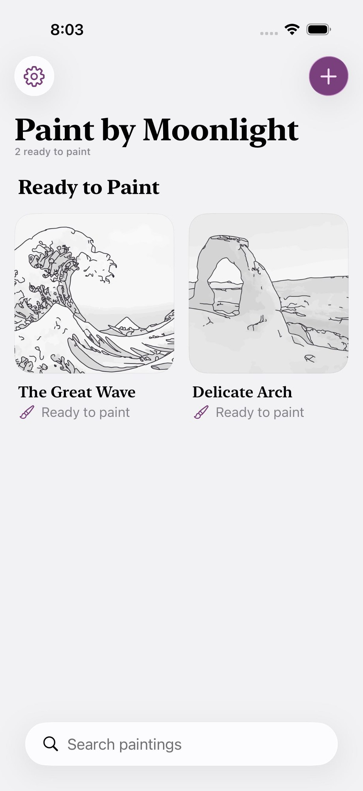 1500x2000

← Read (error): File does not exist. Note: your current working directory is /Users/runner/work/_temp/qa.

> Open Settings.

→ `mcp__maestro__run` `{"device_id": "99DEE653-946C-406D-8E9E-238D1FCE93C9", "yaml": "appId: com.pbordjadze.paintbynumber\n---\n- tapOn:\n    point: \"3%,4%\"\n- waitForAnimationToEnd\n- takeScreenshot: /Users/runner/work/_temp/qa/shots/settings"}`

→ `mcp__maestro__inspect_screen` `{"device_id": "99DEE653-946C-406D-8E9E-238D1FCE93C9"}`

← mcp__maestro__run: {"success":true,"device_id":"99DEE653-946C-406D-8E9E-238D1FCE93C9","commands_executed":4,"message":"Flow executed successfully","env_vars":{"MAESTRO_CLI_ANALYSIS_NOTIFICATION_DISABLED":"true","MAESTRO_CLI_NO_ANALYTICS":"1","MAESTRO_DRIVER_STARTUP_TIMEOUT":"240000","MAESTRO_VERSION":"2.11.0"}}

← mcp__maestro__inspect_screen: {"ui_schema":{"platform":"ios","abbreviations":{"b":"bounds","txt":"text","rid":"resource-id","a11y":"accessibilityText","hint":"hintText","val":"value","c":"children"},"defaults":{"enabled":true,"focused":false,"selected":false,"checked":false,"txt":"","hint":"","rid":"","val":"","a11y":""}},"elements":[{"b":"[0,0][1032,1376]","a11y":"Paint by Moonlight","c":[{"b":"[0,0][1032,1376]","c":[{"b":"[0 …

→ `mcp__maestro__run` `{"device_id": "99DEE653-946C-406D-8E9E-238D1FCE93C9", "yaml": "appId: com.pbordjadze.paintbynumber\n---\n- tapOn:\n    id: \"settings-scene-method\"\n- waitForAnimationToEnd\n- takeScreenshot: /Users/runner/work/_temp/qa/shots/scene-on"}`

← mcp__maestro__run: {"success":true,"device_id":"99DEE653-946C-406D-8E9E-238D1FCE93C9","commands_executed":4,"message":"Flow executed successfully","env_vars":{"MAESTRO_CLI_ANALYSIS_NOTIFICATION_DISABLED":"true","MAESTRO_CLI_NO_ANALYTICS":"1","MAESTRO_DRIVER_STARTUP_TIMEOUT":"240000","MAESTRO_VERSION":"2.11.0"}}

→ `mcp__maestro__take_screenshot` `{"device_id": "99DEE653-946C-406D-8E9E-238D1FCE93C9"}`

← mcp__maestro__take_screenshot: image 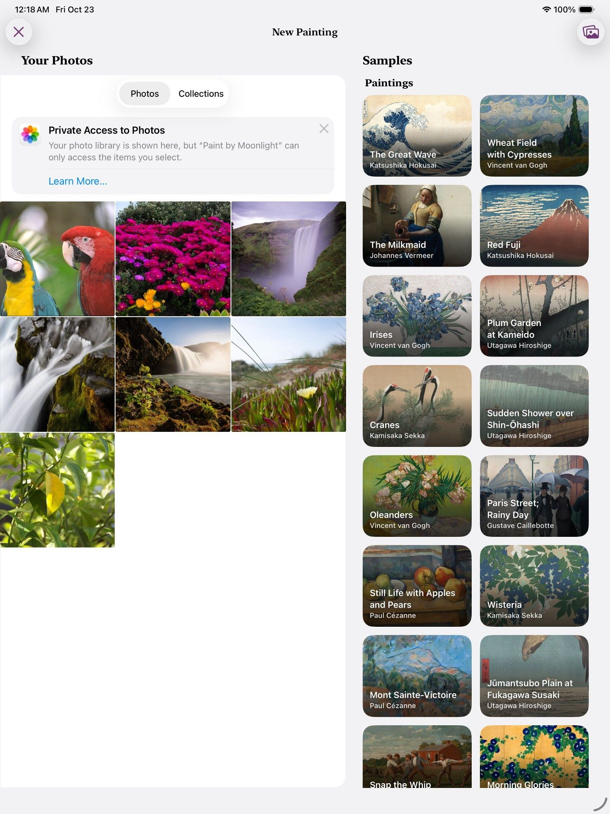 1500x2000

> Toggle still off. Tapping the switch directly.

→ `mcp__maestro__run` `{"device_id": "99DEE653-946C-406D-8E9E-238D1FCE93C9", "yaml": "appId: com.pbordjadze.paintbynumber\n---\n- tapOn:\n    point: \"914,864\"\n- waitForAnimationToEnd\n- takeScreenshot: /Users/runner/work/_temp/qa/shots/scene-on2"}`

→ `Read` `{"file_path": "/Users/runner/work/_temp/qa/app.log"}`

← mcp__maestro__run: {"success":true,"device_id":"99DEE653-946C-406D-8E9E-238D1FCE93C9","commands_executed":4,"message":"Flow executed successfully","env_vars":{"MAESTRO_CLI_ANALYSIS_NOTIFICATION_DISABLED":"true","MAESTRO_CLI_NO_ANALYTICS":"1","MAESTRO_DRIVER_STARTUP_TIMEOUT":"240000","MAESTRO_VERSION":"2.11.0"}}

← Read: 1	getpwuid_r did not find a match for uid 501
2	Filtering the log data using "subsystem == "com.pbordjadze.paintbynumber""
3	Timestamp               Ty Process[PID:TID]
4	2026-10-30 06:51:52.295 Df PaintByNumber[16647:d39f] [com.pbordjadze.paintbynumber:tips] offer in shelf: , wanted
5	2026-10-30 06:51:53.654 Df PaintByNumber[16647:d3ca] [com.pbordjadze.paintbynumber:canvas] Making the render cont …

→ `mcp__maestro__take_screenshot` `{"device_id": "99DEE653-946C-406D-8E9E-238D1FCE93C9"}`

← mcp__maestro__take_screenshot: image  1500x2000

> Scene Method is on. Now Done, then +.

→ `mcp__maestro__run` `{"device_id": "99DEE653-946C-406D-8E9E-238D1FCE93C9", "yaml": "appId: com.pbordjadze.paintbynumber\n---\n- tapOn: \"Done\"\n- waitForAnimationToEnd\n- tapOn:\n    point: \"1075,78\"\n- waitForAnimationToEnd\n- takeScreenshot: /Users/runner/work/_temp/qa/shots/new-sheet"}`

→ `mcp__maestro__inspect_screen` `{"device_id": "99DEE653-946C-406D-8E9E-238D1FCE93C9"}`

← mcp__maestro__run: {"success":true,"device_id":"99DEE653-946C-406D-8E9E-238D1FCE93C9","commands_executed":6,"message":"Flow executed successfully","env_vars":{"MAESTRO_CLI_ANALYSIS_NOTIFICATION_DISABLED":"true","MAESTRO_CLI_NO_ANALYTICS":"1","MAESTRO_DRIVER_STARTUP_TIMEOUT":"240000","MAESTRO_VERSION":"2.11.0"}}

← mcp__maestro__inspect_screen: {"ui_schema":{"platform":"ios","abbreviations":{"b":"bounds","txt":"text","rid":"resource-id","a11y":"accessibilityText","hint":"hintText","val":"value","c":"children"},"defaults":{"enabled":true,"focused":false,"selected":false,"checked":false,"txt":"","hint":"","rid":"","val":"","a11y":""}},"elements":[{"b":"[0,0][1032,1376]","a11y":"Paint by Moonlight","c":[{"b":"[0,0][1032,1376]","c":[{"b":"[0 …

> My point was in pixels; use the label.

→ `mcp__maestro__run` `{"device_id": "99DEE653-946C-406D-8E9E-238D1FCE93C9", "yaml": "appId: com.pbordjadze.paintbynumber\n---\n- tapOn: \"New Painting\"\n- waitForAnimationToEnd\n- takeScreenshot: /Users/runner/work/_temp/qa/shots/new-sheet"}`

→ `mcp__maestro__inspect_screen` `{"device_id": "99DEE653-946C-406D-8E9E-238D1FCE93C9"}`

← mcp__maestro__run: {"success":true,"device_id":"99DEE653-946C-406D-8E9E-238D1FCE93C9","commands_executed":4,"message":"Flow executed successfully","env_vars":{"MAESTRO_CLI_ANALYSIS_NOTIFICATION_DISABLED":"true","MAESTRO_CLI_NO_ANALYTICS":"1","MAESTRO_DRIVER_STARTUP_TIMEOUT":"240000","MAESTRO_VERSION":"2.11.0"}}

← mcp__maestro__inspect_screen: {"ui_schema":{"platform":"ios","abbreviations":{"b":"bounds","txt":"text","rid":"resource-id","a11y":"accessibilityText","hint":"hintText","val":"value","c":"children"},"defaults":{"enabled":true,"focused":false,"selected":false,"checked":false,"txt":"","hint":"","rid":"","val":"","a11y":""}},"elements":[{"b":"[0,0][1032,1376]","a11y":"Paint by Moonlight","c":[{"b":"[0,0][1032,1376]","c":[{"b":"[0 …

→ `mcp__maestro__take_screenshot` `{"device_id": "99DEE653-946C-406D-8E9E-238D1FCE93C9"}`

← mcp__maestro__take_screenshot: image 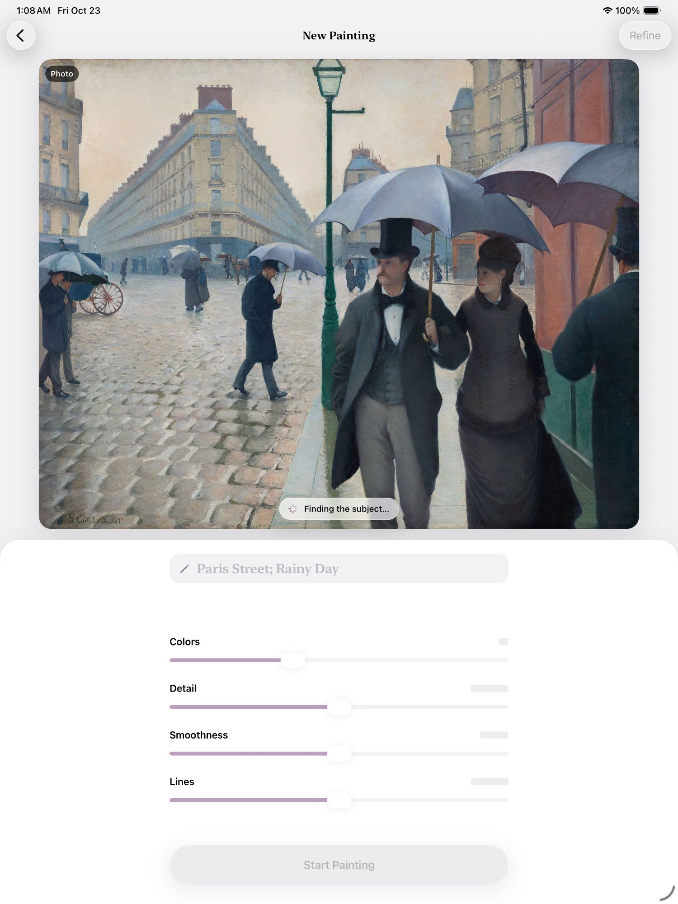 1500x2000

> I'll pick the parrots photo (a subject with faces suits Scene Method).

→ `mcp__maestro__run` `{"device_id": "99DEE653-946C-406D-8E9E-238D1FCE93C9", "yaml": "appId: com.pbordjadze.paintbynumber\n---\n- tapOn:\n    point: \"96,437\"\n- waitForAnimationToEnd\n- takeScreenshot: /Users/runner/work/_temp/qa/shots/scene-preview-1"}`

← mcp__maestro__run: {"success":true,"device_id":"99DEE653-946C-406D-8E9E-238D1FCE93C9","commands_executed":4,"message":"Flow executed successfully","env_vars":{"MAESTRO_CLI_ANALYSIS_NOTIFICATION_DISABLED":"true","MAESTRO_CLI_NO_ANALYTICS":"1","MAESTRO_DRIVER_STARTUP_TIMEOUT":"240000","MAESTRO_VERSION":"2.11.0"}}

→ `mcp__maestro__take_screenshot` `{"device_id": "99DEE653-946C-406D-8E9E-238D1FCE93C9"}`

→ `Read` `{"file_path": "/Users/runner/work/_temp/qa/app.log", "offset": 12}`

← mcp__maestro__take_screenshot: image 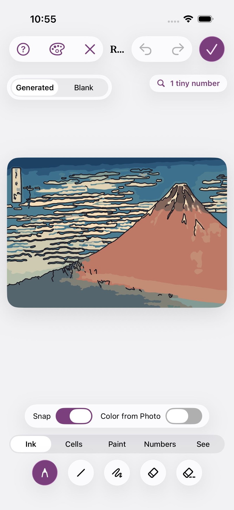 1500x2000

← Read: 12	2026-10-30 06:54:54.501 Df PaintByNumber[16647:d39f] [com.pbordjadze.paintbynumber:tips] offer in drawer: drawerWorthALook, wanted
13	2026-10-30 06:55:46.292 Df PaintByNumber[16647:d39f] [com.pbordjadze.paintbynumber:tips] offer in newPainting: newPaintingSamples, wanted
14	2026-10-30 06:56:29.285 Df PaintByNumber[16647:d39f] [com.pbordjadze.paintbynumber:create] Draft #1 started for 40 colors, …

> Preview took ~1.7 s (log 06:56:29.285 → 30.961). Close tip, look at Adjust.

→ `mcp__maestro__run` `{"device_id": "99DEE653-946C-406D-8E9E-238D1FCE93C9", "yaml": "appId: com.pbordjadze.paintbynumber\n---\n- tapOn: \"Close\"\n- waitForAnimationToEnd\n- tapOn: \"Adjust\"\n- waitForAnimationToEnd\n- takeScreenshot: /Users/runner/work/_temp/qa/shots/scene-adjust"}`

← mcp__maestro__run: {"success":true,"device_id":"99DEE653-946C-406D-8E9E-238D1FCE93C9","commands_executed":6,"message":"Flow executed successfully","env_vars":{"MAESTRO_CLI_ANALYSIS_NOTIFICATION_DISABLED":"true","MAESTRO_CLI_NO_ANALYTICS":"1","MAESTRO_DRIVER_STARTUP_TIMEOUT":"240000","MAESTRO_VERSION":"2.11.0"}}

→ `mcp__maestro__take_screenshot` `{"device_id": "99DEE653-946C-406D-8E9E-238D1FCE93C9"}`

→ `mcp__maestro__inspect_screen` `{"device_id": "99DEE653-946C-406D-8E9E-238D1FCE93C9"}`

← mcp__maestro__take_screenshot: image  1500x2000

← mcp__maestro__inspect_screen: {"ui_schema":{"platform":"ios","abbreviations":{"b":"bounds","txt":"text","rid":"resource-id","a11y":"accessibilityText","hint":"hintText","val":"value","c":"children"},"defaults":{"enabled":true,"focused":false,"selected":false,"checked":false,"txt":"","hint":"","rid":"","val":"","a11y":""}},"elements":[{"b":"[0,0][1032,1376]","a11y":"Paint by Moonlight","c":[{"b":"[0,0][1032,1376]","c":[{"b":"[0 …

> Drag the divider left to see the whole Scene Method painting.

→ `mcp__maestro__run` `{"device_id": "99DEE653-946C-406D-8E9E-238D1FCE93C9", "yaml": "appId: com.pbordjadze.paintbynumber\n---\n- swipe:\n    start: \"516,431\"\n    end: \"40,431\"\n    duration: 800\n- waitForAnimationToEnd\n- takeScreenshot: /Users/runner/work/_temp/qa/shots/scene-preview-full"}`

← mcp__maestro__run: {"success":true,"device_id":"99DEE653-946C-406D-8E9E-238D1FCE93C9","commands_executed":4,"message":"Flow executed successfully","env_vars":{"MAESTRO_CLI_ANALYSIS_NOTIFICATION_DISABLED":"true","MAESTRO_CLI_NO_ANALYTICS":"1","MAESTRO_DRIVER_STARTUP_TIMEOUT":"240000","MAESTRO_VERSION":"2.11.0"}}

→ `mcp__maestro__take_screenshot` `{"device_id": "99DEE653-946C-406D-8E9E-238D1FCE93C9"}`

← mcp__maestro__take_screenshot: image 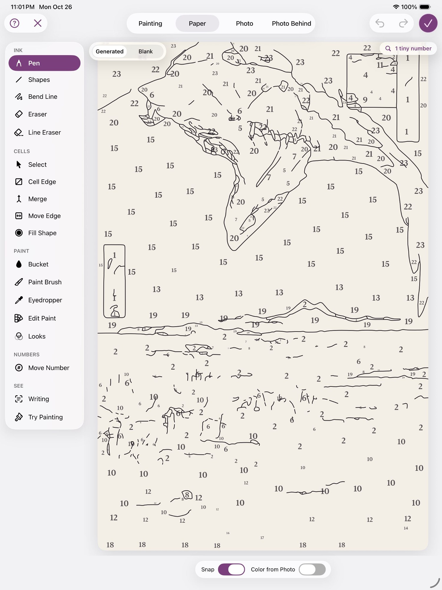 1500x2000

> The left macaw's face lost its eye and stripes; the right one kept its eye. I'll name this painting "Scene On" and start it.

→ `mcp__maestro__run` `{"device_id": "99DEE653-946C-406D-8E9E-238D1FCE93C9", "yaml": "appId: com.pbordjadze.paintbynumber\n---\n- tapOn:\n    id: \"painting-title\"\n- inputText: \"Scene On\"\n- hideKeyboard\n- waitForAnimationToEnd\n- takeScreenshot: /Users/runner/work/_temp/qa/shots/scene-titled"}`

← mcp__maestro__run (error): Failed to run flow: Couldn't hide the keyboard. This can happen if the app uses a custom input or doesn't expose a standard dismiss action.

→ `mcp__maestro__take_screenshot` `{"device_id": "99DEE653-946C-406D-8E9E-238D1FCE93C9"}`

← mcp__maestro__take_screenshot: image  1500x2000

> Tap the return (✓) key, then Start Painting.

→ `mcp__maestro__run` `{"device_id": "99DEE653-946C-406D-8E9E-238D1FCE93C9", "yaml": "appId: com.pbordjadze.paintbynumber\n---\n- tapOn:\n    point: \"938,1148\"\n- waitForAnimationToEnd\n- tapOn: \"Start Painting\"\n- takeScreenshot: /Users/runner/work/_temp/qa/shots/scene-starting"}`

← mcp__maestro__run: {"success":true,"device_id":"99DEE653-946C-406D-8E9E-238D1FCE93C9","commands_executed":5,"message":"Flow executed successfully","env_vars":{"MAESTRO_CLI_ANALYSIS_NOTIFICATION_DISABLED":"true","MAESTRO_CLI_NO_ANALYTICS":"1","MAESTRO_DRIVER_STARTUP_TIMEOUT":"240000","MAESTRO_VERSION":"2.11.0"}}

→ `mcp__maestro__take_screenshot` `{"device_id": "99DEE653-946C-406D-8E9E-238D1FCE93C9"}`

→ `Read` `{"file_path": "/Users/runner/work/_temp/qa/app.log", "offset": 19}`

← mcp__maestro__take_screenshot: image 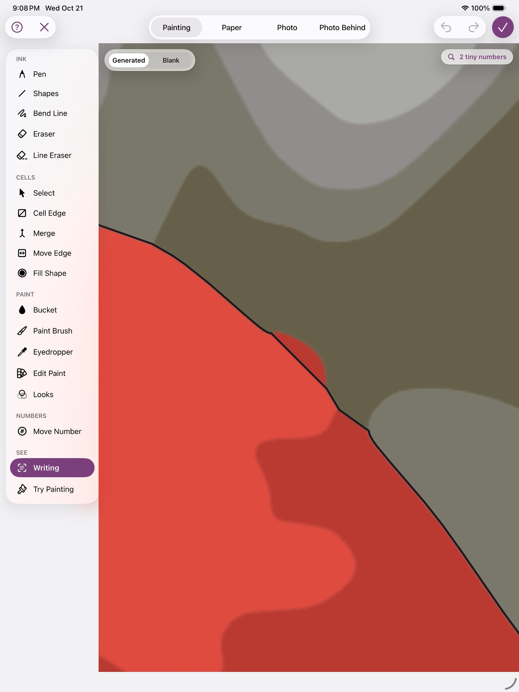 1500x2000

← Read: 19	2026-10-30 06:56:31.421 Df PaintByNumber[16647:d39f] [com.pbordjadze.paintbynumber:tips] turn: newPaintingDivider
20	2026-10-30 06:56:45.449 Df PaintByNumber[16647:d39f] [com.pbordjadze.paintbynumber:tips] turn over: newPaintingDivider
21	2026-10-30 06:57:53.443 Df PaintByNumber[16647:d39f] [com.pbordjadze.paintbynumber:create] Hand-off: the page is expected at Optional((16.0, 280.1666666666666 …

> The stray "]" in the title is mine: my tap for the keyboard's ✓ key landed on "]". Painting opened (185 regions). Close the tip and look at the canvas areas.

→ `mcp__maestro__run` `{"device_id": "99DEE653-946C-406D-8E9E-238D1FCE93C9", "yaml": "appId: com.pbordjadze.paintbynumber\n---\n- tapOn: \"Close\"\n- waitForAnimationToEnd"}`

→ `mcp__maestro__inspect_screen` `{"device_id": "99DEE653-946C-406D-8E9E-238D1FCE93C9"}`

← mcp__maestro__run: {"success":true,"device_id":"99DEE653-946C-406D-8E9E-238D1FCE93C9","commands_executed":3,"message":"Flow executed successfully","env_vars":{"MAESTRO_CLI_ANALYSIS_NOTIFICATION_DISABLED":"true","MAESTRO_CLI_NO_ANALYTICS":"1","MAESTRO_DRIVER_STARTUP_TIMEOUT":"240000","MAESTRO_VERSION":"2.11.0"}}

← mcp__maestro__inspect_screen: {"ui_schema":{"platform":"ios","abbreviations":{"b":"bounds","txt":"text","rid":"resource-id","a11y":"accessibilityText","hint":"hintText","val":"value","c":"children"},"defaults":{"enabled":true,"focused":false,"selected":false,"checked":false,"txt":"","hint":"","rid":"","val":"","a11y":""}},"elements":[{"b":"[0,0][1032,1376]","a11y":"Paint by Moonlight","c":[{"b":"[0,0][1032,1376]","c":[{"b":"[0 …

> Paint areas 95 and 43 (color 7).

→ `mcp__maestro__run` `{"device_id": "99DEE653-946C-406D-8E9E-238D1FCE93C9", "yaml": "appId: com.pbordjadze.paintbynumber\n---\n- tapOn:\n    id: \"canvas-area-95\"\n- waitForAnimationToEnd\n- tapOn:\n    id: \"canvas-area-43\"\n- waitForAnimationToEnd\n- takeScreenshot: /Users/runner/work/_temp/qa/shots/scene-painted-2"}`

← mcp__maestro__run: {"success":true,"device_id":"99DEE653-946C-406D-8E9E-238D1FCE93C9","commands_executed":6,"message":"Flow executed successfully","env_vars":{"MAESTRO_CLI_ANALYSIS_NOTIFICATION_DISABLED":"true","MAESTRO_CLI_NO_ANALYTICS":"1","MAESTRO_DRIVER_STARTUP_TIMEOUT":"240000","MAESTRO_VERSION":"2.11.0"}}

→ `mcp__maestro__take_screenshot` `{"device_id": "99DEE653-946C-406D-8E9E-238D1FCE93C9"}`

← mcp__maestro__take_screenshot: image 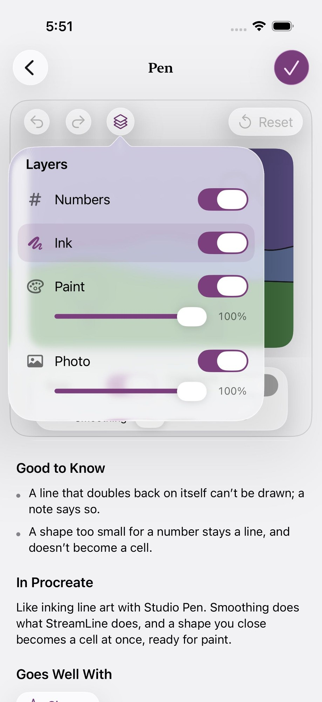 1500x2000

> Two areas painted in the swatch's dark red. Now pick 13 (yellow) and paint the macaw's chest.

→ `mcp__maestro__run` `{"device_id": "99DEE653-946C-406D-8E9E-238D1FCE93C9", "yaml": "appId: com.pbordjadze.paintbynumber\n---\n- tapOn:\n    id: \"swatch-13\"\n    index: 0\n- waitForAnimationToEnd"}`

→ `mcp__maestro__inspect_screen` `{"device_id": "99DEE653-946C-406D-8E9E-238D1FCE93C9"}`

← mcp__maestro__run: {"success":true,"device_id":"99DEE653-946C-406D-8E9E-238D1FCE93C9","commands_executed":3,"message":"Flow executed successfully","env_vars":{"MAESTRO_CLI_ANALYSIS_NOTIFICATION_DISABLED":"true","MAESTRO_CLI_NO_ANALYTICS":"1","MAESTRO_DRIVER_STARTUP_TIMEOUT":"240000","MAESTRO_VERSION":"2.11.0"}}

← mcp__maestro__inspect_screen: {"ui_schema":{"platform":"ios","abbreviations":{"b":"bounds","txt":"text","rid":"resource-id","a11y":"accessibilityText","hint":"hintText","val":"value","c":"children"},"defaults":{"enabled":true,"focused":false,"selected":false,"checked":false,"txt":"","hint":"","rid":"","val":"","a11y":""}},"elements":[{"b":"[0,0][1032,1376]","a11y":"Paint by Moonlight","c":[{"b":"[0,0][1032,1376]","c":[{"b":"[0 …

→ `mcp__maestro__run` `{"device_id": "99DEE653-946C-406D-8E9E-238D1FCE93C9", "yaml": "appId: com.pbordjadze.paintbynumber\n---\n- tapOn:\n    id: \"canvas-area-130\"\n- waitForAnimationToEnd\n- takeScreenshot: /Users/runner/work/_temp/qa/shots/scene-painted-3"}`

← mcp__maestro__run: {"success":true,"device_id":"99DEE653-946C-406D-8E9E-238D1FCE93C9","commands_executed":4,"message":"Flow executed successfully","env_vars":{"MAESTRO_CLI_ANALYSIS_NOTIFICATION_DISABLED":"true","MAESTRO_CLI_NO_ANALYTICS":"1","MAESTRO_DRIVER_STARTUP_TIMEOUT":"240000","MAESTRO_VERSION":"2.11.0"}}

→ `mcp__maestro__take_screenshot` `{"device_id": "99DEE653-946C-406D-8E9E-238D1FCE93C9"}`

← mcp__maestro__take_screenshot: image 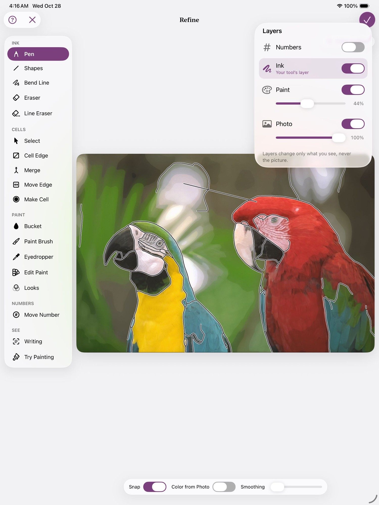 1500x2000

> Color 13 finished (one area), selection moved to 14, and the palette closed up (13 removed; all swatches shifted). Back to the gallery.

→ `mcp__maestro__run` `{"device_id": "99DEE653-946C-406D-8E9E-238D1FCE93C9", "yaml": "appId: com.pbordjadze.paintbynumber\n---\n- tapOn: \"Back\"\n- waitForAnimationToEnd\n- takeScreenshot: /Users/runner/work/_temp/qa/shots/gallery-after-scene"}`

→ `mcp__maestro__inspect_screen` `{"device_id": "99DEE653-946C-406D-8E9E-238D1FCE93C9"}`

← mcp__maestro__run: {"success":true,"device_id":"99DEE653-946C-406D-8E9E-238D1FCE93C9","commands_executed":4,"message":"Flow executed successfully","env_vars":{"MAESTRO_CLI_ANALYSIS_NOTIFICATION_DISABLED":"true","MAESTRO_CLI_NO_ANALYTICS":"1","MAESTRO_DRIVER_STARTUP_TIMEOUT":"240000","MAESTRO_VERSION":"2.11.0"}}

← mcp__maestro__inspect_screen: {"ui_schema":{"platform":"ios","abbreviations":{"b":"bounds","txt":"text","rid":"resource-id","a11y":"accessibilityText","hint":"hintText","val":"value","c":"children"},"defaults":{"enabled":true,"focused":false,"selected":false,"checked":false,"txt":"","hint":"","rid":"","val":"","a11y":""}},"elements":[{"b":"[0,0][1032,1376]","a11y":"Paint by Moonlight","c":[{"b":"[0,0][1032,1376]","c":[{"b":"[0 …

> Gallery shows 1% (3/185), consistent. Long-press the card to find Regenerate.

→ `mcp__maestro__run` `{"device_id": "99DEE653-946C-406D-8E9E-238D1FCE93C9", "yaml": "appId: com.pbordjadze.paintbynumber\n---\n- longPressOn:\n    point: \"176,290\"\n- waitForAnimationToEnd\n- takeScreenshot: /Users/runner/work/_temp/qa/shots/card-menu"}`

← mcp__maestro__run: {"success":true,"device_id":"99DEE653-946C-406D-8E9E-238D1FCE93C9","commands_executed":4,"message":"Flow executed successfully","env_vars":{"MAESTRO_CLI_ANALYSIS_NOTIFICATION_DISABLED":"true","MAESTRO_CLI_NO_ANALYTICS":"1","MAESTRO_DRIVER_STARTUP_TIMEOUT":"240000","MAESTRO_VERSION":"2.11.0"}}

→ `mcp__maestro__take_screenshot` `{"device_id": "99DEE653-946C-406D-8E9E-238D1FCE93C9"}`

← mcp__maestro__take_screenshot: image 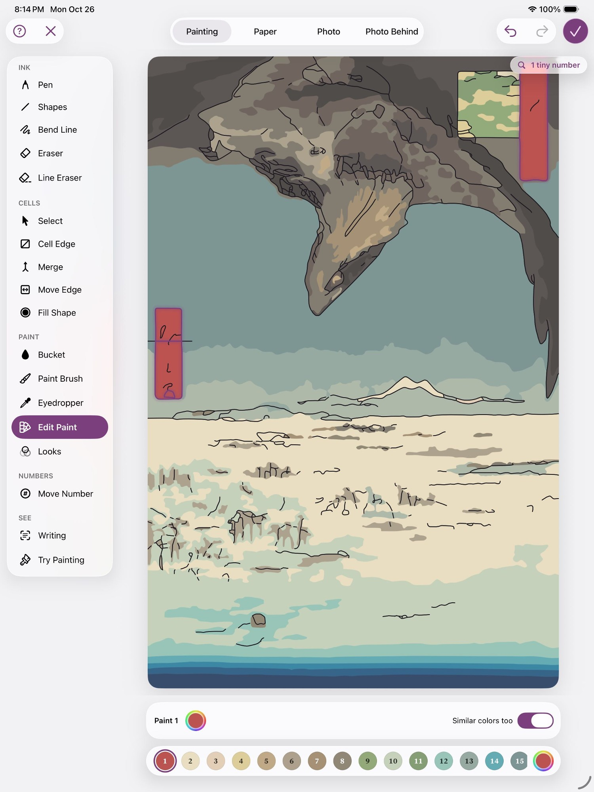 1500x2000

> The menu has no Regenerate (Favorite, Rename, Share, Restart, Delete). I'll use Rename to fix the title.

→ `mcp__maestro__run` `{"device_id": "99DEE653-946C-406D-8E9E-238D1FCE93C9", "yaml": "appId: com.pbordjadze.paintbynumber\n---\n- tapOn: \"Rename\"\n- waitForAnimationToEnd\n- takeScreenshot: /Users/runner/work/_temp/qa/shots/rename"}`

→ `mcp__maestro__inspect_screen` `{"device_id": "99DEE653-946C-406D-8E9E-238D1FCE93C9"}`

← mcp__maestro__run: {"success":true,"device_id":"99DEE653-946C-406D-8E9E-238D1FCE93C9","commands_executed":4,"message":"Flow executed successfully","env_vars":{"MAESTRO_CLI_ANALYSIS_NOTIFICATION_DISABLED":"true","MAESTRO_CLI_NO_ANALYTICS":"1","MAESTRO_DRIVER_STARTUP_TIMEOUT":"240000","MAESTRO_VERSION":"2.11.0"}}

← mcp__maestro__inspect_screen: {"ui_schema":{"platform":"ios","abbreviations":{"b":"bounds","txt":"text","rid":"resource-id","a11y":"accessibilityText","hint":"hintText","val":"value","c":"children"},"defaults":{"enabled":true,"focused":false,"selected":false,"checked":false,"txt":"","hint":"","rid":"","val":"","a11y":""}},"elements":[{"b":"[0,0][1032,1376]","a11y":"Paint by Moonlight","c":[{"b":"[0,0][1032,1376]","c":[{"b":"[0 …

> Confirmed: my earlier tap at (938,1148) fell on the "]" key, just above Done. Fixing the title.

→ `mcp__maestro__run` `{"device_id": "99DEE653-946C-406D-8E9E-238D1FCE93C9", "yaml": "appId: com.pbordjadze.paintbynumber\n---\n- eraseText: 1\n- tapOn: \"Rename\"\n- waitForAnimationToEnd\n- takeScreenshot: /Users/runner/work/_temp/qa/shots/renamed"}`

← mcp__maestro__run: {"success":true,"device_id":"99DEE653-946C-406D-8E9E-238D1FCE93C9","commands_executed":5,"message":"Flow executed successfully","env_vars":{"MAESTRO_CLI_ANALYSIS_NOTIFICATION_DISABLED":"true","MAESTRO_CLI_NO_ANALYTICS":"1","MAESTRO_DRIVER_STARTUP_TIMEOUT":"240000","MAESTRO_VERSION":"2.11.0"}}

→ `mcp__maestro__take_screenshot` `{"device_id": "99DEE653-946C-406D-8E9E-238D1FCE93C9"}`

← mcp__maestro__take_screenshot: image 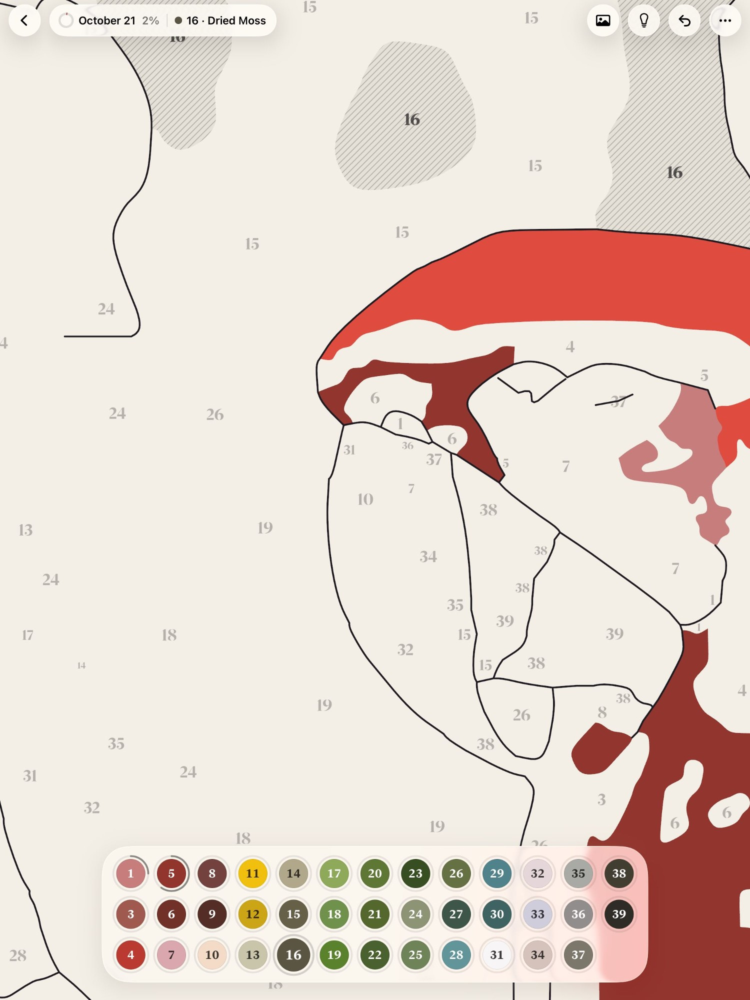 1500x2000

> Writing a first report before continuing.

→ `Write` `{"file_path": "/Users/runner/work/_temp/qa/report.md", "content": "# Paint by Moonlight: exploratory test report (Scene Method session, 2026-10-30)\n\n## Summary\nIn progress. I turned Scene Method on, made a painting (\"Scene On\") from the parrots photo, and painted 3 areas. Generation was fast (preview ready in about 1.7 s). The gallery shows the same 1% as the painting. The gallery card's menu has no Regenerate action.\n\n## Coverage\n- Scene Method ON, create flow: done (photo \u2192 preview \u2192 Start Painting \u2192 painting \u2192 3 fills).\n- Scene Method OFF, create flow: in progre`

← Write: File created successfully at: /Users/runner/work/_temp/qa/report.md (file state is current in your context — no need to Read it back)

→ `mcp__maestro__run` `{"device_id": "99DEE653-946C-406D-8E9E-238D1FCE93C9", "yaml": "appId: com.pbordjadze.paintbynumber\n---\n- tapOn: \"Settings\"\n- waitForAnimationToEnd\n- tapOn:\n    point: \"914,864\"\n- waitForAnimationToEnd\n- takeScreenshot: /Users/runner/work/_temp/qa/shots/scene-off"}`

← mcp__maestro__run: {"success":true,"device_id":"99DEE653-946C-406D-8E9E-238D1FCE93C9","commands_executed":6,"message":"Flow executed successfully","env_vars":{"MAESTRO_CLI_ANALYSIS_NOTIFICATION_DISABLED":"true","MAESTRO_CLI_NO_ANALYTICS":"1","MAESTRO_DRIVER_STARTUP_TIMEOUT":"240000","MAESTRO_VERSION":"2.11.0"}}

→ `mcp__maestro__take_screenshot` `{"device_id": "99DEE653-946C-406D-8E9E-238D1FCE93C9"}`

← mcp__maestro__take_screenshot: image 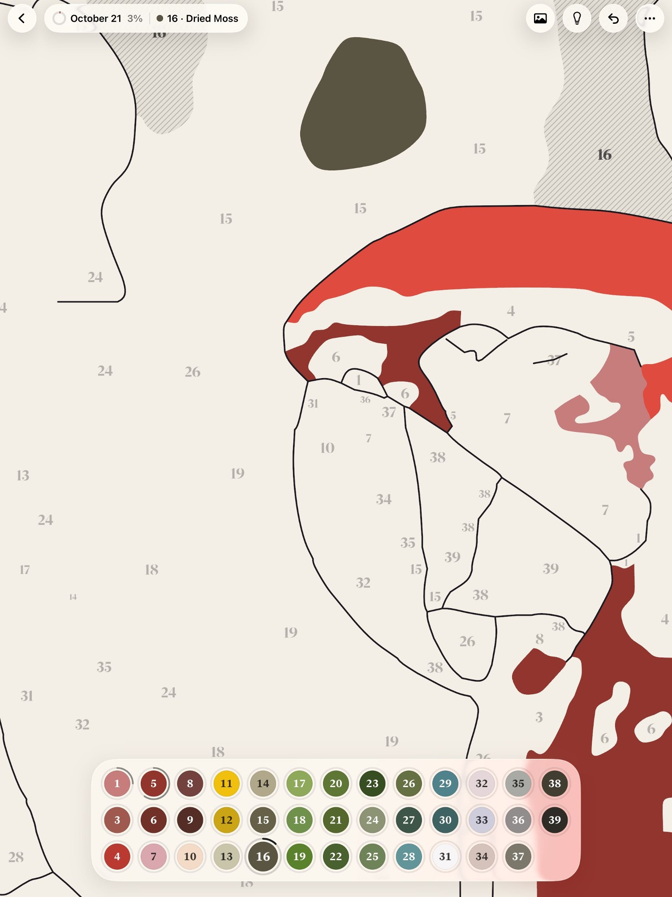 1500x2000

> Scene Method off (it had stayed on; Free Paintings now 2 left). Creating the same photo again.

→ `mcp__maestro__run` `{"device_id": "99DEE653-946C-406D-8E9E-238D1FCE93C9", "yaml": "appId: com.pbordjadze.paintbynumber\n---\n- tapOn: \"Done\"\n- waitForAnimationToEnd\n- tapOn: \"New Painting\"\n- waitForAnimationToEnd\n- tapOn:\n    point: \"96,437\"\n- waitForAnimationToEnd\n- takeScreenshot: /Users/runner/work/_temp/qa/shots/off-preview-1"}`

← mcp__maestro__run: {"success":true,"device_id":"99DEE653-946C-406D-8E9E-238D1FCE93C9","commands_executed":8,"message":"Flow executed successfully","env_vars":{"MAESTRO_CLI_ANALYSIS_NOTIFICATION_DISABLED":"true","MAESTRO_CLI_NO_ANALYTICS":"1","MAESTRO_DRIVER_STARTUP_TIMEOUT":"240000","MAESTRO_VERSION":"2.11.0"}}

→ `mcp__maestro__take_screenshot` `{"device_id": "99DEE653-946C-406D-8E9E-238D1FCE93C9"}`

→ `Read` `{"file_path": "/Users/runner/work/_temp/qa/app.log", "offset": 29}`

← mcp__maestro__take_screenshot: image 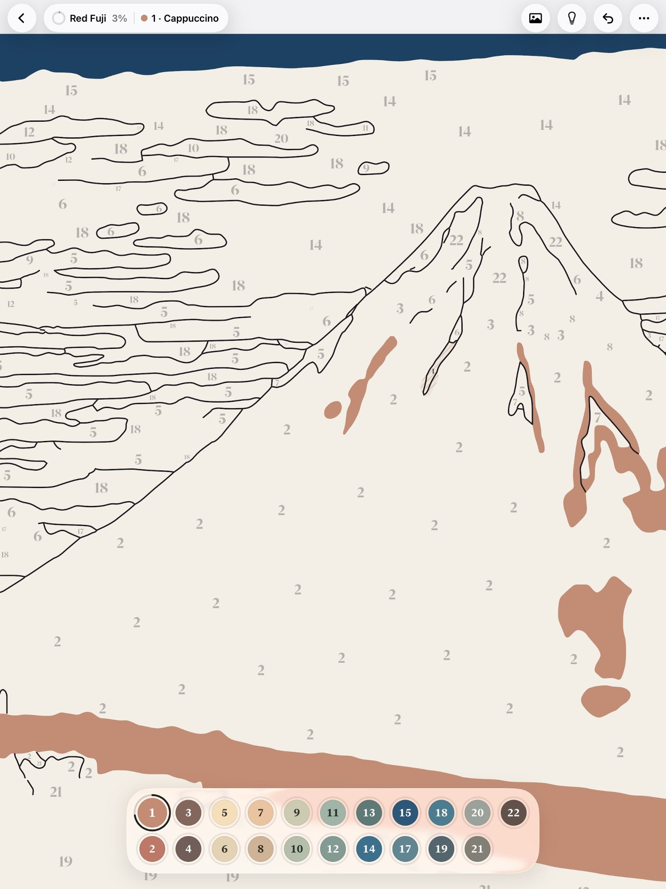 1500x2000

← Read: 29	2026-10-30 06:57:58.483 Df PaintByNumber[16647:d39f] [com.pbordjadze.paintbynumber:tips] turn: benchTap
30	2026-10-30 06:58:11.380 Df PaintByNumber[16647:d39f] [com.pbordjadze.paintbynumber:tips] turn over: benchTap
31	2026-10-30 06:58:18.495 Df PaintByNumber[16647:d39f] [com.pbordjadze.paintbynumber:tips] offer in bench: , wanted
32	2026-10-30 07:00:12.598 Df PaintByNumber[16647:d39f] [com.pbo …

> Off: 39 colors · 180 areas, about 1.5 s (07:00:52.477 → 54.022). Very close to On (40 · 185). Showing the whole painting.

→ `mcp__maestro__run` `{"device_id": "99DEE653-946C-406D-8E9E-238D1FCE93C9", "yaml": "appId: com.pbordjadze.paintbynumber\n---\n- swipe:\n    start: \"516,431\"\n    end: \"40,431\"\n    duration: 800\n- waitForAnimationToEnd\n- takeScreenshot: /Users/runner/work/_temp/qa/shots/off-preview-full"}`

← mcp__maestro__run: {"success":true,"device_id":"99DEE653-946C-406D-8E9E-238D1FCE93C9","commands_executed":4,"message":"Flow executed successfully","env_vars":{"MAESTRO_CLI_ANALYSIS_NOTIFICATION_DISABLED":"true","MAESTRO_CLI_NO_ANALYTICS":"1","MAESTRO_DRIVER_STARTUP_TIMEOUT":"240000","MAESTRO_VERSION":"2.11.0"}}

→ `mcp__maestro__take_screenshot` `{"device_id": "99DEE653-946C-406D-8E9E-238D1FCE93C9"}`

← mcp__maestro__take_screenshot: image 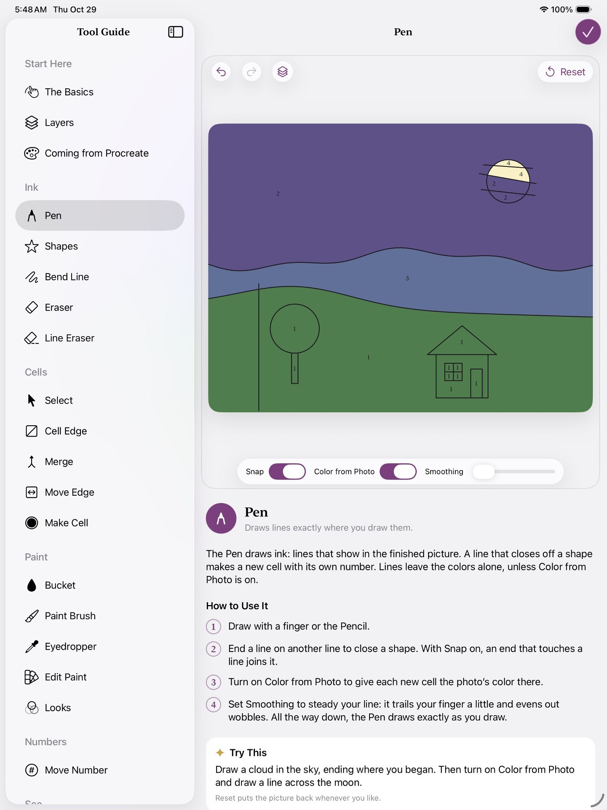 1500x2000

→ `mcp__maestro__run` `{"device_id": "99DEE653-946C-406D-8E9E-238D1FCE93C9", "yaml": "appId: com.pbordjadze.paintbynumber\n---\n- tapOn:\n    id: \"painting-title\"\n- inputText: \"Scene Off\"\n- tapOn:\n    id: \"Done\"\n- waitForAnimationToEnd\n- takeScreenshot: /Users/runner/work/_temp/qa/shots/off-titled"}`

← mcp__maestro__run: {"success":true,"device_id":"99DEE653-946C-406D-8E9E-238D1FCE93C9","commands_executed":6,"message":"Flow executed successfully","env_vars":{"MAESTRO_CLI_ANALYSIS_NOTIFICATION_DISABLED":"true","MAESTRO_CLI_NO_ANALYTICS":"1","MAESTRO_DRIVER_STARTUP_TIMEOUT":"240000","MAESTRO_VERSION":"2.11.0"}}

→ `mcp__maestro__take_screenshot` `{"device_id": "99DEE653-946C-406D-8E9E-238D1FCE93C9"}`

← mcp__maestro__take_screenshot: image 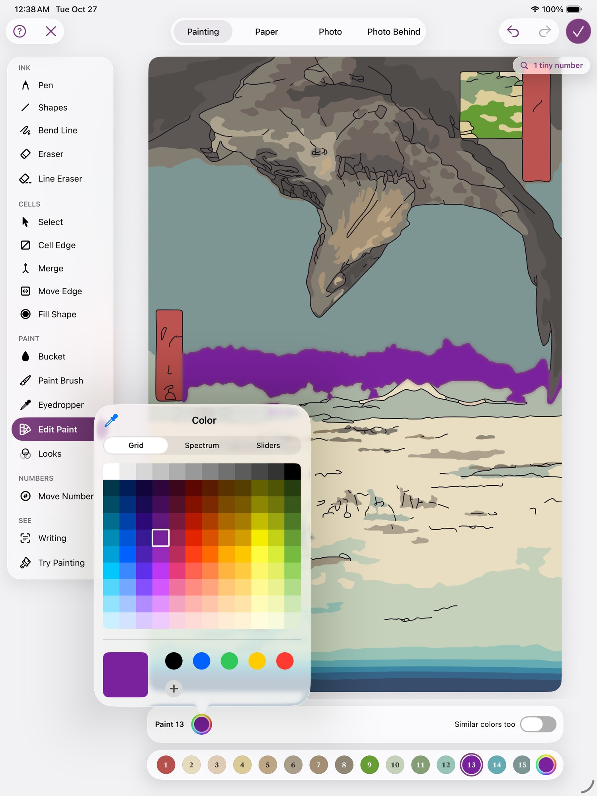 1500x2000

→ `mcp__maestro__run` `{"device_id": "99DEE653-946C-406D-8E9E-238D1FCE93C9", "yaml": "appId: com.pbordjadze.paintbynumber\n---\n- tapOn: \"Start Painting\"\n- waitForAnimationToEnd\n- takeScreenshot: /Users/runner/work/_temp/qa/shots/off-painting"}`

← mcp__maestro__run: {"success":true,"device_id":"99DEE653-946C-406D-8E9E-238D1FCE93C9","commands_executed":4,"message":"Flow executed successfully","env_vars":{"MAESTRO_CLI_ANALYSIS_NOTIFICATION_DISABLED":"true","MAESTRO_CLI_NO_ANALYTICS":"1","MAESTRO_DRIVER_STARTUP_TIMEOUT":"240000","MAESTRO_VERSION":"2.11.0"}}

→ `mcp__maestro__take_screenshot` `{"device_id": "99DEE653-946C-406D-8E9E-238D1FCE93C9"}`

← mcp__maestro__take_screenshot: image 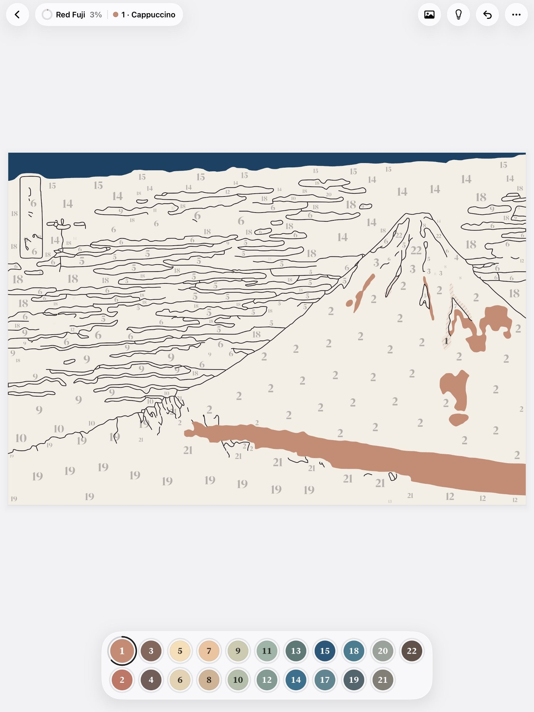 1500x2000

> Outlines look almost the same as Scene On's. Off's largest-area color is 15 (background); On's was 7 (the red body). Paint a 15 area by point.

→ `mcp__maestro__run` `{"device_id": "99DEE653-946C-406D-8E9E-238D1FCE93C9", "yaml": "appId: com.pbordjadze.paintbynumber\n---\n- tapOn:\n    point: \"599,344\"\n- waitForAnimationToEnd\n- tapOn:\n    point: \"160,722\"\n- waitForAnimationToEnd\n- takeScreenshot: /Users/runner/work/_temp/qa/shots/off-painted"}`

← mcp__maestro__run: {"success":true,"device_id":"99DEE653-946C-406D-8E9E-238D1FCE93C9","commands_executed":6,"message":"Flow executed successfully","env_vars":{"MAESTRO_CLI_ANALYSIS_NOTIFICATION_DISABLED":"true","MAESTRO_CLI_NO_ANALYTICS":"1","MAESTRO_DRIVER_STARTUP_TIMEOUT":"240000","MAESTRO_VERSION":"2.11.0"}}

→ `mcp__maestro__take_screenshot` `{"device_id": "99DEE653-946C-406D-8E9E-238D1FCE93C9"}`

← mcp__maestro__take_screenshot: image 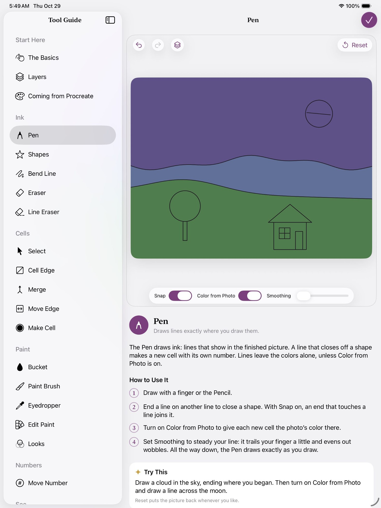 1500x2000

> Both fills landed in olive (15). Trying a double tap to zoom once.

→ `mcp__maestro__run` `{"device_id": "99DEE653-946C-406D-8E9E-238D1FCE93C9", "yaml": "appId: com.pbordjadze.paintbynumber\n---\n- doubleTapOn:\n    point: \"523,688\"\n- waitForAnimationToEnd\n- takeScreenshot: /Users/runner/work/_temp/qa/shots/off-doubletap"}`

← mcp__maestro__run: {"success":true,"device_id":"99DEE653-946C-406D-8E9E-238D1FCE93C9","commands_executed":4,"message":"Flow executed successfully","env_vars":{"MAESTRO_CLI_ANALYSIS_NOTIFICATION_DISABLED":"true","MAESTRO_CLI_NO_ANALYTICS":"1","MAESTRO_DRIVER_STARTUP_TIMEOUT":"240000","MAESTRO_VERSION":"2.11.0"}}

→ `mcp__maestro__take_screenshot` `{"device_id": "99DEE653-946C-406D-8E9E-238D1FCE93C9"}`

← mcp__maestro__take_screenshot: image 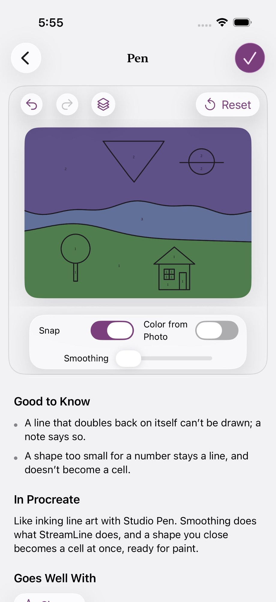 1500x2000

> Double tap didn't zoom, as earlier sessions found. Zooming with Hint instead.

→ `mcp__maestro__run` `{"device_id": "99DEE653-946C-406D-8E9E-238D1FCE93C9", "yaml": "appId: com.pbordjadze.paintbynumber\n---\n- tapOn: \"Hint\"\n- waitForAnimationToEnd\n- takeScreenshot: /Users/runner/work/_temp/qa/shots/off-hint"}`

→ `mcp__maestro__inspect_screen` `{"device_id": "99DEE653-946C-406D-8E9E-238D1FCE93C9"}`

← mcp__maestro__run: {"success":true,"device_id":"99DEE653-946C-406D-8E9E-238D1FCE93C9","commands_executed":4,"message":"Flow executed successfully","env_vars":{"MAESTRO_CLI_ANALYSIS_NOTIFICATION_DISABLED":"true","MAESTRO_CLI_NO_ANALYTICS":"1","MAESTRO_DRIVER_STARTUP_TIMEOUT":"240000","MAESTRO_VERSION":"2.11.0"}}

← mcp__maestro__inspect_screen: {"ui_schema":{"platform":"ios","abbreviations":{"b":"bounds","txt":"text","rid":"resource-id","a11y":"accessibilityText","hint":"hintText","val":"value","c":"children"},"defaults":{"enabled":true,"focused":false,"selected":false,"checked":false,"txt":"","hint":"","rid":"","val":"","a11y":""}},"elements":[{"b":"[0,0][1032,1376]","a11y":"Paint by Moonlight","c":[{"b":"[0,0][1032,1376]","c":[{"b":"[0 …

→ `mcp__maestro__take_screenshot` `{"device_id": "99DEE653-946C-406D-8E9E-238D1FCE93C9"}`

← mcp__maestro__take_screenshot: image 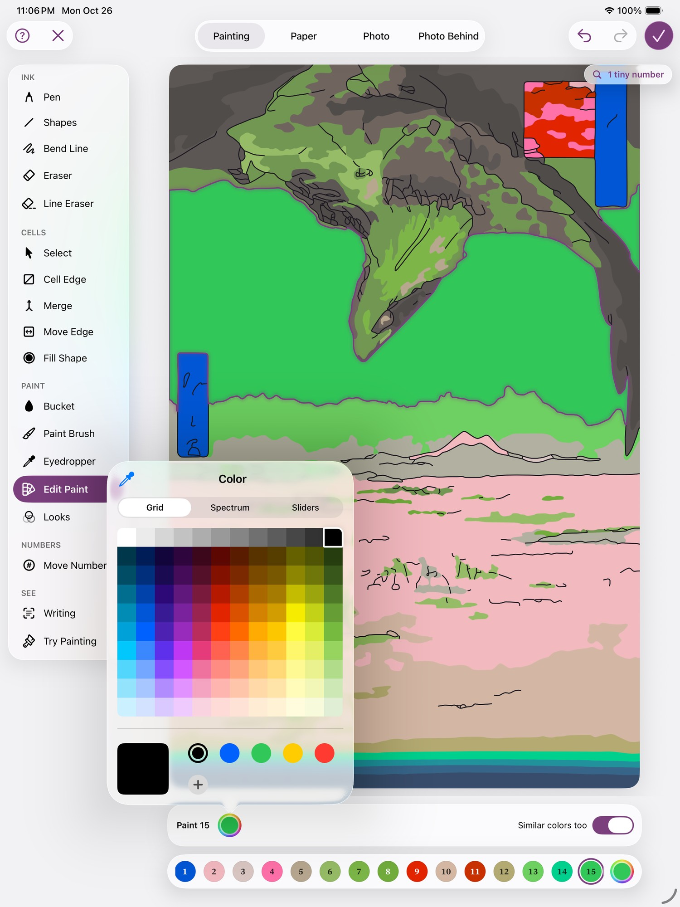 1500x2000

> Hint zoomed in on two small 15 areas by the red macaw's face. Painting both by id.

→ `mcp__maestro__run` `{"device_id": "99DEE653-946C-406D-8E9E-238D1FCE93C9", "yaml": "appId: com.pbordjadze.paintbynumber\n---\n- tapOn:\n    id: \"canvas-area-101\"\n- waitForAnimationToEnd\n- tapOn:\n    id: \"canvas-area-109\"\n- waitForAnimationToEnd\n- takeScreenshot: /Users/runner/work/_temp/qa/shots/off-zoom-painted"}`

← mcp__maestro__run: {"success":true,"device_id":"99DEE653-946C-406D-8E9E-238D1FCE93C9","commands_executed":6,"message":"Flow executed successfully","env_vars":{"MAESTRO_CLI_ANALYSIS_NOTIFICATION_DISABLED":"true","MAESTRO_CLI_NO_ANALYTICS":"1","MAESTRO_DRIVER_STARTUP_TIMEOUT":"240000","MAESTRO_VERSION":"2.11.0"}}

→ `mcp__maestro__take_screenshot` `{"device_id": "99DEE653-946C-406D-8E9E-238D1FCE93C9"}`

← mcp__maestro__take_screenshot: image 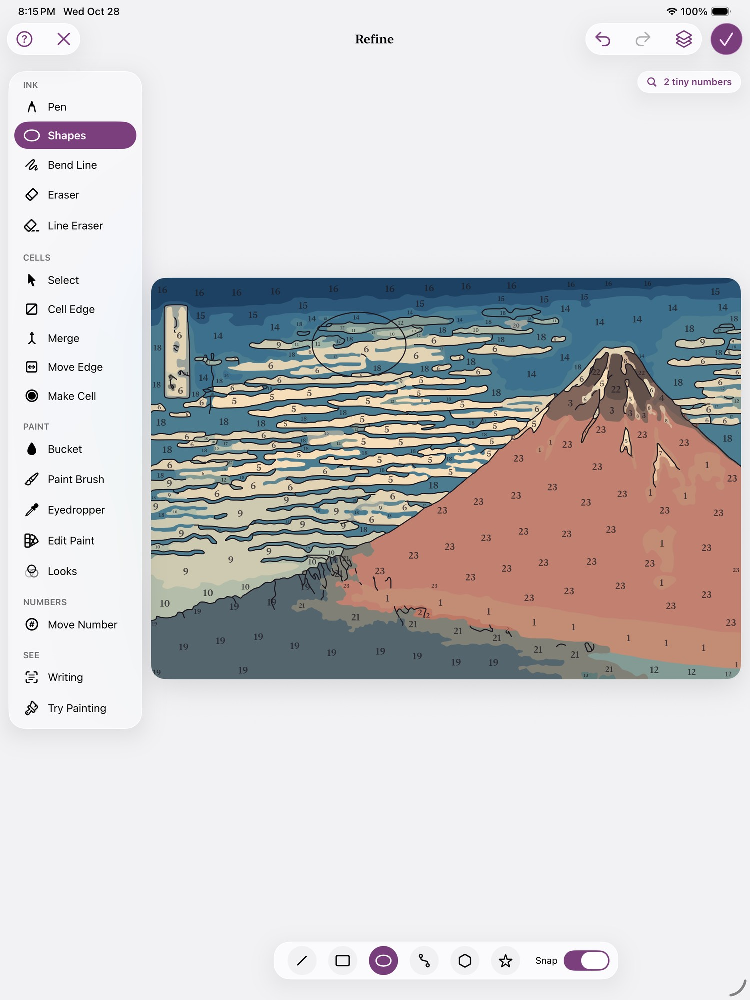 1500x2000

> Both zoomed fills landed. Now Fit to Screen through the ring and More.

→ `mcp__maestro__run` `{"device_id": "99DEE653-946C-406D-8E9E-238D1FCE93C9", "yaml": "appId: com.pbordjadze.paintbynumber\n---\n- tapOn:\n    id: \"quiet-ring\"\n- waitForAnimationToEnd\n- tapOn: \"More\"\n- waitForAnimationToEnd\n- takeScreenshot: /Users/runner/work/_temp/qa/shots/off-more"}`

→ `mcp__maestro__inspect_screen` `{"device_id": "99DEE653-946C-406D-8E9E-238D1FCE93C9"}`

← mcp__maestro__run: {"success":true,"device_id":"99DEE653-946C-406D-8E9E-238D1FCE93C9","commands_executed":6,"message":"Flow executed successfully","env_vars":{"MAESTRO_CLI_ANALYSIS_NOTIFICATION_DISABLED":"true","MAESTRO_CLI_NO_ANALYTICS":"1","MAESTRO_DRIVER_STARTUP_TIMEOUT":"240000","MAESTRO_VERSION":"2.11.0"}}

← mcp__maestro__inspect_screen: {"ui_schema":{"platform":"ios","abbreviations":{"b":"bounds","txt":"text","rid":"resource-id","a11y":"accessibilityText","hint":"hintText","val":"value","c":"children"},"defaults":{"enabled":true,"focused":false,"selected":false,"checked":false,"txt":"","hint":"","rid":"","val":"","a11y":""}},"elements":[{"b":"[0,0][1032,1376]","a11y":"Paint by Moonlight","c":[{"b":"[0,0][1032,1376]","c":[{"b":"[0 …

> The software keyboard came up with the menu (simulator, known). Tapping Fit to Screen.

→ `mcp__maestro__run` `{"device_id": "99DEE653-946C-406D-8E9E-238D1FCE93C9", "yaml": "appId: com.pbordjadze.paintbynumber\n---\n- tapOn: \"Fit to Screen\"\n- waitForAnimationToEnd\n- takeScreenshot: /Users/runner/work/_temp/qa/shots/off-fit"}`

← mcp__maestro__run: {"success":true,"device_id":"99DEE653-946C-406D-8E9E-238D1FCE93C9","commands_executed":4,"message":"Flow executed successfully","env_vars":{"MAESTRO_CLI_ANALYSIS_NOTIFICATION_DISABLED":"true","MAESTRO_CLI_NO_ANALYTICS":"1","MAESTRO_DRIVER_STARTUP_TIMEOUT":"240000","MAESTRO_VERSION":"2.11.0"}}

→ `mcp__maestro__take_screenshot` `{"device_id": "99DEE653-946C-406D-8E9E-238D1FCE93C9"}`

← mcp__maestro__take_screenshot: image 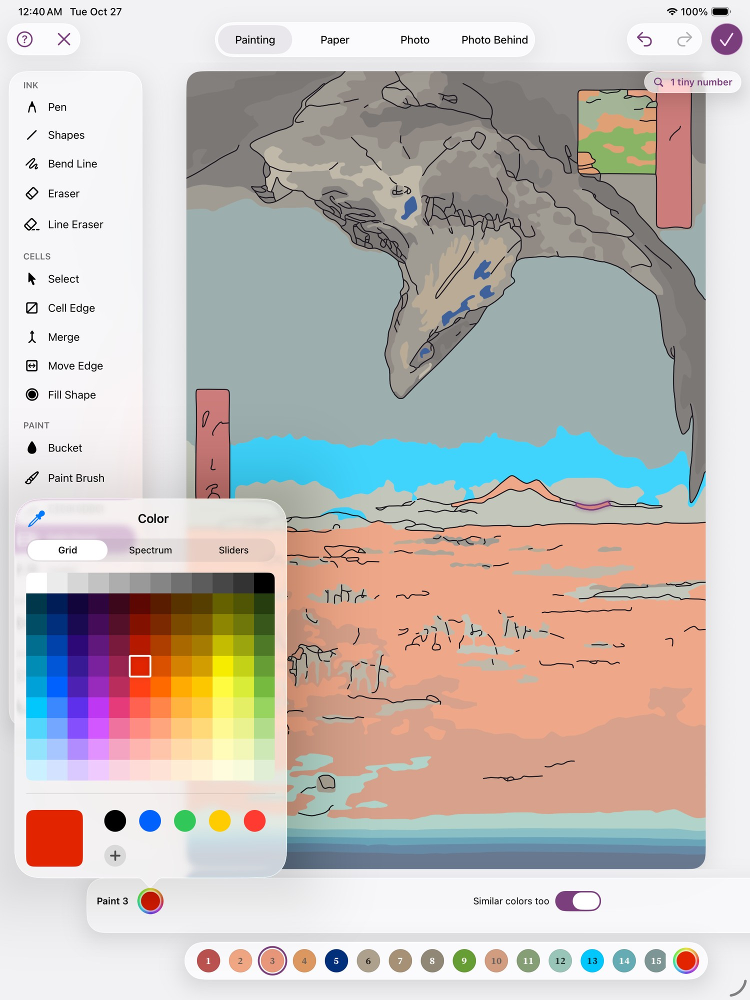 1500x2000

> Fitted again, all 4 fills there, 2% (4/180). Now quitting through Home and relaunching.

→ `mcp__maestro__run` `{"device_id": "99DEE653-946C-406D-8E9E-238D1FCE93C9", "yaml": "appId: com.pbordjadze.paintbynumber\n---\n- pressKey: Home"}`

→ `mcp__maestro__take_screenshot` `{"device_id": "99DEE653-946C-406D-8E9E-238D1FCE93C9"}`

← mcp__maestro__run: {"success":true,"device_id":"99DEE653-946C-406D-8E9E-238D1FCE93C9","commands_executed":2,"message":"Flow executed successfully","env_vars":{"MAESTRO_CLI_ANALYSIS_NOTIFICATION_DISABLED":"true","MAESTRO_CLI_NO_ANALYTICS":"1","MAESTRO_DRIVER_STARTUP_TIMEOUT":"240000","MAESTRO_VERSION":"2.11.0"}}

← mcp__maestro__take_screenshot: image 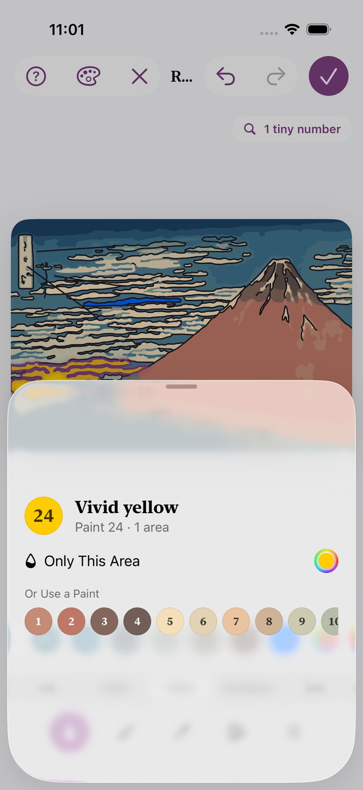 1500x2000

→ `mcp__maestro__run` `{"device_id": "99DEE653-946C-406D-8E9E-238D1FCE93C9", "yaml": "appId: com.pbordjadze.paintbynumber\n---\n- stopApp\n- launchApp\n- waitForAnimationToEnd\n- takeScreenshot: /Users/runner/work/_temp/qa/shots/relaunch"}`

← mcp__maestro__run: {"success":true,"device_id":"99DEE653-946C-406D-8E9E-238D1FCE93C9","commands_executed":5,"message":"Flow executed successfully","env_vars":{"MAESTRO_CLI_ANALYSIS_NOTIFICATION_DISABLED":"true","MAESTRO_CLI_NO_ANALYTICS":"1","MAESTRO_DRIVER_STARTUP_TIMEOUT":"240000","MAESTRO_VERSION":"2.11.0"}}

→ `mcp__maestro__take_screenshot` `{"device_id": "99DEE653-946C-406D-8E9E-238D1FCE93C9"}`

← mcp__maestro__take_screenshot: image 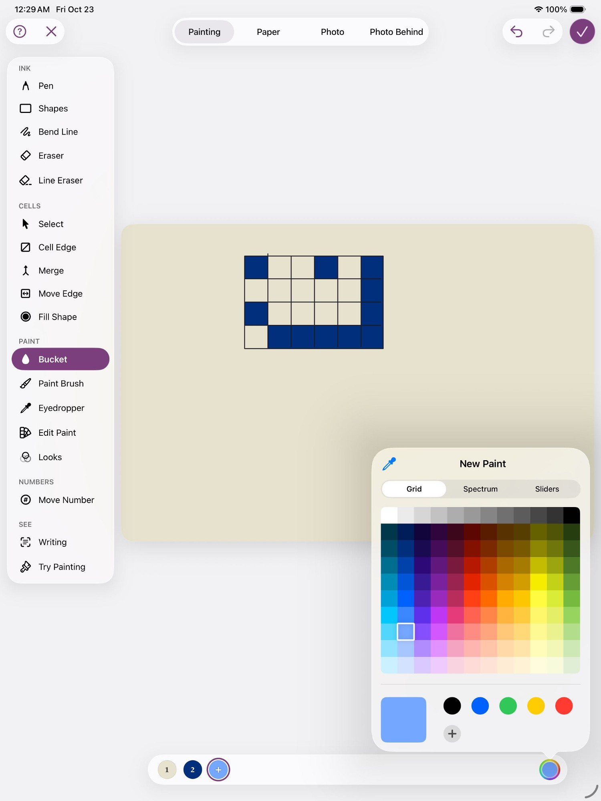 1500x2000

> The app reopened "Scene Off" with all 4 fills at 2%, on the first swatch (by design). Back to the gallery.

→ `mcp__maestro__run` `{"device_id": "99DEE653-946C-406D-8E9E-238D1FCE93C9", "yaml": "appId: com.pbordjadze.paintbynumber\n---\n- tapOn: \"Back\"\n- waitForAnimationToEnd\n- takeScreenshot: /Users/runner/work/_temp/qa/shots/gallery-relaunch"}`

← mcp__maestro__run: {"success":true,"device_id":"99DEE653-946C-406D-8E9E-238D1FCE93C9","commands_executed":4,"message":"Flow executed successfully","env_vars":{"MAESTRO_CLI_ANALYSIS_NOTIFICATION_DISABLED":"true","MAESTRO_CLI_NO_ANALYTICS":"1","MAESTRO_DRIVER_STARTUP_TIMEOUT":"240000","MAESTRO_VERSION":"2.11.0"}}

→ `mcp__maestro__take_screenshot` `{"device_id": "99DEE653-946C-406D-8E9E-238D1FCE93C9"}`

← mcp__maestro__take_screenshot: image 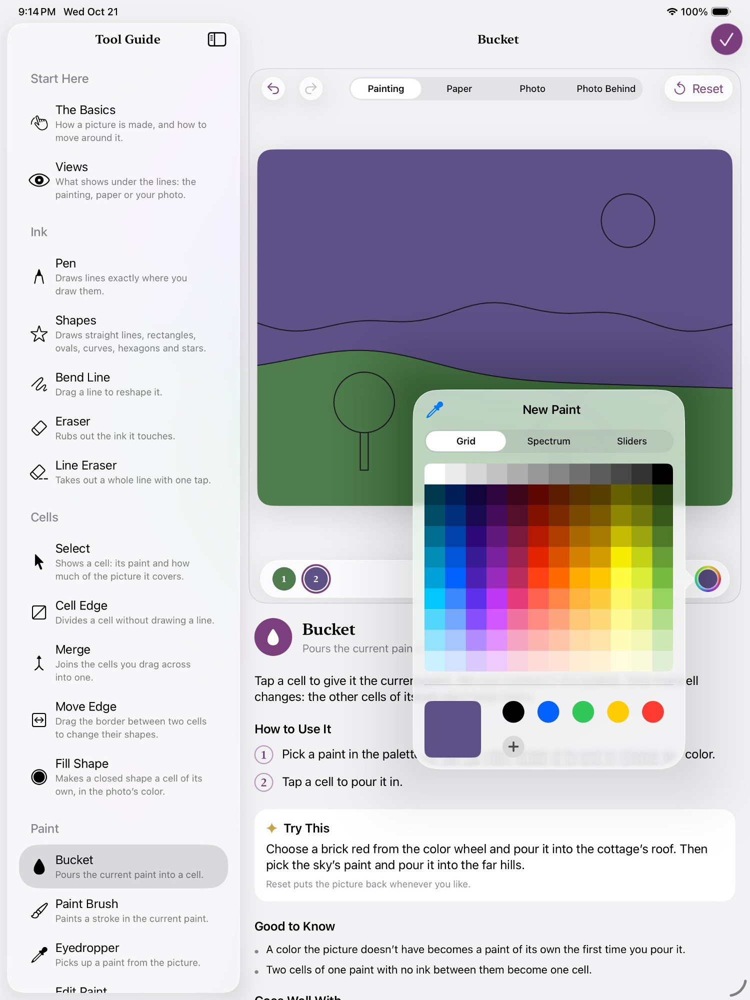 1500x2000

> Both cards keep their progress. Looking for regeneration: I'll check the Restart dialog on Scene On (I can cancel it).

→ `mcp__maestro__run` `{"device_id": "99DEE653-946C-406D-8E9E-238D1FCE93C9", "yaml": "appId: com.pbordjadze.paintbynumber\n---\n- longPressOn:\n    point: \"515,290\"\n- waitForAnimationToEnd\n- tapOn: \"Restart\"\n- waitForAnimationToEnd\n- takeScreenshot: /Users/runner/work/_temp/qa/shots/restart-dialog"}`

→ `mcp__maestro__inspect_screen` `{"device_id": "99DEE653-946C-406D-8E9E-238D1FCE93C9"}`

← mcp__maestro__run: {"success":true,"device_id":"99DEE653-946C-406D-8E9E-238D1FCE93C9","commands_executed":6,"message":"Flow executed successfully","env_vars":{"MAESTRO_CLI_ANALYSIS_NOTIFICATION_DISABLED":"true","MAESTRO_CLI_NO_ANALYTICS":"1","MAESTRO_DRIVER_STARTUP_TIMEOUT":"240000","MAESTRO_VERSION":"2.11.0"}}

← mcp__maestro__inspect_screen: {"ui_schema":{"platform":"ios","abbreviations":{"b":"bounds","txt":"text","rid":"resource-id","a11y":"accessibilityText","hint":"hintText","val":"value","c":"children"},"defaults":{"enabled":true,"focused":false,"selected":false,"checked":false,"txt":"","hint":"","rid":"","val":"","a11y":""}},"elements":[{"b":"[0,0][1032,1376]","a11y":"Paint by Moonlight","c":[{"b":"[0,0][1032,1376]","c":[{"b":"[0 …

> Restart only clears painted areas; it doesn't regenerate. Dismissing it.

→ `mcp__maestro__run` `{"device_id": "99DEE653-946C-406D-8E9E-238D1FCE93C9", "yaml": "appId: com.pbordjadze.paintbynumber\n---\n- tapOn:\n    point: \"900,1200\"\n- waitForAnimationToEnd\n- takeScreenshot: /Users/runner/work/_temp/qa/shots/restart-dismissed"}`

← mcp__maestro__run: {"success":true,"device_id":"99DEE653-946C-406D-8E9E-238D1FCE93C9","commands_executed":4,"message":"Flow executed successfully","env_vars":{"MAESTRO_CLI_ANALYSIS_NOTIFICATION_DISABLED":"true","MAESTRO_CLI_NO_ANALYTICS":"1","MAESTRO_DRIVER_STARTUP_TIMEOUT":"240000","MAESTRO_VERSION":"2.11.0"}}

→ `mcp__maestro__inspect_screen` `{"device_id": "99DEE653-946C-406D-8E9E-238D1FCE93C9"}`

← mcp__maestro__inspect_screen: {"ui_schema":{"platform":"ios","abbreviations":{"b":"bounds","txt":"text","rid":"resource-id","a11y":"accessibilityText","hint":"hintText","val":"value","c":"children"},"defaults":{"enabled":true,"focused":false,"selected":false,"checked":false,"txt":"","hint":"","rid":"","val":"","a11y":""}},"elements":[{"b":"[0,0][1032,1376]","a11y":"Paint by Moonlight","c":[{"b":"[0,0][1032,1376]","c":[{"b":"[0 …

> Not restarted (still 1%). Opening Scene On to check what it kept and its menus.

→ `mcp__maestro__run` `{"device_id": "99DEE653-946C-406D-8E9E-238D1FCE93C9", "yaml": "appId: com.pbordjadze.paintbynumber\n---\n- tapOn: \"Scene On\"\n- waitForAnimationToEnd\n- takeScreenshot: /Users/runner/work/_temp/qa/shots/scene-on-reopen"}`

→ `mcp__maestro__take_screenshot` `{"device_id": "99DEE653-946C-406D-8E9E-238D1FCE93C9"}`

← mcp__maestro__run: {"success":true,"device_id":"99DEE653-946C-406D-8E9E-238D1FCE93C9","commands_executed":4,"message":"Flow executed successfully","env_vars":{"MAESTRO_CLI_ANALYSIS_NOTIFICATION_DISABLED":"true","MAESTRO_CLI_NO_ANALYTICS":"1","MAESTRO_DRIVER_STARTUP_TIMEOUT":"240000","MAESTRO_VERSION":"2.11.0"}}

← mcp__maestro__take_screenshot: image 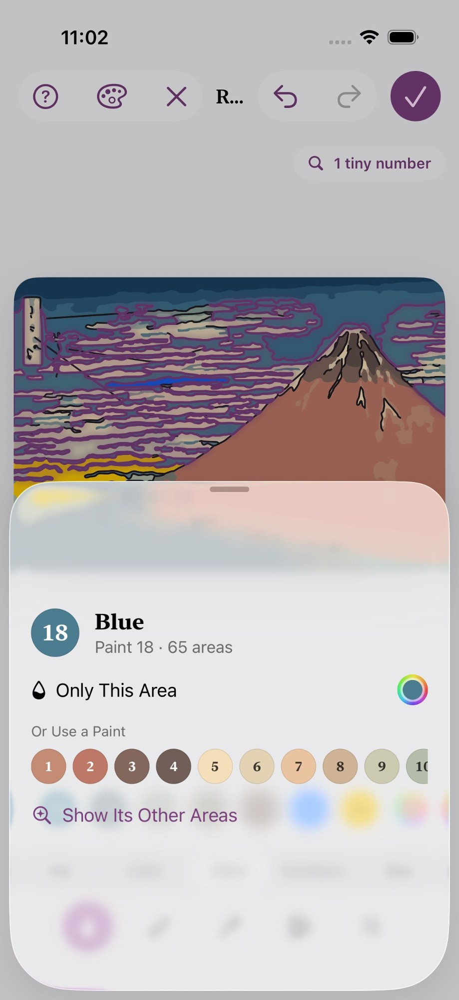 1500x2000

> All 3 fills kept. Checking More › Palette for any regenerate option.

→ `mcp__maestro__run` `{"device_id": "99DEE653-946C-406D-8E9E-238D1FCE93C9", "yaml": "appId: com.pbordjadze.paintbynumber\n---\n- tapOn: \"More\"\n- waitForAnimationToEnd\n- tapOn:\n    id: \"palette-menu\"\n- waitForAnimationToEnd\n- takeScreenshot: /Users/runner/work/_temp/qa/shots/palette-menu"}`

→ `mcp__maestro__take_screenshot` `{"device_id": "99DEE653-946C-406D-8E9E-238D1FCE93C9"}`

← mcp__maestro__run: {"success":true,"device_id":"99DEE653-946C-406D-8E9E-238D1FCE93C9","commands_executed":6,"message":"Flow executed successfully","env_vars":{"MAESTRO_CLI_ANALYSIS_NOTIFICATION_DISABLED":"true","MAESTRO_CLI_NO_ANALYTICS":"1","MAESTRO_DRIVER_STARTUP_TIMEOUT":"240000","MAESTRO_VERSION":"2.11.0"}}

← mcp__maestro__take_screenshot: image 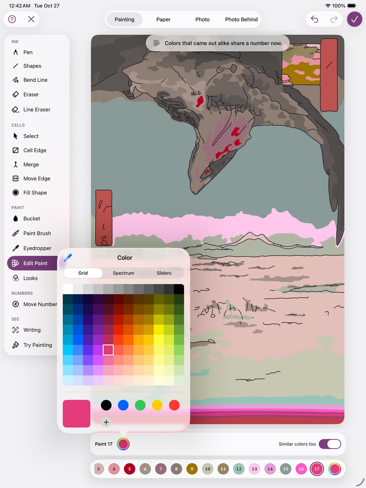 1500x2000

> There's no regenerate option in the painting either. Closing the menu, then checking the card's Share submenu.

→ `mcp__maestro__run` `{"device_id": "99DEE653-946C-406D-8E9E-238D1FCE93C9", "yaml": "appId: com.pbordjadze.paintbynumber\n---\n- tapOn:\n    point: \"200,500\"\n- waitForAnimationToEnd\n- tapOn: \"Back\"\n- waitForAnimationToEnd\n- longPressOn:\n    point: \"515,290\"\n- waitForAnimationToEnd\n- tapOn: \"Share\"\n- waitForAnimationToEnd\n- takeScreenshot: /Users/runner/work/_temp/qa/shots/share-menu"}`

→ `mcp__maestro__take_screenshot` `{"device_id": "99DEE653-946C-406D-8E9E-238D1FCE93C9"}`

← mcp__maestro__run: {"success":true,"device_id":"99DEE653-946C-406D-8E9E-238D1FCE93C9","commands_executed":10,"message":"Flow executed successfully","env_vars":{"MAESTRO_CLI_ANALYSIS_NOTIFICATION_DISABLED":"true","MAESTRO_CLI_NO_ANALYTICS":"1","MAESTRO_DRIVER_STARTUP_TIMEOUT":"240000","MAESTRO_VERSION":"2.11.0"}}

← mcp__maestro__take_screenshot: image 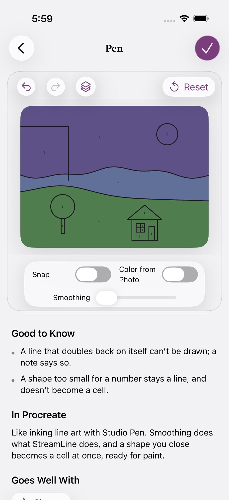 1500x2000

→ `mcp__maestro__run` `{"device_id": "99DEE653-946C-406D-8E9E-238D1FCE93C9", "yaml": "appId: com.pbordjadze.paintbynumber\n---\n- tapOn:\n    point: \"1000,1300\"\n- waitForAnimationToEnd\n- tapOn: \"New Painting\"\n- waitForAnimationToEnd\n- tapOn:\n    point: \"96,437\"\n- waitForAnimationToEnd\n- swipe:\n    start: \"516,431\"\n    end: \"40,431\"\n    duration: 800\n- waitForAnimationToEnd\n- takeScreenshot: /Users/runner/work/_temp/qa/shots/off-preview-again"}`

← mcp__maestro__run: {"success":true,"device_id":"99DEE653-946C-406D-8E9E-238D1FCE93C9","commands_executed":10,"message":"Flow executed successfully","env_vars":{"MAESTRO_CLI_ANALYSIS_NOTIFICATION_DISABLED":"true","MAESTRO_CLI_NO_ANALYTICS":"1","MAESTRO_DRIVER_STARTUP_TIMEOUT":"240000","MAESTRO_VERSION":"2.11.0"}}

→ `mcp__maestro__take_screenshot` `{"device_id": "99DEE653-946C-406D-8E9E-238D1FCE93C9"}`

→ `Read` `{"file_path": "/Users/runner/work/_temp/qa/app.log", "offset": 38}`

← mcp__maestro__take_screenshot: image 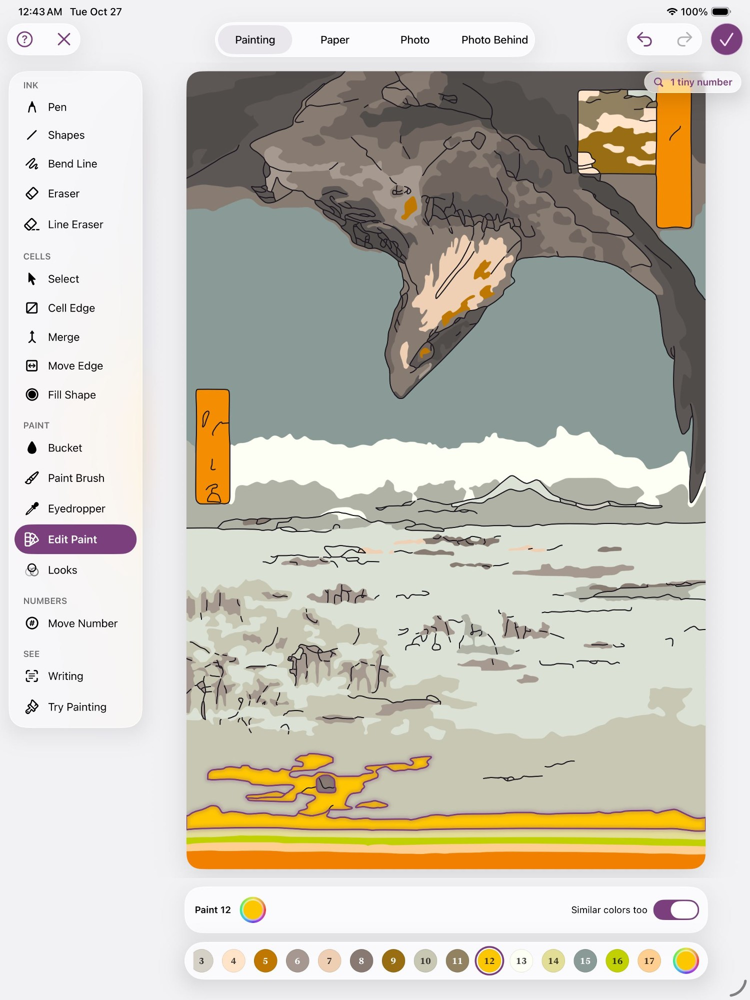 1500x2000

← Read: 38	2026-10-30 07:00:54.039 Df PaintByNumber[16647:d39f] [com.pbordjadze.paintbynumber:tips] offer in preview: newPaintingDivider, newPaintingSuggested, newPaintingSliders, newPaintingRefine, wanted
39	2026-10-30 07:02:08.100 Df PaintByNumber[16647:d39f] [com.pbordjadze.paintbynumber:create] Hand-off: the page is expected at Optional((16.0, 280.16666666666663, 1000.0, 666.6666666666667))
40	2026-10 …

→ `mcp__maestro__run` `{"device_id": "99DEE653-946C-406D-8E9E-238D1FCE93C9", "yaml": "appId: com.pbordjadze.paintbynumber\n---\n- tapOn:\n    id: \"BackButton\"\n- waitForAnimationToEnd\n- takeScreenshot: /Users/runner/work/_temp/qa/shots/picker-again"}`

→ `mcp__maestro__take_screenshot` `{"device_id": "99DEE653-946C-406D-8E9E-238D1FCE93C9"}`

← mcp__maestro__run: {"success":true,"device_id":"99DEE653-946C-406D-8E9E-238D1FCE93C9","commands_executed":4,"message":"Flow executed successfully","env_vars":{"MAESTRO_CLI_ANALYSIS_NOTIFICATION_DISABLED":"true","MAESTRO_CLI_NO_ANALYTICS":"1","MAESTRO_DRIVER_STARTUP_TIMEOUT":"240000","MAESTRO_VERSION":"2.11.0"}}

← mcp__maestro__take_screenshot: image 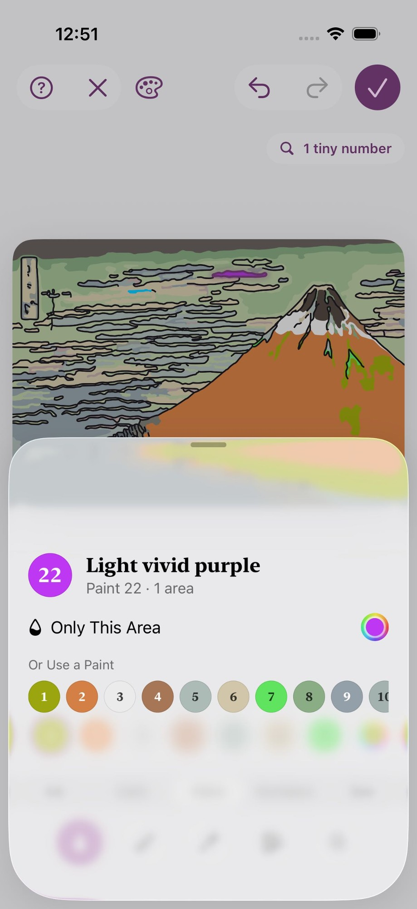 1500x2000

> The system's Private Access banner went away after the relaunch, which moved the grid up. That's the system picker, not the app. Tapping the parrots at their new spot.

→ `mcp__maestro__run` `{"device_id": "99DEE653-946C-406D-8E9E-238D1FCE93C9", "yaml": "appId: com.pbordjadze.paintbynumber\n---\n- tapOn:\n    point: \"96,287\"\n- waitForAnimationToEnd\n- swipe:\n    start: \"516,431\"\n    end: \"40,431\"\n    duration: 800\n- waitForAnimationToEnd\n- takeScreenshot: /Users/runner/work/_temp/qa/shots/off-preview-again"}`

← mcp__maestro__run: {"success":true,"device_id":"99DEE653-946C-406D-8E9E-238D1FCE93C9","commands_executed":6,"message":"Flow executed successfully","env_vars":{"MAESTRO_CLI_ANALYSIS_NOTIFICATION_DISABLED":"true","MAESTRO_CLI_NO_ANALYTICS":"1","MAESTRO_DRIVER_STARTUP_TIMEOUT":"240000","MAESTRO_VERSION":"2.11.0"}}

→ `mcp__maestro__take_screenshot` `{"device_id": "99DEE653-946C-406D-8E9E-238D1FCE93C9"}`

← mcp__maestro__take_screenshot: image 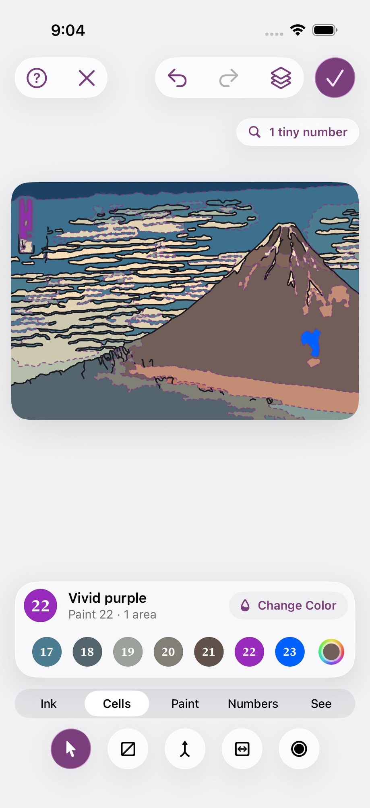 1500x2000

> Off repeats exactly (39 · 180, same picture), so generation is deterministic. Now On again: Back, Close, Settings › switch, Done, then the parrots.

→ `mcp__maestro__run` `{"device_id": "99DEE653-946C-406D-8E9E-238D1FCE93C9", "yaml": "appId: com.pbordjadze.paintbynumber\n---\n- tapOn:\n    id: \"BackButton\"\n- waitForAnimationToEnd\n- tapOn: \"Close\"\n- waitForAnimationToEnd\n- tapOn: \"Settings\"\n- waitForAnimationToEnd\n- tapOn:\n    point: \"914,864\"\n- waitForAnimationToEnd\n- takeScreenshot: /Users/runner/work/_temp/qa/shots/scene-on-again-settings\n- tapOn: \"Done\"\n- waitForAnimationToEnd\n- tapOn: \"New Painting\"\n- waitForAnimationToEnd\n- tapOn:\n    point: \"96,287\"\n- waitForAnimationToEnd\n- swipe:\n    start: \"516,431\"\n    end: \"40,431\"`

← mcp__maestro__run: {"success":true,"device_id":"99DEE653-946C-406D-8E9E-238D1FCE93C9","commands_executed":19,"message":"Flow executed successfully","env_vars":{"MAESTRO_CLI_ANALYSIS_NOTIFICATION_DISABLED":"true","MAESTRO_CLI_NO_ANALYTICS":"1","MAESTRO_DRIVER_STARTUP_TIMEOUT":"240000","MAESTRO_VERSION":"2.11.0"}}

→ `mcp__maestro__take_screenshot` `{"device_id": "99DEE653-946C-406D-8E9E-238D1FCE93C9"}`

→ `Read` `{"file_path": "/Users/runner/work/_temp/qa/shots/scene-on-again-settings.png"}`

← mcp__maestro__take_screenshot: image 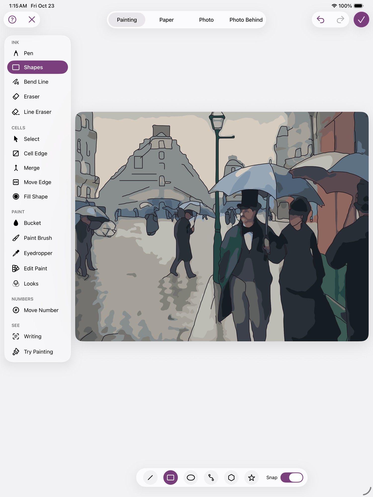 1500x2000

← Read: image 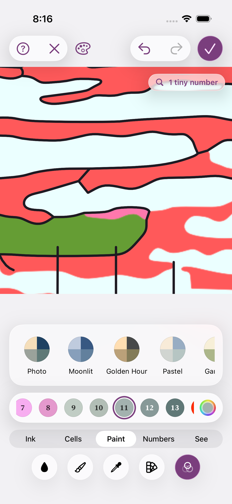 1500x2000

→ `Write` `{"file_path": "/Users/runner/work/_temp/qa/report.md", "content": "# Paint by Moonlight: exploratory test report (Scene Method session, 2026-10-30)\n\n## Summary\nWith Scene Method on and then off, I made a painting from the same photo (the parrots), and both went smoothly. Each preview took about 1.5\u20131.7 s. Filling, Hint zoom, Fit to Screen, going back to the gallery, and quitting through Home and relaunching all kept every fill and the right progress. Two things matter most. First, the app has **no way to regenerate a painting from the gallery**, so I could not test that. Second, **Scen`

← Write: The file /Users/runner/work/_temp/qa/report.md has been updated successfully. (file state is current in your context — no need to Read it back)

> I ran the create flow from the parrots photo with Scene Method on and then off. Both worked from picking the photo to painting, but I couldn't test regenerating from the gallery because the app has no way to do it. The full report is in `/Users/runner/work/_temp/qa/report.md`.
> 
> **Bugs (each seen at least twice):**
> 1. **No way to regenerate a painting from the gallery.**
>    - The card menu has Favorite, Rename, Share, Restart and Delete. Share has Share Progress, Print Template and Send Template. The painting's More menu has no regenerate either.
>    - Restart only clears the paint ("Every painted area will be cleared").
>    - The only way to get a new version is to make a new painting, which uses up one of the three free paintings.
>    - Seen 3 of 3 times.
> 2. **Scene Method barely changes this photo, and not in the way its footer promises.**
>    - On gave 40 colors and 185 areas; Off gave 39 colors and 180 areas. So On has more areas, not a calmer background.
>    - The outlines are nearly the same. On adds a few lines around the red macaw's eye.
>    - In both modes the blue-and-yellow macaw's face lost its eye and stripes, so "detail on faces" didn't show where it would matter most.
>    - Each mode gave the exact same result when I generated it again, so the difference is real but small. A painter wouldn't notice it.
>    - I only tried this one photo; a photo of people might show more.
> 
> **Generation times:** the preview took about 1.7 s with Scene Method on and about 1.5 s with it off. Opening the painting after Start Painting took 1–3 s. Nothing hung or crashed. No log line mentions Scene Method, so the log can't confirm which method was used.
> 
> **Switch text:** "Scene Method" reads as developer jargon, and the footer's closing "Being tried." is clipped and odd. The setting also doesn't say it only affects new paintings, which matters given there's no regenerate.
> 
> **Painting and saving:** every fill landed where I tapped, in the swatch's color, at the fitted zoom and after Hint zoomed in. Fit to Screen worked. Going back to the gallery, and quitting through Home and relaunching, kept every fill and the same progress (1% and 2%) in the gallery and in each painting.
> 
> **Seen only once, so listed as suspicions:**
> - When the Scene Off painting first opened, the log recorded an error that the page wasn't where expected (16 pt off), so the picture moved.
> - Finishing a color removes its swatch and shifts every swatch after it.
> - The Adjust arrow points up when the settings are open, but its accessibility label says "Go Down".
> 
> My own mistakes: a mis-tap on the keyboard titled the first painting "Scene On]", which I fixed with Rename. Once a tap picked a waterfall photo because the photo grid had moved after the relaunch; I went back and picked the parrots. Not tested: drag painting, pinch, Undo, Refine, and photos of people.
