# Agent transcript

- end: success, 170 turns, 19.5 min, estimated $3.9278208
- tool calls: {"mcp__maestro__take_screenshot": 13, "Read": 40, "mcp__maestro__run": 50, "mcp__maestro__inspect_screen": 25, "inspect_screen": 1, "Write": 4}
- images the agent received: 49

**Start**: model claude-opus-5-5, MCP [{"name": "maestro", "status": "connected", "source": "dynamic"}]

→ `mcp__maestro__take_screenshot` `{"device_id": "E839A11B-51B4-4AD3-ACF4-A53B95B7C957"}`

→ `Read` `{"file_path": "/Users/runner/.claude/projects/-Users-runner-work--temp-qa/memory/MEMORY.md"}`

← mcp__maestro__take_screenshot: image  919x2000

← Read (error): File does not exist. Note: your current working directory is /Users/runner/work/_temp/qa.

→ `mcp__maestro__run` `{"device_id": "E839A11B-51B4-4AD3-ACF4-A53B95B7C957", "yaml": "appId: com.pbordjadze.paintbynumber\n---\n- tapOn:\n    point: \"90%,10%\"\n- waitForAnimationToEnd"}`

→ `mcp__maestro__inspect_screen` `{"device_id": "E839A11B-51B4-4AD3-ACF4-A53B95B7C957"}`

← mcp__maestro__run: {"success":true,"device_id":"E839A11B-51B4-4AD3-ACF4-A53B95B7C957","commands_executed":3,"message":"Flow executed successfully","env_vars":{"MAESTRO_CLI_ANALYSIS_NOTIFICATION_DISABLED":"true","MAESTRO_CLI_NO_ANALYTICS":"1","MAESTRO_DRIVER_STARTUP_TIMEOUT":"240000","MAESTRO_VERSION":"2.11.0"}}

← mcp__maestro__inspect_screen: {"ui_schema":{"platform":"ios","abbreviations":{"b":"bounds","txt":"text","rid":"resource-id","a11y":"accessibilityText","hint":"hintText","val":"value","c":"children"},"defaults":{"enabled":true,"focused":false,"selected":false,"checked":false,"txt":"","hint":"","rid":"","val":"","a11y":""}},"elements":[{"b":"[0,0][402,874]","a11y":"Paint by Moonlight","c":[{"b":"[0,0][402,874]","c":[{"b":"[0,0][ …

→ `mcp__maestro__run` `{"device_id": "E839A11B-51B4-4AD3-ACF4-A53B95B7C957", "yaml": "appId: com.pbordjadze.paintbynumber\n---\n- tapOn: \"Samples\"\n- waitForAnimationToEnd"}`

→ `mcp__maestro__take_screenshot` `{"device_id": "E839A11B-51B4-4AD3-ACF4-A53B95B7C957"}`

← mcp__maestro__run: {"success":true,"device_id":"E839A11B-51B4-4AD3-ACF4-A53B95B7C957","commands_executed":3,"message":"Flow executed successfully","env_vars":{"MAESTRO_CLI_ANALYSIS_NOTIFICATION_DISABLED":"true","MAESTRO_CLI_NO_ANALYTICS":"1","MAESTRO_DRIVER_STARTUP_TIMEOUT":"240000","MAESTRO_VERSION":"2.11.0"}}

← mcp__maestro__take_screenshot: image  919x2000

→ `mcp__maestro__take_screenshot` `{"device_id": "E839A11B-51B4-4AD3-ACF4-A53B95B7C957"}`

← mcp__maestro__take_screenshot: image  919x2000

> Loaded fine. Picking Red Fuji.

→ `mcp__maestro__run` `{"device_id": "E839A11B-51B4-4AD3-ACF4-A53B95B7C957", "yaml": "appId: com.pbordjadze.paintbynumber\n---\n- tapOn:\n    point: \"73%,44%\"\n- waitForAnimationToEnd"}`

→ `mcp__maestro__take_screenshot` `{"device_id": "E839A11B-51B4-4AD3-ACF4-A53B95B7C957"}`

← mcp__maestro__run: {"success":true,"device_id":"E839A11B-51B4-4AD3-ACF4-A53B95B7C957","commands_executed":3,"message":"Flow executed successfully","env_vars":{"MAESTRO_CLI_ANALYSIS_NOTIFICATION_DISABLED":"true","MAESTRO_CLI_NO_ANALYTICS":"1","MAESTRO_DRIVER_STARTUP_TIMEOUT":"240000","MAESTRO_VERSION":"2.11.0"}}

← mcp__maestro__take_screenshot: image  919x2000

→ `mcp__maestro__run` `{"device_id": "E839A11B-51B4-4AD3-ACF4-A53B95B7C957", "yaml": "appId: com.pbordjadze.paintbynumber\n---\n- tapOn: \"Close\"\n- tapOn: \"Refine\"\n- waitForAnimationToEnd\n- takeScreenshot: /Users/runner/work/_temp/qa/shots/refine-open"}`

→ `mcp__maestro__take_screenshot` `{"device_id": "E839A11B-51B4-4AD3-ACF4-A53B95B7C957"}`

← mcp__maestro__run: {"success":true,"device_id":"E839A11B-51B4-4AD3-ACF4-A53B95B7C957","commands_executed":5,"message":"Flow executed successfully","env_vars":{"MAESTRO_CLI_ANALYSIS_NOTIFICATION_DISABLED":"true","MAESTRO_CLI_NO_ANALYTICS":"1","MAESTRO_DRIVER_STARTUP_TIMEOUT":"240000","MAESTRO_VERSION":"2.11.0"}}

← mcp__maestro__take_screenshot: image  919x2000

→ `mcp__maestro__run` `{"device_id": "E839A11B-51B4-4AD3-ACF4-A53B95B7C957", "yaml": "appId: com.pbordjadze.paintbynumber\n---\n- tapOn: \"Close\""}`

→ `mcp__maestro__inspect_screen` `{"device_id": "E839A11B-51B4-4AD3-ACF4-A53B95B7C957"}`

← mcp__maestro__run: {"success":true,"device_id":"E839A11B-51B4-4AD3-ACF4-A53B95B7C957","commands_executed":2,"message":"Flow executed successfully","env_vars":{"MAESTRO_CLI_ANALYSIS_NOTIFICATION_DISABLED":"true","MAESTRO_CLI_NO_ANALYTICS":"1","MAESTRO_DRIVER_STARTUP_TIMEOUT":"240000","MAESTRO_VERSION":"2.11.0"}}

← mcp__maestro__inspect_screen: {"ui_schema":{"platform":"ios","abbreviations":{"b":"bounds","txt":"text","rid":"resource-id","a11y":"accessibilityText","hint":"hintText","val":"value","c":"children"},"defaults":{"enabled":true,"focused":false,"selected":false,"checked":false,"txt":"","hint":"","rid":"","val":"","a11y":""}},"elements":[{"b":"[0,0][402,874]","a11y":"Paint by Moonlight","c":[{"b":"[0,0][402,874]","c":[{"b":"[0,0][ …

→ `mcp__maestro__run` `{"device_id": "E839A11B-51B4-4AD3-ACF4-A53B95B7C957", "yaml": "appId: com.pbordjadze.paintbynumber\n---\n- tapOn:\n    id: \"refine-backdrop\"\n- takeScreenshot: /Users/runner/work/_temp/qa/shots/views-menu"}`

→ `mcp__maestro__inspect_screen` `{"device_id": "E839A11B-51B4-4AD3-ACF4-A53B95B7C957"}`

← mcp__maestro__run: {"success":true,"device_id":"E839A11B-51B4-4AD3-ACF4-A53B95B7C957","commands_executed":3,"message":"Flow executed successfully","env_vars":{"MAESTRO_CLI_ANALYSIS_NOTIFICATION_DISABLED":"true","MAESTRO_CLI_NO_ANALYTICS":"1","MAESTRO_DRIVER_STARTUP_TIMEOUT":"240000","MAESTRO_VERSION":"2.11.0"}}

← mcp__maestro__inspect_screen: {"ui_schema":{"platform":"ios","abbreviations":{"b":"bounds","txt":"text","rid":"resource-id","a11y":"accessibilityText","hint":"hintText","val":"value","c":"children"},"defaults":{"enabled":true,"focused":false,"selected":false,"checked":false,"txt":"","hint":"","rid":"","val":"","a11y":""}},"elements":[{"b":"[0,0][402,874]","a11y":"Paint by Moonlight","c":[{"b":"[0,0][402,874]","c":[{"b":"[0,0][ …

→ `Read` `{"file_path": "/Users/runner/work/_temp/qa/shots/views-menu.png"}`

← Read: image  920x2000

→ `mcp__maestro__take_screenshot` `{"device_id": "E839A11B-51B4-4AD3-ACF4-A53B95B7C957"}`

← mcp__maestro__take_screenshot: image  919x2000

> Update so far: the views menu opens and lists Painting, Paper, Photo and Photo Behind, with a checkmark on the view that's showing. Next I'll pick Paper and check that it shows numbers.

→ `mcp__maestro__run` `{"device_id": "E839A11B-51B4-4AD3-ACF4-A53B95B7C957", "yaml": "appId: com.pbordjadze.paintbynumber\n---\n- tapOn: \"Paper\"\n- waitForAnimationToEnd\n- takeScreenshot: /Users/runner/work/_temp/qa/shots/paper-view"}`

→ `mcp__maestro__inspect_screen` `{"device_id": "E839A11B-51B4-4AD3-ACF4-A53B95B7C957"}`

← mcp__maestro__run: {"success":true,"device_id":"E839A11B-51B4-4AD3-ACF4-A53B95B7C957","commands_executed":4,"message":"Flow executed successfully","env_vars":{"MAESTRO_CLI_ANALYSIS_NOTIFICATION_DISABLED":"true","MAESTRO_CLI_NO_ANALYTICS":"1","MAESTRO_DRIVER_STARTUP_TIMEOUT":"240000","MAESTRO_VERSION":"2.11.0"}}

← mcp__maestro__inspect_screen: {"ui_schema":{"platform":"ios","abbreviations":{"b":"bounds","txt":"text","rid":"resource-id","a11y":"accessibilityText","hint":"hintText","val":"value","c":"children"},"defaults":{"enabled":true,"focused":false,"selected":false,"checked":false,"txt":"","hint":"","rid":"","val":"","a11y":""}},"elements":[{"b":"[0,0][402,874]","a11y":"Paint by Moonlight","c":[{"b":"[0,0][402,874]","c":[{"b":"[0,0][ …

→ `mcp__maestro__take_screenshot` `{"device_id": "E839A11B-51B4-4AD3-ACF4-A53B95B7C957"}`

← mcp__maestro__take_screenshot: image  919x2000

→ `Read` `{"file_path": "/Users/runner/work/_temp/qa/shots/paper-view.png"}`

← Read: image  920x2000

→ `mcp__maestro__run` `{"device_id": "E839A11B-51B4-4AD3-ACF4-A53B95B7C957", "yaml": "appId: com.pbordjadze.paintbynumber\n---\n- tapOn:\n    id: \"refine-backdrop\"\n- tapOn: \"Photo\"\n- waitForAnimationToEnd\n- takeScreenshot: /Users/runner/work/_temp/qa/shots/photo-view"}`

→ `mcp__maestro__inspect_screen` `{"device_id": "E839A11B-51B4-4AD3-ACF4-A53B95B7C957"}`

← mcp__maestro__run: {"success":true,"device_id":"E839A11B-51B4-4AD3-ACF4-A53B95B7C957","commands_executed":5,"message":"Flow executed successfully","env_vars":{"MAESTRO_CLI_ANALYSIS_NOTIFICATION_DISABLED":"true","MAESTRO_CLI_NO_ANALYTICS":"1","MAESTRO_DRIVER_STARTUP_TIMEOUT":"240000","MAESTRO_VERSION":"2.11.0"}}

← mcp__maestro__inspect_screen: {"ui_schema":{"platform":"ios","abbreviations":{"b":"bounds","txt":"text","rid":"resource-id","a11y":"accessibilityText","hint":"hintText","val":"value","c":"children"},"defaults":{"enabled":true,"focused":false,"selected":false,"checked":false,"txt":"","hint":"","rid":"","val":"","a11y":""}},"elements":[{"b":"[0,0][402,874]","a11y":"Paint by Moonlight","c":[{"b":"[0,0][402,874]","c":[{"b":"[0,0][ …

→ `Read` `{"file_path": "/Users/runner/work/_temp/qa/shots/photo-view.png"}`

← Read: image  920x2000

→ `mcp__maestro__run` `{"device_id": "E839A11B-51B4-4AD3-ACF4-A53B95B7C957", "yaml": "appId: com.pbordjadze.paintbynumber\n---\n- tapOn:\n    id: \"refine-backdrop\"\n- tapOn: \"Photo Behind\"\n- waitForAnimationToEnd\n- takeScreenshot: /Users/runner/work/_temp/qa/shots/photobehind-view\n- tapOn:\n    id: \"refine-backdrop\"\n- tapOn: \"Paper\"\n- waitForAnimationToEnd\n- takeScreenshot: /Users/runner/work/_temp/qa/shots/paper-view-2"}`

→ `Read` `{"file_path": "/Users/runner/work/_temp/qa/shots/photobehind-view.png"}`

→ `inspect_screen` `{}`

← mcp__maestro__run: {"success":true,"device_id":"E839A11B-51B4-4AD3-ACF4-A53B95B7C957","commands_executed":9,"message":"Flow executed successfully","env_vars":{"MAESTRO_CLI_ANALYSIS_NOTIFICATION_DISABLED":"true","MAESTRO_CLI_NO_ANALYTICS":"1","MAESTRO_DRIVER_STARTUP_TIMEOUT":"240000","MAESTRO_VERSION":"2.11.0"}}

← inspect_screen (error): <tool_use_error>Error: No such tool available: inspect_screen</tool_use_error>

← Read: image  920x2000

→ `mcp__maestro__inspect_screen` `{"device_id": "E839A11B-51B4-4AD3-ACF4-A53B95B7C957"}`

→ `Read` `{"file_path": "/Users/runner/work/_temp/qa/shots/paper-view-2.png"}`

← mcp__maestro__inspect_screen: {"ui_schema":{"platform":"ios","abbreviations":{"b":"bounds","txt":"text","rid":"resource-id","a11y":"accessibilityText","hint":"hintText","val":"value","c":"children"},"defaults":{"enabled":true,"focused":false,"selected":false,"checked":false,"txt":"","hint":"","rid":"","val":"","a11y":""}},"elements":[{"b":"[0,0][402,874]","a11y":"Paint by Moonlight","c":[{"b":"[0,0][402,874]","c":[{"b":"[0,0][ …

← Read: image  920x2000

→ `mcp__maestro__take_screenshot` `{"device_id": "E839A11B-51B4-4AD3-ACF4-A53B95B7C957"}`

← mcp__maestro__take_screenshot: image  919x2000

→ `Write` `{"file_path": "/Users/runner/work/_temp/qa/report.md", "content": "# Paint by Moonlight \u2014 Refine exploratory test (iPhone 17 Pro sim, Debug)\n\n## Summary\n(in progress) Refine opened from the Red Fuji sample's preview. The new views menu opens and all four views can be picked. Paper shows numbers, but on large neighbouring cells they stack on top of each other until they can't be read. The views symbol jumps to the centre of the top bar in Paper.\n\n## Coverage\n- Views menu: done (all 4 picked).\n- Paper numbers: partly.\n- Others: in progress.\n\n## App bugs (reproduced)\n### 1. Paper `

← Write: File created successfully at: /Users/runner/work/_temp/qa/report.md (file state is current in your context — no need to Read it back)

> Next I'll zoom into Paper to check whether the numbers stay legible.

→ `mcp__maestro__run` `{"device_id": "E839A11B-51B4-4AD3-ACF4-A53B95B7C957", "yaml": "appId: com.pbordjadze.paintbynumber\n---\n- doubleTapOn:\n    point: \"65%,45%\"\n- waitForAnimationToEnd\n- takeScreenshot: /Users/runner/work/_temp/qa/shots/paper-zoom-dbl"}`

→ `Read` `{"file_path": "/Users/runner/work/_temp/qa/shots/paper-zoom-dbl.png"}`

← mcp__maestro__run: {"success":true,"device_id":"E839A11B-51B4-4AD3-ACF4-A53B95B7C957","commands_executed":4,"message":"Flow executed successfully","env_vars":{"MAESTRO_CLI_ANALYSIS_NOTIFICATION_DISABLED":"true","MAESTRO_CLI_NO_ANALYTICS":"1","MAESTRO_DRIVER_STARTUP_TIMEOUT":"240000","MAESTRO_VERSION":"2.11.0"}}

← Read: image  920x2000

> Double tap didn't zoom (the Pen is active). I'll try the "1 tiny number" badge, which may zoom to it.

→ `mcp__maestro__run` `{"device_id": "E839A11B-51B4-4AD3-ACF4-A53B95B7C957", "yaml": "appId: com.pbordjadze.paintbynumber\n---\n- tapOn:\n    id: \"refine-tiny\"\n- waitForAnimationToEnd\n- takeScreenshot: /Users/runner/work/_temp/qa/shots/tiny-tap"}`

→ `Read` `{"file_path": "/Users/runner/work/_temp/qa/shots/tiny-tap.png"}`

← mcp__maestro__run: {"success":true,"device_id":"E839A11B-51B4-4AD3-ACF4-A53B95B7C957","commands_executed":4,"message":"Flow executed successfully","env_vars":{"MAESTRO_CLI_ANALYSIS_NOTIFICATION_DISABLED":"true","MAESTRO_CLI_NO_ANALYTICS":"1","MAESTRO_DRIVER_STARTUP_TIMEOUT":"240000","MAESTRO_VERSION":"2.11.0"}}

← Read: image 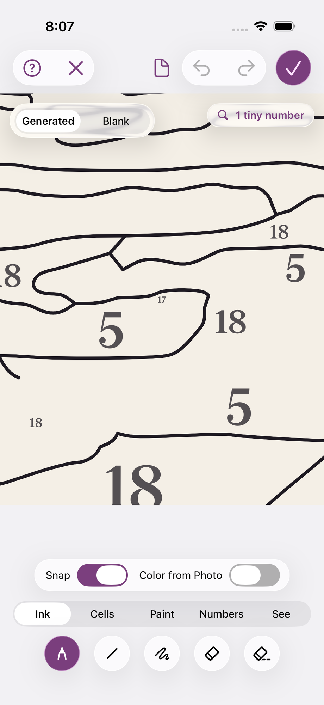 920x2000

> Zoomed in, the numbers are clear. Now I'll draw a Pen stroke across a cell, from one line to another, which should split it into a new cell.

→ `mcp__maestro__run` `{"device_id": "E839A11B-51B4-4AD3-ACF4-A53B95B7C957", "yaml": "appId: com.pbordjadze.paintbynumber\n---\n- swipe:\n    start: \"50%,49%\"\n    end: \"50%,63%\"\n    duration: 800\n- takeScreenshot: /Users/runner/work/_temp/qa/shots/pen-split"}`

→ `Read` `{"file_path": "/Users/runner/work/_temp/qa/shots/pen-split.png"}`

← mcp__maestro__run: {"success":true,"device_id":"E839A11B-51B4-4AD3-ACF4-A53B95B7C957","commands_executed":3,"message":"Flow executed successfully","env_vars":{"MAESTRO_CLI_ANALYSIS_NOTIFICATION_DISABLED":"true","MAESTRO_CLI_NO_ANALYTICS":"1","MAESTRO_DRIVER_STARTUP_TIMEOUT":"240000","MAESTRO_VERSION":"2.11.0"}}

← Read: image 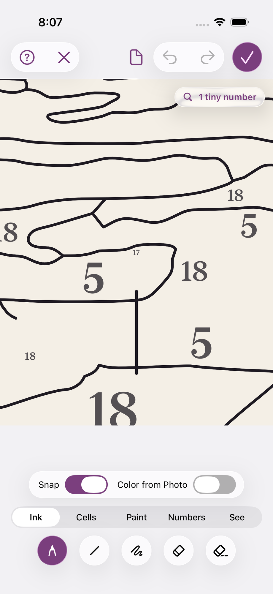 920x2000

→ `mcp__maestro__run` `{"device_id": "E839A11B-51B4-4AD3-ACF4-A53B95B7C957", "yaml": "appId: com.pbordjadze.paintbynumber\n---\n- swipe:\n    start: \"18%,41%\"\n    end: \"18%,53%\"\n    duration: 800\n- takeScreenshot: /Users/runner/work/_temp/qa/shots/pen-split2"}`

→ `Read` `{"file_path": "/Users/runner/work/_temp/qa/shots/pen-split2.png"}`

← mcp__maestro__run: {"success":true,"device_id":"E839A11B-51B4-4AD3-ACF4-A53B95B7C957","commands_executed":3,"message":"Flow executed successfully","env_vars":{"MAESTRO_CLI_ANALYSIS_NOTIFICATION_DISABLED":"true","MAESTRO_CLI_NO_ANALYTICS":"1","MAESTRO_DRIVER_STARTUP_TIMEOUT":"240000","MAESTRO_VERSION":"2.11.0"}}

← Read: image 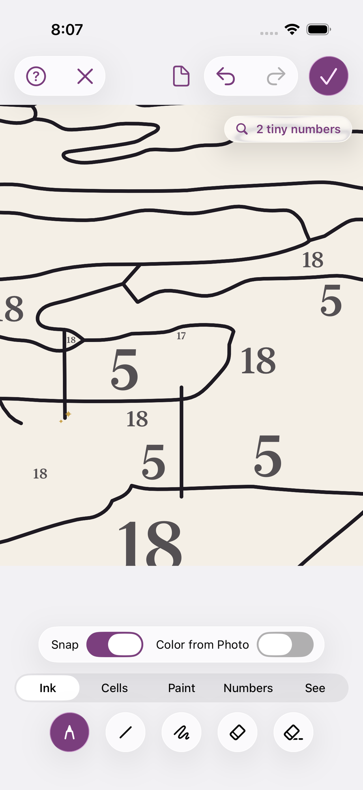 920x2000

→ `Read` `{"file_path": "/Users/runner/work/_temp/qa/app.log"}`

← Read: 1	getpwuid_r did not find a match for uid 501
2	Filtering the log data using "subsystem == "com.pbordjadze.paintbynumber""
3	Timestamp               Ty Process[PID:TID]
4	2026-10-26 19:59:28.360 Df PaintByNumber[19850:e4ca] [com.pbordjadze.paintbynumber:tips] offer in shelf: , wanted
5	2026-10-26 19:59:29.828 Df PaintByNumber[19850:e60b] [com.pbordjadze.paintbynumber:canvas] Making the render cont …

→ `mcp__maestro__run` `{"device_id": "E839A11B-51B4-4AD3-ACF4-A53B95B7C957", "yaml": "appId: com.pbordjadze.paintbynumber\n---\n- tapOn:\n    id: \"refine-undo\"\n- takeScreenshot: /Users/runner/work/_temp/qa/shots/pen-undo1"}`

→ `Read` `{"file_path": "/Users/runner/work/_temp/qa/shots/pen-undo1.png"}`

← mcp__maestro__run: {"success":true,"device_id":"E839A11B-51B4-4AD3-ACF4-A53B95B7C957","commands_executed":3,"message":"Flow executed successfully","env_vars":{"MAESTRO_CLI_ANALYSIS_NOTIFICATION_DISABLED":"true","MAESTRO_CLI_NO_ANALYTICS":"1","MAESTRO_DRIVER_STARTUP_TIMEOUT":"240000","MAESTRO_VERSION":"2.11.0"}}

← Read: image  920x2000

→ `mcp__maestro__run` `{"device_id": "E839A11B-51B4-4AD3-ACF4-A53B95B7C957", "yaml": "appId: com.pbordjadze.paintbynumber\n---\n- swipe:\n    start: \"75%,52%\"\n    end: \"75%,63%\"\n    duration: 800\n- takeScreenshot: /Users/runner/work/_temp/qa/shots/pen3-immediate\n- waitForAnimationToEnd\n- takeScreenshot: /Users/runner/work/_temp/qa/shots/pen3-later"}`

→ `Read` `{"file_path": "/Users/runner/work/_temp/qa/shots/pen3-immediate.png"}`

→ `Read` `{"file_path": "/Users/runner/work/_temp/qa/shots/pen3-later.png"}`

← mcp__maestro__run: {"success":true,"device_id":"E839A11B-51B4-4AD3-ACF4-A53B95B7C957","commands_executed":5,"message":"Flow executed successfully","env_vars":{"MAESTRO_CLI_ANALYSIS_NOTIFICATION_DISABLED":"true","MAESTRO_CLI_NO_ANALYTICS":"1","MAESTRO_DRIVER_STARTUP_TIMEOUT":"240000","MAESTRO_VERSION":"2.11.0"}}

← Read: image  920x2000

← Read: image 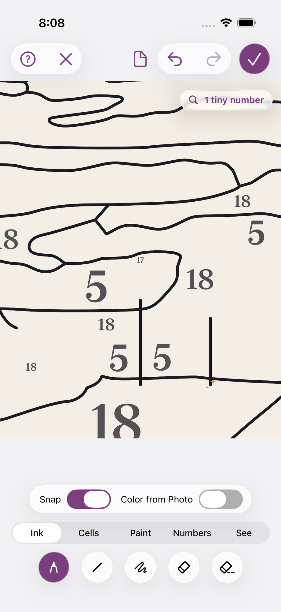 920x2000

> That stroke didn't reach the upper line, so it closed no cell. I'll draw one that crosses fully from line to line.

→ `mcp__maestro__run` `{"device_id": "E839A11B-51B4-4AD3-ACF4-A53B95B7C957", "yaml": "appId: com.pbordjadze.paintbynumber\n---\n- swipe:\n    start: \"25%,49%\"\n    end: \"25%,66%\"\n    duration: 800\n- takeScreenshot: /Users/runner/work/_temp/qa/shots/pen4-immediate\n- waitForAnimationToEnd\n- takeScreenshot: /Users/runner/work/_temp/qa/shots/pen4-later"}`

→ `Read` `{"file_path": "/Users/runner/work/_temp/qa/shots/pen4-immediate.png"}`

→ `Read` `{"file_path": "/Users/runner/work/_temp/qa/shots/pen4-later.png"}`

← mcp__maestro__run: {"success":true,"device_id":"E839A11B-51B4-4AD3-ACF4-A53B95B7C957","commands_executed":5,"message":"Flow executed successfully","env_vars":{"MAESTRO_CLI_ANALYSIS_NOTIFICATION_DISABLED":"true","MAESTRO_CLI_NO_ANALYTICS":"1","MAESTRO_DRIVER_STARTUP_TIMEOUT":"240000","MAESTRO_VERSION":"2.11.0"}}

← Read: image 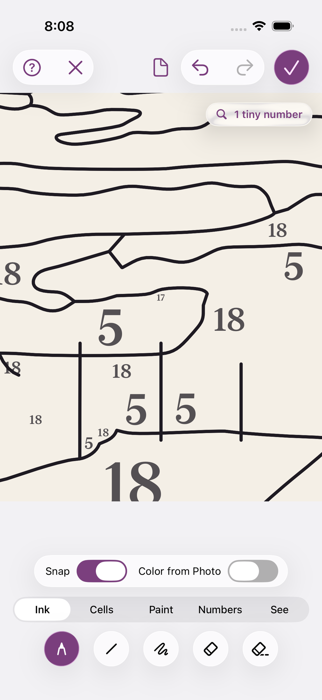 920x2000

← Read: image 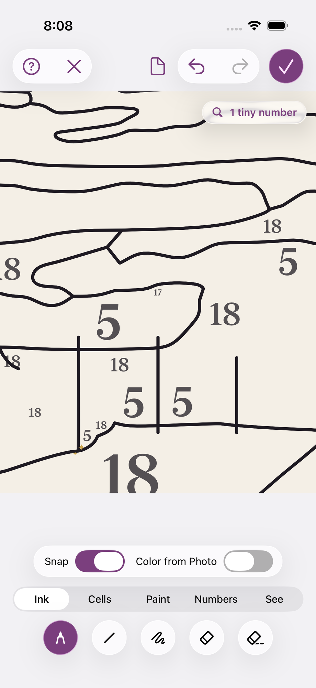 920x2000

> Numbers show straight away for a stroke that closes a cell (pen4-immediate). Next I'll count the tools in each group tab.

→ `mcp__maestro__run` `{"device_id": "E839A11B-51B4-4AD3-ACF4-A53B95B7C957", "yaml": "appId: com.pbordjadze.paintbynumber\n---\n- tapOn: \"Cells\"\n- takeScreenshot: /Users/runner/work/_temp/qa/shots/group-cells"}`

→ `mcp__maestro__inspect_screen` `{"device_id": "E839A11B-51B4-4AD3-ACF4-A53B95B7C957"}`

← mcp__maestro__run: {"success":true,"device_id":"E839A11B-51B4-4AD3-ACF4-A53B95B7C957","commands_executed":3,"message":"Flow executed successfully","env_vars":{"MAESTRO_CLI_ANALYSIS_NOTIFICATION_DISABLED":"true","MAESTRO_CLI_NO_ANALYTICS":"1","MAESTRO_DRIVER_STARTUP_TIMEOUT":"240000","MAESTRO_VERSION":"2.11.0"}}

← mcp__maestro__inspect_screen: {"ui_schema":{"platform":"ios","abbreviations":{"b":"bounds","txt":"text","rid":"resource-id","a11y":"accessibilityText","hint":"hintText","val":"value","c":"children"},"defaults":{"enabled":true,"focused":false,"selected":false,"checked":false,"txt":"","hint":"","rid":"","val":"","a11y":""}},"elements":[{"b":"[0,0][402,874]","a11y":"Paint by Moonlight","c":[{"b":"[0,0][402,874]","c":[{"b":"[0,0][ …

> Cells has its 5 tools: Select, Cell Edge, Merge, Move Edge, Fill Shape. Next: Paint.

→ `mcp__maestro__run` `{"device_id": "E839A11B-51B4-4AD3-ACF4-A53B95B7C957", "yaml": "appId: com.pbordjadze.paintbynumber\n---\n- tapOn: \"Paint\"\n- takeScreenshot: /Users/runner/work/_temp/qa/shots/group-paint"}`

→ `mcp__maestro__inspect_screen` `{"device_id": "E839A11B-51B4-4AD3-ACF4-A53B95B7C957"}`

← mcp__maestro__run: {"success":true,"device_id":"E839A11B-51B4-4AD3-ACF4-A53B95B7C957","commands_executed":3,"message":"Flow executed successfully","env_vars":{"MAESTRO_CLI_ANALYSIS_NOTIFICATION_DISABLED":"true","MAESTRO_CLI_NO_ANALYTICS":"1","MAESTRO_DRIVER_STARTUP_TIMEOUT":"240000","MAESTRO_VERSION":"2.11.0"}}

← mcp__maestro__inspect_screen: {"ui_schema":{"platform":"ios","abbreviations":{"b":"bounds","txt":"text","rid":"resource-id","a11y":"accessibilityText","hint":"hintText","val":"value","c":"children"},"defaults":{"enabled":true,"focused":false,"selected":false,"checked":false,"txt":"","hint":"","rid":"","val":"","a11y":""}},"elements":[{"b":"[0,0][402,874]","a11y":"Paint by Moonlight","c":[{"b":"[0,0][402,874]","c":[{"b":"[0,0][ …

> Paint has its 5 tools, and picking the Paint group switched the view to Painting by itself. Next: Numbers and See.

→ `mcp__maestro__run` `{"device_id": "E839A11B-51B4-4AD3-ACF4-A53B95B7C957", "yaml": "appId: com.pbordjadze.paintbynumber\n---\n- tapOn: \"Numbers\"\n- takeScreenshot: /Users/runner/work/_temp/qa/shots/group-numbers\n- tapOn: \"See\"\n- takeScreenshot: /Users/runner/work/_temp/qa/shots/group-see"}`

→ `mcp__maestro__inspect_screen` `{"device_id": "E839A11B-51B4-4AD3-ACF4-A53B95B7C957"}`

← mcp__maestro__run: {"success":true,"device_id":"E839A11B-51B4-4AD3-ACF4-A53B95B7C957","commands_executed":5,"message":"Flow executed successfully","env_vars":{"MAESTRO_CLI_ANALYSIS_NOTIFICATION_DISABLED":"true","MAESTRO_CLI_NO_ANALYTICS":"1","MAESTRO_DRIVER_STARTUP_TIMEOUT":"240000","MAESTRO_VERSION":"2.11.0"}}

← mcp__maestro__inspect_screen: {"ui_schema":{"platform":"ios","abbreviations":{"b":"bounds","txt":"text","rid":"resource-id","a11y":"accessibilityText","hint":"hintText","val":"value","c":"children"},"defaults":{"enabled":true,"focused":false,"selected":false,"checked":false,"txt":"","hint":"","rid":"","val":"","a11y":""}},"elements":[{"b":"[0,0][402,874]","a11y":"Paint by Moonlight","c":[{"b":"[0,0][402,874]","c":[{"b":"[0,0][ …

→ `Read` `{"file_path": "/Users/runner/work/_temp/qa/shots/group-numbers.png"}`

← Read: image 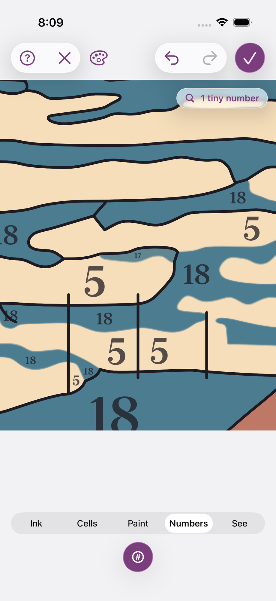 920x2000

> All five groups hold the expected tools: Ink 5, Cells 5, Paint 5, Numbers 1, See 2. Next I'll try Edit Paint.

→ `mcp__maestro__run` `{"device_id": "E839A11B-51B4-4AD3-ACF4-A53B95B7C957", "yaml": "appId: com.pbordjadze.paintbynumber\n---\n- tapOn: \"Paint\"\n- tapOn:\n    id: \"refine-tool-editPaint\"\n- waitForAnimationToEnd\n- takeScreenshot: /Users/runner/work/_temp/qa/shots/editpaint"}`

→ `mcp__maestro__inspect_screen` `{"device_id": "E839A11B-51B4-4AD3-ACF4-A53B95B7C957"}`

← mcp__maestro__run: {"success":true,"device_id":"E839A11B-51B4-4AD3-ACF4-A53B95B7C957","commands_executed":5,"message":"Flow executed successfully","env_vars":{"MAESTRO_CLI_ANALYSIS_NOTIFICATION_DISABLED":"true","MAESTRO_CLI_NO_ANALYTICS":"1","MAESTRO_DRIVER_STARTUP_TIMEOUT":"240000","MAESTRO_VERSION":"2.11.0"}}

← mcp__maestro__inspect_screen: {"ui_schema":{"platform":"ios","abbreviations":{"b":"bounds","txt":"text","rid":"resource-id","a11y":"accessibilityText","hint":"hintText","val":"value","c":"children"},"defaults":{"enabled":true,"focused":false,"selected":false,"checked":false,"txt":"","hint":"","rid":"","val":"","a11y":""}},"elements":[{"b":"[0,0][402,874]","a11y":"Paint by Moonlight","c":[{"b":"[0,0][402,874]","c":[{"b":"[0,0][ …

→ `mcp__maestro__run` `{"device_id": "E839A11B-51B4-4AD3-ACF4-A53B95B7C957", "yaml": "appId: com.pbordjadze.paintbynumber\n---\n- tapOn:\n    point: \"85,707\"\n- tapOn:\n    id: \"refine-colors-picker\"\n- waitForAnimationToEnd\n- takeScreenshot: /Users/runner/work/_temp/qa/shots/picker-open"}`

→ `mcp__maestro__inspect_screen` `{"device_id": "E839A11B-51B4-4AD3-ACF4-A53B95B7C957"}`

← mcp__maestro__run: {"success":true,"device_id":"E839A11B-51B4-4AD3-ACF4-A53B95B7C957","commands_executed":5,"message":"Flow executed successfully","env_vars":{"MAESTRO_CLI_ANALYSIS_NOTIFICATION_DISABLED":"true","MAESTRO_CLI_NO_ANALYTICS":"1","MAESTRO_DRIVER_STARTUP_TIMEOUT":"240000","MAESTRO_VERSION":"2.11.0"}}

← mcp__maestro__inspect_screen: {"ui_schema":{"platform":"ios","abbreviations":{"b":"bounds","txt":"text","rid":"resource-id","a11y":"accessibilityText","hint":"hintText","val":"value","c":"children"},"defaults":{"enabled":true,"focused":false,"selected":false,"checked":false,"txt":"","hint":"","rid":"","val":"","a11y":""}},"elements":[{"b":"[0,0][402,874]","a11y":"Paint by Moonlight","c":[{"b":"[0,0][402,874]","c":[{"b":"[0,0][ …

→ `mcp__maestro__take_screenshot` `{"device_id": "E839A11B-51B4-4AD3-ACF4-A53B95B7C957"}`

← mcp__maestro__take_screenshot: image  919x2000

> The colour picker didn't open on the first tap. Trying again:

→ `mcp__maestro__run` `{"device_id": "E839A11B-51B4-4AD3-ACF4-A53B95B7C957", "yaml": "appId: com.pbordjadze.paintbynumber\n---\n- tapOn:\n    id: \"refine-colors-picker\"\n- waitForAnimationToEnd\n- takeScreenshot: /Users/runner/work/_temp/qa/shots/picker-open2"}`

→ `mcp__maestro__inspect_screen` `{"device_id": "E839A11B-51B4-4AD3-ACF4-A53B95B7C957"}`

← mcp__maestro__run: {"success":true,"device_id":"E839A11B-51B4-4AD3-ACF4-A53B95B7C957","commands_executed":4,"message":"Flow executed successfully","env_vars":{"MAESTRO_CLI_ANALYSIS_NOTIFICATION_DISABLED":"true","MAESTRO_CLI_NO_ANALYTICS":"1","MAESTRO_DRIVER_STARTUP_TIMEOUT":"240000","MAESTRO_VERSION":"2.11.0"}}

← mcp__maestro__inspect_screen: {"ui_schema":{"platform":"ios","abbreviations":{"b":"bounds","txt":"text","rid":"resource-id","a11y":"accessibilityText","hint":"hintText","val":"value","c":"children"},"defaults":{"enabled":true,"focused":false,"selected":false,"checked":false,"txt":"","hint":"","rid":"","val":"","a11y":""}},"elements":[{"b":"[0,0][402,874]","a11y":"Paint by Moonlight","c":[{"b":"[0,0][402,874]","c":[{"b":"[0,0][ …

> The picker opened on the second tap. I'll pick three colours in quick succession (green, then azure, then purple), close the picker straight away, and check that purple sticks.

→ `mcp__maestro__run` `{"device_id": "E839A11B-51B4-4AD3-ACF4-A53B95B7C957", "yaml": "appId: com.pbordjadze.paintbynumber\n---\n- tapOn: \"green 54\"\n- tapOn: \"azure 50\"\n- tapOn: \"purple 38\"\n- tapOn: \"close\"\n- takeScreenshot: /Users/runner/work/_temp/qa/shots/picker-closed"}`

→ `mcp__maestro__inspect_screen` `{"device_id": "E839A11B-51B4-4AD3-ACF4-A53B95B7C957"}`

← mcp__maestro__run: {"success":true,"device_id":"E839A11B-51B4-4AD3-ACF4-A53B95B7C957","commands_executed":6,"message":"Flow executed successfully","env_vars":{"MAESTRO_CLI_ANALYSIS_NOTIFICATION_DISABLED":"true","MAESTRO_CLI_NO_ANALYTICS":"1","MAESTRO_DRIVER_STARTUP_TIMEOUT":"240000","MAESTRO_VERSION":"2.11.0"}}

← mcp__maestro__inspect_screen: {"ui_schema":{"platform":"ios","abbreviations":{"b":"bounds","txt":"text","rid":"resource-id","a11y":"accessibilityText","hint":"hintText","val":"value","c":"children"},"defaults":{"enabled":true,"focused":false,"selected":false,"checked":false,"txt":"","hint":"","rid":"","val":"","a11y":""}},"elements":[{"b":"[0,0][402,874]","a11y":"Paint by Moonlight","c":[{"b":"[0,0][402,874]","c":[{"b":"[0,0][ …

→ `Read` `{"file_path": "/Users/runner/work/_temp/qa/shots/picker-closed.png"}`

← Read: image 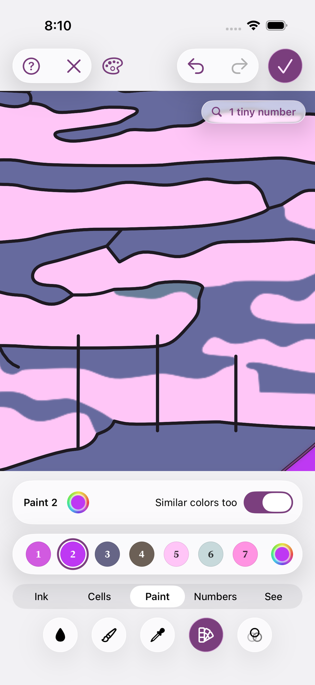 920x2000

→ `mcp__maestro__run` `{"device_id": "E839A11B-51B4-4AD3-ACF4-A53B95B7C957", "yaml": "appId: com.pbordjadze.paintbynumber\n---\n- tapOn:\n    id: \"refine-undo\"\n- takeScreenshot: /Users/runner/work/_temp/qa/shots/color-undo1"}`

→ `mcp__maestro__inspect_screen` `{"device_id": "E839A11B-51B4-4AD3-ACF4-A53B95B7C957"}`

← mcp__maestro__run: {"success":true,"device_id":"E839A11B-51B4-4AD3-ACF4-A53B95B7C957","commands_executed":3,"message":"Flow executed successfully","env_vars":{"MAESTRO_CLI_ANALYSIS_NOTIFICATION_DISABLED":"true","MAESTRO_CLI_NO_ANALYTICS":"1","MAESTRO_DRIVER_STARTUP_TIMEOUT":"240000","MAESTRO_VERSION":"2.11.0"}}

← mcp__maestro__inspect_screen: {"ui_schema":{"platform":"ios","abbreviations":{"b":"bounds","txt":"text","rid":"resource-id","a11y":"accessibilityText","hint":"hintText","val":"value","c":"children"},"defaults":{"enabled":true,"focused":false,"selected":false,"checked":false,"txt":"","hint":"","rid":"","val":"","a11y":""}},"elements":[{"b":"[0,0][402,874]","a11y":"Paint by Moonlight","c":[{"b":"[0,0][402,874]","c":[{"b":"[0,0][ …

→ `mcp__maestro__run` `{"device_id": "E839A11B-51B4-4AD3-ACF4-A53B95B7C957", "yaml": "appId: com.pbordjadze.paintbynumber\n---\n- tapOn:\n    id: \"refine-undo\"\n- assertVisible:\n    id: \"refine-colors-picker\"\n    text: \"green\"\n- tapOn:\n    id: \"refine-undo\"\n- takeScreenshot: /Users/runner/work/_temp/qa/shots/color-undo3"}`

→ `mcp__maestro__inspect_screen` `{"device_id": "E839A11B-51B4-4AD3-ACF4-A53B95B7C957"}`

← mcp__maestro__run: {"success":true,"device_id":"E839A11B-51B4-4AD3-ACF4-A53B95B7C957","commands_executed":5,"message":"Flow executed successfully","env_vars":{"MAESTRO_CLI_ANALYSIS_NOTIFICATION_DISABLED":"true","MAESTRO_CLI_NO_ANALYTICS":"1","MAESTRO_DRIVER_STARTUP_TIMEOUT":"240000","MAESTRO_VERSION":"2.11.0"}}

← mcp__maestro__inspect_screen: {"ui_schema":{"platform":"ios","abbreviations":{"b":"bounds","txt":"text","rid":"resource-id","a11y":"accessibilityText","hint":"hintText","val":"value","c":"children"},"defaults":{"enabled":true,"focused":false,"selected":false,"checked":false,"txt":"","hint":"","rid":"","val":"","a11y":""}},"elements":[{"b":"[0,0][402,874]","a11y":"Paint by Moonlight","c":[{"b":"[0,0][402,874]","c":[{"b":"[0,0][ …

> Undo steps back one colour at a time (purple, azure, green, the original). Next, Redo three times:

→ `mcp__maestro__run` `{"device_id": "E839A11B-51B4-4AD3-ACF4-A53B95B7C957", "yaml": "appId: com.pbordjadze.paintbynumber\n---\n- tapOn:\n    id: \"refine-redo\"\n- assertVisible:\n    id: \"refine-colors-picker\"\n    text: \"green\"\n- tapOn:\n    id: \"refine-redo\"\n- assertVisible:\n    id: \"refine-colors-picker\"\n    text: \"azure\"\n- tapOn:\n    id: \"refine-redo\"\n- assertVisible:\n    id: \"refine-colors-picker\"\n    text: \"purple\"\n- takeScreenshot: /Users/runner/work/_temp/qa/shots/color-redo3"}`

← mcp__maestro__run: {"success":true,"device_id":"E839A11B-51B4-4AD3-ACF4-A53B95B7C957","commands_executed":8,"message":"Flow executed successfully","env_vars":{"MAESTRO_CLI_ANALYSIS_NOTIFICATION_DISABLED":"true","MAESTRO_CLI_NO_ANALYTICS":"1","MAESTRO_DRIVER_STARTUP_TIMEOUT":"240000","MAESTRO_VERSION":"2.11.0"}}

> Redo works too (green, azure, purple). Now I'll check whether the picker fails to open when tapped right after picking a swatch.

→ `mcp__maestro__run` `{"device_id": "E839A11B-51B4-4AD3-ACF4-A53B95B7C957", "yaml": "appId: com.pbordjadze.paintbynumber\n---\n- tapOn:\n    point: \"125,707\"\n- tapOn:\n    id: \"refine-colors-picker\"\n- waitForAnimationToEnd\n- takeScreenshot: /Users/runner/work/_temp/qa/shots/picker-after-swatch2"}`

→ `Read` `{"file_path": "/Users/runner/work/_temp/qa/shots/picker-after-swatch2.png"}`

← mcp__maestro__run: {"success":true,"device_id":"E839A11B-51B4-4AD3-ACF4-A53B95B7C957","commands_executed":5,"message":"Flow executed successfully","env_vars":{"MAESTRO_CLI_ANALYSIS_NOTIFICATION_DISABLED":"true","MAESTRO_CLI_NO_ANALYTICS":"1","MAESTRO_DRIVER_STARTUP_TIMEOUT":"240000","MAESTRO_VERSION":"2.11.0"}}

← Read: image 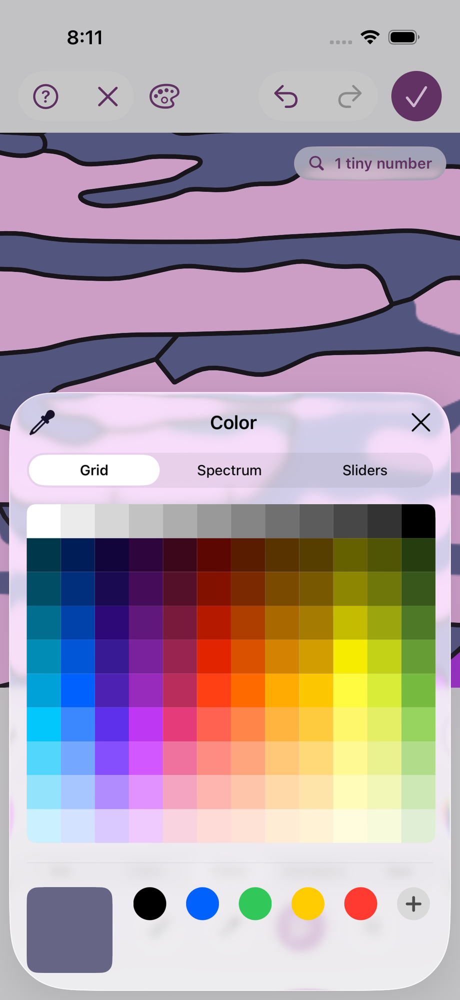 920x2000

> Opened fine this time, so the earlier miss happened 1 time in 2. Next: pick a colour and dismiss the picker straight away by tapping outside it.

→ `mcp__maestro__run` `{"device_id": "E839A11B-51B4-4AD3-ACF4-A53B95B7C957", "yaml": "appId: com.pbordjadze.paintbynumber\n---\n- tapOn: \"green 64\"\n- tapOn: \"red 51\"\n- tapOn:\n    point: \"50%,20%\"\n- takeScreenshot: /Users/runner/work/_temp/qa/shots/picker-dismiss-outside"}`

→ `mcp__maestro__inspect_screen` `{"device_id": "E839A11B-51B4-4AD3-ACF4-A53B95B7C957"}`

← mcp__maestro__run: {"success":true,"device_id":"E839A11B-51B4-4AD3-ACF4-A53B95B7C957","commands_executed":5,"message":"Flow executed successfully","env_vars":{"MAESTRO_CLI_ANALYSIS_NOTIFICATION_DISABLED":"true","MAESTRO_CLI_NO_ANALYTICS":"1","MAESTRO_DRIVER_STARTUP_TIMEOUT":"240000","MAESTRO_VERSION":"2.11.0"}}

← mcp__maestro__inspect_screen: {"ui_schema":{"platform":"ios","abbreviations":{"b":"bounds","txt":"text","rid":"resource-id","a11y":"accessibilityText","hint":"hintText","val":"value","c":"children"},"defaults":{"enabled":true,"focused":false,"selected":false,"checked":false,"txt":"","hint":"","rid":"","val":"","a11y":""}},"elements":[{"b":"[0,0][402,874]","a11y":"Paint by Moonlight","c":[{"b":"[0,0][402,874]","c":[{"b":"[0,0][ …

> Red stuck again (8 changes, 2 more). Next I'll try the Looks tool.

→ `mcp__maestro__run` `{"device_id": "E839A11B-51B4-4AD3-ACF4-A53B95B7C957", "yaml": "appId: com.pbordjadze.paintbynumber\n---\n- tapOn:\n    id: \"refine-tool-looks\"\n- waitForAnimationToEnd\n- takeScreenshot: /Users/runner/work/_temp/qa/shots/looks"}`

→ `mcp__maestro__inspect_screen` `{"device_id": "E839A11B-51B4-4AD3-ACF4-A53B95B7C957"}`

← mcp__maestro__run: {"success":true,"device_id":"E839A11B-51B4-4AD3-ACF4-A53B95B7C957","commands_executed":4,"message":"Flow executed successfully","env_vars":{"MAESTRO_CLI_ANALYSIS_NOTIFICATION_DISABLED":"true","MAESTRO_CLI_NO_ANALYTICS":"1","MAESTRO_DRIVER_STARTUP_TIMEOUT":"240000","MAESTRO_VERSION":"2.11.0"}}

← mcp__maestro__inspect_screen: {"ui_schema":{"platform":"ios","abbreviations":{"b":"bounds","txt":"text","rid":"resource-id","a11y":"accessibilityText","hint":"hintText","val":"value","c":"children"},"defaults":{"enabled":true,"focused":false,"selected":false,"checked":false,"txt":"","hint":"","rid":"","val":"","a11y":""}},"elements":[{"b":"[0,0][402,874]","a11y":"Paint by Moonlight","c":[{"b":"[0,0][402,874]","c":[{"b":"[0,0][ …

→ `Read` `{"file_path": "/Users/runner/work/_temp/qa/shots/looks.png"}`

← Read: image  920x2000

→ `mcp__maestro__run` `{"device_id": "E839A11B-51B4-4AD3-ACF4-A53B95B7C957", "yaml": "appId: com.pbordjadze.paintbynumber\n---\n- tapOn:\n    id: \"refine-look-moonlit\"\n- tapOn:\n    id: \"refine-look-pastel\"\n- takeScreenshot: /Users/runner/work/_temp/qa/shots/looks-pastel"}`

→ `mcp__maestro__inspect_screen` `{"device_id": "E839A11B-51B4-4AD3-ACF4-A53B95B7C957"}`

← mcp__maestro__run: {"success":true,"device_id":"E839A11B-51B4-4AD3-ACF4-A53B95B7C957","commands_executed":4,"message":"Flow executed successfully","env_vars":{"MAESTRO_CLI_ANALYSIS_NOTIFICATION_DISABLED":"true","MAESTRO_CLI_NO_ANALYTICS":"1","MAESTRO_DRIVER_STARTUP_TIMEOUT":"240000","MAESTRO_VERSION":"2.11.0"}}

← mcp__maestro__inspect_screen: {"ui_schema":{"platform":"ios","abbreviations":{"b":"bounds","txt":"text","rid":"resource-id","a11y":"accessibilityText","hint":"hintText","val":"value","c":"children"},"defaults":{"enabled":true,"focused":false,"selected":false,"checked":false,"txt":"","hint":"","rid":"","val":"","a11y":""}},"elements":[{"b":"[0,0][402,874]","a11y":"Paint by Moonlight","c":[{"b":"[0,0][402,874]","c":[{"b":"[0,0][ …

→ `Read` `{"file_path": "/Users/runner/work/_temp/qa/shots/looks-pastel.png"}`

← Read: image  920x2000

→ `mcp__maestro__run` `{"device_id": "E839A11B-51B4-4AD3-ACF4-A53B95B7C957", "yaml": "appId: com.pbordjadze.paintbynumber\n---\n- tapOn:\n    id: \"refine-undo\"\n- takeScreenshot: /Users/runner/work/_temp/qa/shots/looks-undo1"}`

→ `mcp__maestro__inspect_screen` `{"device_id": "E839A11B-51B4-4AD3-ACF4-A53B95B7C957"}`

← mcp__maestro__run: {"success":true,"device_id":"E839A11B-51B4-4AD3-ACF4-A53B95B7C957","commands_executed":3,"message":"Flow executed successfully","env_vars":{"MAESTRO_CLI_ANALYSIS_NOTIFICATION_DISABLED":"true","MAESTRO_CLI_NO_ANALYTICS":"1","MAESTRO_DRIVER_STARTUP_TIMEOUT":"240000","MAESTRO_VERSION":"2.11.0"}}

← mcp__maestro__inspect_screen: {"ui_schema":{"platform":"ios","abbreviations":{"b":"bounds","txt":"text","rid":"resource-id","a11y":"accessibilityText","hint":"hintText","val":"value","c":"children"},"defaults":{"enabled":true,"focused":false,"selected":false,"checked":false,"txt":"","hint":"","rid":"","val":"","a11y":""}},"elements":[{"b":"[0,0][402,874]","a11y":"Paint by Moonlight","c":[{"b":"[0,0][402,874]","c":[{"b":"[0,0][ …

→ `mcp__maestro__run` `{"device_id": "E839A11B-51B4-4AD3-ACF4-A53B95B7C957", "yaml": "appId: com.pbordjadze.paintbynumber\n---\n- tapOn:\n    id: \"refine-undo\"\n- takeScreenshot: /Users/runner/work/_temp/qa/shots/looks-undo2"}`

→ `mcp__maestro__inspect_screen` `{"device_id": "E839A11B-51B4-4AD3-ACF4-A53B95B7C957"}`

← mcp__maestro__run: {"success":true,"device_id":"E839A11B-51B4-4AD3-ACF4-A53B95B7C957","commands_executed":3,"message":"Flow executed successfully","env_vars":{"MAESTRO_CLI_ANALYSIS_NOTIFICATION_DISABLED":"true","MAESTRO_CLI_NO_ANALYTICS":"1","MAESTRO_DRIVER_STARTUP_TIMEOUT":"240000","MAESTRO_VERSION":"2.11.0"}}

← mcp__maestro__inspect_screen: {"ui_schema":{"platform":"ios","abbreviations":{"b":"bounds","txt":"text","rid":"resource-id","a11y":"accessibilityText","hint":"hintText","val":"value","c":"children"},"defaults":{"enabled":true,"focused":false,"selected":false,"checked":false,"txt":"","hint":"","rid":"","val":"","a11y":""}},"elements":[{"b":"[0,0][402,874]","a11y":"Paint by Moonlight","c":[{"b":"[0,0][402,874]","c":[{"b":"[0,0][ …

→ `Write` `{"file_path": "/Users/runner/work/_temp/qa/report.md", "content": "# Paint by Moonlight \u2014 Refine exploratory test (iPhone 17 Pro sim, Debug)\n\n## Summary\n(in progress) Refine was opened from the Red Fuji sample's preview. The views menu works, and the tool groups hold every tool. Paper view's numbers overlap until they can't be read on large neighbouring cells, and the views symbol moves around the top bar. With \"Similar colors too\" on, Edit Paint recolours paints that aren't similar at all (the blue sky turns red or violet). Undo and Redo step through colour changes and Looks one at `

← Write: The file /Users/runner/work/_temp/qa/report.md has been updated successfully. (file state is current in your context — no need to Read it back)

> Next: the area card. I'll long-press an area on the canvas.

→ `mcp__maestro__run` `{"device_id": "E839A11B-51B4-4AD3-ACF4-A53B95B7C957", "yaml": "appId: com.pbordjadze.paintbynumber\n---\n- longPressOn:\n    point: \"40%,45%\"\n- waitForAnimationToEnd\n- takeScreenshot: /Users/runner/work/_temp/qa/shots/area-card"}`

→ `mcp__maestro__inspect_screen` `{"device_id": "E839A11B-51B4-4AD3-ACF4-A53B95B7C957"}`

← mcp__maestro__run: {"success":true,"device_id":"E839A11B-51B4-4AD3-ACF4-A53B95B7C957","commands_executed":4,"message":"Flow executed successfully","env_vars":{"MAESTRO_CLI_ANALYSIS_NOTIFICATION_DISABLED":"true","MAESTRO_CLI_NO_ANALYTICS":"1","MAESTRO_DRIVER_STARTUP_TIMEOUT":"240000","MAESTRO_VERSION":"2.11.0"}}

← mcp__maestro__inspect_screen: {"ui_schema":{"platform":"ios","abbreviations":{"b":"bounds","txt":"text","rid":"resource-id","a11y":"accessibilityText","hint":"hintText","val":"value","c":"children"},"defaults":{"enabled":true,"focused":false,"selected":false,"checked":false,"txt":"","hint":"","rid":"","val":"","a11y":""}},"elements":[{"b":"[0,0][402,874]","a11y":"Paint by Moonlight","c":[{"b":"[0,0][402,874]","c":[{"b":"[0,0][ …

> No card with the Looks tool active. I'll try again with Cells › Select.

→ `mcp__maestro__run` `{"device_id": "E839A11B-51B4-4AD3-ACF4-A53B95B7C957", "yaml": "appId: com.pbordjadze.paintbynumber\n---\n- tapOn: \"Cells\"\n- tapOn:\n    id: \"refine-tool-select\"\n- longPressOn:\n    point: \"40%,45%\"\n- waitForAnimationToEnd\n- takeScreenshot: /Users/runner/work/_temp/qa/shots/area-card2"}`

→ `Read` `{"file_path": "/Users/runner/work/_temp/qa/shots/area-card2.png"}`

← mcp__maestro__run (error): Failed to run flow: Element not found: Id matching regex: refine-tool-select

← Read (error): File does not exist. Note: your current working directory is /Users/runner/work/_temp/qa.

→ `mcp__maestro__take_screenshot` `{"device_id": "E839A11B-51B4-4AD3-ACF4-A53B95B7C957"}`

← mcp__maestro__take_screenshot: image  919x2000

> The card did open from the long press, but only after a delay; inspect_screen didn't show it at first. Looking at its elements now:

→ `mcp__maestro__inspect_screen` `{"device_id": "E839A11B-51B4-4AD3-ACF4-A53B95B7C957"}`

← mcp__maestro__inspect_screen: {"ui_schema":{"platform":"ios","abbreviations":{"b":"bounds","txt":"text","rid":"resource-id","a11y":"accessibilityText","hint":"hintText","val":"value","c":"children"},"defaults":{"enabled":true,"focused":false,"selected":false,"checked":false,"txt":"","hint":"","rid":"","val":"","a11y":""}},"elements":[{"b":"[0,0][402,874]","a11y":"Paint by Moonlight","c":[{"b":"[0,0][402,874]","c":[{"b":"[0,0][ …

→ `mcp__maestro__take_screenshot` `{"device_id": "E839A11B-51B4-4AD3-ACF4-A53B95B7C957"}`

← mcp__maestro__take_screenshot: image  919x2000

> The card shows on screen but doesn't appear in inspect_screen at all. I'll tap its colour wheel (Only This Area) by coordinates.

→ `mcp__maestro__run` `{"device_id": "E839A11B-51B4-4AD3-ACF4-A53B95B7C957", "yaml": "appId: com.pbordjadze.paintbynumber\n---\n- tapOn:\n    point: \"361,603\"\n- waitForAnimationToEnd\n- takeScreenshot: /Users/runner/work/_temp/qa/shots/card-picker"}`

→ `Read` `{"file_path": "/Users/runner/work/_temp/qa/shots/card-picker.png"}`

← mcp__maestro__run: {"success":true,"device_id":"E839A11B-51B4-4AD3-ACF4-A53B95B7C957","commands_executed":4,"message":"Flow executed successfully","env_vars":{"MAESTRO_CLI_ANALYSIS_NOTIFICATION_DISABLED":"true","MAESTRO_CLI_NO_ANALYTICS":"1","MAESTRO_DRIVER_STARTUP_TIMEOUT":"240000","MAESTRO_VERSION":"2.11.0"}}

← Read: image 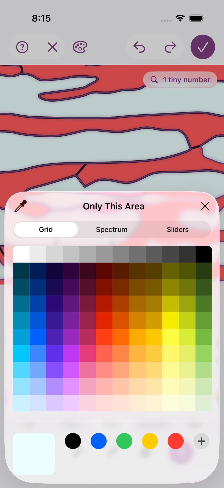 920x2000

→ `mcp__maestro__run` `{"device_id": "E839A11B-51B4-4AD3-ACF4-A53B95B7C957", "yaml": "appId: com.pbordjadze.paintbynumber\n---\n- tapOn: \"bright yellow 69\"\n- tapOn: \"green 54\"\n- tapOn: \"close\"\n- takeScreenshot: /Users/runner/work/_temp/qa/shots/card-after-pick"}`

→ `Read` `{"file_path": "/Users/runner/work/_temp/qa/shots/card-after-pick.png"}`

← mcp__maestro__run: {"success":true,"device_id":"E839A11B-51B4-4AD3-ACF4-A53B95B7C957","commands_executed":5,"message":"Flow executed successfully","env_vars":{"MAESTRO_CLI_ANALYSIS_NOTIFICATION_DISABLED":"true","MAESTRO_CLI_NO_ANALYTICS":"1","MAESTRO_DRIVER_STARTUP_TIMEOUT":"240000","MAESTRO_VERSION":"2.11.0"}}

← Read: image  920x2000

> Green stuck: the area became paint 23 ("Olive", 1 area). Now I'll close the card quickly and step Undo.

→ `mcp__maestro__run` `{"device_id": "E839A11B-51B4-4AD3-ACF4-A53B95B7C957", "yaml": "appId: com.pbordjadze.paintbynumber\n---\n- swipe:\n    start: \"50%,49%\"\n    end: \"50%,95%\"\n    duration: 300\n- takeScreenshot: /Users/runner/work/_temp/qa/shots/card-closed"}`

→ `mcp__maestro__inspect_screen` `{"device_id": "E839A11B-51B4-4AD3-ACF4-A53B95B7C957"}`

← mcp__maestro__run: {"success":true,"device_id":"E839A11B-51B4-4AD3-ACF4-A53B95B7C957","commands_executed":3,"message":"Flow executed successfully","env_vars":{"MAESTRO_CLI_ANALYSIS_NOTIFICATION_DISABLED":"true","MAESTRO_CLI_NO_ANALYTICS":"1","MAESTRO_DRIVER_STARTUP_TIMEOUT":"240000","MAESTRO_VERSION":"2.11.0"}}

← mcp__maestro__inspect_screen: {"ui_schema":{"platform":"ios","abbreviations":{"b":"bounds","txt":"text","rid":"resource-id","a11y":"accessibilityText","hint":"hintText","val":"value","c":"children"},"defaults":{"enabled":true,"focused":false,"selected":false,"checked":false,"txt":"","hint":"","rid":"","val":"","a11y":""}},"elements":[{"b":"[0,0][402,874]","a11y":"Paint by Moonlight","c":[{"b":"[0,0][402,874]","c":[{"b":"[0,0][ …

> Two picks in the card (yellow, then green) added only one change (8 to 9), where Edit Paint counted each pick. Undo once:

→ `mcp__maestro__run` `{"device_id": "E839A11B-51B4-4AD3-ACF4-A53B95B7C957", "yaml": "appId: com.pbordjadze.paintbynumber\n---\n- tapOn:\n    id: \"refine-undo\"\n- takeScreenshot: /Users/runner/work/_temp/qa/shots/card-undo1"}`

→ `Read` `{"file_path": "/Users/runner/work/_temp/qa/shots/card-undo1.png"}`

← mcp__maestro__run: {"success":true,"device_id":"E839A11B-51B4-4AD3-ACF4-A53B95B7C957","commands_executed":3,"message":"Flow executed successfully","env_vars":{"MAESTRO_CLI_ANALYSIS_NOTIFICATION_DISABLED":"true","MAESTRO_CLI_NO_ANALYTICS":"1","MAESTRO_DRIVER_STARTUP_TIMEOUT":"240000","MAESTRO_VERSION":"2.11.0"}}

← Read: image 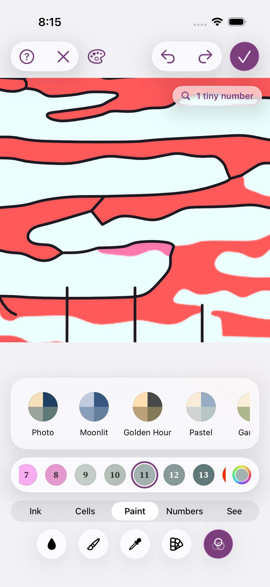 920x2000

> Undo went straight from green back to the original pale teal and skipped the yellow step. Redo next:

→ `mcp__maestro__run` `{"device_id": "E839A11B-51B4-4AD3-ACF4-A53B95B7C957", "yaml": "appId: com.pbordjadze.paintbynumber\n---\n- tapOn:\n    id: \"refine-redo\"\n- takeScreenshot: /Users/runner/work/_temp/qa/shots/card-redo1"}`

→ `Read` `{"file_path": "/Users/runner/work/_temp/qa/shots/card-redo1.png"}`

← mcp__maestro__run: {"success":true,"device_id":"E839A11B-51B4-4AD3-ACF4-A53B95B7C957","commands_executed":3,"message":"Flow executed successfully","env_vars":{"MAESTRO_CLI_ANALYSIS_NOTIFICATION_DISABLED":"true","MAESTRO_CLI_NO_ANALYTICS":"1","MAESTRO_DRIVER_STARTUP_TIMEOUT":"240000","MAESTRO_VERSION":"2.11.0"}}

← Read: image  920x2000

> Redo also went straight to green. To repeat, I'll long-press a different area.

→ `mcp__maestro__run` `{"device_id": "E839A11B-51B4-4AD3-ACF4-A53B95B7C957", "yaml": "appId: com.pbordjadze.paintbynumber\n---\n- longPressOn:\n    point: \"40%,29%\"\n- waitForAnimationToEnd\n- takeScreenshot: /Users/runner/work/_temp/qa/shots/area-card3"}`

→ `mcp__maestro__take_screenshot` `{"device_id": "E839A11B-51B4-4AD3-ACF4-A53B95B7C957"}`

← mcp__maestro__run: {"success":true,"device_id":"E839A11B-51B4-4AD3-ACF4-A53B95B7C957","commands_executed":4,"message":"Flow executed successfully","env_vars":{"MAESTRO_CLI_ANALYSIS_NOTIFICATION_DISABLED":"true","MAESTRO_CLI_NO_ANALYTICS":"1","MAESTRO_DRIVER_STARTUP_TIMEOUT":"240000","MAESTRO_VERSION":"2.11.0"}}

← mcp__maestro__take_screenshot: image  919x2000

→ `mcp__maestro__run` `{"device_id": "E839A11B-51B4-4AD3-ACF4-A53B95B7C957", "yaml": "appId: com.pbordjadze.paintbynumber\n---\n- tapOn:\n    point: \"361,603\"\n- tapOn: \"bright yellow 69\"\n- tapOn: \"purple 38\"\n- tapOn: \"close\"\n- swipe:\n    start: \"50%,49%\"\n    end: \"50%,95%\"\n    duration: 300\n- takeScreenshot: /Users/runner/work/_temp/qa/shots/card2-after"}`

→ `Read` `{"file_path": "/Users/runner/work/_temp/qa/shots/card2-after.png"}`

← mcp__maestro__run: {"success":true,"device_id":"E839A11B-51B4-4AD3-ACF4-A53B95B7C957","commands_executed":7,"message":"Flow executed successfully","env_vars":{"MAESTRO_CLI_ANALYSIS_NOTIFICATION_DISABLED":"true","MAESTRO_CLI_NO_ANALYTICS":"1","MAESTRO_DRIVER_STARTUP_TIMEOUT":"240000","MAESTRO_VERSION":"2.11.0"}}

← Read: image  920x2000

> The area came out yellow (dark olive) instead of purple, the last colour picked. So in the card the last pick didn't stick this time. Checking the log:

→ `Read` `{"file_path": "/Users/runner/work/_temp/qa/app.log", "offset": 24}`

← Read: 24	2026-10-26 20:07:35.944 Df PaintByNumber[19850:e4ca] [com.pbordjadze.paintbynumber:tips] offer in refine: refineFill, wanted
25	2026-10-26 20:07:47.683 Df PaintByNumber[19850:e4ca] [com.pbordjadze.paintbynumber:tips] offer in refine: refineFill, wanted
26	2026-10-26 20:08:06.439 Df PaintByNumber[19850:e4ca] [com.pbordjadze.paintbynumber:tips] offer in preview: newPaintingDivider, newPaintingSug …

> No log lines for it. Seen once so far (it worked the first time). Trying a third area, with the same yellow-then-purple sequence:

→ `mcp__maestro__run` `{"device_id": "E839A11B-51B4-4AD3-ACF4-A53B95B7C957", "yaml": "appId: com.pbordjadze.paintbynumber\n---\n- longPressOn:\n    point: \"54%,39%\"\n- waitForAnimationToEnd\n- takeScreenshot: /Users/runner/work/_temp/qa/shots/area-card4"}`

→ `mcp__maestro__take_screenshot` `{"device_id": "E839A11B-51B4-4AD3-ACF4-A53B95B7C957"}`

← mcp__maestro__run: {"success":true,"device_id":"E839A11B-51B4-4AD3-ACF4-A53B95B7C957","commands_executed":4,"message":"Flow executed successfully","env_vars":{"MAESTRO_CLI_ANALYSIS_NOTIFICATION_DISABLED":"true","MAESTRO_CLI_NO_ANALYTICS":"1","MAESTRO_DRIVER_STARTUP_TIMEOUT":"240000","MAESTRO_VERSION":"2.11.0"}}

← mcp__maestro__take_screenshot: image  919x2000

→ `mcp__maestro__run` `{"device_id": "E839A11B-51B4-4AD3-ACF4-A53B95B7C957", "yaml": "appId: com.pbordjadze.paintbynumber\n---\n- tapOn:\n    point: \"361,603\"\n- tapOn: \"bright yellow 69\"\n- tapOn: \"purple 38\"\n- takeScreenshot: /Users/runner/work/_temp/qa/shots/card3-picker-before-close\n- tapOn: \"close\"\n- takeScreenshot: /Users/runner/work/_temp/qa/shots/card3-card-after-close"}`

→ `Read` `{"file_path": "/Users/runner/work/_temp/qa/shots/card3-picker-before-close.png"}`

→ `Read` `{"file_path": "/Users/runner/work/_temp/qa/shots/card3-card-after-close.png"}`

← mcp__maestro__run: {"success":true,"device_id":"E839A11B-51B4-4AD3-ACF4-A53B95B7C957","commands_executed":7,"message":"Flow executed successfully","env_vars":{"MAESTRO_CLI_ANALYSIS_NOTIFICATION_DISABLED":"true","MAESTRO_CLI_NO_ANALYTICS":"1","MAESTRO_DRIVER_STARTUP_TIMEOUT":"240000","MAESTRO_VERSION":"2.11.0"}}

← Read: image  920x2000

← Read: image  920x2000

→ `mcp__maestro__run` `{"device_id": "E839A11B-51B4-4AD3-ACF4-A53B95B7C957", "yaml": "appId: com.pbordjadze.paintbynumber\n---\n- tapOn:\n    point: \"361,620\"\n- waitForAnimationToEnd\n- takeScreenshot: /Users/runner/work/_temp/qa/shots/card3-picker2-open\n- tapOn: \"purple 38\"\n- waitForAnimationToEnd\n- takeScreenshot: /Users/runner/work/_temp/qa/shots/card3-picker2-purple"}`

→ `Read` `{"file_path": "/Users/runner/work/_temp/qa/shots/card3-picker2-purple.png"}`

← mcp__maestro__run: {"success":true,"device_id":"E839A11B-51B4-4AD3-ACF4-A53B95B7C957","commands_executed":7,"message":"Flow executed successfully","env_vars":{"MAESTRO_CLI_ANALYSIS_NOTIFICATION_DISABLED":"true","MAESTRO_CLI_NO_ANALYTICS":"1","MAESTRO_DRIVER_STARTUP_TIMEOUT":"240000","MAESTRO_VERSION":"2.11.0"}}

← Read: image 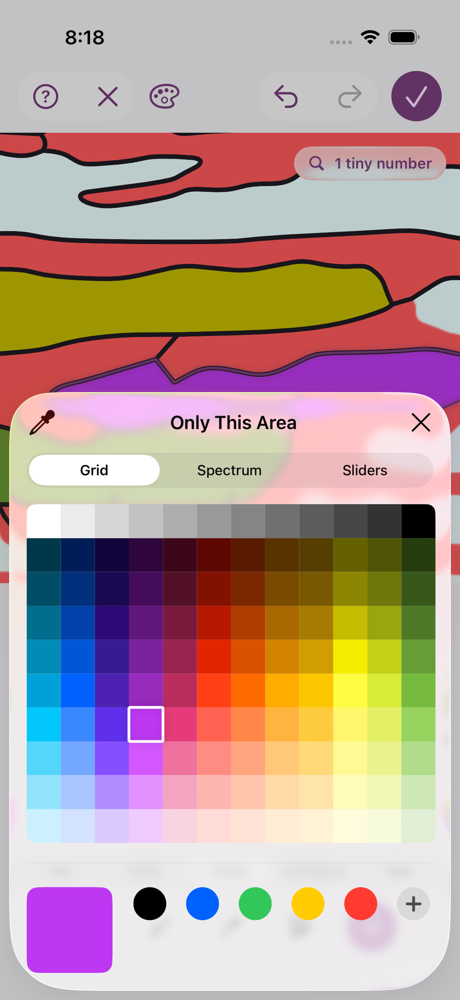 920x2000

→ `mcp__maestro__run` `{"device_id": "E839A11B-51B4-4AD3-ACF4-A53B95B7C957", "yaml": "appId: com.pbordjadze.paintbynumber\n---\n- tapOn: \"close\"\n- swipe:\n    start: \"50%,49%\"\n    end: \"50%,95%\"\n    duration: 300\n- takeScreenshot: /Users/runner/work/_temp/qa/shots/card3-closed\n- tapOn:\n    id: \"refine-undo\"\n- takeScreenshot: /Users/runner/work/_temp/qa/shots/card3-undo1\n- tapOn:\n    id: \"refine-undo\"\n- takeScreenshot: /Users/runner/work/_temp/qa/shots/card3-undo2"}`

→ `Read` `{"file_path": "/Users/runner/work/_temp/qa/shots/card3-closed.png"}`

→ `Read` `{"file_path": "/Users/runner/work/_temp/qa/shots/card3-undo1.png"}`

→ `Read` `{"file_path": "/Users/runner/work/_temp/qa/shots/card3-undo2.png"}`

← mcp__maestro__run: {"success":true,"device_id":"E839A11B-51B4-4AD3-ACF4-A53B95B7C957","commands_executed":8,"message":"Flow executed successfully","env_vars":{"MAESTRO_CLI_ANALYSIS_NOTIFICATION_DISABLED":"true","MAESTRO_CLI_NO_ANALYTICS":"1","MAESTRO_DRIVER_STARTUP_TIMEOUT":"240000","MAESTRO_VERSION":"2.11.0"}}

← Read: image  920x2000

← Read: image  920x2000

← Read: image  920x2000

→ `Write` `{"file_path": "/Users/runner/work/_temp/qa/report.md", "content": "# Paint by Moonlight \u2014 Refine exploratory test (iPhone 17 Pro sim, Debug)\n\n## Summary\nRefine was opened from the Red Fuji sample's New Painting preview and exercised for about 15 minutes. The new views menu works, and every group tab holds the right tools. Paper's new numbers pile up until they can't be read on large neighbouring cells, and the views symbol jumps sideways in Paper. In Edit Paint, \"Similar colors too\" recolours clearly dissimilar paints (the blue sky). In an area's card (Only This Area), picking colour`

← Write: The file /Users/runner/work/_temp/qa/report.md has been updated successfully. (file state is current in your context — no need to Read it back)

> About 16 minutes in. Next I'll look for a note when an action can't work: a plain tap with Cells › Merge.

→ `mcp__maestro__run` `{"device_id": "E839A11B-51B4-4AD3-ACF4-A53B95B7C957", "yaml": "appId: com.pbordjadze.paintbynumber\n---\n- tapOn: \"Cells\"\n- tapOn:\n    id: \"refine-tool-merge\"\n- tapOn:\n    point: \"50%,30%\"\n- takeScreenshot: /Users/runner/work/_temp/qa/shots/merge-tap"}`

→ `Read` `{"file_path": "/Users/runner/work/_temp/qa/shots/merge-tap.png"}`

← mcp__maestro__run: {"success":true,"device_id":"E839A11B-51B4-4AD3-ACF4-A53B95B7C957","commands_executed":5,"message":"Flow executed successfully","env_vars":{"MAESTRO_CLI_ANALYSIS_NOTIFICATION_DISABLED":"true","MAESTRO_CLI_NO_ANALYTICS":"1","MAESTRO_DRIVER_STARTUP_TIMEOUT":"240000","MAESTRO_VERSION":"2.11.0"}}

← Read: image 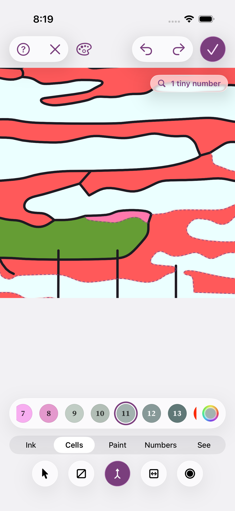 920x2000

→ `mcp__maestro__inspect_screen` `{"device_id": "E839A11B-51B4-4AD3-ACF4-A53B95B7C957"}`

← mcp__maestro__inspect_screen: {"ui_schema":{"platform":"ios","abbreviations":{"b":"bounds","txt":"text","rid":"resource-id","a11y":"accessibilityText","hint":"hintText","val":"value","c":"children"},"defaults":{"enabled":true,"focused":false,"selected":false,"checked":false,"txt":"","hint":"","rid":"","val":"","a11y":""}},"elements":[{"b":"[0,0][402,874]","a11y":"Paint by Moonlight","c":[{"b":"[0,0][402,874]","c":[{"b":"[0,0][ …

→ `mcp__maestro__run` `{"device_id": "E839A11B-51B4-4AD3-ACF4-A53B95B7C957", "yaml": "appId: com.pbordjadze.paintbynumber\n---\n- tapOn: \"Ink\"\n- waitForAnimationToEnd\n- takeScreenshot: /Users/runner/work/_temp/qa/shots/canvas-gap-ink\n- tapOn: \"Cells\"\n- waitForAnimationToEnd\n- takeScreenshot: /Users/runner/work/_temp/qa/shots/canvas-gap-cells"}`

→ `Read` `{"file_path": "/Users/runner/work/_temp/qa/shots/canvas-gap-ink.png"}`

→ `mcp__maestro__inspect_screen` `{"device_id": "E839A11B-51B4-4AD3-ACF4-A53B95B7C957"}`

← mcp__maestro__run: {"success":true,"device_id":"E839A11B-51B4-4AD3-ACF4-A53B95B7C957","commands_executed":7,"message":"Flow executed successfully","env_vars":{"MAESTRO_CLI_ANALYSIS_NOTIFICATION_DISABLED":"true","MAESTRO_CLI_NO_ANALYTICS":"1","MAESTRO_DRIVER_STARTUP_TIMEOUT":"240000","MAESTRO_VERSION":"2.11.0"}}

← Read: image  920x2000

← mcp__maestro__inspect_screen: {"ui_schema":{"platform":"ios","abbreviations":{"b":"bounds","txt":"text","rid":"resource-id","a11y":"accessibilityText","hint":"hintText","val":"value","c":"children"},"defaults":{"enabled":true,"focused":false,"selected":false,"checked":false,"txt":"","hint":"","rid":"","val":"","a11y":""}},"elements":[{"b":"[0,0][402,874]","a11y":"Paint by Moonlight","c":[{"b":"[0,0][402,874]","c":[{"b":"[0,0][ …

→ `mcp__maestro__run` `{"device_id": "E839A11B-51B4-4AD3-ACF4-A53B95B7C957", "yaml": "appId: com.pbordjadze.paintbynumber\n---\n- tapOn:\n    id: \"refine-cancel\"\n- waitForAnimationToEnd\n- takeScreenshot: /Users/runner/work/_temp/qa/shots/cancel-tap"}`

→ `Read` `{"file_path": "/Users/runner/work/_temp/qa/shots/cancel-tap.png"}`

← mcp__maestro__run: {"success":true,"device_id":"E839A11B-51B4-4AD3-ACF4-A53B95B7C957","commands_executed":4,"message":"Flow executed successfully","env_vars":{"MAESTRO_CLI_ANALYSIS_NOTIFICATION_DISABLED":"true","MAESTRO_CLI_NO_ANALYTICS":"1","MAESTRO_DRIVER_STARTUP_TIMEOUT":"240000","MAESTRO_VERSION":"2.11.0"}}

← Read: image  920x2000

> Cancel threw away all 9 changes at one tap, with no confirmation. I'll reopen Refine to see whether anything was kept.

→ `mcp__maestro__run` `{"device_id": "E839A11B-51B4-4AD3-ACF4-A53B95B7C957", "yaml": "appId: com.pbordjadze.paintbynumber\n---\n- tapOn: \"Refine\"\n- waitForAnimationToEnd\n- takeScreenshot: /Users/runner/work/_temp/qa/shots/refine-reopen"}`

→ `Read` `{"file_path": "/Users/runner/work/_temp/qa/shots/refine-reopen.png"}`

← mcp__maestro__run: {"success":true,"device_id":"E839A11B-51B4-4AD3-ACF4-A53B95B7C957","commands_executed":4,"message":"Flow executed successfully","env_vars":{"MAESTRO_CLI_ANALYSIS_NOTIFICATION_DISABLED":"true","MAESTRO_CLI_NO_ANALYTICS":"1","MAESTRO_DRIVER_STARTUP_TIMEOUT":"240000","MAESTRO_VERSION":"2.11.0"}}

← Read: image  920x2000

> Everything is gone. I'll repeat it with one stroke, then Cancel:

→ `mcp__maestro__run` `{"device_id": "E839A11B-51B4-4AD3-ACF4-A53B95B7C957", "yaml": "appId: com.pbordjadze.paintbynumber\n---\n- swipe:\n    start: \"30%,35%\"\n    end: \"60%,55%\"\n    duration: 800\n- waitForAnimationToEnd\n- takeScreenshot: /Users/runner/work/_temp/qa/shots/cancel2-before\n- tapOn:\n    id: \"refine-cancel\"\n- waitForAnimationToEnd\n- takeScreenshot: /Users/runner/work/_temp/qa/shots/cancel2-after"}`

→ `Read` `{"file_path": "/Users/runner/work/_temp/qa/shots/cancel2-after.png"}`

← mcp__maestro__run: {"success":true,"device_id":"E839A11B-51B4-4AD3-ACF4-A53B95B7C957","commands_executed":7,"message":"Flow executed successfully","env_vars":{"MAESTRO_CLI_ANALYSIS_NOTIFICATION_DISABLED":"true","MAESTRO_CLI_NO_ANALYTICS":"1","MAESTRO_DRIVER_STARTUP_TIMEOUT":"240000","MAESTRO_VERSION":"2.11.0"}}

← Read: image  920x2000

→ `Read` `{"file_path": "/Users/runner/work/_temp/qa/shots/cancel2-before.png"}`

← Read: image  920x2000

> Reproduced: Cancel discarded the edits with no confirmation, 2 of 2. Writing the final report.

→ `Write` `{"file_path": "/Users/runner/work/_temp/qa/report.md", "content": "# Paint by Moonlight \u2014 Refine exploratory test (iPhone 17 Pro sim, Debug)\n\n## Summary\nRefine was opened from the Red Fuji sample's New Painting preview and exercised for about 18 minutes. The new views menu works, and every group tab holds the right tools. Paper's new numbers pile up until they can't be read on large neighbouring cells, and the views symbol jumps sideways in Paper. In Edit Paint, \"Similar colors too\" recolours clearly dissimilar paints. In an area's card, a sequence of colour picks often doesn't end o`

← Write: The file /Users/runner/work/_temp/qa/report.md has been updated successfully. (file state is current in your context — no need to Read it back)

> I tested Refine for about 18 minutes, starting from the Red Fuji sample, and found 7 bugs I saw at least twice. The full report is in `/Users/runner/work/_temp/qa/report.md`, with screenshots in `shots/`.
> 
> **The five changes you asked about:**
> 1. **Views menu:** it opens, and Painting, Paper, Photo and Photo Behind can each be picked. The symbol's icon follows the view, and nothing in the top bar wraps, clips or overlaps. But in Paper the symbol moves about 60 pt sideways (bug 2).
> 2. **Numbers on Paper:** they show, and a Pen stroke that closes a cell gets its number straight away. At the fitted zoom, though, they aren't legible (bug 1); deep zoom is fine.
> 3. **Tiny-numbers badge:** works. It was hidden while the Looks note showed and came back afterwards.
> 4. **Edit Paint and Looks:** work. The last colour picked sticks, and Undo and Redo step through each change. The area card has problems (bugs 4 and 5).
> 5. **Group tabs:** all correct: Ink 5, Cells 5, Paint 5, Numbers 1, See 2.
> 
> **Bugs seen twice or more:**
> 1. **Paper numbers pile up:** on large neighbouring cells they stack into a dark blot (the "2"s on the mountain, the "19"s along the bottom). 2 of 2.
> 2. **The views symbol moves:** it sits beside Cancel in three views but centred in Paper. 2 of 2.
> 3. **"Similar colors too" reaches too far:** changing a red paint also recoloured the blue sky (red or violet) and the beige clouds. 2 of 2.
> 4. **The area card loses picks:** after two picks in a row, the area wasn't in the last colour in 2 of 3 runs. Once it kept the first pick; once it kept neither and made a new "White" paint. No note appeared.
> 5. **The card's Undo works differently:** several picks in one card make a single Undo step, while Edit Paint makes one per pick. 2 of 2.
> 6. **Cancel loses everything:** one tap throws away all Refine edits with no confirmation. It sits right next to the Help button. 2 of 2.
> 7. **The canvas doesn't grow back:** after Photo Behind or Looks closes, it stays shrunk, leaving about 175 pt of empty space on the phone. 2 of 2.
> 
> **Seen once only:**
> - The changes counter dropped from 8 to 4 when I applied a Look.
> - The selected paint jumped after Looks and Undo.
> - The colour picker failed to open on one tap.
> - A tap with Merge did nothing and showed no note.
> - The area card doesn't appear in the screen's element list at all, which may mean VoiceOver can't reach it.
> 
> **Not tested:**
> - **Pinch, two-finger gestures and freehand closed shapes:** Maestro can't do them; I used straight strokes from line to line.
> - **Most Cells tools, and several Ink, Paint and See tools.**
> - **Committing with Done, then Start Painting.**
> - **iPad layout.**
