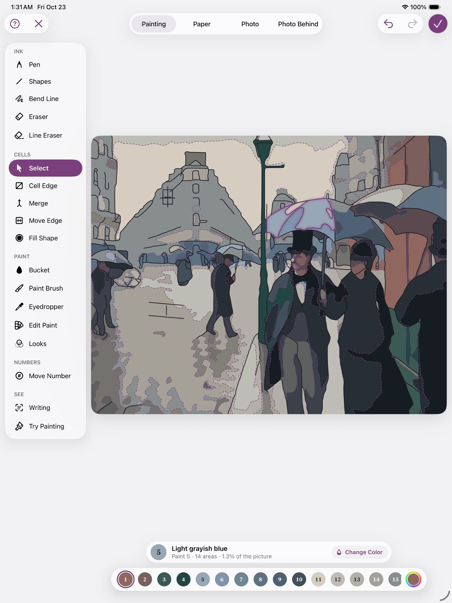
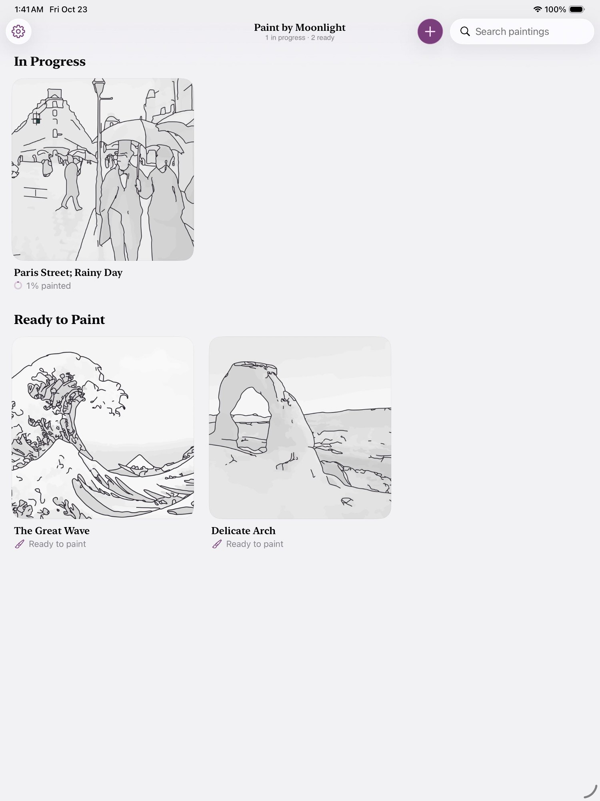

# Agent transcript

- end: success, 156 turns, 36.7 min, estimated $5.732653800000002
- tool calls: {"mcp__maestro__take_screenshot": 49, "Read": 19, "mcp__maestro__run": 60, "mcp__maestro__inspect_screen": 8, "Write": 7}
- images the agent received: 61

**Start**: model claude-opus-5-5, MCP [{"name": "maestro", "status": "connected", "source": "dynamic"}]

→ `mcp__maestro__take_screenshot` `{"device_id": "99DEE653-946C-406D-8E9E-238D1FCE93C9"}`

→ `Read` `{"file_path": "/Users/runner/.claude/projects/-Users-runner-work--temp-qa/memory/MEMORY.md"}`

← mcp__maestro__take_screenshot: image  1500x2000

← Read (error): File does not exist. Note: your current working directory is /Users/runner/work/_temp/qa.

→ `mcp__maestro__run` `{"device_id": "99DEE653-946C-406D-8E9E-238D1FCE93C9", "yaml": "appId: com.pbordjadze.paintbynumber\n---\n- tapOn:\n    point: \"72%,4%\"\n"}`

→ `mcp__maestro__inspect_screen` `{"device_id": "99DEE653-946C-406D-8E9E-238D1FCE93C9"}`

← mcp__maestro__run: {"success":true,"device_id":"99DEE653-946C-406D-8E9E-238D1FCE93C9","commands_executed":2,"message":"Flow executed successfully","env_vars":{"MAESTRO_CLI_ANALYSIS_NOTIFICATION_DISABLED":"true","MAESTRO_CLI_NO_ANALYTICS":"1","MAESTRO_DRIVER_STARTUP_TIMEOUT":"240000","MAESTRO_VERSION":"2.11.0"}}

← mcp__maestro__inspect_screen: {"ui_schema":{"platform":"ios","abbreviations":{"b":"bounds","txt":"text","rid":"resource-id","a11y":"accessibilityText","hint":"hintText","val":"value","c":"children"},"defaults":{"enabled":true,"focused":false,"selected":false,"checked":false,"txt":"","hint":"","rid":"","val":"","a11y":""}},"elements":[{"b":"[0,0][1032,1376]","a11y":"Paint by Moonlight","c":[{"b":"[0,0][1032,1376]","c":[{"b":"[0 …

→ `mcp__maestro__run` `{"device_id": "99DEE653-946C-406D-8E9E-238D1FCE93C9", "yaml": "appId: com.pbordjadze.paintbynumber\n---\n- tapOn: \"Close\"\n"}`

→ `mcp__maestro__take_screenshot` `{"device_id": "99DEE653-946C-406D-8E9E-238D1FCE93C9"}`

← mcp__maestro__run: {"success":true,"device_id":"99DEE653-946C-406D-8E9E-238D1FCE93C9","commands_executed":2,"message":"Flow executed successfully","env_vars":{"MAESTRO_CLI_ANALYSIS_NOTIFICATION_DISABLED":"true","MAESTRO_CLI_NO_ANALYTICS":"1","MAESTRO_DRIVER_STARTUP_TIMEOUT":"240000","MAESTRO_VERSION":"2.11.0"}}

← mcp__maestro__take_screenshot: image  1500x2000

→ `mcp__maestro__run` `{"device_id": "99DEE653-946C-406D-8E9E-238D1FCE93C9", "yaml": "appId: com.pbordjadze.paintbynumber\n---\n- tapOn:\n    point: \"87%,61%\"\n- waitForAnimationToEnd\n"}`

→ `mcp__maestro__take_screenshot` `{"device_id": "99DEE653-946C-406D-8E9E-238D1FCE93C9"}`

← mcp__maestro__run: {"success":true,"device_id":"99DEE653-946C-406D-8E9E-238D1FCE93C9","commands_executed":3,"message":"Flow executed successfully","env_vars":{"MAESTRO_CLI_ANALYSIS_NOTIFICATION_DISABLED":"true","MAESTRO_CLI_NO_ANALYTICS":"1","MAESTRO_DRIVER_STARTUP_TIMEOUT":"240000","MAESTRO_VERSION":"2.11.0"}}

← mcp__maestro__take_screenshot: image  1500x2000

→ `mcp__maestro__run` `{"device_id": "99DEE653-946C-406D-8E9E-238D1FCE93C9", "yaml": "appId: com.pbordjadze.paintbynumber\n---\n- extendedWaitUntil:\n    visible: \"Refine\"\n    enabled: true\n    timeout: 60000\n- waitForAnimationToEnd\n"}`

← mcp__maestro__run (error): Failed to run flow: Unknown Property: enabled at /var/folders/n6/hn37q6pj7sj_9dmqqc2113800000gn/T/maestro-flow660869212085645843.yaml:7:1

→ `mcp__maestro__take_screenshot` `{"device_id": "99DEE653-946C-406D-8E9E-238D1FCE93C9"}`

← mcp__maestro__take_screenshot: image  1500x2000

> Waiting for the preview to finish "Finding the subject…".

→ `mcp__maestro__run` `{"device_id": "99DEE653-946C-406D-8E9E-238D1FCE93C9", "yaml": "appId: com.pbordjadze.paintbynumber\n---\n- extendedWaitUntil:\n    notVisible: \"Finding the subject.*\"\n    timeout: 90000\n- waitForAnimationToEnd\n"}`

→ `mcp__maestro__take_screenshot` `{"device_id": "99DEE653-946C-406D-8E9E-238D1FCE93C9"}`

← mcp__maestro__run: {"success":true,"device_id":"99DEE653-946C-406D-8E9E-238D1FCE93C9","commands_executed":3,"message":"Flow executed successfully","env_vars":{"MAESTRO_CLI_ANALYSIS_NOTIFICATION_DISABLED":"true","MAESTRO_CLI_NO_ANALYTICS":"1","MAESTRO_DRIVER_STARTUP_TIMEOUT":"240000","MAESTRO_VERSION":"2.11.0"}}

← mcp__maestro__take_screenshot: image  1500x2000

> Preview is ready (22 colors · 417 areas). Opening Refine.

→ `mcp__maestro__run` `{"device_id": "99DEE653-946C-406D-8E9E-238D1FCE93C9", "yaml": "appId: com.pbordjadze.paintbynumber\n---\n- tapOn: \"Refine\"\n- waitForAnimationToEnd\n"}`

→ `mcp__maestro__take_screenshot` `{"device_id": "99DEE653-946C-406D-8E9E-238D1FCE93C9"}`

← mcp__maestro__run: {"success":true,"device_id":"99DEE653-946C-406D-8E9E-238D1FCE93C9","commands_executed":3,"message":"Flow executed successfully","env_vars":{"MAESTRO_CLI_ANALYSIS_NOTIFICATION_DISABLED":"true","MAESTRO_CLI_NO_ANALYTICS":"1","MAESTRO_DRIVER_STARTUP_TIMEOUT":"240000","MAESTRO_VERSION":"2.11.0"}}

← mcp__maestro__take_screenshot: image  1500x2000

→ `mcp__maestro__run` `{"device_id": "99DEE653-946C-406D-8E9E-238D1FCE93C9", "yaml": "appId: com.pbordjadze.paintbynumber\n---\n- tapOn: \"Close\"\n"}`

→ `mcp__maestro__inspect_screen` `{"device_id": "99DEE653-946C-406D-8E9E-238D1FCE93C9"}`

← mcp__maestro__run: {"success":true,"device_id":"99DEE653-946C-406D-8E9E-238D1FCE93C9","commands_executed":2,"message":"Flow executed successfully","env_vars":{"MAESTRO_CLI_ANALYSIS_NOTIFICATION_DISABLED":"true","MAESTRO_CLI_NO_ANALYTICS":"1","MAESTRO_DRIVER_STARTUP_TIMEOUT":"240000","MAESTRO_VERSION":"2.11.0"}}

← mcp__maestro__inspect_screen: {"ui_schema":{"platform":"ios","abbreviations":{"b":"bounds","txt":"text","rid":"resource-id","a11y":"accessibilityText","hint":"hintText","val":"value","c":"children"},"defaults":{"enabled":true,"focused":false,"selected":false,"checked":false,"txt":"","hint":"","rid":"","val":"","a11y":""}},"elements":[{"b":"[0,0][1032,1376]","a11y":"Paint by Moonlight","c":[{"b":"[0,0][1032,1376]","c":[{"b":"[0 …

→ `mcp__maestro__run` `{"device_id": "99DEE653-946C-406D-8E9E-238D1FCE93C9", "yaml": "appId: com.pbordjadze.paintbynumber\n---\n- tapOn:\n    id: \"refine-tool-select\"\n- doubleTapOn:\n    point: \"447,516\"\n- waitForAnimationToEnd\n"}`

→ `mcp__maestro__take_screenshot` `{"device_id": "99DEE653-946C-406D-8E9E-238D1FCE93C9"}`

← mcp__maestro__run: {"success":true,"device_id":"99DEE653-946C-406D-8E9E-238D1FCE93C9","commands_executed":4,"message":"Flow executed successfully","env_vars":{"MAESTRO_CLI_ANALYSIS_NOTIFICATION_DISABLED":"true","MAESTRO_CLI_NO_ANALYTICS":"1","MAESTRO_DRIVER_STARTUP_TIMEOUT":"240000","MAESTRO_VERSION":"2.11.0"}}

← mcp__maestro__take_screenshot: image  1500x2000

→ `Read` `{"file_path": "/Users/runner/work/_temp/qa/app.log"}`

← Read: 1	getpwuid_r did not find a match for uid 501
2	Filtering the log data using "subsystem == "com.pbordjadze.paintbynumber""
3	Timestamp               Ty Process[PID:TID]
4	2026-10-23 01:01:04.695 Df PaintByNumber[22558:107c3] [com.pbordjadze.paintbynumber:tips] offer in shelf: , wanted
5	2026-10-23 01:01:06.753 Df PaintByNumber[22558:10859] [com.pbordjadze.paintbynumber:canvas] Making the render co …

→ `mcp__maestro__run` `{"device_id": "99DEE653-946C-406D-8E9E-238D1FCE93C9", "yaml": "appId: com.pbordjadze.paintbynumber\n---\n- tapOn:\n    id: \"refine-guide\"\n- waitForAnimationToEnd\n"}`

→ `mcp__maestro__inspect_screen` `{"device_id": "99DEE653-946C-406D-8E9E-238D1FCE93C9"}`

← mcp__maestro__run: {"success":true,"device_id":"99DEE653-946C-406D-8E9E-238D1FCE93C9","commands_executed":3,"message":"Flow executed successfully","env_vars":{"MAESTRO_CLI_ANALYSIS_NOTIFICATION_DISABLED":"true","MAESTRO_CLI_NO_ANALYTICS":"1","MAESTRO_DRIVER_STARTUP_TIMEOUT":"240000","MAESTRO_VERSION":"2.11.0"}}

← mcp__maestro__inspect_screen: {"ui_schema":{"platform":"ios","abbreviations":{"b":"bounds","txt":"text","rid":"resource-id","a11y":"accessibilityText","hint":"hintText","val":"value","c":"children"},"defaults":{"enabled":true,"focused":false,"selected":false,"checked":false,"txt":"","hint":"","rid":"","val":"","a11y":""}},"elements":[{"b":"[0,0][1032,1376]","a11y":"Paint by Moonlight","c":[{"b":"[0,0][1032,1376]","c":[{"b":"[0 …

→ `mcp__maestro__run` `{"device_id": "99DEE653-946C-406D-8E9E-238D1FCE93C9", "yaml": "appId: com.pbordjadze.paintbynumber\n---\n- tapOn:\n    id: \"refine-guide-topic-basics\"\n- waitForAnimationToEnd\n- takeScreenshot: /Users/runner/work/_temp/qa/shots/guide-basics\n"}`

→ `mcp__maestro__take_screenshot` `{"device_id": "99DEE653-946C-406D-8E9E-238D1FCE93C9"}`

← mcp__maestro__run: {"success":true,"device_id":"99DEE653-946C-406D-8E9E-238D1FCE93C9","commands_executed":4,"message":"Flow executed successfully","env_vars":{"MAESTRO_CLI_ANALYSIS_NOTIFICATION_DISABLED":"true","MAESTRO_CLI_NO_ANALYTICS":"1","MAESTRO_DRIVER_STARTUP_TIMEOUT":"240000","MAESTRO_VERSION":"2.11.0"}}

← mcp__maestro__take_screenshot: image  1500x2000

→ `Write` `{"file_path": "/Users/runner/work/_temp/qa/report.md", "content": "# Paint by Moonlight: exploratory test report (Refine session, Paris Street; Rainy Day)\n\n## Summary\nIn progress. I made a new painting from Samples \u203a Paintings \u203a \"Paris Street; Rainy Day\" (preview: 22 colors \u00b7 417 areas \u00b7 ~20 min) and opened Refine on the Generated drawing. Refine zooms only by pinch (Tool Guide \u203a The Basics), and Maestro can't pinch, so every edit is done at the fitted scale.\n\n## Coverage\n- Create a painting: done up to Refine.\n- Refine goals: in progress.\n\n## App bugs (repr`

← Write: File created successfully at: /Users/runner/work/_temp/qa/report.md (file state is current in your context — no need to Read it back)

→ `mcp__maestro__run` `{"device_id": "99DEE653-946C-406D-8E9E-238D1FCE93C9", "yaml": "appId: com.pbordjadze.paintbynumber\n---\n- tapOn:\n    id: \"refine-guide-topic-merge\"\n- waitForAnimationToEnd\n"}`

← mcp__maestro__run: {"success":true,"device_id":"99DEE653-946C-406D-8E9E-238D1FCE93C9","commands_executed":3,"message":"Flow executed successfully","env_vars":{"MAESTRO_CLI_ANALYSIS_NOTIFICATION_DISABLED":"true","MAESTRO_CLI_NO_ANALYTICS":"1","MAESTRO_DRIVER_STARTUP_TIMEOUT":"240000","MAESTRO_VERSION":"2.11.0"}}

→ `mcp__maestro__take_screenshot` `{"device_id": "99DEE653-946C-406D-8E9E-238D1FCE93C9"}`

← mcp__maestro__take_screenshot: image  1500x2000

→ `mcp__maestro__run` `{"device_id": "99DEE653-946C-406D-8E9E-238D1FCE93C9", "yaml": "appId: com.pbordjadze.paintbynumber\n---\n- tapOn:\n    id: \"refine-guide-done\"\n- waitForAnimationToEnd\n- tapOn: \"Photo Behind\"\n- waitForAnimationToEnd\n- takeScreenshot: /Users/runner/work/_temp/qa/shots/01-photo-behind\n"}`

→ `mcp__maestro__take_screenshot` `{"device_id": "99DEE653-946C-406D-8E9E-238D1FCE93C9"}`

← mcp__maestro__run: {"success":true,"device_id":"99DEE653-946C-406D-8E9E-238D1FCE93C9","commands_executed":6,"message":"Flow executed successfully","env_vars":{"MAESTRO_CLI_ANALYSIS_NOTIFICATION_DISABLED":"true","MAESTRO_CLI_NO_ANALYTICS":"1","MAESTRO_DRIVER_STARTUP_TIMEOUT":"240000","MAESTRO_VERSION":"2.11.0"}}

← mcp__maestro__take_screenshot: image  1500x2000

→ `mcp__maestro__run` `{"device_id": "99DEE653-946C-406D-8E9E-238D1FCE93C9", "yaml": "appId: com.pbordjadze.paintbynumber\n---\n- tapOn:\n    id: \"refine-tool-merge\"\n- waitForAnimationToEnd\n"}`

→ `mcp__maestro__inspect_screen` `{"device_id": "99DEE653-946C-406D-8E9E-238D1FCE93C9"}`

← mcp__maestro__run: {"success":true,"device_id":"99DEE653-946C-406D-8E9E-238D1FCE93C9","commands_executed":3,"message":"Flow executed successfully","env_vars":{"MAESTRO_CLI_ANALYSIS_NOTIFICATION_DISABLED":"true","MAESTRO_CLI_NO_ANALYTICS":"1","MAESTRO_DRIVER_STARTUP_TIMEOUT":"240000","MAESTRO_VERSION":"2.11.0"}}

← mcp__maestro__inspect_screen: {"ui_schema":{"platform":"ios","abbreviations":{"b":"bounds","txt":"text","rid":"resource-id","a11y":"accessibilityText","hint":"hintText","val":"value","c":"children"},"defaults":{"enabled":true,"focused":false,"selected":false,"checked":false,"txt":"","hint":"","rid":"","val":"","a11y":""}},"elements":[{"b":"[0,0][1032,1376]","a11y":"Paint by Moonlight","c":[{"b":"[0,0][1032,1376]","c":[{"b":"[0 …

→ `mcp__maestro__run` `{"device_id": "99DEE653-946C-406D-8E9E-238D1FCE93C9", "yaml": "appId: com.pbordjadze.paintbynumber\n---\n- tapOn: \"Painting\"\n- waitForAnimationToEnd\n- takeScreenshot: /Users/runner/work/_temp/qa/shots/02-merge-before\n"}`

→ `mcp__maestro__take_screenshot` `{"device_id": "99DEE653-946C-406D-8E9E-238D1FCE93C9"}`

← mcp__maestro__run: {"success":true,"device_id":"99DEE653-946C-406D-8E9E-238D1FCE93C9","commands_executed":4,"message":"Flow executed successfully","env_vars":{"MAESTRO_CLI_ANALYSIS_NOTIFICATION_DISABLED":"true","MAESTRO_CLI_NO_ANALYTICS":"1","MAESTRO_DRIVER_STARTUP_TIMEOUT":"240000","MAESTRO_VERSION":"2.11.0"}}

← mcp__maestro__take_screenshot: image  1500x2000

→ `mcp__maestro__run` `{"device_id": "99DEE653-946C-406D-8E9E-238D1FCE93C9", "yaml": "appId: com.pbordjadze.paintbynumber\n---\n- swipe:\n    start: \"323,523\"\n    end: \"399,482\"\n    duration: 1200\n- waitForAnimationToEnd\n- takeScreenshot: /Users/runner/work/_temp/qa/shots/03-merge-1\n"}`

→ `mcp__maestro__take_screenshot` `{"device_id": "99DEE653-946C-406D-8E9E-238D1FCE93C9"}`

← mcp__maestro__run: {"success":true,"device_id":"99DEE653-946C-406D-8E9E-238D1FCE93C9","commands_executed":4,"message":"Flow executed successfully","env_vars":{"MAESTRO_CLI_ANALYSIS_NOTIFICATION_DISABLED":"true","MAESTRO_CLI_NO_ANALYTICS":"1","MAESTRO_DRIVER_STARTUP_TIMEOUT":"240000","MAESTRO_VERSION":"2.11.0"}}

← mcp__maestro__take_screenshot: image  1500x2000

→ `Read` `{"file_path": "/Users/runner/work/_temp/qa/app.log", "offset": 24}`

← Read: 24	2026-10-23 01:09:42.309 Df PaintByNumber[22558:107c3] [com.pbordjadze.paintbynumber:create] Tool Guide page shown: select
25	2026-10-23 01:10:00.248 Df PaintByNumber[22558:107c3] [com.pbordjadze.paintbynumber:create] Tool Guide page shown: basics
26	2026-10-23 01:10:28.213 Df PaintByNumber[22558:107c3] [com.pbordjadze.paintbynumber:create] Tool Guide page shown: merge
27

→ `mcp__maestro__inspect_screen` `{"device_id": "99DEE653-946C-406D-8E9E-238D1FCE93C9"}`

← mcp__maestro__inspect_screen: {"ui_schema":{"platform":"ios","abbreviations":{"b":"bounds","txt":"text","rid":"resource-id","a11y":"accessibilityText","hint":"hintText","val":"value","c":"children"},"defaults":{"enabled":true,"focused":false,"selected":false,"checked":false,"txt":"","hint":"","rid":"","val":"","a11y":""}},"elements":[{"b":"[0,0][1032,1376]","a11y":"Paint by Moonlight","c":[{"b":"[0,0][1032,1376]","c":[{"b":"[0 …

→ `mcp__maestro__run` `{"device_id": "99DEE653-946C-406D-8E9E-238D1FCE93C9", "yaml": "appId: com.pbordjadze.paintbynumber\n---\n- tapOn:\n    id: \"refine-undo\"\n- tapOn:\n    id: \"refine-tool-select\"\n- tapOn:\n    point: \"516,475\"\n- waitForAnimationToEnd\n- takeScreenshot: /Users/runner/work/_temp/qa/shots/04-select-rightface-before-merge\n"}`

→ `mcp__maestro__take_screenshot` `{"device_id": "99DEE653-946C-406D-8E9E-238D1FCE93C9"}`

← mcp__maestro__run: {"success":true,"device_id":"99DEE653-946C-406D-8E9E-238D1FCE93C9","commands_executed":6,"message":"Flow executed successfully","env_vars":{"MAESTRO_CLI_ANALYSIS_NOTIFICATION_DISABLED":"true","MAESTRO_CLI_NO_ANALYTICS":"1","MAESTRO_DRIVER_STARTUP_TIMEOUT":"240000","MAESTRO_VERSION":"2.11.0"}}

← mcp__maestro__take_screenshot: image  1500x2000

→ `mcp__maestro__run` `{"device_id": "99DEE653-946C-406D-8E9E-238D1FCE93C9", "yaml": "appId: com.pbordjadze.paintbynumber\n---\n- tapOn:\n    id: \"refine-redo\"\n- tapOn:\n    id: \"refine-tool-shapes\"\n- waitForAnimationToEnd\n"}`

→ `mcp__maestro__take_screenshot` `{"device_id": "99DEE653-946C-406D-8E9E-238D1FCE93C9"}`

← mcp__maestro__run: {"success":true,"device_id":"99DEE653-946C-406D-8E9E-238D1FCE93C9","commands_executed":4,"message":"Flow executed successfully","env_vars":{"MAESTRO_CLI_ANALYSIS_NOTIFICATION_DISABLED":"true","MAESTRO_CLI_NO_ANALYTICS":"1","MAESTRO_DRIVER_STARTUP_TIMEOUT":"240000","MAESTRO_VERSION":"2.11.0"}}

← mcp__maestro__take_screenshot: image  1500x2000

→ `mcp__maestro__run` `{"device_id": "99DEE653-946C-406D-8E9E-238D1FCE93C9", "yaml": "appId: com.pbordjadze.paintbynumber\n---\n- swipe:\n    start: \"365,482\"\n    end: \"433,482\"\n    duration: 1000\n- waitForAnimationToEnd\n- takeScreenshot: /Users/runner/work/_temp/qa/shots/05-line-snap-on\n"}`

→ `mcp__maestro__take_screenshot` `{"device_id": "99DEE653-946C-406D-8E9E-238D1FCE93C9"}`

← mcp__maestro__run: {"success":true,"device_id":"99DEE653-946C-406D-8E9E-238D1FCE93C9","commands_executed":4,"message":"Flow executed successfully","env_vars":{"MAESTRO_CLI_ANALYSIS_NOTIFICATION_DISABLED":"true","MAESTRO_CLI_NO_ANALYTICS":"1","MAESTRO_DRIVER_STARTUP_TIMEOUT":"240000","MAESTRO_VERSION":"2.11.0"}}

← mcp__maestro__take_screenshot: image  1500x2000

→ `mcp__maestro__run` `{"device_id": "99DEE653-946C-406D-8E9E-238D1FCE93C9", "yaml": "appId: com.pbordjadze.paintbynumber\n---\n- swipe:\n    start: \"331,500\"\n    end: \"436,500\"\n    duration: 1000\n- waitForAnimationToEnd\n- takeScreenshot: /Users/runner/work/_temp/qa/shots/06-line2-snap-on\n"}`

→ `mcp__maestro__take_screenshot` `{"device_id": "99DEE653-946C-406D-8E9E-238D1FCE93C9"}`

← mcp__maestro__run: {"success":true,"device_id":"99DEE653-946C-406D-8E9E-238D1FCE93C9","commands_executed":4,"message":"Flow executed successfully","env_vars":{"MAESTRO_CLI_ANALYSIS_NOTIFICATION_DISABLED":"true","MAESTRO_CLI_NO_ANALYTICS":"1","MAESTRO_DRIVER_STARTUP_TIMEOUT":"240000","MAESTRO_VERSION":"2.11.0"}}

← mcp__maestro__take_screenshot: image  1500x2000

→ `mcp__maestro__run` `{"device_id": "99DEE653-946C-406D-8E9E-238D1FCE93C9", "yaml": "appId: com.pbordjadze.paintbynumber\n---\n- tapOn:\n    id: \"refine-tool-select\"\n- tapOn:\n    point: \"385,490\"\n- waitForAnimationToEnd\n- takeScreenshot: /Users/runner/work/_temp/qa/shots/07-select-after-lines\n"}`

→ `mcp__maestro__take_screenshot` `{"device_id": "99DEE653-946C-406D-8E9E-238D1FCE93C9"}`

← mcp__maestro__run: {"success":true,"device_id":"99DEE653-946C-406D-8E9E-238D1FCE93C9","commands_executed":5,"message":"Flow executed successfully","env_vars":{"MAESTRO_CLI_ANALYSIS_NOTIFICATION_DISABLED":"true","MAESTRO_CLI_NO_ANALYTICS":"1","MAESTRO_DRIVER_STARTUP_TIMEOUT":"240000","MAESTRO_VERSION":"2.11.0"}}

← mcp__maestro__take_screenshot: image  1500x2000

→ `mcp__maestro__run` `{"device_id": "99DEE653-946C-406D-8E9E-238D1FCE93C9", "yaml": "appId: com.pbordjadze.paintbynumber\n---\n- tapOn:\n    id: \"refine-tool-shapes\"\n- tapOn:\n    point: \"471,1322\"\n- swipe:\n    start: \"372,433\"\n    end: \"394,466\"\n    duration: 1000\n- waitForAnimationToEnd\n- tapOn:\n    id: \"refine-tool-select\"\n- tapOn:\n    point: \"383,450\"\n- waitForAnimationToEnd\n- takeScreenshot: /Users/runner/work/_temp/qa/shots/08-rectangle-window\n"}`

→ `mcp__maestro__take_screenshot` `{"device_id": "99DEE653-946C-406D-8E9E-238D1FCE93C9"}`

← mcp__maestro__run: {"success":true,"device_id":"99DEE653-946C-406D-8E9E-238D1FCE93C9","commands_executed":9,"message":"Flow executed successfully","env_vars":{"MAESTRO_CLI_ANALYSIS_NOTIFICATION_DISABLED":"true","MAESTRO_CLI_NO_ANALYTICS":"1","MAESTRO_DRIVER_STARTUP_TIMEOUT":"240000","MAESTRO_VERSION":"2.11.0"}}

← mcp__maestro__take_screenshot: image  1500x2000

→ `mcp__maestro__run` `{"device_id": "99DEE653-946C-406D-8E9E-238D1FCE93C9", "yaml": "appId: com.pbordjadze.paintbynumber\n---\n- tapOn:\n    id: \"refine-tool-shapes\"\n- waitForAnimationToEnd\n- takeScreenshot: /Users/runner/work/_temp/qa/shots/09-rectangle-ink\n"}`

→ `mcp__maestro__take_screenshot` `{"device_id": "99DEE653-946C-406D-8E9E-238D1FCE93C9"}`

← mcp__maestro__run: {"success":true,"device_id":"99DEE653-946C-406D-8E9E-238D1FCE93C9","commands_executed":4,"message":"Flow executed successfully","env_vars":{"MAESTRO_CLI_ANALYSIS_NOTIFICATION_DISABLED":"true","MAESTRO_CLI_NO_ANALYTICS":"1","MAESTRO_DRIVER_STARTUP_TIMEOUT":"240000","MAESTRO_VERSION":"2.11.0"}}

← mcp__maestro__take_screenshot: image  1500x2000

→ `mcp__maestro__run` `{"device_id": "99DEE653-946C-406D-8E9E-238D1FCE93C9", "yaml": "appId: com.pbordjadze.paintbynumber\n---\n- tapOn:\n    point: \"415,1322\"\n- swipe:\n    start: \"383,436\"\n    end: \"383,463\"\n    duration: 1000\n- waitForAnimationToEnd\n- swipe:\n    start: \"375,450\"\n    end: \"391,450\"\n    duration: 1000\n- waitForAnimationToEnd\n- takeScreenshot: /Users/runner/work/_temp/qa/shots/10-window-panes-lines\n"}`

→ `mcp__maestro__take_screenshot` `{"device_id": "99DEE653-946C-406D-8E9E-238D1FCE93C9"}`

← mcp__maestro__run: {"success":true,"device_id":"99DEE653-946C-406D-8E9E-238D1FCE93C9","commands_executed":7,"message":"Flow executed successfully","env_vars":{"MAESTRO_CLI_ANALYSIS_NOTIFICATION_DISABLED":"true","MAESTRO_CLI_NO_ANALYTICS":"1","MAESTRO_DRIVER_STARTUP_TIMEOUT":"240000","MAESTRO_VERSION":"2.11.0"}}

← mcp__maestro__take_screenshot: image  1500x2000

→ `mcp__maestro__run` `{"device_id": "99DEE653-946C-406D-8E9E-238D1FCE93C9", "yaml": "appId: com.pbordjadze.paintbynumber\n---\n- tapOn:\n    id: \"refine-tool-select\"\n- tapOn:\n    point: \"377,441\"\n- waitForAnimationToEnd\n- takeScreenshot: /Users/runner/work/_temp/qa/shots/11-select-pane\n"}`

→ `mcp__maestro__take_screenshot` `{"device_id": "99DEE653-946C-406D-8E9E-238D1FCE93C9"}`

← mcp__maestro__run: {"success":true,"device_id":"99DEE653-946C-406D-8E9E-238D1FCE93C9","commands_executed":5,"message":"Flow executed successfully","env_vars":{"MAESTRO_CLI_ANALYSIS_NOTIFICATION_DISABLED":"true","MAESTRO_CLI_NO_ANALYTICS":"1","MAESTRO_DRIVER_STARTUP_TIMEOUT":"240000","MAESTRO_VERSION":"2.11.0"}}

← mcp__maestro__take_screenshot: image  1500x2000

→ `Read` `{"file_path": "/Users/runner/work/_temp/qa/app.log", "offset": 27}`

← Read: 27	2026-10-23 01:12:43.087 Df PaintByNumber[22558:107c3] [com.pbordjadze.paintbynumber:tips] offer in preview: newPaintingDivider, newPaintingSliders, newPaintingRefine, wanted
28	2026-10-23 01:13:16.212 Df PaintByNumber[22558:107c3] [com.pbordjadze.paintbynumber:tips] offer in preview: newPaintingDivider, newPaintingSliders, newPaintingRefine, wanted
29	2026-10-23 01:13:44.707 Df PaintByNumber[22 …

→ `mcp__maestro__run` `{"device_id": "99DEE653-946C-406D-8E9E-238D1FCE93C9", "yaml": "appId: com.pbordjadze.paintbynumber\n---\n- tapOn:\n    point: \"377,441\"\n- tapOn:\n    point: \"389,459\"\n- waitForAnimationToEnd\n- takeScreenshot: /Users/runner/work/_temp/qa/shots/12-select-pane-br\n"}`

→ `mcp__maestro__inspect_screen` `{"device_id": "99DEE653-946C-406D-8E9E-238D1FCE93C9"}`

← mcp__maestro__run: {"success":true,"device_id":"99DEE653-946C-406D-8E9E-238D1FCE93C9","commands_executed":5,"message":"Flow executed successfully","env_vars":{"MAESTRO_CLI_ANALYSIS_NOTIFICATION_DISABLED":"true","MAESTRO_CLI_NO_ANALYTICS":"1","MAESTRO_DRIVER_STARTUP_TIMEOUT":"240000","MAESTRO_VERSION":"2.11.0"}}

← mcp__maestro__inspect_screen: {"ui_schema":{"platform":"ios","abbreviations":{"b":"bounds","txt":"text","rid":"resource-id","a11y":"accessibilityText","hint":"hintText","val":"value","c":"children"},"defaults":{"enabled":true,"focused":false,"selected":false,"checked":false,"txt":"","hint":"","rid":"","val":"","a11y":""}},"elements":[{"b":"[0,0][1032,1376]","a11y":"Paint by Moonlight","c":[{"b":"[0,0][1032,1376]","c":[{"b":"[0 …

→ `mcp__maestro__run` `{"device_id": "99DEE653-946C-406D-8E9E-238D1FCE93C9", "yaml": "appId: com.pbordjadze.paintbynumber\n---\n- tapOn:\n    id: \"refine-tool-shapes\"\n- swipe:\n    start: \"383,426\"\n    end: \"383,473\"\n    duration: 1000\n- waitForAnimationToEnd\n- tapOn:\n    id: \"refine-tool-select\"\n- tapOn:\n    point: \"377,441\"\n- waitForAnimationToEnd\n- takeScreenshot: /Users/runner/work/_temp/qa/shots/13-overshoot-vline\n"}`

→ `mcp__maestro__take_screenshot` `{"device_id": "99DEE653-946C-406D-8E9E-238D1FCE93C9"}`

← mcp__maestro__run: {"success":true,"device_id":"99DEE653-946C-406D-8E9E-238D1FCE93C9","commands_executed":8,"message":"Flow executed successfully","env_vars":{"MAESTRO_CLI_ANALYSIS_NOTIFICATION_DISABLED":"true","MAESTRO_CLI_NO_ANALYTICS":"1","MAESTRO_DRIVER_STARTUP_TIMEOUT":"240000","MAESTRO_VERSION":"2.11.0"}}

← mcp__maestro__take_screenshot: image  1500x2000

→ `mcp__maestro__run` `{"device_id": "99DEE653-946C-406D-8E9E-238D1FCE93C9", "yaml": "appId: com.pbordjadze.paintbynumber\n---\n- tapOn:\n    id: \"refine-tool-shapes\"\n- waitForAnimationToEnd\n- tapOn:\n    point: \"807,1322\"\n- waitForAnimationToEnd\n- takeScreenshot: /Users/runner/work/_temp/qa/shots/14-snap-off\n"}`

→ `mcp__maestro__take_screenshot` `{"device_id": "99DEE653-946C-406D-8E9E-238D1FCE93C9"}`

← mcp__maestro__run: {"success":true,"device_id":"99DEE653-946C-406D-8E9E-238D1FCE93C9","commands_executed":6,"message":"Flow executed successfully","env_vars":{"MAESTRO_CLI_ANALYSIS_NOTIFICATION_DISABLED":"true","MAESTRO_CLI_NO_ANALYTICS":"1","MAESTRO_DRIVER_STARTUP_TIMEOUT":"240000","MAESTRO_VERSION":"2.11.0"}}

← mcp__maestro__take_screenshot: image  1500x2000

→ `mcp__maestro__run` `{"device_id": "99DEE653-946C-406D-8E9E-238D1FCE93C9", "yaml": "appId: com.pbordjadze.paintbynumber\n---\n- swipe:\n    start: \"366,452\"\n    end: \"400,452\"\n    duration: 1000\n- waitForAnimationToEnd\n- tapOn:\n    id: \"refine-tool-select\"\n- tapOn:\n    point: \"377,441\"\n- waitForAnimationToEnd\n- takeScreenshot: /Users/runner/work/_temp/qa/shots/15-snapoff-hline-pane\n"}`

→ `mcp__maestro__take_screenshot` `{"device_id": "99DEE653-946C-406D-8E9E-238D1FCE93C9"}`

← mcp__maestro__run: {"success":true,"device_id":"99DEE653-946C-406D-8E9E-238D1FCE93C9","commands_executed":7,"message":"Flow executed successfully","env_vars":{"MAESTRO_CLI_ANALYSIS_NOTIFICATION_DISABLED":"true","MAESTRO_CLI_NO_ANALYTICS":"1","MAESTRO_DRIVER_STARTUP_TIMEOUT":"240000","MAESTRO_VERSION":"2.11.0"}}

← mcp__maestro__take_screenshot: image  1500x2000

→ `mcp__maestro__run` `{"device_id": "99DEE653-946C-406D-8E9E-238D1FCE93C9", "yaml": "appId: com.pbordjadze.paintbynumber\n---\n- tapOn:\n    id: \"refine-tool-shapes\"\n- waitForAnimationToEnd\n- swipe:\n    start: \"340,720\"\n    end: \"420,727\"\n    duration: 1000\n- waitForAnimationToEnd\n- tapOn:\n    point: \"807,1322\"\n- waitForAnimationToEnd\n- swipe:\n    start: \"340,690\"\n    end: \"420,697\"\n    duration: 1000\n- waitForAnimationToEnd\n- takeScreenshot: /Users/runner/work/_temp/qa/shots/16-slant-snapoff-below-snapon-above\n"}`

→ `mcp__maestro__take_screenshot` `{"device_id": "99DEE653-946C-406D-8E9E-238D1FCE93C9"}`

← mcp__maestro__run: {"success":true,"device_id":"99DEE653-946C-406D-8E9E-238D1FCE93C9","commands_executed":10,"message":"Flow executed successfully","env_vars":{"MAESTRO_CLI_ANALYSIS_NOTIFICATION_DISABLED":"true","MAESTRO_CLI_NO_ANALYTICS":"1","MAESTRO_DRIVER_STARTUP_TIMEOUT":"240000","MAESTRO_VERSION":"2.11.0"}}

← mcp__maestro__take_screenshot: image  1500x2000

→ `mcp__maestro__run` `{"device_id": "99DEE653-946C-406D-8E9E-238D1FCE93C9", "yaml": "appId: com.pbordjadze.paintbynumber\n---\n- swipe:\n    start: \"380,698\"\n    end: \"380,719\"\n    duration: 1000\n- waitForAnimationToEnd\n- takeScreenshot: /Users/runner/work/_temp/qa/shots/17-snapon-gap4\n"}`

→ `mcp__maestro__take_screenshot` `{"device_id": "99DEE653-946C-406D-8E9E-238D1FCE93C9"}`

← mcp__maestro__run: {"success":true,"device_id":"99DEE653-946C-406D-8E9E-238D1FCE93C9","commands_executed":4,"message":"Flow executed successfully","env_vars":{"MAESTRO_CLI_ANALYSIS_NOTIFICATION_DISABLED":"true","MAESTRO_CLI_NO_ANALYTICS":"1","MAESTRO_DRIVER_STARTUP_TIMEOUT":"240000","MAESTRO_VERSION":"2.11.0"}}

← mcp__maestro__take_screenshot: image  1500x2000

→ `mcp__maestro__run` `{"device_id": "99DEE653-946C-406D-8E9E-238D1FCE93C9", "yaml": "appId: com.pbordjadze.paintbynumber\n---\n- tapOn:\n    id: \"refine-guide\"\n- waitForAnimationToEnd\n- tapOn:\n    id: \"refine-guide-topic-shapes\"\n- waitForAnimationToEnd\n- scroll\n"}`

→ `mcp__maestro__take_screenshot` `{"device_id": "99DEE653-946C-406D-8E9E-238D1FCE93C9"}`

← mcp__maestro__run: {"success":true,"device_id":"99DEE653-946C-406D-8E9E-238D1FCE93C9","commands_executed":6,"message":"Flow executed successfully","env_vars":{"MAESTRO_CLI_ANALYSIS_NOTIFICATION_DISABLED":"true","MAESTRO_CLI_NO_ANALYTICS":"1","MAESTRO_DRIVER_STARTUP_TIMEOUT":"240000","MAESTRO_VERSION":"2.11.0"}}

← mcp__maestro__take_screenshot: image  1500x2000

→ `Write` `{"file_path": "/Users/runner/work/_temp/qa/report.md", "content": "# Paint by Moonlight: exploratory test report (Refine session, Paris Street; Rainy Day)\n\n## Summary\nIn progress. I made a new painting from Samples \u203a Paintings \u203a \"Paris Street; Rainy Day\" (preview: 22 colors \u00b7 417 areas \u00b7 ~20 min) and opened Refine on the Generated drawing. Refine zooms only by pinch (Tool Guide \u203a The Basics), and Maestro can't pinch, so every edit was made at the fitted scale, where the building's facade is about 290 \u00d7 220 pt and a window is about 20 \u00d7 30 pt.\n\n## Cover`

← Write: The file /Users/runner/work/_temp/qa/report.md has been updated successfully. (file state is current in your context — no need to Read it back)

→ `mcp__maestro__run` `{"device_id": "99DEE653-946C-406D-8E9E-238D1FCE93C9", "yaml": "appId: com.pbordjadze.paintbynumber\n---\n- tapOn:\n    id: \"refine-guide-done\"\n- waitForAnimationToEnd\n- tapOn:\n    id: \"refine-tool-smartEraser\"\n- waitForAnimationToEnd\n"}`

← mcp__maestro__run: {"success":true,"device_id":"99DEE653-946C-406D-8E9E-238D1FCE93C9","commands_executed":5,"message":"Flow executed successfully","env_vars":{"MAESTRO_CLI_ANALYSIS_NOTIFICATION_DISABLED":"true","MAESTRO_CLI_NO_ANALYTICS":"1","MAESTRO_DRIVER_STARTUP_TIMEOUT":"240000","MAESTRO_VERSION":"2.11.0"}}

→ `mcp__maestro__run` `{"device_id": "99DEE653-946C-406D-8E9E-238D1FCE93C9", "yaml": "appId: com.pbordjadze.paintbynumber\n---\n- tapOn:\n    point: \"400,482\"\n- waitForAnimationToEnd\n- takeScreenshot: /Users/runner/work/_temp/qa/shots/18-line-eraser\n"}`

→ `mcp__maestro__take_screenshot` `{"device_id": "99DEE653-946C-406D-8E9E-238D1FCE93C9"}`

← mcp__maestro__run: {"success":true,"device_id":"99DEE653-946C-406D-8E9E-238D1FCE93C9","commands_executed":4,"message":"Flow executed successfully","env_vars":{"MAESTRO_CLI_ANALYSIS_NOTIFICATION_DISABLED":"true","MAESTRO_CLI_NO_ANALYTICS":"1","MAESTRO_DRIVER_STARTUP_TIMEOUT":"240000","MAESTRO_VERSION":"2.11.0"}}

← mcp__maestro__take_screenshot: image  1500x2000

→ `mcp__maestro__run` `{"device_id": "99DEE653-946C-406D-8E9E-238D1FCE93C9", "yaml": "appId: com.pbordjadze.paintbynumber\n---\n- tapOn:\n    point: \"370,499\"\n- waitForAnimationToEnd\n- tapOn:\n    point: \"520,472\"\n- waitForAnimationToEnd\n- takeScreenshot: /Users/runner/work/_temp/qa/shots/19-line-eraser-2\n"}`

→ `mcp__maestro__take_screenshot` `{"device_id": "99DEE653-946C-406D-8E9E-238D1FCE93C9"}`

← mcp__maestro__run: {"success":true,"device_id":"99DEE653-946C-406D-8E9E-238D1FCE93C9","commands_executed":6,"message":"Flow executed successfully","env_vars":{"MAESTRO_CLI_ANALYSIS_NOTIFICATION_DISABLED":"true","MAESTRO_CLI_NO_ANALYTICS":"1","MAESTRO_DRIVER_STARTUP_TIMEOUT":"240000","MAESTRO_VERSION":"2.11.0"}}

← mcp__maestro__take_screenshot: image  1500x2000

→ `mcp__maestro__run` `{"device_id": "99DEE653-946C-406D-8E9E-238D1FCE93C9", "yaml": "appId: com.pbordjadze.paintbynumber\n---\n- tapOn:\n    id: \"refine-undo\"\n- waitForAnimationToEnd\n- takeScreenshot: /Users/runner/work/_temp/qa/shots/20-undo-one-erase\n"}`

→ `mcp__maestro__take_screenshot` `{"device_id": "99DEE653-946C-406D-8E9E-238D1FCE93C9"}`

← mcp__maestro__run: {"success":true,"device_id":"99DEE653-946C-406D-8E9E-238D1FCE93C9","commands_executed":4,"message":"Flow executed successfully","env_vars":{"MAESTRO_CLI_ANALYSIS_NOTIFICATION_DISABLED":"true","MAESTRO_CLI_NO_ANALYTICS":"1","MAESTRO_DRIVER_STARTUP_TIMEOUT":"240000","MAESTRO_VERSION":"2.11.0"}}

← mcp__maestro__take_screenshot: image  1500x2000

→ `Read` `{"file_path": "/Users/runner/work/_temp/qa/shots/18-line-eraser.png"}`

← Read: image  1500x2000

→ `Read` `{"file_path": "/Users/runner/work/_temp/qa/shots/17-snapon-gap4.png"}`

← Read: image  1500x2000

→ `Read` `{"file_path": "/Users/runner/work/_temp/qa/shots/09-rectangle-ink.png"}`

← Read: image  1500x2000

→ `Read` `{"file_path": "/Users/runner/work/_temp/qa/shots/06-line2-snap-on.png"}`

← Read: image  1500x2000

→ `mcp__maestro__run` `{"device_id": "99DEE653-946C-406D-8E9E-238D1FCE93C9", "yaml": "appId: com.pbordjadze.paintbynumber\n---\n- tapOn:\n    id: \"refine-tool-shapes\"\n- waitForAnimationToEnd\n- tapOn:\n    point: \"471,1322\"\n- takeScreenshot: /Users/runner/work/_temp/qa/shots/21-before-rect-over-line\n- swipe:\n    start: \"516,466\"\n    end: \"546,496\"\n    duration: 1000\n- waitForAnimationToEnd\n- takeScreenshot: /Users/runner/work/_temp/qa/shots/22-after-rect-over-line\n"}`

→ `mcp__maestro__take_screenshot` `{"device_id": "99DEE653-946C-406D-8E9E-238D1FCE93C9"}`

← mcp__maestro__run: {"success":true,"device_id":"99DEE653-946C-406D-8E9E-238D1FCE93C9","commands_executed":8,"message":"Flow executed successfully","env_vars":{"MAESTRO_CLI_ANALYSIS_NOTIFICATION_DISABLED":"true","MAESTRO_CLI_NO_ANALYTICS":"1","MAESTRO_DRIVER_STARTUP_TIMEOUT":"240000","MAESTRO_VERSION":"2.11.0"}}

← mcp__maestro__take_screenshot: image  1500x2000

→ `mcp__maestro__run` `{"device_id": "99DEE653-946C-406D-8E9E-238D1FCE93C9", "yaml": "appId: com.pbordjadze.paintbynumber\n---\n- repeat:\n    times: 9\n    commands:\n      - tapOn:\n          id: \"refine-undo\"\n- waitForAnimationToEnd\n- takeScreenshot: /Users/runner/work/_temp/qa/shots/23-undo-to-after-rect\n- tapOn:\n    id: \"refine-undo\"\n- waitForAnimationToEnd\n- takeScreenshot: /Users/runner/work/_temp/qa/shots/24-undo-to-before-rect\n"}`

→ `Read` `{"file_path": "/Users/runner/work/_temp/qa/shots/23-undo-to-after-rect.png"}`

→ `Read` `{"file_path": "/Users/runner/work/_temp/qa/shots/24-undo-to-before-rect.png"}`

← mcp__maestro__run: {"success":true,"device_id":"99DEE653-946C-406D-8E9E-238D1FCE93C9","commands_executed":7,"message":"Flow executed successfully","env_vars":{"MAESTRO_CLI_ANALYSIS_NOTIFICATION_DISABLED":"true","MAESTRO_CLI_NO_ANALYTICS":"1","MAESTRO_DRIVER_STARTUP_TIMEOUT":"240000","MAESTRO_VERSION":"2.11.0"}}

← Read: image  1500x2000

← Read: image  1500x2000

→ `mcp__maestro__run` `{"device_id": "99DEE653-946C-406D-8E9E-238D1FCE93C9", "yaml": "appId: com.pbordjadze.paintbynumber\n---\n- tapOn:\n    id: \"refine-undo\"\n- waitForAnimationToEnd\n- takeScreenshot: /Users/runner/work/_temp/qa/shots/25-undo-a\n- tapOn:\n    id: \"refine-undo\"\n- waitForAnimationToEnd\n- takeScreenshot: /Users/runner/work/_temp/qa/shots/26-undo-b\n"}`

→ `Read` `{"file_path": "/Users/runner/work/_temp/qa/shots/25-undo-a.png"}`

→ `Read` `{"file_path": "/Users/runner/work/_temp/qa/shots/26-undo-b.png"}`

← mcp__maestro__run: {"success":true,"device_id":"99DEE653-946C-406D-8E9E-238D1FCE93C9","commands_executed":7,"message":"Flow executed successfully","env_vars":{"MAESTRO_CLI_ANALYSIS_NOTIFICATION_DISABLED":"true","MAESTRO_CLI_NO_ANALYTICS":"1","MAESTRO_DRIVER_STARTUP_TIMEOUT":"240000","MAESTRO_VERSION":"2.11.0"}}

← Read: image  1500x2000

← Read: image  1500x2000

→ `mcp__maestro__run` `{"device_id": "99DEE653-946C-406D-8E9E-238D1FCE93C9", "yaml": "appId: com.pbordjadze.paintbynumber\n---\n- repeat:\n    times: 11\n    commands:\n      - tapOn:\n          id: \"refine-redo\"\n- waitForAnimationToEnd\n- takeScreenshot: /Users/runner/work/_temp/qa/shots/27-redo-11\n"}`

→ `mcp__maestro__take_screenshot` `{"device_id": "99DEE653-946C-406D-8E9E-238D1FCE93C9"}`

← mcp__maestro__run: {"success":true,"device_id":"99DEE653-946C-406D-8E9E-238D1FCE93C9","commands_executed":4,"message":"Flow executed successfully","env_vars":{"MAESTRO_CLI_ANALYSIS_NOTIFICATION_DISABLED":"true","MAESTRO_CLI_NO_ANALYTICS":"1","MAESTRO_DRIVER_STARTUP_TIMEOUT":"240000","MAESTRO_VERSION":"2.11.0"}}

← mcp__maestro__take_screenshot: image  1500x2000

→ `mcp__maestro__run` `{"device_id": "99DEE653-946C-406D-8E9E-238D1FCE93C9", "yaml": "appId: com.pbordjadze.paintbynumber\n---\n- tapOn:\n    id: \"refine-tool-select\"\n- tapOn:\n    point: \"602,600\"\n- waitForAnimationToEnd\n- takeScreenshot: /Users/runner/work/_temp/qa/shots/28-select-lamppost\n"}`

→ `mcp__maestro__take_screenshot` `{"device_id": "99DEE653-946C-406D-8E9E-238D1FCE93C9"}`

← mcp__maestro__run: {"success":true,"device_id":"99DEE653-946C-406D-8E9E-238D1FCE93C9","commands_executed":5,"message":"Flow executed successfully","env_vars":{"MAESTRO_CLI_ANALYSIS_NOTIFICATION_DISABLED":"true","MAESTRO_CLI_NO_ANALYTICS":"1","MAESTRO_DRIVER_STARTUP_TIMEOUT":"240000","MAESTRO_VERSION":"2.11.0"}}

← mcp__maestro__take_screenshot: image  1500x2000

→ `mcp__maestro__run` `{"device_id": "99DEE653-946C-406D-8E9E-238D1FCE93C9", "yaml": "appId: com.pbordjadze.paintbynumber\n---\n- tapOn:\n    id: \"refine-tool-merge\"\n- swipe:\n    start: \"602,600\"\n    end: \"602,330\"\n    duration: 2000\n- waitForAnimationToEnd\n- swipe:\n    start: \"602,600\"\n    end: \"601,757\"\n    duration: 2000\n- waitForAnimationToEnd\n- tapOn:\n    id: \"refine-tool-select\"\n- tapOn:\n    point: \"602,600\"\n- waitForAnimationToEnd\n- takeScreenshot: /Users/runner/work/_temp/qa/shots/29-lamppost-merged\n"}`

→ `mcp__maestro__take_screenshot` `{"device_id": "99DEE653-946C-406D-8E9E-238D1FCE93C9"}`

← mcp__maestro__run: {"success":true,"device_id":"99DEE653-946C-406D-8E9E-238D1FCE93C9","commands_executed":10,"message":"Flow executed successfully","env_vars":{"MAESTRO_CLI_ANALYSIS_NOTIFICATION_DISABLED":"true","MAESTRO_CLI_NO_ANALYTICS":"1","MAESTRO_DRIVER_STARTUP_TIMEOUT":"240000","MAESTRO_VERSION":"2.11.0"}}

← mcp__maestro__take_screenshot: image  1500x2000

→ `mcp__maestro__run` `{"device_id": "99DEE653-946C-406D-8E9E-238D1FCE93C9", "yaml": "appId: com.pbordjadze.paintbynumber\n---\n- tapOn:\n    id: \"refine-undo\"\n- waitForAnimationToEnd\n- takeScreenshot: /Users/runner/work/_temp/qa/shots/30-undo-lower-merge\n- tapOn:\n    id: \"refine-undo\"\n- waitForAnimationToEnd\n- takeScreenshot: /Users/runner/work/_temp/qa/shots/31-undo-upper-merge\n"}`

→ `Read` `{"file_path": "/Users/runner/work/_temp/qa/shots/30-undo-lower-merge.png"}`

← mcp__maestro__run: {"success":true,"device_id":"99DEE653-946C-406D-8E9E-238D1FCE93C9","commands_executed":7,"message":"Flow executed successfully","env_vars":{"MAESTRO_CLI_ANALYSIS_NOTIFICATION_DISABLED":"true","MAESTRO_CLI_NO_ANALYTICS":"1","MAESTRO_DRIVER_STARTUP_TIMEOUT":"240000","MAESTRO_VERSION":"2.11.0"}}

← Read: image  1500x2000

→ `mcp__maestro__run` `{"device_id": "99DEE653-946C-406D-8E9E-238D1FCE93C9", "yaml": "appId: com.pbordjadze.paintbynumber\n---\n- tapOn:\n    id: \"refine-tool-shapes\"\n- waitForAnimationToEnd\n- tapOn:\n    point: \"415,1322\"\n- swipe:\n    start: \"596,466\"\n    end: \"596,552\"\n    duration: 1000\n- waitForAnimationToEnd\n- swipe:\n    start: \"609,466\"\n    end: \"609,552\"\n    duration: 1000\n- waitForAnimationToEnd\n- tapOn:\n    id: \"refine-tool-select\"\n- tapOn:\n    point: \"602,510\"\n- waitForAnimationToEnd\n- takeScreenshot: /Users/runner/work/_temp/qa/shots/32-post-lines-select\n"}`

→ `mcp__maestro__take_screenshot` `{"device_id": "99DEE653-946C-406D-8E9E-238D1FCE93C9"}`

← mcp__maestro__run: {"success":true,"device_id":"99DEE653-946C-406D-8E9E-238D1FCE93C9","commands_executed":12,"message":"Flow executed successfully","env_vars":{"MAESTRO_CLI_ANALYSIS_NOTIFICATION_DISABLED":"true","MAESTRO_CLI_NO_ANALYTICS":"1","MAESTRO_DRIVER_STARTUP_TIMEOUT":"240000","MAESTRO_VERSION":"2.11.0"}}

← mcp__maestro__take_screenshot: image  1500x2000

→ `mcp__maestro__run` `{"device_id": "99DEE653-946C-406D-8E9E-238D1FCE93C9", "yaml": "appId: com.pbordjadze.paintbynumber\n---\n- tapOn:\n    id: \"refine-tool-merge\"\n- swipe:\n    start: \"602,600\"\n    end: \"602,330\"\n    duration: 2000\n- waitForAnimationToEnd\n- swipe:\n    start: \"602,600\"\n    end: \"601,757\"\n    duration: 2000\n- waitForAnimationToEnd\n- tapOn:\n    id: \"refine-tool-select\"\n- tapOn:\n    point: \"602,600\"\n- waitForAnimationToEnd\n- takeScreenshot: /Users/runner/work/_temp/qa/shots/33-lamppost-merged-2\n"}`

→ `mcp__maestro__take_screenshot` `{"device_id": "99DEE653-946C-406D-8E9E-238D1FCE93C9"}`

← mcp__maestro__run: {"success":true,"device_id":"99DEE653-946C-406D-8E9E-238D1FCE93C9","commands_executed":10,"message":"Flow executed successfully","env_vars":{"MAESTRO_CLI_ANALYSIS_NOTIFICATION_DISABLED":"true","MAESTRO_CLI_NO_ANALYTICS":"1","MAESTRO_DRIVER_STARTUP_TIMEOUT":"240000","MAESTRO_VERSION":"2.11.0"}}

← mcp__maestro__take_screenshot: image  1500x2000

→ `Write` `{"file_path": "/Users/runner/work/_temp/qa/report.md", "content": "# Paint by Moonlight: exploratory test report (Refine session, Paris Street; Rainy Day)\n\n## Summary\nI made a new painting from Samples \u203a Paintings \u203a \"Paris Street; Rainy Day\" (preview: 22 colors \u00b7 417 areas \u00b7 ~20 min), opened Refine on the Generated drawing, and worked on the building's facade and the lamp post at the fitted scale. Refine zooms only by pinch, which Maestro can't do. Merge, Shapes and Line Eraser mostly do what they say. Three problems stood out:\n- Once, drawing a rectangle silently del`

← Write: The file /Users/runner/work/_temp/qa/report.md has been updated successfully. (file state is current in your context — no need to Read it back)

→ `mcp__maestro__run` `{"device_id": "99DEE653-946C-406D-8E9E-238D1FCE93C9", "yaml": "appId: com.pbordjadze.paintbynumber\n---\n- tapOn: \"Photo Behind\"\n- waitForAnimationToEnd\n- takeScreenshot: /Users/runner/work/_temp/qa/shots/34-umbrella-photo\n"}`

← mcp__maestro__run: {"success":true,"device_id":"99DEE653-946C-406D-8E9E-238D1FCE93C9","commands_executed":4,"message":"Flow executed successfully","env_vars":{"MAESTRO_CLI_ANALYSIS_NOTIFICATION_DISABLED":"true","MAESTRO_CLI_NO_ANALYTICS":"1","MAESTRO_DRIVER_STARTUP_TIMEOUT":"240000","MAESTRO_VERSION":"2.11.0"}}

→ `mcp__maestro__run` `{"device_id": "99DEE653-946C-406D-8E9E-238D1FCE93C9", "yaml": "appId: com.pbordjadze.paintbynumber\n---\n- tapOn: \"Painting\"\n- tapOn:\n    id: \"refine-tool-select\"\n- tapOn:\n    point: \"700,490\"\n- waitForAnimationToEnd\n- takeScreenshot: /Users/runner/work/_temp/qa/shots/35-umbrella-cell-before\n"}`

→ `mcp__maestro__take_screenshot` `{"device_id": "99DEE653-946C-406D-8E9E-238D1FCE93C9"}`

← mcp__maestro__run: {"success":true,"device_id":"99DEE653-946C-406D-8E9E-238D1FCE93C9","commands_executed":6,"message":"Flow executed successfully","env_vars":{"MAESTRO_CLI_ANALYSIS_NOTIFICATION_DISABLED":"true","MAESTRO_CLI_NO_ANALYTICS":"1","MAESTRO_DRIVER_STARTUP_TIMEOUT":"240000","MAESTRO_VERSION":"2.11.0"}}

← mcp__maestro__take_screenshot: image  1500x2000

→ `mcp__maestro__run` `{"device_id": "99DEE653-946C-406D-8E9E-238D1FCE93C9", "yaml": "appId: com.pbordjadze.paintbynumber\n---\n- tapOn:\n    id: \"refine-tool-cellEdge\"\n- waitForAnimationToEnd\n- swipe:\n    start: \"692,448\"\n    end: \"654,550\"\n    duration: 1200\n- waitForAnimationToEnd\n- takeScreenshot: /Users/runner/work/_temp/qa/shots/36-cell-edge\n- tapOn:\n    id: \"refine-tool-select\"\n- tapOn:\n    point: \"700,490\"\n- waitForAnimationToEnd\n- takeScreenshot: /Users/runner/work/_temp/qa/shots/37-cell-edge-select\n"}`

→ `mcp__maestro__take_screenshot` `{"device_id": "99DEE653-946C-406D-8E9E-238D1FCE93C9"}`

← mcp__maestro__run: {"success":true,"device_id":"99DEE653-946C-406D-8E9E-238D1FCE93C9","commands_executed":10,"message":"Flow executed successfully","env_vars":{"MAESTRO_CLI_ANALYSIS_NOTIFICATION_DISABLED":"true","MAESTRO_CLI_NO_ANALYTICS":"1","MAESTRO_DRIVER_STARTUP_TIMEOUT":"240000","MAESTRO_VERSION":"2.11.0"}}

← mcp__maestro__take_screenshot: image  1500x2000

> Cell Edge worked in one drag: the umbrella panel split in two (paint 5 went from 14 to 15 areas). Next I'm trying Move Edge on that new border.

→ `mcp__maestro__run` `{"device_id": "99DEE653-946C-406D-8E9E-238D1FCE93C9", "yaml": "appId: com.pbordjadze.paintbynumber\n---\n- tapOn:\n    id: \"refine-tool-moveEdge\"\n- waitForAnimationToEnd\n- swipe:\n    start: \"673,499\"\n    end: \"693,499\"\n    duration: 1500\n- waitForAnimationToEnd\n- takeScreenshot: /Users/runner/work/_temp/qa/shots/38-move-edge\n- tapOn:\n    id: \"refine-tool-select\"\n- tapOn:\n    point: \"715,490\"\n- waitForAnimationToEnd\n- takeScreenshot: /Users/runner/work/_temp/qa/shots/39-move-edge-select\n"}`

→ `mcp__maestro__take_screenshot` `{"device_id": "99DEE653-946C-406D-8E9E-238D1FCE93C9"}`

← mcp__maestro__run: {"success":true,"device_id":"99DEE653-946C-406D-8E9E-238D1FCE93C9","commands_executed":10,"message":"Flow executed successfully","env_vars":{"MAESTRO_CLI_ANALYSIS_NOTIFICATION_DISABLED":"true","MAESTRO_CLI_NO_ANALYTICS":"1","MAESTRO_DRIVER_STARTUP_TIMEOUT":"240000","MAESTRO_VERSION":"2.11.0"}}

← mcp__maestro__take_screenshot: image  1500x2000

→ `mcp__maestro__run` `{"device_id": "99DEE653-946C-406D-8E9E-238D1FCE93C9", "yaml": "appId: com.pbordjadze.paintbynumber\n---\n- tapOn:\n    id: \"refine-tool-moveEdge\"\n- waitForAnimationToEnd\n- swipe:\n    start: \"681,499\"\n    end: \"700,499\"\n    duration: 1500\n- takeScreenshot: /Users/runner/work/_temp/qa/shots/40-move-edge-2\n- waitForAnimationToEnd\n- tapOn:\n    id: \"refine-tool-select\"\n- tapOn:\n    point: \"715,490\"\n- waitForAnimationToEnd\n- takeScreenshot: /Users/runner/work/_temp/qa/shots/41-move-edge-2-select\n"}`

→ `mcp__maestro__take_screenshot` `{"device_id": "99DEE653-946C-406D-8E9E-238D1FCE93C9"}`

← mcp__maestro__run: {"success":true,"device_id":"99DEE653-946C-406D-8E9E-238D1FCE93C9","commands_executed":10,"message":"Flow executed successfully","env_vars":{"MAESTRO_CLI_ANALYSIS_NOTIFICATION_DISABLED":"true","MAESTRO_CLI_NO_ANALYTICS":"1","MAESTRO_DRIVER_STARTUP_TIMEOUT":"240000","MAESTRO_VERSION":"2.11.0"}}

← mcp__maestro__take_screenshot: image  1500x2000

→ `Read` `{"file_path": "/Users/runner/work/_temp/qa/app.log", "offset": 34}`

← Read: 34	2026-10-23 01:17:46.511 Df PaintByNumber[22558:107c3] [com.pbordjadze.paintbynumber:tips] offer in refine: refineFill, wanted
35	2026-10-23 01:18:56.838 Df PaintByNumber[22558:107c3] [com.pbordjadze.paintbynumber:tips] offer in refine: refineFill, wanted
36	2026-10-23 01:19:46.989 Df PaintByNumber[22558:107c3] [com.pbordjadze.paintbynumber:tips] offer in refine: refineFill, wanted
37	2026-10-23 …

> The log has a refusal at 01:32:59: "An edit was declined: the line would meet another". It matches my first Move Edge drag. Checking whether a toast showed on screen.

→ `Read` `{"file_path": "/Users/runner/work/_temp/qa/shots/38-move-edge.png"}`

← Read: image  1500x2000

> No toast was visible in the screenshot taken a few seconds after the refused drag. Moving on to Fill Shape, Bucket and Eyedropper on the window panes.

→ `mcp__maestro__run` `{"device_id": "99DEE653-946C-406D-8E9E-238D1FCE93C9", "yaml": "appId: com.pbordjadze.paintbynumber\n---\n- tapOn:\n    id: \"refine-tool-fill\"\n- waitForAnimationToEnd\n- takeScreenshot: /Users/runner/work/_temp/qa/shots/42-fill-tool\n- tapOn:\n    point: \"377,441\"\n- takeScreenshot: /Users/runner/work/_temp/qa/shots/43-fill-tap-immediate\n- waitForAnimationToEnd\n- takeScreenshot: /Users/runner/work/_temp/qa/shots/44-fill-pane\n"}`

→ `mcp__maestro__take_screenshot` `{"device_id": "99DEE653-946C-406D-8E9E-238D1FCE93C9"}`

← mcp__maestro__run: {"success":true,"device_id":"99DEE653-946C-406D-8E9E-238D1FCE93C9","commands_executed":8,"message":"Flow executed successfully","env_vars":{"MAESTRO_CLI_ANALYSIS_NOTIFICATION_DISABLED":"true","MAESTRO_CLI_NO_ANALYTICS":"1","MAESTRO_DRIVER_STARTUP_TIMEOUT":"240000","MAESTRO_VERSION":"2.11.0"}}

← mcp__maestro__take_screenshot: image  1500x2000

→ `Read` `{"file_path": "/Users/runner/work/_temp/qa/app.log", "offset": 69}`

← Read: 69	2026-10-23 01:32:59.399 I  PaintByNumber[22558:107c3] [com.pbordjadze.paintbynumber:create] An edit was declined: the line would meet another
70

→ `Read` `{"file_path": "/Users/runner/work/_temp/qa/shots/43-fill-tap-immediate.png"}`

← Read: image  1500x2000

→ `mcp__maestro__run` `{"device_id": "99DEE653-946C-406D-8E9E-238D1FCE93C9", "yaml": "appId: com.pbordjadze.paintbynumber\n---\n- tapOn:\n    id: \"refine-tool-bucket\"\n- tapOn:\n    id: \"refine-paint-11\"\n- tapOn:\n    point: \"377,441\"\n- waitForAnimationToEnd\n- tapOn:\n    id: \"refine-tool-eyedropper\"\n- tapOn:\n    point: \"602,600\"\n- waitForAnimationToEnd\n- takeScreenshot: /Users/runner/work/_temp/qa/shots/45-eyedropper-picked\n- tapOn:\n    id: \"refine-tool-bucket\"\n- tapOn:\n    point: \"389,459\"\n- waitForAnimationToEnd\n- takeScreenshot: /Users/runner/work/_temp/qa/shots/46-bucket-panes\n"}`

→ `mcp__maestro__inspect_screen` `{"device_id": "99DEE653-946C-406D-8E9E-238D1FCE93C9"}`

← mcp__maestro__run: {"success":true,"device_id":"99DEE653-946C-406D-8E9E-238D1FCE93C9","commands_executed":13,"message":"Flow executed successfully","env_vars":{"MAESTRO_CLI_ANALYSIS_NOTIFICATION_DISABLED":"true","MAESTRO_CLI_NO_ANALYTICS":"1","MAESTRO_DRIVER_STARTUP_TIMEOUT":"240000","MAESTRO_VERSION":"2.11.0"}}

← mcp__maestro__inspect_screen: {"ui_schema":{"platform":"ios","abbreviations":{"b":"bounds","txt":"text","rid":"resource-id","a11y":"accessibilityText","hint":"hintText","val":"value","c":"children"},"defaults":{"enabled":true,"focused":false,"selected":false,"checked":false,"txt":"","hint":"","rid":"","val":"","a11y":""}},"elements":[{"b":"[0,0][1032,1376]","a11y":"Paint by Moonlight","c":[{"b":"[0,0][1032,1376]","c":[{"b":"[0 …

→ `mcp__maestro__run` `{"device_id": "99DEE653-946C-406D-8E9E-238D1FCE93C9", "yaml": "appId: com.pbordjadze.paintbynumber\n---\n- tapOn:\n    id: \"refine-tool-select\"\n- tapOn:\n    point: \"377,441\"\n- waitForAnimationToEnd\n- takeScreenshot: /Users/runner/work/_temp/qa/shots/47-select-pane-tl-beige\n"}`

→ `mcp__maestro__take_screenshot` `{"device_id": "99DEE653-946C-406D-8E9E-238D1FCE93C9"}`

← mcp__maestro__run: {"success":true,"device_id":"99DEE653-946C-406D-8E9E-238D1FCE93C9","commands_executed":5,"message":"Flow executed successfully","env_vars":{"MAESTRO_CLI_ANALYSIS_NOTIFICATION_DISABLED":"true","MAESTRO_CLI_NO_ANALYTICS":"1","MAESTRO_DRIVER_STARTUP_TIMEOUT":"240000","MAESTRO_VERSION":"2.11.0"}}

← mcp__maestro__take_screenshot: image  1500x2000

→ `mcp__maestro__run` `{"device_id": "99DEE653-946C-406D-8E9E-238D1FCE93C9", "yaml": "appId: com.pbordjadze.paintbynumber\n---\n- tapOn:\n    id: \"refine-tool-bucket\"\n- waitForAnimationToEnd\n- tapOn:\n    id: \"refine-paint-11\"\n- waitForAnimationToEnd\n- takeScreenshot: /Users/runner/work/_temp/qa/shots/48-paint11-selected\n- tapOn:\n    point: \"377,441\"\n- waitForAnimationToEnd\n- tapOn:\n    id: \"refine-tool-select\"\n- tapOn:\n    point: \"377,441\"\n- waitForAnimationToEnd\n- takeScreenshot: /Users/runner/work/_temp/qa/shots/49-select-pane-tl-after-bucket11\n"}`

→ `mcp__maestro__take_screenshot` `{"device_id": "99DEE653-946C-406D-8E9E-238D1FCE93C9"}`

← mcp__maestro__run: {"success":true,"device_id":"99DEE653-946C-406D-8E9E-238D1FCE93C9","commands_executed":12,"message":"Flow executed successfully","env_vars":{"MAESTRO_CLI_ANALYSIS_NOTIFICATION_DISABLED":"true","MAESTRO_CLI_NO_ANALYTICS":"1","MAESTRO_DRIVER_STARTUP_TIMEOUT":"240000","MAESTRO_VERSION":"2.11.0"}}

← mcp__maestro__take_screenshot: image  1500x2000

→ `Read` `{"file_path": "/Users/runner/work/_temp/qa/shots/48-paint11-selected.png"}`

← Read: image  1500x2000

> Possible palette bug: tapping the swatch with id `refine-paint-11` (Beige) left swatch 12 (Light gray) selected, and the Bucket poured 12. Checking the hierarchy.

→ `mcp__maestro__run` `{"device_id": "99DEE653-946C-406D-8E9E-238D1FCE93C9", "yaml": "appId: com.pbordjadze.paintbynumber\n---\n- tapOn:\n    id: \"refine-tool-bucket\"\n- waitForAnimationToEnd\n- tapOn:\n    point: \"727,1322\"\n- waitForAnimationToEnd\n- takeScreenshot: /Users/runner/work/_temp/qa/shots/50-tap-swatch11-by-point\n"}`

→ `mcp__maestro__inspect_screen` `{"device_id": "99DEE653-946C-406D-8E9E-238D1FCE93C9"}`

← mcp__maestro__run: {"success":true,"device_id":"99DEE653-946C-406D-8E9E-238D1FCE93C9","commands_executed":6,"message":"Flow executed successfully","env_vars":{"MAESTRO_CLI_ANALYSIS_NOTIFICATION_DISABLED":"true","MAESTRO_CLI_NO_ANALYTICS":"1","MAESTRO_DRIVER_STARTUP_TIMEOUT":"240000","MAESTRO_VERSION":"2.11.0"}}

← mcp__maestro__inspect_screen: {"ui_schema":{"platform":"ios","abbreviations":{"b":"bounds","txt":"text","rid":"resource-id","a11y":"accessibilityText","hint":"hintText","val":"value","c":"children"},"defaults":{"enabled":true,"focused":false,"selected":false,"checked":false,"txt":"","hint":"","rid":"","val":"","a11y":""}},"elements":[{"b":"[0,0][1032,1376]","a11y":"Paint by Moonlight","c":[{"b":"[0,0][1032,1376]","c":[{"b":"[0 …

> Reproduced: a tap at the centre of swatch 11's bounds (727,1322) still selects 12. Checking whether the offset happens on other swatches too.

→ `mcp__maestro__run` `{"device_id": "99DEE653-946C-406D-8E9E-238D1FCE93C9", "yaml": "appId: com.pbordjadze.paintbynumber\n---\n- tapOn:\n    point: \"639,1322\"\n- waitForAnimationToEnd\n- takeScreenshot: /Users/runner/work/_temp/qa/shots/51-tap-swatch9\n"}`

→ `mcp__maestro__take_screenshot` `{"device_id": "99DEE653-946C-406D-8E9E-238D1FCE93C9"}`

← mcp__maestro__run: {"success":true,"device_id":"99DEE653-946C-406D-8E9E-238D1FCE93C9","commands_executed":4,"message":"Flow executed successfully","env_vars":{"MAESTRO_CLI_ANALYSIS_NOTIFICATION_DISABLED":"true","MAESTRO_CLI_NO_ANALYTICS":"1","MAESTRO_DRIVER_STARTUP_TIMEOUT":"240000","MAESTRO_VERSION":"2.11.0"}}

← mcp__maestro__take_screenshot: image  1500x2000

> Tapping swatch 9 selected 10. That makes three swatches off by one (11→12 twice, 9→10). One more check on swatch 1.

→ `mcp__maestro__run` `{"device_id": "99DEE653-946C-406D-8E9E-238D1FCE93C9", "yaml": "appId: com.pbordjadze.paintbynumber\n---\n- tapOn:\n    id: \"refine-paint-1\"\n- waitForAnimationToEnd\n- takeScreenshot: /Users/runner/work/_temp/qa/shots/52-tap-swatch1\n"}`

→ `mcp__maestro__take_screenshot` `{"device_id": "99DEE653-946C-406D-8E9E-238D1FCE93C9"}`

← mcp__maestro__run: {"success":true,"device_id":"99DEE653-946C-406D-8E9E-238D1FCE93C9","commands_executed":4,"message":"Flow executed successfully","env_vars":{"MAESTRO_CLI_ANALYSIS_NOTIFICATION_DISABLED":"true","MAESTRO_CLI_NO_ANALYTICS":"1","MAESTRO_DRIVER_STARTUP_TIMEOUT":"240000","MAESTRO_VERSION":"2.11.0"}}

← mcp__maestro__take_screenshot: image  1500x2000

> Reproduced 4 of 4: in Refine's palette, tapping swatch *n* selects *n+1* (by id or by point), and the Bucket then pours the wrong paint. Writing the report now.

→ `Write` `{"file_path": "/Users/runner/work/_temp/qa/report.md", "content": "# Paint by Moonlight: exploratory test report (Refine session, Paris Street; Rainy Day)\n\n## Summary\nI made a new painting from Samples \u203a Paintings \u203a \"Paris Street; Rainy Day\" (preview: 22 colors \u00b7 417 areas \u00b7 ~20 min), opened Refine on the Generated drawing, and worked on the building's facade, one window, the lamp post and the man's umbrella, all at the fitted scale (Refine zooms only by pinch, which Maestro can't do).\n\nThe clearest bug: tapping a paint swatch in Refine's palette selects the next pai`

← Write: The file /Users/runner/work/_temp/qa/report.md has been updated successfully. (file state is current in your context — no need to Read it back)

> Report saved. With the time left I'll tap Done in Refine and check that the edits carry into the preview and the painting.

→ `mcp__maestro__run` `{"device_id": "99DEE653-946C-406D-8E9E-238D1FCE93C9", "yaml": "appId: com.pbordjadze.paintbynumber\n---\n- tapOn:\n    id: \"refine-done\"\n- waitForAnimationToEnd\n- takeScreenshot: /Users/runner/work/_temp/qa/shots/53-after-refine-done\n"}`

→ `mcp__maestro__take_screenshot` `{"device_id": "99DEE653-946C-406D-8E9E-238D1FCE93C9"}`

← mcp__maestro__run: {"success":true,"device_id":"99DEE653-946C-406D-8E9E-238D1FCE93C9","commands_executed":4,"message":"Flow executed successfully","env_vars":{"MAESTRO_CLI_ANALYSIS_NOTIFICATION_DISABLED":"true","MAESTRO_CLI_NO_ANALYTICS":"1","MAESTRO_DRIVER_STARTUP_TIMEOUT":"240000","MAESTRO_VERSION":"2.11.0"}}

← mcp__maestro__take_screenshot: image  1500x2000

→ `mcp__maestro__run` `{"device_id": "99DEE653-946C-406D-8E9E-238D1FCE93C9", "yaml": "appId: com.pbordjadze.paintbynumber\n---\n- tapOn: \"Start Painting\"\n- extendedWaitUntil:\n    visible:\n      id: \"quiet-ring|Back\"\n    timeout: 90000\n    optional: true\n- waitForAnimationToEnd\n- takeScreenshot: /Users/runner/work/_temp/qa/shots/54-painting-screen\n"}`

→ `mcp__maestro__take_screenshot` `{"device_id": "99DEE653-946C-406D-8E9E-238D1FCE93C9"}`

← mcp__maestro__run: {"success":true,"device_id":"99DEE653-946C-406D-8E9E-238D1FCE93C9","commands_executed":5,"message":"Flow executed successfully","env_vars":{"MAESTRO_CLI_ANALYSIS_NOTIFICATION_DISABLED":"true","MAESTRO_CLI_NO_ANALYTICS":"1","MAESTRO_DRIVER_STARTUP_TIMEOUT":"240000","MAESTRO_VERSION":"2.11.0"}}

← mcp__maestro__take_screenshot: image  1500x2000

→ `mcp__maestro__run` `{"device_id": "99DEE653-946C-406D-8E9E-238D1FCE93C9", "yaml": "appId: com.pbordjadze.paintbynumber\n---\n- tapOn:\n    point: \"252,1308\"\n- waitForAnimationToEnd\n- tapOn:\n    point: \"238,423\"\n- waitForAnimationToEnd\n- takeScreenshot: /Users/runner/work/_temp/qa/shots/55-paint-pane-4\n"}`

→ `mcp__maestro__take_screenshot` `{"device_id": "99DEE653-946C-406D-8E9E-238D1FCE93C9"}`

← mcp__maestro__run: {"success":true,"device_id":"99DEE653-946C-406D-8E9E-238D1FCE93C9","commands_executed":6,"message":"Flow executed successfully","env_vars":{"MAESTRO_CLI_ANALYSIS_NOTIFICATION_DISABLED":"true","MAESTRO_CLI_NO_ANALYTICS":"1","MAESTRO_DRIVER_STARTUP_TIMEOUT":"240000","MAESTRO_VERSION":"2.11.0"}}

← mcp__maestro__take_screenshot: image  1500x2000

> The pane painted in the right color, and the whole lamp post is hatched as a single area. Quick check of the gallery next, then the final report.

→ `mcp__maestro__run` `{"device_id": "99DEE653-946C-406D-8E9E-238D1FCE93C9", "yaml": "appId: com.pbordjadze.paintbynumber\n---\n- tapOn:\n    point: \"40,33\"\n- waitForAnimationToEnd\n- takeScreenshot: /Users/runner/work/_temp/qa/shots/56-gallery\n"}`

→ `mcp__maestro__take_screenshot` `{"device_id": "99DEE653-946C-406D-8E9E-238D1FCE93C9"}`

← mcp__maestro__run: {"success":true,"device_id":"99DEE653-946C-406D-8E9E-238D1FCE93C9","commands_executed":4,"message":"Flow executed successfully","env_vars":{"MAESTRO_CLI_ANALYSIS_NOTIFICATION_DISABLED":"true","MAESTRO_CLI_NO_ANALYTICS":"1","MAESTRO_DRIVER_STARTUP_TIMEOUT":"240000","MAESTRO_VERSION":"2.11.0"}}

← mcp__maestro__take_screenshot: image  1500x2000

→ `Read` `{"file_path": "/Users/runner/work/_temp/qa/report.md", "limit": 25}`

← Read: 1	# Paint by Moonlight: exploratory test report (Refine session, Paris Street; Rainy Day)
2	
3	## Summary
4	I made a new painting from Samples › Paintings › "Paris Street; Rainy Day" (preview: 22 colors · 417 areas · ~20 min), opened Refine on the Generated drawing, and worked on the building's facade, one window, the lamp post and the man's umbrella, all at the fitted scale (Refine zooms only by  …

→ `Write` `{"file_path": "/Users/runner/work/_temp/qa/report_coverage_patch.tmp", "content": "unused"}`

← Write: File created successfully at: /Users/runner/work/_temp/qa/report_coverage_patch.tmp (file state is current in your context — no need to Read it back)

→ `Write` `{"file_path": "/Users/runner/work/_temp/qa/report.md", "content": "# Paint by Moonlight: exploratory test report (Refine session, Paris Street; Rainy Day)\n\n## Summary\nI made a new painting from Samples \u203a Paintings \u203a \"Paris Street; Rainy Day\" (preview: 22 colors \u00b7 417 areas \u00b7 ~20 min), opened Refine on the Generated drawing, and worked on the building's facade, one window, the lamp post and the man's umbrella, all at the fitted scale (Refine zooms only by pinch, which Maestro can't do). Then I tapped Done and Start Painting, painted one pane, and went back to the galler`

← Write: The file /Users/runner/work/_temp/qa/report.md has been updated successfully. (file state is current in your context — no need to Read it back)

→ `Write` `{"file_path": "/Users/runner/work/_temp/qa/report_coverage_patch.tmp", "content": "unused (created by mistake during the QA session; ignore)\n"}`

← Write: The file /Users/runner/work/_temp/qa/report_coverage_patch.tmp has been updated successfully. (file state is current in your context — no need to Read it back)

> I've written the report to `/Users/runner/work/_temp/qa/report.md`, with evidence in `shots/` and `app.log`. I made the "Paris Street; Rainy Day" painting, refined it, started painting it, filled one pane and checked the gallery. Every Refine edit was made at the fitted scale, because Refine zooms only with two fingers, which Maestro can't do.
> 
> **Reproduced bug**
> - **The Refine palette selects the wrong paint.** Tapping a swatch selects the next one along: 11 gave 12 (twice), 9 gave 10, 1 gave 2. That's 4 of 4, whether I tapped by id or by point. The Bucket then pours the wrong paint, and it stays wrong in the finished painting: the pane I meant to make Beige (11) is numbered 12 (shots 48–52, 54). The Eyedropper picks the right paint.
> 
> **Suspicions**
> - **A rectangle deleted an existing line (1 of 2).** Drawing a window rectangle removed a generated ink line it overlapped. Stepping back with Undo, the line came back at the same step the rectangle went away (shots 06, 09, 24, 25). A second rectangle over another line left it alone.
> - **Merge took an umbrella panel I didn't mean.** Two straight drags along the lamp post also joined a large umbrella panel and repainted it dark teal. I couldn't see what a drag would join until I lifted, because screenshots only come after the swipe; I couldn't check the glow. Two cutting lines along the post fixed it, and the post then became a single area.
> - **Refusals aren't explained.** A Move Edge drag that started about 8 pt off the edge did nothing. No message appeared on screen; only the log says "An edit was declined: the line would meet another", which doesn't match the actual mistake or say what to do.
> - **Snap only joins ends that exactly touch.** Line ends 3–4 pt short of a line stayed free and divided nothing, with no sign of it (4 of 4). The guide says this is by design. Only lines drawn past the edges worked, and their stubs remain in the final painting.
> - **Smaller items:**
>   - Fill Shape gave no feedback.
>   - The Select bar puts the paint's area count next to the cell's percentage.
>   - Several paints share an accessibility name ("Gray" five times).
>   - The tips code logs a line on every undo/redo while Refine is open.
> 
> **What worked**
> - Merge on the facade joined exactly the blotch I meant.
> - Lines and rectangles landed where I drew them.
> - Line Eraser, Cell Edge, and Undo/Redo (12 undos, 11 redos) all behaved.
> - One window became four panes and the lamp post became one area, both confirmed on the painting screen.
> - The gallery shows "1% painted" with an updated thumbnail.
> 
> Gesture counts and what I wanted but didn't find are in the report.
> 
> **Not tested:** pinch zoom, curves, Pen and Bend Line, zooming while painting, reopening the painting, and quit/relaunch.
> 
> By mistake I created an extra file, `report_coverage_patch.tmp`, in the qa folder. I couldn't delete it with my tools, so it now just says it can be ignored.
