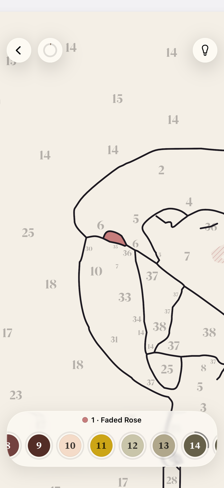

# Agent transcript

- end: success, 172 turns, 17.7 min, estimated $4.3717558000000025
- tool calls: {"mcp__maestro__take_screenshot": 6, "Read": 28, "mcp__maestro__run": 61, "mcp__maestro__inspect_screen": 49, "Write": 4}
- images the agent received: 29

**Start**: model claude-opus-5-5, MCP [{"name": "maestro", "status": "connected", "source": "dynamic"}]

→ `mcp__maestro__take_screenshot` `{"device_id": "77AA4492-C787-4EEE-A772-05D4B3E9ECCD"}`

→ `Read` `{"file_path": "/Users/runner/.claude/projects/-Users-runner-work--temp-qa/memory/MEMORY.md"}`

← mcp__maestro__take_screenshot: image  919x2000

← Read (error): File does not exist. Note: your current working directory is /Users/runner/work/_temp/qa.

> Starting a new painting from the photo.

→ `mcp__maestro__run` `{"device_id": "77AA4492-C787-4EEE-A772-05D4B3E9ECCD", "yaml": "appId: com.pbordjadze.paintbynumber\n---\n- tapOn:\n    point: \"90%,10%\"\n- waitForAnimationToEnd"}`

→ `mcp__maestro__inspect_screen` `{"device_id": "77AA4492-C787-4EEE-A772-05D4B3E9ECCD"}`

← mcp__maestro__run: {"success":true,"device_id":"77AA4492-C787-4EEE-A772-05D4B3E9ECCD","commands_executed":3,"message":"Flow executed successfully","env_vars":{"MAESTRO_CLI_ANALYSIS_NOTIFICATION_DISABLED":"true","MAESTRO_CLI_NO_ANALYTICS":"1","MAESTRO_DRIVER_STARTUP_TIMEOUT":"240000","MAESTRO_VERSION":"2.11.0"}}

← mcp__maestro__inspect_screen: {"ui_schema":{"platform":"ios","abbreviations":{"b":"bounds","txt":"text","rid":"resource-id","a11y":"accessibilityText","hint":"hintText","val":"value","c":"children"},"defaults":{"enabled":true,"focused":false,"selected":false,"checked":false,"txt":"","hint":"","rid":"","val":"","a11y":""}},"elements":[{"b":"[0,0][402,874]","a11y":"Paint by Moonlight","c":[{"b":"[0,0][402,874]","c":[{"b":"[0,0][ …

→ `mcp__maestro__run` `{"device_id": "77AA4492-C787-4EEE-A772-05D4B3E9ECCD", "yaml": "appId: com.pbordjadze.paintbynumber\n---\n- tapOn: \"New Painting\"\n- waitForAnimationToEnd"}`

→ `mcp__maestro__take_screenshot` `{"device_id": "77AA4492-C787-4EEE-A772-05D4B3E9ECCD"}`

← mcp__maestro__run: {"success":true,"device_id":"77AA4492-C787-4EEE-A772-05D4B3E9ECCD","commands_executed":3,"message":"Flow executed successfully","env_vars":{"MAESTRO_CLI_ANALYSIS_NOTIFICATION_DISABLED":"true","MAESTRO_CLI_NO_ANALYTICS":"1","MAESTRO_DRIVER_STARTUP_TIMEOUT":"240000","MAESTRO_VERSION":"2.11.0"}}

← mcp__maestro__take_screenshot: image  919x2000

→ `mcp__maestro__run` `{"device_id": "77AA4492-C787-4EEE-A772-05D4B3E9ECCD", "yaml": "appId: com.pbordjadze.paintbynumber\n---\n- tapOn: \"Close\"\n- tapOn: \"Choose Photo\"\n- waitForAnimationToEnd"}`

→ `mcp__maestro__take_screenshot` `{"device_id": "77AA4492-C787-4EEE-A772-05D4B3E9ECCD"}`

← mcp__maestro__run: {"success":true,"device_id":"77AA4492-C787-4EEE-A772-05D4B3E9ECCD","commands_executed":4,"message":"Flow executed successfully","env_vars":{"MAESTRO_CLI_ANALYSIS_NOTIFICATION_DISABLED":"true","MAESTRO_CLI_NO_ANALYTICS":"1","MAESTRO_DRIVER_STARTUP_TIMEOUT":"240000","MAESTRO_VERSION":"2.11.0"}}

← mcp__maestro__take_screenshot: image  919x2000

> Picking the parrots photo.

→ `mcp__maestro__run` `{"device_id": "77AA4492-C787-4EEE-A772-05D4B3E9ECCD", "yaml": "appId: com.pbordjadze.paintbynumber\n---\n- tapOn:\n    point: \"16%,43%\"\n- waitForAnimationToEnd"}`

→ `mcp__maestro__take_screenshot` `{"device_id": "77AA4492-C787-4EEE-A772-05D4B3E9ECCD"}`

← mcp__maestro__run: {"success":true,"device_id":"77AA4492-C787-4EEE-A772-05D4B3E9ECCD","commands_executed":3,"message":"Flow executed successfully","env_vars":{"MAESTRO_CLI_ANALYSIS_NOTIFICATION_DISABLED":"true","MAESTRO_CLI_NO_ANALYTICS":"1","MAESTRO_DRIVER_STARTUP_TIMEOUT":"240000","MAESTRO_VERSION":"2.11.0"}}

← mcp__maestro__take_screenshot: image  919x2000

→ `mcp__maestro__run` `{"device_id": "77AA4492-C787-4EEE-A772-05D4B3E9ECCD", "yaml": "appId: com.pbordjadze.paintbynumber\n---\n- tapOn: \"Refine\"\n- waitForAnimationToEnd\n- takeScreenshot: /Users/runner/work/_temp/qa/shots/refine-open"}`

→ `mcp__maestro__inspect_screen` `{"device_id": "77AA4492-C787-4EEE-A772-05D4B3E9ECCD"}`

← mcp__maestro__run: {"success":true,"device_id":"77AA4492-C787-4EEE-A772-05D4B3E9ECCD","commands_executed":4,"message":"Flow executed successfully","env_vars":{"MAESTRO_CLI_ANALYSIS_NOTIFICATION_DISABLED":"true","MAESTRO_CLI_NO_ANALYTICS":"1","MAESTRO_DRIVER_STARTUP_TIMEOUT":"240000","MAESTRO_VERSION":"2.11.0"}}

← mcp__maestro__inspect_screen: {"ui_schema":{"platform":"ios","abbreviations":{"b":"bounds","txt":"text","rid":"resource-id","a11y":"accessibilityText","hint":"hintText","val":"value","c":"children"},"defaults":{"enabled":true,"focused":false,"selected":false,"checked":false,"txt":"","hint":"","rid":"","val":"","a11y":""}},"elements":[{"b":"[0,0][402,874]","a11y":"Paint by Moonlight","c":[{"b":"[0,0][402,874]","c":[{"b":"[0,0][ …

→ `mcp__maestro__run` `{"device_id": "77AA4492-C787-4EEE-A772-05D4B3E9ECCD", "yaml": "appId: com.pbordjadze.paintbynumber\n---\n- tapOn: \"Close\"\n- waitForAnimationToEnd\n- takeScreenshot: /Users/runner/work/_temp/qa/shots/refine-main"}`

→ `mcp__maestro__inspect_screen` `{"device_id": "77AA4492-C787-4EEE-A772-05D4B3E9ECCD"}`

← mcp__maestro__run: {"success":true,"device_id":"77AA4492-C787-4EEE-A772-05D4B3E9ECCD","commands_executed":4,"message":"Flow executed successfully","env_vars":{"MAESTRO_CLI_ANALYSIS_NOTIFICATION_DISABLED":"true","MAESTRO_CLI_NO_ANALYTICS":"1","MAESTRO_DRIVER_STARTUP_TIMEOUT":"240000","MAESTRO_VERSION":"2.11.0"}}

← mcp__maestro__inspect_screen: {"ui_schema":{"platform":"ios","abbreviations":{"b":"bounds","txt":"text","rid":"resource-id","a11y":"accessibilityText","hint":"hintText","val":"value","c":"children"},"defaults":{"enabled":true,"focused":false,"selected":false,"checked":false,"txt":"","hint":"","rid":"","val":"","a11y":""}},"elements":[{"b":"[0,0][402,874]","a11y":"Paint by Moonlight","c":[{"b":"[0,0][402,874]","c":[{"b":"[0,0][ …

→ `Read` `{"file_path": "/Users/runner/work/_temp/qa/shots/refine-main.png"}`

← Read: image  920x2000

→ `mcp__maestro__run` `{"device_id": "77AA4492-C787-4EEE-A772-05D4B3E9ECCD", "yaml": "appId: com.pbordjadze.paintbynumber\n---\n- tapOn:\n    id: \"refine-layers\"\n- waitForAnimationToEnd\n- takeScreenshot: /Users/runner/work/_temp/qa/shots/layers-pen"}`

→ `mcp__maestro__inspect_screen` `{"device_id": "77AA4492-C787-4EEE-A772-05D4B3E9ECCD"}`

← mcp__maestro__run: {"success":true,"device_id":"77AA4492-C787-4EEE-A772-05D4B3E9ECCD","commands_executed":4,"message":"Flow executed successfully","env_vars":{"MAESTRO_CLI_ANALYSIS_NOTIFICATION_DISABLED":"true","MAESTRO_CLI_NO_ANALYTICS":"1","MAESTRO_DRIVER_STARTUP_TIMEOUT":"240000","MAESTRO_VERSION":"2.11.0"}}

← mcp__maestro__inspect_screen: {"ui_schema":{"platform":"ios","abbreviations":{"b":"bounds","txt":"text","rid":"resource-id","a11y":"accessibilityText","hint":"hintText","val":"value","c":"children"},"defaults":{"enabled":true,"focused":false,"selected":false,"checked":false,"txt":"","hint":"","rid":"","val":"","a11y":""}},"elements":[{"b":"[0,0][402,874]","a11y":"Paint by Moonlight","c":[{"b":"[0,0][402,874]","c":[{"b":"[0,0][ …

→ `Read` `{"file_path": "/Users/runner/work/_temp/qa/shots/layers-pen.png"}`

← Read: image  920x2000

> So far: Refine opens from the parrots photo's preview. The top bar already looks crowded: the "Refine" title is cut to "R…". I'm checking the Layers popover now.

→ `mcp__maestro__take_screenshot` `{"device_id": "77AA4492-C787-4EEE-A772-05D4B3E9ECCD"}`

← mcp__maestro__take_screenshot: image  919x2000

→ `mcp__maestro__run` `{"device_id": "77AA4492-C787-4EEE-A772-05D4B3E9ECCD", "yaml": "appId: com.pbordjadze.paintbynumber\n---\n- tapOn:\n    id: \"refine-layer-numbers\"\n- tapOn:\n    id: \"refine-layer-photo\"\n- tapOn:\n    id: \"refine-layer-paint\"\n- waitForAnimationToEnd\n- takeScreenshot: /Users/runner/work/_temp/qa/shots/layers-toggled"}`

→ `mcp__maestro__inspect_screen` `{"device_id": "77AA4492-C787-4EEE-A772-05D4B3E9ECCD"}`

← mcp__maestro__run: {"success":true,"device_id":"77AA4492-C787-4EEE-A772-05D4B3E9ECCD","commands_executed":6,"message":"Flow executed successfully","env_vars":{"MAESTRO_CLI_ANALYSIS_NOTIFICATION_DISABLED":"true","MAESTRO_CLI_NO_ANALYTICS":"1","MAESTRO_DRIVER_STARTUP_TIMEOUT":"240000","MAESTRO_VERSION":"2.11.0"}}

← mcp__maestro__inspect_screen: {"ui_schema":{"platform":"ios","abbreviations":{"b":"bounds","txt":"text","rid":"resource-id","a11y":"accessibilityText","hint":"hintText","val":"value","c":"children"},"defaults":{"enabled":true,"focused":false,"selected":false,"checked":false,"txt":"","hint":"","rid":"","val":"","a11y":""}},"elements":[{"b":"[0,0][402,874]","a11y":"Paint by Moonlight","c":[{"b":"[0,0][402,874]","c":[{"b":"[0,0][ …

→ `Read` `{"file_path": "/Users/runner/work/_temp/qa/shots/layers-toggled.png"}`

← Read: image  920x2000

→ `mcp__maestro__run` `{"device_id": "77AA4492-C787-4EEE-A772-05D4B3E9ECCD", "yaml": "appId: com.pbordjadze.paintbynumber\n---\n- tapOn:\n    point: \"340,138\"\n- waitForAnimationToEnd\n- takeScreenshot: /Users/runner/work/_temp/qa/shots/layers-numbers-on"}`

→ `mcp__maestro__inspect_screen` `{"device_id": "77AA4492-C787-4EEE-A772-05D4B3E9ECCD"}`

← mcp__maestro__run: {"success":true,"device_id":"77AA4492-C787-4EEE-A772-05D4B3E9ECCD","commands_executed":4,"message":"Flow executed successfully","env_vars":{"MAESTRO_CLI_ANALYSIS_NOTIFICATION_DISABLED":"true","MAESTRO_CLI_NO_ANALYTICS":"1","MAESTRO_DRIVER_STARTUP_TIMEOUT":"240000","MAESTRO_VERSION":"2.11.0"}}

← mcp__maestro__inspect_screen: {"ui_schema":{"platform":"ios","abbreviations":{"b":"bounds","txt":"text","rid":"resource-id","a11y":"accessibilityText","hint":"hintText","val":"value","c":"children"},"defaults":{"enabled":true,"focused":false,"selected":false,"checked":false,"txt":"","hint":"","rid":"","val":"","a11y":""}},"elements":[{"b":"[0,0][402,874]","a11y":"Paint by Moonlight","c":[{"b":"[0,0][402,874]","c":[{"b":"[0,0][ …

→ `mcp__maestro__run` `{"device_id": "77AA4492-C787-4EEE-A772-05D4B3E9ECCD", "yaml": "appId: com.pbordjadze.paintbynumber\n---\n- tapOn:\n    point: \"340,347\"\n- tapOn:\n    point: \"340,254\"\n- waitForAnimationToEnd\n- takeScreenshot: /Users/runner/work/_temp/qa/shots/layers-photo-on-paint-off"}`

← mcp__maestro__run: {"success":true,"device_id":"77AA4492-C787-4EEE-A772-05D4B3E9ECCD","commands_executed":5,"message":"Flow executed successfully","env_vars":{"MAESTRO_CLI_ANALYSIS_NOTIFICATION_DISABLED":"true","MAESTRO_CLI_NO_ANALYTICS":"1","MAESTRO_DRIVER_STARTUP_TIMEOUT":"240000","MAESTRO_VERSION":"2.11.0"}}

→ `Read` `{"file_path": "/Users/runner/work/_temp/qa/shots/layers-photo-on-paint-off.png"}`

← Read: image  920x2000

→ `mcp__maestro__run` `{"device_id": "77AA4492-C787-4EEE-A772-05D4B3E9ECCD", "yaml": "appId: com.pbordjadze.paintbynumber\n---\n- swipe:\n    start: \"300,385\"\n    end: \"200,385\"\n    duration: 600\n- waitForAnimationToEnd\n- takeScreenshot: /Users/runner/work/_temp/qa/shots/layers-photo-opacity"}`

→ `mcp__maestro__inspect_screen` `{"device_id": "77AA4492-C787-4EEE-A772-05D4B3E9ECCD"}`

← mcp__maestro__run: {"success":true,"device_id":"77AA4492-C787-4EEE-A772-05D4B3E9ECCD","commands_executed":4,"message":"Flow executed successfully","env_vars":{"MAESTRO_CLI_ANALYSIS_NOTIFICATION_DISABLED":"true","MAESTRO_CLI_NO_ANALYTICS":"1","MAESTRO_DRIVER_STARTUP_TIMEOUT":"240000","MAESTRO_VERSION":"2.11.0"}}

← mcp__maestro__inspect_screen: {"ui_schema":{"platform":"ios","abbreviations":{"b":"bounds","txt":"text","rid":"resource-id","a11y":"accessibilityText","hint":"hintText","val":"value","c":"children"},"defaults":{"enabled":true,"focused":false,"selected":false,"checked":false,"txt":"","hint":"","rid":"","val":"","a11y":""}},"elements":[{"b":"[0,0][402,874]","a11y":"Paint by Moonlight","c":[{"b":"[0,0][402,874]","c":[{"b":"[0,0][ …

> Now I'm turning Paint back on and closing the popover.

→ `mcp__maestro__run` `{"device_id": "77AA4492-C787-4EEE-A772-05D4B3E9ECCD", "yaml": "appId: com.pbordjadze.paintbynumber\n---\n- tapOn:\n    point: \"340,254\"\n- tapOn:\n    point: \"200,600\"\n- waitForAnimationToEnd\n- takeScreenshot: /Users/runner/work/_temp/qa/shots/layers-closed"}`

→ `mcp__maestro__inspect_screen` `{"device_id": "77AA4492-C787-4EEE-A772-05D4B3E9ECCD"}`

← mcp__maestro__run: {"success":true,"device_id":"77AA4492-C787-4EEE-A772-05D4B3E9ECCD","commands_executed":5,"message":"Flow executed successfully","env_vars":{"MAESTRO_CLI_ANALYSIS_NOTIFICATION_DISABLED":"true","MAESTRO_CLI_NO_ANALYTICS":"1","MAESTRO_DRIVER_STARTUP_TIMEOUT":"240000","MAESTRO_VERSION":"2.11.0"}}

← mcp__maestro__inspect_screen: {"ui_schema":{"platform":"ios","abbreviations":{"b":"bounds","txt":"text","rid":"resource-id","a11y":"accessibilityText","hint":"hintText","val":"value","c":"children"},"defaults":{"enabled":true,"focused":false,"selected":false,"checked":false,"txt":"","hint":"","rid":"","val":"","a11y":""}},"elements":[{"b":"[0,0][402,874]","a11y":"Paint by Moonlight","c":[{"b":"[0,0][402,874]","c":[{"b":"[0,0][ …

→ `Read` `{"file_path": "/Users/runner/work/_temp/qa/shots/layers-closed.png"}`

← Read: image  920x2000

→ `mcp__maestro__run` `{"device_id": "77AA4492-C787-4EEE-A772-05D4B3E9ECCD", "yaml": "appId: com.pbordjadze.paintbynumber\n---\n- tapOn:\n    point: \"201,761\"\n- waitForAnimationToEnd\n- takeScreenshot: /Users/runner/work/_temp/qa/shots/paint-group"}`

→ `mcp__maestro__inspect_screen` `{"device_id": "77AA4492-C787-4EEE-A772-05D4B3E9ECCD"}`

← mcp__maestro__run: {"success":true,"device_id":"77AA4492-C787-4EEE-A772-05D4B3E9ECCD","commands_executed":4,"message":"Flow executed successfully","env_vars":{"MAESTRO_CLI_ANALYSIS_NOTIFICATION_DISABLED":"true","MAESTRO_CLI_NO_ANALYTICS":"1","MAESTRO_DRIVER_STARTUP_TIMEOUT":"240000","MAESTRO_VERSION":"2.11.0"}}

← mcp__maestro__inspect_screen: {"ui_schema":{"platform":"ios","abbreviations":{"b":"bounds","txt":"text","rid":"resource-id","a11y":"accessibilityText","hint":"hintText","val":"value","c":"children"},"defaults":{"enabled":true,"focused":false,"selected":false,"checked":false,"txt":"","hint":"","rid":"","val":"","a11y":""}},"elements":[{"b":"[0,0][402,874]","a11y":"Paint by Moonlight","c":[{"b":"[0,0][402,874]","c":[{"b":"[0,0][ …

→ `Read` `{"file_path": "/Users/runner/work/_temp/qa/shots/paint-group.png"}`

← Read: image  920x2000

→ `mcp__maestro__run` `{"device_id": "77AA4492-C787-4EEE-A772-05D4B3E9ECCD", "yaml": "appId: com.pbordjadze.paintbynumber\n---\n- longPressOn:\n    point: \"116,480\"\n- waitForAnimationToEnd\n- takeScreenshot: /Users/runner/work/_temp/qa/shots/eyedrop-bucket-yellow"}`

→ `mcp__maestro__inspect_screen` `{"device_id": "77AA4492-C787-4EEE-A772-05D4B3E9ECCD"}`

← mcp__maestro__run: {"success":true,"device_id":"77AA4492-C787-4EEE-A772-05D4B3E9ECCD","commands_executed":4,"message":"Flow executed successfully","env_vars":{"MAESTRO_CLI_ANALYSIS_NOTIFICATION_DISABLED":"true","MAESTRO_CLI_NO_ANALYTICS":"1","MAESTRO_DRIVER_STARTUP_TIMEOUT":"240000","MAESTRO_VERSION":"2.11.0"}}

← mcp__maestro__inspect_screen: {"ui_schema":{"platform":"ios","abbreviations":{"b":"bounds","txt":"text","rid":"resource-id","a11y":"accessibilityText","hint":"hintText","val":"value","c":"children"},"defaults":{"enabled":true,"focused":false,"selected":false,"checked":false,"txt":"","hint":"","rid":"","val":"","a11y":""}},"elements":[{"b":"[0,0][402,874]","a11y":"Paint by Moonlight","c":[{"b":"[0,0][402,874]","c":[{"b":"[0,0][ …

→ `mcp__maestro__run` `{"device_id": "77AA4492-C787-4EEE-A772-05D4B3E9ECCD", "yaml": "appId: com.pbordjadze.paintbynumber\n---\n- tapOn:\n    point: \"53,761\"\n- waitForAnimationToEnd\n- takeScreenshot: /Users/runner/work/_temp/qa/shots/ink-again"}`

→ `mcp__maestro__inspect_screen` `{"device_id": "77AA4492-C787-4EEE-A772-05D4B3E9ECCD"}`

← mcp__maestro__run: {"success":true,"device_id":"77AA4492-C787-4EEE-A772-05D4B3E9ECCD","commands_executed":4,"message":"Flow executed successfully","env_vars":{"MAESTRO_CLI_ANALYSIS_NOTIFICATION_DISABLED":"true","MAESTRO_CLI_NO_ANALYTICS":"1","MAESTRO_DRIVER_STARTUP_TIMEOUT":"240000","MAESTRO_VERSION":"2.11.0"}}

← mcp__maestro__inspect_screen: {"ui_schema":{"platform":"ios","abbreviations":{"b":"bounds","txt":"text","rid":"resource-id","a11y":"accessibilityText","hint":"hintText","val":"value","c":"children"},"defaults":{"enabled":true,"focused":false,"selected":false,"checked":false,"txt":"","hint":"","rid":"","val":"","a11y":""}},"elements":[{"b":"[0,0][402,874]","a11y":"Paint by Moonlight","c":[{"b":"[0,0][402,874]","c":[{"b":"[0,0][ …

→ `mcp__maestro__run` `{"device_id": "77AA4492-C787-4EEE-A772-05D4B3E9ECCD", "yaml": "appId: com.pbordjadze.paintbynumber\n---\n- tapOn:\n    point: \"201,761\"\n- waitForAnimationToEnd\n- takeScreenshot: /Users/runner/work/_temp/qa/shots/paint-group-2"}`

→ `mcp__maestro__inspect_screen` `{"device_id": "77AA4492-C787-4EEE-A772-05D4B3E9ECCD"}`

← mcp__maestro__run: {"success":true,"device_id":"77AA4492-C787-4EEE-A772-05D4B3E9ECCD","commands_executed":4,"message":"Flow executed successfully","env_vars":{"MAESTRO_CLI_ANALYSIS_NOTIFICATION_DISABLED":"true","MAESTRO_CLI_NO_ANALYTICS":"1","MAESTRO_DRIVER_STARTUP_TIMEOUT":"240000","MAESTRO_VERSION":"2.11.0"}}

← mcp__maestro__inspect_screen: {"ui_schema":{"platform":"ios","abbreviations":{"b":"bounds","txt":"text","rid":"resource-id","a11y":"accessibilityText","hint":"hintText","val":"value","c":"children"},"defaults":{"enabled":true,"focused":false,"selected":false,"checked":false,"txt":"","hint":"","rid":"","val":"","a11y":""}},"elements":[{"b":"[0,0][402,874]","a11y":"Paint by Moonlight","c":[{"b":"[0,0][402,874]","c":[{"b":"[0,0][ …

→ `mcp__maestro__run` `{"device_id": "77AA4492-C787-4EEE-A772-05D4B3E9ECCD", "yaml": "appId: com.pbordjadze.paintbynumber\n---\n- tapOn:\n    point: \"53,761\"\n- waitForAnimationToEnd\n- longPressOn:\n    point: \"300,440\"\n- waitForAnimationToEnd\n- takeScreenshot: /Users/runner/work/_temp/qa/shots/eyedrop-pen-red"}`

→ `mcp__maestro__inspect_screen` `{"device_id": "77AA4492-C787-4EEE-A772-05D4B3E9ECCD"}`

← mcp__maestro__run: {"success":true,"device_id":"77AA4492-C787-4EEE-A772-05D4B3E9ECCD","commands_executed":6,"message":"Flow executed successfully","env_vars":{"MAESTRO_CLI_ANALYSIS_NOTIFICATION_DISABLED":"true","MAESTRO_CLI_NO_ANALYTICS":"1","MAESTRO_DRIVER_STARTUP_TIMEOUT":"240000","MAESTRO_VERSION":"2.11.0"}}

← mcp__maestro__inspect_screen: {"ui_schema":{"platform":"ios","abbreviations":{"b":"bounds","txt":"text","rid":"resource-id","a11y":"accessibilityText","hint":"hintText","val":"value","c":"children"},"defaults":{"enabled":true,"focused":false,"selected":false,"checked":false,"txt":"","hint":"","rid":"","val":"","a11y":""}},"elements":[{"b":"[0,0][402,874]","a11y":"Paint by Moonlight","c":[{"b":"[0,0][402,874]","c":[{"b":"[0,0][ …

→ `mcp__maestro__run` `{"device_id": "77AA4492-C787-4EEE-A772-05D4B3E9ECCD", "yaml": "appId: com.pbordjadze.paintbynumber\n---\n- tapOn:\n    point: \"201,761\"\n- waitForAnimationToEnd\n- takeScreenshot: /Users/runner/work/_temp/qa/shots/after-pen-eyedrop-paint"}`

→ `Read` `{"file_path": "/Users/runner/work/_temp/qa/app.log"}`

← mcp__maestro__run: {"success":true,"device_id":"77AA4492-C787-4EEE-A772-05D4B3E9ECCD","commands_executed":4,"message":"Flow executed successfully","env_vars":{"MAESTRO_CLI_ANALYSIS_NOTIFICATION_DISABLED":"true","MAESTRO_CLI_NO_ANALYTICS":"1","MAESTRO_DRIVER_STARTUP_TIMEOUT":"240000","MAESTRO_VERSION":"2.11.0"}}

← Read: 1	getpwuid_r did not find a match for uid 501
2	Filtering the log data using "subsystem == "com.pbordjadze.paintbynumber""
3	Timestamp               Ty Process[PID:TID]
4	2026-10-28 04:11:30.045 Df PaintByNumber[20963:f5e2] [com.pbordjadze.paintbynumber:tips] offer in shelf: , wanted
5	2026-10-28 04:11:31.777 Df PaintByNumber[20963:f648] [com.pbordjadze.paintbynumber:canvas] Making the render cont …

→ `mcp__maestro__inspect_screen` `{"device_id": "77AA4492-C787-4EEE-A772-05D4B3E9ECCD"}`

← mcp__maestro__inspect_screen: {"ui_schema":{"platform":"ios","abbreviations":{"b":"bounds","txt":"text","rid":"resource-id","a11y":"accessibilityText","hint":"hintText","val":"value","c":"children"},"defaults":{"enabled":true,"focused":false,"selected":false,"checked":false,"txt":"","hint":"","rid":"","val":"","a11y":""}},"elements":[{"b":"[0,0][402,874]","a11y":"Paint by Moonlight","c":[{"b":"[0,0][402,874]","c":[{"b":"[0,0][ …

→ `Write` `{"file_path": "/Users/runner/work/_temp/qa/report.md", "content": "# Paint by Moonlight \u2014 exploratory test report (Refine on iPhone 17 Pro, debug build), 2026-10-28\n\n## Summary\n(In progress.) I opened Refine from the parrots photo's New Painting preview. The Layers popover fits the phone width and works, and a still touch picks the cell's paint with Bucket and Pen. The top bar's \"Refine\" title is cut to \"R\u2026\".\n\n## Coverage\n- Goal 1 (new painting): partly. Photo picked \u2192 preview \u2192 Refine. Start Painting not yet tried.\n- Goals 2\u20135: not tried yet. This session f`

← Write: File created successfully at: /Users/runner/work/_temp/qa/report.md (file state is current in your context — no need to Read it back)

> Now the Cells group (Select, Make Cell).

→ `mcp__maestro__run` `{"device_id": "77AA4492-C787-4EEE-A772-05D4B3E9ECCD", "yaml": "appId: com.pbordjadze.paintbynumber\n---\n- tapOn:\n    point: \"127,761\"\n- waitForAnimationToEnd\n- takeScreenshot: /Users/runner/work/_temp/qa/shots/cells-group"}`

→ `mcp__maestro__inspect_screen` `{"device_id": "77AA4492-C787-4EEE-A772-05D4B3E9ECCD"}`

← mcp__maestro__run: {"success":true,"device_id":"77AA4492-C787-4EEE-A772-05D4B3E9ECCD","commands_executed":4,"message":"Flow executed successfully","env_vars":{"MAESTRO_CLI_ANALYSIS_NOTIFICATION_DISABLED":"true","MAESTRO_CLI_NO_ANALYTICS":"1","MAESTRO_DRIVER_STARTUP_TIMEOUT":"240000","MAESTRO_VERSION":"2.11.0"}}

← mcp__maestro__inspect_screen: {"ui_schema":{"platform":"ios","abbreviations":{"b":"bounds","txt":"text","rid":"resource-id","a11y":"accessibilityText","hint":"hintText","val":"value","c":"children"},"defaults":{"enabled":true,"focused":false,"selected":false,"checked":false,"txt":"","hint":"","rid":"","val":"","a11y":""}},"elements":[{"b":"[0,0][402,874]","a11y":"Paint by Moonlight","c":[{"b":"[0,0][402,874]","c":[{"b":"[0,0][ …

→ `mcp__maestro__run` `{"device_id": "77AA4492-C787-4EEE-A772-05D4B3E9ECCD", "yaml": "appId: com.pbordjadze.paintbynumber\n---\n- tapOn:\n    point: \"116,480\"\n- waitForAnimationToEnd\n- takeScreenshot: /Users/runner/work/_temp/qa/shots/select-yellow"}`

→ `mcp__maestro__inspect_screen` `{"device_id": "77AA4492-C787-4EEE-A772-05D4B3E9ECCD"}`

← mcp__maestro__run: {"success":true,"device_id":"77AA4492-C787-4EEE-A772-05D4B3E9ECCD","commands_executed":4,"message":"Flow executed successfully","env_vars":{"MAESTRO_CLI_ANALYSIS_NOTIFICATION_DISABLED":"true","MAESTRO_CLI_NO_ANALYTICS":"1","MAESTRO_DRIVER_STARTUP_TIMEOUT":"240000","MAESTRO_VERSION":"2.11.0"}}

← mcp__maestro__inspect_screen: {"ui_schema":{"platform":"ios","abbreviations":{"b":"bounds","txt":"text","rid":"resource-id","a11y":"accessibilityText","hint":"hintText","val":"value","c":"children"},"defaults":{"enabled":true,"focused":false,"selected":false,"checked":false,"txt":"","hint":"","rid":"","val":"","a11y":""}},"elements":[{"b":"[0,0][402,874]","a11y":"Paint by Moonlight","c":[{"b":"[0,0][402,874]","c":[{"b":"[0,0][ …

→ `Read` `{"file_path": "/Users/runner/work/_temp/qa/shots/select-yellow.png"}`

← Read: image  920x2000

→ `mcp__maestro__run` `{"device_id": "77AA4492-C787-4EEE-A772-05D4B3E9ECCD", "yaml": "appId: com.pbordjadze.paintbynumber\n---\n- tapOn:\n    id: \"refine-selection-color\"\n- waitForAnimationToEnd\n- takeScreenshot: /Users/runner/work/_temp/qa/shots/area-card"}`

← mcp__maestro__run: {"success":true,"device_id":"77AA4492-C787-4EEE-A772-05D4B3E9ECCD","commands_executed":4,"message":"Flow executed successfully","env_vars":{"MAESTRO_CLI_ANALYSIS_NOTIFICATION_DISABLED":"true","MAESTRO_CLI_NO_ANALYTICS":"1","MAESTRO_DRIVER_STARTUP_TIMEOUT":"240000","MAESTRO_VERSION":"2.11.0"}}

→ `Read` `{"file_path": "/Users/runner/work/_temp/qa/shots/area-card.png"}`

← Read: image  920x2000

→ `mcp__maestro__run` `{"device_id": "77AA4492-C787-4EEE-A772-05D4B3E9ECCD", "yaml": "appId: com.pbordjadze.paintbynumber\n---\n- tapOn:\n    point: \"76,687\"\n- waitForAnimationToEnd\n- takeScreenshot: /Users/runner/work/_temp/qa/shots/area-card-pick2"}`

← mcp__maestro__run: {"success":true,"device_id":"77AA4492-C787-4EEE-A772-05D4B3E9ECCD","commands_executed":4,"message":"Flow executed successfully","env_vars":{"MAESTRO_CLI_ANALYSIS_NOTIFICATION_DISABLED":"true","MAESTRO_CLI_NO_ANALYTICS":"1","MAESTRO_DRIVER_STARTUP_TIMEOUT":"240000","MAESTRO_VERSION":"2.11.0"}}

→ `Read` `{"file_path": "/Users/runner/work/_temp/qa/shots/area-card-pick2.png"}`

← Read: image  920x2000

→ `mcp__maestro__run` `{"device_id": "77AA4492-C787-4EEE-A772-05D4B3E9ECCD", "yaml": "appId: com.pbordjadze.paintbynumber\n---\n- swipe:\n    start: \"201,428\"\n    end: \"201,820\"\n    duration: 500\n- waitForAnimationToEnd\n- takeScreenshot: /Users/runner/work/_temp/qa/shots/area-card-closed"}`

→ `mcp__maestro__inspect_screen` `{"device_id": "77AA4492-C787-4EEE-A772-05D4B3E9ECCD"}`

← mcp__maestro__run: {"success":true,"device_id":"77AA4492-C787-4EEE-A772-05D4B3E9ECCD","commands_executed":4,"message":"Flow executed successfully","env_vars":{"MAESTRO_CLI_ANALYSIS_NOTIFICATION_DISABLED":"true","MAESTRO_CLI_NO_ANALYTICS":"1","MAESTRO_DRIVER_STARTUP_TIMEOUT":"240000","MAESTRO_VERSION":"2.11.0"}}

← mcp__maestro__inspect_screen: {"ui_schema":{"platform":"ios","abbreviations":{"b":"bounds","txt":"text","rid":"resource-id","a11y":"accessibilityText","hint":"hintText","val":"value","c":"children"},"defaults":{"enabled":true,"focused":false,"selected":false,"checked":false,"txt":"","hint":"","rid":"","val":"","a11y":""}},"elements":[{"b":"[0,0][402,874]","a11y":"Paint by Moonlight","c":[{"b":"[0,0][402,874]","c":[{"b":"[0,0][ …

→ `mcp__maestro__run` `{"device_id": "77AA4492-C787-4EEE-A772-05D4B3E9ECCD", "yaml": "appId: com.pbordjadze.paintbynumber\n---\n- tapOn:\n    id: \"refine-undo\"\n- waitForAnimationToEnd\n- takeScreenshot: /Users/runner/work/_temp/qa/shots/after-undo-recolor"}`

→ `mcp__maestro__inspect_screen` `{"device_id": "77AA4492-C787-4EEE-A772-05D4B3E9ECCD"}`

← mcp__maestro__run: {"success":true,"device_id":"77AA4492-C787-4EEE-A772-05D4B3E9ECCD","commands_executed":4,"message":"Flow executed successfully","env_vars":{"MAESTRO_CLI_ANALYSIS_NOTIFICATION_DISABLED":"true","MAESTRO_CLI_NO_ANALYTICS":"1","MAESTRO_DRIVER_STARTUP_TIMEOUT":"240000","MAESTRO_VERSION":"2.11.0"}}

← mcp__maestro__inspect_screen: {"ui_schema":{"platform":"ios","abbreviations":{"b":"bounds","txt":"text","rid":"resource-id","a11y":"accessibilityText","hint":"hintText","val":"value","c":"children"},"defaults":{"enabled":true,"focused":false,"selected":false,"checked":false,"txt":"","hint":"","rid":"","val":"","a11y":""}},"elements":[{"b":"[0,0][402,874]","a11y":"Paint by Moonlight","c":[{"b":"[0,0][402,874]","c":[{"b":"[0,0][ …

> Undo restored everything (yellow 11 back, numbers back, "No changes"). Next: Redo, then the Make Cell tool.

→ `mcp__maestro__run` `{"device_id": "77AA4492-C787-4EEE-A772-05D4B3E9ECCD", "yaml": "appId: com.pbordjadze.paintbynumber\n---\n- tapOn:\n    id: \"refine-redo\"\n- tapOn:\n    id: \"refine-tool-fill\"\n- waitForAnimationToEnd\n- takeScreenshot: /Users/runner/work/_temp/qa/shots/make-cell-tool"}`

→ `mcp__maestro__inspect_screen` `{"device_id": "77AA4492-C787-4EEE-A772-05D4B3E9ECCD"}`

← mcp__maestro__run: {"success":true,"device_id":"77AA4492-C787-4EEE-A772-05D4B3E9ECCD","commands_executed":5,"message":"Flow executed successfully","env_vars":{"MAESTRO_CLI_ANALYSIS_NOTIFICATION_DISABLED":"true","MAESTRO_CLI_NO_ANALYTICS":"1","MAESTRO_DRIVER_STARTUP_TIMEOUT":"240000","MAESTRO_VERSION":"2.11.0"}}

← mcp__maestro__inspect_screen: {"ui_schema":{"platform":"ios","abbreviations":{"b":"bounds","txt":"text","rid":"resource-id","a11y":"accessibilityText","hint":"hintText","val":"value","c":"children"},"defaults":{"enabled":true,"focused":false,"selected":false,"checked":false,"txt":"","hint":"","rid":"","val":"","a11y":""}},"elements":[{"b":"[0,0][402,874]","a11y":"Paint by Moonlight","c":[{"b":"[0,0][402,874]","c":[{"b":"[0,0][ …

→ `Read` `{"file_path": "/Users/runner/work/_temp/qa/shots/make-cell-tool.png"}`

← Read: image  920x2000

→ `mcp__maestro__run` `{"device_id": "77AA4492-C787-4EEE-A772-05D4B3E9ECCD", "yaml": "appId: com.pbordjadze.paintbynumber\n---\n- swipe:\n    start: \"225,250\"\n    end: \"265,275\"\n    duration: 800\n- waitForAnimationToEnd\n- takeScreenshot: /Users/runner/work/_temp/qa/shots/make-cell-stroke"}`

→ `mcp__maestro__inspect_screen` `{"device_id": "77AA4492-C787-4EEE-A772-05D4B3E9ECCD"}`

← mcp__maestro__run: {"success":true,"device_id":"77AA4492-C787-4EEE-A772-05D4B3E9ECCD","commands_executed":4,"message":"Flow executed successfully","env_vars":{"MAESTRO_CLI_ANALYSIS_NOTIFICATION_DISABLED":"true","MAESTRO_CLI_NO_ANALYTICS":"1","MAESTRO_DRIVER_STARTUP_TIMEOUT":"240000","MAESTRO_VERSION":"2.11.0"}}

← mcp__maestro__inspect_screen: {"ui_schema":{"platform":"ios","abbreviations":{"b":"bounds","txt":"text","rid":"resource-id","a11y":"accessibilityText","hint":"hintText","val":"value","c":"children"},"defaults":{"enabled":true,"focused":false,"selected":false,"checked":false,"txt":"","hint":"","rid":"","val":"","a11y":""}},"elements":[{"b":"[0,0][402,874]","a11y":"Paint by Moonlight","c":[{"b":"[0,0][402,874]","c":[{"b":"[0,0][ …

→ `mcp__maestro__run` `{"device_id": "77AA4492-C787-4EEE-A772-05D4B3E9ECCD", "yaml": "appId: com.pbordjadze.paintbynumber\n---\n- tapOn:\n    point: \"53,761\"\n- tapOn:\n    id: \"refine-tool-eraser\"\n- waitForAnimationToEnd\n- takeScreenshot: /Users/runner/work/_temp/qa/shots/eraser-options"}`

→ `mcp__maestro__inspect_screen` `{"device_id": "77AA4492-C787-4EEE-A772-05D4B3E9ECCD"}`

← mcp__maestro__run: {"success":true,"device_id":"77AA4492-C787-4EEE-A772-05D4B3E9ECCD","commands_executed":5,"message":"Flow executed successfully","env_vars":{"MAESTRO_CLI_ANALYSIS_NOTIFICATION_DISABLED":"true","MAESTRO_CLI_NO_ANALYTICS":"1","MAESTRO_DRIVER_STARTUP_TIMEOUT":"240000","MAESTRO_VERSION":"2.11.0"}}

← mcp__maestro__inspect_screen: {"ui_schema":{"platform":"ios","abbreviations":{"b":"bounds","txt":"text","rid":"resource-id","a11y":"accessibilityText","hint":"hintText","val":"value","c":"children"},"defaults":{"enabled":true,"focused":false,"selected":false,"checked":false,"txt":"","hint":"","rid":"","val":"","a11y":""}},"elements":[{"b":"[0,0][402,874]","a11y":"Paint by Moonlight","c":[{"b":"[0,0][402,874]","c":[{"b":"[0,0][ …

> Eraser: the Size slider (16 points) fits. Make Cell has no options panel, and an open stroke made nothing (it needs a closed loop, which Maestro can't draw). Now testing Cancel with 1 change pending.

→ `mcp__maestro__run` `{"device_id": "77AA4492-C787-4EEE-A772-05D4B3E9ECCD", "yaml": "appId: com.pbordjadze.paintbynumber\n---\n- tapOn:\n    id: \"refine-cancel\"\n- waitForAnimationToEnd\n- takeScreenshot: /Users/runner/work/_temp/qa/shots/cancel-ask"}`

→ `mcp__maestro__inspect_screen` `{"device_id": "77AA4492-C787-4EEE-A772-05D4B3E9ECCD"}`

← mcp__maestro__run: {"success":true,"device_id":"77AA4492-C787-4EEE-A772-05D4B3E9ECCD","commands_executed":4,"message":"Flow executed successfully","env_vars":{"MAESTRO_CLI_ANALYSIS_NOTIFICATION_DISABLED":"true","MAESTRO_CLI_NO_ANALYTICS":"1","MAESTRO_DRIVER_STARTUP_TIMEOUT":"240000","MAESTRO_VERSION":"2.11.0"}}

← mcp__maestro__inspect_screen: {"ui_schema":{"platform":"ios","abbreviations":{"b":"bounds","txt":"text","rid":"resource-id","a11y":"accessibilityText","hint":"hintText","val":"value","c":"children"},"defaults":{"enabled":true,"focused":false,"selected":false,"checked":false,"txt":"","hint":"","rid":"","val":"","a11y":""}},"elements":[{"b":"[0,0][402,874]","a11y":"Paint by Moonlight","c":[{"b":"[0,0][402,874]","c":[{"b":"[0,0][ …

→ `mcp__maestro__run` `{"device_id": "77AA4492-C787-4EEE-A772-05D4B3E9ECCD", "yaml": "appId: com.pbordjadze.paintbynumber\n---\n- tapOn:\n    point: \"330,620\"\n- waitForAnimationToEnd\n- takeScreenshot: /Users/runner/work/_temp/qa/shots/cancel-dismissed"}`

→ `mcp__maestro__inspect_screen` `{"device_id": "77AA4492-C787-4EEE-A772-05D4B3E9ECCD"}`

← mcp__maestro__run: {"success":true,"device_id":"77AA4492-C787-4EEE-A772-05D4B3E9ECCD","commands_executed":4,"message":"Flow executed successfully","env_vars":{"MAESTRO_CLI_ANALYSIS_NOTIFICATION_DISABLED":"true","MAESTRO_CLI_NO_ANALYTICS":"1","MAESTRO_DRIVER_STARTUP_TIMEOUT":"240000","MAESTRO_VERSION":"2.11.0"}}

← mcp__maestro__inspect_screen: {"ui_schema":{"platform":"ios","abbreviations":{"b":"bounds","txt":"text","rid":"resource-id","a11y":"accessibilityText","hint":"hintText","val":"value","c":"children"},"defaults":{"enabled":true,"focused":false,"selected":false,"checked":false,"txt":"","hint":"","rid":"","val":"","a11y":""}},"elements":[{"b":"[0,0][402,874]","a11y":"Paint by Moonlight","c":[{"b":"[0,0][402,874]","c":[{"b":"[0,0][ …

> Cancel asks "Discard Your Changes?" and dismissing it keeps the change. Next: the Tool Guide.

→ `mcp__maestro__run` `{"device_id": "77AA4492-C787-4EEE-A772-05D4B3E9ECCD", "yaml": "appId: com.pbordjadze.paintbynumber\n---\n- tapOn:\n    id: \"refine-guide\"\n- waitForAnimationToEnd\n- takeScreenshot: /Users/runner/work/_temp/qa/shots/guide"}`

→ `mcp__maestro__inspect_screen` `{"device_id": "77AA4492-C787-4EEE-A772-05D4B3E9ECCD"}`

← mcp__maestro__run: {"success":true,"device_id":"77AA4492-C787-4EEE-A772-05D4B3E9ECCD","commands_executed":4,"message":"Flow executed successfully","env_vars":{"MAESTRO_CLI_ANALYSIS_NOTIFICATION_DISABLED":"true","MAESTRO_CLI_NO_ANALYTICS":"1","MAESTRO_DRIVER_STARTUP_TIMEOUT":"240000","MAESTRO_VERSION":"2.11.0"}}

← mcp__maestro__inspect_screen: {"ui_schema":{"platform":"ios","abbreviations":{"b":"bounds","txt":"text","rid":"resource-id","a11y":"accessibilityText","hint":"hintText","val":"value","c":"children"},"defaults":{"enabled":true,"focused":false,"selected":false,"checked":false,"txt":"","hint":"","rid":"","val":"","a11y":""}},"elements":[{"b":"[0,0][402,874]","a11y":"Paint by Moonlight","c":[{"b":"[0,0][402,874]","c":[{"b":"[0,0][ …

→ `mcp__maestro__run` `{"device_id": "77AA4492-C787-4EEE-A772-05D4B3E9ECCD", "yaml": "appId: com.pbordjadze.paintbynumber\n---\n- tapOn:\n    id: \"BackButton\"\n- waitForAnimationToEnd\n- takeScreenshot: /Users/runner/work/_temp/qa/shots/guide-index"}`

→ `mcp__maestro__inspect_screen` `{"device_id": "77AA4492-C787-4EEE-A772-05D4B3E9ECCD"}`

← mcp__maestro__run: {"success":true,"device_id":"77AA4492-C787-4EEE-A772-05D4B3E9ECCD","commands_executed":4,"message":"Flow executed successfully","env_vars":{"MAESTRO_CLI_ANALYSIS_NOTIFICATION_DISABLED":"true","MAESTRO_CLI_NO_ANALYTICS":"1","MAESTRO_DRIVER_STARTUP_TIMEOUT":"240000","MAESTRO_VERSION":"2.11.0"}}

← mcp__maestro__inspect_screen: {"ui_schema":{"platform":"ios","abbreviations":{"b":"bounds","txt":"text","rid":"resource-id","a11y":"accessibilityText","hint":"hintText","val":"value","c":"children"},"defaults":{"enabled":true,"focused":false,"selected":false,"checked":false,"txt":"","hint":"","rid":"","val":"","a11y":""}},"elements":[{"b":"[0,0][402,874]","a11y":"Paint by Moonlight","c":[{"b":"[0,0][402,874]","c":[{"b":"[0,0][ …

→ `mcp__maestro__run` `{"device_id": "77AA4492-C787-4EEE-A772-05D4B3E9ECCD", "yaml": "appId: com.pbordjadze.paintbynumber\n---\n- tapOn:\n    id: \"refine-guide-topic-layers\"\n- waitForAnimationToEnd\n- takeScreenshot: /Users/runner/work/_temp/qa/shots/guide-layers"}`

→ `mcp__maestro__inspect_screen` `{"device_id": "77AA4492-C787-4EEE-A772-05D4B3E9ECCD"}`

← mcp__maestro__run: {"success":true,"device_id":"77AA4492-C787-4EEE-A772-05D4B3E9ECCD","commands_executed":4,"message":"Flow executed successfully","env_vars":{"MAESTRO_CLI_ANALYSIS_NOTIFICATION_DISABLED":"true","MAESTRO_CLI_NO_ANALYTICS":"1","MAESTRO_DRIVER_STARTUP_TIMEOUT":"240000","MAESTRO_VERSION":"2.11.0"}}

← mcp__maestro__inspect_screen: {"ui_schema":{"platform":"ios","abbreviations":{"b":"bounds","txt":"text","rid":"resource-id","a11y":"accessibilityText","hint":"hintText","val":"value","c":"children"},"defaults":{"enabled":true,"focused":false,"selected":false,"checked":false,"txt":"","hint":"","rid":"","val":"","a11y":""}},"elements":[{"b":"[0,0][402,874]","a11y":"Paint by Moonlight","c":[{"b":"[0,0][402,874]","c":[{"b":"[0,0][ …

→ `mcp__maestro__run` `{"device_id": "77AA4492-C787-4EEE-A772-05D4B3E9ECCD", "yaml": "appId: com.pbordjadze.paintbynumber\n---\n- swipe:\n    start: \"200,820\"\n    end: \"200,600\"\n    duration: 500\n- waitForAnimationToEnd\n- takeScreenshot: /Users/runner/work/_temp/qa/shots/guide-layers-2"}`

← mcp__maestro__run: {"success":true,"device_id":"77AA4492-C787-4EEE-A772-05D4B3E9ECCD","commands_executed":4,"message":"Flow executed successfully","env_vars":{"MAESTRO_CLI_ANALYSIS_NOTIFICATION_DISABLED":"true","MAESTRO_CLI_NO_ANALYTICS":"1","MAESTRO_DRIVER_STARTUP_TIMEOUT":"240000","MAESTRO_VERSION":"2.11.0"}}

→ `Read` `{"file_path": "/Users/runner/work/_temp/qa/shots/guide-layers-2.png"}`

← Read: image  920x2000

→ `mcp__maestro__run` `{"device_id": "77AA4492-C787-4EEE-A772-05D4B3E9ECCD", "yaml": "appId: com.pbordjadze.paintbynumber\n---\n- swipe:\n    start: \"200,840\"\n    end: \"200,600\"\n    duration: 500\n- waitForAnimationToEnd\n- takeScreenshot: /Users/runner/work/_temp/qa/shots/guide-layers-3"}`

← mcp__maestro__run: {"success":true,"device_id":"77AA4492-C787-4EEE-A772-05D4B3E9ECCD","commands_executed":4,"message":"Flow executed successfully","env_vars":{"MAESTRO_CLI_ANALYSIS_NOTIFICATION_DISABLED":"true","MAESTRO_CLI_NO_ANALYTICS":"1","MAESTRO_DRIVER_STARTUP_TIMEOUT":"240000","MAESTRO_VERSION":"2.11.0"}}

→ `Read` `{"file_path": "/Users/runner/work/_temp/qa/shots/guide-layers-3.png"}`

← Read: image  920x2000

→ `mcp__maestro__run` `{"device_id": "77AA4492-C787-4EEE-A772-05D4B3E9ECCD", "yaml": "appId: com.pbordjadze.paintbynumber\n---\n- tapOn:\n    id: \"refine-layers\"\n- waitForAnimationToEnd\n- takeScreenshot: /Users/runner/work/_temp/qa/shots/guide-practice-layers"}`

→ `mcp__maestro__inspect_screen` `{"device_id": "77AA4492-C787-4EEE-A772-05D4B3E9ECCD"}`

← mcp__maestro__run: {"success":true,"device_id":"77AA4492-C787-4EEE-A772-05D4B3E9ECCD","commands_executed":4,"message":"Flow executed successfully","env_vars":{"MAESTRO_CLI_ANALYSIS_NOTIFICATION_DISABLED":"true","MAESTRO_CLI_NO_ANALYTICS":"1","MAESTRO_DRIVER_STARTUP_TIMEOUT":"240000","MAESTRO_VERSION":"2.11.0"}}

← mcp__maestro__inspect_screen: {"ui_schema":{"platform":"ios","abbreviations":{"b":"bounds","txt":"text","rid":"resource-id","a11y":"accessibilityText","hint":"hintText","val":"value","c":"children"},"defaults":{"enabled":true,"focused":false,"selected":false,"checked":false,"txt":"","hint":"","rid":"","val":"","a11y":""}},"elements":[{"b":"[0,0][402,874]","a11y":"Paint by Moonlight","c":[{"b":"[0,0][402,874]","c":[{"b":"[0,0][ …

→ `mcp__maestro__run` `{"device_id": "77AA4492-C787-4EEE-A772-05D4B3E9ECCD", "yaml": "appId: com.pbordjadze.paintbynumber\n---\n- tapOn:\n    point: \"278,457\"\n- waitForAnimationToEnd\n- takeScreenshot: /Users/runner/work/_temp/qa/shots/guide-practice-photo-off"}`

← mcp__maestro__run: {"success":true,"device_id":"77AA4492-C787-4EEE-A772-05D4B3E9ECCD","commands_executed":4,"message":"Flow executed successfully","env_vars":{"MAESTRO_CLI_ANALYSIS_NOTIFICATION_DISABLED":"true","MAESTRO_CLI_NO_ANALYTICS":"1","MAESTRO_DRIVER_STARTUP_TIMEOUT":"240000","MAESTRO_VERSION":"2.11.0"}}

→ `Read` `{"file_path": "/Users/runner/work/_temp/qa/shots/guide-practice-photo-off.png"}`

← Read: image  920x2000

→ `mcp__maestro__run` `{"device_id": "77AA4492-C787-4EEE-A772-05D4B3E9ECCD", "yaml": "appId: com.pbordjadze.paintbynumber\n---\n- tapOn:\n    point: \"278,457\"\n- tapOn:\n    point: \"380,780\"\n- waitForAnimationToEnd\n- tapOn:\n    id: \"BackButton\"\n- waitForAnimationToEnd\n- tapOn:\n    id: \"refine-guide-topic-procreate\"\n- waitForAnimationToEnd\n- takeScreenshot: /Users/runner/work/_temp/qa/shots/guide-procreate"}`

→ `mcp__maestro__inspect_screen` `{"device_id": "77AA4492-C787-4EEE-A772-05D4B3E9ECCD"}`

← mcp__maestro__run: {"success":true,"device_id":"77AA4492-C787-4EEE-A772-05D4B3E9ECCD","commands_executed":9,"message":"Flow executed successfully","env_vars":{"MAESTRO_CLI_ANALYSIS_NOTIFICATION_DISABLED":"true","MAESTRO_CLI_NO_ANALYTICS":"1","MAESTRO_DRIVER_STARTUP_TIMEOUT":"240000","MAESTRO_VERSION":"2.11.0"}}

← mcp__maestro__inspect_screen: {"ui_schema":{"platform":"ios","abbreviations":{"b":"bounds","txt":"text","rid":"resource-id","a11y":"accessibilityText","hint":"hintText","val":"value","c":"children"},"defaults":{"enabled":true,"focused":false,"selected":false,"checked":false,"txt":"","hint":"","rid":"","val":"","a11y":""}},"elements":[{"b":"[0,0][402,874]","a11y":"Paint by Moonlight","c":[{"b":"[0,0][402,874]","c":[{"b":"[0,0][ …

→ `mcp__maestro__run` `{"device_id": "77AA4492-C787-4EEE-A772-05D4B3E9ECCD", "yaml": "appId: com.pbordjadze.paintbynumber\n---\n- swipe:\n    start: \"200,850\"\n    end: \"200,580\"\n    duration: 500\n- waitForAnimationToEnd\n- takeScreenshot: /Users/runner/work/_temp/qa/shots/guide-procreate-2\n- swipe:\n    start: \"200,850\"\n    end: \"200,580\"\n    duration: 500\n- waitForAnimationToEnd\n- takeScreenshot: /Users/runner/work/_temp/qa/shots/guide-procreate-3"}`

← mcp__maestro__run: {"success":true,"device_id":"77AA4492-C787-4EEE-A772-05D4B3E9ECCD","commands_executed":7,"message":"Flow executed successfully","env_vars":{"MAESTRO_CLI_ANALYSIS_NOTIFICATION_DISABLED":"true","MAESTRO_CLI_NO_ANALYTICS":"1","MAESTRO_DRIVER_STARTUP_TIMEOUT":"240000","MAESTRO_VERSION":"2.11.0"}}

→ `Read` `{"file_path": "/Users/runner/work/_temp/qa/shots/guide-procreate-2.png"}`

→ `Read` `{"file_path": "/Users/runner/work/_temp/qa/shots/guide-procreate-3.png"}`

← Read: image  920x2000

← Read: image  920x2000

> The Procreate page reads clearly. Its "Try This" asks you to hold on the far hills to pick their paint, then tap the moon to pour it. I'm trying that in the practice canvas.

→ `mcp__maestro__run` `{"device_id": "77AA4492-C787-4EEE-A772-05D4B3E9ECCD", "yaml": "appId: com.pbordjadze.paintbynumber\n---\n- longPressOn:\n    point: \"131,341\"\n- waitForAnimationToEnd\n- takeScreenshot: /Users/runner/work/_temp/qa/shots/practice-pick-hills"}`

→ `mcp__maestro__inspect_screen` `{"device_id": "77AA4492-C787-4EEE-A772-05D4B3E9ECCD"}`

← mcp__maestro__run: {"success":true,"device_id":"77AA4492-C787-4EEE-A772-05D4B3E9ECCD","commands_executed":4,"message":"Flow executed successfully","env_vars":{"MAESTRO_CLI_ANALYSIS_NOTIFICATION_DISABLED":"true","MAESTRO_CLI_NO_ANALYTICS":"1","MAESTRO_DRIVER_STARTUP_TIMEOUT":"240000","MAESTRO_VERSION":"2.11.0"}}

← mcp__maestro__inspect_screen: {"ui_schema":{"platform":"ios","abbreviations":{"b":"bounds","txt":"text","rid":"resource-id","a11y":"accessibilityText","hint":"hintText","val":"value","c":"children"},"defaults":{"enabled":true,"focused":false,"selected":false,"checked":false,"txt":"","hint":"","rid":"","val":"","a11y":""}},"elements":[{"b":"[0,0][402,874]","a11y":"Paint by Moonlight","c":[{"b":"[0,0][402,874]","c":[{"b":"[0,0][ …

> Picked 3 · Grayish blue. Now tapping the moon.

→ `mcp__maestro__run` `{"device_id": "77AA4492-C787-4EEE-A772-05D4B3E9ECCD", "yaml": "appId: com.pbordjadze.paintbynumber\n---\n- tapOn:\n    point: \"300,243\"\n- waitForAnimationToEnd\n- takeScreenshot: /Users/runner/work/_temp/qa/shots/practice-pour-moon"}`

→ `mcp__maestro__inspect_screen` `{"device_id": "77AA4492-C787-4EEE-A772-05D4B3E9ECCD"}`

← mcp__maestro__run: {"success":true,"device_id":"77AA4492-C787-4EEE-A772-05D4B3E9ECCD","commands_executed":4,"message":"Flow executed successfully","env_vars":{"MAESTRO_CLI_ANALYSIS_NOTIFICATION_DISABLED":"true","MAESTRO_CLI_NO_ANALYTICS":"1","MAESTRO_DRIVER_STARTUP_TIMEOUT":"240000","MAESTRO_VERSION":"2.11.0"}}

← mcp__maestro__inspect_screen: {"ui_schema":{"platform":"ios","abbreviations":{"b":"bounds","txt":"text","rid":"resource-id","a11y":"accessibilityText","hint":"hintText","val":"value","c":"children"},"defaults":{"enabled":true,"focused":false,"selected":false,"checked":false,"txt":"","hint":"","rid":"","val":"","a11y":""}},"elements":[{"b":"[0,0][402,874]","a11y":"Paint by Moonlight","c":[{"b":"[0,0][402,874]","c":[{"b":"[0,0][ …

→ `Read` `{"file_path": "/Users/runner/work/_temp/qa/shots/practice-pour-moon.png"}`

← Read: image  920x2000

→ `mcp__maestro__run` `{"device_id": "77AA4492-C787-4EEE-A772-05D4B3E9ECCD", "yaml": "appId: com.pbordjadze.paintbynumber\n---\n- tapOn:\n    id: \"refine-guide-done\"\n- waitForAnimationToEnd\n- tapOn:\n    point: \"127,761\"\n- waitForAnimationToEnd\n- tapOn:\n    id: \"refine-layers\"\n- waitForAnimationToEnd\n- takeScreenshot: /Users/runner/work/_temp/qa/shots/layers-cells-tool"}`

→ `mcp__maestro__inspect_screen` `{"device_id": "77AA4492-C787-4EEE-A772-05D4B3E9ECCD"}`

← mcp__maestro__run: {"success":true,"device_id":"77AA4492-C787-4EEE-A772-05D4B3E9ECCD","commands_executed":8,"message":"Flow executed successfully","env_vars":{"MAESTRO_CLI_ANALYSIS_NOTIFICATION_DISABLED":"true","MAESTRO_CLI_NO_ANALYTICS":"1","MAESTRO_DRIVER_STARTUP_TIMEOUT":"240000","MAESTRO_VERSION":"2.11.0"}}

← mcp__maestro__inspect_screen: {"ui_schema":{"platform":"ios","abbreviations":{"b":"bounds","txt":"text","rid":"resource-id","a11y":"accessibilityText","hint":"hintText","val":"value","c":"children"},"defaults":{"enabled":true,"focused":false,"selected":false,"checked":false,"txt":"","hint":"","rid":"","val":"","a11y":""}},"elements":[{"b":"[0,0][402,874]","a11y":"Paint by Moonlight","c":[{"b":"[0,0][402,874]","c":[{"b":"[0,0][ …

→ `mcp__maestro__run` `{"device_id": "77AA4492-C787-4EEE-A772-05D4B3E9ECCD", "yaml": "appId: com.pbordjadze.paintbynumber\n---\n- tapOn:\n    point: \"200,600\"\n- waitForAnimationToEnd\n- takeScreenshot: /Users/runner/work/_temp/qa/shots/back-from-guide"}`

→ `mcp__maestro__inspect_screen` `{"device_id": "77AA4492-C787-4EEE-A772-05D4B3E9ECCD"}`

← mcp__maestro__run: {"success":true,"device_id":"77AA4492-C787-4EEE-A772-05D4B3E9ECCD","commands_executed":4,"message":"Flow executed successfully","env_vars":{"MAESTRO_CLI_ANALYSIS_NOTIFICATION_DISABLED":"true","MAESTRO_CLI_NO_ANALYTICS":"1","MAESTRO_DRIVER_STARTUP_TIMEOUT":"240000","MAESTRO_VERSION":"2.11.0"}}

← mcp__maestro__inspect_screen: {"ui_schema":{"platform":"ios","abbreviations":{"b":"bounds","txt":"text","rid":"resource-id","a11y":"accessibilityText","hint":"hintText","val":"value","c":"children"},"defaults":{"enabled":true,"focused":false,"selected":false,"checked":false,"txt":"","hint":"","rid":"","val":"","a11y":""}},"elements":[{"b":"[0,0][402,874]","a11y":"Paint by Moonlight","c":[{"b":"[0,0][402,874]","c":[{"b":"[0,0][ …

→ `mcp__maestro__run` `{"device_id": "77AA4492-C787-4EEE-A772-05D4B3E9ECCD", "yaml": "appId: com.pbordjadze.paintbynumber\n---\n- tapOn:\n    id: \"refine-done\"\n- waitForAnimationToEnd\n- takeScreenshot: /Users/runner/work/_temp/qa/shots/after-done-preview"}`

→ `mcp__maestro__inspect_screen` `{"device_id": "77AA4492-C787-4EEE-A772-05D4B3E9ECCD"}`

← mcp__maestro__run: {"success":true,"device_id":"77AA4492-C787-4EEE-A772-05D4B3E9ECCD","commands_executed":4,"message":"Flow executed successfully","env_vars":{"MAESTRO_CLI_ANALYSIS_NOTIFICATION_DISABLED":"true","MAESTRO_CLI_NO_ANALYTICS":"1","MAESTRO_DRIVER_STARTUP_TIMEOUT":"240000","MAESTRO_VERSION":"2.11.0"}}

← mcp__maestro__inspect_screen: {"ui_schema":{"platform":"ios","abbreviations":{"b":"bounds","txt":"text","rid":"resource-id","a11y":"accessibilityText","hint":"hintText","val":"value","c":"children"},"defaults":{"enabled":true,"focused":false,"selected":false,"checked":false,"txt":"","hint":"","rid":"","val":"","a11y":""}},"elements":[{"b":"[0,0][402,874]","a11y":"Paint by Moonlight","c":[{"b":"[0,0][402,874]","c":[{"b":"[0,0][ …

> Done went back to the preview, which now shows "Refine · 1 change" and "38 colors" (one fewer, as expected). Reopening Refine.

→ `mcp__maestro__run` `{"device_id": "77AA4492-C787-4EEE-A772-05D4B3E9ECCD", "yaml": "appId: com.pbordjadze.paintbynumber\n---\n- tapOn:\n    id: \"refine\"\n- waitForAnimationToEnd\n- takeScreenshot: /Users/runner/work/_temp/qa/shots/refine-reopen"}`

→ `mcp__maestro__inspect_screen` `{"device_id": "77AA4492-C787-4EEE-A772-05D4B3E9ECCD"}`

← mcp__maestro__run: {"success":true,"device_id":"77AA4492-C787-4EEE-A772-05D4B3E9ECCD","commands_executed":4,"message":"Flow executed successfully","env_vars":{"MAESTRO_CLI_ANALYSIS_NOTIFICATION_DISABLED":"true","MAESTRO_CLI_NO_ANALYTICS":"1","MAESTRO_DRIVER_STARTUP_TIMEOUT":"240000","MAESTRO_VERSION":"2.11.0"}}

← mcp__maestro__inspect_screen: {"ui_schema":{"platform":"ios","abbreviations":{"b":"bounds","txt":"text","rid":"resource-id","a11y":"accessibilityText","hint":"hintText","val":"value","c":"children"},"defaults":{"enabled":true,"focused":false,"selected":false,"checked":false,"txt":"","hint":"","rid":"","val":"","a11y":""}},"elements":[{"b":"[0,0][402,874]","a11y":"Paint by Moonlight","c":[{"b":"[0,0][402,874]","c":[{"b":"[0,0][ …

→ `mcp__maestro__run` `{"device_id": "77AA4492-C787-4EEE-A772-05D4B3E9ECCD", "yaml": "appId: com.pbordjadze.paintbynumber\n---\n- tapOn:\n    point: \"201,761\"\n- waitForAnimationToEnd\n- takeScreenshot: /Users/runner/work/_temp/qa/shots/reopen-paint-group"}`

→ `mcp__maestro__inspect_screen` `{"device_id": "77AA4492-C787-4EEE-A772-05D4B3E9ECCD"}`

← mcp__maestro__run: {"success":true,"device_id":"77AA4492-C787-4EEE-A772-05D4B3E9ECCD","commands_executed":4,"message":"Flow executed successfully","env_vars":{"MAESTRO_CLI_ANALYSIS_NOTIFICATION_DISABLED":"true","MAESTRO_CLI_NO_ANALYTICS":"1","MAESTRO_DRIVER_STARTUP_TIMEOUT":"240000","MAESTRO_VERSION":"2.11.0"}}

← mcp__maestro__inspect_screen: {"ui_schema":{"platform":"ios","abbreviations":{"b":"bounds","txt":"text","rid":"resource-id","a11y":"accessibilityText","hint":"hintText","val":"value","c":"children"},"defaults":{"enabled":true,"focused":false,"selected":false,"checked":false,"txt":"","hint":"","rid":"","val":"","a11y":""}},"elements":[{"b":"[0,0][402,874]","a11y":"Paint by Moonlight","c":[{"b":"[0,0][402,874]","c":[{"b":"[0,0][ …

> Reproduced: on a fresh Refine opening, the first Ink → Paint switch again moved the picture down from y=253 to y=266 (2 of 2). Checking the switch back to Ink.

→ `mcp__maestro__run` `{"device_id": "77AA4492-C787-4EEE-A772-05D4B3E9ECCD", "yaml": "appId: com.pbordjadze.paintbynumber\n---\n- tapOn:\n    point: \"53,761\"\n- waitForAnimationToEnd\n- takeScreenshot: /Users/runner/work/_temp/qa/shots/reopen-ink-again"}`

→ `mcp__maestro__inspect_screen` `{"device_id": "77AA4492-C787-4EEE-A772-05D4B3E9ECCD"}`

← mcp__maestro__run: {"success":true,"device_id":"77AA4492-C787-4EEE-A772-05D4B3E9ECCD","commands_executed":4,"message":"Flow executed successfully","env_vars":{"MAESTRO_CLI_ANALYSIS_NOTIFICATION_DISABLED":"true","MAESTRO_CLI_NO_ANALYTICS":"1","MAESTRO_DRIVER_STARTUP_TIMEOUT":"240000","MAESTRO_VERSION":"2.11.0"}}

← mcp__maestro__inspect_screen: {"ui_schema":{"platform":"ios","abbreviations":{"b":"bounds","txt":"text","rid":"resource-id","a11y":"accessibilityText","hint":"hintText","val":"value","c":"children"},"defaults":{"enabled":true,"focused":false,"selected":false,"checked":false,"txt":"","hint":"","rid":"","val":"","a11y":""}},"elements":[{"b":"[0,0][402,874]","a11y":"Paint by Moonlight","c":[{"b":"[0,0][402,874]","c":[{"b":"[0,0][ …

> The picture moved down 13 pt and back up again, the same as the first time. That's 2 of 2, so it goes under reproduced bugs. Updating the report now.

→ `Write` `{"file_path": "/Users/runner/work/_temp/qa/report.md", "content": "# Paint by Moonlight \u2014 exploratory test report (Refine on iPhone 17 Pro, debug build), 2026-10-28\n\n## Summary\nI opened Refine on a phone's width from the parrots photo's New Painting preview and tried this session's new controls: Layers, top bar, still-touch eyedropper, Select \u2192 Change Color, Eraser/Pen options, Make Cell, Cancel and the Tool Guide. Most work as described. One reproduced bug: the picture jumps 13 pt on the first switch of tool group after Refine opens. Also two layout/clarity problems: the top bar'`

← Write: The file /Users/runner/work/_temp/qa/report.md has been updated successfully. (file state is current in your context — no need to Read it back)

> Now Cancel with no changes made in this Refine session.

→ `mcp__maestro__run` `{"device_id": "77AA4492-C787-4EEE-A772-05D4B3E9ECCD", "yaml": "appId: com.pbordjadze.paintbynumber\n---\n- tapOn:\n    id: \"refine-cancel\"\n- waitForAnimationToEnd\n- takeScreenshot: /Users/runner/work/_temp/qa/shots/cancel-no-new-changes"}`

→ `mcp__maestro__inspect_screen` `{"device_id": "77AA4492-C787-4EEE-A772-05D4B3E9ECCD"}`

← mcp__maestro__run: {"success":true,"device_id":"77AA4492-C787-4EEE-A772-05D4B3E9ECCD","commands_executed":4,"message":"Flow executed successfully","env_vars":{"MAESTRO_CLI_ANALYSIS_NOTIFICATION_DISABLED":"true","MAESTRO_CLI_NO_ANALYTICS":"1","MAESTRO_DRIVER_STARTUP_TIMEOUT":"240000","MAESTRO_VERSION":"2.11.0"}}

← mcp__maestro__inspect_screen: {"ui_schema":{"platform":"ios","abbreviations":{"b":"bounds","txt":"text","rid":"resource-id","a11y":"accessibilityText","hint":"hintText","val":"value","c":"children"},"defaults":{"enabled":true,"focused":false,"selected":false,"checked":false,"txt":"","hint":"","rid":"","val":"","a11y":""}},"elements":[{"b":"[0,0][402,874]","a11y":"Paint by Moonlight","c":[{"b":"[0,0][402,874]","c":[{"b":"[0,0][ …

> Cancel with nothing new to discard left without asking and kept "1 change". Now Start Painting, to check the refined painting carries through.

→ `mcp__maestro__run` `{"device_id": "77AA4492-C787-4EEE-A772-05D4B3E9ECCD", "yaml": "appId: com.pbordjadze.paintbynumber\n---\n- tapOn: \"Start Painting\"\n- waitForAnimationToEnd:\n    timeout: 30000\n- takeScreenshot: /Users/runner/work/_temp/qa/shots/painting-open"}`

→ `mcp__maestro__inspect_screen` `{"device_id": "77AA4492-C787-4EEE-A772-05D4B3E9ECCD"}`

← mcp__maestro__run: {"success":true,"device_id":"77AA4492-C787-4EEE-A772-05D4B3E9ECCD","commands_executed":4,"message":"Flow executed successfully","env_vars":{"MAESTRO_CLI_ANALYSIS_NOTIFICATION_DISABLED":"true","MAESTRO_CLI_NO_ANALYTICS":"1","MAESTRO_DRIVER_STARTUP_TIMEOUT":"240000","MAESTRO_VERSION":"2.11.0"}}

← mcp__maestro__inspect_screen: {"ui_schema":{"platform":"ios","abbreviations":{"b":"bounds","txt":"text","rid":"resource-id","a11y":"accessibilityText","hint":"hintText","val":"value","c":"children"},"defaults":{"enabled":true,"focused":false,"selected":false,"checked":false,"txt":"","hint":"","rid":"","val":"","a11y":""}},"elements":[{"b":"[0,0][402,874]","a11y":"Paint by Moonlight","c":[{"b":"[0,0][402,874]","c":[{"b":"[0,0][ …

→ `mcp__maestro__run` `{"device_id": "77AA4492-C787-4EEE-A772-05D4B3E9ECCD", "yaml": "appId: com.pbordjadze.paintbynumber\n---\n- tapOn: \"Close\"\n- waitForAnimationToEnd\n- takeScreenshot: /Users/runner/work/_temp/qa/shots/painting-screen"}`

→ `mcp__maestro__inspect_screen` `{"device_id": "77AA4492-C787-4EEE-A772-05D4B3E9ECCD"}`

← mcp__maestro__run: {"success":true,"device_id":"77AA4492-C787-4EEE-A772-05D4B3E9ECCD","commands_executed":4,"message":"Flow executed successfully","env_vars":{"MAESTRO_CLI_ANALYSIS_NOTIFICATION_DISABLED":"true","MAESTRO_CLI_NO_ANALYTICS":"1","MAESTRO_DRIVER_STARTUP_TIMEOUT":"240000","MAESTRO_VERSION":"2.11.0"}}

← mcp__maestro__inspect_screen: {"ui_schema":{"platform":"ios","abbreviations":{"b":"bounds","txt":"text","rid":"resource-id","a11y":"accessibilityText","hint":"hintText","val":"value","c":"children"},"defaults":{"enabled":true,"focused":false,"selected":false,"checked":false,"txt":"","hint":"","rid":"","val":"","a11y":""}},"elements":[{"b":"[0,0][402,874]","a11y":"Paint by Moonlight","c":[{"b":"[0,0][402,874]","c":[{"b":"[0,0][ …

→ `Read` `{"file_path": "/Users/runner/work/_temp/qa/shots/painting-screen.png"}`

← Read: image  920x2000

→ `Read` `{"file_path": "/Users/runner/work/_temp/qa/shots/painting-open.png"}`

← Read: image  920x2000

→ `mcp__maestro__run` `{"device_id": "77AA4492-C787-4EEE-A772-05D4B3E9ECCD", "yaml": "appId: com.pbordjadze.paintbynumber\n---\n- tapOn: \"Back\"\n- waitForAnimationToEnd\n- takeScreenshot: /Users/runner/work/_temp/qa/shots/gallery-after-new"}`

→ `mcp__maestro__inspect_screen` `{"device_id": "77AA4492-C787-4EEE-A772-05D4B3E9ECCD"}`

← mcp__maestro__run: {"success":true,"device_id":"77AA4492-C787-4EEE-A772-05D4B3E9ECCD","commands_executed":4,"message":"Flow executed successfully","env_vars":{"MAESTRO_CLI_ANALYSIS_NOTIFICATION_DISABLED":"true","MAESTRO_CLI_NO_ANALYTICS":"1","MAESTRO_DRIVER_STARTUP_TIMEOUT":"240000","MAESTRO_VERSION":"2.11.0"}}

← mcp__maestro__inspect_screen: {"ui_schema":{"platform":"ios","abbreviations":{"b":"bounds","txt":"text","rid":"resource-id","a11y":"accessibilityText","hint":"hintText","val":"value","c":"children"},"defaults":{"enabled":true,"focused":false,"selected":false,"checked":false,"txt":"","hint":"","rid":"","val":"","a11y":""}},"elements":[{"b":"[0,0][402,874]","a11y":"Paint by Moonlight","c":[{"b":"[0,0][402,874]","c":[{"b":"[0,0][ …

→ `mcp__maestro__run` `{"device_id": "77AA4492-C787-4EEE-A772-05D4B3E9ECCD", "yaml": "appId: com.pbordjadze.paintbynumber\n---\n- tapOn:\n    point: \"104,320\"\n- waitForAnimationToEnd\n- takeScreenshot: /Users/runner/work/_temp/qa/shots/painting-reopen"}`

→ `mcp__maestro__inspect_screen` `{"device_id": "77AA4492-C787-4EEE-A772-05D4B3E9ECCD"}`

← mcp__maestro__run: {"success":true,"device_id":"77AA4492-C787-4EEE-A772-05D4B3E9ECCD","commands_executed":4,"message":"Flow executed successfully","env_vars":{"MAESTRO_CLI_ANALYSIS_NOTIFICATION_DISABLED":"true","MAESTRO_CLI_NO_ANALYTICS":"1","MAESTRO_DRIVER_STARTUP_TIMEOUT":"240000","MAESTRO_VERSION":"2.11.0"}}

← mcp__maestro__inspect_screen: {"ui_schema":{"platform":"ios","abbreviations":{"b":"bounds","txt":"text","rid":"resource-id","a11y":"accessibilityText","hint":"hintText","val":"value","c":"children"},"defaults":{"enabled":true,"focused":false,"selected":false,"checked":false,"txt":"","hint":"","rid":"","val":"","a11y":""}},"elements":[{"b":"[0,0][402,874]","a11y":"Paint by Moonlight","c":[{"b":"[0,0][402,874]","c":[{"b":"[0,0][ …

> Reproduced: reopening from the gallery again landed on 14 · Flint, with swatches 1–7 scrolled out of view to the left (2 of 2). Now painting a 14 area by tapping the centre of `canvas-area-1`.

→ `mcp__maestro__run` `{"device_id": "77AA4492-C787-4EEE-A772-05D4B3E9ECCD", "yaml": "appId: com.pbordjadze.paintbynumber\n---\n- tapOn:\n    point: \"32,321\"\n- waitForAnimationToEnd\n- takeScreenshot: /Users/runner/work/_temp/qa/shots/paint-first"}`

→ `mcp__maestro__inspect_screen` `{"device_id": "77AA4492-C787-4EEE-A772-05D4B3E9ECCD"}`

← mcp__maestro__run: {"success":true,"device_id":"77AA4492-C787-4EEE-A772-05D4B3E9ECCD","commands_executed":4,"message":"Flow executed successfully","env_vars":{"MAESTRO_CLI_ANALYSIS_NOTIFICATION_DISABLED":"true","MAESTRO_CLI_NO_ANALYTICS":"1","MAESTRO_DRIVER_STARTUP_TIMEOUT":"240000","MAESTRO_VERSION":"2.11.0"}}

← mcp__maestro__inspect_screen: {"ui_schema":{"platform":"ios","abbreviations":{"b":"bounds","txt":"text","rid":"resource-id","a11y":"accessibilityText","hint":"hintText","val":"value","c":"children"},"defaults":{"enabled":true,"focused":false,"selected":false,"checked":false,"txt":"","hint":"","rid":"","val":"","a11y":""}},"elements":[{"b":"[0,0][402,874]","a11y":"Paint by Moonlight","c":[{"b":"[0,0][402,874]","c":[{"b":"[0,0][ …

> Painting works: `canvas-area-1` is gone from the list, progress shows 1%, and swatch 14 shows 9%. Painting two more, then the gallery round-trip.

→ `mcp__maestro__run` `{"device_id": "77AA4492-C787-4EEE-A772-05D4B3E9ECCD", "yaml": "appId: com.pbordjadze.paintbynumber\n---\n- tapOn:\n    point: \"116,341\"\n- tapOn:\n    point: \"70,472\"\n- waitForAnimationToEnd\n- takeScreenshot: /Users/runner/work/_temp/qa/shots/paint-three"}`

→ `mcp__maestro__inspect_screen` `{"device_id": "77AA4492-C787-4EEE-A772-05D4B3E9ECCD"}`

← mcp__maestro__run: {"success":true,"device_id":"77AA4492-C787-4EEE-A772-05D4B3E9ECCD","commands_executed":5,"message":"Flow executed successfully","env_vars":{"MAESTRO_CLI_ANALYSIS_NOTIFICATION_DISABLED":"true","MAESTRO_CLI_NO_ANALYTICS":"1","MAESTRO_DRIVER_STARTUP_TIMEOUT":"240000","MAESTRO_VERSION":"2.11.0"}}

← mcp__maestro__inspect_screen: {"ui_schema":{"platform":"ios","abbreviations":{"b":"bounds","txt":"text","rid":"resource-id","a11y":"accessibilityText","hint":"hintText","val":"value","c":"children"},"defaults":{"enabled":true,"focused":false,"selected":false,"checked":false,"txt":"","hint":"","rid":"","val":"","a11y":""}},"elements":[{"b":"[0,0][402,874]","a11y":"Paint by Moonlight","c":[{"b":"[0,0][402,874]","c":[{"b":"[0,0][ …

→ `Read` `{"file_path": "/Users/runner/work/_temp/qa/shots/paint-three.png"}`

← Read: image  920x2000

> The three fills are olive (14 · Flint) where tapped. Two were thin slivers near lines and one is the larger shape at the lower left. Now Back to the gallery to compare progress.

→ `mcp__maestro__run` `{"device_id": "77AA4492-C787-4EEE-A772-05D4B3E9ECCD", "yaml": "appId: com.pbordjadze.paintbynumber\n---\n- tapOn: \"Back\"\n- waitForAnimationToEnd\n- takeScreenshot: /Users/runner/work/_temp/qa/shots/gallery-progress"}`

→ `mcp__maestro__inspect_screen` `{"device_id": "77AA4492-C787-4EEE-A772-05D4B3E9ECCD"}`

← mcp__maestro__run: {"success":true,"device_id":"77AA4492-C787-4EEE-A772-05D4B3E9ECCD","commands_executed":4,"message":"Flow executed successfully","env_vars":{"MAESTRO_CLI_ANALYSIS_NOTIFICATION_DISABLED":"true","MAESTRO_CLI_NO_ANALYTICS":"1","MAESTRO_DRIVER_STARTUP_TIMEOUT":"240000","MAESTRO_VERSION":"2.11.0"}}

← mcp__maestro__inspect_screen: {"ui_schema":{"platform":"ios","abbreviations":{"b":"bounds","txt":"text","rid":"resource-id","a11y":"accessibilityText","hint":"hintText","val":"value","c":"children"},"defaults":{"enabled":true,"focused":false,"selected":false,"checked":false,"txt":"","hint":"","rid":"","val":"","a11y":""}},"elements":[{"b":"[0,0][402,874]","a11y":"Paint by Moonlight","c":[{"b":"[0,0][402,874]","c":[{"b":"[0,0][ …

> Gallery: "1% painted", In Progress. Now Home → relaunch.

→ `mcp__maestro__run` `{"device_id": "77AA4492-C787-4EEE-A772-05D4B3E9ECCD", "yaml": "appId: com.pbordjadze.paintbynumber\n---\n- pressKey: Home"}`

→ `mcp__maestro__take_screenshot` `{"device_id": "77AA4492-C787-4EEE-A772-05D4B3E9ECCD"}`

← mcp__maestro__run: {"success":true,"device_id":"77AA4492-C787-4EEE-A772-05D4B3E9ECCD","commands_executed":2,"message":"Flow executed successfully","env_vars":{"MAESTRO_CLI_ANALYSIS_NOTIFICATION_DISABLED":"true","MAESTRO_CLI_NO_ANALYTICS":"1","MAESTRO_DRIVER_STARTUP_TIMEOUT":"240000","MAESTRO_VERSION":"2.11.0"}}

← mcp__maestro__take_screenshot: image  919x2000

→ `mcp__maestro__run` `{"device_id": "77AA4492-C787-4EEE-A772-05D4B3E9ECCD", "yaml": "appId: com.pbordjadze.paintbynumber\n---\n- stopApp\n- launchApp\n- waitForAnimationToEnd\n- takeScreenshot: /Users/runner/work/_temp/qa/shots/relaunch-gallery"}`

→ `mcp__maestro__inspect_screen` `{"device_id": "77AA4492-C787-4EEE-A772-05D4B3E9ECCD"}`

← mcp__maestro__run: {"success":true,"device_id":"77AA4492-C787-4EEE-A772-05D4B3E9ECCD","commands_executed":5,"message":"Flow executed successfully","env_vars":{"MAESTRO_CLI_ANALYSIS_NOTIFICATION_DISABLED":"true","MAESTRO_CLI_NO_ANALYTICS":"1","MAESTRO_DRIVER_STARTUP_TIMEOUT":"240000","MAESTRO_VERSION":"2.11.0"}}

← mcp__maestro__inspect_screen: {"ui_schema":{"platform":"ios","abbreviations":{"b":"bounds","txt":"text","rid":"resource-id","a11y":"accessibilityText","hint":"hintText","val":"value","c":"children"},"defaults":{"enabled":true,"focused":false,"selected":false,"checked":false,"txt":"","hint":"","rid":"","val":"","a11y":""}},"elements":[{"b":"[0,0][402,874]","a11y":"Paint by Moonlight","c":[{"b":"[0,0][402,874]","c":[{"b":"[0,0][ …

> After relaunch the gallery still shows "1% painted". Opening the painting to check the three fills and which swatch it opens on.

→ `mcp__maestro__run` `{"device_id": "77AA4492-C787-4EEE-A772-05D4B3E9ECCD", "yaml": "appId: com.pbordjadze.paintbynumber\n---\n- tapOn:\n    point: \"104,320\"\n- waitForAnimationToEnd\n- takeScreenshot: /Users/runner/work/_temp/qa/shots/relaunch-painting"}`

→ `mcp__maestro__inspect_screen` `{"device_id": "77AA4492-C787-4EEE-A772-05D4B3E9ECCD"}`

← mcp__maestro__run: {"success":true,"device_id":"77AA4492-C787-4EEE-A772-05D4B3E9ECCD","commands_executed":4,"message":"Flow executed successfully","env_vars":{"MAESTRO_CLI_ANALYSIS_NOTIFICATION_DISABLED":"true","MAESTRO_CLI_NO_ANALYTICS":"1","MAESTRO_DRIVER_STARTUP_TIMEOUT":"240000","MAESTRO_VERSION":"2.11.0"}}

← mcp__maestro__inspect_screen: {"ui_schema":{"platform":"ios","abbreviations":{"b":"bounds","txt":"text","rid":"resource-id","a11y":"accessibilityText","hint":"hintText","val":"value","c":"children"},"defaults":{"enabled":true,"focused":false,"selected":false,"checked":false,"txt":"","hint":"","rid":"","val":"","a11y":""}},"elements":[{"b":"[0,0][402,874]","a11y":"Paint by Moonlight","c":[{"b":"[0,0][402,874]","c":[{"b":"[0,0][ …

→ `Read` `{"file_path": "/Users/runner/work/_temp/qa/shots/relaunch-painting.png"}`

← Read: image  920x2000

→ `Read` `{"file_path": "/Users/runner/work/_temp/qa/app.log", "offset": 24}`

← Read: 24	2026-10-28 04:21:57.363 Df PaintByNumber[20963:f5e2] [com.pbordjadze.paintbynumber:tips] offer in preview: newPaintingDivider, newPaintingSliders, newPaintingRefine, wanted
25	2026-10-28 04:22:06.584 Df PaintByNumber[20963:f5e2] [com.pbordjadze.paintbynumber:tips] offer in preview: newPaintingDivider, newPaintingSliders, newPaintingRefine, wanted
26	2026-10-28 04:23:03.591 Df PaintByNumber[2096 …

> The log says nothing about the starting swatch. Writing the full report now.

→ `Write` `{"file_path": "/Users/runner/work/_temp/qa/report.md", "content": "# Paint by Moonlight \u2014 exploratory test report (Refine on iPhone 17 Pro, debug build), 2026-10-28\n\n## Summary\nI opened Refine on a phone's width from the parrots photo's New Painting preview and tried this session's new controls: Layers, top bar, still-touch eyedropper, Select \u2192 Change Color, Eraser/Pen options, Make Cell, Cancel and the Tool Guide. Then I started the painting, painted three areas, and checked them through the gallery and a Home + relaunch. Most things work as described. Two problems reproduced:\n-`

← Write: The file /Users/runner/work/_temp/qa/report.md has been updated successfully. (file state is current in your context — no need to Read it back)

> Report saved. With time left, I'll check for crashes and try Hint and zoom.

→ `Read` `{"file_path": "/Users/runner/work/_temp/qa/crashes.txt"}`

← Read: <system-reminder>Warning: the file exists but the contents are empty.</system-reminder>

→ `mcp__maestro__run` `{"device_id": "77AA4492-C787-4EEE-A772-05D4B3E9ECCD", "yaml": "appId: com.pbordjadze.paintbynumber\n---\n- tapOn: \"Hint\"\n- waitForAnimationToEnd\n- takeScreenshot: /Users/runner/work/_temp/qa/shots/hint-1"}`

← mcp__maestro__run: {"success":true,"device_id":"77AA4492-C787-4EEE-A772-05D4B3E9ECCD","commands_executed":4,"message":"Flow executed successfully","env_vars":{"MAESTRO_CLI_ANALYSIS_NOTIFICATION_DISABLED":"true","MAESTRO_CLI_NO_ANALYTICS":"1","MAESTRO_DRIVER_STARTUP_TIMEOUT":"240000","MAESTRO_VERSION":"2.11.0"}}

→ `mcp__maestro__inspect_screen` `{"device_id": "77AA4492-C787-4EEE-A772-05D4B3E9ECCD"}`

← mcp__maestro__inspect_screen: {"ui_schema":{"platform":"ios","abbreviations":{"b":"bounds","txt":"text","rid":"resource-id","a11y":"accessibilityText","hint":"hintText","val":"value","c":"children"},"defaults":{"enabled":true,"focused":false,"selected":false,"checked":false,"txt":"","hint":"","rid":"","val":"","a11y":""}},"elements":[{"b":"[0,0][402,874]","a11y":"Paint by Moonlight","c":[{"b":"[0,0][402,874]","c":[{"b":"[0,0][ …

→ `Read` `{"file_path": "/Users/runner/work/_temp/qa/shots/hint-1.png"}`

← Read: image  920x2000

> Hint zoomed deep in on a hatched area 1 near the right parrot's beak. Painting it while zoomed in.

→ `mcp__maestro__run` `{"device_id": "77AA4492-C787-4EEE-A772-05D4B3E9ECCD", "yaml": "appId: com.pbordjadze.paintbynumber\n---\n- tapOn:\n    point: \"200,424\"\n- waitForAnimationToEnd\n- takeScreenshot: /Users/runner/work/_temp/qa/shots/zoomed-paint"}`

→ `mcp__maestro__inspect_screen` `{"device_id": "77AA4492-C787-4EEE-A772-05D4B3E9ECCD"}`

← mcp__maestro__run: {"success":true,"device_id":"77AA4492-C787-4EEE-A772-05D4B3E9ECCD","commands_executed":4,"message":"Flow executed successfully","env_vars":{"MAESTRO_CLI_ANALYSIS_NOTIFICATION_DISABLED":"true","MAESTRO_CLI_NO_ANALYTICS":"1","MAESTRO_DRIVER_STARTUP_TIMEOUT":"240000","MAESTRO_VERSION":"2.11.0"}}

← mcp__maestro__inspect_screen: {"ui_schema":{"platform":"ios","abbreviations":{"b":"bounds","txt":"text","rid":"resource-id","a11y":"accessibilityText","hint":"hintText","val":"value","c":"children"},"defaults":{"enabled":true,"focused":false,"selected":false,"checked":false,"txt":"","hint":"","rid":"","val":"","a11y":""}},"elements":[{"b":"[0,0][402,874]","a11y":"Paint by Moonlight","c":[{"b":"[0,0][402,874]","c":[{"b":"[0,0][ …

→ `Read` `{"file_path": "/Users/runner/work/_temp/qa/shots/zoomed-paint.png"}`

← Read: image  920x2000

→ `mcp__maestro__run` `{"device_id": "77AA4492-C787-4EEE-A772-05D4B3E9ECCD", "yaml": "appId: com.pbordjadze.paintbynumber\n---\n- doubleTapOn:\n    point: \"80,300\"\n- waitForAnimationToEnd\n- takeScreenshot: /Users/runner/work/_temp/qa/shots/doubletap-out"}`

← mcp__maestro__run: {"success":true,"device_id":"77AA4492-C787-4EEE-A772-05D4B3E9ECCD","commands_executed":4,"message":"Flow executed successfully","env_vars":{"MAESTRO_CLI_ANALYSIS_NOTIFICATION_DISABLED":"true","MAESTRO_CLI_NO_ANALYTICS":"1","MAESTRO_DRIVER_STARTUP_TIMEOUT":"240000","MAESTRO_VERSION":"2.11.0"}}

→ `Read` `{"file_path": "/Users/runner/work/_temp/qa/shots/doubletap-out.png"}`

← Read: image  920x2000

→ `mcp__maestro__run` `{"device_id": "77AA4492-C787-4EEE-A772-05D4B3E9ECCD", "yaml": "appId: com.pbordjadze.paintbynumber\n---\n- tapOn:\n    id: \"quiet-ring\"\n- waitForAnimationToEnd\n- tapOn: \"More\"\n- waitForAnimationToEnd\n- tapOn: \"Fit to Screen\"\n- waitForAnimationToEnd\n- takeScreenshot: /Users/runner/work/_temp/qa/shots/fit-to-screen"}`

→ `mcp__maestro__inspect_screen` `{"device_id": "77AA4492-C787-4EEE-A772-05D4B3E9ECCD"}`

← mcp__maestro__run: {"success":true,"device_id":"77AA4492-C787-4EEE-A772-05D4B3E9ECCD","commands_executed":8,"message":"Flow executed successfully","env_vars":{"MAESTRO_CLI_ANALYSIS_NOTIFICATION_DISABLED":"true","MAESTRO_CLI_NO_ANALYTICS":"1","MAESTRO_DRIVER_STARTUP_TIMEOUT":"240000","MAESTRO_VERSION":"2.11.0"}}

← mcp__maestro__inspect_screen: {"ui_schema":{"platform":"ios","abbreviations":{"b":"bounds","txt":"text","rid":"resource-id","a11y":"accessibilityText","hint":"hintText","val":"value","c":"children"},"defaults":{"enabled":true,"focused":false,"selected":false,"checked":false,"txt":"","hint":"","rid":"","val":"","a11y":""}},"elements":[{"b":"[0,0][402,874]","a11y":"Paint by Moonlight","c":[{"b":"[0,0][402,874]","c":[{"b":"[0,0][ …

> Fit to Screen worked. Three area-1 targets remain, progress still reads 2%, and 1 · Faded Rose is still selected (scrolled out of view after the shake). Finalizing the report.

→ `Read` `{"file_path": "/Users/runner/work/_temp/qa/report.md", "limit": 20}`

← Read: 1	# Paint by Moonlight — exploratory test report (Refine on iPhone 17 Pro, debug build), 2026-10-28
2	
3	## Summary
4	I opened Refine on a phone's width from the parrots photo's New Painting preview and tried this session's new controls: Layers, top bar, still-touch eyedropper, Select → Change Color, Eraser/Pen options, Make Cell, Cancel and the Tool Guide. Then I started the painting, painted thr …

→ `Write` `{"file_path": "/Users/runner/work/_temp/qa/report.md", "content": "# Paint by Moonlight \u2014 exploratory test report (Refine on iPhone 17 Pro, debug build), 2026-10-28\n\n## Summary\nI opened Refine on a phone's width from the parrots photo's New Painting preview and tried this session's new controls: Layers, top bar, still-touch eyedropper, Select \u2192 Change Color, Eraser/Pen options, Make Cell, Cancel and the Tool Guide. Then I started the painting, painted at the fitted zoom and zoomed in, and checked progress through the gallery and a Home + relaunch. Most things work as described, an`

← Write: The file /Users/runner/work/_temp/qa/report.md has been updated successfully. (file state is current in your context — no need to Read it back)

> I found two bugs that happened twice each. Most of Refine's new controls work on a phone's width, and no painting progress was lost through the gallery round-trip or a quit and relaunch. The full report is in `/Users/runner/work/_temp/qa/report.md`, with screenshots in `shots/`. There are no crash reports.
> 
> **Bugs seen twice:**
> 1. **Refine: the picture jumps 13 pt the first time you change tool group.** Refine opens on Ink › Pen. Switching to Paint moves the picture down from y=253 to y=266, and switching back to Ink moves it back up. After that it stays put. It happened on the first opening and again after Done and reopening (2 of 2). This goes against the rule that the picture never moves as tools change.
> 2. **The new painting opened on swatch 14 (Flint), not on swatch 1.** It did this right after Start Painting and again when reopened from the gallery, with swatches 1–7 scrolled out of view (2 of 2). After Home and relaunch it opened correctly on swatch 1. Nothing in `app.log` explains where 14 comes from.
> 
> **Suspicions (seen once, or possibly intended):**
> - **Top bar:** all six controls fit, but the "Refine" title is cut to "R…".
> - **Area card (Select → Change Color):** it covers most of the area you're recolouring, so the change is hard to see until you close it.
> - **Renumbering:** recolouring a paint's only area removed that paint and shifted every later number down by one across the picture. Undo put it all back.
> - **Selection panel:** it read "Paint 2 · 2 areas · 5.4% of the picture", where 5.4% was the one area I had changed, not all of paint 2.
> - **Refine's palette:** after switching groups it scrolled back to the start, hiding the selected paint.
> - **Tool Guide › Layers:** its "Try This" says the photo shows under the paint at half strength, but the practice photo looks the same as the painting, so nothing visibly changes.
> - **Zoomed in:** the painting screen reported "No areas of 1 … in view" while a hatched area of that colour still showed at the screen's edge.
> 
> **Working as described:**
> - **Layers:** the popover fits, its switches and opacity sliders work, and it marks the right layer for each tool.
> - **Holding still on the picture:** picks that cell's paint with the Bucket, the Pen and in the guide's practice, without drawing or changing the tool.
> - **Change Color:** picking a paint in the card worked, and the change carried into the painting.
> - **Pen and Eraser options:** they fit the width.
> - **Cancel:** it asks before discarding changes, and leaves without asking when nothing changed.
> - **Tool Guide:** the Layers and Coming from Procreate pages read clearly and match the app.
> - **Painting:** fills land in the right colour where tapped, both fitted and zoomed in via Hint. Progress matched in the painting and the gallery (1%, then 2%) before and after relaunch.
> 
> **Not tested:**
> - Using Make Cell: it needs a closed loop drawn with a held finger, which Maestro can't do.
> - Tapping Discard Changes.
> - Drag painting.
> - Multi-finger gestures and pinch.
> - Dragging a swatch onto a cell.
> - Anything shown only while a finger is down.
> - Settings and the gallery's menus.
> 
> Double-tap zoom didn't work through Maestro, as earlier sessions found, so I used Hint and Fit to Screen instead.
