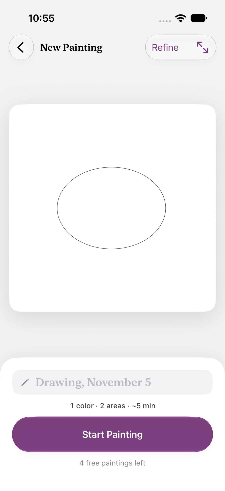

# Agent transcript

- end: success, 101 turns, 16.0 min, estimated $2.5186589999999995
- tool calls: {"mcp__maestro__take_screenshot": 37, "mcp__maestro__inspect_screen": 12, "mcp__maestro__run": 44, "Write": 3, "Read": 3}
- images the agent received: 38

**Start**: model claude-opus-5-5, MCP [{"name": "maestro", "status": "connected", "source": "dynamic"}]

→ `mcp__maestro__take_screenshot` `{"device_id": "385A3CE2-FBB7-4DA1-AF4E-BF5B536F19EC"}`

← mcp__maestro__take_screenshot: image  919x2000

→ `mcp__maestro__inspect_screen` `{"device_id": "385A3CE2-FBB7-4DA1-AF4E-BF5B536F19EC"}`

← mcp__maestro__inspect_screen: {"ui_schema":{"platform":"ios","abbreviations":{"b":"bounds","txt":"text","rid":"resource-id","a11y":"accessibilityText","hint":"hintText","val":"value","c":"children"},"defaults":{"enabled":true,"focused":false,"selected":false,"checked":false,"txt":"","hint":"","rid":"","val":"","a11y":""}},"elements":[{"b":"[0,0][402,874]","a11y":"Paint by Moonlight","c":[{"b":"[0,0][402,874]","c":[{"b":"[0,0][ …

→ `mcp__maestro__run` `{"device_id": "385A3CE2-FBB7-4DA1-AF4E-BF5B536F19EC", "yaml": "appId: com.pbordjadze.paintbynumber\n---\n- tapOn: \"New Painting\"\n- waitForAnimationToEnd\n- takeScreenshot: /Users/runner/work/_temp/qa/shots/plan-1"}`

→ `mcp__maestro__inspect_screen` `{"device_id": "385A3CE2-FBB7-4DA1-AF4E-BF5B536F19EC"}`

← mcp__maestro__run: {"success":true,"device_id":"385A3CE2-FBB7-4DA1-AF4E-BF5B536F19EC","commands_executed":4,"message":"Flow executed successfully","env_vars":{"MAESTRO_CLI_ANALYSIS_NOTIFICATION_DISABLED":"true","MAESTRO_CLI_NO_ANALYTICS":"1","MAESTRO_DRIVER_STARTUP_TIMEOUT":"240000","MAESTRO_VERSION":"2.11.0"}}

← mcp__maestro__inspect_screen: {"ui_schema":{"platform":"ios","abbreviations":{"b":"bounds","txt":"text","rid":"resource-id","a11y":"accessibilityText","hint":"hintText","val":"value","c":"children"},"defaults":{"enabled":true,"focused":false,"selected":false,"checked":false,"txt":"","hint":"","rid":"","val":"","a11y":""}},"elements":[{"b":"[0,0][402,874]","a11y":"Paint by Moonlight","c":[{"b":"[0,0][402,874]","c":[{"b":"[0,0][ …

> "From Scratch" button visible at top-right. Easy find.

→ `mcp__maestro__run` `{"device_id": "385A3CE2-FBB7-4DA1-AF4E-BF5B536F19EC", "yaml": "appId: com.pbordjadze.paintbynumber\n---\n- tapOn:\n    id: \"from-scratch\"\n- waitForAnimationToEnd\n- takeScreenshot: /Users/runner/work/_temp/qa/shots/plan-2"}`

→ `mcp__maestro__inspect_screen` `{"device_id": "385A3CE2-FBB7-4DA1-AF4E-BF5B536F19EC"}`

← mcp__maestro__run: {"success":true,"device_id":"385A3CE2-FBB7-4DA1-AF4E-BF5B536F19EC","commands_executed":4,"message":"Flow executed successfully","env_vars":{"MAESTRO_CLI_ANALYSIS_NOTIFICATION_DISABLED":"true","MAESTRO_CLI_NO_ANALYTICS":"1","MAESTRO_DRIVER_STARTUP_TIMEOUT":"240000","MAESTRO_VERSION":"2.11.0"}}

← mcp__maestro__inspect_screen: {"ui_schema":{"platform":"ios","abbreviations":{"b":"bounds","txt":"text","rid":"resource-id","a11y":"accessibilityText","hint":"hintText","val":"value","c":"children"},"defaults":{"enabled":true,"focused":false,"selected":false,"checked":false,"txt":"","hint":"","rid":"","val":"","a11y":""}},"elements":[{"b":"[0,0][402,874]","a11y":"Paint by Moonlight","c":[{"b":"[0,0][402,874]","c":[{"b":"[0,0][ …

→ `mcp__maestro__take_screenshot` `{"device_id": "385A3CE2-FBB7-4DA1-AF4E-BF5B536F19EC"}`

← mcp__maestro__take_screenshot: image  919x2000

→ `mcp__maestro__run` `{"device_id": "385A3CE2-FBB7-4DA1-AF4E-BF5B536F19EC", "yaml": "appId: com.pbordjadze.paintbynumber\n---\n- tapOn:\n    id: \"refine-guide\"\n- waitForAnimationToEnd"}`

→ `mcp__maestro__take_screenshot` `{"device_id": "385A3CE2-FBB7-4DA1-AF4E-BF5B536F19EC"}`

← mcp__maestro__run: {"success":true,"device_id":"385A3CE2-FBB7-4DA1-AF4E-BF5B536F19EC","commands_executed":3,"message":"Flow executed successfully","env_vars":{"MAESTRO_CLI_ANALYSIS_NOTIFICATION_DISABLED":"true","MAESTRO_CLI_NO_ANALYTICS":"1","MAESTRO_DRIVER_STARTUP_TIMEOUT":"240000","MAESTRO_VERSION":"2.11.0"}}

← mcp__maestro__take_screenshot: image  919x2000

→ `mcp__maestro__run` `{"device_id": "385A3CE2-FBB7-4DA1-AF4E-BF5B536F19EC", "yaml": "appId: com.pbordjadze.paintbynumber\n---\n- swipe:\n    start: \"50%,85%\"\n    end: \"50%,25%\"\n    duration: 800\n- waitForAnimationToEnd"}`

→ `mcp__maestro__inspect_screen` `{"device_id": "385A3CE2-FBB7-4DA1-AF4E-BF5B536F19EC"}`

← mcp__maestro__run: {"success":true,"device_id":"385A3CE2-FBB7-4DA1-AF4E-BF5B536F19EC","commands_executed":3,"message":"Flow executed successfully","env_vars":{"MAESTRO_CLI_ANALYSIS_NOTIFICATION_DISABLED":"true","MAESTRO_CLI_NO_ANALYTICS":"1","MAESTRO_DRIVER_STARTUP_TIMEOUT":"240000","MAESTRO_VERSION":"2.11.0"}}

← mcp__maestro__inspect_screen: {"ui_schema":{"platform":"ios","abbreviations":{"b":"bounds","txt":"text","rid":"resource-id","a11y":"accessibilityText","hint":"hintText","val":"value","c":"children"},"defaults":{"enabled":true,"focused":false,"selected":false,"checked":false,"txt":"","hint":"","rid":"","val":"","a11y":""}},"elements":[{"b":"[0,0][402,874]","a11y":"Paint by Moonlight","c":[{"b":"[0,0][402,874]","c":[{"b":"[0,0][ …

→ `mcp__maestro__run` `{"device_id": "385A3CE2-FBB7-4DA1-AF4E-BF5B536F19EC", "yaml": "appId: com.pbordjadze.paintbynumber\n---\n- tapOn:\n    id: \"refine-guide-done\"\n- waitForAnimationToEnd\n- tapOn:\n    id: \"refine-tool-shapes\"\n- waitForAnimationToEnd"}`

→ `mcp__maestro__take_screenshot` `{"device_id": "385A3CE2-FBB7-4DA1-AF4E-BF5B536F19EC"}`

← mcp__maestro__run: {"success":true,"device_id":"385A3CE2-FBB7-4DA1-AF4E-BF5B536F19EC","commands_executed":5,"message":"Flow executed successfully","env_vars":{"MAESTRO_CLI_ANALYSIS_NOTIFICATION_DISABLED":"true","MAESTRO_CLI_NO_ANALYTICS":"1","MAESTRO_DRIVER_STARTUP_TIMEOUT":"240000","MAESTRO_VERSION":"2.11.0"}}

← mcp__maestro__take_screenshot: image  919x2000

→ `mcp__maestro__inspect_screen` `{"device_id": "385A3CE2-FBB7-4DA1-AF4E-BF5B536F19EC"}`

← mcp__maestro__inspect_screen: {"ui_schema":{"platform":"ios","abbreviations":{"b":"bounds","txt":"text","rid":"resource-id","a11y":"accessibilityText","hint":"hintText","val":"value","c":"children"},"defaults":{"enabled":true,"focused":false,"selected":false,"checked":false,"txt":"","hint":"","rid":"","val":"","a11y":""}},"elements":[{"b":"[0,0][402,874]","a11y":"Paint by Moonlight","c":[{"b":"[0,0][402,874]","c":[{"b":"[0,0][ …

→ `mcp__maestro__run` `{"device_id": "385A3CE2-FBB7-4DA1-AF4E-BF5B536F19EC", "yaml": "appId: com.pbordjadze.paintbynumber\n---\n- tapOn:\n    id: \"refine-shape-oval\"\n- swipe:\n    start: \"105,410\"\n    end: \"305,470\"\n    duration: 800\n- waitForAnimationToEnd"}`

→ `mcp__maestro__take_screenshot` `{"device_id": "385A3CE2-FBB7-4DA1-AF4E-BF5B536F19EC"}`

← mcp__maestro__run: {"success":true,"device_id":"385A3CE2-FBB7-4DA1-AF4E-BF5B536F19EC","commands_executed":4,"message":"Flow executed successfully","env_vars":{"MAESTRO_CLI_ANALYSIS_NOTIFICATION_DISABLED":"true","MAESTRO_CLI_NO_ANALYTICS":"1","MAESTRO_DRIVER_STARTUP_TIMEOUT":"240000","MAESTRO_VERSION":"2.11.0"}}

← mcp__maestro__take_screenshot: image  919x2000

→ `mcp__maestro__run` `{"device_id": "385A3CE2-FBB7-4DA1-AF4E-BF5B536F19EC", "yaml": "appId: com.pbordjadze.paintbynumber\n---\n- tapOn:\n    id: \"refine-shape-line\"\n- swipe:\n    start: \"14,440\"\n    end: \"104,440\"\n    duration: 800\n- swipe:\n    start: \"304,440\"\n    end: \"388,440\"\n    duration: 800\n- waitForAnimationToEnd"}`

→ `mcp__maestro__take_screenshot` `{"device_id": "385A3CE2-FBB7-4DA1-AF4E-BF5B536F19EC"}`

← mcp__maestro__run: {"success":true,"device_id":"385A3CE2-FBB7-4DA1-AF4E-BF5B536F19EC","commands_executed":5,"message":"Flow executed successfully","env_vars":{"MAESTRO_CLI_ANALYSIS_NOTIFICATION_DISABLED":"true","MAESTRO_CLI_NO_ANALYTICS":"1","MAESTRO_DRIVER_STARTUP_TIMEOUT":"240000","MAESTRO_VERSION":"2.11.0"}}

← mcp__maestro__take_screenshot: image  919x2000

> Sea line snapped to both the canvas edges and the oval. Now the tower walls, top and stripes.

→ `mcp__maestro__run` `{"device_id": "385A3CE2-FBB7-4DA1-AF4E-BF5B536F19EC", "yaml": "appId: com.pbordjadze.paintbynumber\n---\n- swipe:\n    start: \"185,290\"\n    end: \"185,412\"\n    duration: 800\n- swipe:\n    start: \"225,290\"\n    end: \"225,412\"\n    duration: 800\n- swipe:\n    start: \"185,290\"\n    end: \"225,290\"\n    duration: 800\n- waitForAnimationToEnd\n- takeScreenshot: /Users/runner/work/_temp/qa/shots/plan-3"}`

→ `mcp__maestro__take_screenshot` `{"device_id": "385A3CE2-FBB7-4DA1-AF4E-BF5B536F19EC"}`

← mcp__maestro__run: {"success":true,"device_id":"385A3CE2-FBB7-4DA1-AF4E-BF5B536F19EC","commands_executed":6,"message":"Flow executed successfully","env_vars":{"MAESTRO_CLI_ANALYSIS_NOTIFICATION_DISABLED":"true","MAESTRO_CLI_NO_ANALYTICS":"1","MAESTRO_DRIVER_STARTUP_TIMEOUT":"240000","MAESTRO_VERSION":"2.11.0"}}

← mcp__maestro__take_screenshot: image  919x2000

> Tower closed cleanly. Now stripes, lantern and roof.

→ `mcp__maestro__run` `{"device_id": "385A3CE2-FBB7-4DA1-AF4E-BF5B536F19EC", "yaml": "appId: com.pbordjadze.paintbynumber\n---\n- swipe:\n    start: \"185,316\"\n    end: \"225,316\"\n    duration: 800\n- swipe:\n    start: \"185,342\"\n    end: \"225,342\"\n    duration: 800\n- swipe:\n    start: \"185,368\"\n    end: \"225,368\"\n    duration: 800\n- swipe:\n    start: \"185,392\"\n    end: \"225,392\"\n    duration: 800\n- swipe:\n    start: \"192,290\"\n    end: \"192,264\"\n    duration: 800\n- swipe:\n    start: \"218,290\"\n    end: \"218,264\"\n    duration: 800\n- swipe:\n    start: \"184,264\"\n    end: \"`

→ `mcp__maestro__take_screenshot` `{"device_id": "385A3CE2-FBB7-4DA1-AF4E-BF5B536F19EC"}`

← mcp__maestro__run: {"success":true,"device_id":"385A3CE2-FBB7-4DA1-AF4E-BF5B536F19EC","commands_executed":11,"message":"Flow executed successfully","env_vars":{"MAESTRO_CLI_ANALYSIS_NOTIFICATION_DISABLED":"true","MAESTRO_CLI_NO_ANALYTICS":"1","MAESTRO_DRIVER_STARTUP_TIMEOUT":"240000","MAESTRO_VERSION":"2.11.0"}}

← mcp__maestro__take_screenshot: image  919x2000

> Lighthouse outline worked first try (snap is generous and accurate). Now waves — trying the **Curve** shape.

→ `mcp__maestro__run` `{"device_id": "385A3CE2-FBB7-4DA1-AF4E-BF5B536F19EC", "yaml": "appId: com.pbordjadze.paintbynumber\n---\n- tapOn:\n    id: \"refine-shape-curve\"\n- swipe:\n    start: \"14,505\"\n    end: \"388,505\"\n    duration: 800\n- waitForAnimationToEnd"}`

→ `mcp__maestro__take_screenshot` `{"device_id": "385A3CE2-FBB7-4DA1-AF4E-BF5B536F19EC"}`

← mcp__maestro__run: {"success":true,"device_id":"385A3CE2-FBB7-4DA1-AF4E-BF5B536F19EC","commands_executed":4,"message":"Flow executed successfully","env_vars":{"MAESTRO_CLI_ANALYSIS_NOTIFICATION_DISABLED":"true","MAESTRO_CLI_NO_ANALYTICS":"1","MAESTRO_DRIVER_STARTUP_TIMEOUT":"240000","MAESTRO_VERSION":"2.11.0"}}

← mcp__maestro__take_screenshot: image  919x2000

→ `mcp__maestro__inspect_screen` `{"device_id": "385A3CE2-FBB7-4DA1-AF4E-BF5B536F19EC"}`

← mcp__maestro__inspect_screen: {"ui_schema":{"platform":"ios","abbreviations":{"b":"bounds","txt":"text","rid":"resource-id","a11y":"accessibilityText","hint":"hintText","val":"value","c":"children"},"defaults":{"enabled":true,"focused":false,"selected":false,"checked":false,"txt":"","hint":"","rid":"","val":"","a11y":""}},"elements":[{"b":"[0,0][402,874]","a11y":"Paint by Moonlight","c":[{"b":"[0,0][402,874]","c":[{"b":"[0,0][ …

> The canvas jumped up ~23 pt when the curve's hint "Drag to bend the curve…" appeared, and my curve landed lower in the picture than I aimed. Noting that. Now bending the curve.

→ `mcp__maestro__run` `{"device_id": "385A3CE2-FBB7-4DA1-AF4E-BF5B536F19EC", "yaml": "appId: com.pbordjadze.paintbynumber\n---\n- swipe:\n    start: \"201,505\"\n    end: \"201,485\"\n    duration: 800\n- waitForAnimationToEnd"}`

→ `mcp__maestro__take_screenshot` `{"device_id": "385A3CE2-FBB7-4DA1-AF4E-BF5B536F19EC"}`

← mcp__maestro__run: {"success":true,"device_id":"385A3CE2-FBB7-4DA1-AF4E-BF5B536F19EC","commands_executed":3,"message":"Flow executed successfully","env_vars":{"MAESTRO_CLI_ANALYSIS_NOTIFICATION_DISABLED":"true","MAESTRO_CLI_NO_ANALYTICS":"1","MAESTRO_DRIVER_STARTUP_TIMEOUT":"240000","MAESTRO_VERSION":"2.11.0"}}

← mcp__maestro__take_screenshot: image  919x2000

> Curve works: drag the line, then drag to bend — one bend per curve. For a wavy line I'll chain two curves.

→ `mcp__maestro__run` `{"device_id": "385A3CE2-FBB7-4DA1-AF4E-BF5B536F19EC", "yaml": "appId: com.pbordjadze.paintbynumber\n---\n- swipe:\n    start: \"14,472\"\n    end: \"140,472\"\n    duration: 800\n- swipe:\n    start: \"77,472\"\n    end: \"77,458\"\n    duration: 800\n- swipe:\n    start: \"140,472\"\n    end: \"265,472\"\n    duration: 800\n- swipe:\n    start: \"202,472\"\n    end: \"202,458\"\n    duration: 800\n- swipe:\n    start: \"265,472\"\n    end: \"388,472\"\n    duration: 800\n- swipe:\n    start: \"326,472\"\n    end: \"326,458\"\n    duration: 800\n- waitForAnimationToEnd"}`

→ `mcp__maestro__take_screenshot` `{"device_id": "385A3CE2-FBB7-4DA1-AF4E-BF5B536F19EC"}`

← mcp__maestro__run: {"success":true,"device_id":"385A3CE2-FBB7-4DA1-AF4E-BF5B536F19EC","commands_executed":8,"message":"Flow executed successfully","env_vars":{"MAESTRO_CLI_ANALYSIS_NOTIFICATION_DISABLED":"true","MAESTRO_CLI_NO_ANALYTICS":"1","MAESTRO_DRIVER_STARTUP_TIMEOUT":"240000","MAESTRO_VERSION":"2.11.0"}}

← mcp__maestro__take_screenshot: image  919x2000

> Waves done with three chained curves. Now seagull 1: each wing as a crescent (bent curve on top, straight line underneath).

→ `mcp__maestro__run` `{"device_id": "385A3CE2-FBB7-4DA1-AF4E-BF5B536F19EC", "yaml": "appId: com.pbordjadze.paintbynumber\n---\n- swipe:\n    start: \"45,245\"\n    end: \"80,258\"\n    duration: 800\n- swipe:\n    start: \"62,251\"\n    end: \"60,228\"\n    duration: 800\n- swipe:\n    start: \"80,258\"\n    end: \"115,245\"\n    duration: 800\n- swipe:\n    start: \"98,251\"\n    end: \"100,228\"\n    duration: 800\n- tapOn:\n    id: \"refine-shape-line\"\n- swipe:\n    start: \"45,245\"\n    end: \"80,258\"\n    duration: 800\n- swipe:\n    start: \"80,258\"\n    end: \"115,245\"\n    duration: 800\n- waitForAnim`

→ `mcp__maestro__take_screenshot` `{"device_id": "385A3CE2-FBB7-4DA1-AF4E-BF5B536F19EC"}`

← mcp__maestro__run: {"success":true,"device_id":"385A3CE2-FBB7-4DA1-AF4E-BF5B536F19EC","commands_executed":9,"message":"Flow executed successfully","env_vars":{"MAESTRO_CLI_ANALYSIS_NOTIFICATION_DISABLED":"true","MAESTRO_CLI_NO_ANALYTICS":"1","MAESTRO_DRIVER_STARTUP_TIMEOUT":"240000","MAESTRO_VERSION":"2.11.0"}}

← mcp__maestro__take_screenshot: image  919x2000

> Gull 1 drew as planned. Gull 2, top right, slightly smaller.

→ `mcp__maestro__run` `{"device_id": "385A3CE2-FBB7-4DA1-AF4E-BF5B536F19EC", "yaml": "appId: com.pbordjadze.paintbynumber\n---\n- tapOn:\n    id: \"refine-shape-curve\"\n- swipe:\n    start: \"280,215\"\n    end: \"310,226\"\n    duration: 800\n- swipe:\n    start: \"295,221\"\n    end: \"293,201\"\n    duration: 800\n- swipe:\n    start: \"310,226\"\n    end: \"340,215\"\n    duration: 800\n- swipe:\n    start: \"325,221\"\n    end: \"327,201\"\n    duration: 800\n- tapOn:\n    id: \"refine-shape-line\"\n- swipe:\n    start: \"280,215\"\n    end: \"310,226\"\n    duration: 800\n- swipe:\n    start: \"310,226\"\n   `

→ `mcp__maestro__take_screenshot` `{"device_id": "385A3CE2-FBB7-4DA1-AF4E-BF5B536F19EC"}`

← mcp__maestro__run: {"success":true,"device_id":"385A3CE2-FBB7-4DA1-AF4E-BF5B536F19EC","commands_executed":10,"message":"Flow executed successfully","env_vars":{"MAESTRO_CLI_ANALYSIS_NOTIFICATION_DISABLED":"true","MAESTRO_CLI_NO_ANALYTICS":"1","MAESTRO_DRIVER_STARTUP_TIMEOUT":"240000","MAESTRO_VERSION":"2.11.0"}}

← mcp__maestro__take_screenshot: image  919x2000

> Line art is complete. Writing an early report, then coloring.

→ `Write` `{"file_path": "/Users/runner/work/_temp/qa/report.md", "content": "# Refine from scratch \u2014 lighthouse (iPhone 17 Pro, debug build) \u2014 IN PROGRESS\n\n**Verdict**: (in progress) line art done as planned; coloring next.\n\n**What I meant to draw**: A red-and-white striped lighthouse tower (red top, alternating bands) with a yellow lantern and dark roof, on a grey oval rock island, in a dark-blue sea with a lighter wavy band and a darker band below, two white seagulls in a light-blue sky.\n\n## Log so far\n1. Blank canvas: + \u2192 \"From Scratch\" (top right of New Painting) \u2192 Refin`

← Write: File created successfully at: /Users/runner/work/_temp/qa/report.md (file state is current in your context — no need to Read it back)

→ `mcp__maestro__run` `{"device_id": "385A3CE2-FBB7-4DA1-AF4E-BF5B536F19EC", "yaml": "appId: com.pbordjadze.paintbynumber\n---\n- takeScreenshot: /Users/runner/work/_temp/qa/shots/plan-4-lineart\n- tapOn: \"Paint\"\n- waitForAnimationToEnd"}`

→ `mcp__maestro__take_screenshot` `{"device_id": "385A3CE2-FBB7-4DA1-AF4E-BF5B536F19EC"}`

← mcp__maestro__run: {"success":true,"device_id":"385A3CE2-FBB7-4DA1-AF4E-BF5B536F19EC","commands_executed":4,"message":"Flow executed successfully","env_vars":{"MAESTRO_CLI_ANALYSIS_NOTIFICATION_DISABLED":"true","MAESTRO_CLI_NO_ANALYTICS":"1","MAESTRO_DRIVER_STARTUP_TIMEOUT":"240000","MAESTRO_VERSION":"2.11.0"}}

← mcp__maestro__take_screenshot: image  919x2000

> Paint group: Bucket selected, palette has only paint 1 (white) plus a color wheel. Tapping the color wheel to add a paint.

→ `mcp__maestro__inspect_screen` `{"device_id": "385A3CE2-FBB7-4DA1-AF4E-BF5B536F19EC"}`

← mcp__maestro__inspect_screen: {"ui_schema":{"platform":"ios","abbreviations":{"b":"bounds","txt":"text","rid":"resource-id","a11y":"accessibilityText","hint":"hintText","val":"value","c":"children"},"defaults":{"enabled":true,"focused":false,"selected":false,"checked":false,"txt":"","hint":"","rid":"","val":"","a11y":""}},"elements":[{"b":"[0,0][402,874]","a11y":"Paint by Moonlight","c":[{"b":"[0,0][402,874]","c":[{"b":"[0,0][ …

→ `mcp__maestro__run` `{"device_id": "385A3CE2-FBB7-4DA1-AF4E-BF5B536F19EC", "yaml": "appId: com.pbordjadze.paintbynumber\n---\n- tapOn:\n    id: \"refine-palette-new\"\n- waitForAnimationToEnd"}`

→ `mcp__maestro__take_screenshot` `{"device_id": "385A3CE2-FBB7-4DA1-AF4E-BF5B536F19EC"}`

← mcp__maestro__run: {"success":true,"device_id":"385A3CE2-FBB7-4DA1-AF4E-BF5B536F19EC","commands_executed":3,"message":"Flow executed successfully","env_vars":{"MAESTRO_CLI_ANALYSIS_NOTIFICATION_DISABLED":"true","MAESTRO_CLI_NO_ANALYTICS":"1","MAESTRO_DRIVER_STARTUP_TIMEOUT":"240000","MAESTRO_VERSION":"2.11.0"}}

← mcp__maestro__take_screenshot: image  919x2000

> System color picker opened. Picking a bright red.

→ `mcp__maestro__run` `{"device_id": "385A3CE2-FBB7-4DA1-AF4E-BF5B536F19EC", "yaml": "appId: com.pbordjadze.paintbynumber\n---\n- tapOn:\n    point: \"186,670\"\n- waitForAnimationToEnd"}`

→ `mcp__maestro__take_screenshot` `{"device_id": "385A3CE2-FBB7-4DA1-AF4E-BF5B536F19EC"}`

← mcp__maestro__run: {"success":true,"device_id":"385A3CE2-FBB7-4DA1-AF4E-BF5B536F19EC","commands_executed":3,"message":"Flow executed successfully","env_vars":{"MAESTRO_CLI_ANALYSIS_NOTIFICATION_DISABLED":"true","MAESTRO_CLI_NO_ANALYTICS":"1","MAESTRO_DRIVER_STARTUP_TIMEOUT":"240000","MAESTRO_VERSION":"2.11.0"}}

← mcp__maestro__take_screenshot: image  919x2000

> Red selected; the sheet stays open. Dismissing it by tapping above it.

→ `mcp__maestro__run` `{"device_id": "385A3CE2-FBB7-4DA1-AF4E-BF5B536F19EC", "yaml": "appId: com.pbordjadze.paintbynumber\n---\n- tapOn:\n    point: \"201,140\"\n- waitForAnimationToEnd"}`

→ `mcp__maestro__inspect_screen` `{"device_id": "385A3CE2-FBB7-4DA1-AF4E-BF5B536F19EC"}`

← mcp__maestro__run: {"success":true,"device_id":"385A3CE2-FBB7-4DA1-AF4E-BF5B536F19EC","commands_executed":3,"message":"Flow executed successfully","env_vars":{"MAESTRO_CLI_ANALYSIS_NOTIFICATION_DISABLED":"true","MAESTRO_CLI_NO_ANALYTICS":"1","MAESTRO_DRIVER_STARTUP_TIMEOUT":"240000","MAESTRO_VERSION":"2.11.0"}}

← mcp__maestro__inspect_screen: {"ui_schema":{"platform":"ios","abbreviations":{"b":"bounds","txt":"text","rid":"resource-id","a11y":"accessibilityText","hint":"hintText","val":"value","c":"children"},"defaults":{"enabled":true,"focused":false,"selected":false,"checked":false,"txt":"","hint":"","rid":"","val":"","a11y":""}},"elements":[{"b":"[0,0][402,874]","a11y":"Paint by Moonlight","c":[{"b":"[0,0][402,874]","c":[{"b":"[0,0][ …

> A pending "New Paint" swatch is selected. Bucketing the three red bands.

→ `mcp__maestro__run` `{"device_id": "385A3CE2-FBB7-4DA1-AF4E-BF5B536F19EC", "yaml": "appId: com.pbordjadze.paintbynumber\n---\n- tapOn:\n    point: \"205,280\"\n- tapOn:\n    point: \"205,332\"\n- tapOn:\n    point: \"205,378\"\n- waitForAnimationToEnd"}`

→ `mcp__maestro__take_screenshot` `{"device_id": "385A3CE2-FBB7-4DA1-AF4E-BF5B536F19EC"}`

← mcp__maestro__run: {"success":true,"device_id":"385A3CE2-FBB7-4DA1-AF4E-BF5B536F19EC","commands_executed":5,"message":"Flow executed successfully","env_vars":{"MAESTRO_CLI_ANALYSIS_NOTIFICATION_DISABLED":"true","MAESTRO_CLI_NO_ANALYTICS":"1","MAESTRO_DRIVER_STARTUP_TIMEOUT":"240000","MAESTRO_VERSION":"2.11.0"}}

← mcp__maestro__take_screenshot: image  919x2000

> Red bands painted (paint 2). Adding yellow for the lantern.

→ `mcp__maestro__run` `{"device_id": "385A3CE2-FBB7-4DA1-AF4E-BF5B536F19EC", "yaml": "appId: com.pbordjadze.paintbynumber\n---\n- tapOn:\n    id: \"refine-palette-new\"\n- waitForAnimationToEnd\n- tapOn:\n    point: \"305,699\"\n- tapOn:\n    point: \"201,140\"\n- waitForAnimationToEnd\n- tapOn:\n    point: \"205,255\"\n- waitForAnimationToEnd"}`

→ `mcp__maestro__take_screenshot` `{"device_id": "385A3CE2-FBB7-4DA1-AF4E-BF5B536F19EC"}`

← mcp__maestro__run: {"success":true,"device_id":"385A3CE2-FBB7-4DA1-AF4E-BF5B536F19EC","commands_executed":8,"message":"Flow executed successfully","env_vars":{"MAESTRO_CLI_ANALYSIS_NOTIFICATION_DISABLED":"true","MAESTRO_CLI_NO_ANALYTICS":"1","MAESTRO_DRIVER_STARTUP_TIMEOUT":"240000","MAESTRO_VERSION":"2.11.0"}}

← mcp__maestro__take_screenshot: image  919x2000

> Lantern yellow (paint 3). Next: dark grey roof, then grey rock (two halves of the island, split by the sea line).

→ `mcp__maestro__run` `{"device_id": "385A3CE2-FBB7-4DA1-AF4E-BF5B536F19EC", "yaml": "appId: com.pbordjadze.paintbynumber\n---\n- tapOn:\n    id: \"refine-palette-new\"\n- waitForAnimationToEnd\n- tapOn:\n    point: \"276,551\"\n- tapOn:\n    point: \"201,140\"\n- waitForAnimationToEnd\n- tapOn:\n    point: \"205,234\"\n- waitForAnimationToEnd\n- tapOn:\n    id: \"refine-palette-new\"\n- waitForAnimationToEnd\n- tapOn:\n    point: \"187,551\"\n- tapOn:\n    point: \"201,140\"\n- waitForAnimationToEnd\n- tapOn:\n    point: \"150,410\"\n- waitForAnimationToEnd\n- tapOn:\n    point: \"205,432\"\n- waitForAnimationToEnd`

→ `mcp__maestro__take_screenshot` `{"device_id": "385A3CE2-FBB7-4DA1-AF4E-BF5B536F19EC"}`

← mcp__maestro__run: {"success":true,"device_id":"385A3CE2-FBB7-4DA1-AF4E-BF5B536F19EC","commands_executed":17,"message":"Flow executed successfully","env_vars":{"MAESTRO_CLI_ANALYSIS_NOTIFICATION_DISABLED":"true","MAESTRO_CLI_NO_ANALYTICS":"1","MAESTRO_DRIVER_STARTUP_TIMEOUT":"240000","MAESTRO_VERSION":"2.11.0"}}

← mcp__maestro__take_screenshot: image  919x2000

> Roof (4, dark grey) and island (5, grey) done; island turned out as one area. Now sky, sea bands.

→ `mcp__maestro__run` `{"device_id": "385A3CE2-FBB7-4DA1-AF4E-BF5B536F19EC", "yaml": "appId: com.pbordjadze.paintbynumber\n---\n- tapOn:\n    id: \"refine-palette-new\"\n- waitForAnimationToEnd\n- tapOn:\n    point: \"38,788\"\n- tapOn:\n    point: \"201,140\"\n- waitForAnimationToEnd\n- tapOn:\n    point: \"60,330\"\n- waitForAnimationToEnd\n- tapOn:\n    id: \"refine-palette-new\"\n- waitForAnimationToEnd\n- tapOn:\n    point: \"68,670\"\n- tapOn:\n    point: \"201,140\"\n- waitForAnimationToEnd\n- tapOn:\n    point: \"40,438\"\n- waitForAnimationToEnd\n- tapOn:\n    id: \"refine-palette-new\"\n- waitForAnimationT`

→ `mcp__maestro__take_screenshot` `{"device_id": "385A3CE2-FBB7-4DA1-AF4E-BF5B536F19EC"}`

← mcp__maestro__run: {"success":true,"device_id":"385A3CE2-FBB7-4DA1-AF4E-BF5B536F19EC","commands_executed":29,"message":"Flow executed successfully","env_vars":{"MAESTRO_CLI_ANALYSIS_NOTIFICATION_DISABLED":"true","MAESTRO_CLI_NO_ANALYTICS":"1","MAESTRO_DRIVER_STARTUP_TIMEOUT":"240000","MAESTRO_VERSION":"2.11.0"}}

← mcp__maestro__take_screenshot: image  919x2000

> That's the picture I wanted. Let me check the cells via Layers › Numbers before leaving.

→ `mcp__maestro__run` `{"device_id": "385A3CE2-FBB7-4DA1-AF4E-BF5B536F19EC", "yaml": "appId: com.pbordjadze.paintbynumber\n---\n- tapOn:\n    id: \"refine-layers\"\n- waitForAnimationToEnd"}`

→ `mcp__maestro__inspect_screen` `{"device_id": "385A3CE2-FBB7-4DA1-AF4E-BF5B536F19EC"}`

← mcp__maestro__run: {"success":true,"device_id":"385A3CE2-FBB7-4DA1-AF4E-BF5B536F19EC","commands_executed":3,"message":"Flow executed successfully","env_vars":{"MAESTRO_CLI_ANALYSIS_NOTIFICATION_DISABLED":"true","MAESTRO_CLI_NO_ANALYTICS":"1","MAESTRO_DRIVER_STARTUP_TIMEOUT":"240000","MAESTRO_VERSION":"2.11.0"}}

← mcp__maestro__inspect_screen: {"ui_schema":{"platform":"ios","abbreviations":{"b":"bounds","txt":"text","rid":"resource-id","a11y":"accessibilityText","hint":"hintText","val":"value","c":"children"},"defaults":{"enabled":true,"focused":false,"selected":false,"checked":false,"txt":"","hint":"","rid":"","val":"","a11y":""}},"elements":[{"b":"[0,0][402,874]","a11y":"Paint by Moonlight","c":[{"b":"[0,0][402,874]","c":[{"b":"[0,0][ …

→ `mcp__maestro__run` `{"device_id": "385A3CE2-FBB7-4DA1-AF4E-BF5B536F19EC", "yaml": "appId: com.pbordjadze.paintbynumber\n---\n- tapOn:\n    id: \"refine-layer-numbers\"\n- waitForAnimationToEnd\n- tapOn:\n    point: \"30,700\"\n- waitForAnimationToEnd\n- takeScreenshot: /Users/runner/work/_temp/qa/shots/plan-5-numbers"}`

→ `mcp__maestro__take_screenshot` `{"device_id": "385A3CE2-FBB7-4DA1-AF4E-BF5B536F19EC"}`

← mcp__maestro__run: {"success":true,"device_id":"385A3CE2-FBB7-4DA1-AF4E-BF5B536F19EC","commands_executed":6,"message":"Flow executed successfully","env_vars":{"MAESTRO_CLI_ANALYSIS_NOTIFICATION_DISABLED":"true","MAESTRO_CLI_NO_ANALYTICS":"1","MAESTRO_DRIVER_STARTUP_TIMEOUT":"240000","MAESTRO_VERSION":"2.11.0"}}

← mcp__maestro__take_screenshot: image  919x2000

> No numbers visible. Checking whether the Numbers switch actually turned on.

→ `mcp__maestro__run` `{"device_id": "385A3CE2-FBB7-4DA1-AF4E-BF5B536F19EC", "yaml": "appId: com.pbordjadze.paintbynumber\n---\n- tapOn:\n    id: \"refine-layers\"\n- waitForAnimationToEnd"}`

→ `mcp__maestro__take_screenshot` `{"device_id": "385A3CE2-FBB7-4DA1-AF4E-BF5B536F19EC"}`

← mcp__maestro__run: {"success":true,"device_id":"385A3CE2-FBB7-4DA1-AF4E-BF5B536F19EC","commands_executed":3,"message":"Flow executed successfully","env_vars":{"MAESTRO_CLI_ANALYSIS_NOTIFICATION_DISABLED":"true","MAESTRO_CLI_NO_ANALYTICS":"1","MAESTRO_DRIVER_STARTUP_TIMEOUT":"240000","MAESTRO_VERSION":"2.11.0"}}

← mcp__maestro__take_screenshot: image  919x2000

> Numbers is still off — my id-tap (at the row's centre) didn't flip it. Tapping the switch itself.

→ `mcp__maestro__run` `{"device_id": "385A3CE2-FBB7-4DA1-AF4E-BF5B536F19EC", "yaml": "appId: com.pbordjadze.paintbynumber\n---\n- tapOn:\n    point: \"340,128\"\n- waitForAnimationToEnd"}`

→ `mcp__maestro__take_screenshot` `{"device_id": "385A3CE2-FBB7-4DA1-AF4E-BF5B536F19EC"}`

← mcp__maestro__run: {"success":true,"device_id":"385A3CE2-FBB7-4DA1-AF4E-BF5B536F19EC","commands_executed":3,"message":"Flow executed successfully","env_vars":{"MAESTRO_CLI_ANALYSIS_NOTIFICATION_DISABLED":"true","MAESTRO_CLI_NO_ANALYTICS":"1","MAESTRO_DRIVER_STARTUP_TIMEOUT":"240000","MAESTRO_VERSION":"2.11.0"}}

← mcp__maestro__take_screenshot: image  919x2000

→ `mcp__maestro__run` `{"device_id": "385A3CE2-FBB7-4DA1-AF4E-BF5B536F19EC", "yaml": "appId: com.pbordjadze.paintbynumber\n---\n- tapOn:\n    point: \"30,700\"\n- waitForAnimationToEnd\n- takeScreenshot: /Users/runner/work/_temp/qa/shots/plan-5-numbers"}`

→ `mcp__maestro__take_screenshot` `{"device_id": "385A3CE2-FBB7-4DA1-AF4E-BF5B536F19EC"}`

← mcp__maestro__run: {"success":true,"device_id":"385A3CE2-FBB7-4DA1-AF4E-BF5B536F19EC","commands_executed":4,"message":"Flow executed successfully","env_vars":{"MAESTRO_CLI_ANALYSIS_NOTIFICATION_DISABLED":"true","MAESTRO_CLI_NO_ANALYTICS":"1","MAESTRO_DRIVER_STARTUP_TIMEOUT":"240000","MAESTRO_VERSION":"2.11.0"}}

← mcp__maestro__take_screenshot: image  919x2000

> 18 areas, all closed, each numbered — exactly the plan. Saving final-refine and tapping Done.

→ `mcp__maestro__run` `{"device_id": "385A3CE2-FBB7-4DA1-AF4E-BF5B536F19EC", "yaml": "appId: com.pbordjadze.paintbynumber\n---\n- takeScreenshot: /Users/runner/work/_temp/qa/shots/final-refine\n- tapOn:\n    id: \"refine-done\"\n- waitForAnimationToEnd"}`

→ `mcp__maestro__take_screenshot` `{"device_id": "385A3CE2-FBB7-4DA1-AF4E-BF5B536F19EC"}`

← mcp__maestro__run: {"success":true,"device_id":"385A3CE2-FBB7-4DA1-AF4E-BF5B536F19EC","commands_executed":4,"message":"Flow executed successfully","env_vars":{"MAESTRO_CLI_ANALYSIS_NOTIFICATION_DISABLED":"true","MAESTRO_CLI_NO_ANALYTICS":"1","MAESTRO_DRIVER_STARTUP_TIMEOUT":"240000","MAESTRO_VERSION":"2.11.0"}}

← mcp__maestro__take_screenshot: image  919x2000

> The preview says **"9 colors · 16 areas"**, but Refine's Numbers layer showed 18 numbered cells. I'll name it and start painting to see which areas merged.

→ `mcp__maestro__run` `{"device_id": "385A3CE2-FBB7-4DA1-AF4E-BF5B536F19EC", "yaml": "appId: com.pbordjadze.paintbynumber\n---\n- tapOn:\n    point: \"201,680\"\n- inputText: \"Lighthouse\"\n- hideKeyboard\n- waitForAnimationToEnd"}`

→ `mcp__maestro__take_screenshot` `{"device_id": "385A3CE2-FBB7-4DA1-AF4E-BF5B536F19EC"}`

← mcp__maestro__run: {"success":true,"device_id":"385A3CE2-FBB7-4DA1-AF4E-BF5B536F19EC","commands_executed":5,"message":"Flow executed successfully","env_vars":{"MAESTRO_CLI_ANALYSIS_NOTIFICATION_DISABLED":"true","MAESTRO_CLI_NO_ANALYTICS":"1","MAESTRO_DRIVER_STARTUP_TIMEOUT":"240000","MAESTRO_VERSION":"2.11.0"}}

← mcp__maestro__take_screenshot: image  919x2000

> Unexpected: after tapping the name field, typing "Lighthouse" and hiding the keyboard, the app went straight to the painting screen (I never tapped Start Painting). Checking the log.

→ `Read` `{"file_path": "/Users/runner/work/_temp/qa/app.log"}`

← Read: 1	getpwuid_r did not find a match for uid 501
2	Filtering the log data using "subsystem == "com.pbordjadze.paintbynumber""
3	Timestamp               Ty Process[PID:TID]
4	2026-11-05 22:37:33.333 Df PaintByNumber[26867:13117] [com.pbordjadze.paintbynumber:tips] offer in shelf: , wanted
5	2026-11-05 22:37:35.026 Df PaintByNumber[26867:13242] [com.pbordjadze.paintbynumber:canvas] Making the render co …

> Log confirms 16 regions — I recounted the Refine numbers and 16 is right (my "18" was a miscount), so no discrepancy. Closing the "Tap to Paint" tip and saving the template shot.

→ `mcp__maestro__inspect_screen` `{"device_id": "385A3CE2-FBB7-4DA1-AF4E-BF5B536F19EC"}`

← mcp__maestro__inspect_screen: {"ui_schema":{"platform":"ios","abbreviations":{"b":"bounds","txt":"text","rid":"resource-id","a11y":"accessibilityText","hint":"hintText","val":"value","c":"children"},"defaults":{"enabled":true,"focused":false,"selected":false,"checked":false,"txt":"","hint":"","rid":"","val":"","a11y":""}},"elements":[{"b":"[0,0][402,874]","a11y":"Paint by Moonlight","c":[{"b":"[0,0][402,874]","c":[{"b":"[0,0][ …

→ `mcp__maestro__run` `{"device_id": "385A3CE2-FBB7-4DA1-AF4E-BF5B536F19EC", "yaml": "appId: com.pbordjadze.paintbynumber\n---\n- tapOn: \"Close\"\n- waitForAnimationToEnd\n- takeScreenshot: /Users/runner/work/_temp/qa/shots/final-template"}`

→ `mcp__maestro__inspect_screen` `{"device_id": "385A3CE2-FBB7-4DA1-AF4E-BF5B536F19EC"}`

← mcp__maestro__run: {"success":true,"device_id":"385A3CE2-FBB7-4DA1-AF4E-BF5B536F19EC","commands_executed":4,"message":"Flow executed successfully","env_vars":{"MAESTRO_CLI_ANALYSIS_NOTIFICATION_DISABLED":"true","MAESTRO_CLI_NO_ANALYTICS":"1","MAESTRO_DRIVER_STARTUP_TIMEOUT":"240000","MAESTRO_VERSION":"2.11.0"}}

← mcp__maestro__inspect_screen: {"ui_schema":{"platform":"ios","abbreviations":{"b":"bounds","txt":"text","rid":"resource-id","a11y":"accessibilityText","hint":"hintText","val":"value","c":"children"},"defaults":{"enabled":true,"focused":false,"selected":false,"checked":false,"txt":"","hint":"","rid":"","val":"","a11y":""}},"elements":[{"b":"[0,0][402,874]","a11y":"Paint by Moonlight","c":[{"b":"[0,0][402,874]","c":[{"b":"[0,0][ …

> Name saved ("Lighthouse"). Painting opened on swatch 6 (sky). Painting all 16 areas, color by color.

→ `mcp__maestro__run` `{"device_id": "385A3CE2-FBB7-4DA1-AF4E-BF5B536F19EC", "yaml": "appId: com.pbordjadze.paintbynumber\n---\n- tapOn:\n    id: \"canvas-area-0\"\n- waitForAnimationToEnd"}`

→ `mcp__maestro__take_screenshot` `{"device_id": "385A3CE2-FBB7-4DA1-AF4E-BF5B536F19EC"}`

← mcp__maestro__run: {"success":true,"device_id":"385A3CE2-FBB7-4DA1-AF4E-BF5B536F19EC","commands_executed":3,"message":"Flow executed successfully","env_vars":{"MAESTRO_CLI_ANALYSIS_NOTIFICATION_DISABLED":"true","MAESTRO_CLI_NO_ANALYTICS":"1","MAESTRO_DRIVER_STARTUP_TIMEOUT":"240000","MAESTRO_VERSION":"2.11.0"}}

← mcp__maestro__take_screenshot: image  919x2000

> Sky done; swatch 6 left the palette and 7 got selected (by design). Painting the sea bands.

→ `mcp__maestro__run` `{"device_id": "385A3CE2-FBB7-4DA1-AF4E-BF5B536F19EC", "yaml": "appId: com.pbordjadze.paintbynumber\n---\n- tapOn:\n    point: \"38,510\"\n- waitForAnimationToEnd\n- tapOn:\n    point: \"342,547\"\n- waitForAnimationToEnd\n- tapOn:\n    point: \"200,581\"\n- waitForAnimationToEnd"}`

→ `mcp__maestro__take_screenshot` `{"device_id": "385A3CE2-FBB7-4DA1-AF4E-BF5B536F19EC"}`

← mcp__maestro__run: {"success":true,"device_id":"385A3CE2-FBB7-4DA1-AF4E-BF5B536F19EC","commands_executed":7,"message":"Flow executed successfully","env_vars":{"MAESTRO_CLI_ANALYSIS_NOTIFICATION_DISABLED":"true","MAESTRO_CLI_NO_ANALYTICS":"1","MAESTRO_DRIVER_STARTUP_TIMEOUT":"240000","MAESTRO_VERSION":"2.11.0"}}

← mcp__maestro__take_screenshot: image  919x2000

> Sea done; wrapped round to 1 (white). Painting gulls and white bands, then red.

→ `mcp__maestro__run` `{"device_id": "385A3CE2-FBB7-4DA1-AF4E-BF5B536F19EC", "yaml": "appId: com.pbordjadze.paintbynumber\n---\n- tapOn:\n    point: \"64,316\"\n- waitForAnimationToEnd\n- tapOn:\n    point: \"104,316\"\n- waitForAnimationToEnd\n- tapOn:\n    point: \"290,287\"\n- waitForAnimationToEnd\n- tapOn:\n    point: \"326,287\"\n- waitForAnimationToEnd\n- tapOn:\n    point: \"204,379\"\n- waitForAnimationToEnd\n- tapOn:\n    point: \"204,430\"\n- waitForAnimationToEnd"}`

→ `mcp__maestro__take_screenshot` `{"device_id": "385A3CE2-FBB7-4DA1-AF4E-BF5B536F19EC"}`

← mcp__maestro__run: {"success":true,"device_id":"385A3CE2-FBB7-4DA1-AF4E-BF5B536F19EC","commands_executed":13,"message":"Flow executed successfully","env_vars":{"MAESTRO_CLI_ANALYSIS_NOTIFICATION_DISABLED":"true","MAESTRO_CLI_NO_ANALYTICS":"1","MAESTRO_DRIVER_STARTUP_TIMEOUT":"240000","MAESTRO_VERSION":"2.11.0"}}

← mcp__maestro__take_screenshot: image  919x2000

→ `mcp__maestro__run` `{"device_id": "385A3CE2-FBB7-4DA1-AF4E-BF5B536F19EC", "yaml": "appId: com.pbordjadze.paintbynumber\n---\n- tapOn:\n    point: \"204,354\"\n- waitForAnimationToEnd\n- tapOn:\n    point: \"204,405\"\n- waitForAnimationToEnd\n- tapOn:\n    point: \"204,450\"\n- waitForAnimationToEnd\n- tapOn:\n    point: \"204,329\"\n- waitForAnimationToEnd\n- tapOn:\n    point: \"204,309\"\n- waitForAnimationToEnd\n- tapOn:\n    point: \"203,490\"\n- waitForAnimationToEnd"}`

→ `mcp__maestro__take_screenshot` `{"device_id": "385A3CE2-FBB7-4DA1-AF4E-BF5B536F19EC"}`

← mcp__maestro__run: {"success":true,"device_id":"385A3CE2-FBB7-4DA1-AF4E-BF5B536F19EC","commands_executed":13,"message":"Flow executed successfully","env_vars":{"MAESTRO_CLI_ANALYSIS_NOTIFICATION_DISABLED":"true","MAESTRO_CLI_NO_ANALYTICS":"1","MAESTRO_DRIVER_STARTUP_TIMEOUT":"240000","MAESTRO_VERSION":"2.11.0"}}

← mcp__maestro__take_screenshot: image  919x2000

> Finished, 100%, every area painted on the first tap. Saving the final shot.

→ `mcp__maestro__run` `{"device_id": "385A3CE2-FBB7-4DA1-AF4E-BF5B536F19EC", "yaml": "appId: com.pbordjadze.paintbynumber\n---\n- takeScreenshot: /Users/runner/work/_temp/qa/shots/final-painting"}`

← mcp__maestro__run: {"success":true,"device_id":"385A3CE2-FBB7-4DA1-AF4E-BF5B536F19EC","commands_executed":2,"message":"Flow executed successfully","env_vars":{"MAESTRO_CLI_ANALYSIS_NOTIFICATION_DISABLED":"true","MAESTRO_CLI_NO_ANALYTICS":"1","MAESTRO_DRIVER_STARTUP_TIMEOUT":"240000","MAESTRO_VERSION":"2.11.0"}}

→ `Write` `{"file_path": "/Users/runner/work/_temp/qa/report.md", "content": "# Refine from scratch \u2014 lighthouse (iPhone 17 Pro, debug build)\n\n**Verdict**: Yes \u2014 I got the picture I wanted, drawn, colored and painted to 100%, in about 9 minutes and without a single redo.\n\n**What I meant to draw**: A red-and-white striped lighthouse tower (red top, alternating bands) with a yellow lantern and dark roof, on a grey oval rock island, in a dark-blue sea with a lighter wavy band and a darker band below, two white seagulls in a light-blue sky.\n\n**What I got**: That. 16 areas, 9 paints: light-blu`

← Write: The file /Users/runner/work/_temp/qa/report.md has been updated successfully. (file state is current in your context — no need to Read it back)

> Painting done and report written. Now using the remaining time to reproduce the two suspicions. First, back to the gallery and a fresh From Scratch page to repeat the canvas jump.

→ `mcp__maestro__run` `{"device_id": "385A3CE2-FBB7-4DA1-AF4E-BF5B536F19EC", "yaml": "appId: com.pbordjadze.paintbynumber\n---\n- tapOn: \"Done\"\n- waitForAnimationToEnd\n- takeScreenshot: /Users/runner/work/_temp/qa/shots/gallery-after"}`

→ `mcp__maestro__take_screenshot` `{"device_id": "385A3CE2-FBB7-4DA1-AF4E-BF5B536F19EC"}`

← mcp__maestro__run: {"success":true,"device_id":"385A3CE2-FBB7-4DA1-AF4E-BF5B536F19EC","commands_executed":4,"message":"Flow executed successfully","env_vars":{"MAESTRO_CLI_ANALYSIS_NOTIFICATION_DISABLED":"true","MAESTRO_CLI_NO_ANALYTICS":"1","MAESTRO_DRIVER_STARTUP_TIMEOUT":"240000","MAESTRO_VERSION":"2.11.0"}}

← mcp__maestro__take_screenshot: image  919x2000

> Gallery shows "Lighthouse — Finished · 1 min" with a correct thumbnail. Now the repro for the canvas jump.

→ `mcp__maestro__run` `{"device_id": "385A3CE2-FBB7-4DA1-AF4E-BF5B536F19EC", "yaml": "appId: com.pbordjadze.paintbynumber\n---\n- tapOn: \"New Painting\"\n- waitForAnimationToEnd\n- tapOn:\n    id: \"from-scratch\"\n- waitForAnimationToEnd\n- tapOn:\n    id: \"refine-tool-shapes\"\n- waitForAnimationToEnd\n- swipe:\n    start: \"14,300\"\n    end: \"388,300\"\n    duration: 800\n- waitForAnimationToEnd\n- tapOn:\n    id: \"refine-shape-curve\"\n- waitForAnimationToEnd"}`

→ `mcp__maestro__inspect_screen` `{"device_id": "385A3CE2-FBB7-4DA1-AF4E-BF5B536F19EC"}`

← mcp__maestro__run: {"success":true,"device_id":"385A3CE2-FBB7-4DA1-AF4E-BF5B536F19EC","commands_executed":11,"message":"Flow executed successfully","env_vars":{"MAESTRO_CLI_ANALYSIS_NOTIFICATION_DISABLED":"true","MAESTRO_CLI_NO_ANALYTICS":"1","MAESTRO_DRIVER_STARTUP_TIMEOUT":"240000","MAESTRO_VERSION":"2.11.0"}}

← mcp__maestro__inspect_screen: {"ui_schema":{"platform":"ios","abbreviations":{"b":"bounds","txt":"text","rid":"resource-id","a11y":"accessibilityText","hint":"hintText","val":"value","c":"children"},"defaults":{"enabled":true,"focused":false,"selected":false,"checked":false,"txt":"","hint":"","rid":"","val":"","a11y":""}},"elements":[{"b":"[0,0][402,874]","a11y":"Paint by Moonlight","c":[{"b":"[0,0][402,874]","c":[{"b":"[0,0][ …

→ `mcp__maestro__run` `{"device_id": "385A3CE2-FBB7-4DA1-AF4E-BF5B536F19EC", "yaml": "appId: com.pbordjadze.paintbynumber\n---\n- tapOn:\n    id: \"refine-cancel\"\n- waitForAnimationToEnd"}`

→ `mcp__maestro__take_screenshot` `{"device_id": "385A3CE2-FBB7-4DA1-AF4E-BF5B536F19EC"}`

← mcp__maestro__run: {"success":true,"device_id":"385A3CE2-FBB7-4DA1-AF4E-BF5B536F19EC","commands_executed":3,"message":"Flow executed successfully","env_vars":{"MAESTRO_CLI_ANALYSIS_NOTIFICATION_DISABLED":"true","MAESTRO_CLI_NO_ANALYTICS":"1","MAESTRO_DRIVER_STARTUP_TIMEOUT":"240000","MAESTRO_VERSION":"2.11.0"}}

← mcp__maestro__take_screenshot: image  919x2000

> Cancel asks before discarding (as designed). Instead, I'll keep this one-line page and use it to retest the name field without `hideKeyboard`.

→ `mcp__maestro__run` `{"device_id": "385A3CE2-FBB7-4DA1-AF4E-BF5B536F19EC", "yaml": "appId: com.pbordjadze.paintbynumber\n---\n- tapOn:\n    point: \"300,600\"\n- waitForAnimationToEnd\n- tapOn:\n    id: \"refine-done\"\n- waitForAnimationToEnd\n- tapOn:\n    point: \"201,680\"\n- waitForAnimationToEnd\n- takeScreenshot: /Users/runner/work/_temp/qa/shots/name-field-focused"}`

→ `mcp__maestro__take_screenshot` `{"device_id": "385A3CE2-FBB7-4DA1-AF4E-BF5B536F19EC"}`

← mcp__maestro__run: {"success":true,"device_id":"385A3CE2-FBB7-4DA1-AF4E-BF5B536F19EC","commands_executed":8,"message":"Flow executed successfully","env_vars":{"MAESTRO_CLI_ANALYSIS_NOTIFICATION_DISABLED":"true","MAESTRO_CLI_NO_ANALYTICS":"1","MAESTRO_DRIVER_STARTUP_TIMEOUT":"240000","MAESTRO_VERSION":"2.11.0"}}

← mcp__maestro__take_screenshot: image  919x2000

> Note: "4 free paintings left" — the Lighthouse used one. The keyboard's return key is a blue ✓. Testing what a person would do: type a name and press ✓.

→ `mcp__maestro__run` `{"device_id": "385A3CE2-FBB7-4DA1-AF4E-BF5B536F19EC", "yaml": "appId: com.pbordjadze.paintbynumber\n---\n- inputText: \"Line test\"\n- tapOn:\n    point: \"348,818\"\n- waitForAnimationToEnd\n- takeScreenshot: /Users/runner/work/_temp/qa/shots/name-return"}`

→ `mcp__maestro__take_screenshot` `{"device_id": "385A3CE2-FBB7-4DA1-AF4E-BF5B536F19EC"}`

← mcp__maestro__run: {"success":true,"device_id":"385A3CE2-FBB7-4DA1-AF4E-BF5B536F19EC","commands_executed":5,"message":"Flow executed successfully","env_vars":{"MAESTRO_CLI_ANALYSIS_NOTIFICATION_DISABLED":"true","MAESTRO_CLI_NO_ANALYTICS":"1","MAESTRO_DRIVER_STARTUP_TIMEOUT":"240000","MAESTRO_VERSION":"2.11.0"}}

← mcp__maestro__take_screenshot: image  919x2000

→ `mcp__maestro__run` `{"device_id": "385A3CE2-FBB7-4DA1-AF4E-BF5B536F19EC", "yaml": "appId: com.pbordjadze.paintbynumber\n---\n- tapOn:\n    point: \"38,84\"\n- waitForAnimationToEnd"}`

→ `mcp__maestro__take_screenshot` `{"device_id": "385A3CE2-FBB7-4DA1-AF4E-BF5B536F19EC"}`

← mcp__maestro__run: {"success":true,"device_id":"385A3CE2-FBB7-4DA1-AF4E-BF5B536F19EC","commands_executed":3,"message":"Flow executed successfully","env_vars":{"MAESTRO_CLI_ANALYSIS_NOTIFICATION_DISABLED":"true","MAESTRO_CLI_NO_ANALYTICS":"1","MAESTRO_DRIVER_STARTUP_TIMEOUT":"240000","MAESTRO_VERSION":"2.11.0"}}

← mcp__maestro__take_screenshot: image  919x2000

> Back from the preview dropped my drawing **without asking** (Refine's Cancel asks first). Checking whether From Scratch brings it back.

→ `mcp__maestro__run` `{"device_id": "385A3CE2-FBB7-4DA1-AF4E-BF5B536F19EC", "yaml": "appId: com.pbordjadze.paintbynumber\n---\n- tapOn:\n    id: \"from-scratch\"\n- waitForAnimationToEnd\n- takeScreenshot: /Users/runner/work/_temp/qa/shots/from-scratch-again"}`

→ `mcp__maestro__take_screenshot` `{"device_id": "385A3CE2-FBB7-4DA1-AF4E-BF5B536F19EC"}`

← mcp__maestro__run: {"success":true,"device_id":"385A3CE2-FBB7-4DA1-AF4E-BF5B536F19EC","commands_executed":4,"message":"Flow executed successfully","env_vars":{"MAESTRO_CLI_ANALYSIS_NOTIFICATION_DISABLED":"true","MAESTRO_CLI_NO_ANALYTICS":"1","MAESTRO_DRIVER_STARTUP_TIMEOUT":"240000","MAESTRO_VERSION":"2.11.0"}}

← mcp__maestro__take_screenshot: image  919x2000

> The drawing is gone — From Scratch opens a blank page. Reproducing once more to be sure.

→ `mcp__maestro__run` `{"device_id": "385A3CE2-FBB7-4DA1-AF4E-BF5B536F19EC", "yaml": "appId: com.pbordjadze.paintbynumber\n---\n- tapOn:\n    id: \"refine-tool-shapes\"\n- waitForAnimationToEnd\n- tapOn:\n    id: \"refine-shape-oval\"\n- swipe:\n    start: \"100,300\"\n    end: \"300,450\"\n    duration: 800\n- waitForAnimationToEnd\n- tapOn:\n    id: \"refine-done\"\n- waitForAnimationToEnd\n- takeScreenshot: /Users/runner/work/_temp/qa/shots/discard-1-preview\n- tapOn:\n    point: \"38,84\"\n- waitForAnimationToEnd\n- takeScreenshot: /Users/runner/work/_temp/qa/shots/discard-2-after-back\n- tapOn:\n    id: \"from-`

→ `mcp__maestro__take_screenshot` `{"device_id": "385A3CE2-FBB7-4DA1-AF4E-BF5B536F19EC"}`

← mcp__maestro__run: {"success":true,"device_id":"385A3CE2-FBB7-4DA1-AF4E-BF5B536F19EC","commands_executed":15,"message":"Flow executed successfully","env_vars":{"MAESTRO_CLI_ANALYSIS_NOTIFICATION_DISABLED":"true","MAESTRO_CLI_NO_ANALYTICS":"1","MAESTRO_DRIVER_STARTUP_TIMEOUT":"240000","MAESTRO_VERSION":"2.11.0"}}

← mcp__maestro__take_screenshot: image  919x2000

→ `Read` `{"file_path": "/Users/runner/work/_temp/qa/shots/discard-1-preview.png"}`

← Read: image  920x2000

> Reproduced 2 of 2. Leaving this blank page and checking for crashes.

→ `mcp__maestro__run` `{"device_id": "385A3CE2-FBB7-4DA1-AF4E-BF5B536F19EC", "yaml": "appId: com.pbordjadze.paintbynumber\n---\n- tapOn:\n    id: \"refine-cancel\"\n- waitForAnimationToEnd"}`

→ `Read` `{"file_path": "/Users/runner/work/_temp/qa/crashes.txt"}`

← mcp__maestro__run: {"success":true,"device_id":"385A3CE2-FBB7-4DA1-AF4E-BF5B536F19EC","commands_executed":3,"message":"Flow executed successfully","env_vars":{"MAESTRO_CLI_ANALYSIS_NOTIFICATION_DISABLED":"true","MAESTRO_CLI_NO_ANALYTICS":"1","MAESTRO_DRIVER_STARTUP_TIMEOUT":"240000","MAESTRO_VERSION":"2.11.0"}}

← Read: <system-reminder>Warning: the file exists but the contents are empty.</system-reminder>

> No crashes. Writing the final report.

→ `Write` `{"file_path": "/Users/runner/work/_temp/qa/report.md", "content": "# Refine from scratch: lighthouse (iPhone 17 Pro, debug build)\n\n**Verdict**: Yes. I drew, colored and painted to 100% the picture I wanted, in about 9 minutes, with no redos. One real problem turned up next to the task: Back on the New Painting preview throws a from-scratch drawing away without asking.\n\n**What I meant to draw**: A red-and-white striped lighthouse tower (red top, alternating bands) with a yellow lantern and dark roof, on a grey oval rock island, in a dark-blue sea with a lighter wavy band and a darker band b`

← Write: The file /Users/runner/work/_temp/qa/report.md has been updated successfully. (file state is current in your context — no need to Read it back)

> I got the lighthouse I planned, drew it in Refine, and painted it to 100%, with no redos. It took about 9 minutes and has 16 areas in 9 paints. It's saved in the gallery as "Lighthouse · Finished".
> 
> **The drawing:** I found the empty page right away: + → "From Scratch". The Tool Guide's Pen page told me what I needed: lines snap to each other within about 10 pt, and a closed line makes a new area. Everything was drawn with the Shapes tool:
> - **Island:** one Oval.
> - **Tower, stripes, lantern, roof:** straight Lines, which all snapped closed on the first try.
> - **Waves:** the Curve shape gives one bend per curve, so the wave line is three curves joined end to end.
> - **Gulls:** each wing is a bent curve with a straight line under it, making a closed crescent.
> 
> I colored it with the Bucket and the system color picker, then filled every area with one tap on the painting screen.
> 
> **Bug (reproduced 2 of 2):** Back on the New Painting preview throws away a from-scratch drawing without asking. Tapping From Scratch again gives a blank page. Refine's own Cancel does ask "Discard Your Changes?", so this is inconsistent. It would have thrown away the 9-minute lighthouse with no warning.
> 
> **Suspicions:**
> - Choosing the Curve shape shows a hint, and the canvas moves up 23 pt and stays there. It moves when the tool is picked, not mid-stroke. That fits the "canvas keeps the room of the tallest panel" design, but it moved the picture just as I was about to draw on it. Seen 2 of 2.
> - The log shows a Refine tip being offered about 25 times and taking a turn on screen, yet none of my screenshots show it. It was then refused as "nothing done", though I'd drawn plenty by then.
> 
> **Automation problems:** Maestro's `hideKeyboard` on the name field landed me on the painting screen without my tapping Start Painting. That used up one of the free paintings (5 → 4). Retesting with the keyboard's own ✓ key just closed the keyboard, so this was Maestro's tap, not the app.
> 
> No crashes. Everything is in `/Users/runner/work/_temp/qa/report.md`, with screenshots in `shots/` (`final-refine`, `final-template`, `final-painting`, plus the discard evidence: `discard-1-preview`, `discard-2-after-back`, `discard-3-blank-again`).
