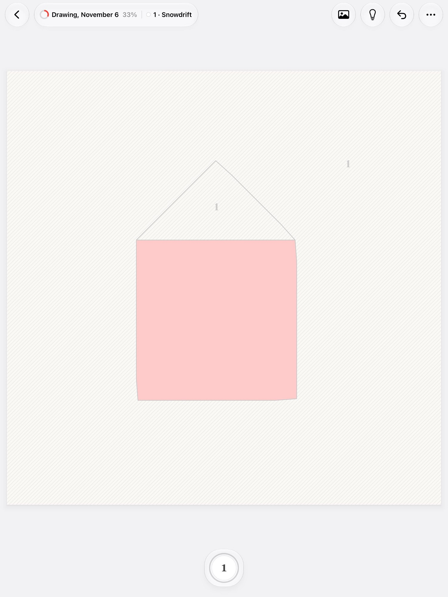
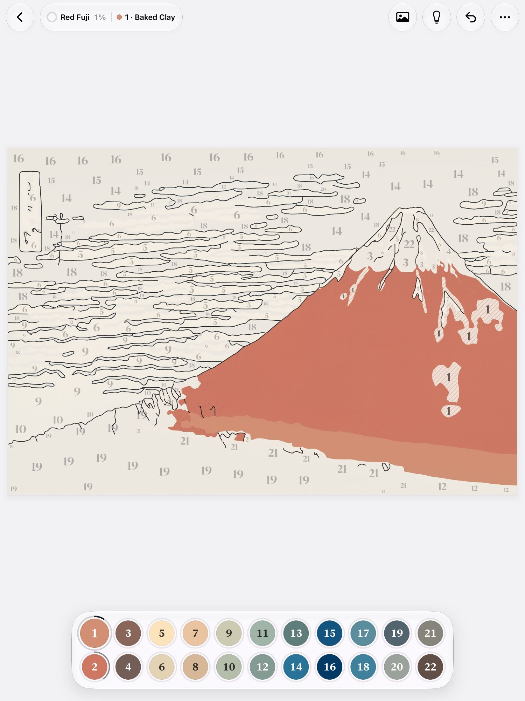

# Agent transcript

- end: success, 183 turns, 26.4 min, estimated $7.940893399999998
- tool calls: {"mcp__maestro__take_screenshot": 78, "Read": 16, "mcp__maestro__run": 76, "mcp__maestro__inspect_screen": 6, "Write": 6}
- images the agent received: 78

**Start**: model claude-opus-5-5, MCP [{"name": "maestro", "status": "connected", "source": "dynamic"}]

→ `mcp__maestro__take_screenshot` `{"device_id": "E247944A-EF3A-4ACA-99BF-97F59D694F71"}`

→ `Read` `{"file_path": "/Users/runner/work/_temp/qa/app.log"}`

← mcp__maestro__take_screenshot: image  1500x2000

← Read: 1	getpwuid_r did not find a match for uid 501
2	Filtering the log data using "subsystem == "com.pbordjadze.paintbynumber""
3	Timestamp               Ty Process[PID:TID]
4	2026-11-06 05:26:18.296 Df PaintByNumber[48782:1ef86] [com.pbordjadze.paintbynumber:tips] offer in shelf: , wanted
5	2026-11-06 05:26:18.999 Df PaintByNumber[48782:1f02b] [com.pbordjadze.paintbynumber:canvas] Making the render co …

→ `mcp__maestro__run` `{"device_id": "E247944A-EF3A-4ACA-99BF-97F59D694F71", "yaml": "appId: com.pbordjadze.paintbynumber\n---\n- takeScreenshot: /Users/runner/work/_temp/qa/shots/gallery-first\n- tapOn: \"The Great Wave\"\n- waitForAnimationToEnd\n- takeScreenshot: /Users/runner/work/_temp/qa/shots/wave-open"}`

→ `mcp__maestro__take_screenshot` `{"device_id": "E247944A-EF3A-4ACA-99BF-97F59D694F71"}`

← mcp__maestro__run: {"success":true,"device_id":"E247944A-EF3A-4ACA-99BF-97F59D694F71","commands_executed":5,"message":"Flow executed successfully","env_vars":{"MAESTRO_CLI_ANALYSIS_NOTIFICATION_DISABLED":"true","MAESTRO_CLI_NO_ANALYTICS":"1","MAESTRO_DRIVER_STARTUP_TIMEOUT":"240000","MAESTRO_VERSION":"2.11.0"}}

← mcp__maestro__take_screenshot: image  1500x2000

→ `mcp__maestro__run` `{"device_id": "E247944A-EF3A-4ACA-99BF-97F59D694F71", "yaml": "appId: com.pbordjadze.paintbynumber\n---\n- takeScreenshot: /Users/runner/work/_temp/qa/shots/tip-1-tap-to-paint"}`

→ `mcp__maestro__inspect_screen` `{"device_id": "E247944A-EF3A-4ACA-99BF-97F59D694F71"}`

← mcp__maestro__run: {"success":true,"device_id":"E247944A-EF3A-4ACA-99BF-97F59D694F71","commands_executed":2,"message":"Flow executed successfully","env_vars":{"MAESTRO_CLI_ANALYSIS_NOTIFICATION_DISABLED":"true","MAESTRO_CLI_NO_ANALYTICS":"1","MAESTRO_DRIVER_STARTUP_TIMEOUT":"240000","MAESTRO_VERSION":"2.11.0"}}

← mcp__maestro__inspect_screen: {"ui_schema":{"platform":"ios","abbreviations":{"b":"bounds","txt":"text","rid":"resource-id","a11y":"accessibilityText","hint":"hintText","val":"value","c":"children"},"defaults":{"enabled":true,"focused":false,"selected":false,"checked":false,"txt":"","hint":"","rid":"","val":"","a11y":""}},"elements":[{"b":"[0,0][1032,1376]","a11y":"Paint by Moonlight","c":[{"b":"[0,0][1032,1376]","c":[{"b":"[0 …

→ `mcp__maestro__take_screenshot` `{"device_id": "E247944A-EF3A-4ACA-99BF-97F59D694F71"}`

← mcp__maestro__take_screenshot: image  1500x2000

→ `mcp__maestro__run` `{"device_id": "E247944A-EF3A-4ACA-99BF-97F59D694F71", "yaml": "appId: com.pbordjadze.paintbynumber\n---\n- tapOn: \"Close\"\n- tapOn:\n    point: \"729,640\"\n- takeScreenshot: /Users/runner/work/_temp/qa/shots/wave-paint1"}`

→ `mcp__maestro__take_screenshot` `{"device_id": "E247944A-EF3A-4ACA-99BF-97F59D694F71"}`

← mcp__maestro__run: {"success":true,"device_id":"E247944A-EF3A-4ACA-99BF-97F59D694F71","commands_executed":4,"message":"Flow executed successfully","env_vars":{"MAESTRO_CLI_ANALYSIS_NOTIFICATION_DISABLED":"true","MAESTRO_CLI_NO_ANALYTICS":"1","MAESTRO_DRIVER_STARTUP_TIMEOUT":"240000","MAESTRO_VERSION":"2.11.0"}}

← mcp__maestro__take_screenshot: image  1500x2000

> Opened The Great Wave; first tip "Tap to Paint" appeared over the palette; first fill worked. Painting a couple more.

→ `mcp__maestro__run` `{"device_id": "E247944A-EF3A-4ACA-99BF-97F59D694F71", "yaml": "appId: com.pbordjadze.paintbynumber\n---\n- tapOn:\n    point: \"371,371\"\n- tapOn:\n    point: \"266,777\"\n- tapOn:\n    point: \"1500,1160\"\n    label: dummy\n"}`

← mcp__maestro__run: {"success":true,"device_id":"E247944A-EF3A-4ACA-99BF-97F59D694F71","commands_executed":4,"message":"Flow executed successfully","env_vars":{"MAESTRO_CLI_ANALYSIS_NOTIFICATION_DISABLED":"true","MAESTRO_CLI_NO_ANALYTICS":"1","MAESTRO_DRIVER_STARTUP_TIMEOUT":"240000","MAESTRO_VERSION":"2.11.0"}}

→ `mcp__maestro__take_screenshot` `{"device_id": "E247944A-EF3A-4ACA-99BF-97F59D694F71"}`

← mcp__maestro__take_screenshot: image  1500x2000

→ `mcp__maestro__inspect_screen` `{"device_id": "E247944A-EF3A-4ACA-99BF-97F59D694F71"}`

← mcp__maestro__inspect_screen: {"ui_schema":{"platform":"ios","abbreviations":{"b":"bounds","txt":"text","rid":"resource-id","a11y":"accessibilityText","hint":"hintText","val":"value","c":"children"},"defaults":{"enabled":true,"focused":false,"selected":false,"checked":false,"txt":"","hint":"","rid":"","val":"","a11y":""}},"elements":[{"b":"[0,0][1032,1376]","a11y":"Paint by Moonlight","c":[{"b":"[0,0][1032,1376]","c":[{"b":"[0 …

→ `mcp__maestro__run` `{"device_id": "E247944A-EF3A-4ACA-99BF-97F59D694F71", "yaml": "appId: com.pbordjadze.paintbynumber\n---\n- tapOn: \"Back\"\n- waitForAnimationToEnd\n- takeScreenshot: /Users/runner/work/_temp/qa/shots/gallery-after-wave"}`

→ `mcp__maestro__take_screenshot` `{"device_id": "E247944A-EF3A-4ACA-99BF-97F59D694F71"}`

← mcp__maestro__run: {"success":true,"device_id":"E247944A-EF3A-4ACA-99BF-97F59D694F71","commands_executed":4,"message":"Flow executed successfully","env_vars":{"MAESTRO_CLI_ANALYSIS_NOTIFICATION_DISABLED":"true","MAESTRO_CLI_NO_ANALYTICS":"1","MAESTRO_DRIVER_STARTUP_TIMEOUT":"240000","MAESTRO_VERSION":"2.11.0"}}

← mcp__maestro__take_screenshot: image  1500x2000

→ `Read` `{"file_path": "/Users/runner/work/_temp/qa/app.log", "offset": 12}`

← Read: 12	2026-11-06 05:29:10.349 Df PaintByNumber[48782:1ef86] [com.pbordjadze.paintbynumber:library] Opened B9E20797-9B5F-46BA-B5B5-D004CD2EBFB5: 333 regions
13	2026-11-06 05:29:11.936 Df PaintByNumber[48782:1ef86] [com.pbordjadze.paintbynumber:library] Painting screen recognizers: UIKitHoverGestureRecognizer, _UIParallaxTransitionPanGestureRecognizer, _UIContentSwipeDismissGestureRecognizer (disabled) …

> Writing the initial report now, then on to making a new painting.

→ `Write` `{"file_path": "/Users/runner/work/_temp/qa/report.md", "content": "# Paint by Moonlight \u2014 newcomer's first hour (tips focus), iPad Pro 13\" simulator, debug build\n\n## Summary\n(In progress.) Gallery and the first painting work: opened The Great Wave, painted 3 areas, back in the gallery it shows \"1% painted\" with the colours in its thumbnail. One tip seen so far (\"Tap to Paint\"). The gallery's first tip (shelfStarter) had already come and gone before the session started.\n\n## Coverage\n1. Gallery + paint a starter: done (The Great Wave, 3 areas, back).\n2. Sample picture painting: `

← Write: File created successfully at: /Users/runner/work/_temp/qa/report.md (file state is current in your context — no need to Read it back)

→ `mcp__maestro__run` `{"device_id": "E247944A-EF3A-4ACA-99BF-97F59D694F71", "yaml": "appId: com.pbordjadze.paintbynumber\n---\n- tapOn:\n    point: \"748,54\"\n- waitForAnimationToEnd"}`

→ `mcp__maestro__take_screenshot` `{"device_id": "E247944A-EF3A-4ACA-99BF-97F59D694F71"}`

← mcp__maestro__run: {"success":true,"device_id":"E247944A-EF3A-4ACA-99BF-97F59D694F71","commands_executed":3,"message":"Flow executed successfully","env_vars":{"MAESTRO_CLI_ANALYSIS_NOTIFICATION_DISABLED":"true","MAESTRO_CLI_NO_ANALYTICS":"1","MAESTRO_DRIVER_STARTUP_TIMEOUT":"240000","MAESTRO_VERSION":"2.11.0"}}

← mcp__maestro__take_screenshot: image  1500x2000

→ `mcp__maestro__run` `{"device_id": "E247944A-EF3A-4ACA-99BF-97F59D694F71", "yaml": "appId: com.pbordjadze.paintbynumber\n---\n- takeScreenshot: /Users/runner/work/_temp/qa/shots/new-painting-sheet\n- tapOn:\n    point: \"904,382\"\n- waitForAnimationToEnd"}`

→ `mcp__maestro__take_screenshot` `{"device_id": "E247944A-EF3A-4ACA-99BF-97F59D694F71"}`

← mcp__maestro__run: {"success":true,"device_id":"E247944A-EF3A-4ACA-99BF-97F59D694F71","commands_executed":4,"message":"Flow executed successfully","env_vars":{"MAESTRO_CLI_ANALYSIS_NOTIFICATION_DISABLED":"true","MAESTRO_CLI_NO_ANALYTICS":"1","MAESTRO_DRIVER_STARTUP_TIMEOUT":"240000","MAESTRO_VERSION":"2.11.0"}}

← mcp__maestro__take_screenshot: image  1500x2000

→ `mcp__maestro__run` `{"device_id": "E247944A-EF3A-4ACA-99BF-97F59D694F71", "yaml": "appId: com.pbordjadze.paintbynumber\n---\n- takeScreenshot: /Users/runner/work/_temp/qa/shots/preview-redfuji\n- tapOn: \"Start Painting\"\n- waitForAnimationToEnd:\n    timeout: 15000"}`

→ `mcp__maestro__take_screenshot` `{"device_id": "E247944A-EF3A-4ACA-99BF-97F59D694F71"}`

← mcp__maestro__run: {"success":true,"device_id":"E247944A-EF3A-4ACA-99BF-97F59D694F71","commands_executed":4,"message":"Flow executed successfully","env_vars":{"MAESTRO_CLI_ANALYSIS_NOTIFICATION_DISABLED":"true","MAESTRO_CLI_NO_ANALYTICS":"1","MAESTRO_DRIVER_STARTUP_TIMEOUT":"240000","MAESTRO_VERSION":"2.11.0"}}

← mcp__maestro__take_screenshot: image  1500x2000

→ `mcp__maestro__run` `{"device_id": "E247944A-EF3A-4ACA-99BF-97F59D694F71", "yaml": "appId: com.pbordjadze.paintbynumber\n---\n- tapOn:\n    point: \"688,722\"\n- takeScreenshot: /Users/runner/work/_temp/qa/shots/fuji-paint1"}`

→ `mcp__maestro__take_screenshot` `{"device_id": "E247944A-EF3A-4ACA-99BF-97F59D694F71"}`

← mcp__maestro__run: {"success":true,"device_id":"E247944A-EF3A-4ACA-99BF-97F59D694F71","commands_executed":3,"message":"Flow executed successfully","env_vars":{"MAESTRO_CLI_ANALYSIS_NOTIFICATION_DISABLED":"true","MAESTRO_CLI_NO_ANALYTICS":"1","MAESTRO_DRIVER_STARTUP_TIMEOUT":"240000","MAESTRO_VERSION":"2.11.0"}}

← mcp__maestro__take_screenshot: image  1500x2000

→ `mcp__maestro__run` `{"device_id": "E247944A-EF3A-4ACA-99BF-97F59D694F71", "yaml": "appId: com.pbordjadze.paintbynumber\n---\n- tapOn: \"Hint\"\n- takeScreenshot: /Users/runner/work/_temp/qa/shots/fuji-hint"}`

→ `mcp__maestro__take_screenshot` `{"device_id": "E247944A-EF3A-4ACA-99BF-97F59D694F71"}`

← mcp__maestro__run: {"success":true,"device_id":"E247944A-EF3A-4ACA-99BF-97F59D694F71","commands_executed":3,"message":"Flow executed successfully","env_vars":{"MAESTRO_CLI_ANALYSIS_NOTIFICATION_DISABLED":"true","MAESTRO_CLI_NO_ANALYTICS":"1","MAESTRO_DRIVER_STARTUP_TIMEOUT":"240000","MAESTRO_VERSION":"2.11.0"}}

← mcp__maestro__take_screenshot: image  1500x2000

→ `mcp__maestro__run` `{"device_id": "E247944A-EF3A-4ACA-99BF-97F59D694F71", "yaml": "appId: com.pbordjadze.paintbynumber\n---\n- tapOn:\n    point: \"516,950\"\n- takeScreenshot: /Users/runner/work/_temp/qa/shots/fuji-paint2"}`

→ `mcp__maestro__take_screenshot` `{"device_id": "E247944A-EF3A-4ACA-99BF-97F59D694F71"}`

← mcp__maestro__run: {"success":true,"device_id":"E247944A-EF3A-4ACA-99BF-97F59D694F71","commands_executed":3,"message":"Flow executed successfully","env_vars":{"MAESTRO_CLI_ANALYSIS_NOTIFICATION_DISABLED":"true","MAESTRO_CLI_NO_ANALYTICS":"1","MAESTRO_DRIVER_STARTUP_TIMEOUT":"240000","MAESTRO_VERSION":"2.11.0"}}

← mcp__maestro__take_screenshot: image  1500x2000

> Red Fuji (sample) made and painted — works. No new tip yet. Selecting another colour, then on to the photo.

→ `mcp__maestro__run` `{"device_id": "E247944A-EF3A-4ACA-99BF-97F59D694F71", "yaml": "appId: com.pbordjadze.paintbynumber\n---\n- tapOn:\n    id: \"swatch-1\"\n    index: 0\n- tapOn:\n    point: \"406,903\"\n- takeScreenshot: /Users/runner/work/_temp/qa/shots/fuji-paint3"}`

→ `mcp__maestro__take_screenshot` `{"device_id": "E247944A-EF3A-4ACA-99BF-97F59D694F71"}`

← mcp__maestro__run: {"success":true,"device_id":"E247944A-EF3A-4ACA-99BF-97F59D694F71","commands_executed":4,"message":"Flow executed successfully","env_vars":{"MAESTRO_CLI_ANALYSIS_NOTIFICATION_DISABLED":"true","MAESTRO_CLI_NO_ANALYTICS":"1","MAESTRO_DRIVER_STARTUP_TIMEOUT":"240000","MAESTRO_VERSION":"2.11.0"}}

← mcp__maestro__take_screenshot: image  1500x2000

→ `mcp__maestro__run` `{"device_id": "E247944A-EF3A-4ACA-99BF-97F59D694F71", "yaml": "appId: com.pbordjadze.paintbynumber\n---\n- tapOn: \"Back\"\n- waitForAnimationToEnd\n- takeScreenshot: /Users/runner/work/_temp/qa/shots/gallery-after-fuji"}`

→ `mcp__maestro__take_screenshot` `{"device_id": "E247944A-EF3A-4ACA-99BF-97F59D694F71"}`

← mcp__maestro__run: {"success":true,"device_id":"E247944A-EF3A-4ACA-99BF-97F59D694F71","commands_executed":4,"message":"Flow executed successfully","env_vars":{"MAESTRO_CLI_ANALYSIS_NOTIFICATION_DISABLED":"true","MAESTRO_CLI_NO_ANALYTICS":"1","MAESTRO_DRIVER_STARTUP_TIMEOUT":"240000","MAESTRO_VERSION":"2.11.0"}}

← mcp__maestro__take_screenshot: image  1500x2000

→ `mcp__maestro__run` `{"device_id": "E247944A-EF3A-4ACA-99BF-97F59D694F71", "yaml": "appId: com.pbordjadze.paintbynumber\n---\n- tapOn:\n    point: \"748,54\"\n- waitForAnimationToEnd\n- tapOn:\n    point: \"292,438\"\n- waitForAnimationToEnd"}`

→ `mcp__maestro__take_screenshot` `{"device_id": "E247944A-EF3A-4ACA-99BF-97F59D694F71"}`

← mcp__maestro__run: {"success":true,"device_id":"E247944A-EF3A-4ACA-99BF-97F59D694F71","commands_executed":5,"message":"Flow executed successfully","env_vars":{"MAESTRO_CLI_ANALYSIS_NOTIFICATION_DISABLED":"true","MAESTRO_CLI_NO_ANALYTICS":"1","MAESTRO_DRIVER_STARTUP_TIMEOUT":"240000","MAESTRO_VERSION":"2.11.0"}}

← mcp__maestro__take_screenshot: image  1500x2000

→ `mcp__maestro__run` `{"device_id": "E247944A-EF3A-4ACA-99BF-97F59D694F71", "yaml": "appId: com.pbordjadze.paintbynumber\n---\n- extendedWaitUntil:\n    notVisible: \"Updating.*\"\n    timeout: 60000\n- takeScreenshot: /Users/runner/work/_temp/qa/shots/preview-flowers"}`

→ `mcp__maestro__take_screenshot` `{"device_id": "E247944A-EF3A-4ACA-99BF-97F59D694F71"}`

← mcp__maestro__run: {"success":true,"device_id":"E247944A-EF3A-4ACA-99BF-97F59D694F71","commands_executed":3,"message":"Flow executed successfully","env_vars":{"MAESTRO_CLI_ANALYSIS_NOTIFICATION_DISABLED":"true","MAESTRO_CLI_NO_ANALYTICS":"1","MAESTRO_DRIVER_STARTUP_TIMEOUT":"240000","MAESTRO_VERSION":"2.11.0"}}

← mcp__maestro__take_screenshot: image  1500x2000

> Tip 2 appeared: "Compare Photo and Page" on the photo preview.

→ `mcp__maestro__run` `{"device_id": "E247944A-EF3A-4ACA-99BF-97F59D694F71", "yaml": "appId: com.pbordjadze.paintbynumber\n---\n- takeScreenshot: /Users/runner/work/_temp/qa/shots/tip-2-compare-photo-page"}`

← mcp__maestro__run: {"success":true,"device_id":"E247944A-EF3A-4ACA-99BF-97F59D694F71","commands_executed":2,"message":"Flow executed successfully","env_vars":{"MAESTRO_CLI_ANALYSIS_NOTIFICATION_DISABLED":"true","MAESTRO_CLI_NO_ANALYTICS":"1","MAESTRO_DRIVER_STARTUP_TIMEOUT":"240000","MAESTRO_VERSION":"2.11.0"}}

→ `Read` `{"file_path": "/Users/runner/work/_temp/qa/app.log", "offset": 19}`

← Read: 19	2026-11-06 05:29:49.523 Df PaintByNumber[48782:1ef86] [com.pbordjadze.paintbynumber:canvas] Waited 0.40426625 seconds for a drawable
20	2026-11-06 05:30:33.726 Df PaintByNumber[48782:1ef86] [com.pbordjadze.paintbynumber:tips] offer in newPainting: newPaintingSamples, wanted
21	2026-11-06 05:31:26.439 Df PaintByNumber[48782:1ef86] [com.pbordjadze.paintbynumber:create] Draft #1 started for 24 col …

→ `mcp__maestro__take_screenshot` `{"device_id": "E247944A-EF3A-4ACA-99BF-97F59D694F71"}`

← mcp__maestro__take_screenshot: image  1500x2000

→ `mcp__maestro__run` `{"device_id": "E247944A-EF3A-4ACA-99BF-97F59D694F71", "yaml": "appId: com.pbordjadze.paintbynumber\n---\n- tapOn: \"Close\"\n- swipe:\n    start: \"516,572\"\n    end: \"250,572\"\n    duration: 1000\n- takeScreenshot: /Users/runner/work/_temp/qa/shots/flowers-divider-dragged"}`

→ `mcp__maestro__take_screenshot` `{"device_id": "E247944A-EF3A-4ACA-99BF-97F59D694F71"}`

← mcp__maestro__run: {"success":true,"device_id":"E247944A-EF3A-4ACA-99BF-97F59D694F71","commands_executed":4,"message":"Flow executed successfully","env_vars":{"MAESTRO_CLI_ANALYSIS_NOTIFICATION_DISABLED":"true","MAESTRO_CLI_NO_ANALYTICS":"1","MAESTRO_DRIVER_STARTUP_TIMEOUT":"240000","MAESTRO_VERSION":"2.11.0"}}

← mcp__maestro__take_screenshot: image  1500x2000

→ `mcp__maestro__run` `{"device_id": "E247944A-EF3A-4ACA-99BF-97F59D694F71", "yaml": "appId: com.pbordjadze.paintbynumber\n---\n- tapOn: \"Start Painting\"\n- waitForAnimationToEnd:\n    timeout: 15000"}`

→ `mcp__maestro__take_screenshot` `{"device_id": "E247944A-EF3A-4ACA-99BF-97F59D694F71"}`

← mcp__maestro__run: {"success":true,"device_id":"E247944A-EF3A-4ACA-99BF-97F59D694F71","commands_executed":3,"message":"Flow executed successfully","env_vars":{"MAESTRO_CLI_ANALYSIS_NOTIFICATION_DISABLED":"true","MAESTRO_CLI_NO_ANALYTICS":"1","MAESTRO_DRIVER_STARTUP_TIMEOUT":"240000","MAESTRO_VERSION":"2.11.0"}}

← mcp__maestro__take_screenshot: image  1500x2000

→ `mcp__maestro__run` `{"device_id": "E247944A-EF3A-4ACA-99BF-97F59D694F71", "yaml": "appId: com.pbordjadze.paintbynumber\n---\n- tapOn:\n    point: \"537,887\"\n- tapOn:\n    point: \"645,686\"\n- takeScreenshot: /Users/runner/work/_temp/qa/shots/flowers-paint1"}`

→ `mcp__maestro__take_screenshot` `{"device_id": "E247944A-EF3A-4ACA-99BF-97F59D694F71"}`

← mcp__maestro__run: {"success":true,"device_id":"E247944A-EF3A-4ACA-99BF-97F59D694F71","commands_executed":4,"message":"Flow executed successfully","env_vars":{"MAESTRO_CLI_ANALYSIS_NOTIFICATION_DISABLED":"true","MAESTRO_CLI_NO_ANALYTICS":"1","MAESTRO_DRIVER_STARTUP_TIMEOUT":"240000","MAESTRO_VERSION":"2.11.0"}}

← mcp__maestro__take_screenshot: image  1500x2000

> Photo painting works. Next: "From Scratch" for drawing my own picture.

→ `mcp__maestro__run` `{"device_id": "E247944A-EF3A-4ACA-99BF-97F59D694F71", "yaml": "appId: com.pbordjadze.paintbynumber\n---\n- tapOn: \"Back\"\n- waitForAnimationToEnd\n- tapOn:\n    point: \"748,54\"\n- waitForAnimationToEnd\n- tapOn: \"From Scratch\"\n- waitForAnimationToEnd"}`

→ `mcp__maestro__take_screenshot` `{"device_id": "E247944A-EF3A-4ACA-99BF-97F59D694F71"}`

← mcp__maestro__run: {"success":true,"device_id":"E247944A-EF3A-4ACA-99BF-97F59D694F71","commands_executed":7,"message":"Flow executed successfully","env_vars":{"MAESTRO_CLI_ANALYSIS_NOTIFICATION_DISABLED":"true","MAESTRO_CLI_NO_ANALYTICS":"1","MAESTRO_DRIVER_STARTUP_TIMEOUT":"240000","MAESTRO_VERSION":"2.11.0"}}

← mcp__maestro__take_screenshot: image  1500x2000

→ `mcp__maestro__run` `{"device_id": "E247944A-EF3A-4ACA-99BF-97F59D694F71", "yaml": "appId: com.pbordjadze.paintbynumber\n---\n- takeScreenshot: /Users/runner/work/_temp/qa/shots/scratch-refine-open\n- swipe:\n    start: \"450,600\"\n    end: \"750,600\"\n    duration: 800\n- swipe:\n    start: \"750,600\"\n    end: \"750,900\"\n    duration: 800\n- swipe:\n    start: \"750,900\"\n    end: \"450,900\"\n    duration: 800\n- swipe:\n    start: \"450,900\"\n    end: \"450,600\"\n    duration: 800\n- swipe:\n    start: \"450,600\"\n    end: \"600,450\"\n    duration: 800\n- swipe:\n    start: \"600,450\"\n    end: \"75`

→ `mcp__maestro__take_screenshot` `{"device_id": "E247944A-EF3A-4ACA-99BF-97F59D694F71"}`

← mcp__maestro__run: {"success":true,"device_id":"E247944A-EF3A-4ACA-99BF-97F59D694F71","commands_executed":9,"message":"Flow executed successfully","env_vars":{"MAESTRO_CLI_ANALYSIS_NOTIFICATION_DISABLED":"true","MAESTRO_CLI_NO_ANALYTICS":"1","MAESTRO_DRIVER_STARTUP_TIMEOUT":"240000","MAESTRO_VERSION":"2.11.0"}}

← mcp__maestro__take_screenshot: image  1500x2000

→ `mcp__maestro__inspect_screen` `{"device_id": "E247944A-EF3A-4ACA-99BF-97F59D694F71"}`

← mcp__maestro__inspect_screen: {"ui_schema":{"platform":"ios","abbreviations":{"b":"bounds","txt":"text","rid":"resource-id","a11y":"accessibilityText","hint":"hintText","val":"value","c":"children"},"defaults":{"enabled":true,"focused":false,"selected":false,"checked":false,"txt":"","hint":"","rid":"","val":"","a11y":""}},"elements":[{"b":"[0,0][1032,1376]","a11y":"Paint by Moonlight","c":[{"b":"[0,0][1032,1376]","c":[{"b":"[0 …

→ `mcp__maestro__run` `{"device_id": "E247944A-EF3A-4ACA-99BF-97F59D694F71", "yaml": "appId: com.pbordjadze.paintbynumber\n---\n- tapOn:\n    id: \"refine-tool-bucket\"\n- waitForAnimationToEnd"}`

→ `mcp__maestro__take_screenshot` `{"device_id": "E247944A-EF3A-4ACA-99BF-97F59D694F71"}`

← mcp__maestro__run: {"success":true,"device_id":"E247944A-EF3A-4ACA-99BF-97F59D694F71","commands_executed":3,"message":"Flow executed successfully","env_vars":{"MAESTRO_CLI_ANALYSIS_NOTIFICATION_DISABLED":"true","MAESTRO_CLI_NO_ANALYTICS":"1","MAESTRO_DRIVER_STARTUP_TIMEOUT":"240000","MAESTRO_VERSION":"2.11.0"}}

← mcp__maestro__take_screenshot: image  1500x2000

→ `mcp__maestro__run` `{"device_id": "E247944A-EF3A-4ACA-99BF-97F59D694F71", "yaml": "appId: com.pbordjadze.paintbynumber\n---\n- tapOn:\n    point: \"943,1321\"\n- waitForAnimationToEnd"}`

→ `mcp__maestro__take_screenshot` `{"device_id": "E247944A-EF3A-4ACA-99BF-97F59D694F71"}`

← mcp__maestro__run: {"success":true,"device_id":"E247944A-EF3A-4ACA-99BF-97F59D694F71","commands_executed":3,"message":"Flow executed successfully","env_vars":{"MAESTRO_CLI_ANALYSIS_NOTIFICATION_DISABLED":"true","MAESTRO_CLI_NO_ANALYTICS":"1","MAESTRO_DRIVER_STARTUP_TIMEOUT":"240000","MAESTRO_VERSION":"2.11.0"}}

← mcp__maestro__take_screenshot: image  1500x2000

→ `mcp__maestro__run` `{"device_id": "E247944A-EF3A-4ACA-99BF-97F59D694F71", "yaml": "appId: com.pbordjadze.paintbynumber\n---\n- tapOn:\n    point: \"984,1199\"\n- tapOn:\n    point: \"600,200\"\n- waitForAnimationToEnd"}`

→ `mcp__maestro__take_screenshot` `{"device_id": "E247944A-EF3A-4ACA-99BF-97F59D694F71"}`

← mcp__maestro__run: {"success":true,"device_id":"E247944A-EF3A-4ACA-99BF-97F59D694F71","commands_executed":4,"message":"Flow executed successfully","env_vars":{"MAESTRO_CLI_ANALYSIS_NOTIFICATION_DISABLED":"true","MAESTRO_CLI_NO_ANALYTICS":"1","MAESTRO_DRIVER_STARTUP_TIMEOUT":"240000","MAESTRO_VERSION":"2.11.0"}}

← mcp__maestro__take_screenshot: image  1500x2000

> Drew a house on the scratch page (opens straight into a "Refine" editor). Now filling it with the Bucket.

→ `mcp__maestro__run` `{"device_id": "E247944A-EF3A-4ACA-99BF-97F59D694F71", "yaml": "appId: com.pbordjadze.paintbynumber\n---\n- tapOn:\n    point: \"600,750\"\n- waitForAnimationToEnd"}`

→ `mcp__maestro__take_screenshot` `{"device_id": "E247944A-EF3A-4ACA-99BF-97F59D694F71"}`

← mcp__maestro__run: {"success":true,"device_id":"E247944A-EF3A-4ACA-99BF-97F59D694F71","commands_executed":3,"message":"Flow executed successfully","env_vars":{"MAESTRO_CLI_ANALYSIS_NOTIFICATION_DISABLED":"true","MAESTRO_CLI_NO_ANALYTICS":"1","MAESTRO_DRIVER_STARTUP_TIMEOUT":"240000","MAESTRO_VERSION":"2.11.0"}}

← mcp__maestro__take_screenshot: image  1500x2000

→ `mcp__maestro__run` `{"device_id": "E247944A-EF3A-4ACA-99BF-97F59D694F71", "yaml": "appId: com.pbordjadze.paintbynumber\n---\n- takeScreenshot: /Users/runner/work/_temp/qa/shots/scratch-house-filled\n- tapOn:\n    id: \"refine-done\"\n- waitForAnimationToEnd:\n    timeout: 15000"}`

→ `mcp__maestro__take_screenshot` `{"device_id": "E247944A-EF3A-4ACA-99BF-97F59D694F71"}`

← mcp__maestro__run: {"success":true,"device_id":"E247944A-EF3A-4ACA-99BF-97F59D694F71","commands_executed":4,"message":"Flow executed successfully","env_vars":{"MAESTRO_CLI_ANALYSIS_NOTIFICATION_DISABLED":"true","MAESTRO_CLI_NO_ANALYTICS":"1","MAESTRO_DRIVER_STARTUP_TIMEOUT":"240000","MAESTRO_VERSION":"2.11.0"}}

← mcp__maestro__take_screenshot: image  1500x2000

→ `mcp__maestro__run` `{"device_id": "E247944A-EF3A-4ACA-99BF-97F59D694F71", "yaml": "appId: com.pbordjadze.paintbynumber\n---\n- takeScreenshot: /Users/runner/work/_temp/qa/shots/preview-drawing\n- tapOn: \"Start Painting\"\n- waitForAnimationToEnd:\n    timeout: 15000"}`

→ `mcp__maestro__take_screenshot` `{"device_id": "E247944A-EF3A-4ACA-99BF-97F59D694F71"}`

← mcp__maestro__run: {"success":true,"device_id":"E247944A-EF3A-4ACA-99BF-97F59D694F71","commands_executed":4,"message":"Flow executed successfully","env_vars":{"MAESTRO_CLI_ANALYSIS_NOTIFICATION_DISABLED":"true","MAESTRO_CLI_NO_ANALYTICS":"1","MAESTRO_DRIVER_STARTUP_TIMEOUT":"240000","MAESTRO_VERSION":"2.11.0"}}

← mcp__maestro__take_screenshot: image  1500x2000

→ `mcp__maestro__run` `{"device_id": "E247944A-EF3A-4ACA-99BF-97F59D694F71", "yaml": "appId: com.pbordjadze.paintbynumber\n---\n- tapOn:\n    id: \"swatch-2\"\n    index: 0\n- tapOn:\n    point: \"500,700\"\n- takeScreenshot: /Users/runner/work/_temp/qa/shots/drawing-paint1"}`

→ `mcp__maestro__take_screenshot` `{"device_id": "E247944A-EF3A-4ACA-99BF-97F59D694F71"}`

← mcp__maestro__run: {"success":true,"device_id":"E247944A-EF3A-4ACA-99BF-97F59D694F71","commands_executed":4,"message":"Flow executed successfully","env_vars":{"MAESTRO_CLI_ANALYSIS_NOTIFICATION_DISABLED":"true","MAESTRO_CLI_NO_ANALYTICS":"1","MAESTRO_DRIVER_STARTUP_TIMEOUT":"240000","MAESTRO_VERSION":"2.11.0"}}

← mcp__maestro__take_screenshot: image  1500x2000

→ `Read` `{"file_path": "/Users/runner/work/_temp/qa/app.log", "offset": 42}`

← Read: 42	2026-11-06 05:33:31.806 Df PaintByNumber[48782:1ef86] [com.pbordjadze.paintbynumber:tips] turn: newPaintingDivider
43	2026-11-06 05:34:00.549 Df PaintByNumber[48782:1ef86] [com.pbordjadze.paintbynumber:tips] turn over: newPaintingDivider
44	2026-11-06 05:34:14.850 Df PaintByNumber[48782:1ef86] [com.pbordjadze.paintbynumber:create] Hand-off: the page is expected at Optional((15.999999999999943,  …

→ `mcp__maestro__run` `{"device_id": "E247944A-EF3A-4ACA-99BF-97F59D694F71", "yaml": "appId: com.pbordjadze.paintbynumber\n---\n- tapOn:\n    id: \"quiet-ring\"\n- waitForAnimationToEnd"}`

→ `mcp__maestro__take_screenshot` `{"device_id": "E247944A-EF3A-4ACA-99BF-97F59D694F71"}`

← mcp__maestro__run: {"success":true,"device_id":"E247944A-EF3A-4ACA-99BF-97F59D694F71","commands_executed":3,"message":"Flow executed successfully","env_vars":{"MAESTRO_CLI_ANALYSIS_NOTIFICATION_DISABLED":"true","MAESTRO_CLI_NO_ANALYTICS":"1","MAESTRO_DRIVER_STARTUP_TIMEOUT":"240000","MAESTRO_VERSION":"2.11.0"}}

← mcp__maestro__take_screenshot: image  1500x2000

> Drawing painted (33%). Checking what the photo button does on a drawing that has no photo.

→ `mcp__maestro__run` `{"device_id": "E247944A-EF3A-4ACA-99BF-97F59D694F71", "yaml": "appId: com.pbordjadze.paintbynumber\n---\n- tapOn:\n    point: \"791,33\"\n- takeScreenshot: /Users/runner/work/_temp/qa/shots/drawing-photo-button"}`

→ `mcp__maestro__take_screenshot` `{"device_id": "E247944A-EF3A-4ACA-99BF-97F59D694F71"}`

← mcp__maestro__run: {"success":true,"device_id":"E247944A-EF3A-4ACA-99BF-97F59D694F71","commands_executed":3,"message":"Flow executed successfully","env_vars":{"MAESTRO_CLI_ANALYSIS_NOTIFICATION_DISABLED":"true","MAESTRO_CLI_NO_ANALYTICS":"1","MAESTRO_DRIVER_STARTUP_TIMEOUT":"240000","MAESTRO_VERSION":"2.11.0"}}

← mcp__maestro__take_screenshot: image  1500x2000

→ `mcp__maestro__run` `{"device_id": "E247944A-EF3A-4ACA-99BF-97F59D694F71", "yaml": "appId: com.pbordjadze.paintbynumber\n---\n- tapOn:\n    point: \"791,33\"\n- takeScreenshot: /Users/runner/work/_temp/qa/shots/drawing-photo-off"}`

→ `mcp__maestro__take_screenshot` `{"device_id": "E247944A-EF3A-4ACA-99BF-97F59D694F71"}`

← mcp__maestro__run: {"success":true,"device_id":"E247944A-EF3A-4ACA-99BF-97F59D694F71","commands_executed":3,"message":"Flow executed successfully","env_vars":{"MAESTRO_CLI_ANALYSIS_NOTIFICATION_DISABLED":"true","MAESTRO_CLI_NO_ANALYTICS":"1","MAESTRO_DRIVER_STARTUP_TIMEOUT":"240000","MAESTRO_VERSION":"2.11.0"}}

← mcp__maestro__take_screenshot: image  1500x2000

→ `mcp__maestro__take_screenshot` `{"device_id": "E247944A-EF3A-4ACA-99BF-97F59D694F71"}`

← mcp__maestro__take_screenshot: image  1500x2000

> After toggling the photo view off, the drawing stays washed out (pink instead of red, grey lines). Investigating.

→ `mcp__maestro__inspect_screen` `{"device_id": "E247944A-EF3A-4ACA-99BF-97F59D694F71"}`

← mcp__maestro__inspect_screen: {"ui_schema":{"platform":"ios","abbreviations":{"b":"bounds","txt":"text","rid":"resource-id","a11y":"accessibilityText","hint":"hintText","val":"value","c":"children"},"defaults":{"enabled":true,"focused":false,"selected":false,"checked":false,"txt":"","hint":"","rid":"","val":"","a11y":""}},"elements":[{"b":"[0,0][1032,1376]","a11y":"Paint by Moonlight","c":[{"b":"[0,0][1032,1376]","c":[{"b":"[0 …

→ `mcp__maestro__run` `{"device_id": "E247944A-EF3A-4ACA-99BF-97F59D694F71", "yaml": "appId: com.pbordjadze.paintbynumber\n---\n- waitForAnimationToEnd\n- takeScreenshot: /Users/runner/work/_temp/qa/shots/drawing-photo-off-later"}`

→ `mcp__maestro__take_screenshot` `{"device_id": "E247944A-EF3A-4ACA-99BF-97F59D694F71"}`

← mcp__maestro__run: {"success":true,"device_id":"E247944A-EF3A-4ACA-99BF-97F59D694F71","commands_executed":3,"message":"Flow executed successfully","env_vars":{"MAESTRO_CLI_ANALYSIS_NOTIFICATION_DISABLED":"true","MAESTRO_CLI_NO_ANALYTICS":"1","MAESTRO_DRIVER_STARTUP_TIMEOUT":"240000","MAESTRO_VERSION":"2.11.0"}}

← mcp__maestro__take_screenshot: image  1500x2000

→ `mcp__maestro__run` `{"device_id": "E247944A-EF3A-4ACA-99BF-97F59D694F71", "yaml": "appId: com.pbordjadze.paintbynumber\n---\n- tapOn:\n    id: \"Photo\"\n    index: 0\n- waitForAnimationToEnd\n- takeScreenshot: /Users/runner/work/_temp/qa/shots/drawing-photo-on-2\n- tapOn:\n    id: \"Photo\"\n    index: 0\n- waitForAnimationToEnd\n- takeScreenshot: /Users/runner/work/_temp/qa/shots/drawing-photo-off-2"}`

→ `mcp__maestro__take_screenshot` `{"device_id": "E247944A-EF3A-4ACA-99BF-97F59D694F71"}`

← mcp__maestro__run: {"success":true,"device_id":"E247944A-EF3A-4ACA-99BF-97F59D694F71","commands_executed":7,"message":"Flow executed successfully","env_vars":{"MAESTRO_CLI_ANALYSIS_NOTIFICATION_DISABLED":"true","MAESTRO_CLI_NO_ANALYTICS":"1","MAESTRO_DRIVER_STARTUP_TIMEOUT":"240000","MAESTRO_VERSION":"2.11.0"}}

← mcp__maestro__take_screenshot: image  1500x2000

→ `mcp__maestro__run` `{"device_id": "E247944A-EF3A-4ACA-99BF-97F59D694F71", "yaml": "appId: com.pbordjadze.paintbynumber\n---\n- pressKey: Home"}`

→ `mcp__maestro__take_screenshot` `{"device_id": "E247944A-EF3A-4ACA-99BF-97F59D694F71"}`

← mcp__maestro__run: {"success":true,"device_id":"E247944A-EF3A-4ACA-99BF-97F59D694F71","commands_executed":2,"message":"Flow executed successfully","env_vars":{"MAESTRO_CLI_ANALYSIS_NOTIFICATION_DISABLED":"true","MAESTRO_CLI_NO_ANALYTICS":"1","MAESTRO_DRIVER_STARTUP_TIMEOUT":"240000","MAESTRO_VERSION":"2.11.0"}}

← mcp__maestro__take_screenshot: image  1500x2000

→ `mcp__maestro__run` `{"device_id": "E247944A-EF3A-4ACA-99BF-97F59D694F71", "yaml": "appId: com.pbordjadze.paintbynumber\n---\n- stopApp\n- launchApp\n- waitForAnimationToEnd:\n    timeout: 10000"}`

→ `mcp__maestro__take_screenshot` `{"device_id": "E247944A-EF3A-4ACA-99BF-97F59D694F71"}`

← mcp__maestro__run: {"success":true,"device_id":"E247944A-EF3A-4ACA-99BF-97F59D694F71","commands_executed":4,"message":"Flow executed successfully","env_vars":{"MAESTRO_CLI_ANALYSIS_NOTIFICATION_DISABLED":"true","MAESTRO_CLI_NO_ANALYTICS":"1","MAESTRO_DRIVER_STARTUP_TIMEOUT":"240000","MAESTRO_VERSION":"2.11.0"}}

← mcp__maestro__take_screenshot: image  1500x2000

> Relaunch reopened the drawing with progress intact (33%). Updating the report before continuing.

→ `Write` `{"file_path": "/Users/runner/work/_temp/qa/report.md", "content": "# Paint by Moonlight \u2014 newcomer's first hour (tips focus), iPad Pro 13\" simulator, debug build\n\n## Summary\n(In progress, written at ~05:40.) Gallery, sample, photo and from-scratch paintings all worked end to end. Two tips seen so far (\"Tap to Paint\", \"Compare Photo and Page\"), both well placed and readable. Main tip finding: the session's tip budget was spent on a gallery tip that came while the starters were still being prepared, before anyone could see it. After two visible tips the log refuses the next one (\"b`

← Write: The file /Users/runner/work/_temp/qa/report.md has been updated successfully. (file state is current in your context — no need to Read it back)

→ `Read` `{"file_path": "/Users/runner/work/_temp/qa/app.log", "offset": 68}`

← Read: 68	2026-11-06 05:37:35.007 Df PaintByNumber[48782:1ef86] [com.pbordjadze.paintbynumber:tips] benchShowPhoto refused: sessionFull
69	2026-11-06 05:37:53.519 Df PaintByNumber[48782:1ef86] [com.pbordjadze.paintbynumber:tips] offer in bench: benchZen, wanted
70	2026-11-06 05:38:33.579 Df PaintByNumber[48782:1ef86] [com.pbordjadze.paintbynumber:tips] offer in bench: benchFind, wanted
71	2026-11-06 05:3 …

→ `mcp__maestro__run` `{"device_id": "E247944A-EF3A-4ACA-99BF-97F59D694F71", "yaml": "appId: com.pbordjadze.paintbynumber\n---\n- tapOn: \"Back\"\n- waitForAnimationToEnd"}`

→ `mcp__maestro__take_screenshot` `{"device_id": "E247944A-EF3A-4ACA-99BF-97F59D694F71"}`

← mcp__maestro__run: {"success":true,"device_id":"E247944A-EF3A-4ACA-99BF-97F59D694F71","commands_executed":3,"message":"Flow executed successfully","env_vars":{"MAESTRO_CLI_ANALYSIS_NOTIFICATION_DISABLED":"true","MAESTRO_CLI_NO_ANALYTICS":"1","MAESTRO_DRIVER_STARTUP_TIMEOUT":"240000","MAESTRO_VERSION":"2.11.0"}}

← mcp__maestro__take_screenshot: image  1500x2000

→ `mcp__maestro__run` `{"device_id": "E247944A-EF3A-4ACA-99BF-97F59D694F71", "yaml": "appId: com.pbordjadze.paintbynumber\n---\n- tapOn:\n    point: \"748,54\"\n- waitForAnimationToEnd\n- tapOn:\n    point: \"705,535\"\n- waitForAnimationToEnd\n- extendedWaitUntil:\n    notVisible: \"Updating.*\"\n    timeout: 60000"}`

→ `mcp__maestro__take_screenshot` `{"device_id": "E247944A-EF3A-4ACA-99BF-97F59D694F71"}`

← mcp__maestro__run: {"success":true,"device_id":"E247944A-EF3A-4ACA-99BF-97F59D694F71","commands_executed":6,"message":"Flow executed successfully","env_vars":{"MAESTRO_CLI_ANALYSIS_NOTIFICATION_DISABLED":"true","MAESTRO_CLI_NO_ANALYTICS":"1","MAESTRO_DRIVER_STARTUP_TIMEOUT":"240000","MAESTRO_VERSION":"2.11.0"}}

← mcp__maestro__take_screenshot: image  1500x2000

→ `Read` `{"file_path": "/Users/runner/work/_temp/qa/app.log", "offset": 79}`

← Read: 79	2026-11-06 05:39:38.884 Df PaintByNumber[89993:36536] [com.pbordjadze.paintbynumber:tips] offer in bench: benchZen, wanted
80	2026-11-06 05:40:11.371 Df PaintByNumber[89993:36536] [com.pbordjadze.paintbynumber:tips] offer in newPainting: newPaintingSamples, wanted
81	2026-11-06 05:40:34.489 Df PaintByNumber[89993:36536] [com.pbordjadze.paintbynumber:create] Draft #1 started for 24 colors, detai …

→ `mcp__maestro__run` `{"device_id": "E247944A-EF3A-4ACA-99BF-97F59D694F71", "yaml": "appId: com.pbordjadze.paintbynumber\n---\n- tapOn: \"Adjust.*\"\n- waitForAnimationToEnd"}`

→ `mcp__maestro__take_screenshot` `{"device_id": "E247944A-EF3A-4ACA-99BF-97F59D694F71"}`

← mcp__maestro__run: {"success":true,"device_id":"E247944A-EF3A-4ACA-99BF-97F59D694F71","commands_executed":3,"message":"Flow executed successfully","env_vars":{"MAESTRO_CLI_ANALYSIS_NOTIFICATION_DISABLED":"true","MAESTRO_CLI_NO_ANALYTICS":"1","MAESTRO_DRIVER_STARTUP_TIMEOUT":"240000","MAESTRO_VERSION":"2.11.0"}}

← mcp__maestro__take_screenshot: image  1500x2000

> Adjust has a "Lines" slider (automatic). To draw lines myself I'll try Refine.

→ `mcp__maestro__run` `{"device_id": "E247944A-EF3A-4ACA-99BF-97F59D694F71", "yaml": "appId: com.pbordjadze.paintbynumber\n---\n- takeScreenshot: /Users/runner/work/_temp/qa/shots/irises-adjust\n- tapOn: \"Refine\"\n- waitForAnimationToEnd:\n    timeout: 15000"}`

→ `mcp__maestro__take_screenshot` `{"device_id": "E247944A-EF3A-4ACA-99BF-97F59D694F71"}`

← mcp__maestro__run: {"success":true,"device_id":"E247944A-EF3A-4ACA-99BF-97F59D694F71","commands_executed":4,"message":"Flow executed successfully","env_vars":{"MAESTRO_CLI_ANALYSIS_NOTIFICATION_DISABLED":"true","MAESTRO_CLI_NO_ANALYTICS":"1","MAESTRO_DRIVER_STARTUP_TIMEOUT":"240000","MAESTRO_VERSION":"2.11.0"}}

← mcp__maestro__take_screenshot: image  1500x2000

→ `mcp__maestro__run` `{"device_id": "E247944A-EF3A-4ACA-99BF-97F59D694F71", "yaml": "appId: com.pbordjadze.paintbynumber\n---\n- takeScreenshot: /Users/runner/work/_temp/qa/shots/irises-refine-open\n- swipe:\n    start: \"240,400\"\n    end: \"400,480\"\n    duration: 900\n- waitForAnimationToEnd\n- takeScreenshot: /Users/runner/work/_temp/qa/shots/irises-refine-line"}`

→ `mcp__maestro__take_screenshot` `{"device_id": "E247944A-EF3A-4ACA-99BF-97F59D694F71"}`

← mcp__maestro__run: {"success":true,"device_id":"E247944A-EF3A-4ACA-99BF-97F59D694F71","commands_executed":5,"message":"Flow executed successfully","env_vars":{"MAESTRO_CLI_ANALYSIS_NOTIFICATION_DISABLED":"true","MAESTRO_CLI_NO_ANALYTICS":"1","MAESTRO_DRIVER_STARTUP_TIMEOUT":"240000","MAESTRO_VERSION":"2.11.0"}}

← mcp__maestro__take_screenshot: image  1500x2000

> Line drawn in Refine. Now leaving with Cancel (X).

→ `mcp__maestro__run` `{"device_id": "E247944A-EF3A-4ACA-99BF-97F59D694F71", "yaml": "appId: com.pbordjadze.paintbynumber\n---\n- tapOn:\n    id: \"refine-cancel\"\n- waitForAnimationToEnd"}`

→ `mcp__maestro__take_screenshot` `{"device_id": "E247944A-EF3A-4ACA-99BF-97F59D694F71"}`

← mcp__maestro__run: {"success":true,"device_id":"E247944A-EF3A-4ACA-99BF-97F59D694F71","commands_executed":3,"message":"Flow executed successfully","env_vars":{"MAESTRO_CLI_ANALYSIS_NOTIFICATION_DISABLED":"true","MAESTRO_CLI_NO_ANALYTICS":"1","MAESTRO_DRIVER_STARTUP_TIMEOUT":"240000","MAESTRO_VERSION":"2.11.0"}}

← mcp__maestro__take_screenshot: image  1500x2000

→ `mcp__maestro__run` `{"device_id": "E247944A-EF3A-4ACA-99BF-97F59D694F71", "yaml": "appId: com.pbordjadze.paintbynumber\n---\n- takeScreenshot: /Users/runner/work/_temp/qa/shots/irises-refine-discard-ask\n- tapOn: \"Discard Changes\"\n- waitForAnimationToEnd"}`

→ `mcp__maestro__take_screenshot` `{"device_id": "E247944A-EF3A-4ACA-99BF-97F59D694F71"}`

← mcp__maestro__run: {"success":true,"device_id":"E247944A-EF3A-4ACA-99BF-97F59D694F71","commands_executed":4,"message":"Flow executed successfully","env_vars":{"MAESTRO_CLI_ANALYSIS_NOTIFICATION_DISABLED":"true","MAESTRO_CLI_NO_ANALYTICS":"1","MAESTRO_DRIVER_STARTUP_TIMEOUT":"240000","MAESTRO_VERSION":"2.11.0"}}

← mcp__maestro__take_screenshot: image  1500x2000

> Goal 5 done (Refine, drew a line, discarded). Now the printing hunt — recording my expectation in the report first.

→ `Read` `{"file_path": "/Users/runner/work/_temp/qa/report.md", "limit": 15}`

← Read: 1	# Paint by Moonlight — newcomer's first hour (tips focus), iPad Pro 13" simulator, debug build
2	
3	## Summary
4	(In progress, written at ~05:40.) Gallery, sample, photo and from-scratch paintings all worked end to end. Two tips seen so far ("Tap to Paint", "Compare Photo and Page"), both well placed and readable. Main tip finding: the session's tip budget was spent on a gallery tip that came wh …

→ `Write` `{"file_path": "/Users/runner/work/_temp/qa/report.md", "content": "# Paint by Moonlight \u2014 newcomer's first hour (tips focus), iPad Pro 13\" simulator, debug build\n\n## Summary\n(In progress, written at ~05:42.) Gallery, sample, photo and from-scratch paintings all worked end to end, and Refine on a preview let me draw and discard a line. Two tips seen so far (\"Tap to Paint\", \"Compare Photo and Page\"), both well placed and readable. Main tip finding: the session's tip budget was spent on a gallery tip that came while the starters were still being prepared, before anyone could see it. `

← Write: The file /Users/runner/work/_temp/qa/report.md has been updated successfully. (file state is current in your context — no need to Read it back)

→ `mcp__maestro__run` `{"device_id": "E247944A-EF3A-4ACA-99BF-97F59D694F71", "yaml": "appId: com.pbordjadze.paintbynumber\n---\n- takeScreenshot: /Users/runner/work/_temp/qa/shots/print-1-preview\n- tapOn:\n    point: \"32,54\"\n- waitForAnimationToEnd\n- takeScreenshot: /Users/runner/work/_temp/qa/shots/print-1b-after-back"}`

→ `mcp__maestro__take_screenshot` `{"device_id": "E247944A-EF3A-4ACA-99BF-97F59D694F71"}`

← mcp__maestro__run: {"success":true,"device_id":"E247944A-EF3A-4ACA-99BF-97F59D694F71","commands_executed":5,"message":"Flow executed successfully","env_vars":{"MAESTRO_CLI_ANALYSIS_NOTIFICATION_DISABLED":"true","MAESTRO_CLI_NO_ANALYTICS":"1","MAESTRO_DRIVER_STARTUP_TIMEOUT":"240000","MAESTRO_VERSION":"2.11.0"}}

← mcp__maestro__take_screenshot: image  1500x2000

→ `mcp__maestro__run` `{"device_id": "E247944A-EF3A-4ACA-99BF-97F59D694F71", "yaml": "appId: com.pbordjadze.paintbynumber\n---\n- tapOn:\n    point: \"32,54\"\n- waitForAnimationToEnd\n- tapOn: \"Red Fuji\"\n- waitForAnimationToEnd\n- takeScreenshot: /Users/runner/work/_temp/qa/shots/print-2-painting-screen"}`

→ `mcp__maestro__take_screenshot` `{"device_id": "E247944A-EF3A-4ACA-99BF-97F59D694F71"}`

← mcp__maestro__run: {"success":true,"device_id":"E247944A-EF3A-4ACA-99BF-97F59D694F71","commands_executed":6,"message":"Flow executed successfully","env_vars":{"MAESTRO_CLI_ANALYSIS_NOTIFICATION_DISABLED":"true","MAESTRO_CLI_NO_ANALYTICS":"1","MAESTRO_DRIVER_STARTUP_TIMEOUT":"240000","MAESTRO_VERSION":"2.11.0"}}

← mcp__maestro__take_screenshot: image  1500x2000

→ `mcp__maestro__run` `{"device_id": "E247944A-EF3A-4ACA-99BF-97F59D694F71", "yaml": "appId: com.pbordjadze.paintbynumber\n---\n- tapOn: \"More\"\n- waitForAnimationToEnd\n- takeScreenshot: /Users/runner/work/_temp/qa/shots/print-3-more-menu"}`

→ `mcp__maestro__take_screenshot` `{"device_id": "E247944A-EF3A-4ACA-99BF-97F59D694F71"}`

← mcp__maestro__run: {"success":true,"device_id":"E247944A-EF3A-4ACA-99BF-97F59D694F71","commands_executed":4,"message":"Flow executed successfully","env_vars":{"MAESTRO_CLI_ANALYSIS_NOTIFICATION_DISABLED":"true","MAESTRO_CLI_NO_ANALYTICS":"1","MAESTRO_DRIVER_STARTUP_TIMEOUT":"240000","MAESTRO_VERSION":"2.11.0"}}

← mcp__maestro__take_screenshot: image  1500x2000

→ `mcp__maestro__run` `{"device_id": "E247944A-EF3A-4ACA-99BF-97F59D694F71", "yaml": "appId: com.pbordjadze.paintbynumber\n---\n- tapOn: \"Palette\"\n- waitForAnimationToEnd\n- takeScreenshot: /Users/runner/work/_temp/qa/shots/print-4-palette-submenu"}`

→ `mcp__maestro__take_screenshot` `{"device_id": "E247944A-EF3A-4ACA-99BF-97F59D694F71"}`

← mcp__maestro__run: {"success":true,"device_id":"E247944A-EF3A-4ACA-99BF-97F59D694F71","commands_executed":4,"message":"Flow executed successfully","env_vars":{"MAESTRO_CLI_ANALYSIS_NOTIFICATION_DISABLED":"true","MAESTRO_CLI_NO_ANALYTICS":"1","MAESTRO_DRIVER_STARTUP_TIMEOUT":"240000","MAESTRO_VERSION":"2.11.0"}}

← mcp__maestro__take_screenshot: image  1500x2000

→ `mcp__maestro__run` `{"device_id": "E247944A-EF3A-4ACA-99BF-97F59D694F71", "yaml": "appId: com.pbordjadze.paintbynumber\n---\n- tapOn:\n    point: \"300,180\"\n- waitForAnimationToEnd\n- tapOn: \"Back\"\n- waitForAnimationToEnd\n- longPressOn: \"Red Fuji\"\n- waitForAnimationToEnd\n- takeScreenshot: /Users/runner/work/_temp/qa/shots/print-5-gallery-longpress"}`

→ `mcp__maestro__take_screenshot` `{"device_id": "E247944A-EF3A-4ACA-99BF-97F59D694F71"}`

← mcp__maestro__run: {"success":true,"device_id":"E247944A-EF3A-4ACA-99BF-97F59D694F71","commands_executed":8,"message":"Flow executed successfully","env_vars":{"MAESTRO_CLI_ANALYSIS_NOTIFICATION_DISABLED":"true","MAESTRO_CLI_NO_ANALYTICS":"1","MAESTRO_DRIVER_STARTUP_TIMEOUT":"240000","MAESTRO_VERSION":"2.11.0"}}

← mcp__maestro__take_screenshot: image  1500x2000

> Long-press menu has "Share ›". Opening it.

→ `mcp__maestro__run` `{"device_id": "E247944A-EF3A-4ACA-99BF-97F59D694F71", "yaml": "appId: com.pbordjadze.paintbynumber\n---\n- tapOn: \"Share\"\n- waitForAnimationToEnd\n- takeScreenshot: /Users/runner/work/_temp/qa/shots/print-6-share-submenu"}`

→ `mcp__maestro__take_screenshot` `{"device_id": "E247944A-EF3A-4ACA-99BF-97F59D694F71"}`

← mcp__maestro__run: {"success":true,"device_id":"E247944A-EF3A-4ACA-99BF-97F59D694F71","commands_executed":4,"message":"Flow executed successfully","env_vars":{"MAESTRO_CLI_ANALYSIS_NOTIFICATION_DISABLED":"true","MAESTRO_CLI_NO_ANALYTICS":"1","MAESTRO_DRIVER_STARTUP_TIMEOUT":"240000","MAESTRO_VERSION":"2.11.0"}}

← mcp__maestro__take_screenshot: image  1500x2000

> Found it: gallery long-press › Share › "Print Template…" (about 2 minutes, 6 places looked). Checking that it opens, without printing.

→ `mcp__maestro__run` `{"device_id": "E247944A-EF3A-4ACA-99BF-97F59D694F71", "yaml": "appId: com.pbordjadze.paintbynumber\n---\n- tapOn: \"Print Template.*\"\n- waitForAnimationToEnd:\n    timeout: 10000\n- takeScreenshot: /Users/runner/work/_temp/qa/shots/print-7-print-template"}`

→ `mcp__maestro__take_screenshot` `{"device_id": "E247944A-EF3A-4ACA-99BF-97F59D694F71"}`

← mcp__maestro__run: {"success":true,"device_id":"E247944A-EF3A-4ACA-99BF-97F59D694F71","commands_executed":4,"message":"Flow executed successfully","env_vars":{"MAESTRO_CLI_ANALYSIS_NOTIFICATION_DISABLED":"true","MAESTRO_CLI_NO_ANALYTICS":"1","MAESTRO_DRIVER_STARTUP_TIMEOUT":"240000","MAESTRO_VERSION":"2.11.0"}}

← mcp__maestro__take_screenshot: image  1500x2000

> Tapping "Print Template…" seemingly did nothing — no print dialog. Checking the log.

→ `Read` `{"file_path": "/Users/runner/work/_temp/qa/app.log", "offset": 85}`

← Read: 85	2026-11-06 05:40:37.879 Df PaintByNumber[89993:36536] [com.pbordjadze.paintbynumber:tips] offer in preview: newPaintingDivider, newPaintingSliders, newPaintingRefine, wanted
86	2026-11-06 05:41:06.028 Df PaintByNumber[89993:36536] [com.pbordjadze.paintbynumber:create] Refine opens [adjusting false, full under way false, final true, phase ready]
87	2026-11-06 05:41:06.957 Df PaintByNumber[89993: …

→ `mcp__maestro__run` `{"device_id": "E247944A-EF3A-4ACA-99BF-97F59D694F71", "yaml": "appId: com.pbordjadze.paintbynumber\n---\n- longPressOn: \"Red Fuji\"\n- waitForAnimationToEnd\n- tapOn: \"Share\"\n- waitForAnimationToEnd\n- tapOn: \"Print Template.*\"\n- takeScreenshot: /Users/runner/work/_temp/qa/shots/print-8-retry-immediate\n- waitForAnimationToEnd:\n    timeout: 10000\n- takeScreenshot: /Users/runner/work/_temp/qa/shots/print-8-retry-later"}`

→ `mcp__maestro__take_screenshot` `{"device_id": "E247944A-EF3A-4ACA-99BF-97F59D694F71"}`

← mcp__maestro__run (error): Failed to run flow: Element not found: Text matching regex: Red Fuji

← mcp__maestro__take_screenshot: image  1500x2000

→ `mcp__maestro__run` `{"device_id": "E247944A-EF3A-4ACA-99BF-97F59D694F71", "yaml": "appId: com.pbordjadze.paintbynumber\n---\n- takeScreenshot: /Users/runner/work/_temp/qa/shots/print-8-share-sheet\n- tapOn: \"Print\"\n- waitForAnimationToEnd:\n    timeout: 10000\n- takeScreenshot: /Users/runner/work/_temp/qa/shots/print-9-print-options"}`

→ `mcp__maestro__take_screenshot` `{"device_id": "E247944A-EF3A-4ACA-99BF-97F59D694F71"}`

← mcp__maestro__run (error): Failed to run flow: Element not found: Text matching regex: Print

← mcp__maestro__take_screenshot: image  1500x2000

→ `mcp__maestro__run` `{"device_id": "E247944A-EF3A-4ACA-99BF-97F59D694F71", "yaml": "appId: com.pbordjadze.paintbynumber\n---\n- tapOn:\n    point: \"540,481\"\n- waitForAnimationToEnd:\n    timeout: 10000\n- takeScreenshot: /Users/runner/work/_temp/qa/shots/print-9-print-options"}`

→ `mcp__maestro__take_screenshot` `{"device_id": "E247944A-EF3A-4ACA-99BF-97F59D694F71"}`

← mcp__maestro__run: {"success":true,"device_id":"E247944A-EF3A-4ACA-99BF-97F59D694F71","commands_executed":4,"message":"Flow executed successfully","env_vars":{"MAESTRO_CLI_ANALYSIS_NOTIFICATION_DISABLED":"true","MAESTRO_CLI_NO_ANALYTICS":"1","MAESTRO_DRIVER_STARTUP_TIMEOUT":"240000","MAESTRO_VERSION":"2.11.0"}}

← mcp__maestro__take_screenshot: image  1500x2000

> Print preview works: 6 pages (overview, 4 tiled sheets with numbers, a color key with reference). Closing without printing.

→ `mcp__maestro__run` `{"device_id": "E247944A-EF3A-4ACA-99BF-97F59D694F71", "yaml": "appId: com.pbordjadze.paintbynumber\n---\n- tapOn:\n    point: \"341,64\"\n- waitForAnimationToEnd"}`

→ `mcp__maestro__take_screenshot` `{"device_id": "E247944A-EF3A-4ACA-99BF-97F59D694F71"}`

← mcp__maestro__run: {"success":true,"device_id":"E247944A-EF3A-4ACA-99BF-97F59D694F71","commands_executed":3,"message":"Flow executed successfully","env_vars":{"MAESTRO_CLI_ANALYSIS_NOTIFICATION_DISABLED":"true","MAESTRO_CLI_NO_ANALYTICS":"1","MAESTRO_DRIVER_STARTUP_TIMEOUT":"240000","MAESTRO_VERSION":"2.11.0"}}

← mcp__maestro__take_screenshot: image  1500x2000

→ `mcp__maestro__run` `{"device_id": "E247944A-EF3A-4ACA-99BF-97F59D694F71", "yaml": "appId: com.pbordjadze.paintbynumber\n---\n- longPressOn: \"The Great Wave\"\n- waitForAnimationToEnd\n- tapOn: \"Share\"\n- waitForAnimationToEnd\n- tapOn: \"Print Template.*\"\n- takeScreenshot: /Users/runner/work/_temp/qa/shots/print-10-wave-t0"}`

← mcp__maestro__run: {"success":true,"device_id":"E247944A-EF3A-4ACA-99BF-97F59D694F71","commands_executed":7,"message":"Flow executed successfully","env_vars":{"MAESTRO_CLI_ANALYSIS_NOTIFICATION_DISABLED":"true","MAESTRO_CLI_NO_ANALYTICS":"1","MAESTRO_DRIVER_STARTUP_TIMEOUT":"240000","MAESTRO_VERSION":"2.11.0"}}

→ `mcp__maestro__take_screenshot` `{"device_id": "E247944A-EF3A-4ACA-99BF-97F59D694F71"}`

← mcp__maestro__take_screenshot: image  1500x2000

→ `mcp__maestro__run` `{"device_id": "E247944A-EF3A-4ACA-99BF-97F59D694F71", "yaml": "appId: com.pbordjadze.paintbynumber\n---\n- tapOn:\n    point: \"850,1200\"\n- waitForAnimationToEnd\n- tapOn: \"November 6\"\n- waitForAnimationToEnd\n- takeScreenshot: /Users/runner/work/_temp/qa/shots/flowers-reopen"}`

→ `mcp__maestro__take_screenshot` `{"device_id": "E247944A-EF3A-4ACA-99BF-97F59D694F71"}`

← mcp__maestro__run: {"success":true,"device_id":"E247944A-EF3A-4ACA-99BF-97F59D694F71","commands_executed":6,"message":"Flow executed successfully","env_vars":{"MAESTRO_CLI_ANALYSIS_NOTIFICATION_DISABLED":"true","MAESTRO_CLI_NO_ANALYTICS":"1","MAESTRO_DRIVER_STARTUP_TIMEOUT":"240000","MAESTRO_VERSION":"2.11.0"}}

← mcp__maestro__take_screenshot: image  1500x2000

→ `mcp__maestro__run` `{"device_id": "E247944A-EF3A-4ACA-99BF-97F59D694F71", "yaml": "appId: com.pbordjadze.paintbynumber\n---\n- tapOn: \"Back\"\n- waitForAnimationToEnd\n- tapOn:\n    point: \"30,54\"\n- waitForAnimationToEnd\n- takeScreenshot: /Users/runner/work/_temp/qa/shots/settings"}`

→ `mcp__maestro__take_screenshot` `{"device_id": "E247944A-EF3A-4ACA-99BF-97F59D694F71"}`

← mcp__maestro__run: {"success":true,"device_id":"E247944A-EF3A-4ACA-99BF-97F59D694F71","commands_executed":6,"message":"Flow executed successfully","env_vars":{"MAESTRO_CLI_ANALYSIS_NOTIFICATION_DISABLED":"true","MAESTRO_CLI_NO_ANALYTICS":"1","MAESTRO_DRIVER_STARTUP_TIMEOUT":"240000","MAESTRO_VERSION":"2.11.0"}}

← mcp__maestro__take_screenshot: image  1500x2000

→ `mcp__maestro__run` `{"device_id": "E247944A-EF3A-4ACA-99BF-97F59D694F71", "yaml": "appId: com.pbordjadze.paintbynumber\n---\n- tapOn: \"Show Tips Again\"\n- waitForAnimationToEnd\n- takeScreenshot: /Users/runner/work/_temp/qa/shots/settings-after-show-tips-again"}`

→ `mcp__maestro__take_screenshot` `{"device_id": "E247944A-EF3A-4ACA-99BF-97F59D694F71"}`

← mcp__maestro__run: {"success":true,"device_id":"E247944A-EF3A-4ACA-99BF-97F59D694F71","commands_executed":4,"message":"Flow executed successfully","env_vars":{"MAESTRO_CLI_ANALYSIS_NOTIFICATION_DISABLED":"true","MAESTRO_CLI_NO_ANALYTICS":"1","MAESTRO_DRIVER_STARTUP_TIMEOUT":"240000","MAESTRO_VERSION":"2.11.0"}}

← mcp__maestro__take_screenshot: image  1500x2000

> Printing done (found via gallery long-press › Share › Print Template…). Turned on "Show Tips Again" in Settings to watch more tips; closing Settings now.

→ `mcp__maestro__run` `{"device_id": "E247944A-EF3A-4ACA-99BF-97F59D694F71", "yaml": "appId: com.pbordjadze.paintbynumber\n---\n- tapOn:\n    point: \"917,62\"\n- waitForAnimationToEnd\n- takeScreenshot: /Users/runner/work/_temp/qa/shots/gallery-after-tips-reset"}`

→ `mcp__maestro__take_screenshot` `{"device_id": "E247944A-EF3A-4ACA-99BF-97F59D694F71"}`

← mcp__maestro__run: {"success":true,"device_id":"E247944A-EF3A-4ACA-99BF-97F59D694F71","commands_executed":4,"message":"Flow executed successfully","env_vars":{"MAESTRO_CLI_ANALYSIS_NOTIFICATION_DISABLED":"true","MAESTRO_CLI_NO_ANALYTICS":"1","MAESTRO_DRIVER_STARTUP_TIMEOUT":"240000","MAESTRO_VERSION":"2.11.0"}}

← mcp__maestro__take_screenshot: image  1500x2000

→ `mcp__maestro__run` `{"device_id": "E247944A-EF3A-4ACA-99BF-97F59D694F71", "yaml": "appId: com.pbordjadze.paintbynumber\n---\n- tapOn:\n    point: \"947,64\"\n- waitForAnimationToEnd"}`

→ `mcp__maestro__take_screenshot` `{"device_id": "E247944A-EF3A-4ACA-99BF-97F59D694F71"}`

← mcp__maestro__run: {"success":true,"device_id":"E247944A-EF3A-4ACA-99BF-97F59D694F71","commands_executed":3,"message":"Flow executed successfully","env_vars":{"MAESTRO_CLI_ANALYSIS_NOTIFICATION_DISABLED":"true","MAESTRO_CLI_NO_ANALYTICS":"1","MAESTRO_DRIVER_STARTUP_TIMEOUT":"240000","MAESTRO_VERSION":"2.11.0"}}

← mcp__maestro__take_screenshot: image  1500x2000

→ `mcp__maestro__run` `{"device_id": "E247944A-EF3A-4ACA-99BF-97F59D694F71", "yaml": "appId: com.pbordjadze.paintbynumber\n---\n- tapOn:\n    point: \"176,1200\"\n- waitForAnimationToEnd\n- takeScreenshot: /Users/runner/work/_temp/qa/shots/arch-open"}`

→ `mcp__maestro__take_screenshot` `{"device_id": "E247944A-EF3A-4ACA-99BF-97F59D694F71"}`

← mcp__maestro__run: {"success":true,"device_id":"E247944A-EF3A-4ACA-99BF-97F59D694F71","commands_executed":4,"message":"Flow executed successfully","env_vars":{"MAESTRO_CLI_ANALYSIS_NOTIFICATION_DISABLED":"true","MAESTRO_CLI_NO_ANALYTICS":"1","MAESTRO_DRIVER_STARTUP_TIMEOUT":"240000","MAESTRO_VERSION":"2.11.0"}}

← mcp__maestro__take_screenshot: image  1500x2000

> Tip "Tap to Paint" reappeared after the reset (tip 3). Saving evidence, then closing it via the palette usage.

→ `mcp__maestro__run` `{"device_id": "E247944A-EF3A-4ACA-99BF-97F59D694F71", "yaml": "appId: com.pbordjadze.paintbynumber\n---\n- takeScreenshot: /Users/runner/work/_temp/qa/shots/tip-3-tap-to-paint-again"}`

← mcp__maestro__run: {"success":true,"device_id":"E247944A-EF3A-4ACA-99BF-97F59D694F71","commands_executed":2,"message":"Flow executed successfully","env_vars":{"MAESTRO_CLI_ANALYSIS_NOTIFICATION_DISABLED":"true","MAESTRO_CLI_NO_ANALYTICS":"1","MAESTRO_DRIVER_STARTUP_TIMEOUT":"240000","MAESTRO_VERSION":"2.11.0"}}

→ `Read` `{"file_path": "/Users/runner/work/_temp/qa/app.log", "offset": 94}`

← Read: 94	2026-11-06 05:43:15.468 Df PaintByNumber[89993:36536] [com.pbordjadze.paintbynumber:tips] offer in bench: benchZen, wanted
95	2026-11-06 05:46:44.980 Df PaintByNumber[89993:36536] [com.pbordjadze.paintbynumber:library] Opened 3D523756-B26C-4DDF-87D9-94A3AA345133: 994 regions
96	2026-11-06 05:46:46.197 Df PaintByNumber[89993:36536] [com.pbordjadze.paintbynumber:library] Painting screen recognize …

→ `mcp__maestro__take_screenshot` `{"device_id": "E247944A-EF3A-4ACA-99BF-97F59D694F71"}`

← mcp__maestro__take_screenshot: image  1500x2000

> Stayed put. Now I'll tap a "5" area without closing the tip, to see whether that tap paints or only dismisses.

→ `mcp__maestro__run` `{"device_id": "E247944A-EF3A-4ACA-99BF-97F59D694F71", "yaml": "appId: com.pbordjadze.paintbynumber\n---\n- tapOn:\n    point: \"206,894\"\n- takeScreenshot: /Users/runner/work/_temp/qa/shots/arch-tap-while-tip"}`

→ `mcp__maestro__take_screenshot` `{"device_id": "E247944A-EF3A-4ACA-99BF-97F59D694F71"}`

← mcp__maestro__run: {"success":true,"device_id":"E247944A-EF3A-4ACA-99BF-97F59D694F71","commands_executed":3,"message":"Flow executed successfully","env_vars":{"MAESTRO_CLI_ANALYSIS_NOTIFICATION_DISABLED":"true","MAESTRO_CLI_NO_ANALYTICS":"1","MAESTRO_DRIVER_STARTUP_TIMEOUT":"240000","MAESTRO_VERSION":"2.11.0"}}

← mcp__maestro__take_screenshot: image  1500x2000

→ `mcp__maestro__run` `{"device_id": "E247944A-EF3A-4ACA-99BF-97F59D694F71", "yaml": "appId: com.pbordjadze.paintbynumber\n---\n- tapOn:\n    point: \"206,894\"\n- takeScreenshot: /Users/runner/work/_temp/qa/shots/arch-tap-after-tip"}`

→ `mcp__maestro__take_screenshot` `{"device_id": "E247944A-EF3A-4ACA-99BF-97F59D694F71"}`

← mcp__maestro__run: {"success":true,"device_id":"E247944A-EF3A-4ACA-99BF-97F59D694F71","commands_executed":3,"message":"Flow executed successfully","env_vars":{"MAESTRO_CLI_ANALYSIS_NOTIFICATION_DISABLED":"true","MAESTRO_CLI_NO_ANALYTICS":"1","MAESTRO_DRIVER_STARTUP_TIMEOUT":"240000","MAESTRO_VERSION":"2.11.0"}}

← mcp__maestro__take_screenshot: image  1500x2000

→ `mcp__maestro__run` `{"device_id": "E247944A-EF3A-4ACA-99BF-97F59D694F71", "yaml": "appId: com.pbordjadze.paintbynumber\n---\n- tapOn:\n    point: \"554,665\"\n- tapOn:\n    point: \"430,490\"\n- tapOn: \"Hint\"\n- takeScreenshot: /Users/runner/work/_temp/qa/shots/arch-hint"}`

→ `mcp__maestro__take_screenshot` `{"device_id": "E247944A-EF3A-4ACA-99BF-97F59D694F71"}`

← mcp__maestro__run: {"success":true,"device_id":"E247944A-EF3A-4ACA-99BF-97F59D694F71","commands_executed":5,"message":"Flow executed successfully","env_vars":{"MAESTRO_CLI_ANALYSIS_NOTIFICATION_DISABLED":"true","MAESTRO_CLI_NO_ANALYTICS":"1","MAESTRO_DRIVER_STARTUP_TIMEOUT":"240000","MAESTRO_VERSION":"2.11.0"}}

← mcp__maestro__take_screenshot: image  1500x2000

→ `mcp__maestro__inspect_screen` `{"device_id": "E247944A-EF3A-4ACA-99BF-97F59D694F71"}`

← mcp__maestro__inspect_screen: {"ui_schema":{"platform":"ios","abbreviations":{"b":"bounds","txt":"text","rid":"resource-id","a11y":"accessibilityText","hint":"hintText","val":"value","c":"children"},"defaults":{"enabled":true,"focused":false,"selected":false,"checked":false,"txt":"","hint":"","rid":"","val":"","a11y":""}},"elements":[{"b":"[0,0][1032,1376]","a11y":"Paint by Moonlight","c":[{"b":"[0,0][1032,1376]","c":[{"b":"[0 …

→ `mcp__maestro__run` `{"device_id": "E247944A-EF3A-4ACA-99BF-97F59D694F71", "yaml": "appId: com.pbordjadze.paintbynumber\n---\n- tapOn:\n    id: \"canvas-area-20\"\n- tapOn:\n    id: \"canvas-area-21\"\n- tapOn:\n    id: \"canvas-area-25\"\n- takeScreenshot: /Users/runner/work/_temp/qa/shots/arch-paint-more"}`

→ `mcp__maestro__take_screenshot` `{"device_id": "E247944A-EF3A-4ACA-99BF-97F59D694F71"}`

← mcp__maestro__run: {"success":true,"device_id":"E247944A-EF3A-4ACA-99BF-97F59D694F71","commands_executed":5,"message":"Flow executed successfully","env_vars":{"MAESTRO_CLI_ANALYSIS_NOTIFICATION_DISABLED":"true","MAESTRO_CLI_NO_ANALYTICS":"1","MAESTRO_DRIVER_STARTUP_TIMEOUT":"240000","MAESTRO_VERSION":"2.11.0"}}

← mcp__maestro__take_screenshot: image  1500x2000

→ `mcp__maestro__run` `{"device_id": "E247944A-EF3A-4ACA-99BF-97F59D694F71", "yaml": "appId: com.pbordjadze.paintbynumber\n---\n- tapOn:\n    point: \"935,1195\"\n- takeScreenshot: /Users/runner/work/_temp/qa/shots/arch-last5"}`

→ `mcp__maestro__take_screenshot` `{"device_id": "E247944A-EF3A-4ACA-99BF-97F59D694F71"}`

← mcp__maestro__run: {"success":true,"device_id":"E247944A-EF3A-4ACA-99BF-97F59D694F71","commands_executed":3,"message":"Flow executed successfully","env_vars":{"MAESTRO_CLI_ANALYSIS_NOTIFICATION_DISABLED":"true","MAESTRO_CLI_NO_ANALYTICS":"1","MAESTRO_DRIVER_STARTUP_TIMEOUT":"240000","MAESTRO_VERSION":"2.11.0"}}

← mcp__maestro__take_screenshot: image  1500x2000

> Finished colour 5 on Delicate Arch; the palette dropped it and moved on to 6, as designed. Checking the log for tip activity.

→ `Read` `{"file_path": "/Users/runner/work/_temp/qa/app.log", "offset": 104}`

← Read: 104	2026-11-06 05:47:47.455 Df PaintByNumber[89993:36536] [com.pbordjadze.paintbynumber:tips] turn: benchTap
105	2026-11-06 05:48:13.928 Df PaintByNumber[89993:36536] [com.pbordjadze.paintbynumber:tips] turn over: benchTap
106	2026-11-06 05:48:58.851 Df PaintByNumber[89993:36536] [com.pbordjadze.paintbynumber:tips] offer in bench: benchDrag, wanted benchDrag
107	2026-11-06 05:49:01.985 Df PaintByN …

→ `mcp__maestro__run` `{"device_id": "E247944A-EF3A-4ACA-99BF-97F59D694F71", "yaml": "appId: com.pbordjadze.paintbynumber\n---\n- tapOn:\n    point: \"413,1030\"\n- tapOn:\n    point: \"251,350\"\n- tapOn:\n    point: \"505,693\"\n- takeScreenshot: /Users/runner/work/_temp/qa/shots/arch-paint-6s"}`

→ `mcp__maestro__take_screenshot` `{"device_id": "E247944A-EF3A-4ACA-99BF-97F59D694F71"}`

← mcp__maestro__run: {"success":true,"device_id":"E247944A-EF3A-4ACA-99BF-97F59D694F71","commands_executed":5,"message":"Flow executed successfully","env_vars":{"MAESTRO_CLI_ANALYSIS_NOTIFICATION_DISABLED":"true","MAESTRO_CLI_NO_ANALYTICS":"1","MAESTRO_DRIVER_STARTUP_TIMEOUT":"240000","MAESTRO_VERSION":"2.11.0"}}

← mcp__maestro__take_screenshot: image  1500x2000

→ `Read` `{"file_path": "/Users/runner/work/_temp/qa/app.log", "offset": 107}`

← Read: 107	2026-11-06 05:49:01.985 Df PaintByNumber[89993:36536] [com.pbordjadze.paintbynumber:tips] nothing was eligible in time: benchDrag pending
108	2026-11-06 05:49:34.318 Df PaintByNumber[89993:36536] [com.pbordjadze.paintbynumber:tips] offer in bench: benchDrag, wanted benchDrag
109	2026-11-06 05:49:37.386 Df PaintByNumber[89993:36536] [com.pbordjadze.paintbynumber:tips] nothing was eligible in ti …

→ `mcp__maestro__run` `{"device_id": "E247944A-EF3A-4ACA-99BF-97F59D694F71", "yaml": "appId: com.pbordjadze.paintbynumber\n---\n- tapOn:\n    point: \"296,1118\"\n- tapOn:\n    point: \"60,1000\"\n- takeScreenshot: /Users/runner/work/_temp/qa/shots/arch-paint-6s-b"}`

→ `mcp__maestro__take_screenshot` `{"device_id": "E247944A-EF3A-4ACA-99BF-97F59D694F71"}`

← mcp__maestro__run: {"success":true,"device_id":"E247944A-EF3A-4ACA-99BF-97F59D694F71","commands_executed":4,"message":"Flow executed successfully","env_vars":{"MAESTRO_CLI_ANALYSIS_NOTIFICATION_DISABLED":"true","MAESTRO_CLI_NO_ANALYTICS":"1","MAESTRO_DRIVER_STARTUP_TIMEOUT":"240000","MAESTRO_VERSION":"2.11.0"}}

← mcp__maestro__take_screenshot: image  1500x2000

→ `Read` `{"file_path": "/Users/runner/work/_temp/qa/app.log", "offset": 109}`

← Read: 109	2026-11-06 05:49:37.386 Df PaintByNumber[89993:36536] [com.pbordjadze.paintbynumber:tips] nothing was eligible in time: benchDrag pending
110

> Writing the report update now (printing found, tip 3, more suspicions).

→ `Write` `{"file_path": "/Users/runner/work/_temp/qa/report.md", "content": "# Paint by Moonlight \u2014 newcomer's first hour (tips focus), iPad Pro 13\" simulator, debug build\n\n## Summary\nThe newcomer journey worked end to end: starter, sample, photo and From Scratch paintings; Refine on a preview (draw a line, discard it); quit and relaunch. Printing was findable but hidden: it is only in the gallery's long-press menu (Share \u203a Print Template\u2026), not in the painting's own More menu. The print preview it makes is good (6 pages: overview, 4 numbered tiles, color key). I saw 3 tips, each well`

← Write: The file /Users/runner/work/_temp/qa/report.md has been updated successfully. (file state is current in your context — no need to Read it back)

→ `Read` `{"file_path": "/Users/runner/work/_temp/qa/app.log", "offset": 109}`

← Read: 109	2026-11-06 05:49:37.386 Df PaintByNumber[89993:36536] [com.pbordjadze.paintbynumber:tips] nothing was eligible in time: benchDrag pending
110	2026-11-06 05:50:08.782 Df PaintByNumber[89993:36536] [com.pbordjadze.paintbynumber:tips] offer in bench: benchZen, wanted
111

→ `mcp__maestro__inspect_screen` `{"device_id": "E247944A-EF3A-4ACA-99BF-97F59D694F71"}`

← mcp__maestro__inspect_screen: {"ui_schema":{"platform":"ios","abbreviations":{"b":"bounds","txt":"text","rid":"resource-id","a11y":"accessibilityText","hint":"hintText","val":"value","c":"children"},"defaults":{"enabled":true,"focused":false,"selected":false,"checked":false,"txt":"","hint":"","rid":"","val":"","a11y":""}},"elements":[{"b":"[0,0][1032,1376]","a11y":"Paint by Moonlight","c":[{"b":"[0,0][1032,1376]","c":[{"b":"[0 …

→ `mcp__maestro__run` `{"device_id": "E247944A-EF3A-4ACA-99BF-97F59D694F71", "yaml": "appId: com.pbordjadze.paintbynumber\n---\n- tapOn:\n    id: \"canvas-area-59\"\n- waitForAnimationToEnd"}`

→ `mcp__maestro__take_screenshot` `{"device_id": "E247944A-EF3A-4ACA-99BF-97F59D694F71"}`

← mcp__maestro__run: {"success":true,"device_id":"E247944A-EF3A-4ACA-99BF-97F59D694F71","commands_executed":3,"message":"Flow executed successfully","env_vars":{"MAESTRO_CLI_ANALYSIS_NOTIFICATION_DISABLED":"true","MAESTRO_CLI_NO_ANALYTICS":"1","MAESTRO_DRIVER_STARTUP_TIMEOUT":"240000","MAESTRO_VERSION":"2.11.0"}}

← mcp__maestro__take_screenshot: image  1500x2000

→ `Read` `{"file_path": "/Users/runner/work/_temp/qa/app.log", "offset": 110}`

← Read: 110	2026-11-06 05:50:08.782 Df PaintByNumber[89993:36536] [com.pbordjadze.paintbynumber:tips] offer in bench: benchZen, wanted
111	2026-11-06 05:50:48.881 Df PaintByNumber[89993:36536] [com.pbordjadze.paintbynumber:tips] offer in bench: benchFind, wanted benchFind
112	2026-11-06 05:50:48.950 Df PaintByNumber[89993:36536] [com.pbordjadze.paintbynumber:tips] no tip of benchFind is eligible: benchFin …

→ `mcp__maestro__run` `{"device_id": "E247944A-EF3A-4ACA-99BF-97F59D694F71", "yaml": "appId: com.pbordjadze.paintbynumber\n---\n- tapOn: \"Back\"\n- waitForAnimationToEnd\n- tapOn: \"Drawing, November 6\"\n- waitForAnimationToEnd\n- takeScreenshot: /Users/runner/work/_temp/qa/shots/drawing-reopen-after-reset"}`

→ `mcp__maestro__take_screenshot` `{"device_id": "E247944A-EF3A-4ACA-99BF-97F59D694F71"}`

← mcp__maestro__run: {"success":true,"device_id":"E247944A-EF3A-4ACA-99BF-97F59D694F71","commands_executed":6,"message":"Flow executed successfully","env_vars":{"MAESTRO_CLI_ANALYSIS_NOTIFICATION_DISABLED":"true","MAESTRO_CLI_NO_ANALYTICS":"1","MAESTRO_DRIVER_STARTUP_TIMEOUT":"240000","MAESTRO_VERSION":"2.11.0"}}

← mcp__maestro__take_screenshot: image  1500x2000

> Tip 4, "Peek at the Photo", appeared on the From Scratch drawing, which has no photo. That confirms the earlier suspicion. Saving evidence.

→ `mcp__maestro__run` `{"device_id": "E247944A-EF3A-4ACA-99BF-97F59D694F71", "yaml": "appId: com.pbordjadze.paintbynumber\n---\n- takeScreenshot: /Users/runner/work/_temp/qa/shots/tip-4-peek-at-photo-no-photo"}`

← mcp__maestro__run: {"success":true,"device_id":"E247944A-EF3A-4ACA-99BF-97F59D694F71","commands_executed":2,"message":"Flow executed successfully","env_vars":{"MAESTRO_CLI_ANALYSIS_NOTIFICATION_DISABLED":"true","MAESTRO_CLI_NO_ANALYTICS":"1","MAESTRO_DRIVER_STARTUP_TIMEOUT":"240000","MAESTRO_VERSION":"2.11.0"}}

→ `Read` `{"file_path": "/Users/runner/work/_temp/qa/app.log", "offset": 113}`

← Read: 113	2026-11-06 05:51:00.547 Df PaintByNumber[89993:36536] [com.pbordjadze.paintbynumber:canvas] Waited 0.887951083 seconds for a drawable
114	2026-11-06 05:51:19.585 Df PaintByNumber[89993:36536] [com.pbordjadze.paintbynumber:tips] offer in bench: benchZen, wanted benchZen
115	2026-11-06 05:51:20.042 Df PaintByNumber[89993:36536] [com.pbordjadze.paintbynumber:tips] nothing was eligible in time: be …

→ `mcp__maestro__take_screenshot` `{"device_id": "E247944A-EF3A-4ACA-99BF-97F59D694F71"}`

← mcp__maestro__take_screenshot: image  1500x2000

> Still up and unchanged. Closing it, then following its advice by tapping Photo, to see whether the blank page happens again.

→ `mcp__maestro__run` `{"device_id": "E247944A-EF3A-4ACA-99BF-97F59D694F71", "yaml": "appId: com.pbordjadze.paintbynumber\n---\n- tapOn: \"Close\"\n- waitForAnimationToEnd\n- tapOn:\n    id: \"Photo\"\n    index: 0\n- takeScreenshot: /Users/runner/work/_temp/qa/shots/drawing-photo-on-3"}`

→ `mcp__maestro__take_screenshot` `{"device_id": "E247944A-EF3A-4ACA-99BF-97F59D694F71"}`

← mcp__maestro__run: {"success":true,"device_id":"E247944A-EF3A-4ACA-99BF-97F59D694F71","commands_executed":5,"message":"Flow executed successfully","env_vars":{"MAESTRO_CLI_ANALYSIS_NOTIFICATION_DISABLED":"true","MAESTRO_CLI_NO_ANALYTICS":"1","MAESTRO_DRIVER_STARTUP_TIMEOUT":"240000","MAESTRO_VERSION":"2.11.0"}}

← mcp__maestro__take_screenshot: image  1500x2000

> Blank page again (2 of 2). Now toggling Photo off to check whether the washed-out state comes back.

→ `mcp__maestro__run` `{"device_id": "E247944A-EF3A-4ACA-99BF-97F59D694F71", "yaml": "appId: com.pbordjadze.paintbynumber\n---\n- tapOn:\n    id: \"Photo\"\n    index: 0\n- takeScreenshot: /Users/runner/work/_temp/qa/shots/drawing-photo-off-3"}`

→ `mcp__maestro__take_screenshot` `{"device_id": "E247944A-EF3A-4ACA-99BF-97F59D694F71"}`

← mcp__maestro__run: {"success":true,"device_id":"E247944A-EF3A-4ACA-99BF-97F59D694F71","commands_executed":3,"message":"Flow executed successfully","env_vars":{"MAESTRO_CLI_ANALYSIS_NOTIFICATION_DISABLED":"true","MAESTRO_CLI_NO_ANALYTICS":"1","MAESTRO_DRIVER_STARTUP_TIMEOUT":"240000","MAESTRO_VERSION":"2.11.0"}}

← mcp__maestro__take_screenshot: image  1500x2000

→ `mcp__maestro__run` `{"device_id": "E247944A-EF3A-4ACA-99BF-97F59D694F71", "yaml": "appId: com.pbordjadze.paintbynumber\n---\n- waitForAnimationToEnd:\n    timeout: 10000\n- takeScreenshot: /Users/runner/work/_temp/qa/shots/drawing-photo-off-3-later"}`

→ `mcp__maestro__take_screenshot` `{"device_id": "E247944A-EF3A-4ACA-99BF-97F59D694F71"}`

← mcp__maestro__run: {"success":true,"device_id":"E247944A-EF3A-4ACA-99BF-97F59D694F71","commands_executed":3,"message":"Flow executed successfully","env_vars":{"MAESTRO_CLI_ANALYSIS_NOTIFICATION_DISABLED":"true","MAESTRO_CLI_NO_ANALYTICS":"1","MAESTRO_DRIVER_STARTUP_TIMEOUT":"240000","MAESTRO_VERSION":"2.11.0"}}

← mcp__maestro__take_screenshot: image  1500x2000

> Stuck washed out again after Photo off (2 of 3 now). Waiting a little longer to see whether it recovers by itself.

→ `mcp__maestro__run` `{"device_id": "E247944A-EF3A-4ACA-99BF-97F59D694F71", "yaml": "appId: com.pbordjadze.paintbynumber\n---\n- extendedWaitUntil:\n    visible: \"Nonexistent-wait-marker\"\n    timeout: 20000\n    optional: true\n- takeScreenshot: /Users/runner/work/_temp/qa/shots/drawing-photo-off-3-30s"}`

→ `mcp__maestro__take_screenshot` `{"device_id": "E247944A-EF3A-4ACA-99BF-97F59D694F71"}`

← mcp__maestro__run: {"success":true,"device_id":"E247944A-EF3A-4ACA-99BF-97F59D694F71","commands_executed":3,"message":"Flow executed successfully","env_vars":{"MAESTRO_CLI_ANALYSIS_NOTIFICATION_DISABLED":"true","MAESTRO_CLI_NO_ANALYTICS":"1","MAESTRO_DRIVER_STARTUP_TIMEOUT":"240000","MAESTRO_VERSION":"2.11.0"}}

← mcp__maestro__take_screenshot: image  1500x2000

> Still faded after more than 40 s. Checking whether the same happens on a painting that has a photo (Red Fuji).

→ `mcp__maestro__run` `{"device_id": "E247944A-EF3A-4ACA-99BF-97F59D694F71", "yaml": "appId: com.pbordjadze.paintbynumber\n---\n- tapOn: \"Back\"\n- waitForAnimationToEnd\n- tapOn: \"Red Fuji\"\n- waitForAnimationToEnd\n- tapOn:\n    id: \"Photo\"\n    index: 0\n- takeScreenshot: /Users/runner/work/_temp/qa/shots/fuji-photo-on\n- tapOn:\n    id: \"Photo\"\n    index: 0\n- waitForAnimationToEnd:\n    timeout: 10000\n- takeScreenshot: /Users/runner/work/_temp/qa/shots/fuji-photo-off"}`

→ `mcp__maestro__take_screenshot` `{"device_id": "E247944A-EF3A-4ACA-99BF-97F59D694F71"}`

← mcp__maestro__run: {"success":true,"device_id":"E247944A-EF3A-4ACA-99BF-97F59D694F71","commands_executed":10,"message":"Flow executed successfully","env_vars":{"MAESTRO_CLI_ANALYSIS_NOTIFICATION_DISABLED":"true","MAESTRO_CLI_NO_ANALYTICS":"1","MAESTRO_DRIVER_STARTUP_TIMEOUT":"240000","MAESTRO_VERSION":"2.11.0"}}

← mcp__maestro__take_screenshot: image  1500x2000

> On Red Fuji (which has a photo), Photo on/off went back to full color, so the stuck washed-out state looks specific to the From Scratch drawing. Writing the final report.

→ `Write` `{"file_path": "/Users/runner/work/_temp/qa/report.md", "content": "# Paint by Moonlight: a newcomer's first hour, focused on tips (iPad Pro 13\" simulator, debug build)\n\n## Summary\nThe newcomer journey worked end to end: a starter, a sample, the photo and a From Scratch drawing all became paintings I could paint; Refine on a preview let me draw a line and discard it; quitting and relaunching kept my progress. Printing exists and makes a good 6-page template, but it hides in the gallery's long-press menu (Share \u203a Print Template\u2026), not in the painting's own More menu. I saw 4 tips, `

← Write: The file /Users/runner/work/_temp/qa/report.md has been updated successfully. (file state is current in your context — no need to Read it back)

→ `Read` `{"file_path": "/Users/runner/work/_temp/qa/crashes.txt"}`

← Read: <system-reminder>Warning: the file exists but the contents are empty.</system-reminder>

→ `Write` `{"file_path": "/Users/runner/work/_temp/qa/report.md", "content": "# Paint by Moonlight: a newcomer's first hour, focused on tips (iPad Pro 13\" simulator, debug build)\n\n## Summary\nThe newcomer journey worked end to end: a starter, a sample, the photo and a From Scratch drawing all became paintings I could paint; Refine on a preview let me draw a line and discard it; quitting and relaunching kept my progress. Printing exists and makes a good 6-page template, but it hides in the gallery's long-press menu (Share \u203a Print Template\u2026), not in the painting's own More menu. I saw 4 tips, `

← Write: The file /Users/runner/work/_temp/qa/report.md has been updated successfully. (file state is current in your context — no need to Read it back)

> I covered all six goals; the report is at `/Users/runner/work/_temp/qa/report.md`. There were no crashes (`crashes.txt` is empty), and quitting through Home and relaunching kept my progress.
> 
> **Tips:** I saw four, and none looked broken (no blank or cut-off cards). Each pointed at the thing it names.
> 1. "Tap to Paint" when I first opened a painting.
> 2. "Compare Photo and Page" on the photo's preview.
> 3. "Tap to Paint" again, after I used Settings › Show Tips Again.
> 4. "Peek at the Photo", shown on my hand-drawn From Scratch painting, which has no photo.
> 
> **Bugs I saw at least twice:**
> - **Photo on a hand-drawn painting (2 of 2):** doing what "Peek at the Photo" says, tapping Photo, turns the whole page blank white.
> - **Washed-out drawing (2 of 3):** turning Photo off again left that drawing faded for over 40 s. On Red Fuji, which has a photo, it went back to full color.
> - **Log error at every move from preview to painting (3 of 3):** "the page is not where it was expected", each time exactly 16 pt off. The jump is too quick for a screenshot, so I only have the log for it.
> 
> **Printing:** I expected it in the painting's More menu, but it isn't there. It's only in the gallery: long-press a painting › Share › Print Template…. It took about 2.5 minutes and 6 places. I wouldn't quite have given up, because long-pressing a tile is a common iOS habit, but nothing on the painting screen hints at it. I'd add it to the More menu. The print preview itself is good: 6 pages, including numbered tiles and a color key.
> 
> **Suspicions, each seen once:**
> - The gallery's first tip played while the app was still preparing its starter paintings, before anyone could see it. The log then refused a later tip because the session was "full" about 9 minutes in.
> - With "Tap to Paint" up, my tap on a matching area only closed the tip and painted nothing. A second tap painted it.
> - The first time I chose Print Template…, nothing appeared for about a minute, with no spinner. The second time it opened promptly.
> 
> Not reached: the tips still waiting on the app's roughly 3-minute spacing after the reset. Drag painting and pinch aren't possible with Maestro, and I didn't open Give Feedback or print anything.
