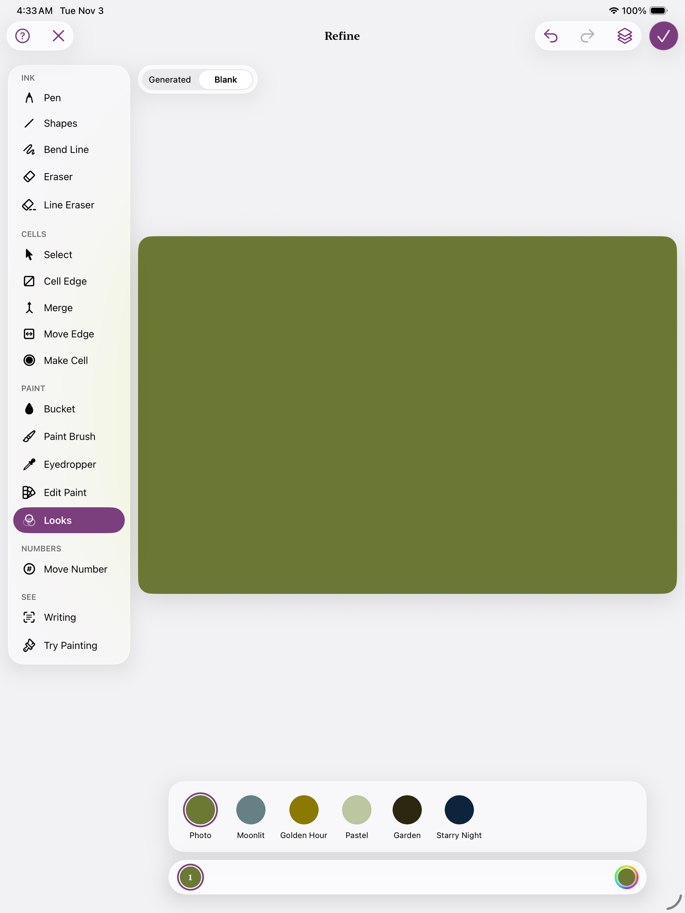
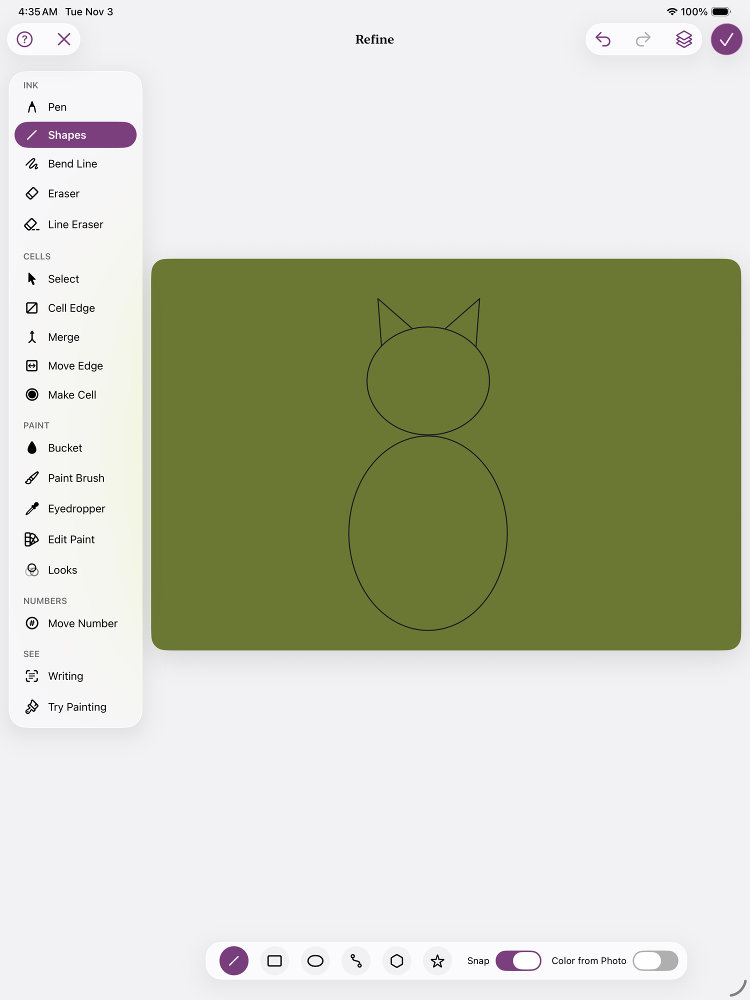
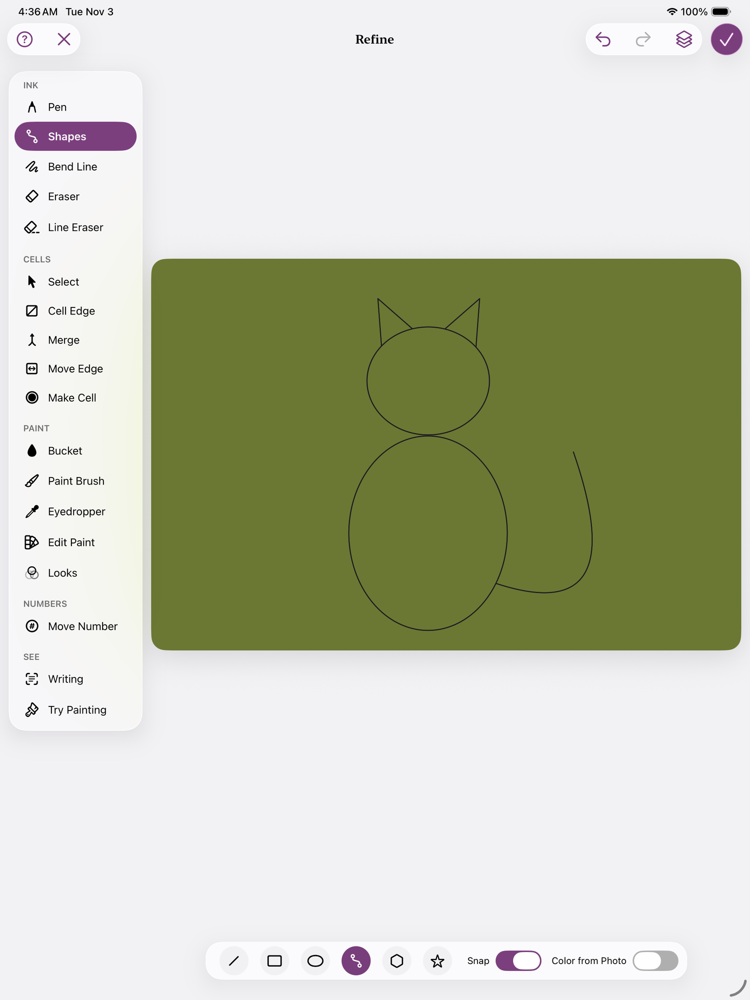
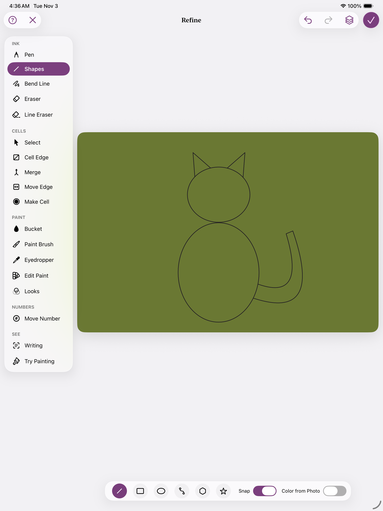
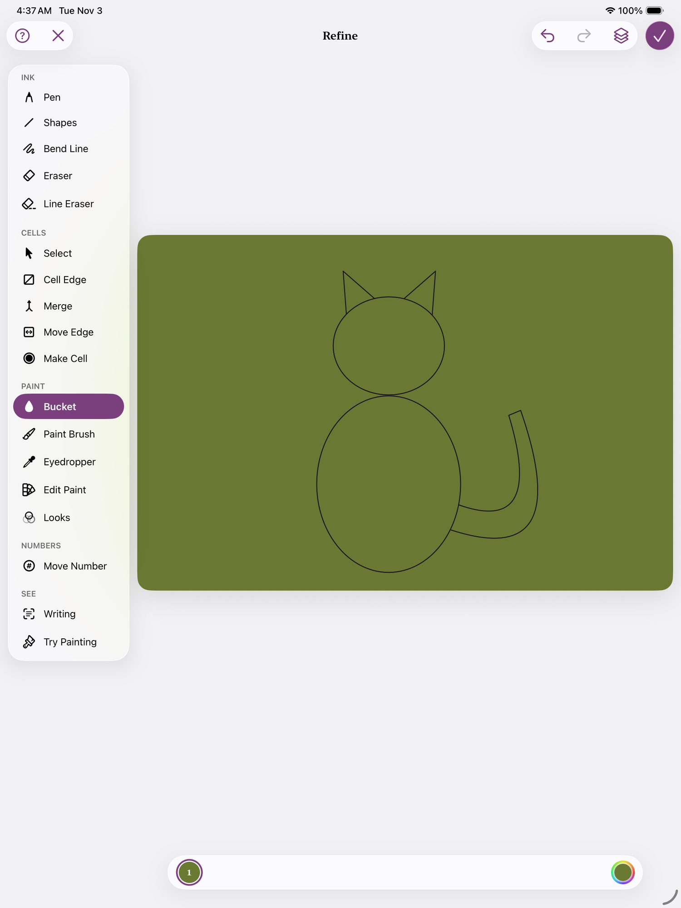
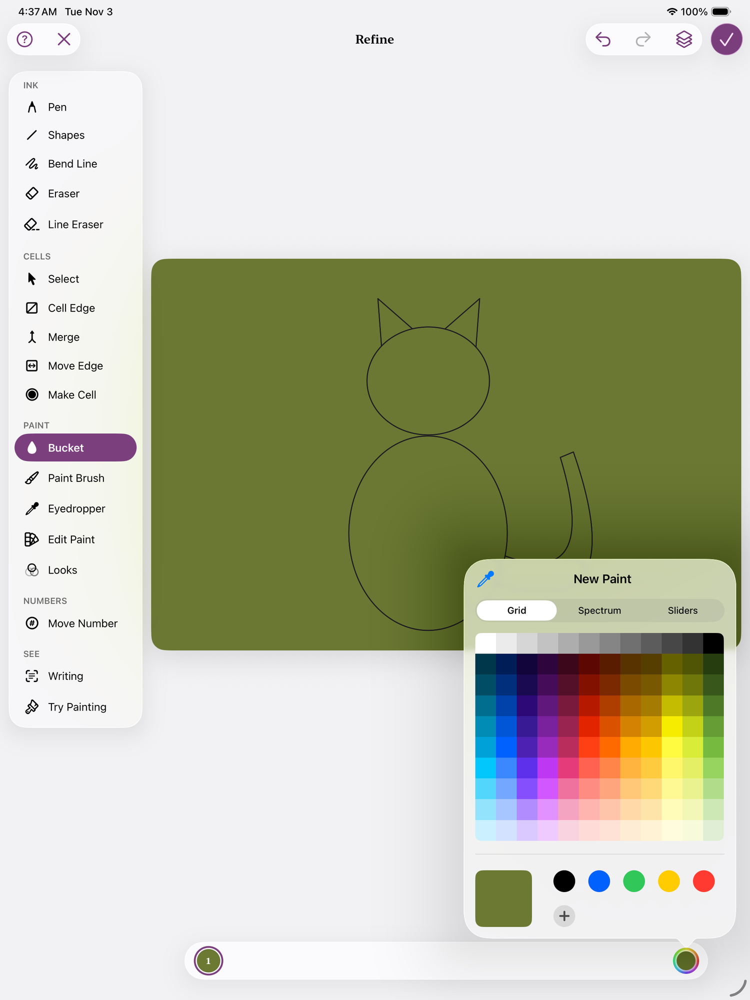
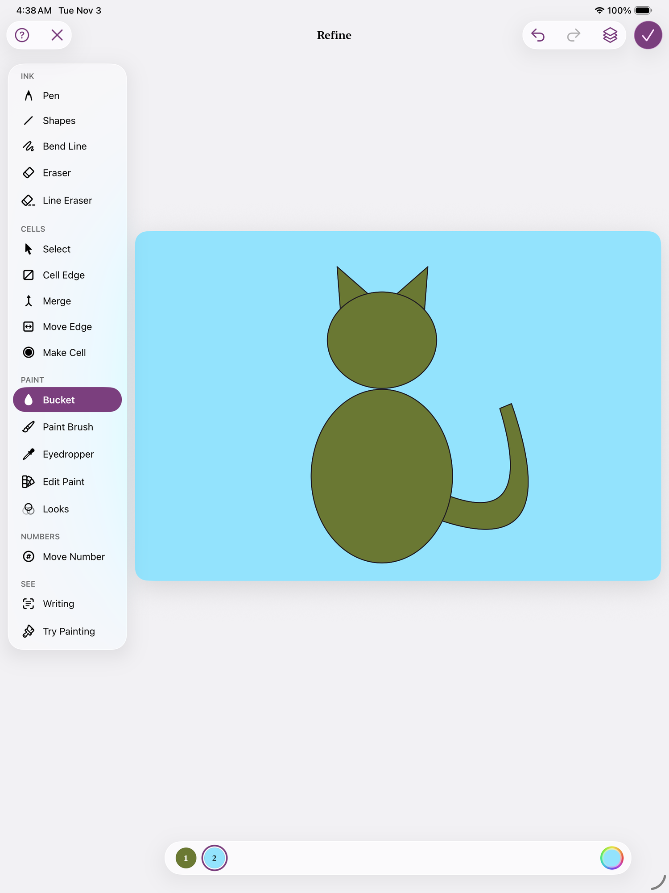
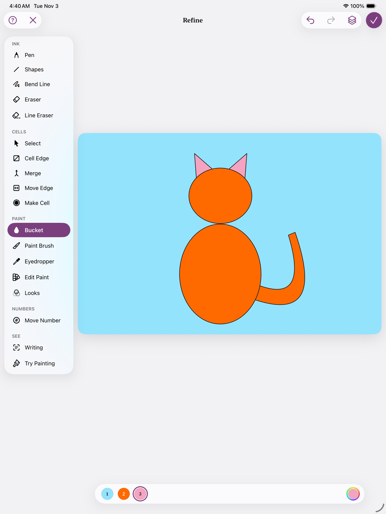

# Agent transcript

- end: error_during_execution, 79 turns, 11.9 min, estimated $1.6794514000000005
- tool calls: {"mcp__maestro__take_screenshot": 6, "mcp__maestro__run": 26, "mcp__maestro__inspect_screen": 16, "Read": 14, "Write": 1}
- images the agent received: 20

**Start**: model claude-opus-5-5, MCP [{"name": "maestro", "status": "connected", "source": "dynamic"}]

→ `mcp__maestro__take_screenshot` `{"device_id": "3593632A-CE78-4177-B6DD-E03EA2DEDFB7"}`

← mcp__maestro__take_screenshot: image  1500x2000

→ `mcp__maestro__run` `{"device_id": "3593632A-CE78-4177-B6DD-E03EA2DEDFB7", "yaml": "appId: com.pbordjadze.paintbynumber\n---\n- tapOn:\n    point: \"72%,4%\"\n- waitForAnimationToEnd"}`

→ `mcp__maestro__inspect_screen` `{"device_id": "3593632A-CE78-4177-B6DD-E03EA2DEDFB7"}`

← mcp__maestro__run: {"success":true,"device_id":"3593632A-CE78-4177-B6DD-E03EA2DEDFB7","commands_executed":3,"message":"Flow executed successfully","env_vars":{"MAESTRO_CLI_ANALYSIS_NOTIFICATION_DISABLED":"true","MAESTRO_CLI_NO_ANALYTICS":"1","MAESTRO_DRIVER_STARTUP_TIMEOUT":"240000","MAESTRO_VERSION":"2.11.0"}}

← mcp__maestro__inspect_screen: {"ui_schema":{"platform":"ios","abbreviations":{"b":"bounds","txt":"text","rid":"resource-id","a11y":"accessibilityText","hint":"hintText","val":"value","c":"children"},"defaults":{"enabled":true,"focused":false,"selected":false,"checked":false,"txt":"","hint":"","rid":"","val":"","a11y":""}},"elements":[{"b":"[0,0][1032,1376]","a11y":"Paint by Moonlight","c":[{"b":"[0,0][1032,1376]","c":[{"b":"[0 …

→ `mcp__maestro__run` `{"device_id": "3593632A-CE78-4177-B6DD-E03EA2DEDFB7", "yaml": "appId: com.pbordjadze.paintbynumber\n---\n- tapOn: \"Close\"\n- waitForAnimationToEnd"}`

→ `mcp__maestro__take_screenshot` `{"device_id": "3593632A-CE78-4177-B6DD-E03EA2DEDFB7"}`

← mcp__maestro__run: {"success":true,"device_id":"3593632A-CE78-4177-B6DD-E03EA2DEDFB7","commands_executed":3,"message":"Flow executed successfully","env_vars":{"MAESTRO_CLI_ANALYSIS_NOTIFICATION_DISABLED":"true","MAESTRO_CLI_NO_ANALYTICS":"1","MAESTRO_DRIVER_STARTUP_TIMEOUT":"240000","MAESTRO_VERSION":"2.11.0"}}

← mcp__maestro__take_screenshot: image  1500x2000

→ `mcp__maestro__run` `{"device_id": "3593632A-CE78-4177-B6DD-E03EA2DEDFB7", "yaml": "appId: com.pbordjadze.paintbynumber\n---\n- tapOn:\n    point: \"9%,60%\"\n- waitForAnimationToEnd"}`

→ `mcp__maestro__take_screenshot` `{"device_id": "3593632A-CE78-4177-B6DD-E03EA2DEDFB7"}`

→ `mcp__maestro__inspect_screen` `{"device_id": "3593632A-CE78-4177-B6DD-E03EA2DEDFB7"}`

← mcp__maestro__run: {"success":true,"device_id":"3593632A-CE78-4177-B6DD-E03EA2DEDFB7","commands_executed":3,"message":"Flow executed successfully","env_vars":{"MAESTRO_CLI_ANALYSIS_NOTIFICATION_DISABLED":"true","MAESTRO_CLI_NO_ANALYTICS":"1","MAESTRO_DRIVER_STARTUP_TIMEOUT":"240000","MAESTRO_VERSION":"2.11.0"}}

← mcp__maestro__take_screenshot: image  1500x2000

← mcp__maestro__inspect_screen: {"ui_schema":{"platform":"ios","abbreviations":{"b":"bounds","txt":"text","rid":"resource-id","a11y":"accessibilityText","hint":"hintText","val":"value","c":"children"},"defaults":{"enabled":true,"focused":false,"selected":false,"checked":false,"txt":"","hint":"","rid":"","val":"","a11y":""}},"elements":[{"b":"[0,0][1032,1376]","a11y":"Paint by Moonlight","c":[{"b":"[0,0][1032,1376]","c":[{"b":"[0 …

→ `mcp__maestro__run` `{"device_id": "3593632A-CE78-4177-B6DD-E03EA2DEDFB7", "yaml": "appId: com.pbordjadze.paintbynumber\n---\n- tapOn:\n    id: \"refine\"\n- waitForAnimationToEnd"}`

→ `mcp__maestro__take_screenshot` `{"device_id": "3593632A-CE78-4177-B6DD-E03EA2DEDFB7"}`

→ `mcp__maestro__inspect_screen` `{"device_id": "3593632A-CE78-4177-B6DD-E03EA2DEDFB7"}`

← mcp__maestro__run: {"success":true,"device_id":"3593632A-CE78-4177-B6DD-E03EA2DEDFB7","commands_executed":3,"message":"Flow executed successfully","env_vars":{"MAESTRO_CLI_ANALYSIS_NOTIFICATION_DISABLED":"true","MAESTRO_CLI_NO_ANALYTICS":"1","MAESTRO_DRIVER_STARTUP_TIMEOUT":"240000","MAESTRO_VERSION":"2.11.0"}}

← mcp__maestro__take_screenshot: image  1500x2000

← mcp__maestro__inspect_screen: {"ui_schema":{"platform":"ios","abbreviations":{"b":"bounds","txt":"text","rid":"resource-id","a11y":"accessibilityText","hint":"hintText","val":"value","c":"children"},"defaults":{"enabled":true,"focused":false,"selected":false,"checked":false,"txt":"","hint":"","rid":"","val":"","a11y":""}},"elements":[{"b":"[0,0][1032,1376]","a11y":"Paint by Moonlight","c":[{"b":"[0,0][1032,1376]","c":[{"b":"[0 …

> I'm in Refine now: its tools are Pen, Shapes, Bend Line, Erasers, cell tools, Bucket and Looks. Next I'll look for a way to start from an empty canvas.

→ `mcp__maestro__run` `{"device_id": "3593632A-CE78-4177-B6DD-E03EA2DEDFB7", "yaml": "appId: com.pbordjadze.paintbynumber\n---\n- tapOn: \"Close\"\n- waitForAnimationToEnd\n- tapOn: \"Looks\"\n- waitForAnimationToEnd\n- takeScreenshot: /Users/runner/work/_temp/qa/shots/plan-1"}`

→ `mcp__maestro__inspect_screen` `{"device_id": "3593632A-CE78-4177-B6DD-E03EA2DEDFB7"}`

← mcp__maestro__run: {"success":true,"device_id":"3593632A-CE78-4177-B6DD-E03EA2DEDFB7","commands_executed":6,"message":"Flow executed successfully","env_vars":{"MAESTRO_CLI_ANALYSIS_NOTIFICATION_DISABLED":"true","MAESTRO_CLI_NO_ANALYTICS":"1","MAESTRO_DRIVER_STARTUP_TIMEOUT":"240000","MAESTRO_VERSION":"2.11.0"}}

← mcp__maestro__inspect_screen: {"ui_schema":{"platform":"ios","abbreviations":{"b":"bounds","txt":"text","rid":"resource-id","a11y":"accessibilityText","hint":"hintText","val":"value","c":"children"},"defaults":{"enabled":true,"focused":false,"selected":false,"checked":false,"txt":"","hint":"","rid":"","val":"","a11y":""}},"elements":[{"b":"[0,0][1032,1376]","a11y":"Paint by Moonlight","c":[{"b":"[0,0][1032,1376]","c":[{"b":"[0 …

> There's a "Generated / Blank" switch at the top of the canvas. Tapping Blank.

→ `mcp__maestro__run` `{"device_id": "3593632A-CE78-4177-B6DD-E03EA2DEDFB7", "yaml": "appId: com.pbordjadze.paintbynumber\n---\n- tapOn: \"Blank\"\n- waitForAnimationToEnd\n- takeScreenshot: /Users/runner/work/_temp/qa/shots/plan-2"}`

→ `mcp__maestro__inspect_screen` `{"device_id": "3593632A-CE78-4177-B6DD-E03EA2DEDFB7"}`

← mcp__maestro__run: {"success":true,"device_id":"3593632A-CE78-4177-B6DD-E03EA2DEDFB7","commands_executed":4,"message":"Flow executed successfully","env_vars":{"MAESTRO_CLI_ANALYSIS_NOTIFICATION_DISABLED":"true","MAESTRO_CLI_NO_ANALYTICS":"1","MAESTRO_DRIVER_STARTUP_TIMEOUT":"240000","MAESTRO_VERSION":"2.11.0"}}

← mcp__maestro__inspect_screen: {"ui_schema":{"platform":"ios","abbreviations":{"b":"bounds","txt":"text","rid":"resource-id","a11y":"accessibilityText","hint":"hintText","val":"value","c":"children"},"defaults":{"enabled":true,"focused":false,"selected":false,"checked":false,"txt":"","hint":"","rid":"","val":"","a11y":""}},"elements":[{"b":"[0,0][1032,1376]","a11y":"Paint by Moonlight","c":[{"b":"[0,0][1032,1376]","c":[{"b":"[0 …

→ `Read` `{"file_path": "/Users/runner/work/_temp/qa/shots/plan-2.png"}`

← Read: image  1500x2000

→ `mcp__maestro__run` `{"device_id": "3593632A-CE78-4177-B6DD-E03EA2DEDFB7", "yaml": "appId: com.pbordjadze.paintbynumber\n---\n- tapOn:\n    id: \"refine-tool-shapes\"\n- waitForAnimationToEnd"}`

→ `mcp__maestro__take_screenshot` `{"device_id": "3593632A-CE78-4177-B6DD-E03EA2DEDFB7"}`

← mcp__maestro__run: {"success":true,"device_id":"3593632A-CE78-4177-B6DD-E03EA2DEDFB7","commands_executed":3,"message":"Flow executed successfully","env_vars":{"MAESTRO_CLI_ANALYSIS_NOTIFICATION_DISABLED":"true","MAESTRO_CLI_NO_ANALYTICS":"1","MAESTRO_DRIVER_STARTUP_TIMEOUT":"240000","MAESTRO_VERSION":"2.11.0"}}

← mcp__maestro__take_screenshot: image  1500x2000

→ `mcp__maestro__run` `{"device_id": "3593632A-CE78-4177-B6DD-E03EA2DEDFB7", "yaml": "appId: com.pbordjadze.paintbynumber\n---\n- tapOn:\n    point: \"433,1322\"\n- waitForAnimationToEnd\n- swipe:\n    start: \"480,600\"\n    end: \"700,870\"\n    duration: 800\n- waitForAnimationToEnd\n- takeScreenshot: /Users/runner/work/_temp/qa/shots/plan-3"}`

← mcp__maestro__run: {"success":true,"device_id":"3593632A-CE78-4177-B6DD-E03EA2DEDFB7","commands_executed":6,"message":"Flow executed successfully","env_vars":{"MAESTRO_CLI_ANALYSIS_NOTIFICATION_DISABLED":"true","MAESTRO_CLI_NO_ANALYTICS":"1","MAESTRO_DRIVER_STARTUP_TIMEOUT":"240000","MAESTRO_VERSION":"2.11.0"}}

→ `Read` `{"file_path": "/Users/runner/work/_temp/qa/shots/plan-3.png"}`

← Read: image  1500x2000

> The ellipse went corner to corner, as expected. Now the head.

→ `mcp__maestro__run` `{"device_id": "3593632A-CE78-4177-B6DD-E03EA2DEDFB7", "yaml": "appId: com.pbordjadze.paintbynumber\n---\n- swipe:\n    start: \"505,450\"\n    end: \"675,600\"\n    duration: 800\n- waitForAnimationToEnd\n- takeScreenshot: /Users/runner/work/_temp/qa/shots/plan-4"}`

← mcp__maestro__run: {"success":true,"device_id":"3593632A-CE78-4177-B6DD-E03EA2DEDFB7","commands_executed":4,"message":"Flow executed successfully","env_vars":{"MAESTRO_CLI_ANALYSIS_NOTIFICATION_DISABLED":"true","MAESTRO_CLI_NO_ANALYTICS":"1","MAESTRO_DRIVER_STARTUP_TIMEOUT":"240000","MAESTRO_VERSION":"2.11.0"}}

→ `Read` `{"file_path": "/Users/runner/work/_temp/qa/shots/plan-4.png"}`

← Read: image  1500x2000

> Head sits on the body, touching at one point. Now the ears, as two lines each with the Line tool.

→ `mcp__maestro__run` `{"device_id": "3593632A-CE78-4177-B6DD-E03EA2DEDFB7", "yaml": "appId: com.pbordjadze.paintbynumber\n---\n- tapOn:\n    point: \"321,1322\"\n- waitForAnimationToEnd\n- swipe:\n    start: \"525,477\"\n    end: \"520,410\"\n    duration: 600\n- swipe:\n    start: \"520,410\"\n    end: \"568,453\"\n    duration: 600\n- swipe:\n    start: \"655,477\"\n    end: \"660,410\"\n    duration: 600\n- swipe:\n    start: \"660,410\"\n    end: \"612,453\"\n    duration: 600\n- waitForAnimationToEnd\n- takeScreenshot: /Users/runner/work/_temp/qa/shots/plan-5"}`

← mcp__maestro__run: {"success":true,"device_id":"3593632A-CE78-4177-B6DD-E03EA2DEDFB7","commands_executed":9,"message":"Flow executed successfully","env_vars":{"MAESTRO_CLI_ANALYSIS_NOTIFICATION_DISABLED":"true","MAESTRO_CLI_NO_ANALYTICS":"1","MAESTRO_DRIVER_STARTUP_TIMEOUT":"240000","MAESTRO_VERSION":"2.11.0"}}

→ `Read` `{"file_path": "/Users/runner/work/_temp/qa/shots/plan-5.png"}`

← Read: image  1500x2000

> Ears done with 4 straight lines, first try, and Snap joined them to the head. Saving a first report before the tail.

→ `Write` `{"file_path": "/Users/runner/work/_temp/qa/report.md", "content": "# Refine exploratory session \u2014 draw a cat (in progress)\n\n**Verdict**: in progress.\n\n**What I meant to draw**: An orange cat sitting, seen from the front, on a light-blue background: a round head with two triangle ears, an oval body below, a tail curling up on the right; head, ears, body and tail each their own area.\n\n## The steps (so far)\n| Step | Tries | Stuck | What worked | Expected instead |\n|---|---|---|---|---|\n| Find a blank canvas | 1 | 0 | New Painting \u203a photo (leaf) \u203a Refine \u203a \"Generated `

← Write: File created successfully at: /Users/runner/work/_temp/qa/report.md (file state is current in your context — no need to Read it back)

→ `mcp__maestro__run` `{"device_id": "3593632A-CE78-4177-B6DD-E03EA2DEDFB7", "yaml": "appId: com.pbordjadze.paintbynumber\n---\n- tapOn:\n    point: \"490,1322\"\n- waitForAnimationToEnd\n- takeScreenshot: /Users/runner/work/_temp/qa/shots/plan-6"}`

← mcp__maestro__run: {"success":true,"device_id":"3593632A-CE78-4177-B6DD-E03EA2DEDFB7","commands_executed":4,"message":"Flow executed successfully","env_vars":{"MAESTRO_CLI_ANALYSIS_NOTIFICATION_DISABLED":"true","MAESTRO_CLI_NO_ANALYTICS":"1","MAESTRO_DRIVER_STARTUP_TIMEOUT":"240000","MAESTRO_VERSION":"2.11.0"}}

→ `Read` `{"file_path": "/Users/runner/work/_temp/qa/shots/plan-6.png"}`

← Read: image  1500x2000

> No hint on how this curve tool works. Checking its label.

→ `mcp__maestro__inspect_screen` `{"device_id": "3593632A-CE78-4177-B6DD-E03EA2DEDFB7"}`

← mcp__maestro__inspect_screen: {"ui_schema":{"platform":"ios","abbreviations":{"b":"bounds","txt":"text","rid":"resource-id","a11y":"accessibilityText","hint":"hintText","val":"value","c":"children"},"defaults":{"enabled":true,"focused":false,"selected":false,"checked":false,"txt":"","hint":"","rid":"","val":"","a11y":""}},"elements":[{"b":"[0,0][1032,1376]","a11y":"Paint by Moonlight","c":[{"b":"[0,0][1032,1376]","c":[{"b":"[0 …

> The canvas lists a hint: "Drag from one end of the curve to the other, then drag to bend it." It never showed in my screenshots. Drawing the tail's outer edge.

→ `mcp__maestro__run` `{"device_id": "3593632A-CE78-4177-B6DD-E03EA2DEDFB7", "yaml": "appId: com.pbordjadze.paintbynumber\n---\n- swipe:\n    start: \"684,800\"\n    end: \"790,620\"\n    duration: 700\n- waitForAnimationToEnd\n- takeScreenshot: /Users/runner/work/_temp/qa/shots/plan-7a\n- swipe:\n    start: \"737,710\"\n    end: \"805,790\"\n    duration: 700\n- waitForAnimationToEnd\n- takeScreenshot: /Users/runner/work/_temp/qa/shots/plan-7"}`

← mcp__maestro__run: {"success":true,"device_id":"3593632A-CE78-4177-B6DD-E03EA2DEDFB7","commands_executed":7,"message":"Flow executed successfully","env_vars":{"MAESTRO_CLI_ANALYSIS_NOTIFICATION_DISABLED":"true","MAESTRO_CLI_NO_ANALYTICS":"1","MAESTRO_DRIVER_STARTUP_TIMEOUT":"240000","MAESTRO_VERSION":"2.11.0"}}

→ `Read` `{"file_path": "/Users/runner/work/_temp/qa/shots/plan-7.png"}`

← Read: image  1500x2000

> The curve bent as the hint said: drag end to end, then drag the middle. Now the inner edge, then a line to close the tail's tip.

→ `mcp__maestro__run` `{"device_id": "3593632A-CE78-4177-B6DD-E03EA2DEDFB7", "yaml": "appId: com.pbordjadze.paintbynumber\n---\n- swipe:\n    start: \"695,765\"\n    end: \"772,628\"\n    duration: 700\n- waitForAnimationToEnd\n- swipe:\n    start: \"733,697\"\n    end: \"780,755\"\n    duration: 700\n- waitForAnimationToEnd\n- tapOn:\n    id: \"refine-shape-line\"\n- waitForAnimationToEnd\n- swipe:\n    start: \"789,621\"\n    end: \"772,628\"\n    duration: 600\n- waitForAnimationToEnd\n- takeScreenshot: /Users/runner/work/_temp/qa/shots/plan-8"}`

← mcp__maestro__run: {"success":true,"device_id":"3593632A-CE78-4177-B6DD-E03EA2DEDFB7","commands_executed":10,"message":"Flow executed successfully","env_vars":{"MAESTRO_CLI_ANALYSIS_NOTIFICATION_DISABLED":"true","MAESTRO_CLI_NO_ANALYTICS":"1","MAESTRO_DRIVER_STARTUP_TIMEOUT":"240000","MAESTRO_VERSION":"2.11.0"}}

→ `Read` `{"file_path": "/Users/runner/work/_temp/qa/shots/plan-8.png"}`

← Read: image  1500x2000

> The tail closed with a short line. Now colors: opening Bucket to see the palette.

→ `mcp__maestro__run` `{"device_id": "3593632A-CE78-4177-B6DD-E03EA2DEDFB7", "yaml": "appId: com.pbordjadze.paintbynumber\n---\n- tapOn:\n    id: \"refine-tool-bucket\"\n- waitForAnimationToEnd\n- takeScreenshot: /Users/runner/work/_temp/qa/shots/plan-9"}`

→ `mcp__maestro__inspect_screen` `{"device_id": "3593632A-CE78-4177-B6DD-E03EA2DEDFB7"}`

← mcp__maestro__run: {"success":true,"device_id":"3593632A-CE78-4177-B6DD-E03EA2DEDFB7","commands_executed":4,"message":"Flow executed successfully","env_vars":{"MAESTRO_CLI_ANALYSIS_NOTIFICATION_DISABLED":"true","MAESTRO_CLI_NO_ANALYTICS":"1","MAESTRO_DRIVER_STARTUP_TIMEOUT":"240000","MAESTRO_VERSION":"2.11.0"}}

← mcp__maestro__inspect_screen: {"ui_schema":{"platform":"ios","abbreviations":{"b":"bounds","txt":"text","rid":"resource-id","a11y":"accessibilityText","hint":"hintText","val":"value","c":"children"},"defaults":{"enabled":true,"focused":false,"selected":false,"checked":false,"txt":"","hint":"","rid":"","val":"","a11y":""}},"elements":[{"b":"[0,0][1032,1376]","a11y":"Paint by Moonlight","c":[{"b":"[0,0][1032,1376]","c":[{"b":"[0 …

→ `mcp__maestro__run` `{"device_id": "3593632A-CE78-4177-B6DD-E03EA2DEDFB7", "yaml": "appId: com.pbordjadze.paintbynumber\n---\n- tapOn:\n    id: \"refine-palette-new\"\n- waitForAnimationToEnd\n- takeScreenshot: /Users/runner/work/_temp/qa/shots/plan-10"}`

→ `mcp__maestro__inspect_screen` `{"device_id": "3593632A-CE78-4177-B6DD-E03EA2DEDFB7"}`

← mcp__maestro__run: {"success":true,"device_id":"3593632A-CE78-4177-B6DD-E03EA2DEDFB7","commands_executed":4,"message":"Flow executed successfully","env_vars":{"MAESTRO_CLI_ANALYSIS_NOTIFICATION_DISABLED":"true","MAESTRO_CLI_NO_ANALYTICS":"1","MAESTRO_DRIVER_STARTUP_TIMEOUT":"240000","MAESTRO_VERSION":"2.11.0"}}

← mcp__maestro__inspect_screen: {"ui_schema":{"platform":"ios","abbreviations":{"b":"bounds","txt":"text","rid":"resource-id","a11y":"accessibilityText","hint":"hintText","val":"value","c":"children"},"defaults":{"enabled":true,"focused":false,"selected":false,"checked":false,"txt":"","hint":"","rid":"","val":"","a11y":""}},"elements":[{"b":"[0,0][1032,1376]","a11y":"Paint by Moonlight","c":[{"b":"[0,0][1032,1376]","c":[{"b":"[0 …

→ `Read` `{"file_path": "/Users/runner/work/_temp/qa/shots/plan-10.png"}`

← Read: image  1500x2000

> Tapping New Paint showed no change. Trying again by point.

→ `mcp__maestro__run` `{"device_id": "3593632A-CE78-4177-B6DD-E03EA2DEDFB7", "yaml": "appId: com.pbordjadze.paintbynumber\n---\n- tapOn:\n    point: \"944,1322\"\n- waitForAnimationToEnd\n- takeScreenshot: /Users/runner/work/_temp/qa/shots/plan-11"}`

→ `mcp__maestro__inspect_screen` `{"device_id": "3593632A-CE78-4177-B6DD-E03EA2DEDFB7"}`

← mcp__maestro__run: {"success":true,"device_id":"3593632A-CE78-4177-B6DD-E03EA2DEDFB7","commands_executed":4,"message":"Flow executed successfully","env_vars":{"MAESTRO_CLI_ANALYSIS_NOTIFICATION_DISABLED":"true","MAESTRO_CLI_NO_ANALYTICS":"1","MAESTRO_DRIVER_STARTUP_TIMEOUT":"240000","MAESTRO_VERSION":"2.11.0"}}

← mcp__maestro__inspect_screen: {"ui_schema":{"platform":"ios","abbreviations":{"b":"bounds","txt":"text","rid":"resource-id","a11y":"accessibilityText","hint":"hintText","val":"value","c":"children"},"defaults":{"enabled":true,"focused":false,"selected":false,"checked":false,"txt":"","hint":"","rid":"","val":"","a11y":""}},"elements":[{"b":"[0,0][1032,1376]","a11y":"Paint by Moonlight","c":[{"b":"[0,0][1032,1376]","c":[{"b":"[0 …

→ `Read` `{"file_path": "/Users/runner/work/_temp/qa/shots/plan-11.png"}`

← Read: image  1500x2000

> The second tap opened the system color picker; the first, by id, didn't. Picking light blue, then closing the picker.

→ `mcp__maestro__run` `{"device_id": "3593632A-CE78-4177-B6DD-E03EA2DEDFB7", "yaml": "appId: com.pbordjadze.paintbynumber\n---\n- tapOn:\n    point: \"668,1112\"\n- waitForAnimationToEnd\n- tapOn:\n    point: \"500,1250\"\n- waitForAnimationToEnd\n- takeScreenshot: /Users/runner/work/_temp/qa/shots/plan-12"}`

→ `mcp__maestro__inspect_screen` `{"device_id": "3593632A-CE78-4177-B6DD-E03EA2DEDFB7"}`

← mcp__maestro__run: {"success":true,"device_id":"3593632A-CE78-4177-B6DD-E03EA2DEDFB7","commands_executed":6,"message":"Flow executed successfully","env_vars":{"MAESTRO_CLI_ANALYSIS_NOTIFICATION_DISABLED":"true","MAESTRO_CLI_NO_ANALYTICS":"1","MAESTRO_DRIVER_STARTUP_TIMEOUT":"240000","MAESTRO_VERSION":"2.11.0"}}

← mcp__maestro__inspect_screen: {"ui_schema":{"platform":"ios","abbreviations":{"b":"bounds","txt":"text","rid":"resource-id","a11y":"accessibilityText","hint":"hintText","val":"value","c":"children"},"defaults":{"enabled":true,"focused":false,"selected":false,"checked":false,"txt":"","hint":"","rid":"","val":"","a11y":""}},"elements":[{"b":"[0,0][1032,1376]","a11y":"Paint by Moonlight","c":[{"b":"[0,0][1032,1376]","c":[{"b":"[0 …

→ `mcp__maestro__take_screenshot` `{"device_id": "3593632A-CE78-4177-B6DD-E03EA2DEDFB7"}`

← mcp__maestro__take_screenshot: image  1500x2000

> A light-blue swatch was added and selected, but the picker is still open after my tap outside it. Trying to dismiss it higher up.

→ `mcp__maestro__run` `{"device_id": "3593632A-CE78-4177-B6DD-E03EA2DEDFB7", "yaml": "appId: com.pbordjadze.paintbynumber\n---\n- tapOn:\n    point: \"600,200\"\n- waitForAnimationToEnd\n- takeScreenshot: /Users/runner/work/_temp/qa/shots/plan-13"}`

→ `mcp__maestro__inspect_screen` `{"device_id": "3593632A-CE78-4177-B6DD-E03EA2DEDFB7"}`

← mcp__maestro__run: {"success":true,"device_id":"3593632A-CE78-4177-B6DD-E03EA2DEDFB7","commands_executed":4,"message":"Flow executed successfully","env_vars":{"MAESTRO_CLI_ANALYSIS_NOTIFICATION_DISABLED":"true","MAESTRO_CLI_NO_ANALYTICS":"1","MAESTRO_DRIVER_STARTUP_TIMEOUT":"240000","MAESTRO_VERSION":"2.11.0"}}

← mcp__maestro__inspect_screen: {"ui_schema":{"platform":"ios","abbreviations":{"b":"bounds","txt":"text","rid":"resource-id","a11y":"accessibilityText","hint":"hintText","val":"value","c":"children"},"defaults":{"enabled":true,"focused":false,"selected":false,"checked":false,"txt":"","hint":"","rid":"","val":"","a11y":""}},"elements":[{"b":"[0,0][1032,1376]","a11y":"Paint by Moonlight","c":[{"b":"[0,0][1032,1376]","c":[{"b":"[0 …

> Picker closed; a pending "New Paint" swatch is selected. Pouring it on the background.

→ `mcp__maestro__run` `{"device_id": "3593632A-CE78-4177-B6DD-E03EA2DEDFB7", "yaml": "appId: com.pbordjadze.paintbynumber\n---\n- tapOn:\n    point: \"300,450\"\n- waitForAnimationToEnd\n- takeScreenshot: /Users/runner/work/_temp/qa/shots/plan-14"}`

← mcp__maestro__run: {"success":true,"device_id":"3593632A-CE78-4177-B6DD-E03EA2DEDFB7","commands_executed":4,"message":"Flow executed successfully","env_vars":{"MAESTRO_CLI_ANALYSIS_NOTIFICATION_DISABLED":"true","MAESTRO_CLI_NO_ANALYTICS":"1","MAESTRO_DRIVER_STARTUP_TIMEOUT":"240000","MAESTRO_VERSION":"2.11.0"}}

→ `Read` `{"file_path": "/Users/runner/work/_temp/qa/shots/plan-14.png"}`

← Read: image  1500x2000

> Background filled in one tap, and head, body, tail and ears stayed separate cells. Adding orange next.

→ `mcp__maestro__run` `{"device_id": "3593632A-CE78-4177-B6DD-E03EA2DEDFB7", "yaml": "appId: com.pbordjadze.paintbynumber\n---\n- tapOn:\n    point: \"944,1322\"\n- waitForAnimationToEnd\n- takeScreenshot: /Users/runner/work/_temp/qa/shots/plan-15"}`

→ `mcp__maestro__inspect_screen` `{"device_id": "3593632A-CE78-4177-B6DD-E03EA2DEDFB7"}`

← mcp__maestro__run: {"success":true,"device_id":"3593632A-CE78-4177-B6DD-E03EA2DEDFB7","commands_executed":4,"message":"Flow executed successfully","env_vars":{"MAESTRO_CLI_ANALYSIS_NOTIFICATION_DISABLED":"true","MAESTRO_CLI_NO_ANALYTICS":"1","MAESTRO_DRIVER_STARTUP_TIMEOUT":"240000","MAESTRO_VERSION":"2.11.0"}}

← mcp__maestro__inspect_screen: {"ui_schema":{"platform":"ios","abbreviations":{"b":"bounds","txt":"text","rid":"resource-id","a11y":"accessibilityText","hint":"hintText","val":"value","c":"children"},"defaults":{"enabled":true,"focused":false,"selected":false,"checked":false,"txt":"","hint":"","rid":"","val":"","a11y":""}},"elements":[{"b":"[0,0][1032,1376]","a11y":"Paint by Moonlight","c":[{"b":"[0,0][1032,1376]","c":[{"b":"[0 …

→ `mcp__maestro__run` `{"device_id": "3593632A-CE78-4177-B6DD-E03EA2DEDFB7", "yaml": "appId: com.pbordjadze.paintbynumber\n---\n- tapOn:\n    point: \"839,1027\"\n- waitForAnimationToEnd\n- tapOn:\n    point: \"600,200\"\n- waitForAnimationToEnd\n- tapOn:\n    point: \"590,525\"\n- waitForAnimationToEnd\n- tapOn:\n    point: \"589,740\"\n- waitForAnimationToEnd\n- tapOn:\n    point: \"801,722\"\n- waitForAnimationToEnd\n- takeScreenshot: /Users/runner/work/_temp/qa/shots/plan-16"}`

← mcp__maestro__run: {"success":true,"device_id":"3593632A-CE78-4177-B6DD-E03EA2DEDFB7","commands_executed":12,"message":"Flow executed successfully","env_vars":{"MAESTRO_CLI_ANALYSIS_NOTIFICATION_DISABLED":"true","MAESTRO_CLI_NO_ANALYTICS":"1","MAESTRO_DRIVER_STARTUP_TIMEOUT":"240000","MAESTRO_VERSION":"2.11.0"}}

→ `Read` `{"file_path": "/Users/runner/work/_temp/qa/shots/plan-16.png"}`

← Read: image  1500x2000

> Head, body and tail orange in 3 taps. The ears need their own color: adding pink.

→ `mcp__maestro__run` `{"device_id": "3593632A-CE78-4177-B6DD-E03EA2DEDFB7", "yaml": "appId: com.pbordjadze.paintbynumber\n---\n- tapOn:\n    point: \"944,1322\"\n- waitForAnimationToEnd\n- takeScreenshot: /Users/runner/work/_temp/qa/shots/plan-17"}`

→ `mcp__maestro__inspect_screen` `{"device_id": "3593632A-CE78-4177-B6DD-E03EA2DEDFB7"}`

← mcp__maestro__run: {"success":true,"device_id":"3593632A-CE78-4177-B6DD-E03EA2DEDFB7","commands_executed":4,"message":"Flow executed successfully","env_vars":{"MAESTRO_CLI_ANALYSIS_NOTIFICATION_DISABLED":"true","MAESTRO_CLI_NO_ANALYTICS":"1","MAESTRO_DRIVER_STARTUP_TIMEOUT":"240000","MAESTRO_VERSION":"2.11.0"}}

← mcp__maestro__inspect_screen: {"ui_schema":{"platform":"ios","abbreviations":{"b":"bounds","txt":"text","rid":"resource-id","a11y":"accessibilityText","hint":"hintText","val":"value","c":"children"},"defaults":{"enabled":true,"focused":false,"selected":false,"checked":false,"txt":"","hint":"","rid":"","val":"","a11y":""}},"elements":[{"b":"[0,0][1032,1376]","a11y":"Paint by Moonlight","c":[{"b":"[0,0][1032,1376]","c":[{"b":"[0 …

→ `mcp__maestro__run` `{"device_id": "3593632A-CE78-4177-B6DD-E03EA2DEDFB7", "yaml": "appId: com.pbordjadze.paintbynumber\n---\n- tapOn:\n    point: \"782,1112\"\n- waitForAnimationToEnd\n- tapOn:\n    point: \"600,200\"\n- waitForAnimationToEnd\n- tapOn:\n    point: \"533,440\"\n- waitForAnimationToEnd\n- tapOn:\n    point: \"647,440\"\n- waitForAnimationToEnd\n- takeScreenshot: /Users/runner/work/_temp/qa/shots/plan-18"}`

← mcp__maestro__run: {"success":true,"device_id":"3593632A-CE78-4177-B6DD-E03EA2DEDFB7","commands_executed":10,"message":"Flow executed successfully","env_vars":{"MAESTRO_CLI_ANALYSIS_NOTIFICATION_DISABLED":"true","MAESTRO_CLI_NO_ANALYTICS":"1","MAESTRO_DRIVER_STARTUP_TIMEOUT":"240000","MAESTRO_VERSION":"2.11.0"}}

→ `Read` `{"file_path": "/Users/runner/work/_temp/qa/shots/plan-18.png"}`

← Read: image  1500x2000

> The cat matches my plan. The olive paint left the palette once no area used it, and the rest renumbered 1–3. Saving final-refine and tapping Done.

→ `mcp__maestro__run` `{"device_id": "3593632A-CE78-4177-B6DD-E03EA2DEDFB7", "yaml": "appId: com.pbordjadze.paintbynumber\n---\n- takeScreenshot: /Users/runner/work/_temp/qa/shots/final-refine\n- tapOn:\n    id: \"refine-done\"\n- waitForAnimationToEnd\n- takeScreenshot: /Users/runner/work/_temp/qa/shots/plan-19"}`

→ `mcp__maestro__inspect_screen` `{"device_id": "3593632A-CE78-4177-B6DD-E03EA2DEDFB7"}`

← mcp__maestro__run: {"success":true,"device_id":"3593632A-CE78-4177-B6DD-E03EA2DEDFB7","commands_executed":5,"message":"Flow executed successfully","env_vars":{"MAESTRO_CLI_ANALYSIS_NOTIFICATION_DISABLED":"true","MAESTRO_CLI_NO_ANALYTICS":"1","MAESTRO_DRIVER_STARTUP_TIMEOUT":"240000","MAESTRO_VERSION":"2.11.0"}}

← mcp__maestro__inspect_screen: {"ui_schema":{"platform":"ios","abbreviations":{"b":"bounds","txt":"text","rid":"resource-id","a11y":"accessibilityText","hint":"hintText","val":"value","c":"children"},"defaults":{"enabled":true,"focused":false,"selected":false,"checked":false,"txt":"","hint":"","rid":"","val":"","a11y":""}},"elements":[{"b":"[0,0][1032,1376]","a11y":"Paint by Moonlight","c":[{"b":"[0,0][1032,1376]","c":[{"b":"[0 …

> The preview reads "3 colors · 6 areas · ~5 min", which matches the drawing: background, head, body, tail and two ears. Checking the preview.

→ `Read` `{"file_path": "/Users/runner/work/_temp/qa/shots/plan-19.png"}`

← Read: image  1500x2000

> The preview shows the photo on the left half, by design. Tapping Start Painting.

→ `mcp__maestro__run` `{"device_id": "3593632A-CE78-4177-B6DD-E03EA2DEDFB7", "yaml": "appId: com.pbordjadze.paintbynumber\n---\n- tapOn: \"Start Painting\"\n- waitForAnimationToEnd:\n    timeout: 15000\n- takeScreenshot: /Users/runner/work/_temp/qa/shots/plan-20"}`

→ `mcp__maestro__inspect_screen` `{"device_id": "3593632A-CE78-4177-B6DD-E03EA2DEDFB7"}`

← mcp__maestro__run: {"success":true,"device_id":"3593632A-CE78-4177-B6DD-E03EA2DEDFB7","commands_executed":4,"message":"Flow executed successfully","env_vars":{"MAESTRO_CLI_ANALYSIS_NOTIFICATION_DISABLED":"true","MAESTRO_CLI_NO_ANALYTICS":"1","MAESTRO_DRIVER_STARTUP_TIMEOUT":"240000","MAESTRO_VERSION":"2.11.0"}}

← mcp__maestro__inspect_screen: {"ui_schema":{"platform":"ios","abbreviations":{"b":"bounds","txt":"text","rid":"resource-id","a11y":"accessibilityText","hint":"hintText","val":"value","c":"children"},"defaults":{"enabled":true,"focused":false,"selected":false,"checked":false,"txt":"","hint":"","rid":"","val":"","a11y":""}},"elements":[{"b":"[0,0][1032,1376]","a11y":"Paint by Moonlight","c":[{"b":"[0,0][1032,1376]","c":[{"b":"[0 …

→ `mcp__maestro__run` `{"device_id": "3593632A-CE78-4177-B6DD-E03EA2DEDFB7", "yaml": "appId: com.pbordjadze.paintbynumber\n---\n- tapOn: \"Close\"\n- waitForAnimationToEnd\n- takeScreenshot: /Users/runner/work/_temp/qa/shots/final-template"}`

→ `mcp__maestro__inspect_screen` `{"device_id": "3593632A-CE78-4177-B6DD-E03EA2DEDFB7"}`

← mcp__maestro__run: {"success":true,"device_id":"3593632A-CE78-4177-B6DD-E03EA2DEDFB7","commands_executed":4,"message":"Flow executed successfully","env_vars":{"MAESTRO_CLI_ANALYSIS_NOTIFICATION_DISABLED":"true","MAESTRO_CLI_NO_ANALYTICS":"1","MAESTRO_DRIVER_STARTUP_TIMEOUT":"240000","MAESTRO_VERSION":"2.11.0"}}

← mcp__maestro__inspect_screen: {"ui_schema":{"platform":"ios","abbreviations":{"b":"bounds","txt":"text","rid":"resource-id","a11y":"accessibilityText","hint":"hintText","val":"value","c":"children"},"defaults":{"enabled":true,"focused":false,"selected":false,"checked":false,"txt":"","hint":"","rid":"","val":"","a11y":""}},"elements":[{"b":"[0,0][1032,1376]","a11y":"Paint by Moonlight","c":[{"b":"[0,0][1032,1376]","c":[{"b":"[0 …

→ `Read` `{"file_path": "/Users/runner/work/_temp/qa/shots/final-template.png"}`

← Read: image  1500x2000
