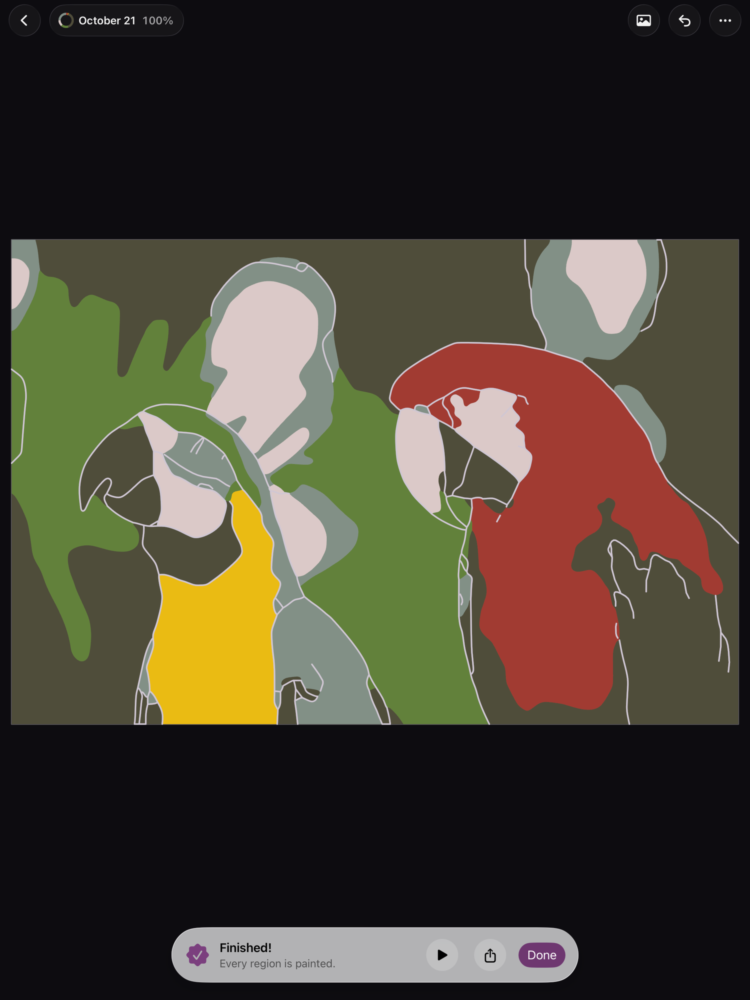

# Agent transcript

- end: success, 152 turns, 31.0 min, estimated $5.4741152
- tool calls: {"mcp__maestro__take_screenshot": 54, "Read": 12, "mcp__maestro__inspect_screen": 13, "mcp__maestro__run": 63, "Write": 3}
- images the agent received: 60

**Start**: model claude-opus-5-5, MCP [{"name": "maestro", "status": "connected", "source": "dynamic"}]

→ `mcp__maestro__take_screenshot` `{"device_id": "99DEE653-946C-406D-8E9E-238D1FCE93C9"}`

→ `Read` `{"file_path": "/Users/runner/work/_temp/qa/app.log"}`

← mcp__maestro__take_screenshot: image  1500x2000

← Read: 1	getpwuid_r did not find a match for uid 501
2	Filtering the log data using "subsystem == "com.pbordjadze.paintbynumber""
3	Timestamp               Ty Process[PID:TID]
4	2026-10-21 21:42:12.280 Df PaintByNumber[49872:20773] [com.pbordjadze.paintbynumber:tips] offer in shelf: , wanted
5	2026-10-21 21:42:13.557 Df PaintByNumber[49872:207bd] [com.pbordjadze.paintbynumber:canvas] Making the render co …

→ `mcp__maestro__inspect_screen` `{"device_id": "99DEE653-946C-406D-8E9E-238D1FCE93C9"}`

← mcp__maestro__inspect_screen: {"ui_schema":{"platform":"ios","abbreviations":{"b":"bounds","txt":"text","rid":"resource-id","a11y":"accessibilityText","hint":"hintText","val":"value","c":"children"},"defaults":{"enabled":true,"focused":false,"selected":false,"checked":false,"txt":"","hint":"","rid":"","val":"","a11y":""}},"elements":[{"b":"[0,0][1032,1376]","a11y":"Paint by Moonlight","c":[{"b":"[0,0][1032,1376]","c":[{"b":"[0 …

→ `mcp__maestro__run` `{"device_id": "99DEE653-946C-406D-8E9E-238D1FCE93C9", "yaml": "appId: com.pbordjadze.paintbynumber\n---\n- tapOn: \"New Painting\"\n- waitForAnimationToEnd\n- takeScreenshot: /Users/runner/work/_temp/qa/shots/01-new-painting"}`

← mcp__maestro__run: {"success":true,"device_id":"99DEE653-946C-406D-8E9E-238D1FCE93C9","commands_executed":4,"message":"Flow executed successfully","env_vars":{"MAESTRO_CLI_ANALYSIS_NOTIFICATION_DISABLED":"true","MAESTRO_CLI_NO_ANALYTICS":"1","MAESTRO_DRIVER_STARTUP_TIMEOUT":"240000","MAESTRO_VERSION":"2.11.0"}}

→ `mcp__maestro__take_screenshot` `{"device_id": "99DEE653-946C-406D-8E9E-238D1FCE93C9"}`

← mcp__maestro__take_screenshot: image  1500x2000

→ `mcp__maestro__run` `{"device_id": "99DEE653-946C-406D-8E9E-238D1FCE93C9", "yaml": "appId: com.pbordjadze.paintbynumber\n---\n- tapOn:\n    point: \"740,54\"\n- waitForAnimationToEnd"}`

→ `mcp__maestro__take_screenshot` `{"device_id": "99DEE653-946C-406D-8E9E-238D1FCE93C9"}`

← mcp__maestro__run: {"success":true,"device_id":"99DEE653-946C-406D-8E9E-238D1FCE93C9","commands_executed":3,"message":"Flow executed successfully","env_vars":{"MAESTRO_CLI_ANALYSIS_NOTIFICATION_DISABLED":"true","MAESTRO_CLI_NO_ANALYTICS":"1","MAESTRO_DRIVER_STARTUP_TIMEOUT":"240000","MAESTRO_VERSION":"2.11.0"}}

← mcp__maestro__take_screenshot: image  1500x2000

→ `mcp__maestro__run` `{"device_id": "99DEE653-946C-406D-8E9E-238D1FCE93C9", "yaml": "appId: com.pbordjadze.paintbynumber\n---\n- takeScreenshot: /Users/runner/work/_temp/qa/shots/02-new-painting-tip\n- tapOn: \"Close\"\n- waitForAnimationToEnd\n- tapOn: \"Red Fuji.*\"\n- waitForAnimationToEnd\n- takeScreenshot: /Users/runner/work/_temp/qa/shots/03-preview"}`

→ `mcp__maestro__take_screenshot` `{"device_id": "99DEE653-946C-406D-8E9E-238D1FCE93C9"}`

← mcp__maestro__run (error): Failed to run flow: Element not found: Text matching regex: Red Fuji.*

← mcp__maestro__take_screenshot: image  1500x2000

→ `mcp__maestro__run` `{"device_id": "99DEE653-946C-406D-8E9E-238D1FCE93C9", "yaml": "appId: com.pbordjadze.paintbynumber\n---\n- tapOn:\n    point: \"740,54\"\n- waitForAnimationToEnd"}`

→ `mcp__maestro__inspect_screen` `{"device_id": "99DEE653-946C-406D-8E9E-238D1FCE93C9"}`

← mcp__maestro__run: {"success":true,"device_id":"99DEE653-946C-406D-8E9E-238D1FCE93C9","commands_executed":3,"message":"Flow executed successfully","env_vars":{"MAESTRO_CLI_ANALYSIS_NOTIFICATION_DISABLED":"true","MAESTRO_CLI_NO_ANALYTICS":"1","MAESTRO_DRIVER_STARTUP_TIMEOUT":"240000","MAESTRO_VERSION":"2.11.0"}}

← mcp__maestro__inspect_screen: {"ui_schema":{"platform":"ios","abbreviations":{"b":"bounds","txt":"text","rid":"resource-id","a11y":"accessibilityText","hint":"hintText","val":"value","c":"children"},"defaults":{"enabled":true,"focused":false,"selected":false,"checked":false,"txt":"","hint":"","rid":"","val":"","a11y":""}},"elements":[{"b":"[0,0][1032,1376]","a11y":"Paint by Moonlight","c":[{"b":"[0,0][1032,1376]","c":[{"b":"[0 …

→ `mcp__maestro__run` `{"device_id": "99DEE653-946C-406D-8E9E-238D1FCE93C9", "yaml": "appId: com.pbordjadze.paintbynumber\n---\n- tapOn: \"Sample: Red Fuji, Katsushika Hokusai\"\n- waitForAnimationToEnd\n- takeScreenshot: /Users/runner/work/_temp/qa/shots/03-preview"}`

→ `mcp__maestro__take_screenshot` `{"device_id": "99DEE653-946C-406D-8E9E-238D1FCE93C9"}`

← mcp__maestro__run: {"success":true,"device_id":"99DEE653-946C-406D-8E9E-238D1FCE93C9","commands_executed":4,"message":"Flow executed successfully","env_vars":{"MAESTRO_CLI_ANALYSIS_NOTIFICATION_DISABLED":"true","MAESTRO_CLI_NO_ANALYTICS":"1","MAESTRO_DRIVER_STARTUP_TIMEOUT":"240000","MAESTRO_VERSION":"2.11.0"}}

← mcp__maestro__take_screenshot: image  1500x2000

→ `mcp__maestro__run` `{"device_id": "99DEE653-946C-406D-8E9E-238D1FCE93C9", "yaml": "appId: com.pbordjadze.paintbynumber\n---\n- tapOn: \"Start Painting\"\n- waitForAnimationToEnd\n- takeScreenshot: /Users/runner/work/_temp/qa/shots/04-making"}`

→ `mcp__maestro__take_screenshot` `{"device_id": "99DEE653-946C-406D-8E9E-238D1FCE93C9"}`

← mcp__maestro__run: {"success":true,"device_id":"99DEE653-946C-406D-8E9E-238D1FCE93C9","commands_executed":4,"message":"Flow executed successfully","env_vars":{"MAESTRO_CLI_ANALYSIS_NOTIFICATION_DISABLED":"true","MAESTRO_CLI_NO_ANALYTICS":"1","MAESTRO_DRIVER_STARTUP_TIMEOUT":"240000","MAESTRO_VERSION":"2.11.0"}}

← mcp__maestro__take_screenshot: image  1500x2000

→ `mcp__maestro__run` `{"device_id": "99DEE653-946C-406D-8E9E-238D1FCE93C9", "yaml": "appId: com.pbordjadze.paintbynumber\n---\n- tapOn: \"Close\"\n- waitForAnimationToEnd"}`

→ `mcp__maestro__inspect_screen` `{"device_id": "99DEE653-946C-406D-8E9E-238D1FCE93C9"}`

← mcp__maestro__run: {"success":true,"device_id":"99DEE653-946C-406D-8E9E-238D1FCE93C9","commands_executed":3,"message":"Flow executed successfully","env_vars":{"MAESTRO_CLI_ANALYSIS_NOTIFICATION_DISABLED":"true","MAESTRO_CLI_NO_ANALYTICS":"1","MAESTRO_DRIVER_STARTUP_TIMEOUT":"240000","MAESTRO_VERSION":"2.11.0"}}

← mcp__maestro__inspect_screen: {"ui_schema":{"platform":"ios","abbreviations":{"b":"bounds","txt":"text","rid":"resource-id","a11y":"accessibilityText","hint":"hintText","val":"value","c":"children"},"defaults":{"enabled":true,"focused":false,"selected":false,"checked":false,"txt":"","hint":"","rid":"","val":"","a11y":""}},"elements":[{"b":"[0,0][1032,1376]","a11y":"Paint by Moonlight","c":[{"b":"[0,0][1032,1376]","c":[{"b":"[0 …

> Painting created from Red Fuji sample in ~seconds. Now painting a few color‑1 areas.

→ `mcp__maestro__run` `{"device_id": "99DEE653-946C-406D-8E9E-238D1FCE93C9", "yaml": "appId: com.pbordjadze.paintbynumber\n---\n- tapOn:\n    id: \"canvas-area-236\"\n- waitForAnimationToEnd\n- tapOn:\n    id: \"canvas-area-129\"\n- waitForAnimationToEnd\n- takeScreenshot: /Users/runner/work/_temp/qa/shots/05-painted-1"}`

→ `mcp__maestro__take_screenshot` `{"device_id": "99DEE653-946C-406D-8E9E-238D1FCE93C9"}`

← mcp__maestro__run: {"success":true,"device_id":"99DEE653-946C-406D-8E9E-238D1FCE93C9","commands_executed":6,"message":"Flow executed successfully","env_vars":{"MAESTRO_CLI_ANALYSIS_NOTIFICATION_DISABLED":"true","MAESTRO_CLI_NO_ANALYTICS":"1","MAESTRO_DRIVER_STARTUP_TIMEOUT":"240000","MAESTRO_VERSION":"2.11.0"}}

← mcp__maestro__take_screenshot: image  1500x2000

→ `mcp__maestro__run` `{"device_id": "99DEE653-946C-406D-8E9E-238D1FCE93C9", "yaml": "appId: com.pbordjadze.paintbynumber\n---\n- tapOn:\n    point: \"881,747\"\n- waitForAnimationToEnd\n- tapOn:\n    point: \"958,612\"\n- waitForAnimationToEnd\n- tapOn:\n    point: \"880,810\"\n- waitForAnimationToEnd\n- takeScreenshot: /Users/runner/work/_temp/qa/shots/06-painted-more"}`

→ `mcp__maestro__take_screenshot` `{"device_id": "99DEE653-946C-406D-8E9E-238D1FCE93C9"}`

← mcp__maestro__run: {"success":true,"device_id":"99DEE653-946C-406D-8E9E-238D1FCE93C9","commands_executed":8,"message":"Flow executed successfully","env_vars":{"MAESTRO_CLI_ANALYSIS_NOTIFICATION_DISABLED":"true","MAESTRO_CLI_NO_ANALYTICS":"1","MAESTRO_DRIVER_STARTUP_TIMEOUT":"240000","MAESTRO_VERSION":"2.11.0"}}

← mcp__maestro__take_screenshot: image  1500x2000

→ `mcp__maestro__run` `{"device_id": "99DEE653-946C-406D-8E9E-238D1FCE93C9", "yaml": "appId: com.pbordjadze.paintbynumber\n---\n- tapOn:\n    id: \"swatch-16\"\n    index: 0\n- waitForAnimationToEnd\n- takeScreenshot: /Users/runner/work/_temp/qa/shots/07-swatch16"}`

→ `mcp__maestro__take_screenshot` `{"device_id": "99DEE653-946C-406D-8E9E-238D1FCE93C9"}`

← mcp__maestro__run: {"success":true,"device_id":"99DEE653-946C-406D-8E9E-238D1FCE93C9","commands_executed":4,"message":"Flow executed successfully","env_vars":{"MAESTRO_CLI_ANALYSIS_NOTIFICATION_DISABLED":"true","MAESTRO_CLI_NO_ANALYTICS":"1","MAESTRO_DRIVER_STARTUP_TIMEOUT":"240000","MAESTRO_VERSION":"2.11.0"}}

← mcp__maestro__take_screenshot: image  1500x2000

→ `mcp__maestro__run` `{"device_id": "99DEE653-946C-406D-8E9E-238D1FCE93C9", "yaml": "appId: com.pbordjadze.paintbynumber\n---\n- tapOn:\n    point: \"300,305\"\n- waitForAnimationToEnd\n- takeScreenshot: /Users/runner/work/_temp/qa/shots/08-painted-16"}`

→ `mcp__maestro__take_screenshot` `{"device_id": "99DEE653-946C-406D-8E9E-238D1FCE93C9"}`

← mcp__maestro__run: {"success":true,"device_id":"99DEE653-946C-406D-8E9E-238D1FCE93C9","commands_executed":4,"message":"Flow executed successfully","env_vars":{"MAESTRO_CLI_ANALYSIS_NOTIFICATION_DISABLED":"true","MAESTRO_CLI_NO_ANALYTICS":"1","MAESTRO_DRIVER_STARTUP_TIMEOUT":"240000","MAESTRO_VERSION":"2.11.0"}}

← mcp__maestro__take_screenshot: image  1500x2000

→ `mcp__maestro__run` `{"device_id": "99DEE653-946C-406D-8E9E-238D1FCE93C9", "yaml": "appId: com.pbordjadze.paintbynumber\n---\n- doubleTapOn:\n    point: \"800,560\"\n- waitForAnimationToEnd\n- takeScreenshot: /Users/runner/work/_temp/qa/shots/09-doubletap"}`

→ `mcp__maestro__take_screenshot` `{"device_id": "99DEE653-946C-406D-8E9E-238D1FCE93C9"}`

← mcp__maestro__run: {"success":true,"device_id":"99DEE653-946C-406D-8E9E-238D1FCE93C9","commands_executed":4,"message":"Flow executed successfully","env_vars":{"MAESTRO_CLI_ANALYSIS_NOTIFICATION_DISABLED":"true","MAESTRO_CLI_NO_ANALYTICS":"1","MAESTRO_DRIVER_STARTUP_TIMEOUT":"240000","MAESTRO_VERSION":"2.11.0"}}

← mcp__maestro__take_screenshot: image  1500x2000

> Double-tap didn't zoom (as earlier sessions saw). Trying Hint to zoom in.

→ `mcp__maestro__run` `{"device_id": "99DEE653-946C-406D-8E9E-238D1FCE93C9", "yaml": "appId: com.pbordjadze.paintbynumber\n---\n- tapOn: \"Hint\"\n- waitForAnimationToEnd\n- takeScreenshot: /Users/runner/work/_temp/qa/shots/10-hint"}`

→ `mcp__maestro__take_screenshot` `{"device_id": "99DEE653-946C-406D-8E9E-238D1FCE93C9"}`

← mcp__maestro__run: {"success":true,"device_id":"99DEE653-946C-406D-8E9E-238D1FCE93C9","commands_executed":4,"message":"Flow executed successfully","env_vars":{"MAESTRO_CLI_ANALYSIS_NOTIFICATION_DISABLED":"true","MAESTRO_CLI_NO_ANALYTICS":"1","MAESTRO_DRIVER_STARTUP_TIMEOUT":"240000","MAESTRO_VERSION":"2.11.0"}}

← mcp__maestro__take_screenshot: image  1500x2000

→ `mcp__maestro__run` `{"device_id": "99DEE653-946C-406D-8E9E-238D1FCE93C9", "yaml": "appId: com.pbordjadze.paintbynumber\n---\n- tapOn:\n    point: \"551,609\"\n- waitForAnimationToEnd\n- tapOn:\n    point: \"515,634\"\n- waitForAnimationToEnd\n- tapOn:\n    point: \"891,781\"\n- waitForAnimationToEnd\n- takeScreenshot: /Users/runner/work/_temp/qa/shots/11-zoomed-painted"}`

→ `mcp__maestro__take_screenshot` `{"device_id": "99DEE653-946C-406D-8E9E-238D1FCE93C9"}`

← mcp__maestro__run: {"success":true,"device_id":"99DEE653-946C-406D-8E9E-238D1FCE93C9","commands_executed":8,"message":"Flow executed successfully","env_vars":{"MAESTRO_CLI_ANALYSIS_NOTIFICATION_DISABLED":"true","MAESTRO_CLI_NO_ANALYTICS":"1","MAESTRO_DRIVER_STARTUP_TIMEOUT":"240000","MAESTRO_VERSION":"2.11.0"}}

← mcp__maestro__take_screenshot: image  1500x2000

> Painting while zoomed works. Now checking the More menu for the keyboard issue.

→ `mcp__maestro__run` `{"device_id": "99DEE653-946C-406D-8E9E-238D1FCE93C9", "yaml": "appId: com.pbordjadze.paintbynumber\n---\n- tapOn: \"More\"\n- waitForAnimationToEnd\n- takeScreenshot: /Users/runner/work/_temp/qa/shots/12-more-menu"}`

→ `mcp__maestro__take_screenshot` `{"device_id": "99DEE653-946C-406D-8E9E-238D1FCE93C9"}`

← mcp__maestro__run: {"success":true,"device_id":"99DEE653-946C-406D-8E9E-238D1FCE93C9","commands_executed":4,"message":"Flow executed successfully","env_vars":{"MAESTRO_CLI_ANALYSIS_NOTIFICATION_DISABLED":"true","MAESTRO_CLI_NO_ANALYTICS":"1","MAESTRO_DRIVER_STARTUP_TIMEOUT":"240000","MAESTRO_VERSION":"2.11.0"}}

← mcp__maestro__take_screenshot: image  1500x2000

> The empty keyboard appears with the More menu on iPad too (1st time). Reproducing.

→ `mcp__maestro__run` `{"device_id": "99DEE653-946C-406D-8E9E-238D1FCE93C9", "yaml": "appId: com.pbordjadze.paintbynumber\n---\n- tapOn:\n    point: \"600,30\"\n- waitForAnimationToEnd\n- takeScreenshot: /Users/runner/work/_temp/qa/shots/13-after-dismiss"}`

→ `mcp__maestro__take_screenshot` `{"device_id": "99DEE653-946C-406D-8E9E-238D1FCE93C9"}`

← mcp__maestro__run: {"success":true,"device_id":"99DEE653-946C-406D-8E9E-238D1FCE93C9","commands_executed":4,"message":"Flow executed successfully","env_vars":{"MAESTRO_CLI_ANALYSIS_NOTIFICATION_DISABLED":"true","MAESTRO_CLI_NO_ANALYTICS":"1","MAESTRO_DRIVER_STARTUP_TIMEOUT":"240000","MAESTRO_VERSION":"2.11.0"}}

← mcp__maestro__take_screenshot: image  1500x2000

> Keyboard went with the menu. Opening More again (2nd) and using Fit to Screen.

→ `mcp__maestro__run` `{"device_id": "99DEE653-946C-406D-8E9E-238D1FCE93C9", "yaml": "appId: com.pbordjadze.paintbynumber\n---\n- tapOn: \"More\"\n- waitForAnimationToEnd\n- takeScreenshot: /Users/runner/work/_temp/qa/shots/14-more-menu-2"}`

→ `mcp__maestro__take_screenshot` `{"device_id": "99DEE653-946C-406D-8E9E-238D1FCE93C9"}`

← mcp__maestro__run: {"success":true,"device_id":"99DEE653-946C-406D-8E9E-238D1FCE93C9","commands_executed":4,"message":"Flow executed successfully","env_vars":{"MAESTRO_CLI_ANALYSIS_NOTIFICATION_DISABLED":"true","MAESTRO_CLI_NO_ANALYTICS":"1","MAESTRO_DRIVER_STARTUP_TIMEOUT":"240000","MAESTRO_VERSION":"2.11.0"}}

← mcp__maestro__take_screenshot: image  1500x2000

→ `mcp__maestro__inspect_screen` `{"device_id": "99DEE653-946C-406D-8E9E-238D1FCE93C9"}`

← mcp__maestro__inspect_screen: {"ui_schema":{"platform":"ios","abbreviations":{"b":"bounds","txt":"text","rid":"resource-id","a11y":"accessibilityText","hint":"hintText","val":"value","c":"children"},"defaults":{"enabled":true,"focused":false,"selected":false,"checked":false,"txt":"","hint":"","rid":"","val":"","a11y":""}},"elements":[{"b":"[0,0][1032,1376]","a11y":"Paint by Moonlight","c":[{"b":"[0,0][1032,1376]","c":[{"b":"[0 …

→ `mcp__maestro__run` `{"device_id": "99DEE653-946C-406D-8E9E-238D1FCE93C9", "yaml": "appId: com.pbordjadze.paintbynumber\n---\n- tapOn: \"Fit to Screen\"\n- waitForAnimationToEnd\n- takeScreenshot: /Users/runner/work/_temp/qa/shots/15-fit"}`

→ `mcp__maestro__take_screenshot` `{"device_id": "99DEE653-946C-406D-8E9E-238D1FCE93C9"}`

← mcp__maestro__run: {"success":true,"device_id":"99DEE653-946C-406D-8E9E-238D1FCE93C9","commands_executed":4,"message":"Flow executed successfully","env_vars":{"MAESTRO_CLI_ANALYSIS_NOTIFICATION_DISABLED":"true","MAESTRO_CLI_NO_ANALYTICS":"1","MAESTRO_DRIVER_STARTUP_TIMEOUT":"240000","MAESTRO_VERSION":"2.11.0"}}

← mcp__maestro__take_screenshot: image  1500x2000

→ `Read` `{"file_path": "/Users/runner/work/_temp/qa/app.log", "offset": 12}`

← Read: 12	2026-10-21 21:47:50.737 Df PaintByNumber[49872:20773] [com.pbordjadze.paintbynumber:tips] offer in newPainting: newPaintingSamples, wanted newPaintingSamples
13	2026-10-21 21:47:53.243 Df PaintByNumber[49872:20773] [com.pbordjadze.paintbynumber:tips] turn: newPaintingSamples
14	2026-10-21 21:48:38.392 Df PaintByNumber[49872:20773] [com.pbordjadze.paintbynumber:tips] turn over: newPaintingSample …

→ `Write` `{"file_path": "/Users/runner/work/_temp/qa/report.md", "content": "# Paint by Moonlight \u2014 exploratory test report (iPad Pro 13\", release build)\n\n## Summary\n(In progress.) Creating a painting from the Red Fuji sample and painting at fitted and zoomed levels works. An empty hardware-style keyboard comes up every time the painting screen's More (\u2026) menu opens on iPad, covering the palette (2 of 2).\n\n## Coverage\n1. Create painting: done (sample Red Fuji, default sliders, 22 colors / 248 areas).\n2. Paint: partly \u2014 tapped color 1 areas at fitted zoom and zoomed in, color 16; p`

← Write: File created successfully at: /Users/runner/work/_temp/qa/report.md (file state is current in your context — no need to Read it back)

→ `mcp__maestro__run` `{"device_id": "99DEE653-946C-406D-8E9E-238D1FCE93C9", "yaml": "appId: com.pbordjadze.paintbynumber\n---\n- tapOn: \"Undo\"\n- waitForAnimationToEnd\n- takeScreenshot: /Users/runner/work/_temp/qa/shots/16-undo"}`

→ `mcp__maestro__take_screenshot` `{"device_id": "99DEE653-946C-406D-8E9E-238D1FCE93C9"}`

← mcp__maestro__run: {"success":true,"device_id":"99DEE653-946C-406D-8E9E-238D1FCE93C9","commands_executed":4,"message":"Flow executed successfully","env_vars":{"MAESTRO_CLI_ANALYSIS_NOTIFICATION_DISABLED":"true","MAESTRO_CLI_NO_ANALYTICS":"1","MAESTRO_DRIVER_STARTUP_TIMEOUT":"240000","MAESTRO_VERSION":"2.11.0"}}

← mcp__maestro__take_screenshot: image  1500x2000

> Undo correctly removed the last fill. Re-painting it, then going back to the gallery to check persistence.

→ `mcp__maestro__run` `{"device_id": "99DEE653-946C-406D-8E9E-238D1FCE93C9", "yaml": "appId: com.pbordjadze.paintbynumber\n---\n- tapOn:\n    point: \"862,655\"\n- waitForAnimationToEnd\n- takeScreenshot: /Users/runner/work/_temp/qa/shots/17-before-back\n- tapOn: \"Back\"\n- waitForAnimationToEnd\n- takeScreenshot: /Users/runner/work/_temp/qa/shots/18-gallery-after-back"}`

→ `mcp__maestro__take_screenshot` `{"device_id": "99DEE653-946C-406D-8E9E-238D1FCE93C9"}`

← mcp__maestro__run: {"success":true,"device_id":"99DEE653-946C-406D-8E9E-238D1FCE93C9","commands_executed":7,"message":"Flow executed successfully","env_vars":{"MAESTRO_CLI_ANALYSIS_NOTIFICATION_DISABLED":"true","MAESTRO_CLI_NO_ANALYTICS":"1","MAESTRO_DRIVER_STARTUP_TIMEOUT":"240000","MAESTRO_VERSION":"2.11.0"}}

← mcp__maestro__take_screenshot: image  1500x2000

→ `Read` `{"file_path": "/Users/runner/work/_temp/qa/shots/17-before-back.png"}`

← Read: image  1500x2000

> Gallery shows Red Fuji 3% with fills in the thumbnail. Reopening it.

→ `mcp__maestro__run` `{"device_id": "99DEE653-946C-406D-8E9E-238D1FCE93C9", "yaml": "appId: com.pbordjadze.paintbynumber\n---\n- tapOn: \"Red Fuji\"\n- waitForAnimationToEnd\n- takeScreenshot: /Users/runner/work/_temp/qa/shots/19-reopened"}`

→ `mcp__maestro__take_screenshot` `{"device_id": "99DEE653-946C-406D-8E9E-238D1FCE93C9"}`

← mcp__maestro__run: {"success":true,"device_id":"99DEE653-946C-406D-8E9E-238D1FCE93C9","commands_executed":4,"message":"Flow executed successfully","env_vars":{"MAESTRO_CLI_ANALYSIS_NOTIFICATION_DISABLED":"true","MAESTRO_CLI_NO_ANALYTICS":"1","MAESTRO_DRIVER_STARTUP_TIMEOUT":"240000","MAESTRO_VERSION":"2.11.0"}}

← mcp__maestro__take_screenshot: image  1500x2000

> Reopen preserved everything (3%). Now quitting via Home + stopApp and relaunching.

→ `mcp__maestro__run` `{"device_id": "99DEE653-946C-406D-8E9E-238D1FCE93C9", "yaml": "appId: com.pbordjadze.paintbynumber\n---\n- pressKey: Home\n- waitForAnimationToEnd\n- stopApp\n- launchApp\n- waitForAnimationToEnd\n- takeScreenshot: /Users/runner/work/_temp/qa/shots/20-relaunch"}`

→ `mcp__maestro__take_screenshot` `{"device_id": "99DEE653-946C-406D-8E9E-238D1FCE93C9"}`

← mcp__maestro__run: {"success":true,"device_id":"99DEE653-946C-406D-8E9E-238D1FCE93C9","commands_executed":7,"message":"Flow executed successfully","env_vars":{"MAESTRO_CLI_ANALYSIS_NOTIFICATION_DISABLED":"true","MAESTRO_CLI_NO_ANALYTICS":"1","MAESTRO_DRIVER_STARTUP_TIMEOUT":"240000","MAESTRO_VERSION":"2.11.0"}}

← mcp__maestro__take_screenshot: image  1500x2000

> Relaunch restored the painting screen with all fills. Back to gallery and exploring the context menu.

→ `mcp__maestro__run` `{"device_id": "99DEE653-946C-406D-8E9E-238D1FCE93C9", "yaml": "appId: com.pbordjadze.paintbynumber\n---\n- tapOn: \"Back\"\n- waitForAnimationToEnd\n- takeScreenshot: /Users/runner/work/_temp/qa/shots/21-gallery-after-relaunch\n- longPressOn: \"Red Fuji\"\n- waitForAnimationToEnd\n- takeScreenshot: /Users/runner/work/_temp/qa/shots/22-context-menu"}`

→ `mcp__maestro__take_screenshot` `{"device_id": "99DEE653-946C-406D-8E9E-238D1FCE93C9"}`

← mcp__maestro__run: {"success":true,"device_id":"99DEE653-946C-406D-8E9E-238D1FCE93C9","commands_executed":7,"message":"Flow executed successfully","env_vars":{"MAESTRO_CLI_ANALYSIS_NOTIFICATION_DISABLED":"true","MAESTRO_CLI_NO_ANALYTICS":"1","MAESTRO_DRIVER_STARTUP_TIMEOUT":"240000","MAESTRO_VERSION":"2.11.0"}}

← mcp__maestro__take_screenshot: image  1500x2000

→ `mcp__maestro__run` `{"device_id": "99DEE653-946C-406D-8E9E-238D1FCE93C9", "yaml": "appId: com.pbordjadze.paintbynumber\n---\n- tapOn: \"Share\"\n- waitForAnimationToEnd\n- takeScreenshot: /Users/runner/work/_temp/qa/shots/23-share-submenu"}`

→ `mcp__maestro__take_screenshot` `{"device_id": "99DEE653-946C-406D-8E9E-238D1FCE93C9"}`

← mcp__maestro__run: {"success":true,"device_id":"99DEE653-946C-406D-8E9E-238D1FCE93C9","commands_executed":4,"message":"Flow executed successfully","env_vars":{"MAESTRO_CLI_ANALYSIS_NOTIFICATION_DISABLED":"true","MAESTRO_CLI_NO_ANALYTICS":"1","MAESTRO_DRIVER_STARTUP_TIMEOUT":"240000","MAESTRO_VERSION":"2.11.0"}}

← mcp__maestro__take_screenshot: image  1500x2000

→ `mcp__maestro__run` `{"device_id": "99DEE653-946C-406D-8E9E-238D1FCE93C9", "yaml": "appId: com.pbordjadze.paintbynumber\n---\n- tapOn: \"Send Template\u2026\"\n- waitForAnimationToEnd\n- takeScreenshot: /Users/runner/work/_temp/qa/shots/24-send-template"}`

→ `mcp__maestro__take_screenshot` `{"device_id": "99DEE653-946C-406D-8E9E-238D1FCE93C9"}`

← mcp__maestro__run: {"success":true,"device_id":"99DEE653-946C-406D-8E9E-238D1FCE93C9","commands_executed":4,"message":"Flow executed successfully","env_vars":{"MAESTRO_CLI_ANALYSIS_NOTIFICATION_DISABLED":"true","MAESTRO_CLI_NO_ANALYTICS":"1","MAESTRO_DRIVER_STARTUP_TIMEOUT":"240000","MAESTRO_VERSION":"2.11.0"}}

← mcp__maestro__take_screenshot: image  1500x2000

→ `mcp__maestro__run` `{"device_id": "99DEE653-946C-406D-8E9E-238D1FCE93C9", "yaml": "appId: com.pbordjadze.paintbynumber\n---\n- tapOn:\n    point: \"668,830\"\n- waitForAnimationToEnd\n- takeScreenshot: /Users/runner/work/_temp/qa/shots/25-send-template-off"}`

→ `mcp__maestro__take_screenshot` `{"device_id": "99DEE653-946C-406D-8E9E-238D1FCE93C9"}`

← mcp__maestro__run: {"success":true,"device_id":"99DEE653-946C-406D-8E9E-238D1FCE93C9","commands_executed":4,"message":"Flow executed successfully","env_vars":{"MAESTRO_CLI_ANALYSIS_NOTIFICATION_DISABLED":"true","MAESTRO_CLI_NO_ANALYTICS":"1","MAESTRO_DRIVER_STARTUP_TIMEOUT":"240000","MAESTRO_VERSION":"2.11.0"}}

← mcp__maestro__take_screenshot: image  1500x2000

→ `mcp__maestro__run` `{"device_id": "99DEE653-946C-406D-8E9E-238D1FCE93C9", "yaml": "appId: com.pbordjadze.paintbynumber\n---\n- tapOn: \"Cancel\"\n- waitForAnimationToEnd\n- longPressOn: \"Red Fuji\"\n- waitForAnimationToEnd\n- tapOn: \"Rename\"\n- waitForAnimationToEnd\n- takeScreenshot: /Users/runner/work/_temp/qa/shots/26-rename"}`

→ `mcp__maestro__take_screenshot` `{"device_id": "99DEE653-946C-406D-8E9E-238D1FCE93C9"}`

← mcp__maestro__run: {"success":true,"device_id":"99DEE653-946C-406D-8E9E-238D1FCE93C9","commands_executed":8,"message":"Flow executed successfully","env_vars":{"MAESTRO_CLI_ANALYSIS_NOTIFICATION_DISABLED":"true","MAESTRO_CLI_NO_ANALYTICS":"1","MAESTRO_DRIVER_STARTUP_TIMEOUT":"240000","MAESTRO_VERSION":"2.11.0"}}

← mcp__maestro__take_screenshot: image  1500x2000

> Rename dialog fine. Renaming to test then checking search.

→ `mcp__maestro__run` `{"device_id": "99DEE653-946C-406D-8E9E-238D1FCE93C9", "yaml": "appId: com.pbordjadze.paintbynumber\n---\n- inputText: \" Test\"\n- tapOn: \"Rename\"\n- waitForAnimationToEnd\n- takeScreenshot: /Users/runner/work/_temp/qa/shots/27-renamed\n- tapOn: \"Search paintings\"\n- inputText: \"fuji\"\n- waitForAnimationToEnd\n- takeScreenshot: /Users/runner/work/_temp/qa/shots/28-search"}`

→ `mcp__maestro__take_screenshot` `{"device_id": "99DEE653-946C-406D-8E9E-238D1FCE93C9"}`

← mcp__maestro__run: {"success":true,"device_id":"99DEE653-946C-406D-8E9E-238D1FCE93C9","commands_executed":9,"message":"Flow executed successfully","env_vars":{"MAESTRO_CLI_ANALYSIS_NOTIFICATION_DISABLED":"true","MAESTRO_CLI_NO_ANALYTICS":"1","MAESTRO_DRIVER_STARTUP_TIMEOUT":"240000","MAESTRO_VERSION":"2.11.0"}}

← mcp__maestro__take_screenshot: image  1500x2000

→ `mcp__maestro__inspect_screen` `{"device_id": "99DEE653-946C-406D-8E9E-238D1FCE93C9"}`

← mcp__maestro__inspect_screen: {"ui_schema":{"platform":"ios","abbreviations":{"b":"bounds","txt":"text","rid":"resource-id","a11y":"accessibilityText","hint":"hintText","val":"value","c":"children"},"defaults":{"enabled":true,"focused":false,"selected":false,"checked":false,"txt":"","hint":"","rid":"","val":"","a11y":""}},"elements":[{"b":"[0,0][1032,1376]","a11y":"Paint by Moonlight","c":[{"b":"[0,0][1032,1376]","c":[{"b":"[0 …

→ `mcp__maestro__run` `{"device_id": "99DEE653-946C-406D-8E9E-238D1FCE93C9", "yaml": "appId: com.pbordjadze.paintbynumber\n---\n- inputText: \"zzz\"\n- waitForAnimationToEnd\n- takeScreenshot: /Users/runner/work/_temp/qa/shots/29-search-empty"}`

→ `mcp__maestro__take_screenshot` `{"device_id": "99DEE653-946C-406D-8E9E-238D1FCE93C9"}`

← mcp__maestro__run: {"success":true,"device_id":"99DEE653-946C-406D-8E9E-238D1FCE93C9","commands_executed":4,"message":"Flow executed successfully","env_vars":{"MAESTRO_CLI_ANALYSIS_NOTIFICATION_DISABLED":"true","MAESTRO_CLI_NO_ANALYTICS":"1","MAESTRO_DRIVER_STARTUP_TIMEOUT":"240000","MAESTRO_VERSION":"2.11.0"}}

← mcp__maestro__take_screenshot: image  1500x2000

> Search works. Clearing and opening Settings.

→ `mcp__maestro__run` `{"device_id": "99DEE653-946C-406D-8E9E-238D1FCE93C9", "yaml": "appId: com.pbordjadze.paintbynumber\n---\n- tapOn: \"Clear text\"\n- tapOn: \"Hide keyboard\"\n- waitForAnimationToEnd\n- tapOn: \"Settings\"\n- waitForAnimationToEnd\n- takeScreenshot: /Users/runner/work/_temp/qa/shots/30-settings"}`

→ `mcp__maestro__take_screenshot` `{"device_id": "99DEE653-946C-406D-8E9E-238D1FCE93C9"}`

← mcp__maestro__run (error): Failed to run flow: Element not found: Text matching regex: Hide keyboard

← mcp__maestro__take_screenshot: image  1500x2000

→ `mcp__maestro__run` `{"device_id": "99DEE653-946C-406D-8E9E-238D1FCE93C9", "yaml": "appId: com.pbordjadze.paintbynumber\n---\n- tapOn: \"Settings\"\n- waitForAnimationToEnd\n- takeScreenshot: /Users/runner/work/_temp/qa/shots/30-settings"}`

→ `mcp__maestro__take_screenshot` `{"device_id": "99DEE653-946C-406D-8E9E-238D1FCE93C9"}`

← mcp__maestro__run: {"success":true,"device_id":"99DEE653-946C-406D-8E9E-238D1FCE93C9","commands_executed":4,"message":"Flow executed successfully","env_vars":{"MAESTRO_CLI_ANALYSIS_NOTIFICATION_DISABLED":"true","MAESTRO_CLI_NO_ANALYTICS":"1","MAESTRO_DRIVER_STARTUP_TIMEOUT":"240000","MAESTRO_VERSION":"2.11.0"}}

← mcp__maestro__take_screenshot: image  1500x2000

→ `mcp__maestro__run` `{"device_id": "99DEE653-946C-406D-8E9E-238D1FCE93C9", "yaml": "appId: com.pbordjadze.paintbynumber\n---\n- tapOn: \"Light\"\n- waitForAnimationToEnd\n- takeScreenshot: /Users/runner/work/_temp/qa/shots/31-paper-menu"}`

→ `mcp__maestro__take_screenshot` `{"device_id": "99DEE653-946C-406D-8E9E-238D1FCE93C9"}`

← mcp__maestro__run: {"success":true,"device_id":"99DEE653-946C-406D-8E9E-238D1FCE93C9","commands_executed":4,"message":"Flow executed successfully","env_vars":{"MAESTRO_CLI_ANALYSIS_NOTIFICATION_DISABLED":"true","MAESTRO_CLI_NO_ANALYTICS":"1","MAESTRO_DRIVER_STARTUP_TIMEOUT":"240000","MAESTRO_VERSION":"2.11.0"}}

← mcp__maestro__take_screenshot: image  1500x2000

> Choosing Dark paper, then Music menu.

→ `mcp__maestro__run` `{"device_id": "99DEE653-946C-406D-8E9E-238D1FCE93C9", "yaml": "appId: com.pbordjadze.paintbynumber\n---\n- tapOn: \"Dark\"\n- waitForAnimationToEnd\n- tapOn: \"Auto\"\n- waitForAnimationToEnd\n- takeScreenshot: /Users/runner/work/_temp/qa/shots/32-music-menu"}`

→ `mcp__maestro__take_screenshot` `{"device_id": "99DEE653-946C-406D-8E9E-238D1FCE93C9"}`

← mcp__maestro__run: {"success":true,"device_id":"99DEE653-946C-406D-8E9E-238D1FCE93C9","commands_executed":6,"message":"Flow executed successfully","env_vars":{"MAESTRO_CLI_ANALYSIS_NOTIFICATION_DISABLED":"true","MAESTRO_CLI_NO_ANALYTICS":"1","MAESTRO_DRIVER_STARTUP_TIMEOUT":"240000","MAESTRO_VERSION":"2.11.0"}}

← mcp__maestro__take_screenshot: image  1500x2000

> No "Off" in Music. Choosing Moon, then checking other pickers.

→ `mcp__maestro__run` `{"device_id": "99DEE653-946C-406D-8E9E-238D1FCE93C9", "yaml": "appId: com.pbordjadze.paintbynumber\n---\n- tapOn: \"Moon\"\n- waitForAnimationToEnd\n- takeScreenshot: /Users/runner/work/_temp/qa/shots/33-music-moon\n- tapOn: \"Regular\"\n- waitForAnimationToEnd\n- takeScreenshot: /Users/runner/work/_temp/qa/shots/34-lineweight-menu"}`

→ `mcp__maestro__take_screenshot` `{"device_id": "99DEE653-946C-406D-8E9E-238D1FCE93C9"}`

← mcp__maestro__run: {"success":true,"device_id":"99DEE653-946C-406D-8E9E-238D1FCE93C9","commands_executed":7,"message":"Flow executed successfully","env_vars":{"MAESTRO_CLI_ANALYSIS_NOTIFICATION_DISABLED":"true","MAESTRO_CLI_NO_ANALYTICS":"1","MAESTRO_DRIVER_STARTUP_TIMEOUT":"240000","MAESTRO_VERSION":"2.11.0"}}

← mcp__maestro__take_screenshot: image  1500x2000

→ `mcp__maestro__run` `{"device_id": "99DEE653-946C-406D-8E9E-238D1FCE93C9", "yaml": "appId: com.pbordjadze.paintbynumber\n---\n- tapOn: \"Bold\"\n- waitForAnimationToEnd\n- tapOn: \"Relaxed\"\n- waitForAnimationToEnd\n- takeScreenshot: /Users/runner/work/_temp/qa/shots/35-length-menu"}`

→ `mcp__maestro__take_screenshot` `{"device_id": "99DEE653-946C-406D-8E9E-238D1FCE93C9"}`

← mcp__maestro__run: {"success":true,"device_id":"99DEE653-946C-406D-8E9E-238D1FCE93C9","commands_executed":6,"message":"Flow executed successfully","env_vars":{"MAESTRO_CLI_ANALYSIS_NOTIFICATION_DISABLED":"true","MAESTRO_CLI_NO_ANALYTICS":"1","MAESTRO_DRIVER_STARTUP_TIMEOUT":"240000","MAESTRO_VERSION":"2.11.0"}}

← mcp__maestro__take_screenshot: image  1500x2000

→ `mcp__maestro__run` `{"device_id": "99DEE653-946C-406D-8E9E-238D1FCE93C9", "yaml": "appId: com.pbordjadze.paintbynumber\n---\n- tapOn: \"Relaxed\"\n- waitForAnimationToEnd\n- tapOn: \"Painting\"\n- waitForAnimationToEnd\n- takeScreenshot: /Users/runner/work/_temp/qa/shots/36-preview-menu"}`

→ `mcp__maestro__take_screenshot` `{"device_id": "99DEE653-946C-406D-8E9E-238D1FCE93C9"}`

← mcp__maestro__run: {"success":true,"device_id":"99DEE653-946C-406D-8E9E-238D1FCE93C9","commands_executed":6,"message":"Flow executed successfully","env_vars":{"MAESTRO_CLI_ANALYSIS_NOTIFICATION_DISABLED":"true","MAESTRO_CLI_NO_ANALYTICS":"1","MAESTRO_DRIVER_STARTUP_TIMEOUT":"240000","MAESTRO_VERSION":"2.11.0"}}

← mcp__maestro__take_screenshot: image  1500x2000

→ `mcp__maestro__run` `{"device_id": "99DEE653-946C-406D-8E9E-238D1FCE93C9", "yaml": "appId: com.pbordjadze.paintbynumber\n---\n- tapOn:\n    point: \"900,712\"\n- waitForAnimationToEnd\n- takeScreenshot: /Users/runner/work/_temp/qa/shots/36-preview-menu"}`

→ `mcp__maestro__take_screenshot` `{"device_id": "99DEE653-946C-406D-8E9E-238D1FCE93C9"}`

← mcp__maestro__run: {"success":true,"device_id":"99DEE653-946C-406D-8E9E-238D1FCE93C9","commands_executed":4,"message":"Flow executed successfully","env_vars":{"MAESTRO_CLI_ANALYSIS_NOTIFICATION_DISABLED":"true","MAESTRO_CLI_NO_ANALYTICS":"1","MAESTRO_DRIVER_STARTUP_TIMEOUT":"240000","MAESTRO_VERSION":"2.11.0"}}

← mcp__maestro__take_screenshot: image  1500x2000

→ `mcp__maestro__run` `{"device_id": "99DEE653-946C-406D-8E9E-238D1FCE93C9", "yaml": "appId: com.pbordjadze.paintbynumber\n---\n- tapOn: \"Line Art\"\n- waitForAnimationToEnd\n- tapOn: \"Acknowledgements\"\n- waitForAnimationToEnd\n- takeScreenshot: /Users/runner/work/_temp/qa/shots/37-acknowledgements"}`

→ `mcp__maestro__take_screenshot` `{"device_id": "99DEE653-946C-406D-8E9E-238D1FCE93C9"}`

← mcp__maestro__run: {"success":true,"device_id":"99DEE653-946C-406D-8E9E-238D1FCE93C9","commands_executed":6,"message":"Flow executed successfully","env_vars":{"MAESTRO_CLI_ANALYSIS_NOTIFICATION_DISABLED":"true","MAESTRO_CLI_NO_ANALYTICS":"1","MAESTRO_DRIVER_STARTUP_TIMEOUT":"240000","MAESTRO_VERSION":"2.11.0"}}

← mcp__maestro__take_screenshot: image  1500x2000

> Settings changed (Dark paper, Bold lines, Moon, Line Art preview). Closing and opening the painting on dark paper.

→ `mcp__maestro__run` `{"device_id": "99DEE653-946C-406D-8E9E-238D1FCE93C9", "yaml": "appId: com.pbordjadze.paintbynumber\n---\n- tapOn:\n    point: \"80,74\"\n- waitForAnimationToEnd\n- takeScreenshot: /Users/runner/work/_temp/qa/shots/38-settings-after\n- tapOn:\n    point: \"952,74\"\n- waitForAnimationToEnd\n- tapOn: \"Red Fuji Test\"\n- waitForAnimationToEnd\n- takeScreenshot: /Users/runner/work/_temp/qa/shots/39-dark-paper"}`

→ `mcp__maestro__take_screenshot` `{"device_id": "99DEE653-946C-406D-8E9E-238D1FCE93C9"}`

← mcp__maestro__run: {"success":true,"device_id":"99DEE653-946C-406D-8E9E-238D1FCE93C9","commands_executed":9,"message":"Flow executed successfully","env_vars":{"MAESTRO_CLI_ANALYSIS_NOTIFICATION_DISABLED":"true","MAESTRO_CLI_NO_ANALYTICS":"1","MAESTRO_DRIVER_STARTUP_TIMEOUT":"240000","MAESTRO_VERSION":"2.11.0"}}

← mcp__maestro__take_screenshot: image  1500x2000

> Dark paper renders; palette tray is a light grey slab on the dark screen. Painting color 2 here.

→ `mcp__maestro__run` `{"device_id": "99DEE653-946C-406D-8E9E-238D1FCE93C9", "yaml": "appId: com.pbordjadze.paintbynumber\n---\n- tapOn:\n    id: \"swatch-2\"\n    index: 0\n- waitForAnimationToEnd\n- takeScreenshot: /Users/runner/work/_temp/qa/shots/40-dark-swatch2\n- tapOn:\n    point: \"640,640\"\n- waitForAnimationToEnd\n- takeScreenshot: /Users/runner/work/_temp/qa/shots/41-dark-painted2"}`

→ `mcp__maestro__take_screenshot` `{"device_id": "99DEE653-946C-406D-8E9E-238D1FCE93C9"}`

← mcp__maestro__run: {"success":true,"device_id":"99DEE653-946C-406D-8E9E-238D1FCE93C9","commands_executed":7,"message":"Flow executed successfully","env_vars":{"MAESTRO_CLI_ANALYSIS_NOTIFICATION_DISABLED":"true","MAESTRO_CLI_NO_ANALYTICS":"1","MAESTRO_DRIVER_STARTUP_TIMEOUT":"240000","MAESTRO_VERSION":"2.11.0"}}

← mcp__maestro__take_screenshot: image  1500x2000

→ `mcp__maestro__run` `{"device_id": "99DEE653-946C-406D-8E9E-238D1FCE93C9", "yaml": "appId: com.pbordjadze.paintbynumber\n---\n- tapOn: \"More\"\n- waitForAnimationToEnd\n- takeScreenshot: /Users/runner/work/_temp/qa/shots/42-more-menu-3-dark\n- tapOn: \"Give Feedback\u2026\"\n- waitForAnimationToEnd\n- takeScreenshot: /Users/runner/work/_temp/qa/shots/43-feedback"}`

→ `mcp__maestro__take_screenshot` `{"device_id": "99DEE653-946C-406D-8E9E-238D1FCE93C9"}`

← mcp__maestro__run: {"success":true,"device_id":"99DEE653-946C-406D-8E9E-238D1FCE93C9","commands_executed":7,"message":"Flow executed successfully","env_vars":{"MAESTRO_CLI_ANALYSIS_NOTIFICATION_DISABLED":"true","MAESTRO_CLI_NO_ANALYTICS":"1","MAESTRO_DRIVER_STARTUP_TIMEOUT":"240000","MAESTRO_VERSION":"2.11.0"}}

← mcp__maestro__take_screenshot: image  1500x2000

→ `Read` `{"file_path": "/Users/runner/work/_temp/qa/shots/42-more-menu-3-dark.png"}`

← Read: image  1500x2000

> Keyboard with More menu: 3 of 3. In Feedback now — drawing a stroke, then Next.

→ `mcp__maestro__run` `{"device_id": "99DEE653-946C-406D-8E9E-238D1FCE93C9", "yaml": "appId: com.pbordjadze.paintbynumber\n---\n- swipe:\n    start: \"300,500\"\n    end: \"500,600\"\n    duration: 600\n- waitForAnimationToEnd\n- takeScreenshot: /Users/runner/work/_temp/qa/shots/44-feedback-drawn\n- tapOn: \"Next\"\n- waitForAnimationToEnd\n- takeScreenshot: /Users/runner/work/_temp/qa/shots/45-feedback-review"}`

→ `mcp__maestro__take_screenshot` `{"device_id": "99DEE653-946C-406D-8E9E-238D1FCE93C9"}`

← mcp__maestro__run: {"success":true,"device_id":"99DEE653-946C-406D-8E9E-238D1FCE93C9","commands_executed":7,"message":"Flow executed successfully","env_vars":{"MAESTRO_CLI_ANALYSIS_NOTIFICATION_DISABLED":"true","MAESTRO_CLI_NO_ANALYTICS":"1","MAESTRO_DRIVER_STARTUP_TIMEOUT":"240000","MAESTRO_VERSION":"2.11.0"}}

← mcp__maestro__take_screenshot: image  1500x2000

> Review sheet looks good; leaving without sending.

→ `mcp__maestro__run` `{"device_id": "99DEE653-946C-406D-8E9E-238D1FCE93C9", "yaml": "appId: com.pbordjadze.paintbynumber\n---\n- tapOn:\n    point: \"80,106\"\n- waitForAnimationToEnd\n- tapOn:\n    point: \"38,28\"\n- waitForAnimationToEnd\n- takeScreenshot: /Users/runner/work/_temp/qa/shots/46-after-feedback-close"}`

→ `mcp__maestro__take_screenshot` `{"device_id": "99DEE653-946C-406D-8E9E-238D1FCE93C9"}`

← mcp__maestro__run: {"success":true,"device_id":"99DEE653-946C-406D-8E9E-238D1FCE93C9","commands_executed":6,"message":"Flow executed successfully","env_vars":{"MAESTRO_CLI_ANALYSIS_NOTIFICATION_DISABLED":"true","MAESTRO_CLI_NO_ANALYTICS":"1","MAESTRO_DRIVER_STARTUP_TIMEOUT":"240000","MAESTRO_VERSION":"2.11.0"}}

← mcp__maestro__take_screenshot: image  1500x2000

→ `mcp__maestro__run` `{"device_id": "99DEE653-946C-406D-8E9E-238D1FCE93C9", "yaml": "appId: com.pbordjadze.paintbynumber\n---\n- tapOn: \"Discard\"\n- waitForAnimationToEnd\n- takeScreenshot: /Users/runner/work/_temp/qa/shots/47-after-discard"}`

→ `Read` `{"file_path": "/Users/runner/work/_temp/qa/app.log", "offset": 44}`

← mcp__maestro__run: {"success":true,"device_id":"99DEE653-946C-406D-8E9E-238D1FCE93C9","commands_executed":4,"message":"Flow executed successfully","env_vars":{"MAESTRO_CLI_ANALYSIS_NOTIFICATION_DISABLED":"true","MAESTRO_CLI_NO_ANALYTICS":"1","MAESTRO_DRIVER_STARTUP_TIMEOUT":"240000","MAESTRO_VERSION":"2.11.0"}}

← Read: 44	2026-10-21 21:55:23.112 Df PaintByNumber[49872:20773] [com.pbordjadze.paintbynumber:tips] offer in bench: benchDrag, wanted benchDrag
45	2026-10-21 21:55:26.222 Df PaintByNumber[49872:20773] [com.pbordjadze.paintbynumber:tips] nothing was eligible in time: benchDrag pending
46	2026-10-21 21:56:05.490 Df PaintByNumber[49872:20773] [com.pbordjadze.paintbynumber:library] Opened 752600D3-7186-487C- …

→ `Write` `{"file_path": "/Users/runner/work/_temp/qa/report.md", "content": "# Paint by Moonlight \u2014 exploratory test report (iPad Pro 13\" simulator, release build 1.0 (1))\n\n## Summary\nThe core loop works well on iPad: a painting made from the Red Fuji sample was ready in about 20 s, taps painted the right areas in the swatch's color at the fitted zoom and zoomed in, and progress, fills and the gallery thumbnail all survived going back to the gallery and a quit-and-relaunch. The clearest defect: **every time the painting screen's More (\u2026) menu opens, an empty on-screen keyboard comes up as `

← Write: The file /Users/runner/work/_temp/qa/report.md has been updated successfully. (file state is current in your context — no need to Read it back)

> Report written. Now re-checking the Advance-to-Next-Color behavior with a mid-palette color (20).

→ `mcp__maestro__run` `{"device_id": "99DEE653-946C-406D-8E9E-238D1FCE93C9", "yaml": "appId: com.pbordjadze.paintbynumber\n---\n- tapOn:\n    id: \"swatch-20\"\n    index: 0\n- waitForAnimationToEnd"}`

→ `mcp__maestro__inspect_screen` `{"device_id": "99DEE653-946C-406D-8E9E-238D1FCE93C9"}`

← mcp__maestro__run: {"success":true,"device_id":"99DEE653-946C-406D-8E9E-238D1FCE93C9","commands_executed":3,"message":"Flow executed successfully","env_vars":{"MAESTRO_CLI_ANALYSIS_NOTIFICATION_DISABLED":"true","MAESTRO_CLI_NO_ANALYTICS":"1","MAESTRO_DRIVER_STARTUP_TIMEOUT":"240000","MAESTRO_VERSION":"2.11.0"}}

← mcp__maestro__inspect_screen: {"ui_schema":{"platform":"ios","abbreviations":{"b":"bounds","txt":"text","rid":"resource-id","a11y":"accessibilityText","hint":"hintText","val":"value","c":"children"},"defaults":{"enabled":true,"focused":false,"selected":false,"checked":false,"txt":"","hint":"","rid":"","val":"","a11y":""}},"elements":[{"b":"[0,0][1032,1376]","a11y":"Paint by Moonlight","c":[{"b":"[0,0][1032,1376]","c":[{"b":"[0 …

→ `mcp__maestro__run` `{"device_id": "99DEE653-946C-406D-8E9E-238D1FCE93C9", "yaml": "appId: com.pbordjadze.paintbynumber\n---\n- tapOn:\n    id: \"canvas-area-15\"\n- tapOn:\n    id: \"canvas-area-38\"\n- tapOn:\n    id: \"canvas-area-3\"\n- tapOn:\n    id: \"canvas-area-142\"\n- tapOn:\n    id: \"canvas-area-203\"\n- tapOn:\n    id: \"canvas-area-210\"\n- waitForAnimationToEnd\n- takeScreenshot: /Users/runner/work/_temp/qa/shots/48-color20-done"}`

→ `mcp__maestro__take_screenshot` `{"device_id": "99DEE653-946C-406D-8E9E-238D1FCE93C9"}`

← mcp__maestro__run: {"success":true,"device_id":"99DEE653-946C-406D-8E9E-238D1FCE93C9","commands_executed":9,"message":"Flow executed successfully","env_vars":{"MAESTRO_CLI_ANALYSIS_NOTIFICATION_DISABLED":"true","MAESTRO_CLI_NO_ANALYTICS":"1","MAESTRO_DRIVER_STARTUP_TIMEOUT":"240000","MAESTRO_VERSION":"2.11.0"}}

← mcp__maestro__take_screenshot: image  1500x2000

> Reproduced: finishing color 20 jumped to color 1, not 21 (2 of 2), and the palette reflowed again. Now making a fewest-colors painting.

→ `mcp__maestro__run` `{"device_id": "99DEE653-946C-406D-8E9E-238D1FCE93C9", "yaml": "appId: com.pbordjadze.paintbynumber\n---\n- tapOn: \"Back\"\n- waitForAnimationToEnd\n- tapOn:\n    point: \"740,54\"\n- waitForAnimationToEnd\n- takeScreenshot: /Users/runner/work/_temp/qa/shots/49-new-painting-2"}`

→ `mcp__maestro__take_screenshot` `{"device_id": "99DEE653-946C-406D-8E9E-238D1FCE93C9"}`

← mcp__maestro__run: {"success":true,"device_id":"99DEE653-946C-406D-8E9E-238D1FCE93C9","commands_executed":6,"message":"Flow executed successfully","env_vars":{"MAESTRO_CLI_ANALYSIS_NOTIFICATION_DISABLED":"true","MAESTRO_CLI_NO_ANALYTICS":"1","MAESTRO_DRIVER_STARTUP_TIMEOUT":"240000","MAESTRO_VERSION":"2.11.0"}}

← mcp__maestro__take_screenshot: image  1500x2000

> Using the photo (parrots) this time.

→ `mcp__maestro__run` `{"device_id": "99DEE653-946C-406D-8E9E-238D1FCE93C9", "yaml": "appId: com.pbordjadze.paintbynumber\n---\n- tapOn:\n    point: \"97,295\"\n- waitForAnimationToEnd\n- takeScreenshot: /Users/runner/work/_temp/qa/shots/50-photo-preview"}`

→ `mcp__maestro__take_screenshot` `{"device_id": "99DEE653-946C-406D-8E9E-238D1FCE93C9"}`

← mcp__maestro__run: {"success":true,"device_id":"99DEE653-946C-406D-8E9E-238D1FCE93C9","commands_executed":4,"message":"Flow executed successfully","env_vars":{"MAESTRO_CLI_ANALYSIS_NOTIFICATION_DISABLED":"true","MAESTRO_CLI_NO_ANALYTICS":"1","MAESTRO_DRIVER_STARTUP_TIMEOUT":"240000","MAESTRO_VERSION":"2.11.0"}}

← mcp__maestro__take_screenshot: image  1500x2000

→ `mcp__maestro__run` `{"device_id": "99DEE653-946C-406D-8E9E-238D1FCE93C9", "yaml": "appId: com.pbordjadze.paintbynumber\n---\n- swipe:\n    start: \"509,1005\"\n    end: \"200,1005\"\n    duration: 800\n- waitForAnimationToEnd\n- takeScreenshot: /Users/runner/work/_temp/qa/shots/51-min-colors"}`

→ `mcp__maestro__take_screenshot` `{"device_id": "99DEE653-946C-406D-8E9E-238D1FCE93C9"}`

← mcp__maestro__run: {"success":true,"device_id":"99DEE653-946C-406D-8E9E-238D1FCE93C9","commands_executed":4,"message":"Flow executed successfully","env_vars":{"MAESTRO_CLI_ANALYSIS_NOTIFICATION_DISABLED":"true","MAESTRO_CLI_NO_ANALYTICS":"1","MAESTRO_DRIVER_STARTUP_TIMEOUT":"240000","MAESTRO_VERSION":"2.11.0"}}

← mcp__maestro__take_screenshot: image  1500x2000

> Colors at minimum (6). Lowering Detail too to make finishing feasible.

→ `mcp__maestro__run` `{"device_id": "99DEE653-946C-406D-8E9E-238D1FCE93C9", "yaml": "appId: com.pbordjadze.paintbynumber\n---\n- swipe:\n    start: \"674,1076\"\n    end: \"200,1076\"\n    duration: 800\n- waitForAnimationToEnd\n- swipe:\n    start: \"501,1147\"\n    end: \"800,1147\"\n    duration: 800\n- waitForAnimationToEnd\n- takeScreenshot: /Users/runner/work/_temp/qa/shots/52-min-detail"}`

→ `mcp__maestro__take_screenshot` `{"device_id": "99DEE653-946C-406D-8E9E-238D1FCE93C9"}`

← mcp__maestro__run: {"success":true,"device_id":"99DEE653-946C-406D-8E9E-238D1FCE93C9","commands_executed":6,"message":"Flow executed successfully","env_vars":{"MAESTRO_CLI_ANALYSIS_NOTIFICATION_DISABLED":"true","MAESTRO_CLI_NO_ANALYTICS":"1","MAESTRO_DRIVER_STARTUP_TIMEOUT":"240000","MAESTRO_VERSION":"2.11.0"}}

← mcp__maestro__take_screenshot: image  1500x2000

> 73 areas. Starting.

→ `mcp__maestro__run` `{"device_id": "99DEE653-946C-406D-8E9E-238D1FCE93C9", "yaml": "appId: com.pbordjadze.paintbynumber\n---\n- tapOn: \"Start Painting\"\n- waitForAnimationToEnd\n- takeScreenshot: /Users/runner/work/_temp/qa/shots/53-parrot-start"}`

→ `mcp__maestro__take_screenshot` `{"device_id": "99DEE653-946C-406D-8E9E-238D1FCE93C9"}`

← mcp__maestro__run: {"success":true,"device_id":"99DEE653-946C-406D-8E9E-238D1FCE93C9","commands_executed":4,"message":"Flow executed successfully","env_vars":{"MAESTRO_CLI_ANALYSIS_NOTIFICATION_DISABLED":"true","MAESTRO_CLI_NO_ANALYTICS":"1","MAESTRO_DRIVER_STARTUP_TIMEOUT":"240000","MAESTRO_VERSION":"2.11.0"}}

← mcp__maestro__take_screenshot: image  1500x2000

> Notable: the painting shows both parrots (whole photo) while the preview showed only one, framed much tighter. Now painting all areas color by color.

→ `mcp__maestro__inspect_screen` `{"device_id": "99DEE653-946C-406D-8E9E-238D1FCE93C9"}`

← mcp__maestro__inspect_screen: {"ui_schema":{"platform":"ios","abbreviations":{"b":"bounds","txt":"text","rid":"resource-id","a11y":"accessibilityText","hint":"hintText","val":"value","c":"children"},"defaults":{"enabled":true,"focused":false,"selected":false,"checked":false,"txt":"","hint":"","rid":"","val":"","a11y":""}},"elements":[{"b":"[0,0][1032,1376]","a11y":"Paint by Moonlight","c":[{"b":"[0,0][1032,1376]","c":[{"b":"[0 …

→ `mcp__maestro__run` `{"device_id": "99DEE653-946C-406D-8E9E-238D1FCE93C9", "yaml": "appId: com.pbordjadze.paintbynumber\n---\n- tapOn:\n    id: \"canvas-area-15\"\n- tapOn:\n    id: \"canvas-area-19\"\n- tapOn:\n    id: \"canvas-area-21\"\n- waitForAnimationToEnd"}`

→ `mcp__maestro__inspect_screen` `{"device_id": "99DEE653-946C-406D-8E9E-238D1FCE93C9"}`

← mcp__maestro__run: {"success":true,"device_id":"99DEE653-946C-406D-8E9E-238D1FCE93C9","commands_executed":5,"message":"Flow executed successfully","env_vars":{"MAESTRO_CLI_ANALYSIS_NOTIFICATION_DISABLED":"true","MAESTRO_CLI_NO_ANALYTICS":"1","MAESTRO_DRIVER_STARTUP_TIMEOUT":"240000","MAESTRO_VERSION":"2.11.0"}}

← mcp__maestro__inspect_screen: {"ui_schema":{"platform":"ios","abbreviations":{"b":"bounds","txt":"text","rid":"resource-id","a11y":"accessibilityText","hint":"hintText","val":"value","c":"children"},"defaults":{"enabled":true,"focused":false,"selected":false,"checked":false,"txt":"","hint":"","rid":"","val":"","a11y":""}},"elements":[{"b":"[0,0][1032,1376]","a11y":"Paint by Moonlight","c":[{"b":"[0,0][1032,1376]","c":[{"b":"[0 …

→ `mcp__maestro__run` `{"device_id": "99DEE653-946C-406D-8E9E-238D1FCE93C9", "yaml": "appId: com.pbordjadze.paintbynumber\n---\n- tapOn:\n    id: \"canvas-area-42\"\n- waitForAnimationToEnd"}`

→ `mcp__maestro__inspect_screen` `{"device_id": "99DEE653-946C-406D-8E9E-238D1FCE93C9"}`

← mcp__maestro__run: {"success":true,"device_id":"99DEE653-946C-406D-8E9E-238D1FCE93C9","commands_executed":3,"message":"Flow executed successfully","env_vars":{"MAESTRO_CLI_ANALYSIS_NOTIFICATION_DISABLED":"true","MAESTRO_CLI_NO_ANALYTICS":"1","MAESTRO_DRIVER_STARTUP_TIMEOUT":"240000","MAESTRO_VERSION":"2.11.0"}}

← mcp__maestro__inspect_screen: {"ui_schema":{"platform":"ios","abbreviations":{"b":"bounds","txt":"text","rid":"resource-id","a11y":"accessibilityText","hint":"hintText","val":"value","c":"children"},"defaults":{"enabled":true,"focused":false,"selected":false,"checked":false,"txt":"","hint":"","rid":"","val":"","a11y":""}},"elements":[{"b":"[0,0][1032,1376]","a11y":"Paint by Moonlight","c":[{"b":"[0,0][1032,1376]","c":[{"b":"[0 …

→ `mcp__maestro__run` `{"device_id": "99DEE653-946C-406D-8E9E-238D1FCE93C9", "yaml": "appId: com.pbordjadze.paintbynumber\n---\n- tapOn: {id: \"canvas-area-2\"}\n- tapOn: {id: \"canvas-area-5\"}\n- tapOn: {id: \"canvas-area-1\"}\n- tapOn: {id: \"canvas-area-13\"}\n- tapOn: {id: \"canvas-area-6\"}\n- tapOn: {id: \"canvas-area-30\"}\n- tapOn: {id: \"canvas-area-29\"}\n- tapOn: {id: \"canvas-area-37\"}\n- tapOn: {id: \"canvas-area-35\"}\n- tapOn: {id: \"canvas-area-33\"}\n- tapOn: {id: \"canvas-area-36\"}\n- tapOn: {id: \"canvas-area-47\"}\n- tapOn: {id: \"canvas-area-48\"}\n- tapOn: {id: \"canvas-area-49\"}\n- tapOn: `

→ `mcp__maestro__take_screenshot` `{"device_id": "99DEE653-946C-406D-8E9E-238D1FCE93C9"}`

← mcp__maestro__run: {"success":true,"device_id":"99DEE653-946C-406D-8E9E-238D1FCE93C9","commands_executed":32,"message":"Flow executed successfully","env_vars":{"MAESTRO_CLI_ANALYSIS_NOTIFICATION_DISABLED":"true","MAESTRO_CLI_NO_ANALYTICS":"1","MAESTRO_DRIVER_STARTUP_TIMEOUT":"240000","MAESTRO_VERSION":"2.11.0"}}

← mcp__maestro__take_screenshot: image  1500x2000

> Color 3 done (45%). Continuing with 4.

→ `mcp__maestro__inspect_screen` `{"device_id": "99DEE653-946C-406D-8E9E-238D1FCE93C9"}`

← mcp__maestro__inspect_screen: {"ui_schema":{"platform":"ios","abbreviations":{"b":"bounds","txt":"text","rid":"resource-id","a11y":"accessibilityText","hint":"hintText","val":"value","c":"children"},"defaults":{"enabled":true,"focused":false,"selected":false,"checked":false,"txt":"","hint":"","rid":"","val":"","a11y":""}},"elements":[{"b":"[0,0][1032,1376]","a11y":"Paint by Moonlight","c":[{"b":"[0,0][1032,1376]","c":[{"b":"[0 …

→ `mcp__maestro__run` `{"device_id": "99DEE653-946C-406D-8E9E-238D1FCE93C9", "yaml": "appId: com.pbordjadze.paintbynumber\n---\n- tapOn: {id: \"canvas-area-11\"}\n- tapOn: {id: \"canvas-area-17\"}\n- tapOn: {id: \"canvas-area-27\"}\n- tapOn: {id: \"canvas-area-22\"}\n- tapOn: {id: \"canvas-area-38\"}\n- tapOn: {id: \"canvas-area-43\"}\n- tapOn: {id: \"canvas-area-46\"}\n- tapOn: {id: \"canvas-area-51\"}\n- tapOn: {id: \"canvas-area-54\"}\n- tapOn: {id: \"canvas-area-53\"}\n- tapOn: {id: \"canvas-area-16\"}\n- tapOn: {id: \"canvas-area-60\"}\n- waitForAnimationToEnd"}`

→ `mcp__maestro__inspect_screen` `{"device_id": "99DEE653-946C-406D-8E9E-238D1FCE93C9"}`

← mcp__maestro__run: {"success":true,"device_id":"99DEE653-946C-406D-8E9E-238D1FCE93C9","commands_executed":14,"message":"Flow executed successfully","env_vars":{"MAESTRO_CLI_ANALYSIS_NOTIFICATION_DISABLED":"true","MAESTRO_CLI_NO_ANALYTICS":"1","MAESTRO_DRIVER_STARTUP_TIMEOUT":"240000","MAESTRO_VERSION":"2.11.0"}}

← mcp__maestro__inspect_screen: {"ui_schema":{"platform":"ios","abbreviations":{"b":"bounds","txt":"text","rid":"resource-id","a11y":"accessibilityText","hint":"hintText","val":"value","c":"children"},"defaults":{"enabled":true,"focused":false,"selected":false,"checked":false,"txt":"","hint":"","rid":"","val":"","a11y":""}},"elements":[{"b":"[0,0][1032,1376]","a11y":"Paint by Moonlight","c":[{"b":"[0,0][1032,1376]","c":[{"b":"[0 …

→ `mcp__maestro__run` `{"device_id": "99DEE653-946C-406D-8E9E-238D1FCE93C9", "yaml": "appId: com.pbordjadze.paintbynumber\n---\n- tapOn: {id: \"canvas-area-8\"}\n- tapOn: {id: \"canvas-area-4\"}\n- tapOn: {id: \"canvas-area-12\"}\n- tapOn: {id: \"canvas-area-20\"}\n- tapOn: {id: \"canvas-area-25\"}\n- tapOn: {id: \"canvas-area-31\"}\n- tapOn: {id: \"canvas-area-24\"}\n- tapOn: {id: \"canvas-area-40\"}\n- tapOn: {id: \"canvas-area-34\"}\n- tapOn: {id: \"canvas-area-44\"}\n- waitForAnimationToEnd"}`

→ `mcp__maestro__inspect_screen` `{"device_id": "99DEE653-946C-406D-8E9E-238D1FCE93C9"}`

← mcp__maestro__run: {"success":true,"device_id":"99DEE653-946C-406D-8E9E-238D1FCE93C9","commands_executed":12,"message":"Flow executed successfully","env_vars":{"MAESTRO_CLI_ANALYSIS_NOTIFICATION_DISABLED":"true","MAESTRO_CLI_NO_ANALYTICS":"1","MAESTRO_DRIVER_STARTUP_TIMEOUT":"240000","MAESTRO_VERSION":"2.11.0"}}

← mcp__maestro__inspect_screen: {"ui_schema":{"platform":"ios","abbreviations":{"b":"bounds","txt":"text","rid":"resource-id","a11y":"accessibilityText","hint":"hintText","val":"value","c":"children"},"defaults":{"enabled":true,"focused":false,"selected":false,"checked":false,"txt":"","hint":"","rid":"","val":"","a11y":""}},"elements":[{"b":"[0,0][1032,1376]","a11y":"Paint by Moonlight","c":[{"b":"[0,0][1032,1376]","c":[{"b":"[0 …

> Last color (6). Painting all but one, then the final one to watch the finish.

→ `mcp__maestro__run` `{"device_id": "99DEE653-946C-406D-8E9E-238D1FCE93C9", "yaml": "appId: com.pbordjadze.paintbynumber\n---\n- tapOn: {id: \"canvas-area-0\"}\n- tapOn: {id: \"canvas-area-7\"}\n- tapOn: {id: \"canvas-area-10\"}\n- tapOn: {id: \"canvas-area-3\"}\n- tapOn: {id: \"canvas-area-14\"}\n- tapOn: {id: \"canvas-area-28\"}\n- tapOn: {id: \"canvas-area-9\"}\n- tapOn: {id: \"canvas-area-23\"}\n- tapOn: {id: \"canvas-area-18\"}\n- tapOn: {id: \"canvas-area-32\"}\n- tapOn: {id: \"canvas-area-41\"}\n- tapOn: {id: \"canvas-area-26\"}\n- tapOn: {id: \"canvas-area-55\"}\n- tapOn: {id: \"canvas-area-57\"}\n- tapOn: `

→ `mcp__maestro__take_screenshot` `{"device_id": "99DEE653-946C-406D-8E9E-238D1FCE93C9"}`

← mcp__maestro__run: {"success":true,"device_id":"99DEE653-946C-406D-8E9E-238D1FCE93C9","commands_executed":20,"message":"Flow executed successfully","env_vars":{"MAESTRO_CLI_ANALYSIS_NOTIFICATION_DISABLED":"true","MAESTRO_CLI_NO_ANALYTICS":"1","MAESTRO_DRIVER_STARTUP_TIMEOUT":"240000","MAESTRO_VERSION":"2.11.0"}}

← mcp__maestro__take_screenshot: image  1500x2000

→ `mcp__maestro__run` `{"device_id": "99DEE653-946C-406D-8E9E-238D1FCE93C9", "yaml": "appId: com.pbordjadze.paintbynumber\n---\n- tapOn: {id: \"canvas-area-69\"}\n- takeScreenshot: /Users/runner/work/_temp/qa/shots/56-finish-0s\n- waitForAnimationToEnd\n- takeScreenshot: /Users/runner/work/_temp/qa/shots/57-finish-settled"}`

→ `mcp__maestro__take_screenshot` `{"device_id": "99DEE653-946C-406D-8E9E-238D1FCE93C9"}`

← mcp__maestro__run: {"success":true,"device_id":"99DEE653-946C-406D-8E9E-238D1FCE93C9","commands_executed":5,"message":"Flow executed successfully","env_vars":{"MAESTRO_CLI_ANALYSIS_NOTIFICATION_DISABLED":"true","MAESTRO_CLI_NO_ANALYTICS":"1","MAESTRO_DRIVER_STARTUP_TIMEOUT":"240000","MAESTRO_VERSION":"2.11.0"}}

← mcp__maestro__take_screenshot: image  1500x2000

> Finished at 100% with a completion bar. Checking the instant shot, then Replay.

→ `Read` `{"file_path": "/Users/runner/work/_temp/qa/shots/56-finish-0s.png"}`

← Read: image  1500x2000

→ `mcp__maestro__inspect_screen` `{"device_id": "99DEE653-946C-406D-8E9E-238D1FCE93C9"}`

← mcp__maestro__inspect_screen: {"ui_schema":{"platform":"ios","abbreviations":{"b":"bounds","txt":"text","rid":"resource-id","a11y":"accessibilityText","hint":"hintText","val":"value","c":"children"},"defaults":{"enabled":true,"focused":false,"selected":false,"checked":false,"txt":"","hint":"","rid":"","val":"","a11y":""}},"elements":[{"b":"[0,0][1032,1376]","a11y":"Paint by Moonlight","c":[{"b":"[0,0][1032,1376]","c":[{"b":"[0 …

→ `mcp__maestro__run` `{"device_id": "99DEE653-946C-406D-8E9E-238D1FCE93C9", "yaml": "appId: com.pbordjadze.paintbynumber\n---\n- tapOn: \"Replay\"\n- takeScreenshot: /Users/runner/work/_temp/qa/shots/58-replay-start\n- swipe:\n    start: \"10,10\"\n    end: \"10,10\"\n    duration: 1500\n- takeScreenshot: /Users/runner/work/_temp/qa/shots/59-replay-mid\n- waitForAnimationToEnd\n- takeScreenshot: /Users/runner/work/_temp/qa/shots/60-replay-end"}`

← mcp__maestro__run: {"success":true,"device_id":"99DEE653-946C-406D-8E9E-238D1FCE93C9","commands_executed":7,"message":"Flow executed successfully","env_vars":{"MAESTRO_CLI_ANALYSIS_NOTIFICATION_DISABLED":"true","MAESTRO_CLI_NO_ANALYTICS":"1","MAESTRO_DRIVER_STARTUP_TIMEOUT":"240000","MAESTRO_VERSION":"2.11.0"}}

→ `Read` `{"file_path": "/Users/runner/work/_temp/qa/shots/59-replay-mid.png"}`

← Read: image  1500x2000

→ `mcp__maestro__take_screenshot` `{"device_id": "99DEE653-946C-406D-8E9E-238D1FCE93C9"}`

← mcp__maestro__take_screenshot: image  1500x2000

→ `Read` `{"file_path": "/Users/runner/work/_temp/qa/shots/58-replay-start.png"}`

← Read: image  1500x2000

→ `Read` `{"file_path": "/Users/runner/work/_temp/qa/app.log", "offset": 75}`

← Read: 75	2026-10-21 22:06:09.406 Df PaintByNumber[87825:374ae] [com.pbordjadze.paintbynumber:tips] offer in bench: benchDrag, wanted benchDrag
76	2026-10-21 22:06:10.988 Df PaintByNumber[87825:374ae] [com.pbordjadze.paintbynumber:tips] benchDrag refused: sessionFull
77	2026-10-21 22:06:38.055 Df PaintByNumber[87825:374ae] [com.pbordjadze.paintbynumber:tips] offer in newPainting: newPaintingSamples, want …

> Replay showed no visible change. Retrying with a coordinate tap and immediate screenshots.

→ `mcp__maestro__run` `{"device_id": "99DEE653-946C-406D-8E9E-238D1FCE93C9", "yaml": "appId: com.pbordjadze.paintbynumber\n---\n- tapOn:\n    point: \"608,1314\"\n- takeScreenshot: /Users/runner/work/_temp/qa/shots/61-replay2-a\n- takeScreenshot: /Users/runner/work/_temp/qa/shots/62-replay2-b\n- takeScreenshot: /Users/runner/work/_temp/qa/shots/63-replay2-c"}`

→ `Read` `{"file_path": "/Users/runner/work/_temp/qa/shots/61-replay2-a.png"}`

← mcp__maestro__run: {"success":true,"device_id":"99DEE653-946C-406D-8E9E-238D1FCE93C9","commands_executed":5,"message":"Flow executed successfully","env_vars":{"MAESTRO_CLI_ANALYSIS_NOTIFICATION_DISABLED":"true","MAESTRO_CLI_NO_ANALYTICS":"1","MAESTRO_DRIVER_STARTUP_TIMEOUT":"240000","MAESTRO_VERSION":"2.11.0"}}

← Read: image  1500x2000

→ `Read` `{"file_path": "/Users/runner/work/_temp/qa/app.log", "offset": 210}`

← Read: 210	2026-10-21 22:13:30.827 Df PaintByNumber[87825:374ae] [com.pbordjadze.paintbynumber:tips] offer in bench: benchReplay, wanted
211

> Replay: no visible change and nothing logged, 2 of 2. Checking the gallery's Finished section.

→ `mcp__maestro__run` `{"device_id": "99DEE653-946C-406D-8E9E-238D1FCE93C9", "yaml": "appId: com.pbordjadze.paintbynumber\n---\n- tapOn: \"Done\"\n- waitForAnimationToEnd\n- takeScreenshot: /Users/runner/work/_temp/qa/shots/64-after-done"}`

→ `mcp__maestro__take_screenshot` `{"device_id": "99DEE653-946C-406D-8E9E-238D1FCE93C9"}`

← mcp__maestro__run: {"success":true,"device_id":"99DEE653-946C-406D-8E9E-238D1FCE93C9","commands_executed":4,"message":"Flow executed successfully","env_vars":{"MAESTRO_CLI_ANALYSIS_NOTIFICATION_DISABLED":"true","MAESTRO_CLI_NO_ANALYTICS":"1","MAESTRO_DRIVER_STARTUP_TIMEOUT":"240000","MAESTRO_VERSION":"2.11.0"}}

← mcp__maestro__take_screenshot: image  1500x2000

> Re-checking the preview-vs-painting framing with the same photo.

→ `mcp__maestro__run` `{"device_id": "99DEE653-946C-406D-8E9E-238D1FCE93C9", "yaml": "appId: com.pbordjadze.paintbynumber\n---\n- tapOn:\n    point: \"740,54\"\n- waitForAnimationToEnd\n- tapOn:\n    point: \"97,295\"\n- waitForAnimationToEnd\n- takeScreenshot: /Users/runner/work/_temp/qa/shots/65-photo-preview-2"}`

→ `mcp__maestro__take_screenshot` `{"device_id": "99DEE653-946C-406D-8E9E-238D1FCE93C9"}`

← mcp__maestro__run: {"success":true,"device_id":"99DEE653-946C-406D-8E9E-238D1FCE93C9","commands_executed":6,"message":"Flow executed successfully","env_vars":{"MAESTRO_CLI_ANALYSIS_NOTIFICATION_DISABLED":"true","MAESTRO_CLI_NO_ANALYTICS":"1","MAESTRO_DRIVER_STARTUP_TIMEOUT":"240000","MAESTRO_VERSION":"2.11.0"}}

← mcp__maestro__take_screenshot: image  1500x2000

> Preview framing is the same tight crop on the second try. Backing out and writing the final report.

→ `mcp__maestro__run` `{"device_id": "99DEE653-946C-406D-8E9E-238D1FCE93C9", "yaml": "appId: com.pbordjadze.paintbynumber\n---\n- tapOn:\n    point: \"32,54\"\n- waitForAnimationToEnd\n- takeScreenshot: /Users/runner/work/_temp/qa/shots/66-back-from-preview"}`

← mcp__maestro__run: {"success":true,"device_id":"99DEE653-946C-406D-8E9E-238D1FCE93C9","commands_executed":4,"message":"Flow executed successfully","env_vars":{"MAESTRO_CLI_ANALYSIS_NOTIFICATION_DISABLED":"true","MAESTRO_CLI_NO_ANALYTICS":"1","MAESTRO_DRIVER_STARTUP_TIMEOUT":"240000","MAESTRO_VERSION":"2.11.0"}}

→ `Read` `{"file_path": "/Users/runner/work/_temp/qa/crashes.txt"}`

← Read: <system-reminder>Warning: the file exists but the contents are empty.</system-reminder>

→ `Write` `{"file_path": "/Users/runner/work/_temp/qa/report.md", "content": "# Paint by Moonlight \u2014 exploratory test report (iPad Pro 13\" simulator, release build 1.0 (1))\n\n## Summary\nThe core loop works well on iPad. Two paintings were made: one from the Red Fuji sample, and one from the parrots photo with the fewest colors the slider allows (6). Taps painted the right areas in the swatch's color at the fitted zoom and zoomed in. Progress and fills survived going back to the gallery and a quit-and-relaunch, and the 6-color painting was finished to 100% with no crash (`crashes.txt` is empty).\n`

← Write: The file /Users/runner/work/_temp/qa/report.md has been updated successfully. (file state is current in your context — no need to Read it back)

> I tested both goals and the extras in about 30 minutes, and the report is written. The core loop works on iPad: I made two paintings, one from the Red Fuji sample and one from the parrots photo at the fewest colors (6). I finished the 6-color one to 100% with no crash, and progress and fills survived going back to the gallery and a quit and relaunch (Home, then `stopApp`, then `launchApp`).
> 
> **Bugs I saw twice or more:**
> 1. **Opening More (…) on the painting screen also brings up an empty keyboard.** There's no text field, and the keyboard covers the palette. 3 of 3, on light and dark paper; this matches the iPhone report.
> 2. **Finishing a color jumps the selection back to color 1**, not the next one, even though "Advance to Next Color" is on. 2 of 2 (after colors 16 and 20). Each time the remaining swatches also shift places, once moving swatch 21 from the bottom row to the top.
> 3. **Replay on a finished painting shows nothing.** Screenshots before and after the tap are identical and nothing about replay appears in the log. 2 of 2. If it plays in a way screenshots can't catch, that would be a tool limit, but nothing suggested it ran.
> 
> **Main suspicions (seen once or unsure):**
> - **The preview doesn't match the painting.** For the parrots photo it showed one parrot's head filling the frame (same both times I opened it), but the painting came out as the whole photo with both parrots. I only made that painting once.
> - **No outlines between some areas of different colors** (the sky on Red Fuji), so you can't see where one area ends until you select its color.
> - **Copy that doesn't fit:**
>   - The "No Photo at Hand" tip appears next to 7 photos.
>   - "Suggested for this photo" shows for a Hokusai print.
>   - Send Template mentions "your changes to the drawing", which the release build can't make.
>   - Settings says paintings aim for "about half an hour" next to a preview estimating ~10 min.
> - **Settings and styling:**
>   - Music has no Off option.
>   - On dark paper the palette and completion bar stay light grey.
>   - Restart is red in one menu and black in the other.
>   - Progress shows 0% after the first areas are painted.
> 
> **Not done:** drag painting and pinch (Maestro can't do them), and double-tap zoom didn't work, so I zoomed with Hint and Fit to Screen. I also didn't reach:
> - the gallery's Show filter (I couldn't find it)
> - Print, Favorite, Restart and Delete confirmations
> - a palette long enough to scroll
> - Show Tips Again, Zen Mode and The Making-of
> 
> Screenshots for every finding are in `shots/`.
> 
> Files are in `/Users/runner/work/_temp/qa`:
> - `report.md`
> - `shots/`
