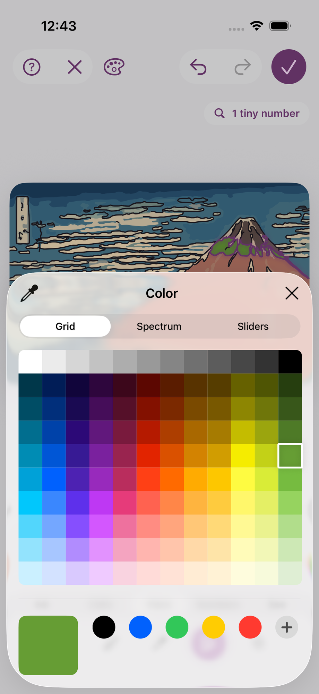
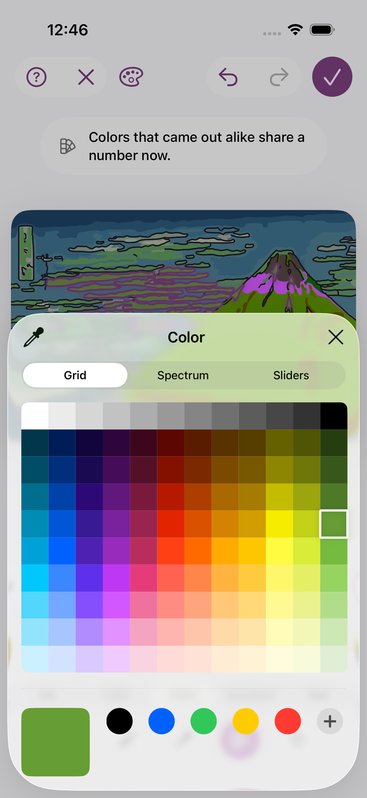
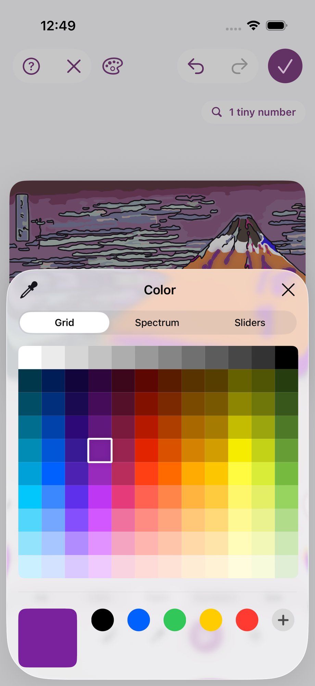
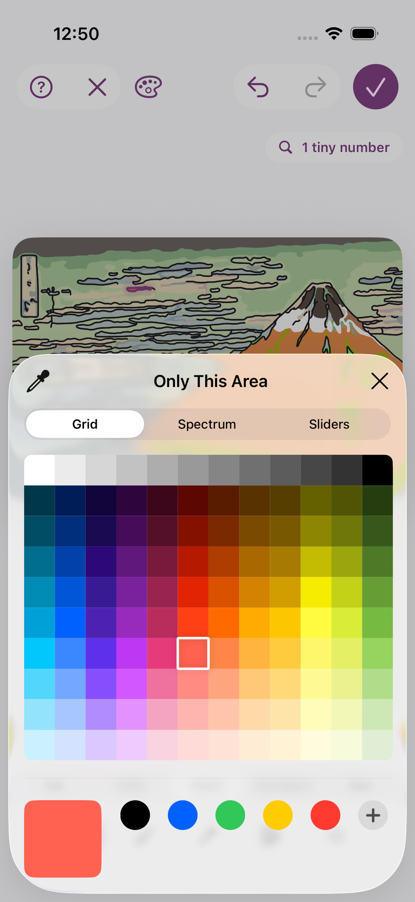
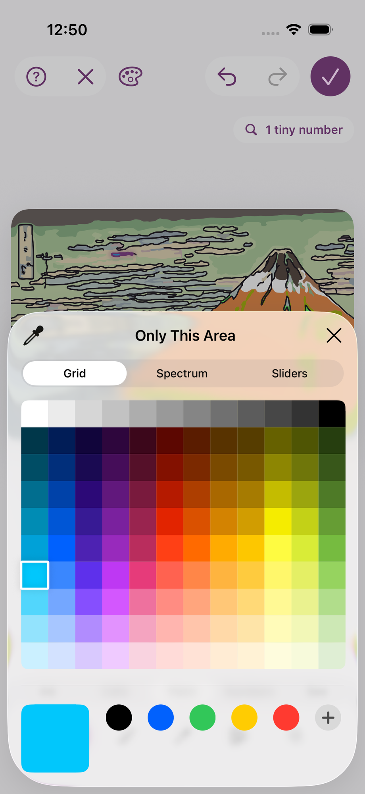
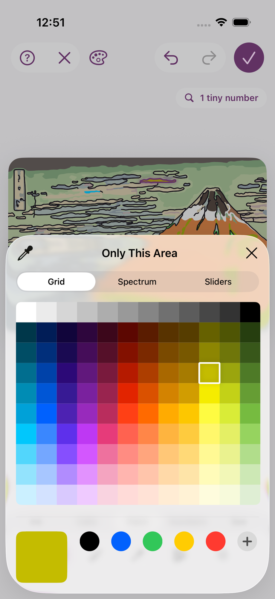

# Agent transcript

- end: success, 124 turns, 18.8 min, estimated $2.6876187999999996
- tool calls: {"mcp__maestro__take_screenshot": 22, "Read": 16, "mcp__maestro__run": 43, "mcp__maestro__inspect_screen": 26, "Write": 3}
- images the agent received: 35

**Start**: model claude-opus-5-5, MCP [{"name": "maestro", "status": "connected", "source": "dynamic"}]

→ `mcp__maestro__take_screenshot` `{"device_id": "77AA4492-C787-4EEE-A772-05D4B3E9ECCD"}`

→ `Read` `{"file_path": "/Users/runner/.claude/projects/-Users-runner-work--temp-qa/memory/MEMORY.md"}`

← mcp__maestro__take_screenshot: image  919x2000

← Read (error): File does not exist. Note: your current working directory is /Users/runner/work/_temp/qa.

→ `mcp__maestro__run` `{"device_id": "77AA4492-C787-4EEE-A772-05D4B3E9ECCD", "yaml": "appId: com.pbordjadze.paintbynumber\n---\n- tapOn:\n    point: \"90%,10%\"\n- waitForAnimationToEnd"}`

← mcp__maestro__run: {"success":true,"device_id":"77AA4492-C787-4EEE-A772-05D4B3E9ECCD","commands_executed":3,"message":"Flow executed successfully","env_vars":{"MAESTRO_CLI_ANALYSIS_NOTIFICATION_DISABLED":"true","MAESTRO_CLI_NO_ANALYTICS":"1","MAESTRO_DRIVER_STARTUP_TIMEOUT":"240000","MAESTRO_VERSION":"2.11.0"}}

→ `mcp__maestro__inspect_screen` `{"device_id": "77AA4492-C787-4EEE-A772-05D4B3E9ECCD"}`

← mcp__maestro__inspect_screen: {"ui_schema":{"platform":"ios","abbreviations":{"b":"bounds","txt":"text","rid":"resource-id","a11y":"accessibilityText","hint":"hintText","val":"value","c":"children"},"defaults":{"enabled":true,"focused":false,"selected":false,"checked":false,"txt":"","hint":"","rid":"","val":"","a11y":""}},"elements":[{"b":"[0,0][402,874]","a11y":"Paint by Moonlight","c":[{"b":"[0,0][402,874]","c":[{"b":"[0,0][ …

> Tap didn't open it. Use the label.

→ `mcp__maestro__run` `{"device_id": "77AA4492-C787-4EEE-A772-05D4B3E9ECCD", "yaml": "appId: com.pbordjadze.paintbynumber\n---\n- tapOn: \"New Painting\"\n- waitForAnimationToEnd"}`

→ `mcp__maestro__take_screenshot` `{"device_id": "77AA4492-C787-4EEE-A772-05D4B3E9ECCD"}`

← mcp__maestro__run: {"success":true,"device_id":"77AA4492-C787-4EEE-A772-05D4B3E9ECCD","commands_executed":3,"message":"Flow executed successfully","env_vars":{"MAESTRO_CLI_ANALYSIS_NOTIFICATION_DISABLED":"true","MAESTRO_CLI_NO_ANALYTICS":"1","MAESTRO_DRIVER_STARTUP_TIMEOUT":"240000","MAESTRO_VERSION":"2.11.0"}}

← mcp__maestro__take_screenshot: image  919x2000

→ `mcp__maestro__run` `{"device_id": "77AA4492-C787-4EEE-A772-05D4B3E9ECCD", "yaml": "appId: com.pbordjadze.paintbynumber\n---\n- tapOn: \"Close\"\n- tapOn: \"Samples\"\n- waitForAnimationToEnd"}`

→ `mcp__maestro__inspect_screen` `{"device_id": "77AA4492-C787-4EEE-A772-05D4B3E9ECCD"}`

← mcp__maestro__run: {"success":true,"device_id":"77AA4492-C787-4EEE-A772-05D4B3E9ECCD","commands_executed":4,"message":"Flow executed successfully","env_vars":{"MAESTRO_CLI_ANALYSIS_NOTIFICATION_DISABLED":"true","MAESTRO_CLI_NO_ANALYTICS":"1","MAESTRO_DRIVER_STARTUP_TIMEOUT":"240000","MAESTRO_VERSION":"2.11.0"}}

← mcp__maestro__inspect_screen: {"ui_schema":{"platform":"ios","abbreviations":{"b":"bounds","txt":"text","rid":"resource-id","a11y":"accessibilityText","hint":"hintText","val":"value","c":"children"},"defaults":{"enabled":true,"focused":false,"selected":false,"checked":false,"txt":"","hint":"","rid":"","val":"","a11y":""}},"elements":[{"b":"[0,0][402,874]","a11y":"Paint by Moonlight","c":[{"b":"[0,0][402,874]","c":[{"b":"[0,0][ …

→ `mcp__maestro__run` `{"device_id": "77AA4492-C787-4EEE-A772-05D4B3E9ECCD", "yaml": "appId: com.pbordjadze.paintbynumber\n---\n- tapOn: \"Sample: Red Fuji, Katsushika Hokusai\"\n- extendedWaitUntil:\n    visible: \"Refine\"\n    timeout: 90000\n- takeScreenshot: /Users/runner/work/_temp/qa/shots/preview"}`

→ `mcp__maestro__inspect_screen` `{"device_id": "77AA4492-C787-4EEE-A772-05D4B3E9ECCD"}`

← mcp__maestro__run: {"success":true,"device_id":"77AA4492-C787-4EEE-A772-05D4B3E9ECCD","commands_executed":4,"message":"Flow executed successfully","env_vars":{"MAESTRO_CLI_ANALYSIS_NOTIFICATION_DISABLED":"true","MAESTRO_CLI_NO_ANALYTICS":"1","MAESTRO_DRIVER_STARTUP_TIMEOUT":"240000","MAESTRO_VERSION":"2.11.0"}}

← mcp__maestro__inspect_screen: {"ui_schema":{"platform":"ios","abbreviations":{"b":"bounds","txt":"text","rid":"resource-id","a11y":"accessibilityText","hint":"hintText","val":"value","c":"children"},"defaults":{"enabled":true,"focused":false,"selected":false,"checked":false,"txt":"","hint":"","rid":"","val":"","a11y":""}},"elements":[{"b":"[0,0][402,874]","a11y":"Paint by Moonlight","c":[{"b":"[0,0][402,874]","c":[{"b":"[0,0][ …

> Still preparing. Wait for Start Painting to be enabled.

→ `mcp__maestro__run` `{"device_id": "77AA4492-C787-4EEE-A772-05D4B3E9ECCD", "yaml": "appId: com.pbordjadze.paintbynumber\n---\n- extendedWaitUntil:\n    visible:\n      text: \"Start Painting\"\n      enabled: true\n    timeout: 120000\n- tapOn:\n    id: \"refine\"\n- waitForAnimationToEnd\n- takeScreenshot: /Users/runner/work/_temp/qa/shots/refine-open"}`

→ `mcp__maestro__inspect_screen` `{"device_id": "77AA4492-C787-4EEE-A772-05D4B3E9ECCD"}`

← mcp__maestro__run: {"success":true,"device_id":"77AA4492-C787-4EEE-A772-05D4B3E9ECCD","commands_executed":5,"message":"Flow executed successfully","env_vars":{"MAESTRO_CLI_ANALYSIS_NOTIFICATION_DISABLED":"true","MAESTRO_CLI_NO_ANALYTICS":"1","MAESTRO_DRIVER_STARTUP_TIMEOUT":"240000","MAESTRO_VERSION":"2.11.0"}}

← mcp__maestro__inspect_screen: {"ui_schema":{"platform":"ios","abbreviations":{"b":"bounds","txt":"text","rid":"resource-id","a11y":"accessibilityText","hint":"hintText","val":"value","c":"children"},"defaults":{"enabled":true,"focused":false,"selected":false,"checked":false,"txt":"","hint":"","rid":"","val":"","a11y":""}},"elements":[{"b":"[0,0][402,874]","a11y":"Paint by Moonlight","c":[{"b":"[0,0][402,874]","c":[{"b":"[0,0][ …

→ `mcp__maestro__run` `{"device_id": "77AA4492-C787-4EEE-A772-05D4B3E9ECCD", "yaml": "appId: com.pbordjadze.paintbynumber\n---\n- tapOn: \"Close\"\n- waitForAnimationToEnd"}`

→ `mcp__maestro__take_screenshot` `{"device_id": "77AA4492-C787-4EEE-A772-05D4B3E9ECCD"}`

→ `mcp__maestro__inspect_screen` `{"device_id": "77AA4492-C787-4EEE-A772-05D4B3E9ECCD"}`

← mcp__maestro__run: {"success":true,"device_id":"77AA4492-C787-4EEE-A772-05D4B3E9ECCD","commands_executed":3,"message":"Flow executed successfully","env_vars":{"MAESTRO_CLI_ANALYSIS_NOTIFICATION_DISABLED":"true","MAESTRO_CLI_NO_ANALYTICS":"1","MAESTRO_DRIVER_STARTUP_TIMEOUT":"240000","MAESTRO_VERSION":"2.11.0"}}

← mcp__maestro__take_screenshot: image  919x2000

← mcp__maestro__inspect_screen: {"ui_schema":{"platform":"ios","abbreviations":{"b":"bounds","txt":"text","rid":"resource-id","a11y":"accessibilityText","hint":"hintText","val":"value","c":"children"},"defaults":{"enabled":true,"focused":false,"selected":false,"checked":false,"txt":"","hint":"","rid":"","val":"","a11y":""}},"elements":[{"b":"[0,0][402,874]","a11y":"Paint by Moonlight","c":[{"b":"[0,0][402,874]","c":[{"b":"[0,0][ …

> Start with check (2): the views symbol. Tap it.

→ `mcp__maestro__run` `{"device_id": "77AA4492-C787-4EEE-A772-05D4B3E9ECCD", "yaml": "appId: com.pbordjadze.paintbynumber\n---\n- tapOn:\n    id: \"refine-backdrop\"\n- waitForAnimationToEnd"}`

→ `mcp__maestro__take_screenshot` `{"device_id": "77AA4492-C787-4EEE-A772-05D4B3E9ECCD"}`

→ `mcp__maestro__inspect_screen` `{"device_id": "77AA4492-C787-4EEE-A772-05D4B3E9ECCD"}`

← mcp__maestro__run: {"success":true,"device_id":"77AA4492-C787-4EEE-A772-05D4B3E9ECCD","commands_executed":3,"message":"Flow executed successfully","env_vars":{"MAESTRO_CLI_ANALYSIS_NOTIFICATION_DISABLED":"true","MAESTRO_CLI_NO_ANALYTICS":"1","MAESTRO_DRIVER_STARTUP_TIMEOUT":"240000","MAESTRO_VERSION":"2.11.0"}}

← mcp__maestro__take_screenshot: image  919x2000

← mcp__maestro__inspect_screen: {"ui_schema":{"platform":"ios","abbreviations":{"b":"bounds","txt":"text","rid":"resource-id","a11y":"accessibilityText","hint":"hintText","val":"value","c":"children"},"defaults":{"enabled":true,"focused":false,"selected":false,"checked":false,"txt":"","hint":"","rid":"","val":"","a11y":""}},"elements":[{"b":"[0,0][402,874]","a11y":"Paint by Moonlight","c":[{"b":"[0,0][402,874]","c":[{"b":"[0,0][ …

→ `mcp__maestro__run` `{"device_id": "77AA4492-C787-4EEE-A772-05D4B3E9ECCD", "yaml": "appId: com.pbordjadze.paintbynumber\n---\n- tapOn: \"Paper\"\n- waitForAnimationToEnd\n- takeScreenshot: /Users/runner/work/_temp/qa/shots/view-paper-1"}`

→ `mcp__maestro__inspect_screen` `{"device_id": "77AA4492-C787-4EEE-A772-05D4B3E9ECCD"}`

← mcp__maestro__run: {"success":true,"device_id":"77AA4492-C787-4EEE-A772-05D4B3E9ECCD","commands_executed":4,"message":"Flow executed successfully","env_vars":{"MAESTRO_CLI_ANALYSIS_NOTIFICATION_DISABLED":"true","MAESTRO_CLI_NO_ANALYTICS":"1","MAESTRO_DRIVER_STARTUP_TIMEOUT":"240000","MAESTRO_VERSION":"2.11.0"}}

← mcp__maestro__inspect_screen: {"ui_schema":{"platform":"ios","abbreviations":{"b":"bounds","txt":"text","rid":"resource-id","a11y":"accessibilityText","hint":"hintText","val":"value","c":"children"},"defaults":{"enabled":true,"focused":false,"selected":false,"checked":false,"txt":"","hint":"","rid":"","val":"","a11y":""}},"elements":[{"b":"[0,0][402,874]","a11y":"Paint by Moonlight","c":[{"b":"[0,0][402,874]","c":[{"b":"[0,0][ …

> Paper: button [128,70][158,97] vs Painting [128,71][158,97] (outer container unchanged). Next, Photo.

→ `mcp__maestro__run` `{"device_id": "77AA4492-C787-4EEE-A772-05D4B3E9ECCD", "yaml": "appId: com.pbordjadze.paintbynumber\n---\n- tapOn:\n    id: \"refine-backdrop\"\n- tapOn: \"Photo\"\n- waitForAnimationToEnd\n- takeScreenshot: /Users/runner/work/_temp/qa/shots/view-photo-1"}`

→ `mcp__maestro__inspect_screen` `{"device_id": "77AA4492-C787-4EEE-A772-05D4B3E9ECCD"}`

← mcp__maestro__run: {"success":true,"device_id":"77AA4492-C787-4EEE-A772-05D4B3E9ECCD","commands_executed":5,"message":"Flow executed successfully","env_vars":{"MAESTRO_CLI_ANALYSIS_NOTIFICATION_DISABLED":"true","MAESTRO_CLI_NO_ANALYTICS":"1","MAESTRO_DRIVER_STARTUP_TIMEOUT":"240000","MAESTRO_VERSION":"2.11.0"}}

← mcp__maestro__inspect_screen: {"ui_schema":{"platform":"ios","abbreviations":{"b":"bounds","txt":"text","rid":"resource-id","a11y":"accessibilityText","hint":"hintText","val":"value","c":"children"},"defaults":{"enabled":true,"focused":false,"selected":false,"checked":false,"txt":"","hint":"","rid":"","val":"","a11y":""}},"elements":[{"b":"[0,0][402,874]","a11y":"Paint by Moonlight","c":[{"b":"[0,0][402,874]","c":[{"b":"[0,0][ …

→ `mcp__maestro__run` `{"device_id": "77AA4492-C787-4EEE-A772-05D4B3E9ECCD", "yaml": "appId: com.pbordjadze.paintbynumber\n---\n- tapOn:\n    id: \"refine-backdrop\"\n- tapOn: \"Photo Behind\"\n- waitForAnimationToEnd\n- takeScreenshot: /Users/runner/work/_temp/qa/shots/view-photobehind-1"}`

→ `mcp__maestro__inspect_screen` `{"device_id": "77AA4492-C787-4EEE-A772-05D4B3E9ECCD"}`

← mcp__maestro__run: {"success":true,"device_id":"77AA4492-C787-4EEE-A772-05D4B3E9ECCD","commands_executed":5,"message":"Flow executed successfully","env_vars":{"MAESTRO_CLI_ANALYSIS_NOTIFICATION_DISABLED":"true","MAESTRO_CLI_NO_ANALYTICS":"1","MAESTRO_DRIVER_STARTUP_TIMEOUT":"240000","MAESTRO_VERSION":"2.11.0"}}

← mcp__maestro__inspect_screen: {"ui_schema":{"platform":"ios","abbreviations":{"b":"bounds","txt":"text","rid":"resource-id","a11y":"accessibilityText","hint":"hintText","val":"value","c":"children"},"defaults":{"enabled":true,"focused":false,"selected":false,"checked":false,"txt":"","hint":"","rid":"","val":"","a11y":""}},"elements":[{"b":"[0,0][402,874]","a11y":"Paint by Moonlight","c":[{"b":"[0,0][402,874]","c":[{"b":"[0,0][ …

> Photo Behind: button again [128,70][158,97]; picture moved 270→242 as the slider appeared (first tall panel). Now Paper.

→ `mcp__maestro__run` `{"device_id": "77AA4492-C787-4EEE-A772-05D4B3E9ECCD", "yaml": "appId: com.pbordjadze.paintbynumber\n---\n- tapOn:\n    id: \"refine-backdrop\"\n- tapOn: \"Paper\"\n- waitForAnimationToEnd\n- takeScreenshot: /Users/runner/work/_temp/qa/shots/view-paper-2"}`

→ `mcp__maestro__inspect_screen` `{"device_id": "77AA4492-C787-4EEE-A772-05D4B3E9ECCD"}`

← mcp__maestro__run: {"success":true,"device_id":"77AA4492-C787-4EEE-A772-05D4B3E9ECCD","commands_executed":5,"message":"Flow executed successfully","env_vars":{"MAESTRO_CLI_ANALYSIS_NOTIFICATION_DISABLED":"true","MAESTRO_CLI_NO_ANALYTICS":"1","MAESTRO_DRIVER_STARTUP_TIMEOUT":"240000","MAESTRO_VERSION":"2.11.0"}}

← mcp__maestro__inspect_screen: {"ui_schema":{"platform":"ios","abbreviations":{"b":"bounds","txt":"text","rid":"resource-id","a11y":"accessibilityText","hint":"hintText","val":"value","c":"children"},"defaults":{"enabled":true,"focused":false,"selected":false,"checked":false,"txt":"","hint":"","rid":"","val":"","a11y":""}},"elements":[{"b":"[0,0][402,874]","a11y":"Paint by Moonlight","c":[{"b":"[0,0][402,874]","c":[{"b":"[0,0][ …

> Round 1 done. Rounds 2–3: I'll switch and inspect each.

→ `mcp__maestro__run` `{"device_id": "77AA4492-C787-4EEE-A772-05D4B3E9ECCD", "yaml": "appId: com.pbordjadze.paintbynumber\n---\n- tapOn:\n    id: \"refine-backdrop\"\n- tapOn: \"Painting\"\n- waitForAnimationToEnd\n- takeScreenshot: /Users/runner/work/_temp/qa/shots/view-painting-2"}`

→ `mcp__maestro__inspect_screen` `{"device_id": "77AA4492-C787-4EEE-A772-05D4B3E9ECCD"}`

← mcp__maestro__run: {"success":true,"device_id":"77AA4492-C787-4EEE-A772-05D4B3E9ECCD","commands_executed":5,"message":"Flow executed successfully","env_vars":{"MAESTRO_CLI_ANALYSIS_NOTIFICATION_DISABLED":"true","MAESTRO_CLI_NO_ANALYTICS":"1","MAESTRO_DRIVER_STARTUP_TIMEOUT":"240000","MAESTRO_VERSION":"2.11.0"}}

← mcp__maestro__inspect_screen: {"ui_schema":{"platform":"ios","abbreviations":{"b":"bounds","txt":"text","rid":"resource-id","a11y":"accessibilityText","hint":"hintText","val":"value","c":"children"},"defaults":{"enabled":true,"focused":false,"selected":false,"checked":false,"txt":"","hint":"","rid":"","val":"","a11y":""}},"elements":[{"b":"[0,0][402,874]","a11y":"Paint by Moonlight","c":[{"b":"[0,0][402,874]","c":[{"b":"[0,0][ …

→ `mcp__maestro__run` `{"device_id": "77AA4492-C787-4EEE-A772-05D4B3E9ECCD", "yaml": "appId: com.pbordjadze.paintbynumber\n---\n- tapOn:\n    id: \"refine-backdrop\"\n- tapOn: \"Paper\"\n- waitForAnimationToEnd\n- takeScreenshot: /Users/runner/work/_temp/qa/shots/view-paper-3\n- tapOn:\n    id: \"refine-backdrop\"\n- tapOn: \"Photo\"\n- waitForAnimationToEnd\n- takeScreenshot: /Users/runner/work/_temp/qa/shots/view-photo-2\n- tapOn:\n    id: \"refine-backdrop\"\n- tapOn: \"Photo Behind\"\n- waitForAnimationToEnd\n- takeScreenshot: /Users/runner/work/_temp/qa/shots/view-photobehind-2"}`

→ `mcp__maestro__inspect_screen` `{"device_id": "77AA4492-C787-4EEE-A772-05D4B3E9ECCD"}`

← mcp__maestro__run: {"success":true,"device_id":"77AA4492-C787-4EEE-A772-05D4B3E9ECCD","commands_executed":13,"message":"Flow executed successfully","env_vars":{"MAESTRO_CLI_ANALYSIS_NOTIFICATION_DISABLED":"true","MAESTRO_CLI_NO_ANALYTICS":"1","MAESTRO_DRIVER_STARTUP_TIMEOUT":"240000","MAESTRO_VERSION":"2.11.0"}}

← mcp__maestro__inspect_screen: {"ui_schema":{"platform":"ios","abbreviations":{"b":"bounds","txt":"text","rid":"resource-id","a11y":"accessibilityText","hint":"hintText","val":"value","c":"children"},"defaults":{"enabled":true,"focused":false,"selected":false,"checked":false,"txt":"","hint":"","rid":"","val":"","a11y":""}},"elements":[{"b":"[0,0][402,874]","a11y":"Paint by Moonlight","c":[{"b":"[0,0][402,874]","c":[{"b":"[0,0][ …

→ `Read` `{"file_path": "/Users/runner/work/_temp/qa/shots/view-photobehind-2.png"}`

← Read: image  920x2000

→ `mcp__maestro__run` `{"device_id": "77AA4492-C787-4EEE-A772-05D4B3E9ECCD", "yaml": "appId: com.pbordjadze.paintbynumber\n---\n- tapOn:\n    id: \"refine-backdrop\"\n- tapOn: \"Paper\"\n- waitForAnimationToEnd\n- takeScreenshot: /Users/runner/work/_temp/qa/shots/view-paper-4\n- tapOn:\n    id: \"refine-backdrop\"\n- tapOn: \"Painting\"\n- waitForAnimationToEnd\n- takeScreenshot: /Users/runner/work/_temp/qa/shots/view-painting-3\n- tapOn:\n    id: \"refine-backdrop\"\n- tapOn: \"Paper\"\n- tapOn:\n    id: \"refine-backdrop\"\n- tapOn: \"Photo\"\n- waitForAnimationToEnd\n- takeScreenshot: /Users/runner/work/_temp/qa/`

→ `mcp__maestro__inspect_screen` `{"device_id": "77AA4492-C787-4EEE-A772-05D4B3E9ECCD"}`

← mcp__maestro__run: {"success":true,"device_id":"77AA4492-C787-4EEE-A772-05D4B3E9ECCD","commands_executed":23,"message":"Flow executed successfully","env_vars":{"MAESTRO_CLI_ANALYSIS_NOTIFICATION_DISABLED":"true","MAESTRO_CLI_NO_ANALYTICS":"1","MAESTRO_DRIVER_STARTUP_TIMEOUT":"240000","MAESTRO_VERSION":"2.11.0"}}

← mcp__maestro__inspect_screen: {"ui_schema":{"platform":"ios","abbreviations":{"b":"bounds","txt":"text","rid":"resource-id","a11y":"accessibilityText","hint":"hintText","val":"value","c":"children"},"defaults":{"enabled":true,"focused":false,"selected":false,"checked":false,"txt":"","hint":"","rid":"","val":"","a11y":""}},"elements":[{"b":"[0,0][402,874]","a11y":"Paint by Moonlight","c":[{"b":"[0,0][402,874]","c":[{"b":"[0,0][ …

> Views check done (3 rounds). Writing a first report, then Edit Paint.

→ `Write` `{"file_path": "/Users/runner/work/_temp/qa/report.md", "content": "# Paint by Moonlight: Refine recheck (debug build), 2026-10-27\n\n## Summary\nIn progress. The views symbol check (2) passed in 3 of 3 rounds. Edit Paint (1) and the area card (3) have not been tested yet.\n\n## Coverage\n- Setup: New Painting \u203a Samples \u203a Red Fuji \u203a waited for Start Painting to become enabled \u203a Refine. Done.\n- (2) Views symbol: done, 3 rounds (Painting \u203a Paper \u203a Photo \u203a Photo Behind \u203a Paper).\n- (1) Edit Paint: pending.\n- (3) Area card: pending.\n\n## Check (2): views s`

← Write: File created successfully at: /Users/runner/work/_temp/qa/report.md (file state is current in your context — no need to Read it back)

→ `mcp__maestro__run` `{"device_id": "77AA4492-C787-4EEE-A772-05D4B3E9ECCD", "yaml": "appId: com.pbordjadze.paintbynumber\n---\n- tapOn: \"Paint\"\n- waitForAnimationToEnd"}`

→ `mcp__maestro__take_screenshot` `{"device_id": "77AA4492-C787-4EEE-A772-05D4B3E9ECCD"}`

→ `mcp__maestro__inspect_screen` `{"device_id": "77AA4492-C787-4EEE-A772-05D4B3E9ECCD"}`

← mcp__maestro__run: {"success":true,"device_id":"77AA4492-C787-4EEE-A772-05D4B3E9ECCD","commands_executed":3,"message":"Flow executed successfully","env_vars":{"MAESTRO_CLI_ANALYSIS_NOTIFICATION_DISABLED":"true","MAESTRO_CLI_NO_ANALYTICS":"1","MAESTRO_DRIVER_STARTUP_TIMEOUT":"240000","MAESTRO_VERSION":"2.11.0"}}

← mcp__maestro__take_screenshot: image  919x2000

← mcp__maestro__inspect_screen: {"ui_schema":{"platform":"ios","abbreviations":{"b":"bounds","txt":"text","rid":"resource-id","a11y":"accessibilityText","hint":"hintText","val":"value","c":"children"},"defaults":{"enabled":true,"focused":false,"selected":false,"checked":false,"txt":"","hint":"","rid":"","val":"","a11y":""}},"elements":[{"b":"[0,0][402,874]","a11y":"Paint by Moonlight","c":[{"b":"[0,0][402,874]","c":[{"b":"[0,0][ …

> Note: the view went from Paper back to Painting when I switched to the Paint group. Now the Edit Paint tool.

→ `mcp__maestro__run` `{"device_id": "77AA4492-C787-4EEE-A772-05D4B3E9ECCD", "yaml": "appId: com.pbordjadze.paintbynumber\n---\n- tapOn:\n    id: \"refine-tool-editPaint\"\n- waitForAnimationToEnd"}`

→ `mcp__maestro__take_screenshot` `{"device_id": "77AA4492-C787-4EEE-A772-05D4B3E9ECCD"}`

→ `mcp__maestro__inspect_screen` `{"device_id": "77AA4492-C787-4EEE-A772-05D4B3E9ECCD"}`

← mcp__maestro__run: {"success":true,"device_id":"77AA4492-C787-4EEE-A772-05D4B3E9ECCD","commands_executed":3,"message":"Flow executed successfully","env_vars":{"MAESTRO_CLI_ANALYSIS_NOTIFICATION_DISABLED":"true","MAESTRO_CLI_NO_ANALYTICS":"1","MAESTRO_DRIVER_STARTUP_TIMEOUT":"240000","MAESTRO_VERSION":"2.11.0"}}

← mcp__maestro__take_screenshot: image  919x2000

← mcp__maestro__inspect_screen: {"ui_schema":{"platform":"ios","abbreviations":{"b":"bounds","txt":"text","rid":"resource-id","a11y":"accessibilityText","hint":"hintText","val":"value","c":"children"},"defaults":{"enabled":true,"focused":false,"selected":false,"checked":false,"txt":"","hint":"","rid":"","val":"","a11y":""}},"elements":[{"b":"[0,0][402,874]","a11y":"Paint by Moonlight","c":[{"b":"[0,0][402,874]","c":[{"b":"[0,0][ …

> Edit Paint bar: "Paint 1", color well, and "Similar colors too" ON. Turn Similar OFF, select paint 3, then open the picker.

→ `mcp__maestro__run` `{"device_id": "77AA4492-C787-4EEE-A772-05D4B3E9ECCD", "yaml": "appId: com.pbordjadze.paintbynumber\n---\n- tapOn:\n    id: \"refine-colors-family\"\n- tapOn:\n    point: \"125,707\"\n- waitForAnimationToEnd\n- takeScreenshot: /Users/runner/work/_temp/qa/shots/ep-off-start"}`

→ `mcp__maestro__inspect_screen` `{"device_id": "77AA4492-C787-4EEE-A772-05D4B3E9ECCD"}`

← mcp__maestro__run: {"success":true,"device_id":"77AA4492-C787-4EEE-A772-05D4B3E9ECCD","commands_executed":5,"message":"Flow executed successfully","env_vars":{"MAESTRO_CLI_ANALYSIS_NOTIFICATION_DISABLED":"true","MAESTRO_CLI_NO_ANALYTICS":"1","MAESTRO_DRIVER_STARTUP_TIMEOUT":"240000","MAESTRO_VERSION":"2.11.0"}}

← mcp__maestro__inspect_screen: {"ui_schema":{"platform":"ios","abbreviations":{"b":"bounds","txt":"text","rid":"resource-id","a11y":"accessibilityText","hint":"hintText","val":"value","c":"children"},"defaults":{"enabled":true,"focused":false,"selected":false,"checked":false,"txt":"","hint":"","rid":"","val":"","a11y":""}},"elements":[{"b":"[0,0][402,874]","a11y":"Paint by Moonlight","c":[{"b":"[0,0][402,874]","c":[{"b":"[0,0][ …

> Paint 3 is selected, but the toggle is still ON. The color well also still reads "red orange" for paint 3 (Grayish brown), which may be stale. Tap the switch itself.

→ `mcp__maestro__run` `{"device_id": "77AA4492-C787-4EEE-A772-05D4B3E9ECCD", "yaml": "appId: com.pbordjadze.paintbynumber\n---\n- tapOn:\n    point: \"342,641\"\n- waitForAnimationToEnd"}`

→ `mcp__maestro__take_screenshot` `{"device_id": "77AA4492-C787-4EEE-A772-05D4B3E9ECCD"}`

← mcp__maestro__run: {"success":true,"device_id":"77AA4492-C787-4EEE-A772-05D4B3E9ECCD","commands_executed":3,"message":"Flow executed successfully","env_vars":{"MAESTRO_CLI_ANALYSIS_NOTIFICATION_DISABLED":"true","MAESTRO_CLI_NO_ANALYTICS":"1","MAESTRO_DRIVER_STARTUP_TIMEOUT":"240000","MAESTRO_VERSION":"2.11.0"}}

← mcp__maestro__take_screenshot: image  919x2000

> Similar colors is OFF now, and paint 3's area on Fuji's summit is outlined. Open the color well.

→ `mcp__maestro__run` `{"device_id": "77AA4492-C787-4EEE-A772-05D4B3E9ECCD", "yaml": "appId: com.pbordjadze.paintbynumber\n---\n- tapOn:\n    id: \"refine-colors-picker\"\n- waitForAnimationToEnd"}`

→ `mcp__maestro__take_screenshot` `{"device_id": "77AA4492-C787-4EEE-A772-05D4B3E9ECCD"}`

→ `mcp__maestro__inspect_screen` `{"device_id": "77AA4492-C787-4EEE-A772-05D4B3E9ECCD"}`

← mcp__maestro__run: {"success":true,"device_id":"77AA4492-C787-4EEE-A772-05D4B3E9ECCD","commands_executed":3,"message":"Flow executed successfully","env_vars":{"MAESTRO_CLI_ANALYSIS_NOTIFICATION_DISABLED":"true","MAESTRO_CLI_NO_ANALYTICS":"1","MAESTRO_DRIVER_STARTUP_TIMEOUT":"240000","MAESTRO_VERSION":"2.11.0"}}

← mcp__maestro__take_screenshot: image  919x2000

← mcp__maestro__inspect_screen: {"ui_schema":{"platform":"ios","abbreviations":{"b":"bounds","txt":"text","rid":"resource-id","a11y":"accessibilityText","hint":"hintText","val":"value","c":"children"},"defaults":{"enabled":true,"focused":false,"selected":false,"checked":false,"txt":"","hint":"","rid":"","val":"","a11y":""}},"elements":[{"b":"[0,0][402,874]","a11y":"Paint by Moonlight","c":[{"b":"[0,0][402,874]","c":[{"b":"[0,0][ …

> The picker didn't open from a tap by id. Try a tap by point.

→ `mcp__maestro__run` `{"device_id": "77AA4492-C787-4EEE-A772-05D4B3E9ECCD", "yaml": "appId: com.pbordjadze.paintbynumber\n---\n- tapOn:\n    point: \"100,641\"\n- waitForAnimationToEnd"}`

→ `mcp__maestro__take_screenshot` `{"device_id": "77AA4492-C787-4EEE-A772-05D4B3E9ECCD"}`

← mcp__maestro__run: {"success":true,"device_id":"77AA4492-C787-4EEE-A772-05D4B3E9ECCD","commands_executed":3,"message":"Flow executed successfully","env_vars":{"MAESTRO_CLI_ANALYSIS_NOTIFICATION_DISABLED":"true","MAESTRO_CLI_NO_ANALYTICS":"1","MAESTRO_DRIVER_STARTUP_TIMEOUT":"240000","MAESTRO_VERSION":"2.11.0"}}

← mcp__maestro__take_screenshot: image  919x2000

> Two taps on the color well, and no picker. Check the log.

→ `Read` `{"file_path": "/Users/runner/work/_temp/qa/app.log"}`

← Read: 1	getpwuid_r did not find a match for uid 501
2	Filtering the log data using "subsystem == "com.pbordjadze.paintbynumber""
3	Timestamp               Ty Process[PID:TID]
4	2026-10-27 00:29:36.964 Df PaintByNumber[26362:125c8] [com.pbordjadze.paintbynumber:tips] offer in shelf: , wanted
5	2026-10-27 00:29:38.915 Df PaintByNumber[26362:12640] [com.pbordjadze.paintbynumber:canvas] Making the render co …

> Nothing in the log. Try once more and take the screenshot inside the flow.

→ `mcp__maestro__run` `{"device_id": "77AA4492-C787-4EEE-A772-05D4B3E9ECCD", "yaml": "appId: com.pbordjadze.paintbynumber\n---\n- tapOn:\n    point: \"97,639\"\n- takeScreenshot: /Users/runner/work/_temp/qa/shots/ep-well-tap3"}`

→ `mcp__maestro__inspect_screen` `{"device_id": "77AA4492-C787-4EEE-A772-05D4B3E9ECCD"}`

← mcp__maestro__run: {"success":true,"device_id":"77AA4492-C787-4EEE-A772-05D4B3E9ECCD","commands_executed":3,"message":"Flow executed successfully","env_vars":{"MAESTRO_CLI_ANALYSIS_NOTIFICATION_DISABLED":"true","MAESTRO_CLI_NO_ANALYTICS":"1","MAESTRO_DRIVER_STARTUP_TIMEOUT":"240000","MAESTRO_VERSION":"2.11.0"}}

← mcp__maestro__inspect_screen: {"ui_schema":{"platform":"ios","abbreviations":{"b":"bounds","txt":"text","rid":"resource-id","a11y":"accessibilityText","hint":"hintText","val":"value","c":"children"},"defaults":{"enabled":true,"focused":false,"selected":false,"checked":false,"txt":"","hint":"","rid":"","val":"","a11y":""}},"elements":[{"b":"[0,0][402,874]","a11y":"Paint by Moonlight","c":[{"b":"[0,0][402,874]","c":[{"b":"[0,0][ …

> The picker opened on the third tap. Now pick 3 colors about 5 s apart, with a screenshot after each.

→ `mcp__maestro__run` `{"device_id": "77AA4492-C787-4EEE-A772-05D4B3E9ECCD", "yaml": "appId: com.pbordjadze.paintbynumber\n---\n- tapOn: \"green 54\"\n- takeScreenshot: /Users/runner/work/_temp/qa/shots/ep-off-r1-pick1\n- tapOn: \"azure 50\"\n- takeScreenshot: /Users/runner/work/_temp/qa/shots/ep-off-r1-pick2\n- tapOn: \"purple 49\"\n- takeScreenshot: /Users/runner/work/_temp/qa/shots/ep-off-r1-pick3"}`

→ `mcp__maestro__take_screenshot` `{"device_id": "77AA4492-C787-4EEE-A772-05D4B3E9ECCD"}`

← mcp__maestro__run: {"success":true,"device_id":"77AA4492-C787-4EEE-A772-05D4B3E9ECCD","commands_executed":7,"message":"Flow executed successfully","env_vars":{"MAESTRO_CLI_ANALYSIS_NOTIFICATION_DISABLED":"true","MAESTRO_CLI_NO_ANALYTICS":"1","MAESTRO_DRIVER_STARTUP_TIMEOUT":"240000","MAESTRO_VERSION":"2.11.0"}}

← mcp__maestro__take_screenshot: image  919x2000

> The area ended purple, the 3rd pick. Check the intermediate shots.

→ `Read` `{"file_path": "/Users/runner/work/_temp/qa/shots/ep-off-r1-pick1.png"}`

→ `Read` `{"file_path": "/Users/runner/work/_temp/qa/shots/ep-off-r1-pick2.png"}`

← Read: image  920x2000

← Read: image  920x2000

> All 3 picks recolored paint 3 (green, then blue, then purple). Close the picker and check the bar.

→ `mcp__maestro__run` `{"device_id": "77AA4492-C787-4EEE-A772-05D4B3E9ECCD", "yaml": "appId: com.pbordjadze.paintbynumber\n---\n- tapOn: \"close\"\n- waitForAnimationToEnd\n- takeScreenshot: /Users/runner/work/_temp/qa/shots/ep-off-r1-closed"}`

→ `mcp__maestro__inspect_screen` `{"device_id": "77AA4492-C787-4EEE-A772-05D4B3E9ECCD"}`

← mcp__maestro__run: {"success":true,"device_id":"77AA4492-C787-4EEE-A772-05D4B3E9ECCD","commands_executed":4,"message":"Flow executed successfully","env_vars":{"MAESTRO_CLI_ANALYSIS_NOTIFICATION_DISABLED":"true","MAESTRO_CLI_NO_ANALYTICS":"1","MAESTRO_DRIVER_STARTUP_TIMEOUT":"240000","MAESTRO_VERSION":"2.11.0"}}

← mcp__maestro__inspect_screen: {"ui_schema":{"platform":"ios","abbreviations":{"b":"bounds","txt":"text","rid":"resource-id","a11y":"accessibilityText","hint":"hintText","val":"value","c":"children"},"defaults":{"enabled":true,"focused":false,"selected":false,"checked":false,"txt":"","hint":"","rid":"","val":"","a11y":""}},"elements":[{"b":"[0,0][402,874]","a11y":"Paint by Moonlight","c":[{"b":"[0,0][402,874]","c":[{"b":"[0,0][ …

> Round 1 (OFF) passed: bar says "Paint 3", well "purple", swatch "3 · Light vivid purple", 3 changes. Round 2 with paint 4.

→ `mcp__maestro__run` `{"device_id": "77AA4492-C787-4EEE-A772-05D4B3E9ECCD", "yaml": "appId: com.pbordjadze.paintbynumber\n---\n- tapOn:\n    point: \"172,707\"\n- waitForAnimationToEnd\n- tapOn:\n    point: \"100,641\"\n- waitForAnimationToEnd\n- takeScreenshot: /Users/runner/work/_temp/qa/shots/ep-off-r2-open"}`

→ `mcp__maestro__take_screenshot` `{"device_id": "77AA4492-C787-4EEE-A772-05D4B3E9ECCD"}`

← mcp__maestro__run: {"success":true,"device_id":"77AA4492-C787-4EEE-A772-05D4B3E9ECCD","commands_executed":6,"message":"Flow executed successfully","env_vars":{"MAESTRO_CLI_ANALYSIS_NOTIFICATION_DISABLED":"true","MAESTRO_CLI_NO_ANALYTICS":"1","MAESTRO_DRIVER_STARTUP_TIMEOUT":"240000","MAESTRO_VERSION":"2.11.0"}}

← mcp__maestro__take_screenshot: image  919x2000

> The picker opened on the first tap this time, showing paint 4's color. Pick 3.

→ `mcp__maestro__run` `{"device_id": "77AA4492-C787-4EEE-A772-05D4B3E9ECCD", "yaml": "appId: com.pbordjadze.paintbynumber\n---\n- tapOn: \"red 64\"\n- takeScreenshot: /Users/runner/work/_temp/qa/shots/ep-off-r2-pick1\n- tapOn: \"teal 51\"\n- takeScreenshot: /Users/runner/work/_temp/qa/shots/ep-off-r2-pick2\n- tapOn: \"bright amber 61\"\n- takeScreenshot: /Users/runner/work/_temp/qa/shots/ep-off-r2-pick3\n- tapOn: \"close\"\n- waitForAnimationToEnd\n- takeScreenshot: /Users/runner/work/_temp/qa/shots/ep-off-r2-closed"}`

→ `mcp__maestro__inspect_screen` `{"device_id": "77AA4492-C787-4EEE-A772-05D4B3E9ECCD"}`

← mcp__maestro__run: {"success":true,"device_id":"77AA4492-C787-4EEE-A772-05D4B3E9ECCD","commands_executed":10,"message":"Flow executed successfully","env_vars":{"MAESTRO_CLI_ANALYSIS_NOTIFICATION_DISABLED":"true","MAESTRO_CLI_NO_ANALYTICS":"1","MAESTRO_DRIVER_STARTUP_TIMEOUT":"240000","MAESTRO_VERSION":"2.11.0"}}

← mcp__maestro__inspect_screen: {"ui_schema":{"platform":"ios","abbreviations":{"b":"bounds","txt":"text","rid":"resource-id","a11y":"accessibilityText","hint":"hintText","val":"value","c":"children"},"defaults":{"enabled":true,"focused":false,"selected":false,"checked":false,"txt":"","hint":"","rid":"","val":"","a11y":""}},"elements":[{"b":"[0,0][402,874]","a11y":"Paint by Moonlight","c":[{"b":"[0,0][402,874]","c":[{"b":"[0,0][ …

> Round 2 passed: Paint 4, "bright amber", "4 · Dark yellow", 3→6 changes. Round 3 with paint 2.

→ `mcp__maestro__run` `{"device_id": "77AA4492-C787-4EEE-A772-05D4B3E9ECCD", "yaml": "appId: com.pbordjadze.paintbynumber\n---\n- tapOn:\n    point: \"82,707\"\n- waitForAnimationToEnd\n- tapOn:\n    point: \"100,641\"\n- waitForAnimationToEnd\n- takeScreenshot: /Users/runner/work/_temp/qa/shots/ep-off-r3-open"}`

→ `mcp__maestro__take_screenshot` `{"device_id": "77AA4492-C787-4EEE-A772-05D4B3E9ECCD"}`

← mcp__maestro__run: {"success":true,"device_id":"77AA4492-C787-4EEE-A772-05D4B3E9ECCD","commands_executed":6,"message":"Flow executed successfully","env_vars":{"MAESTRO_CLI_ANALYSIS_NOTIFICATION_DISABLED":"true","MAESTRO_CLI_NO_ANALYTICS":"1","MAESTRO_DRIVER_STARTUP_TIMEOUT":"240000","MAESTRO_VERSION":"2.11.0"}}

← mcp__maestro__take_screenshot: image  919x2000

→ `mcp__maestro__run` `{"device_id": "77AA4492-C787-4EEE-A772-05D4B3E9ECCD", "yaml": "appId: com.pbordjadze.paintbynumber\n---\n- tapOn: \"azure 64\"\n- takeScreenshot: /Users/runner/work/_temp/qa/shots/ep-off-r3-pick1\n- tapOn: \"green 42\"\n- takeScreenshot: /Users/runner/work/_temp/qa/shots/ep-off-r3-pick2\n- tapOn: \"light orange 80\"\n- takeScreenshot: /Users/runner/work/_temp/qa/shots/ep-off-r3-pick3\n- tapOn: \"close\"\n- waitForAnimationToEnd\n- takeScreenshot: /Users/runner/work/_temp/qa/shots/ep-off-r3-closed"}`

→ `mcp__maestro__inspect_screen` `{"device_id": "77AA4492-C787-4EEE-A772-05D4B3E9ECCD"}`

← mcp__maestro__run: {"success":true,"device_id":"77AA4492-C787-4EEE-A772-05D4B3E9ECCD","commands_executed":10,"message":"Flow executed successfully","env_vars":{"MAESTRO_CLI_ANALYSIS_NOTIFICATION_DISABLED":"true","MAESTRO_CLI_NO_ANALYTICS":"1","MAESTRO_DRIVER_STARTUP_TIMEOUT":"240000","MAESTRO_VERSION":"2.11.0"}}

← mcp__maestro__inspect_screen: {"ui_schema":{"platform":"ios","abbreviations":{"b":"bounds","txt":"text","rid":"resource-id","a11y":"accessibilityText","hint":"hintText","val":"value","c":"children"},"defaults":{"enabled":true,"focused":false,"selected":false,"checked":false,"txt":"","hint":"","rid":"","val":"","a11y":""}},"elements":[{"b":"[0,0][402,874]","a11y":"Paint by Moonlight","c":[{"b":"[0,0][402,874]","c":[{"b":"[0,0][ …

> OFF: 3 of 3 passed (3→6→9 changes). Now turn Similar colors ON and select paint 5 (Light beige, which has similar beiges).

→ `mcp__maestro__run` `{"device_id": "77AA4492-C787-4EEE-A772-05D4B3E9ECCD", "yaml": "appId: com.pbordjadze.paintbynumber\n---\n- tapOn:\n    point: \"342,641\"\n- waitForAnimationToEnd\n- tapOn:\n    point: \"214,707\"\n- waitForAnimationToEnd\n- takeScreenshot: /Users/runner/work/_temp/qa/shots/ep-on-r1-start"}`

→ `mcp__maestro__inspect_screen` `{"device_id": "77AA4492-C787-4EEE-A772-05D4B3E9ECCD"}`

← mcp__maestro__run: {"success":true,"device_id":"77AA4492-C787-4EEE-A772-05D4B3E9ECCD","commands_executed":6,"message":"Flow executed successfully","env_vars":{"MAESTRO_CLI_ANALYSIS_NOTIFICATION_DISABLED":"true","MAESTRO_CLI_NO_ANALYTICS":"1","MAESTRO_DRIVER_STARTUP_TIMEOUT":"240000","MAESTRO_VERSION":"2.11.0"}}

← mcp__maestro__inspect_screen: {"ui_schema":{"platform":"ios","abbreviations":{"b":"bounds","txt":"text","rid":"resource-id","a11y":"accessibilityText","hint":"hintText","val":"value","c":"children"},"defaults":{"enabled":true,"focused":false,"selected":false,"checked":false,"txt":"","hint":"","rid":"","val":"","a11y":""}},"elements":[{"b":"[0,0][402,874]","a11y":"Paint by Moonlight","c":[{"b":"[0,0][402,874]","c":[{"b":"[0,0][ …

> The well's value reads "light orange" (paint 2's new color) while Paint 5 (Light beige) is selected. Check how the well looks.

→ `Read` `{"file_path": "/Users/runner/work/_temp/qa/shots/ep-on-r1-start.png"}`

← Read: image  920x2000

> The well looks light beige (correct), but its accessibility value is stale: VoiceOver would read the previous paint's color. Now open the picker for the ON run.

→ `mcp__maestro__run` `{"device_id": "77AA4492-C787-4EEE-A772-05D4B3E9ECCD", "yaml": "appId: com.pbordjadze.paintbynumber\n---\n- tapOn:\n    point: \"100,641\"\n- waitForAnimationToEnd\n- takeScreenshot: /Users/runner/work/_temp/qa/shots/ep-on-r1-open"}`

→ `mcp__maestro__take_screenshot` `{"device_id": "77AA4492-C787-4EEE-A772-05D4B3E9ECCD"}`

← mcp__maestro__run: {"success":true,"device_id":"77AA4492-C787-4EEE-A772-05D4B3E9ECCD","commands_executed":4,"message":"Flow executed successfully","env_vars":{"MAESTRO_CLI_ANALYSIS_NOTIFICATION_DISABLED":"true","MAESTRO_CLI_NO_ANALYTICS":"1","MAESTRO_DRIVER_STARTUP_TIMEOUT":"240000","MAESTRO_VERSION":"2.11.0"}}

← mcp__maestro__take_screenshot: image  919x2000

→ `mcp__maestro__run` `{"device_id": "77AA4492-C787-4EEE-A772-05D4B3E9ECCD", "yaml": "appId: com.pbordjadze.paintbynumber\n---\n- tapOn: \"red 64\"\n- takeScreenshot: /Users/runner/work/_temp/qa/shots/ep-on-r1-pick1\n- tapOn: \"green 54\"\n- takeScreenshot: /Users/runner/work/_temp/qa/shots/ep-on-r1-pick2\n- tapOn: \"azure 50\"\n- takeScreenshot: /Users/runner/work/_temp/qa/shots/ep-on-r1-pick3\n- tapOn: \"close\"\n- waitForAnimationToEnd\n- takeScreenshot: /Users/runner/work/_temp/qa/shots/ep-on-r1-closed"}`

→ `mcp__maestro__inspect_screen` `{"device_id": "77AA4492-C787-4EEE-A772-05D4B3E9ECCD"}`

← mcp__maestro__run: {"success":true,"device_id":"77AA4492-C787-4EEE-A772-05D4B3E9ECCD","commands_executed":10,"message":"Flow executed successfully","env_vars":{"MAESTRO_CLI_ANALYSIS_NOTIFICATION_DISABLED":"true","MAESTRO_CLI_NO_ANALYTICS":"1","MAESTRO_DRIVER_STARTUP_TIMEOUT":"240000","MAESTRO_VERSION":"2.11.0"}}

← mcp__maestro__inspect_screen: {"ui_schema":{"platform":"ios","abbreviations":{"b":"bounds","txt":"text","rid":"resource-id","a11y":"accessibilityText","hint":"hintText","val":"value","c":"children"},"defaults":{"enabled":true,"focused":false,"selected":false,"checked":false,"txt":"","hint":"","rid":"","val":"","a11y":""}},"elements":[{"b":"[0,0][402,874]","a11y":"Paint by Moonlight","c":[{"b":"[0,0][402,874]","c":[{"b":"[0,0][ …

→ `Read` `{"file_path": "/Users/runner/work/_temp/qa/shots/ep-on-r1-pick1.png"}`

→ `Read` `{"file_path": "/Users/runner/work/_temp/qa/shots/ep-on-r1-pick2.png"}`

→ `Read` `{"file_path": "/Users/runner/work/_temp/qa/shots/ep-on-r1-closed.png"}`

← Read: image  920x2000

← Read: image  920x2000

← Read: image  920x2000

→ `Write` `{"file_path": "/Users/runner/work/_temp/qa/report.md", "content": "# Paint by Moonlight: Refine recheck (debug build), 2026-10-27\n\n## Summary\nIn progress. The views symbol (2) passed 3 of 3. Edit Paint (1) with Similar colors OFF passed 3 of 3, and ON is under way (1 of 1 passed so far). New finding: the Edit Paint color well's accessibility value is stale, naming the last picked color rather than the selected paint's.\n\n## Coverage\n- Setup: New Painting \u203a Samples \u203a Red Fuji \u203a waited for Start Painting \u203a Refine. Done.\n- (2) Views symbol: done, 3 rounds.\n- (1) Edit Pa`

← Write: The file /Users/runner/work/_temp/qa/report.md has been updated successfully. (file state is current in your context — no need to Read it back)

→ `mcp__maestro__run` `{"device_id": "77AA4492-C787-4EEE-A772-05D4B3E9ECCD", "yaml": "appId: com.pbordjadze.paintbynumber\n---\n- tapOn:\n    point: \"125,707\"\n- waitForAnimationToEnd\n- tapOn:\n    point: \"100,641\"\n- waitForAnimationToEnd\n- takeScreenshot: /Users/runner/work/_temp/qa/shots/ep-on-r2-open"}`

→ `mcp__maestro__take_screenshot` `{"device_id": "77AA4492-C787-4EEE-A772-05D4B3E9ECCD"}`

← mcp__maestro__run: {"success":true,"device_id":"77AA4492-C787-4EEE-A772-05D4B3E9ECCD","commands_executed":6,"message":"Flow executed successfully","env_vars":{"MAESTRO_CLI_ANALYSIS_NOTIFICATION_DISABLED":"true","MAESTRO_CLI_NO_ANALYTICS":"1","MAESTRO_DRIVER_STARTUP_TIMEOUT":"240000","MAESTRO_VERSION":"2.11.0"}}

← mcp__maestro__take_screenshot: image  919x2000

> The picker opened on paint 3 (purple). Pick 3.

→ `mcp__maestro__run` `{"device_id": "77AA4492-C787-4EEE-A772-05D4B3E9ECCD", "yaml": "appId: com.pbordjadze.paintbynumber\n---\n- tapOn: \"yellow 49\"\n- takeScreenshot: /Users/runner/work/_temp/qa/shots/ep-on-r2-pick1\n- tapOn: \"red 51\"\n- takeScreenshot: /Users/runner/work/_temp/qa/shots/ep-on-r2-pick2\n- tapOn: \"very light gray 92\"\n- takeScreenshot: /Users/runner/work/_temp/qa/shots/ep-on-r2-pick3\n- tapOn: \"close\"\n- waitForAnimationToEnd\n- takeScreenshot: /Users/runner/work/_temp/qa/shots/ep-on-r2-closed"}`

→ `mcp__maestro__inspect_screen` `{"device_id": "77AA4492-C787-4EEE-A772-05D4B3E9ECCD"}`

← mcp__maestro__run: {"success":true,"device_id":"77AA4492-C787-4EEE-A772-05D4B3E9ECCD","commands_executed":10,"message":"Flow executed successfully","env_vars":{"MAESTRO_CLI_ANALYSIS_NOTIFICATION_DISABLED":"true","MAESTRO_CLI_NO_ANALYTICS":"1","MAESTRO_DRIVER_STARTUP_TIMEOUT":"240000","MAESTRO_VERSION":"2.11.0"}}

← mcp__maestro__inspect_screen: {"ui_schema":{"platform":"ios","abbreviations":{"b":"bounds","txt":"text","rid":"resource-id","a11y":"accessibilityText","hint":"hintText","val":"value","c":"children"},"defaults":{"enabled":true,"focused":false,"selected":false,"checked":false,"txt":"","hint":"","rid":"","val":"","a11y":""}},"elements":[{"b":"[0,0][402,874]","a11y":"Paint by Moonlight","c":[{"b":"[0,0][402,874]","c":[{"b":"[0,0][ …

> ON round 2 passed: Paint 3 ends "White" ("very light gray"), 15 changes; paint 6 followed it (Grayish purple). Round 3 with paint 1.

→ `mcp__maestro__run` `{"device_id": "77AA4492-C787-4EEE-A772-05D4B3E9ECCD", "yaml": "appId: com.pbordjadze.paintbynumber\n---\n- tapOn:\n    point: \"38,707\"\n- waitForAnimationToEnd\n- tapOn:\n    point: \"100,641\"\n- waitForAnimationToEnd\n- takeScreenshot: /Users/runner/work/_temp/qa/shots/ep-on-r3-open"}`

→ `mcp__maestro__take_screenshot` `{"device_id": "77AA4492-C787-4EEE-A772-05D4B3E9ECCD"}`

← mcp__maestro__run: {"success":true,"device_id":"77AA4492-C787-4EEE-A772-05D4B3E9ECCD","commands_executed":6,"message":"Flow executed successfully","env_vars":{"MAESTRO_CLI_ANALYSIS_NOTIFICATION_DISABLED":"true","MAESTRO_CLI_NO_ANALYTICS":"1","MAESTRO_DRIVER_STARTUP_TIMEOUT":"240000","MAESTRO_VERSION":"2.11.0"}}

← mcp__maestro__take_screenshot: image  919x2000

→ `mcp__maestro__run` `{"device_id": "77AA4492-C787-4EEE-A772-05D4B3E9ECCD", "yaml": "appId: com.pbordjadze.paintbynumber\n---\n- tapOn: \"orange 61\"\n- takeScreenshot: /Users/runner/work/_temp/qa/shots/ep-on-r3-pick1\n- tapOn: \"dark purple 24\"\n- takeScreenshot: /Users/runner/work/_temp/qa/shots/ep-on-r3-pick2\n- tapOn: \"chartreuse 60\"\n- takeScreenshot: /Users/runner/work/_temp/qa/shots/ep-on-r3-pick3\n- tapOn: \"close\"\n- waitForAnimationToEnd\n- takeScreenshot: /Users/runner/work/_temp/qa/shots/ep-on-r3-closed"}`

→ `mcp__maestro__inspect_screen` `{"device_id": "77AA4492-C787-4EEE-A772-05D4B3E9ECCD"}`

← mcp__maestro__run: {"success":true,"device_id":"77AA4492-C787-4EEE-A772-05D4B3E9ECCD","commands_executed":10,"message":"Flow executed successfully","env_vars":{"MAESTRO_CLI_ANALYSIS_NOTIFICATION_DISABLED":"true","MAESTRO_CLI_NO_ANALYTICS":"1","MAESTRO_DRIVER_STARTUP_TIMEOUT":"240000","MAESTRO_VERSION":"2.11.0"}}

← mcp__maestro__inspect_screen: {"ui_schema":{"platform":"ios","abbreviations":{"b":"bounds","txt":"text","rid":"resource-id","a11y":"accessibilityText","hint":"hintText","val":"value","c":"children"},"defaults":{"enabled":true,"focused":false,"selected":false,"checked":false,"txt":"","hint":"","rid":"","val":"","a11y":""}},"elements":[{"b":"[0,0][402,874]","a11y":"Paint by Moonlight","c":[{"b":"[0,0][402,874]","c":[{"b":"[0,0][ …

→ `Read` `{"file_path": "/Users/runner/work/_temp/qa/shots/ep-on-r3-closed.png"}`

→ `Read` `{"file_path": "/Users/runner/work/_temp/qa/shots/ep-on-r3-pick2.png"}`

← Read: image  920x2000

← Read: image  920x2000

> ON: 3 of 3 passed. Each pick recolored the selected paint and the bar kept its number (Paint 5, Paint 3, Paint 1), though many other paints moved with it. Now check (3): long-press a cloud area.

→ `mcp__maestro__run` `{"device_id": "77AA4492-C787-4EEE-A772-05D4B3E9ECCD", "yaml": "appId: com.pbordjadze.paintbynumber\n---\n- tapOn:\n    id: \"refine-tool-bucket\"\n- longPressOn:\n    point: \"131,281\"\n- waitForAnimationToEnd\n- takeScreenshot: /Users/runner/work/_temp/qa/shots/card-r1-open"}`

→ `mcp__maestro__take_screenshot` `{"device_id": "77AA4492-C787-4EEE-A772-05D4B3E9ECCD"}`

← mcp__maestro__run: {"success":true,"device_id":"77AA4492-C787-4EEE-A772-05D4B3E9ECCD","commands_executed":5,"message":"Flow executed successfully","env_vars":{"MAESTRO_CLI_ANALYSIS_NOTIFICATION_DISABLED":"true","MAESTRO_CLI_NO_ANALYTICS":"1","MAESTRO_DRIVER_STARTUP_TIMEOUT":"240000","MAESTRO_VERSION":"2.11.0"}}

← mcp__maestro__take_screenshot: image  919x2000

> The card: "Grayish pink, Paint 15 · 26 areas", with "Only This Area" and a well. Tap the well, at about (361,603) pt.

→ `mcp__maestro__run` `{"device_id": "77AA4492-C787-4EEE-A772-05D4B3E9ECCD", "yaml": "appId: com.pbordjadze.paintbynumber\n---\n- tapOn:\n    point: \"361,603\"\n- waitForAnimationToEnd"}`

→ `mcp__maestro__take_screenshot` `{"device_id": "77AA4492-C787-4EEE-A772-05D4B3E9ECCD"}`

← mcp__maestro__run: {"success":true,"device_id":"77AA4492-C787-4EEE-A772-05D4B3E9ECCD","commands_executed":3,"message":"Flow executed successfully","env_vars":{"MAESTRO_CLI_ANALYSIS_NOTIFICATION_DISABLED":"true","MAESTRO_CLI_NO_ANALYTICS":"1","MAESTRO_DRIVER_STARTUP_TIMEOUT":"240000","MAESTRO_VERSION":"2.11.0"}}

← mcp__maestro__take_screenshot: image  919x2000

> Picker titled "Only This Area". Pick A (red 51), then B (bright teal 63).

→ `mcp__maestro__run` `{"device_id": "77AA4492-C787-4EEE-A772-05D4B3E9ECCD", "yaml": "appId: com.pbordjadze.paintbynumber\n---\n- tapOn: \"red 51\"\n- takeScreenshot: /Users/runner/work/_temp/qa/shots/card-r1-pickA\n- tapOn: \"bright teal 63\"\n- takeScreenshot: /Users/runner/work/_temp/qa/shots/card-r1-pickB"}`

→ `Read` `{"file_path": "/Users/runner/work/_temp/qa/shots/card-r1-pickA.png"}`

→ `Read` `{"file_path": "/Users/runner/work/_temp/qa/shots/card-r1-pickB.png"}`

← mcp__maestro__run: {"success":true,"device_id":"77AA4492-C787-4EEE-A772-05D4B3E9ECCD","commands_executed":5,"message":"Flow executed successfully","env_vars":{"MAESTRO_CLI_ANALYSIS_NOTIFICATION_DISABLED":"true","MAESTRO_CLI_NO_ANALYTICS":"1","MAESTRO_DRIVER_STARTUP_TIMEOUT":"240000","MAESTRO_VERSION":"2.11.0"}}

← Read: image  920x2000

← Read: image  920x2000

> Too small to judge the area's fill at this scale. Close the picker and look at the card and the canvas.

→ `mcp__maestro__run` `{"device_id": "77AA4492-C787-4EEE-A772-05D4B3E9ECCD", "yaml": "appId: com.pbordjadze.paintbynumber\n---\n- tapOn: \"close\"\n- waitForAnimationToEnd\n- takeScreenshot: /Users/runner/work/_temp/qa/shots/card-r1-after"}`

→ `mcp__maestro__take_screenshot` `{"device_id": "77AA4492-C787-4EEE-A772-05D4B3E9ECCD"}`

← mcp__maestro__run: {"success":true,"device_id":"77AA4492-C787-4EEE-A772-05D4B3E9ECCD","commands_executed":4,"message":"Flow executed successfully","env_vars":{"MAESTRO_CLI_ANALYSIS_NOTIFICATION_DISABLED":"true","MAESTRO_CLI_NO_ANALYTICS":"1","MAESTRO_DRIVER_STARTUP_TIMEOUT":"240000","MAESTRO_VERSION":"2.11.0"}}

← mcp__maestro__take_screenshot: image  919x2000

> Round 1 passed: the card now reads "Light vivid blue, Paint 21 · 1 area", still under "Only This Area", and the area shows blue (B). Dismiss the card and long-press another cloud.

→ `mcp__maestro__run` `{"device_id": "77AA4492-C787-4EEE-A772-05D4B3E9ECCD", "yaml": "appId: com.pbordjadze.paintbynumber\n---\n- swipe:\n    start: \"201,430\"\n    end: \"201,860\"\n    duration: 400\n- waitForAnimationToEnd\n- longPressOn:\n    point: \"220,262\"\n- waitForAnimationToEnd\n- takeScreenshot: /Users/runner/work/_temp/qa/shots/card-r2-open"}`

→ `mcp__maestro__take_screenshot` `{"device_id": "77AA4492-C787-4EEE-A772-05D4B3E9ECCD"}`

← mcp__maestro__run: {"success":true,"device_id":"77AA4492-C787-4EEE-A772-05D4B3E9ECCD","commands_executed":6,"message":"Flow executed successfully","env_vars":{"MAESTRO_CLI_ANALYSIS_NOTIFICATION_DISABLED":"true","MAESTRO_CLI_NO_ANALYTICS":"1","MAESTRO_DRIVER_STARTUP_TIMEOUT":"240000","MAESTRO_VERSION":"2.11.0"}}

← mcp__maestro__take_screenshot: image  919x2000

> Paint 5 · 30 areas. Round 2: well › A bright yellow 69 › B purple 38 › close.

→ `mcp__maestro__run` `{"device_id": "77AA4492-C787-4EEE-A772-05D4B3E9ECCD", "yaml": "appId: com.pbordjadze.paintbynumber\n---\n- tapOn:\n    point: \"361,603\"\n- waitForAnimationToEnd\n- takeScreenshot: /Users/runner/work/_temp/qa/shots/card-r2-picker\n- tapOn: \"bright yellow 69\"\n- takeScreenshot: /Users/runner/work/_temp/qa/shots/card-r2-pickA\n- tapOn: \"purple 38\"\n- takeScreenshot: /Users/runner/work/_temp/qa/shots/card-r2-pickB\n- tapOn: \"close\"\n- waitForAnimationToEnd\n- takeScreenshot: /Users/runner/work/_temp/qa/shots/card-r2-after"}`

→ `mcp__maestro__take_screenshot` `{"device_id": "77AA4492-C787-4EEE-A772-05D4B3E9ECCD"}`

← mcp__maestro__run: {"success":true,"device_id":"77AA4492-C787-4EEE-A772-05D4B3E9ECCD","commands_executed":11,"message":"Flow executed successfully","env_vars":{"MAESTRO_CLI_ANALYSIS_NOTIFICATION_DISABLED":"true","MAESTRO_CLI_NO_ANALYTICS":"1","MAESTRO_DRIVER_STARTUP_TIMEOUT":"240000","MAESTRO_VERSION":"2.11.0"}}

← mcp__maestro__take_screenshot: image  919x2000

> Round 2 passed: the area is purple, and the card reads "Paint 22 · 1 area" under "Only This Area". Confirm pick A applied.

→ `Read` `{"file_path": "/Users/runner/work/_temp/qa/shots/card-r2-pickA.png"}`

← Read: image  920x2000

> Pick A showed on the area (olive yellow). Round 3: dismiss, then long-press the mountain.

→ `mcp__maestro__run` `{"device_id": "77AA4492-C787-4EEE-A772-05D4B3E9ECCD", "yaml": "appId: com.pbordjadze.paintbynumber\n---\n- swipe:\n    start: \"201,430\"\n    end: \"201,860\"\n    duration: 400\n- waitForAnimationToEnd\n- longPressOn:\n    point: \"284,385\"\n- waitForAnimationToEnd\n- takeScreenshot: /Users/runner/work/_temp/qa/shots/card-r3-open"}`

→ `mcp__maestro__take_screenshot` `{"device_id": "77AA4492-C787-4EEE-A772-05D4B3E9ECCD"}`

← mcp__maestro__run: {"success":true,"device_id":"77AA4492-C787-4EEE-A772-05D4B3E9ECCD","commands_executed":6,"message":"Flow executed successfully","env_vars":{"MAESTRO_CLI_ANALYSIS_NOTIFICATION_DISABLED":"true","MAESTRO_CLI_NO_ANALYTICS":"1","MAESTRO_DRIVER_STARTUP_TIMEOUT":"240000","MAESTRO_VERSION":"2.11.0"}}

← mcp__maestro__take_screenshot: image  919x2000

> Paint 2 · 5 areas. Pick A (green 54), then B (azure 50).

→ `mcp__maestro__run` `{"device_id": "77AA4492-C787-4EEE-A772-05D4B3E9ECCD", "yaml": "appId: com.pbordjadze.paintbynumber\n---\n- tapOn:\n    point: \"361,603\"\n- waitForAnimationToEnd\n- tapOn: \"green 54\"\n- takeScreenshot: /Users/runner/work/_temp/qa/shots/card-r3-pickA\n- tapOn: \"azure 50\"\n- takeScreenshot: /Users/runner/work/_temp/qa/shots/card-r3-pickB\n- tapOn: \"close\"\n- waitForAnimationToEnd\n- takeScreenshot: /Users/runner/work/_temp/qa/shots/card-r3-after"}`

→ `mcp__maestro__take_screenshot` `{"device_id": "77AA4492-C787-4EEE-A772-05D4B3E9ECCD"}`

← mcp__maestro__run: {"success":true,"device_id":"77AA4492-C787-4EEE-A772-05D4B3E9ECCD","commands_executed":10,"message":"Flow executed successfully","env_vars":{"MAESTRO_CLI_ANALYSIS_NOTIFICATION_DISABLED":"true","MAESTRO_CLI_NO_ANALYTICS":"1","MAESTRO_DRIVER_STARTUP_TIMEOUT":"240000","MAESTRO_VERSION":"2.11.0"}}

← mcp__maestro__take_screenshot: image  919x2000

→ `Read` `{"file_path": "/Users/runner/work/_temp/qa/shots/card-r3-pickA.png"}`

← Read: image  920x2000

> Card: 3 of 3 passed. One more case for the stale-value bug: Edit Paint, select paint 6, inspect.

→ `mcp__maestro__run` `{"device_id": "77AA4492-C787-4EEE-A772-05D4B3E9ECCD", "yaml": "appId: com.pbordjadze.paintbynumber\n---\n- swipe:\n    start: \"201,430\"\n    end: \"201,860\"\n    duration: 400\n- waitForAnimationToEnd\n- tapOn:\n    id: \"refine-tool-editPaint\"\n- tapOn:\n    point: \"258,707\"\n- waitForAnimationToEnd\n- takeScreenshot: /Users/runner/work/_temp/qa/shots/stale-value-3"}`

→ `mcp__maestro__inspect_screen` `{"device_id": "77AA4492-C787-4EEE-A772-05D4B3E9ECCD"}`

← mcp__maestro__run: {"success":true,"device_id":"77AA4492-C787-4EEE-A772-05D4B3E9ECCD","commands_executed":7,"message":"Flow executed successfully","env_vars":{"MAESTRO_CLI_ANALYSIS_NOTIFICATION_DISABLED":"true","MAESTRO_CLI_NO_ANALYTICS":"1","MAESTRO_DRIVER_STARTUP_TIMEOUT":"240000","MAESTRO_VERSION":"2.11.0"}}

← mcp__maestro__inspect_screen: {"ui_schema":{"platform":"ios","abbreviations":{"b":"bounds","txt":"text","rid":"resource-id","a11y":"accessibilityText","hint":"hintText","val":"value","c":"children"},"defaults":{"enabled":true,"focused":false,"selected":false,"checked":false,"txt":"","hint":"","rid":"","val":"","a11y":""}},"elements":[{"b":"[0,0][402,874]","a11y":"Paint by Moonlight","c":[{"b":"[0,0][402,874]","c":[{"b":"[0,0][ …

→ `Write` `{"file_path": "/Users/runner/work/_temp/qa/report.md", "content": "# Paint by Moonlight: Refine recheck (debug build), 2026-10-27, 12:36\u201312:53\n\n## Summary\nI rechecked all three Refine items on the Red Fuji sample, each at least 3 times, and all passed:\n- **Views symbol:** it stays put, 3 of 3.\n- **Edit Paint, 3 picks in a row:** every pick applied, and the bar kept naming the edited paint: 3 of 3 with Similar colors OFF, 3 of 3 with it ON.\n- **Area card:** the area ended in color B and the card kept \"Only This Area\", 3 of 3.\n\nNo app bug was reproduced. Two small suspicions are l`

← Write: The file /Users/runner/work/_temp/qa/report.md has been updated successfully. (file state is current in your context — no need to Read it back)

→ `Read` `{"file_path": "/Users/runner/work/_temp/qa/crashes.txt"}`

← Read: <system-reminder>Warning: the file exists but the contents are empty.</system-reminder>

> All three Refine rechecks passed every time, so I have no reproduced app bug to report. `crashes.txt` is empty, meaning no crashes. The full report, with tables, bounds and screenshot names, is in `/Users/runner/work/_temp/qa/report.md`.
> 
> - **(2) Views symbol, 3 of 3:** the symbol's frame stayed at [128,71][158,97] through Painting, Paper, Photo, Photo Behind and Paper in every round. The button itself starts 1 pt higher (y 70) for Paper and Photo Behind, which comes from the icon's own height and doesn't show on screen. The other bar buttons never moved and nothing was cut short.
> - **(1) Edit Paint, 3 of 3 OFF and 3 of 3 ON:** every one of the three picks recolored the selected paint, which ended in the 3rd color. The bar kept naming that paint each time.
>   - With Similar colors ON, other paints changed too and some merged, which is by design. No pick was ignored and no other paint took over the picker.
> - **(3) Area card, 3 of 3:** the area showed color A, then ended in B. The card kept saying "Only This Area" and now reads "Paint N · 1 area".
> 
> One correction: my first report draft listed "the color well announces the previous paint's color" as a bug. That was wrong and I've withdrawn it. The well uses iOS's own color names: paint 3's color was named "red orange 42" by the system picker itself. What remains is a suspicion, since the app's palette uses different names. A VoiceOver user would hear "red orange" for the swatch labelled "Grayish brown", and "pastel yellow orange" for "Beige".
> 
> Two smaller suspicions, each seen once:
> - The first two taps on the color well didn't open the picker; the third did, and every later tap worked first time. Nothing appeared in the log, so it may be Maestro rather than the app.
> - Moving from the Ink tools to the Paint tools switched the view from Paper back to Painting. It's probably intended.
> 
> I left Refine open with 21 changes and never tapped Done, Cancel or Start Painting. The painting, zoom, gallery and relaunch goals were outside this session.
