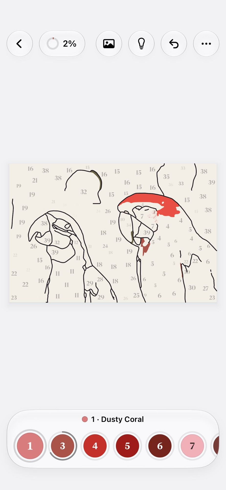
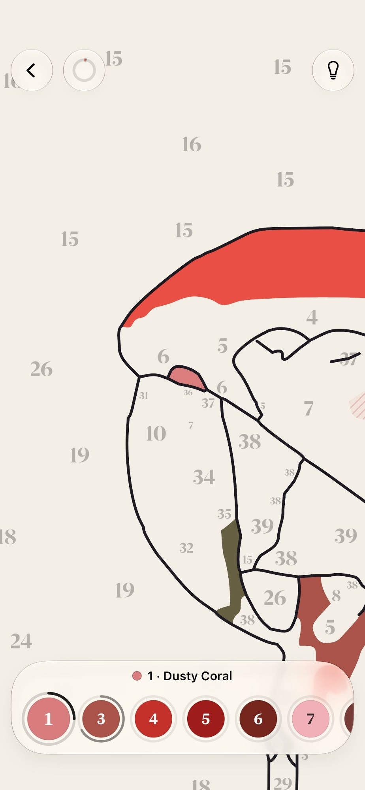

# Agent transcript

- end: success, 191 turns, 21.4 min, estimated $6.196833400000002
- tool calls: {"mcp__maestro__take_screenshot": 76, "Read": 15, "mcp__maestro__run": 78, "mcp__maestro__inspect_screen": 16, "Write": 5}
- images the agent received: 76

**Start**: model claude-opus-5-5, MCP [{"name": "maestro", "status": "connected", "source": "dynamic"}]

→ `mcp__maestro__take_screenshot` `{"device_id": "66B86BC1-4267-4749-86CE-137182F5D903"}`

→ `Read` `{"file_path": "/Users/runner/work/_temp/qa/app.log"}`

← mcp__maestro__take_screenshot: image  924x2000

← Read: 1	getpwuid_r did not find a match for uid 501
2	Filtering the log data using "subsystem == "com.pbordjadze.paintbynumber""
3	Timestamp               Ty Process[PID:TID]
4	2026-11-06 04:43:09.342 Df PaintByNumber[59372:2465a] [com.pbordjadze.paintbynumber:tips] offer in shelf: , wanted
5	2026-11-06 04:43:10.547 Df PaintByNumber[59372:24824] [com.pbordjadze.paintbynumber:canvas] Making the render co …

→ `mcp__maestro__run` `{"device_id": "66B86BC1-4267-4749-86CE-137182F5D903", "yaml": "appId: com.pbordjadze.paintbynumber\n---\n- takeScreenshot: /Users/runner/work/_temp/qa/shots/gallery-first\n- tapOn: \"The Great Wave\"\n- waitForAnimationToEnd\n"}`

→ `mcp__maestro__take_screenshot` `{"device_id": "66B86BC1-4267-4749-86CE-137182F5D903"}`

← mcp__maestro__run: {"success":true,"device_id":"66B86BC1-4267-4749-86CE-137182F5D903","commands_executed":4,"message":"Flow executed successfully","env_vars":{"MAESTRO_CLI_ANALYSIS_NOTIFICATION_DISABLED":"true","MAESTRO_CLI_NO_ANALYTICS":"1","MAESTRO_DRIVER_STARTUP_TIMEOUT":"240000","MAESTRO_VERSION":"2.11.0"}}

← mcp__maestro__take_screenshot: image  924x2000

→ `mcp__maestro__run` `{"device_id": "66B86BC1-4267-4749-86CE-137182F5D903", "yaml": "appId: com.pbordjadze.paintbynumber\n---\n- takeScreenshot: /Users/runner/work/_temp/qa/shots/tip-1-tap-to-paint\n"}`

→ `mcp__maestro__inspect_screen` `{"device_id": "66B86BC1-4267-4749-86CE-137182F5D903"}`

← mcp__maestro__run: {"success":true,"device_id":"66B86BC1-4267-4749-86CE-137182F5D903","commands_executed":2,"message":"Flow executed successfully","env_vars":{"MAESTRO_CLI_ANALYSIS_NOTIFICATION_DISABLED":"true","MAESTRO_CLI_NO_ANALYTICS":"1","MAESTRO_DRIVER_STARTUP_TIMEOUT":"240000","MAESTRO_VERSION":"2.11.0"}}

← mcp__maestro__inspect_screen: {"ui_schema":{"platform":"ios","abbreviations":{"b":"bounds","txt":"text","rid":"resource-id","a11y":"accessibilityText","hint":"hintText","val":"value","c":"children"},"defaults":{"enabled":true,"focused":false,"selected":false,"checked":false,"txt":"","hint":"","rid":"","val":"","a11y":""}},"elements":[{"b":"[0,0][390,844]","a11y":"Paint by Moonlight","c":[{"b":"[0,0][390,844]","c":[{"b":"[0,0][ …

→ `mcp__maestro__take_screenshot` `{"device_id": "66B86BC1-4267-4749-86CE-137182F5D903"}`

← mcp__maestro__take_screenshot: image  924x2000

→ `mcp__maestro__run` `{"device_id": "66B86BC1-4267-4749-86CE-137182F5D903", "yaml": "appId: com.pbordjadze.paintbynumber\n---\n- tapOn: \"Close\"\n"}`

→ `mcp__maestro__inspect_screen` `{"device_id": "66B86BC1-4267-4749-86CE-137182F5D903"}`

← mcp__maestro__run: {"success":true,"device_id":"66B86BC1-4267-4749-86CE-137182F5D903","commands_executed":2,"message":"Flow executed successfully","env_vars":{"MAESTRO_CLI_ANALYSIS_NOTIFICATION_DISABLED":"true","MAESTRO_CLI_NO_ANALYTICS":"1","MAESTRO_DRIVER_STARTUP_TIMEOUT":"240000","MAESTRO_VERSION":"2.11.0"}}

← mcp__maestro__inspect_screen: {"ui_schema":{"platform":"ios","abbreviations":{"b":"bounds","txt":"text","rid":"resource-id","a11y":"accessibilityText","hint":"hintText","val":"value","c":"children"},"defaults":{"enabled":true,"focused":false,"selected":false,"checked":false,"txt":"","hint":"","rid":"","val":"","a11y":""}},"elements":[{"b":"[0,0][390,844]","a11y":"Paint by Moonlight","c":[{"b":"[0,0][390,844]","c":[{"b":"[0,0][ …

> Gallery looked fine; the first tip ("Tap to Paint") showed on opening The Great Wave. Now painting a few areas.

→ `mcp__maestro__run` `{"device_id": "66B86BC1-4267-4749-86CE-137182F5D903", "yaml": "appId: com.pbordjadze.paintbynumber\n---\n- tapOn:\n    id: \"canvas-area-2\"\n- tapOn:\n    id: \"canvas-area-14\"\n- tapOn:\n    id: \"canvas-area-270\"\n- takeScreenshot: /Users/runner/work/_temp/qa/shots/wave-painted-3\n"}`

→ `mcp__maestro__take_screenshot` `{"device_id": "66B86BC1-4267-4749-86CE-137182F5D903"}`

← mcp__maestro__run: {"success":true,"device_id":"66B86BC1-4267-4749-86CE-137182F5D903","commands_executed":5,"message":"Flow executed successfully","env_vars":{"MAESTRO_CLI_ANALYSIS_NOTIFICATION_DISABLED":"true","MAESTRO_CLI_NO_ANALYTICS":"1","MAESTRO_DRIVER_STARTUP_TIMEOUT":"240000","MAESTRO_VERSION":"2.11.0"}}

← mcp__maestro__take_screenshot: image  924x2000

→ `mcp__maestro__inspect_screen` `{"device_id": "66B86BC1-4267-4749-86CE-137182F5D903"}`

← mcp__maestro__inspect_screen: {"ui_schema":{"platform":"ios","abbreviations":{"b":"bounds","txt":"text","rid":"resource-id","a11y":"accessibilityText","hint":"hintText","val":"value","c":"children"},"defaults":{"enabled":true,"focused":false,"selected":false,"checked":false,"txt":"","hint":"","rid":"","val":"","a11y":""}},"elements":[{"b":"[0,0][390,844]","a11y":"Paint by Moonlight","c":[{"b":"[0,0][390,844]","c":[{"b":"[0,0][ …

→ `mcp__maestro__run` `{"device_id": "66B86BC1-4267-4749-86CE-137182F5D903", "yaml": "appId: com.pbordjadze.paintbynumber\n---\n- tapOn: \"Back\"\n- waitForAnimationToEnd\n"}`

→ `mcp__maestro__take_screenshot` `{"device_id": "66B86BC1-4267-4749-86CE-137182F5D903"}`

← mcp__maestro__run: {"success":true,"device_id":"66B86BC1-4267-4749-86CE-137182F5D903","commands_executed":3,"message":"Flow executed successfully","env_vars":{"MAESTRO_CLI_ANALYSIS_NOTIFICATION_DISABLED":"true","MAESTRO_CLI_NO_ANALYTICS":"1","MAESTRO_DRIVER_STARTUP_TIMEOUT":"240000","MAESTRO_VERSION":"2.11.0"}}

← mcp__maestro__take_screenshot: image  924x2000

→ `mcp__maestro__run` `{"device_id": "66B86BC1-4267-4749-86CE-137182F5D903", "yaml": "appId: com.pbordjadze.paintbynumber\n---\n- takeScreenshot: /Users/runner/work/_temp/qa/shots/gallery-after-wave\n- tapOn:\n    point: \"90%,8%\"\n- waitForAnimationToEnd\n"}`

→ `mcp__maestro__take_screenshot` `{"device_id": "66B86BC1-4267-4749-86CE-137182F5D903"}`

← mcp__maestro__run: {"success":true,"device_id":"66B86BC1-4267-4749-86CE-137182F5D903","commands_executed":4,"message":"Flow executed successfully","env_vars":{"MAESTRO_CLI_ANALYSIS_NOTIFICATION_DISABLED":"true","MAESTRO_CLI_NO_ANALYTICS":"1","MAESTRO_DRIVER_STARTUP_TIMEOUT":"240000","MAESTRO_VERSION":"2.11.0"}}

← mcp__maestro__take_screenshot: image  924x2000

→ `mcp__maestro__run` `{"device_id": "66B86BC1-4267-4749-86CE-137182F5D903", "yaml": "appId: com.pbordjadze.paintbynumber\n---\n- takeScreenshot: /Users/runner/work/_temp/qa/shots/new-painting\n- tapOn: \"Samples\"\n- waitForAnimationToEnd\n"}`

→ `mcp__maestro__take_screenshot` `{"device_id": "66B86BC1-4267-4749-86CE-137182F5D903"}`

← mcp__maestro__run: {"success":true,"device_id":"66B86BC1-4267-4749-86CE-137182F5D903","commands_executed":4,"message":"Flow executed successfully","env_vars":{"MAESTRO_CLI_ANALYSIS_NOTIFICATION_DISABLED":"true","MAESTRO_CLI_NO_ANALYTICS":"1","MAESTRO_DRIVER_STARTUP_TIMEOUT":"240000","MAESTRO_VERSION":"2.11.0"}}

← mcp__maestro__take_screenshot: image  924x2000

> Choosing Red Fuji (a simple-looking picture).

→ `mcp__maestro__run` `{"device_id": "66B86BC1-4267-4749-86CE-137182F5D903", "yaml": "appId: com.pbordjadze.paintbynumber\n---\n- tapOn: \"Red Fuji.*\"\n- waitForAnimationToEnd\n"}`

→ `mcp__maestro__take_screenshot` `{"device_id": "66B86BC1-4267-4749-86CE-137182F5D903"}`

← mcp__maestro__run: {"success":true,"device_id":"66B86BC1-4267-4749-86CE-137182F5D903","commands_executed":3,"message":"Flow executed successfully","env_vars":{"MAESTRO_CLI_ANALYSIS_NOTIFICATION_DISABLED":"true","MAESTRO_CLI_NO_ANALYTICS":"1","MAESTRO_DRIVER_STARTUP_TIMEOUT":"240000","MAESTRO_VERSION":"2.11.0"}}

← mcp__maestro__take_screenshot: image  924x2000

→ `mcp__maestro__run` `{"device_id": "66B86BC1-4267-4749-86CE-137182F5D903", "yaml": "appId: com.pbordjadze.paintbynumber\n---\n- takeScreenshot: /Users/runner/work/_temp/qa/shots/preview-redfuji\n- tapOn: \"Start Painting\"\n- waitForAnimationToEnd\n"}`

→ `mcp__maestro__take_screenshot` `{"device_id": "66B86BC1-4267-4749-86CE-137182F5D903"}`

← mcp__maestro__run: {"success":true,"device_id":"66B86BC1-4267-4749-86CE-137182F5D903","commands_executed":4,"message":"Flow executed successfully","env_vars":{"MAESTRO_CLI_ANALYSIS_NOTIFICATION_DISABLED":"true","MAESTRO_CLI_NO_ANALYTICS":"1","MAESTRO_DRIVER_STARTUP_TIMEOUT":"240000","MAESTRO_VERSION":"2.11.0"}}

← mcp__maestro__take_screenshot: image  924x2000

→ `mcp__maestro__run` `{"device_id": "66B86BC1-4267-4749-86CE-137182F5D903", "yaml": "appId: com.pbordjadze.paintbynumber\n---\n- tapOn:\n    point: \"65%,52%\"\n- tapOn: \"Hint\"\n- waitForAnimationToEnd\n"}`

→ `mcp__maestro__take_screenshot` `{"device_id": "66B86BC1-4267-4749-86CE-137182F5D903"}`

← mcp__maestro__run: {"success":true,"device_id":"66B86BC1-4267-4749-86CE-137182F5D903","commands_executed":4,"message":"Flow executed successfully","env_vars":{"MAESTRO_CLI_ANALYSIS_NOTIFICATION_DISABLED":"true","MAESTRO_CLI_NO_ANALYTICS":"1","MAESTRO_DRIVER_STARTUP_TIMEOUT":"240000","MAESTRO_VERSION":"2.11.0"}}

← mcp__maestro__take_screenshot: image  924x2000

→ `mcp__maestro__inspect_screen` `{"device_id": "66B86BC1-4267-4749-86CE-137182F5D903"}`

← mcp__maestro__inspect_screen: {"ui_schema":{"platform":"ios","abbreviations":{"b":"bounds","txt":"text","rid":"resource-id","a11y":"accessibilityText","hint":"hintText","val":"value","c":"children"},"defaults":{"enabled":true,"focused":false,"selected":false,"checked":false,"txt":"","hint":"","rid":"","val":"","a11y":""}},"elements":[{"b":"[0,0][390,844]","a11y":"Paint by Moonlight","c":[{"b":"[0,0][390,844]","c":[{"b":"[0,0][ …

→ `mcp__maestro__run` `{"device_id": "66B86BC1-4267-4749-86CE-137182F5D903", "yaml": "appId: com.pbordjadze.paintbynumber\n---\n- tapOn:\n    id: \"canvas-area-241\"\n- takeScreenshot: /Users/runner/work/_temp/qa/shots/redfuji-hint-painted\n"}`

→ `mcp__maestro__take_screenshot` `{"device_id": "66B86BC1-4267-4749-86CE-137182F5D903"}`

← mcp__maestro__run: {"success":true,"device_id":"66B86BC1-4267-4749-86CE-137182F5D903","commands_executed":3,"message":"Flow executed successfully","env_vars":{"MAESTRO_CLI_ANALYSIS_NOTIFICATION_DISABLED":"true","MAESTRO_CLI_NO_ANALYTICS":"1","MAESTRO_DRIVER_STARTUP_TIMEOUT":"240000","MAESTRO_VERSION":"2.11.0"}}

← mcp__maestro__take_screenshot: image  924x2000

→ `Write` `{"file_path": "/Users/runner/work/_temp/qa/report.md", "content": "# Paint by Moonlight \u2014 newcomer's first hour (tips focus), iPhone 16e simulator\n\n## Summary\nIn progress. Gallery, opening and painting a starter (The Great Wave) and making a painting from a sample (Red Fuji) all worked. One tip so far (\"Tap to Paint\").\n\n## Coverage\n1. Gallery + paint starter: done (3 areas on The Great Wave, 1%, thumbnail updated on Back).\n2. Sample painting: done (Red Fuji, 2 areas painted, Hint used).\n3\u20136: in progress.\n\n## Tips\n- Log (before the session): `04:45:01.601 tips turn: shelf`

← Write: File created successfully at: /Users/runner/work/_temp/qa/report.md (file state is current in your context — no need to Read it back)

→ `mcp__maestro__run` `{"device_id": "66B86BC1-4267-4749-86CE-137182F5D903", "yaml": "appId: com.pbordjadze.paintbynumber\n---\n- tapOn: \"Back\"\n- waitForAnimationToEnd\n"}`

→ `mcp__maestro__take_screenshot` `{"device_id": "66B86BC1-4267-4749-86CE-137182F5D903"}`

← mcp__maestro__run: {"success":true,"device_id":"66B86BC1-4267-4749-86CE-137182F5D903","commands_executed":3,"message":"Flow executed successfully","env_vars":{"MAESTRO_CLI_ANALYSIS_NOTIFICATION_DISABLED":"true","MAESTRO_CLI_NO_ANALYTICS":"1","MAESTRO_DRIVER_STARTUP_TIMEOUT":"240000","MAESTRO_VERSION":"2.11.0"}}

← mcp__maestro__take_screenshot: image  924x2000

> Sample painting (Red Fuji) worked end to end. Next: the photo from Photos.

→ `mcp__maestro__run` `{"device_id": "66B86BC1-4267-4749-86CE-137182F5D903", "yaml": "appId: com.pbordjadze.paintbynumber\n---\n- tapOn:\n    point: \"90%,8%\"\n- waitForAnimationToEnd\n- tapOn: \"Photos\"\n- tapOn: \"Choose Photo\"\n- waitForAnimationToEnd\n"}`

→ `mcp__maestro__take_screenshot` `{"device_id": "66B86BC1-4267-4749-86CE-137182F5D903"}`

← mcp__maestro__run: {"success":true,"device_id":"66B86BC1-4267-4749-86CE-137182F5D903","commands_executed":6,"message":"Flow executed successfully","env_vars":{"MAESTRO_CLI_ANALYSIS_NOTIFICATION_DISABLED":"true","MAESTRO_CLI_NO_ANALYTICS":"1","MAESTRO_DRIVER_STARTUP_TIMEOUT":"240000","MAESTRO_VERSION":"2.11.0"}}

← mcp__maestro__take_screenshot: image  924x2000

→ `mcp__maestro__run` `{"device_id": "66B86BC1-4267-4749-86CE-137182F5D903", "yaml": "appId: com.pbordjadze.paintbynumber\n---\n- tapOn:\n    point: \"16%,42%\"\n- waitForAnimationToEnd\n"}`

→ `mcp__maestro__take_screenshot` `{"device_id": "66B86BC1-4267-4749-86CE-137182F5D903"}`

← mcp__maestro__run: {"success":true,"device_id":"66B86BC1-4267-4749-86CE-137182F5D903","commands_executed":3,"message":"Flow executed successfully","env_vars":{"MAESTRO_CLI_ANALYSIS_NOTIFICATION_DISABLED":"true","MAESTRO_CLI_NO_ANALYTICS":"1","MAESTRO_DRIVER_STARTUP_TIMEOUT":"240000","MAESTRO_VERSION":"2.11.0"}}

← mcp__maestro__take_screenshot: image  924x2000

→ `mcp__maestro__run` `{"device_id": "66B86BC1-4267-4749-86CE-137182F5D903", "yaml": "appId: com.pbordjadze.paintbynumber\n---\n- takeScreenshot: /Users/runner/work/_temp/qa/shots/tip-2-compare-photo-and-page\n"}`

← mcp__maestro__run: {"success":true,"device_id":"66B86BC1-4267-4749-86CE-137182F5D903","commands_executed":2,"message":"Flow executed successfully","env_vars":{"MAESTRO_CLI_ANALYSIS_NOTIFICATION_DISABLED":"true","MAESTRO_CLI_NO_ANALYTICS":"1","MAESTRO_DRIVER_STARTUP_TIMEOUT":"240000","MAESTRO_VERSION":"2.11.0"}}

→ `mcp__maestro__inspect_screen` `{"device_id": "66B86BC1-4267-4749-86CE-137182F5D903"}`

← mcp__maestro__inspect_screen: {"ui_schema":{"platform":"ios","abbreviations":{"b":"bounds","txt":"text","rid":"resource-id","a11y":"accessibilityText","hint":"hintText","val":"value","c":"children"},"defaults":{"enabled":true,"focused":false,"selected":false,"checked":false,"txt":"","hint":"","rid":"","val":"","a11y":""}},"elements":[{"b":"[0,0][390,844]","a11y":"Paint by Moonlight","c":[{"b":"[0,0][390,844]","c":[{"b":"[0,0][ …

→ `mcp__maestro__take_screenshot` `{"device_id": "66B86BC1-4267-4749-86CE-137182F5D903"}`

← mcp__maestro__take_screenshot: image  924x2000

→ `mcp__maestro__run` `{"device_id": "66B86BC1-4267-4749-86CE-137182F5D903", "yaml": "appId: com.pbordjadze.paintbynumber\n---\n- tapOn: \"Close\"\n- swipe:\n    start: \"50%,37%\"\n    end: \"80%,37%\"\n    duration: 800\n- takeScreenshot: /Users/runner/work/_temp/qa/shots/parrot-preview-divider\n"}`

→ `mcp__maestro__take_screenshot` `{"device_id": "66B86BC1-4267-4749-86CE-137182F5D903"}`

← mcp__maestro__run: {"success":true,"device_id":"66B86BC1-4267-4749-86CE-137182F5D903","commands_executed":4,"message":"Flow executed successfully","env_vars":{"MAESTRO_CLI_ANALYSIS_NOTIFICATION_DISABLED":"true","MAESTRO_CLI_NO_ANALYTICS":"1","MAESTRO_DRIVER_STARTUP_TIMEOUT":"240000","MAESTRO_VERSION":"2.11.0"}}

← mcp__maestro__take_screenshot: image  924x2000

→ `mcp__maestro__run` `{"device_id": "66B86BC1-4267-4749-86CE-137182F5D903", "yaml": "appId: com.pbordjadze.paintbynumber\n---\n- tapOn: \"Start Painting\"\n- waitForAnimationToEnd\n"}`

→ `mcp__maestro__take_screenshot` `{"device_id": "66B86BC1-4267-4749-86CE-137182F5D903"}`

← mcp__maestro__run: {"success":true,"device_id":"66B86BC1-4267-4749-86CE-137182F5D903","commands_executed":3,"message":"Flow executed successfully","env_vars":{"MAESTRO_CLI_ANALYSIS_NOTIFICATION_DISABLED":"true","MAESTRO_CLI_NO_ANALYTICS":"1","MAESTRO_DRIVER_STARTUP_TIMEOUT":"240000","MAESTRO_VERSION":"2.11.0"}}

← mcp__maestro__take_screenshot: image  924x2000

> Photo painting opened (parrots). Painting a couple of areas.

→ `mcp__maestro__inspect_screen` `{"device_id": "66B86BC1-4267-4749-86CE-137182F5D903"}`

← mcp__maestro__inspect_screen: {"ui_schema":{"platform":"ios","abbreviations":{"b":"bounds","txt":"text","rid":"resource-id","a11y":"accessibilityText","hint":"hintText","val":"value","c":"children"},"defaults":{"enabled":true,"focused":false,"selected":false,"checked":false,"txt":"","hint":"","rid":"","val":"","a11y":""}},"elements":[{"b":"[0,0][390,844]","a11y":"Paint by Moonlight","c":[{"b":"[0,0][390,844]","c":[{"b":"[0,0][ …

→ `mcp__maestro__run` `{"device_id": "66B86BC1-4267-4749-86CE-137182F5D903", "yaml": "appId: com.pbordjadze.paintbynumber\n---\n- tapOn:\n    id: \"canvas-area-19\"\n- tapOn:\n    id: \"canvas-area-101\"\n- takeScreenshot: /Users/runner/work/_temp/qa/shots/parrot-painted-2\n"}`

→ `mcp__maestro__take_screenshot` `{"device_id": "66B86BC1-4267-4749-86CE-137182F5D903"}`

← mcp__maestro__run: {"success":true,"device_id":"66B86BC1-4267-4749-86CE-137182F5D903","commands_executed":4,"message":"Flow executed successfully","env_vars":{"MAESTRO_CLI_ANALYSIS_NOTIFICATION_DISABLED":"true","MAESTRO_CLI_NO_ANALYTICS":"1","MAESTRO_DRIVER_STARTUP_TIMEOUT":"240000","MAESTRO_VERSION":"2.11.0"}}

← mcp__maestro__take_screenshot: image  924x2000

→ `mcp__maestro__run` `{"device_id": "66B86BC1-4267-4749-86CE-137182F5D903", "yaml": "appId: com.pbordjadze.paintbynumber\n---\n- tapOn: \"Back\"\n- waitForAnimationToEnd\n- takeScreenshot: /Users/runner/work/_temp/qa/shots/gallery-3\n- tapOn:\n    point: \"90%,8%\"\n- waitForAnimationToEnd\n- tapOn: \"From Scratch\"\n- waitForAnimationToEnd\n"}`

→ `mcp__maestro__take_screenshot` `{"device_id": "66B86BC1-4267-4749-86CE-137182F5D903"}`

← mcp__maestro__run: {"success":true,"device_id":"66B86BC1-4267-4749-86CE-137182F5D903","commands_executed":8,"message":"Flow executed successfully","env_vars":{"MAESTRO_CLI_ANALYSIS_NOTIFICATION_DISABLED":"true","MAESTRO_CLI_NO_ANALYTICS":"1","MAESTRO_DRIVER_STARTUP_TIMEOUT":"240000","MAESTRO_VERSION":"2.11.0"}}

← mcp__maestro__take_screenshot: image  924x2000

→ `mcp__maestro__inspect_screen` `{"device_id": "66B86BC1-4267-4749-86CE-137182F5D903"}`

← mcp__maestro__inspect_screen: {"ui_schema":{"platform":"ios","abbreviations":{"b":"bounds","txt":"text","rid":"resource-id","a11y":"accessibilityText","hint":"hintText","val":"value","c":"children"},"defaults":{"enabled":true,"focused":false,"selected":false,"checked":false,"txt":"","hint":"","rid":"","val":"","a11y":""}},"elements":[{"b":"[0,0][390,844]","a11y":"Paint by Moonlight","c":[{"b":"[0,0][390,844]","c":[{"b":"[0,0][ …

> Opened "From Scratch" — a blank page editor with Pen. Drawing a square with four pen strokes.

→ `mcp__maestro__run` `{"device_id": "66B86BC1-4267-4749-86CE-137182F5D903", "yaml": "appId: com.pbordjadze.paintbynumber\n---\n- swipe:\n    start: \"120,300\"\n    end: \"270,300\"\n    duration: 800\n- swipe:\n    start: \"270,300\"\n    end: \"270,450\"\n    duration: 800\n- swipe:\n    start: \"270,450\"\n    end: \"120,450\"\n    duration: 800\n- swipe:\n    start: \"120,450\"\n    end: \"120,300\"\n    duration: 800\n- takeScreenshot: /Users/runner/work/_temp/qa/shots/scratch-square\n"}`

→ `mcp__maestro__take_screenshot` `{"device_id": "66B86BC1-4267-4749-86CE-137182F5D903"}`

← mcp__maestro__run: {"success":true,"device_id":"66B86BC1-4267-4749-86CE-137182F5D903","commands_executed":6,"message":"Flow executed successfully","env_vars":{"MAESTRO_CLI_ANALYSIS_NOTIFICATION_DISABLED":"true","MAESTRO_CLI_NO_ANALYTICS":"1","MAESTRO_DRIVER_STARTUP_TIMEOUT":"240000","MAESTRO_VERSION":"2.11.0"}}

← mcp__maestro__take_screenshot: image  924x2000

> Square drawn. Tapping Done (✓).

→ `mcp__maestro__run` `{"device_id": "66B86BC1-4267-4749-86CE-137182F5D903", "yaml": "appId: com.pbordjadze.paintbynumber\n---\n- tapOn:\n    id: \"refine-done\"\n- waitForAnimationToEnd\n"}`

→ `mcp__maestro__take_screenshot` `{"device_id": "66B86BC1-4267-4749-86CE-137182F5D903"}`

← mcp__maestro__run: {"success":true,"device_id":"66B86BC1-4267-4749-86CE-137182F5D903","commands_executed":3,"message":"Flow executed successfully","env_vars":{"MAESTRO_CLI_ANALYSIS_NOTIFICATION_DISABLED":"true","MAESTRO_CLI_NO_ANALYTICS":"1","MAESTRO_DRIVER_STARTUP_TIMEOUT":"240000","MAESTRO_VERSION":"2.11.0"}}

← mcp__maestro__take_screenshot: image  924x2000

→ `mcp__maestro__run` `{"device_id": "66B86BC1-4267-4749-86CE-137182F5D903", "yaml": "appId: com.pbordjadze.paintbynumber\n---\n- takeScreenshot: /Users/runner/work/_temp/qa/shots/scratch-preview\n- tapOn: \"Start Painting\"\n- waitForAnimationToEnd\n"}`

→ `mcp__maestro__take_screenshot` `{"device_id": "66B86BC1-4267-4749-86CE-137182F5D903"}`

← mcp__maestro__run: {"success":true,"device_id":"66B86BC1-4267-4749-86CE-137182F5D903","commands_executed":4,"message":"Flow executed successfully","env_vars":{"MAESTRO_CLI_ANALYSIS_NOTIFICATION_DISABLED":"true","MAESTRO_CLI_NO_ANALYTICS":"1","MAESTRO_DRIVER_STARTUP_TIMEOUT":"240000","MAESTRO_VERSION":"2.11.0"}}

← mcp__maestro__take_screenshot: image  924x2000

> The drawing became a painting with a single white paint ("1 · Printer Paper"). Painting the square.

→ `mcp__maestro__run` `{"device_id": "66B86BC1-4267-4749-86CE-137182F5D903", "yaml": "appId: com.pbordjadze.paintbynumber\n---\n- tapOn:\n    point: \"50%,45%\"\n- takeScreenshot: /Users/runner/work/_temp/qa/shots/scratch-painted\n"}`

→ `mcp__maestro__take_screenshot` `{"device_id": "66B86BC1-4267-4749-86CE-137182F5D903"}`

← mcp__maestro__run: {"success":true,"device_id":"66B86BC1-4267-4749-86CE-137182F5D903","commands_executed":3,"message":"Flow executed successfully","env_vars":{"MAESTRO_CLI_ANALYSIS_NOTIFICATION_DISABLED":"true","MAESTRO_CLI_NO_ANALYTICS":"1","MAESTRO_DRIVER_STARTUP_TIMEOUT":"240000","MAESTRO_VERSION":"2.11.0"}}

← mcp__maestro__take_screenshot: image  924x2000

→ `Read` `{"file_path": "/Users/runner/work/_temp/qa/app.log", "offset": 12}`

← Read: 12	2026-11-06 04:47:07.491 Df PaintByNumber[59372:2465a] [com.pbordjadze.paintbynumber:library] Opened 3934CFE6-E04A-4F23-A6B2-10E9B436E890: 333 regions
13	2026-11-06 04:47:08.304 Df PaintByNumber[59372:2465a] [com.pbordjadze.paintbynumber:library] Painting screen recognizers: UIKitHoverGestureRecognizer, _UIParallaxTransitionPanGestureRecognizer, _UIContentSwipeDismissGestureRecognizer (disabled) …

> Two tips seen so far; log shows a third (benchShowPhoto) was refused with "sessionFull" — I'll note that. Now goal 5: Refine from a preview.

→ `mcp__maestro__run` `{"device_id": "66B86BC1-4267-4749-86CE-137182F5D903", "yaml": "appId: com.pbordjadze.paintbynumber\n---\n- tapOn: \"Back\"\n- waitForAnimationToEnd\n- takeScreenshot: /Users/runner/work/_temp/qa/shots/gallery-4\n- tapOn:\n    point: \"90%,8%\"\n- waitForAnimationToEnd\n- tapOn: \"Samples\"\n- tapOn: \"Irises.*\"\n- waitForAnimationToEnd\n"}`

→ `mcp__maestro__take_screenshot` `{"device_id": "66B86BC1-4267-4749-86CE-137182F5D903"}`

← mcp__maestro__run: {"success":true,"device_id":"66B86BC1-4267-4749-86CE-137182F5D903","commands_executed":9,"message":"Flow executed successfully","env_vars":{"MAESTRO_CLI_ANALYSIS_NOTIFICATION_DISABLED":"true","MAESTRO_CLI_NO_ANALYTICS":"1","MAESTRO_DRIVER_STARTUP_TIMEOUT":"240000","MAESTRO_VERSION":"2.11.0"}}

← mcp__maestro__take_screenshot: image  924x2000

→ `mcp__maestro__run` `{"device_id": "66B86BC1-4267-4749-86CE-137182F5D903", "yaml": "appId: com.pbordjadze.paintbynumber\n---\n- takeScreenshot: /Users/runner/work/_temp/qa/shots/preview-irises\n- tapOn: \"Refine\"\n- waitForAnimationToEnd\n"}`

→ `mcp__maestro__take_screenshot` `{"device_id": "66B86BC1-4267-4749-86CE-137182F5D903"}`

← mcp__maestro__run: {"success":true,"device_id":"66B86BC1-4267-4749-86CE-137182F5D903","commands_executed":4,"message":"Flow executed successfully","env_vars":{"MAESTRO_CLI_ANALYSIS_NOTIFICATION_DISABLED":"true","MAESTRO_CLI_NO_ANALYTICS":"1","MAESTRO_DRIVER_STARTUP_TIMEOUT":"240000","MAESTRO_VERSION":"2.11.0"}}

← mcp__maestro__take_screenshot: image  924x2000

> Refine is the line-editing tool. Drawing one pen line across the left wall.

→ `mcp__maestro__run` `{"device_id": "66B86BC1-4267-4749-86CE-137182F5D903", "yaml": "appId: com.pbordjadze.paintbynumber\n---\n- swipe:\n    start: \"30,420\"\n    end: \"130,380\"\n    duration: 900\n- takeScreenshot: /Users/runner/work/_temp/qa/shots/refine-one-line\n"}`

→ `mcp__maestro__take_screenshot` `{"device_id": "66B86BC1-4267-4749-86CE-137182F5D903"}`

← mcp__maestro__run: {"success":true,"device_id":"66B86BC1-4267-4749-86CE-137182F5D903","commands_executed":3,"message":"Flow executed successfully","env_vars":{"MAESTRO_CLI_ANALYSIS_NOTIFICATION_DISABLED":"true","MAESTRO_CLI_NO_ANALYTICS":"1","MAESTRO_DRIVER_STARTUP_TIMEOUT":"240000","MAESTRO_VERSION":"2.11.0"}}

← mcp__maestro__take_screenshot: image  924x2000

> Line drawn (ends appear snapped). The "Generated / Blank" switch disappeared after the edit. Now leaving with Cancel.

→ `mcp__maestro__run` `{"device_id": "66B86BC1-4267-4749-86CE-137182F5D903", "yaml": "appId: com.pbordjadze.paintbynumber\n---\n- tapOn:\n    id: \"refine-cancel\"\n- waitForAnimationToEnd\n"}`

→ `mcp__maestro__take_screenshot` `{"device_id": "66B86BC1-4267-4749-86CE-137182F5D903"}`

← mcp__maestro__run: {"success":true,"device_id":"66B86BC1-4267-4749-86CE-137182F5D903","commands_executed":3,"message":"Flow executed successfully","env_vars":{"MAESTRO_CLI_ANALYSIS_NOTIFICATION_DISABLED":"true","MAESTRO_CLI_NO_ANALYTICS":"1","MAESTRO_DRIVER_STARTUP_TIMEOUT":"240000","MAESTRO_VERSION":"2.11.0"}}

← mcp__maestro__take_screenshot: image  924x2000

→ `mcp__maestro__run` `{"device_id": "66B86BC1-4267-4749-86CE-137182F5D903", "yaml": "appId: com.pbordjadze.paintbynumber\n---\n- takeScreenshot: /Users/runner/work/_temp/qa/shots/refine-discard-ask\n- tapOn: \"Discard Changes\"\n- waitForAnimationToEnd\n- takeScreenshot: /Users/runner/work/_temp/qa/shots/after-discard\n"}`

→ `mcp__maestro__take_screenshot` `{"device_id": "66B86BC1-4267-4749-86CE-137182F5D903"}`

← mcp__maestro__run: {"success":true,"device_id":"66B86BC1-4267-4749-86CE-137182F5D903","commands_executed":5,"message":"Flow executed successfully","env_vars":{"MAESTRO_CLI_ANALYSIS_NOTIFICATION_DISABLED":"true","MAESTRO_CLI_NO_ANALYTICS":"1","MAESTRO_DRIVER_STARTUP_TIMEOUT":"240000","MAESTRO_VERSION":"2.11.0"}}

← mcp__maestro__take_screenshot: image  924x2000

> Goals 1–5 done. Updating the report, then starting the printing search.

→ `Write` `{"file_path": "/Users/runner/work/_temp/qa/report.md", "content": "# Paint by Moonlight \u2014 newcomer's first hour (tips focus), iPhone 16e simulator\n\n## Summary\nIn progress (written at ~04:53). Goals 1\u20135 worked end to end with no crash. Two tips seen (\"Tap to Paint\", \"Compare Photo and Page\"); the gallery's first tip came and went during preparation, and a third tip was refused by the app's per-session limit after only two had been shown to me. Printing search starting.\n\n## Coverage\n1. Gallery + paint starter: **done** (The Great Wave, 3 areas, 1%; gallery thumbnail and \"1% `

← Write: The file /Users/runner/work/_temp/qa/report.md has been updated successfully. (file state is current in your context — no need to Read it back)

→ `mcp__maestro__run` `{"device_id": "66B86BC1-4267-4749-86CE-137182F5D903", "yaml": "appId: com.pbordjadze.paintbynumber\n---\n- tapOn:\n    point: \"10%,8%\"\n- waitForAnimationToEnd\n"}`

→ `mcp__maestro__take_screenshot` `{"device_id": "66B86BC1-4267-4749-86CE-137182F5D903"}`

← mcp__maestro__run: {"success":true,"device_id":"66B86BC1-4267-4749-86CE-137182F5D903","commands_executed":3,"message":"Flow executed successfully","env_vars":{"MAESTRO_CLI_ANALYSIS_NOTIFICATION_DISABLED":"true","MAESTRO_CLI_NO_ANALYTICS":"1","MAESTRO_DRIVER_STARTUP_TIMEOUT":"240000","MAESTRO_VERSION":"2.11.0"}}

← mcp__maestro__take_screenshot: image  924x2000

→ `mcp__maestro__run` `{"device_id": "66B86BC1-4267-4749-86CE-137182F5D903", "yaml": "appId: com.pbordjadze.paintbynumber\n---\n- tapOn:\n    point: \"10%,8%\"\n- waitForAnimationToEnd\n- tapOn: \"Red Fuji\"\n- waitForAnimationToEnd\n- takeScreenshot: /Users/runner/work/_temp/qa/shots/print-1-painting-topbar\n"}`

→ `mcp__maestro__take_screenshot` `{"device_id": "66B86BC1-4267-4749-86CE-137182F5D903"}`

← mcp__maestro__run: {"success":true,"device_id":"66B86BC1-4267-4749-86CE-137182F5D903","commands_executed":6,"message":"Flow executed successfully","env_vars":{"MAESTRO_CLI_ANALYSIS_NOTIFICATION_DISABLED":"true","MAESTRO_CLI_NO_ANALYTICS":"1","MAESTRO_DRIVER_STARTUP_TIMEOUT":"240000","MAESTRO_VERSION":"2.11.0"}}

← mcp__maestro__take_screenshot: image  924x2000

> Print look #1: painting's top bar — no print/share icon. Look #2: the More (…) menu.

→ `mcp__maestro__run` `{"device_id": "66B86BC1-4267-4749-86CE-137182F5D903", "yaml": "appId: com.pbordjadze.paintbynumber\n---\n- tapOn: \"More\"\n- waitForAnimationToEnd\n- takeScreenshot: /Users/runner/work/_temp/qa/shots/print-2-more-menu\n"}`

→ `mcp__maestro__take_screenshot` `{"device_id": "66B86BC1-4267-4749-86CE-137182F5D903"}`

← mcp__maestro__run: {"success":true,"device_id":"66B86BC1-4267-4749-86CE-137182F5D903","commands_executed":4,"message":"Flow executed successfully","env_vars":{"MAESTRO_CLI_ANALYSIS_NOTIFICATION_DISABLED":"true","MAESTRO_CLI_NO_ANALYTICS":"1","MAESTRO_DRIVER_STARTUP_TIMEOUT":"240000","MAESTRO_VERSION":"2.11.0"}}

← mcp__maestro__take_screenshot: image  924x2000

→ `mcp__maestro__inspect_screen` `{"device_id": "66B86BC1-4267-4749-86CE-137182F5D903"}`

← mcp__maestro__inspect_screen: {"ui_schema":{"platform":"ios","abbreviations":{"b":"bounds","txt":"text","rid":"resource-id","a11y":"accessibilityText","hint":"hintText","val":"value","c":"children"},"defaults":{"enabled":true,"focused":false,"selected":false,"checked":false,"txt":"","hint":"","rid":"","val":"","a11y":""}},"elements":[{"b":"[0,0][390,844]","a11y":"Paint by Moonlight","c":[{"b":"[0,0][390,844]","c":[{"b":"[0,0][ …

→ `mcp__maestro__take_screenshot` `{"device_id": "66B86BC1-4267-4749-86CE-137182F5D903"}`

← mcp__maestro__take_screenshot: image  924x2000

> No Print in More. Saving evidence and peeking into the Palette submenu (look #3).

→ `mcp__maestro__run` `{"device_id": "66B86BC1-4267-4749-86CE-137182F5D903", "yaml": "appId: com.pbordjadze.paintbynumber\n---\n- takeScreenshot: /Users/runner/work/_temp/qa/shots/print-2-more-menu\n- tapOn:\n    id: \"palette-menu\"\n- waitForAnimationToEnd\n- takeScreenshot: /Users/runner/work/_temp/qa/shots/print-3-palette-submenu\n"}`

→ `mcp__maestro__take_screenshot` `{"device_id": "66B86BC1-4267-4749-86CE-137182F5D903"}`

← mcp__maestro__run: {"success":true,"device_id":"66B86BC1-4267-4749-86CE-137182F5D903","commands_executed":5,"message":"Flow executed successfully","env_vars":{"MAESTRO_CLI_ANALYSIS_NOTIFICATION_DISABLED":"true","MAESTRO_CLI_NO_ANALYTICS":"1","MAESTRO_DRIVER_STARTUP_TIMEOUT":"240000","MAESTRO_VERSION":"2.11.0"}}

← mcp__maestro__take_screenshot: image  924x2000

> No print in Palette either. Closing the menu, then look #4: long-press a painting in the gallery.

→ `mcp__maestro__run` `{"device_id": "66B86BC1-4267-4749-86CE-137182F5D903", "yaml": "appId: com.pbordjadze.paintbynumber\n---\n- tapOn:\n    point: \"10%,25%\"\n- waitForAnimationToEnd\n"}`

→ `mcp__maestro__take_screenshot` `{"device_id": "66B86BC1-4267-4749-86CE-137182F5D903"}`

← mcp__maestro__run: {"success":true,"device_id":"66B86BC1-4267-4749-86CE-137182F5D903","commands_executed":3,"message":"Flow executed successfully","env_vars":{"MAESTRO_CLI_ANALYSIS_NOTIFICATION_DISABLED":"true","MAESTRO_CLI_NO_ANALYTICS":"1","MAESTRO_DRIVER_STARTUP_TIMEOUT":"240000","MAESTRO_VERSION":"2.11.0"}}

← mcp__maestro__take_screenshot: image  924x2000

> Look #4: tapping the progress pill (1%) — might open painting details.

→ `mcp__maestro__run` `{"device_id": "66B86BC1-4267-4749-86CE-137182F5D903", "yaml": "appId: com.pbordjadze.paintbynumber\n---\n- tapOn: \"Red Fuji, 1 percent painted\"\n- waitForAnimationToEnd\n- takeScreenshot: /Users/runner/work/_temp/qa/shots/print-4-progress-pill\n"}`

→ `mcp__maestro__take_screenshot` `{"device_id": "66B86BC1-4267-4749-86CE-137182F5D903"}`

← mcp__maestro__run: {"success":true,"device_id":"66B86BC1-4267-4749-86CE-137182F5D903","commands_executed":4,"message":"Flow executed successfully","env_vars":{"MAESTRO_CLI_ANALYSIS_NOTIFICATION_DISABLED":"true","MAESTRO_CLI_NO_ANALYTICS":"1","MAESTRO_DRIVER_STARTUP_TIMEOUT":"240000","MAESTRO_VERSION":"2.11.0"}}

← mcp__maestro__take_screenshot: image  924x2000

> Nothing from the pill. Look #5: back to the gallery and long-press a painting.

→ `mcp__maestro__run` `{"device_id": "66B86BC1-4267-4749-86CE-137182F5D903", "yaml": "appId: com.pbordjadze.paintbynumber\n---\n- tapOn: \"Back\"\n- waitForAnimationToEnd\n- longPressOn:\n    point: \"26%,36%\"\n- waitForAnimationToEnd\n- takeScreenshot: /Users/runner/work/_temp/qa/shots/print-5-gallery-longpress\n"}`

→ `mcp__maestro__take_screenshot` `{"device_id": "66B86BC1-4267-4749-86CE-137182F5D903"}`

← mcp__maestro__run: {"success":true,"device_id":"66B86BC1-4267-4749-86CE-137182F5D903","commands_executed":6,"message":"Flow executed successfully","env_vars":{"MAESTRO_CLI_ANALYSIS_NOTIFICATION_DISABLED":"true","MAESTRO_CLI_NO_ANALYTICS":"1","MAESTRO_DRIVER_STARTUP_TIMEOUT":"240000","MAESTRO_VERSION":"2.11.0"}}

← mcp__maestro__take_screenshot: image  924x2000

> Long-press menu: Favorite, Rename, Share ›, Restart, Delete. Look #6: Share ›.

→ `mcp__maestro__run` `{"device_id": "66B86BC1-4267-4749-86CE-137182F5D903", "yaml": "appId: com.pbordjadze.paintbynumber\n---\n- tapOn: \"Share\"\n- waitForAnimationToEnd\n- takeScreenshot: /Users/runner/work/_temp/qa/shots/print-6-share-submenu\n"}`

→ `mcp__maestro__take_screenshot` `{"device_id": "66B86BC1-4267-4749-86CE-137182F5D903"}`

← mcp__maestro__run: {"success":true,"device_id":"66B86BC1-4267-4749-86CE-137182F5D903","commands_executed":4,"message":"Flow executed successfully","env_vars":{"MAESTRO_CLI_ANALYSIS_NOTIFICATION_DISABLED":"true","MAESTRO_CLI_NO_ANALYTICS":"1","MAESTRO_DRIVER_STARTUP_TIMEOUT":"240000","MAESTRO_VERSION":"2.11.0"}}

← mcp__maestro__take_screenshot: image  924x2000

> Found it at look #6: gallery › long-press a painting › Share › **Print Template…** (~2 min, 6 places). Closing the menu without printing.

→ `mcp__maestro__run` `{"device_id": "66B86BC1-4267-4749-86CE-137182F5D903", "yaml": "appId: com.pbordjadze.paintbynumber\n---\n- tapOn:\n    point: \"50%,10%\"\n- waitForAnimationToEnd\n"}`

→ `mcp__maestro__take_screenshot` `{"device_id": "66B86BC1-4267-4749-86CE-137182F5D903"}`

← mcp__maestro__run: {"success":true,"device_id":"66B86BC1-4267-4749-86CE-137182F5D903","commands_executed":3,"message":"Flow executed successfully","env_vars":{"MAESTRO_CLI_ANALYSIS_NOTIFICATION_DISABLED":"true","MAESTRO_CLI_NO_ANALYTICS":"1","MAESTRO_DRIVER_STARTUP_TIMEOUT":"240000","MAESTRO_VERSION":"2.11.0"}}

← mcp__maestro__take_screenshot: image  924x2000

→ `Write` `{"file_path": "/Users/runner/work/_temp/qa/report.md", "content": "# Paint by Moonlight \u2014 newcomer's first hour (tips focus), iPhone 16e simulator\n\n## Summary\nIn progress (written at ~04:56). Goals 1\u20136 all worked end to end with no crash. Only two tips reached me (\"Tap to Paint\", \"Compare Photo and Page\"); the gallery's first tip came and went during preparation, and a third tip was refused by the app's per-session limit (\"sessionFull\") after only two had been shown to me. Print was found in ~2 minutes, on the 6th place looked, hidden under gallery \u203a long-press \u203a S`

← Write: The file /Users/runner/work/_temp/qa/report.md has been updated successfully. (file state is current in your context — no need to Read it back)

→ `mcp__maestro__run` `{"device_id": "66B86BC1-4267-4749-86CE-137182F5D903", "yaml": "appId: com.pbordjadze.paintbynumber\n---\n- tapOn: \"Delicate Arch\"\n- waitForAnimationToEnd\n"}`

→ `mcp__maestro__take_screenshot` `{"device_id": "66B86BC1-4267-4749-86CE-137182F5D903"}`

← mcp__maestro__run: {"success":true,"device_id":"66B86BC1-4267-4749-86CE-137182F5D903","commands_executed":3,"message":"Flow executed successfully","env_vars":{"MAESTRO_CLI_ANALYSIS_NOTIFICATION_DISABLED":"true","MAESTRO_CLI_NO_ANALYTICS":"1","MAESTRO_DRIVER_STARTUP_TIMEOUT":"240000","MAESTRO_VERSION":"2.11.0"}}

← mcp__maestro__take_screenshot: image  924x2000

> Opened Delicate Arch. Painting one area, then Home + relaunch to test persistence and see whether a new session brings tips.

→ `mcp__maestro__run` `{"device_id": "66B86BC1-4267-4749-86CE-137182F5D903", "yaml": "appId: com.pbordjadze.paintbynumber\n---\n- tapOn:\n    point: \"54,502\"\n- takeScreenshot: /Users/runner/work/_temp/qa/shots/arch-before-home\n"}`

→ `mcp__maestro__inspect_screen` `{"device_id": "66B86BC1-4267-4749-86CE-137182F5D903"}`

← mcp__maestro__run: {"success":true,"device_id":"66B86BC1-4267-4749-86CE-137182F5D903","commands_executed":3,"message":"Flow executed successfully","env_vars":{"MAESTRO_CLI_ANALYSIS_NOTIFICATION_DISABLED":"true","MAESTRO_CLI_NO_ANALYTICS":"1","MAESTRO_DRIVER_STARTUP_TIMEOUT":"240000","MAESTRO_VERSION":"2.11.0"}}

← mcp__maestro__inspect_screen: {"ui_schema":{"platform":"ios","abbreviations":{"b":"bounds","txt":"text","rid":"resource-id","a11y":"accessibilityText","hint":"hintText","val":"value","c":"children"},"defaults":{"enabled":true,"focused":false,"selected":false,"checked":false,"txt":"","hint":"","rid":"","val":"","a11y":""}},"elements":[{"b":"[0,0][390,844]","a11y":"Paint by Moonlight","c":[{"b":"[0,0][390,844]","c":[{"b":"[0,0][ …

→ `mcp__maestro__run` `{"device_id": "66B86BC1-4267-4749-86CE-137182F5D903", "yaml": "appId: com.pbordjadze.paintbynumber\n---\n- pressKey: Home\n"}`

→ `mcp__maestro__take_screenshot` `{"device_id": "66B86BC1-4267-4749-86CE-137182F5D903"}`

← mcp__maestro__run: {"success":true,"device_id":"66B86BC1-4267-4749-86CE-137182F5D903","commands_executed":2,"message":"Flow executed successfully","env_vars":{"MAESTRO_CLI_ANALYSIS_NOTIFICATION_DISABLED":"true","MAESTRO_CLI_NO_ANALYTICS":"1","MAESTRO_DRIVER_STARTUP_TIMEOUT":"240000","MAESTRO_VERSION":"2.11.0"}}

← mcp__maestro__take_screenshot: image  924x2000

→ `mcp__maestro__run` `{"device_id": "66B86BC1-4267-4749-86CE-137182F5D903", "yaml": "appId: com.pbordjadze.paintbynumber\n---\n- stopApp\n- launchApp\n- waitForAnimationToEnd\n"}`

→ `mcp__maestro__take_screenshot` `{"device_id": "66B86BC1-4267-4749-86CE-137182F5D903"}`

← mcp__maestro__run: {"success":true,"device_id":"66B86BC1-4267-4749-86CE-137182F5D903","commands_executed":4,"message":"Flow executed successfully","env_vars":{"MAESTRO_CLI_ANALYSIS_NOTIFICATION_DISABLED":"true","MAESTRO_CLI_NO_ANALYTICS":"1","MAESTRO_DRIVER_STARTUP_TIMEOUT":"240000","MAESTRO_VERSION":"2.11.0"}}

← mcp__maestro__take_screenshot: image  924x2000

> Relaunch shows a blank screen; waiting a moment and looking again.

→ `mcp__maestro__take_screenshot` `{"device_id": "66B86BC1-4267-4749-86CE-137182F5D903"}`

← mcp__maestro__take_screenshot: image  924x2000

→ `mcp__maestro__run` `{"device_id": "66B86BC1-4267-4749-86CE-137182F5D903", "yaml": "appId: com.pbordjadze.paintbynumber\n---\n- waitForAnimationToEnd:\n    timeout: 15000\n"}`

→ `mcp__maestro__take_screenshot` `{"device_id": "66B86BC1-4267-4749-86CE-137182F5D903"}`

← mcp__maestro__run: {"success":true,"device_id":"66B86BC1-4267-4749-86CE-137182F5D903","commands_executed":2,"message":"Flow executed successfully","env_vars":{"MAESTRO_CLI_ANALYSIS_NOTIFICATION_DISABLED":"true","MAESTRO_CLI_NO_ANALYTICS":"1","MAESTRO_DRIVER_STARTUP_TIMEOUT":"240000","MAESTRO_VERSION":"2.11.0"}}

← mcp__maestro__take_screenshot: image  924x2000

> Relaunch reopened Delicate Arch with the paint kept (1%). Checking the log for tip activity in this new session.

→ `Read` `{"file_path": "/Users/runner/work/_temp/qa/app.log", "offset": 63}`

← Read: 63	2026-11-06 04:52:17.744 Df PaintByNumber[59372:2465a] [com.pbordjadze.paintbynumber:tips] offer in newPainting: newPaintingSamples, wanted
64	2026-11-06 04:52:37.626 Df PaintByNumber[59372:2465a] [com.pbordjadze.paintbynumber:create] Draft #1 started for 24 colors, detail 0.77, lines 0.5 [adjusting false, full under way false, final false, phase generating]
65	2026-11-06 04:52:38.202 Df PaintBy …

→ `mcp__maestro__run` `{"device_id": "66B86BC1-4267-4749-86CE-137182F5D903", "yaml": "appId: com.pbordjadze.paintbynumber\n---\n- tapOn: \"Hint\"\n- waitForAnimationToEnd\n"}`

→ `mcp__maestro__take_screenshot` `{"device_id": "66B86BC1-4267-4749-86CE-137182F5D903"}`

← mcp__maestro__run: {"success":true,"device_id":"66B86BC1-4267-4749-86CE-137182F5D903","commands_executed":3,"message":"Flow executed successfully","env_vars":{"MAESTRO_CLI_ANALYSIS_NOTIFICATION_DISABLED":"true","MAESTRO_CLI_NO_ANALYTICS":"1","MAESTRO_DRIVER_STARTUP_TIMEOUT":"240000","MAESTRO_VERSION":"2.11.0"}}

← mcp__maestro__take_screenshot: image  924x2000

→ `mcp__maestro__run` `{"device_id": "66B86BC1-4267-4749-86CE-137182F5D903", "yaml": "appId: com.pbordjadze.paintbynumber\n---\n- tapOn:\n    point: \"240,400\"\n- waitForAnimationToEnd\n"}`

→ `mcp__maestro__take_screenshot` `{"device_id": "66B86BC1-4267-4749-86CE-137182F5D903"}`

← mcp__maestro__run: {"success":true,"device_id":"66B86BC1-4267-4749-86CE-137182F5D903","commands_executed":3,"message":"Flow executed successfully","env_vars":{"MAESTRO_CLI_ANALYSIS_NOTIFICATION_DISABLED":"true","MAESTRO_CLI_NO_ANALYTICS":"1","MAESTRO_DRIVER_STARTUP_TIMEOUT":"240000","MAESTRO_VERSION":"2.11.0"}}

← mcp__maestro__take_screenshot: image  924x2000

→ `mcp__maestro__inspect_screen` `{"device_id": "66B86BC1-4267-4749-86CE-137182F5D903"}`

← mcp__maestro__inspect_screen: {"ui_schema":{"platform":"ios","abbreviations":{"b":"bounds","txt":"text","rid":"resource-id","a11y":"accessibilityText","hint":"hintText","val":"value","c":"children"},"defaults":{"enabled":true,"focused":false,"selected":false,"checked":false,"txt":"","hint":"","rid":"","val":"","a11y":""}},"elements":[{"b":"[0,0][390,844]","a11y":"Paint by Moonlight","c":[{"b":"[0,0][390,844]","c":[{"b":"[0,0][ …

→ `mcp__maestro__run` `{"device_id": "66B86BC1-4267-4749-86CE-137182F5D903", "yaml": "appId: com.pbordjadze.paintbynumber\n---\n- tapOn:\n    id: \"swatch-6\"\n- waitForAnimationToEnd\n"}`

→ `mcp__maestro__inspect_screen` `{"device_id": "66B86BC1-4267-4749-86CE-137182F5D903"}`

← mcp__maestro__run: {"success":true,"device_id":"66B86BC1-4267-4749-86CE-137182F5D903","commands_executed":3,"message":"Flow executed successfully","env_vars":{"MAESTRO_CLI_ANALYSIS_NOTIFICATION_DISABLED":"true","MAESTRO_CLI_NO_ANALYTICS":"1","MAESTRO_DRIVER_STARTUP_TIMEOUT":"240000","MAESTRO_VERSION":"2.11.0"}}

← mcp__maestro__inspect_screen: {"ui_schema":{"platform":"ios","abbreviations":{"b":"bounds","txt":"text","rid":"resource-id","a11y":"accessibilityText","hint":"hintText","val":"value","c":"children"},"defaults":{"enabled":true,"focused":false,"selected":false,"checked":false,"txt":"","hint":"","rid":"","val":"","a11y":""}},"elements":[{"b":"[0,0][390,844]","a11y":"Paint by Moonlight","c":[{"b":"[0,0][390,844]","c":[{"b":"[0,0][ …

→ `mcp__maestro__run` `{"device_id": "66B86BC1-4267-4749-86CE-137182F5D903", "yaml": "appId: com.pbordjadze.paintbynumber\n---\n- tapOn:\n    id: \"canvas-area-87\"\n- tapOn:\n    id: \"canvas-area-11\"\n"}`

→ `mcp__maestro__take_screenshot` `{"device_id": "66B86BC1-4267-4749-86CE-137182F5D903"}`

← mcp__maestro__run: {"success":true,"device_id":"66B86BC1-4267-4749-86CE-137182F5D903","commands_executed":3,"message":"Flow executed successfully","env_vars":{"MAESTRO_CLI_ANALYSIS_NOTIFICATION_DISABLED":"true","MAESTRO_CLI_NO_ANALYTICS":"1","MAESTRO_DRIVER_STARTUP_TIMEOUT":"240000","MAESTRO_VERSION":"2.11.0"}}

← mcp__maestro__take_screenshot: image  924x2000

> Painted two areas of 6. Tapping the progress ring to bring back the other buttons, then looking for tips.

→ `mcp__maestro__run` `{"device_id": "66B86BC1-4267-4749-86CE-137182F5D903", "yaml": "appId: com.pbordjadze.paintbynumber\n---\n- tapOn:\n    id: \"quiet-ring\"\n- waitForAnimationToEnd\n"}`

→ `mcp__maestro__take_screenshot` `{"device_id": "66B86BC1-4267-4749-86CE-137182F5D903"}`

← mcp__maestro__run: {"success":true,"device_id":"66B86BC1-4267-4749-86CE-137182F5D903","commands_executed":3,"message":"Flow executed successfully","env_vars":{"MAESTRO_CLI_ANALYSIS_NOTIFICATION_DISABLED":"true","MAESTRO_CLI_NO_ANALYTICS":"1","MAESTRO_DRIVER_STARTUP_TIMEOUT":"240000","MAESTRO_VERSION":"2.11.0"}}

← mcp__maestro__take_screenshot: image  924x2000

→ `Read` `{"file_path": "/Users/runner/work/_temp/qa/app.log", "offset": 88}`

← Read: 88	2026-11-06 04:56:26.045 Df PaintByNumber[99052:3ad1c] [com.pbordjadze.paintbynumber:feedback] Sounds ready in 1.002037083 seconds
89

> No tip offers in the log since relaunch. Going back to the gallery (where a "shelfNewPainting" tip was offered at launch).

→ `mcp__maestro__run` `{"device_id": "66B86BC1-4267-4749-86CE-137182F5D903", "yaml": "appId: com.pbordjadze.paintbynumber\n---\n- tapOn: \"Back\"\n- waitForAnimationToEnd\n"}`

→ `mcp__maestro__take_screenshot` `{"device_id": "66B86BC1-4267-4749-86CE-137182F5D903"}`

← mcp__maestro__run: {"success":true,"device_id":"66B86BC1-4267-4749-86CE-137182F5D903","commands_executed":3,"message":"Flow executed successfully","env_vars":{"MAESTRO_CLI_ANALYSIS_NOTIFICATION_DISABLED":"true","MAESTRO_CLI_NO_ANALYTICS":"1","MAESTRO_DRIVER_STARTUP_TIMEOUT":"240000","MAESTRO_VERSION":"2.11.0"}}

← mcp__maestro__take_screenshot: image  924x2000

→ `mcp__maestro__run` `{"device_id": "66B86BC1-4267-4749-86CE-137182F5D903", "yaml": "appId: com.pbordjadze.paintbynumber\n---\n- tapOn:\n    point: \"10%,8%\"\n- waitForAnimationToEnd\n- takeScreenshot: /Users/runner/work/_temp/qa/shots/settings\n"}`

→ `mcp__maestro__take_screenshot` `{"device_id": "66B86BC1-4267-4749-86CE-137182F5D903"}`

← mcp__maestro__run: {"success":true,"device_id":"66B86BC1-4267-4749-86CE-137182F5D903","commands_executed":4,"message":"Flow executed successfully","env_vars":{"MAESTRO_CLI_ANALYSIS_NOTIFICATION_DISABLED":"true","MAESTRO_CLI_NO_ANALYTICS":"1","MAESTRO_DRIVER_STARTUP_TIMEOUT":"240000","MAESTRO_VERSION":"2.11.0"}}

← mcp__maestro__take_screenshot: image  924x2000

> Settings has Tips and "Show Tips Again". Since I missed several tips, I'll tap Show Tips Again and revisit places.

→ `mcp__maestro__run` `{"device_id": "66B86BC1-4267-4749-86CE-137182F5D903", "yaml": "appId: com.pbordjadze.paintbynumber\n---\n- tapOn: \"Show Tips Again\"\n- waitForAnimationToEnd\n"}`

→ `mcp__maestro__take_screenshot` `{"device_id": "66B86BC1-4267-4749-86CE-137182F5D903"}`

← mcp__maestro__run: {"success":true,"device_id":"66B86BC1-4267-4749-86CE-137182F5D903","commands_executed":3,"message":"Flow executed successfully","env_vars":{"MAESTRO_CLI_ANALYSIS_NOTIFICATION_DISABLED":"true","MAESTRO_CLI_NO_ANALYTICS":"1","MAESTRO_DRIVER_STARTUP_TIMEOUT":"240000","MAESTRO_VERSION":"2.11.0"}}

← mcp__maestro__take_screenshot: image  924x2000

→ `mcp__maestro__run` `{"device_id": "66B86BC1-4267-4749-86CE-137182F5D903", "yaml": "appId: com.pbordjadze.paintbynumber\n---\n- tapOn:\n    point: \"90%,10%\"\n- waitForAnimationToEnd\n"}`

→ `mcp__maestro__take_screenshot` `{"device_id": "66B86BC1-4267-4749-86CE-137182F5D903"}`

← mcp__maestro__run: {"success":true,"device_id":"66B86BC1-4267-4749-86CE-137182F5D903","commands_executed":3,"message":"Flow executed successfully","env_vars":{"MAESTRO_CLI_ANALYSIS_NOTIFICATION_DISABLED":"true","MAESTRO_CLI_NO_ANALYTICS":"1","MAESTRO_DRIVER_STARTUP_TIMEOUT":"240000","MAESTRO_VERSION":"2.11.0"}}

← mcp__maestro__take_screenshot: image  924x2000

→ `Read` `{"file_path": "/Users/runner/work/_temp/qa/app.log", "offset": 88}`

← Read: 88	2026-11-06 04:56:26.045 Df PaintByNumber[99052:3ad1c] [com.pbordjadze.paintbynumber:feedback] Sounds ready in 1.002037083 seconds
89	2026-11-06 04:57:34.505 Df PaintByNumber[99052:3ace3] [com.pbordjadze.paintbynumber:tips] offer in bench: benchZen, wanted
90	2026-11-06 04:57:46.808 Df PaintByNumber[99052:3ace3] [com.pbordjadze.paintbynumber:tips] offer in drawer: drawerWorthALook, wanted
91

→ `mcp__maestro__run` `{"device_id": "66B86BC1-4267-4749-86CE-137182F5D903", "yaml": "appId: com.pbordjadze.paintbynumber\n---\n- tapOn: \"Red Fuji\"\n- waitForAnimationToEnd\n"}`

→ `mcp__maestro__take_screenshot` `{"device_id": "66B86BC1-4267-4749-86CE-137182F5D903"}`

← mcp__maestro__run: {"success":true,"device_id":"66B86BC1-4267-4749-86CE-137182F5D903","commands_executed":3,"message":"Flow executed successfully","env_vars":{"MAESTRO_CLI_ANALYSIS_NOTIFICATION_DISABLED":"true","MAESTRO_CLI_NO_ANALYTICS":"1","MAESTRO_DRIVER_STARTUP_TIMEOUT":"240000","MAESTRO_VERSION":"2.11.0"}}

← mcp__maestro__take_screenshot: image  924x2000

→ `Read` `{"file_path": "/Users/runner/work/_temp/qa/app.log", "offset": 90}`

← Read: 90	2026-11-06 04:57:46.808 Df PaintByNumber[99052:3ace3] [com.pbordjadze.paintbynumber:tips] offer in drawer: drawerWorthALook, wanted
91	2026-11-06 04:58:30.315 Df PaintByNumber[99052:3ace3] [com.pbordjadze.paintbynumber:library] Opened F7C9BA63-46EE-4954-972F-E2A301A24212: 248 regions
92	2026-11-06 04:58:31.327 Df PaintByNumber[99052:3ace3] [com.pbordjadze.paintbynumber:library] Painting screen  …

> No tip offered in the painting after "Show Tips Again". Trying the New Painting screen (log shows a "newPaintingSamples" tip there).

→ `mcp__maestro__run` `{"device_id": "66B86BC1-4267-4749-86CE-137182F5D903", "yaml": "appId: com.pbordjadze.paintbynumber\n---\n- tapOn: \"Back\"\n- waitForAnimationToEnd\n- tapOn:\n    point: \"90%,8%\"\n- waitForAnimationToEnd\n"}`

→ `mcp__maestro__take_screenshot` `{"device_id": "66B86BC1-4267-4749-86CE-137182F5D903"}`

← mcp__maestro__run: {"success":true,"device_id":"66B86BC1-4267-4749-86CE-137182F5D903","commands_executed":5,"message":"Flow executed successfully","env_vars":{"MAESTRO_CLI_ANALYSIS_NOTIFICATION_DISABLED":"true","MAESTRO_CLI_NO_ANALYTICS":"1","MAESTRO_DRIVER_STARTUP_TIMEOUT":"240000","MAESTRO_VERSION":"2.11.0"}}

← mcp__maestro__take_screenshot: image  924x2000

> Tip 3 appeared: "No Photo at Hand". Capturing it.

→ `mcp__maestro__run` `{"device_id": "66B86BC1-4267-4749-86CE-137182F5D903", "yaml": "appId: com.pbordjadze.paintbynumber\n---\n- takeScreenshot: /Users/runner/work/_temp/qa/shots/tip-3-no-photo-at-hand\n"}`

← mcp__maestro__run: {"success":true,"device_id":"66B86BC1-4267-4749-86CE-137182F5D903","commands_executed":2,"message":"Flow executed successfully","env_vars":{"MAESTRO_CLI_ANALYSIS_NOTIFICATION_DISABLED":"true","MAESTRO_CLI_NO_ANALYTICS":"1","MAESTRO_DRIVER_STARTUP_TIMEOUT":"240000","MAESTRO_VERSION":"2.11.0"}}

→ `mcp__maestro__inspect_screen` `{"device_id": "66B86BC1-4267-4749-86CE-137182F5D903"}`

← mcp__maestro__inspect_screen: {"ui_schema":{"platform":"ios","abbreviations":{"b":"bounds","txt":"text","rid":"resource-id","a11y":"accessibilityText","hint":"hintText","val":"value","c":"children"},"defaults":{"enabled":true,"focused":false,"selected":false,"checked":false,"txt":"","hint":"","rid":"","val":"","a11y":""}},"elements":[{"b":"[0,0][390,844]","a11y":"Paint by Moonlight","c":[{"b":"[0,0][390,844]","c":[{"b":"[0,0][ …

→ `mcp__maestro__take_screenshot` `{"device_id": "66B86BC1-4267-4749-86CE-137182F5D903"}`

← mcp__maestro__take_screenshot: image  924x2000

> Tip stays. Its arrow points at the middle of the Photos/Samples control, not clearly at "Samples". Closing it and opening a sample preview to look for the preview tips.

→ `mcp__maestro__run` `{"device_id": "66B86BC1-4267-4749-86CE-137182F5D903", "yaml": "appId: com.pbordjadze.paintbynumber\n---\n- tapOn: \"Close\"\n- tapOn: \"Samples\"\n- tapOn: \"Cranes.*\"\n- waitForAnimationToEnd\n"}`

→ `mcp__maestro__take_screenshot` `{"device_id": "66B86BC1-4267-4749-86CE-137182F5D903"}`

← mcp__maestro__run: {"success":true,"device_id":"66B86BC1-4267-4749-86CE-137182F5D903","commands_executed":5,"message":"Flow executed successfully","env_vars":{"MAESTRO_CLI_ANALYSIS_NOTIFICATION_DISABLED":"true","MAESTRO_CLI_NO_ANALYTICS":"1","MAESTRO_DRIVER_STARTUP_TIMEOUT":"240000","MAESTRO_VERSION":"2.11.0"}}

← mcp__maestro__take_screenshot: image  924x2000

→ `mcp__maestro__run` `{"device_id": "66B86BC1-4267-4749-86CE-137182F5D903", "yaml": "appId: com.pbordjadze.paintbynumber\n---\n- waitForAnimationToEnd:\n    timeout: 15000\n"}`

→ `mcp__maestro__take_screenshot` `{"device_id": "66B86BC1-4267-4749-86CE-137182F5D903"}`

← mcp__maestro__run: {"success":true,"device_id":"66B86BC1-4267-4749-86CE-137182F5D903","commands_executed":2,"message":"Flow executed successfully","env_vars":{"MAESTRO_CLI_ANALYSIS_NOTIFICATION_DISABLED":"true","MAESTRO_CLI_NO_ANALYTICS":"1","MAESTRO_DRIVER_STARTUP_TIMEOUT":"240000","MAESTRO_VERSION":"2.11.0"}}

← mcp__maestro__take_screenshot: image  924x2000

→ `mcp__maestro__run` `{"device_id": "66B86BC1-4267-4749-86CE-137182F5D903", "yaml": "appId: com.pbordjadze.paintbynumber\n---\n- tapOn: \"Adjust\"\n- waitForAnimationToEnd\n"}`

→ `mcp__maestro__take_screenshot` `{"device_id": "66B86BC1-4267-4749-86CE-137182F5D903"}`

← mcp__maestro__run: {"success":true,"device_id":"66B86BC1-4267-4749-86CE-137182F5D903","commands_executed":3,"message":"Flow executed successfully","env_vars":{"MAESTRO_CLI_ANALYSIS_NOTIFICATION_DISABLED":"true","MAESTRO_CLI_NO_ANALYTICS":"1","MAESTRO_DRIVER_STARTUP_TIMEOUT":"240000","MAESTRO_VERSION":"2.11.0"}}

← mcp__maestro__take_screenshot: image  924x2000

→ `Read` `{"file_path": "/Users/runner/work/_temp/qa/app.log", "offset": 94}`

← Read: 94	2026-11-06 04:58:31.757 Df PaintByNumber[99052:3ace3] [com.pbordjadze.paintbynumber:library] Painting screen recognizers: UIKitHoverGestureRecognizer, _UIParallaxTransitionPanGestureRecognizer, _UIContentSwipeDismissGestureRecognizer, _UITransformGestureRecognizer
95	2026-11-06 04:58:50.817 Df PaintByNumber[99052:3ace3] [com.pbordjadze.paintbynumber:tips] offer in newPainting: newPaintingSample …

→ `mcp__maestro__run` `{"device_id": "66B86BC1-4267-4749-86CE-137182F5D903", "yaml": "appId: com.pbordjadze.paintbynumber\n---\n- swipe:\n    start: \"35%,74%\"\n    end: \"20%,74%\"\n    duration: 700\n- waitForAnimationToEnd:\n    timeout: 10000\n- takeScreenshot: /Users/runner/work/_temp/qa/shots/cranes-fewer-colors\n"}`

→ `mcp__maestro__take_screenshot` `{"device_id": "66B86BC1-4267-4749-86CE-137182F5D903"}`

← mcp__maestro__run: {"success":true,"device_id":"66B86BC1-4267-4749-86CE-137182F5D903","commands_executed":4,"message":"Flow executed successfully","env_vars":{"MAESTRO_CLI_ANALYSIS_NOTIFICATION_DISABLED":"true","MAESTRO_CLI_NO_ANALYTICS":"1","MAESTRO_DRIVER_STARTUP_TIMEOUT":"240000","MAESTRO_VERSION":"2.11.0"}}

← mcp__maestro__take_screenshot: image  924x2000

→ `mcp__maestro__run` `{"device_id": "66B86BC1-4267-4749-86CE-137182F5D903", "yaml": "appId: com.pbordjadze.paintbynumber\n---\n- swipe:\n    start: \"136,657\"\n    end: \"80,657\"\n    duration: 700\n- waitForAnimationToEnd:\n    timeout: 10000\n- takeScreenshot: /Users/runner/work/_temp/qa/shots/cranes-fewer-colors\n"}`

→ `mcp__maestro__take_screenshot` `{"device_id": "66B86BC1-4267-4749-86CE-137182F5D903"}`

← mcp__maestro__run: {"success":true,"device_id":"66B86BC1-4267-4749-86CE-137182F5D903","commands_executed":4,"message":"Flow executed successfully","env_vars":{"MAESTRO_CLI_ANALYSIS_NOTIFICATION_DISABLED":"true","MAESTRO_CLI_NO_ANALYTICS":"1","MAESTRO_DRIVER_STARTUP_TIMEOUT":"240000","MAESTRO_VERSION":"2.11.0"}}

← mcp__maestro__take_screenshot: image  924x2000

> Lowering Colors 20→11 *raised* the area count 263→305 — surprising. Checking by moving the slider the other way.

→ `mcp__maestro__run` `{"device_id": "66B86BC1-4267-4749-86CE-137182F5D903", "yaml": "appId: com.pbordjadze.paintbynumber\n---\n- swipe:\n    start: \"98,657\"\n    end: \"220,657\"\n    duration: 700\n- waitForAnimationToEnd:\n    timeout: 10000\n- takeScreenshot: /Users/runner/work/_temp/qa/shots/cranes-more-colors\n"}`

→ `mcp__maestro__take_screenshot` `{"device_id": "66B86BC1-4267-4749-86CE-137182F5D903"}`

← mcp__maestro__run: {"success":true,"device_id":"66B86BC1-4267-4749-86CE-137182F5D903","commands_executed":4,"message":"Flow executed successfully","env_vars":{"MAESTRO_CLI_ANALYSIS_NOTIFICATION_DISABLED":"true","MAESTRO_CLI_NO_ANALYTICS":"1","MAESTRO_DRIVER_STARTUP_TIMEOUT":"240000","MAESTRO_VERSION":"2.11.0"}}

← mcp__maestro__take_screenshot: image  924x2000

> Pattern: Colors 11→305 areas, 20→263, 45→256 (fewer colours, more areas). Resetting, then opening Refine to see if its tip comes (pacing allows one after ~05:02).

→ `mcp__maestro__run` `{"device_id": "66B86BC1-4267-4749-86CE-137182F5D903", "yaml": "appId: com.pbordjadze.paintbynumber\n---\n- tapOn: \"Reset to Suggested\"\n- waitForAnimationToEnd:\n    timeout: 10000\n- takeScreenshot: /Users/runner/work/_temp/qa/shots/cranes-reset\n"}`

→ `mcp__maestro__take_screenshot` `{"device_id": "66B86BC1-4267-4749-86CE-137182F5D903"}`

← mcp__maestro__run: {"success":true,"device_id":"66B86BC1-4267-4749-86CE-137182F5D903","commands_executed":4,"message":"Flow executed successfully","env_vars":{"MAESTRO_CLI_ANALYSIS_NOTIFICATION_DISABLED":"true","MAESTRO_CLI_NO_ANALYTICS":"1","MAESTRO_DRIVER_STARTUP_TIMEOUT":"240000","MAESTRO_VERSION":"2.11.0"}}

← mcp__maestro__take_screenshot: image  924x2000

→ `mcp__maestro__run` `{"device_id": "66B86BC1-4267-4749-86CE-137182F5D903", "yaml": "appId: com.pbordjadze.paintbynumber\n---\n- tapOn: \"Lines\"\n- waitForAnimationToEnd\n- takeScreenshot: /Users/runner/work/_temp/qa/shots/cranes-lines-tab\n"}`

→ `mcp__maestro__take_screenshot` `{"device_id": "66B86BC1-4267-4749-86CE-137182F5D903"}`

← mcp__maestro__run: {"success":true,"device_id":"66B86BC1-4267-4749-86CE-137182F5D903","commands_executed":4,"message":"Flow executed successfully","env_vars":{"MAESTRO_CLI_ANALYSIS_NOTIFICATION_DISABLED":"true","MAESTRO_CLI_NO_ANALYTICS":"1","MAESTRO_DRIVER_STARTUP_TIMEOUT":"240000","MAESTRO_VERSION":"2.11.0"}}

← mcp__maestro__take_screenshot: image  924x2000

→ `Read` `{"file_path": "/Users/runner/work/_temp/qa/app.log", "offset": 102}`

← Read: 102	2026-11-06 04:59:45.305 Df PaintByNumber[99052:3ace3] [com.pbordjadze.paintbynumber:tips] offer in preview: newPaintingDivider, newPaintingSliders, newPaintingRefine, wanted
103	2026-11-06 05:00:32.021 Df PaintByNumber[99052:3ace3] [com.pbordjadze.paintbynumber:create] A slider was touched [adjusting true, full under way false, final true, phase ready]
104	2026-11-06 05:00:32.117 Df PaintByNum …

→ `mcp__maestro__run` `{"device_id": "66B86BC1-4267-4749-86CE-137182F5D903", "yaml": "appId: com.pbordjadze.paintbynumber\n---\n- tapOn: \"Refine\"\n- waitForAnimationToEnd\n"}`

→ `mcp__maestro__take_screenshot` `{"device_id": "66B86BC1-4267-4749-86CE-137182F5D903"}`

← mcp__maestro__run: {"success":true,"device_id":"66B86BC1-4267-4749-86CE-137182F5D903","commands_executed":3,"message":"Flow executed successfully","env_vars":{"MAESTRO_CLI_ANALYSIS_NOTIFICATION_DISABLED":"true","MAESTRO_CLI_NO_ANALYTICS":"1","MAESTRO_DRIVER_STARTUP_TIMEOUT":"240000","MAESTRO_VERSION":"2.11.0"}}

← mcp__maestro__take_screenshot: image  924x2000

> Tip 4 appeared on opening Refine: "Draw Your Own Lines". Capturing.

→ `mcp__maestro__run` `{"device_id": "66B86BC1-4267-4749-86CE-137182F5D903", "yaml": "appId: com.pbordjadze.paintbynumber\n---\n- takeScreenshot: /Users/runner/work/_temp/qa/shots/tip-4-draw-your-own-lines\n"}`

← mcp__maestro__run: {"success":true,"device_id":"66B86BC1-4267-4749-86CE-137182F5D903","commands_executed":2,"message":"Flow executed successfully","env_vars":{"MAESTRO_CLI_ANALYSIS_NOTIFICATION_DISABLED":"true","MAESTRO_CLI_NO_ANALYTICS":"1","MAESTRO_DRIVER_STARTUP_TIMEOUT":"240000","MAESTRO_VERSION":"2.11.0"}}

→ `mcp__maestro__inspect_screen` `{"device_id": "66B86BC1-4267-4749-86CE-137182F5D903"}`

← mcp__maestro__inspect_screen: {"ui_schema":{"platform":"ios","abbreviations":{"b":"bounds","txt":"text","rid":"resource-id","a11y":"accessibilityText","hint":"hintText","val":"value","c":"children"},"defaults":{"enabled":true,"focused":false,"selected":false,"checked":false,"txt":"","hint":"","rid":"","val":"","a11y":""}},"elements":[{"b":"[0,0][390,844]","a11y":"Paint by Moonlight","c":[{"b":"[0,0][390,844]","c":[{"b":"[0,0][ …

→ `mcp__maestro__take_screenshot` `{"device_id": "66B86BC1-4267-4749-86CE-137182F5D903"}`

← mcp__maestro__take_screenshot: image  924x2000

> Tip stays; it covers the Snap / Color from Photo / Smoothing card and the Ink…See tabs, pointing at the Pen tool. Closing it.

→ `mcp__maestro__run` `{"device_id": "66B86BC1-4267-4749-86CE-137182F5D903", "yaml": "appId: com.pbordjadze.paintbynumber\n---\n- tapOn: \"Close\"\n- waitForAnimationToEnd\n- takeScreenshot: /Users/runner/work/_temp/qa/shots/tip-4-after-close\n- tapOn:\n    id: \"refine-cancel\"\n- waitForAnimationToEnd\n"}`

→ `mcp__maestro__take_screenshot` `{"device_id": "66B86BC1-4267-4749-86CE-137182F5D903"}`

← mcp__maestro__run: {"success":true,"device_id":"66B86BC1-4267-4749-86CE-137182F5D903","commands_executed":6,"message":"Flow executed successfully","env_vars":{"MAESTRO_CLI_ANALYSIS_NOTIFICATION_DISABLED":"true","MAESTRO_CLI_NO_ANALYTICS":"1","MAESTRO_DRIVER_STARTUP_TIMEOUT":"240000","MAESTRO_VERSION":"2.11.0"}}

← mcp__maestro__take_screenshot: image  924x2000

→ `Read` `{"file_path": "/Users/runner/work/_temp/qa/app.log", "offset": 148}`

← Read: 148	2026-11-06 05:01:03.491 Df PaintByNumber[99052:3ace3] [com.pbordjadze.paintbynumber:tips] offer in preview: newPaintingDivider, newPaintingSliders, newPaintingRefine, wanted
149	2026-11-06 05:01:29.373 Df PaintByNumber[99052:3ace3] [com.pbordjadze.paintbynumber:create] Refine opens [adjusting false, full under way false, final true, phase ready]
150	2026-11-06 05:01:30.123 Df PaintByNumber[990 …

→ `Write` `{"file_path": "/Users/runner/work/_temp/qa/report.md", "content": "# Paint by Moonlight \u2014 newcomer's first hour (tips focus), iPhone 16e simulator\n\n## Summary\nGoals 1\u20136 all worked end to end with no crash (crashes.txt empty as far as I could read). I saw four tips; all sat where they claimed and pointed at roughly the right control, but the first session's tip budget was partly spent on a tip shown during the install-time preparation that nobody saw, the \"Compare Photo and Page\" tip is hard to read over a colourful picture and hides a third of it, and the \"No Photo at Hand\" ti`

← Write: The file /Users/runner/work/_temp/qa/report.md has been updated successfully. (file state is current in your context — no need to Read it back)

→ `Read` `{"file_path": "/Users/runner/work/_temp/qa/crashes.txt"}`

← Read: <system-reminder>Warning: the file exists but the contents are empty.</system-reminder>

> No crashes. Next: check the Colors/areas pattern on a second picture (Irises).

→ `mcp__maestro__run` `{"device_id": "66B86BC1-4267-4749-86CE-137182F5D903", "yaml": "appId: com.pbordjadze.paintbynumber\n---\n- tapOn:\n    point: \"10%,8%\"\n- waitForAnimationToEnd\n- tapOn: \"Irises.*\"\n- waitForAnimationToEnd:\n    timeout: 15000\n"}`

→ `mcp__maestro__take_screenshot` `{"device_id": "66B86BC1-4267-4749-86CE-137182F5D903"}`

← mcp__maestro__run: {"success":true,"device_id":"66B86BC1-4267-4749-86CE-137182F5D903","commands_executed":5,"message":"Flow executed successfully","env_vars":{"MAESTRO_CLI_ANALYSIS_NOTIFICATION_DISABLED":"true","MAESTRO_CLI_NO_ANALYTICS":"1","MAESTRO_DRIVER_STARTUP_TIMEOUT":"240000","MAESTRO_VERSION":"2.11.0"}}

← mcp__maestro__take_screenshot: image  924x2000

→ `mcp__maestro__run` `{"device_id": "66B86BC1-4267-4749-86CE-137182F5D903", "yaml": "appId: com.pbordjadze.paintbynumber\n---\n- extendedWaitUntil:\n    visible: \"Start Painting\"\n    timeout: 20000\n- waitForAnimationToEnd\n"}`

→ `mcp__maestro__take_screenshot` `{"device_id": "66B86BC1-4267-4749-86CE-137182F5D903"}`

← mcp__maestro__run: {"success":true,"device_id":"66B86BC1-4267-4749-86CE-137182F5D903","commands_executed":3,"message":"Flow executed successfully","env_vars":{"MAESTRO_CLI_ANALYSIS_NOTIFICATION_DISABLED":"true","MAESTRO_CLI_NO_ANALYTICS":"1","MAESTRO_DRIVER_STARTUP_TIMEOUT":"240000","MAESTRO_VERSION":"2.11.0"}}

← mcp__maestro__take_screenshot: image  924x2000

→ `mcp__maestro__run` `{"device_id": "66B86BC1-4267-4749-86CE-137182F5D903", "yaml": "appId: com.pbordjadze.paintbynumber\n---\n- swipe:\n    start: \"149,657\"\n    end: \"70,657\"\n    duration: 700\n- waitForAnimationToEnd:\n    timeout: 15000\n- takeScreenshot: /Users/runner/work/_temp/qa/shots/irises-fewer-colors\n"}`

→ `mcp__maestro__take_screenshot` `{"device_id": "66B86BC1-4267-4749-86CE-137182F5D903"}`

← mcp__maestro__run: {"success":true,"device_id":"66B86BC1-4267-4749-86CE-137182F5D903","commands_executed":4,"message":"Flow executed successfully","env_vars":{"MAESTRO_CLI_ANALYSIS_NOTIFICATION_DISABLED":"true","MAESTRO_CLI_NO_ANALYTICS":"1","MAESTRO_DRIVER_STARTUP_TIMEOUT":"240000","MAESTRO_VERSION":"2.11.0"}}

← mcp__maestro__take_screenshot: image  924x2000

> Reproduced on Irises: Colors 24→10 gives 840→973 areas and ~40→~50 min. Resetting, then back to painting to look for the remaining tips.

→ `mcp__maestro__run` `{"device_id": "66B86BC1-4267-4749-86CE-137182F5D903", "yaml": "appId: com.pbordjadze.paintbynumber\n---\n- tapOn: \"Reset to Suggested\"\n- waitForAnimationToEnd\n- tapOn:\n    point: \"10%,8%\"\n- waitForAnimationToEnd\n- tapOn:\n    point: \"10%,8%\"\n- waitForAnimationToEnd\n- tapOn: \"November 6\"\n- waitForAnimationToEnd\n"}`

→ `mcp__maestro__take_screenshot` `{"device_id": "66B86BC1-4267-4749-86CE-137182F5D903"}`

← mcp__maestro__run: {"success":true,"device_id":"66B86BC1-4267-4749-86CE-137182F5D903","commands_executed":9,"message":"Flow executed successfully","env_vars":{"MAESTRO_CLI_ANALYSIS_NOTIFICATION_DISABLED":"true","MAESTRO_CLI_NO_ANALYTICS":"1","MAESTRO_DRIVER_STARTUP_TIMEOUT":"240000","MAESTRO_VERSION":"2.11.0"}}

← mcp__maestro__take_screenshot: image  924x2000

→ `mcp__maestro__run` `{"device_id": "66B86BC1-4267-4749-86CE-137182F5D903", "yaml": "appId: com.pbordjadze.paintbynumber\n---\n- tapOn:\n    id: \"swatch-2\"\n- waitForAnimationToEnd\n"}`

→ `mcp__maestro__inspect_screen` `{"device_id": "66B86BC1-4267-4749-86CE-137182F5D903"}`

← mcp__maestro__run: {"success":true,"device_id":"66B86BC1-4267-4749-86CE-137182F5D903","commands_executed":3,"message":"Flow executed successfully","env_vars":{"MAESTRO_CLI_ANALYSIS_NOTIFICATION_DISABLED":"true","MAESTRO_CLI_NO_ANALYTICS":"1","MAESTRO_DRIVER_STARTUP_TIMEOUT":"240000","MAESTRO_VERSION":"2.11.0"}}

← mcp__maestro__inspect_screen: {"ui_schema":{"platform":"ios","abbreviations":{"b":"bounds","txt":"text","rid":"resource-id","a11y":"accessibilityText","hint":"hintText","val":"value","c":"children"},"defaults":{"enabled":true,"focused":false,"selected":false,"checked":false,"txt":"","hint":"","rid":"","val":"","a11y":""}},"elements":[{"b":"[0,0][390,844]","a11y":"Paint by Moonlight","c":[{"b":"[0,0][390,844]","c":[{"b":"[0,0][ …

→ `mcp__maestro__run` `{"device_id": "66B86BC1-4267-4749-86CE-137182F5D903", "yaml": "appId: com.pbordjadze.paintbynumber\n---\n- tapOn:\n    id: \"canvas-area-36\"\n- waitForAnimationToEnd\n"}`

→ `mcp__maestro__take_screenshot` `{"device_id": "66B86BC1-4267-4749-86CE-137182F5D903"}`

← mcp__maestro__run: {"success":true,"device_id":"66B86BC1-4267-4749-86CE-137182F5D903","commands_executed":3,"message":"Flow executed successfully","env_vars":{"MAESTRO_CLI_ANALYSIS_NOTIFICATION_DISABLED":"true","MAESTRO_CLI_NO_ANALYTICS":"1","MAESTRO_DRIVER_STARTUP_TIMEOUT":"240000","MAESTRO_VERSION":"2.11.0"}}

← mcp__maestro__take_screenshot: image  924x2000

→ `Read` `{"file_path": "/Users/runner/work/_temp/qa/app.log", "offset": 153}`

← Read: 153	2026-11-06 05:03:13.845 Df PaintByNumber[99052:3ace3] [com.pbordjadze.paintbynumber:tips] offer in newPainting: newPaintingSamples, wanted
154	2026-11-06 05:03:31.170 Df PaintByNumber[99052:3ace3] [com.pbordjadze.paintbynumber:create] Draft #10 started for 24 colors, detail 0.77, lines 0.5 [adjusting false, full under way false, final false, phase generating]
155	2026-11-06 05:03:31.764 Df Pai …

→ `mcp__maestro__run` `{"device_id": "66B86BC1-4267-4749-86CE-137182F5D903", "yaml": "appId: com.pbordjadze.paintbynumber\n---\n- tapOn: \"Hint\"\n- waitForAnimationToEnd\n"}`

→ `mcp__maestro__inspect_screen` `{"device_id": "66B86BC1-4267-4749-86CE-137182F5D903"}`

← mcp__maestro__run: {"success":true,"device_id":"66B86BC1-4267-4749-86CE-137182F5D903","commands_executed":3,"message":"Flow executed successfully","env_vars":{"MAESTRO_CLI_ANALYSIS_NOTIFICATION_DISABLED":"true","MAESTRO_CLI_NO_ANALYTICS":"1","MAESTRO_DRIVER_STARTUP_TIMEOUT":"240000","MAESTRO_VERSION":"2.11.0"}}

← mcp__maestro__inspect_screen: {"ui_schema":{"platform":"ios","abbreviations":{"b":"bounds","txt":"text","rid":"resource-id","a11y":"accessibilityText","hint":"hintText","val":"value","c":"children"},"defaults":{"enabled":true,"focused":false,"selected":false,"checked":false,"txt":"","hint":"","rid":"","val":"","a11y":""}},"elements":[{"b":"[0,0][390,844]","a11y":"Paint by Moonlight","c":[{"b":"[0,0][390,844]","c":[{"b":"[0,0][ …

→ `mcp__maestro__run` `{"device_id": "66B86BC1-4267-4749-86CE-137182F5D903", "yaml": "appId: com.pbordjadze.paintbynumber\n---\n- tapOn:\n    id: \"canvas-area-121\"\n- tapOn:\n    id: \"canvas-area-148\"\n- waitForAnimationToEnd\n"}`

→ `mcp__maestro__take_screenshot` `{"device_id": "66B86BC1-4267-4749-86CE-137182F5D903"}`

← mcp__maestro__run: {"success":true,"device_id":"66B86BC1-4267-4749-86CE-137182F5D903","commands_executed":4,"message":"Flow executed successfully","env_vars":{"MAESTRO_CLI_ANALYSIS_NOTIFICATION_DISABLED":"true","MAESTRO_CLI_NO_ANALYTICS":"1","MAESTRO_DRIVER_STARTUP_TIMEOUT":"240000","MAESTRO_VERSION":"2.11.0"}}

← mcp__maestro__take_screenshot: image  924x2000

> Painted two more areas. Checking whether a tip is offered now (~3 min after tip 4).

→ `Read` `{"file_path": "/Users/runner/work/_temp/qa/app.log", "offset": 192}`

← Read: 192	2026-11-06 05:04:23.055 Df PaintByNumber[99052:3ace3] [com.pbordjadze.paintbynumber:library] Painting screen recognizers: UIKitHoverGestureRecognizer, _UIParallaxTransitionPanGestureRecognizer, _UIContentSwipeDismissGestureRecognizer, _UITransformGestureRecognizer
193	2026-11-06 05:05:05.808 Df PaintByNumber[99052:3ace3] [com.pbordjadze.paintbynumber:tips] offer in bench: benchZen, wanted benc …

> Log: the Zen tip was wanted at 05:05:05 but "nothing was eligible in time: benchZen pending" — likely because its anchor (More) is hidden in the faded top bar. Testing by bringing More back.

→ `mcp__maestro__run` `{"device_id": "66B86BC1-4267-4749-86CE-137182F5D903", "yaml": "appId: com.pbordjadze.paintbynumber\n---\n- tapOn:\n    id: \"quiet-ring\"\n- waitForAnimationToEnd\n"}`

→ `mcp__maestro__take_screenshot` `{"device_id": "66B86BC1-4267-4749-86CE-137182F5D903"}`

← mcp__maestro__run: {"success":true,"device_id":"66B86BC1-4267-4749-86CE-137182F5D903","commands_executed":3,"message":"Flow executed successfully","env_vars":{"MAESTRO_CLI_ANALYSIS_NOTIFICATION_DISABLED":"true","MAESTRO_CLI_NO_ANALYTICS":"1","MAESTRO_DRIVER_STARTUP_TIMEOUT":"240000","MAESTRO_VERSION":"2.11.0"}}

← mcp__maestro__take_screenshot: image  924x2000

→ `Read` `{"file_path": "/Users/runner/work/_temp/qa/app.log", "offset": 193}`

← Read: 193	2026-11-06 05:05:05.808 Df PaintByNumber[99052:3ace3] [com.pbordjadze.paintbynumber:tips] offer in bench: benchZen, wanted benchZen
194	2026-11-06 05:05:08.984 Df PaintByNumber[99052:3ace3] [com.pbordjadze.paintbynumber:tips] nothing was eligible in time: benchZen pending
195	2026-11-06 05:05:39.357 Df PaintByNumber[99052:3ace3] [com.pbordjadze.paintbynumber:tips] offer in bench: benchZen, wan …

→ `mcp__maestro__take_screenshot` `{"device_id": "66B86BC1-4267-4749-86CE-137182F5D903"}`

← mcp__maestro__take_screenshot: image  924x2000

→ `Read` `{"file_path": "/Users/runner/work/_temp/qa/app.log", "offset": 195}`

← Read: 195	2026-11-06 05:05:39.357 Df PaintByNumber[99052:3ace3] [com.pbordjadze.paintbynumber:tips] offer in bench: benchZen, wanted benchZen
196	2026-11-06 05:05:42.443 Df PaintByNumber[99052:3ace3] [com.pbordjadze.paintbynumber:tips] nothing was eligible in time: benchZen pending
197

> Zen tip: offered and wanted twice (05:05:05, 05:05:39) but "nothing was eligible in time" both times, even with More visible. One more Home + relaunch to see if a new session shows it.

→ `mcp__maestro__run` `{"device_id": "66B86BC1-4267-4749-86CE-137182F5D903", "yaml": "appId: com.pbordjadze.paintbynumber\n---\n- pressKey: Home\n"}`

→ `mcp__maestro__take_screenshot` `{"device_id": "66B86BC1-4267-4749-86CE-137182F5D903"}`

← mcp__maestro__run: {"success":true,"device_id":"66B86BC1-4267-4749-86CE-137182F5D903","commands_executed":2,"message":"Flow executed successfully","env_vars":{"MAESTRO_CLI_ANALYSIS_NOTIFICATION_DISABLED":"true","MAESTRO_CLI_NO_ANALYTICS":"1","MAESTRO_DRIVER_STARTUP_TIMEOUT":"240000","MAESTRO_VERSION":"2.11.0"}}

← mcp__maestro__take_screenshot: image  924x2000

→ `mcp__maestro__run` `{"device_id": "66B86BC1-4267-4749-86CE-137182F5D903", "yaml": "appId: com.pbordjadze.paintbynumber\n---\n- stopApp\n- launchApp\n- extendedWaitUntil:\n    visible: \"Hint\"\n    timeout: 30000\n- waitForAnimationToEnd\n"}`

→ `mcp__maestro__take_screenshot` `{"device_id": "66B86BC1-4267-4749-86CE-137182F5D903"}`

← mcp__maestro__run: {"success":true,"device_id":"66B86BC1-4267-4749-86CE-137182F5D903","commands_executed":5,"message":"Flow executed successfully","env_vars":{"MAESTRO_CLI_ANALYSIS_NOTIFICATION_DISABLED":"true","MAESTRO_CLI_NO_ANALYTICS":"1","MAESTRO_DRIVER_STARTUP_TIMEOUT":"240000","MAESTRO_VERSION":"2.11.0"}}

← mcp__maestro__take_screenshot: image  924x2000

> Relaunch #2 reopened the parrots at 2% with all paint kept. Painting an area to give the Zen tip its moment again.

→ `mcp__maestro__run` `{"device_id": "66B86BC1-4267-4749-86CE-137182F5D903", "yaml": "appId: com.pbordjadze.paintbynumber\n---\n- tapOn: \"Hint\"\n- waitForAnimationToEnd\n"}`

→ `mcp__maestro__inspect_screen` `{"device_id": "66B86BC1-4267-4749-86CE-137182F5D903"}`

← mcp__maestro__run: {"success":true,"device_id":"66B86BC1-4267-4749-86CE-137182F5D903","commands_executed":3,"message":"Flow executed successfully","env_vars":{"MAESTRO_CLI_ANALYSIS_NOTIFICATION_DISABLED":"true","MAESTRO_CLI_NO_ANALYTICS":"1","MAESTRO_DRIVER_STARTUP_TIMEOUT":"240000","MAESTRO_VERSION":"2.11.0"}}

← mcp__maestro__inspect_screen: {"ui_schema":{"platform":"ios","abbreviations":{"b":"bounds","txt":"text","rid":"resource-id","a11y":"accessibilityText","hint":"hintText","val":"value","c":"children"},"defaults":{"enabled":true,"focused":false,"selected":false,"checked":false,"txt":"","hint":"","rid":"","val":"","a11y":""}},"elements":[{"b":"[0,0][390,844]","a11y":"Paint by Moonlight","c":[{"b":"[0,0][390,844]","c":[{"b":"[0,0][ …

→ `mcp__maestro__run` `{"device_id": "66B86BC1-4267-4749-86CE-137182F5D903", "yaml": "appId: com.pbordjadze.paintbynumber\n---\n- tapOn:\n    id: \"canvas-area-57\"\n- waitForAnimationToEnd\n"}`

→ `mcp__maestro__take_screenshot` `{"device_id": "66B86BC1-4267-4749-86CE-137182F5D903"}`

← mcp__maestro__run: {"success":true,"device_id":"66B86BC1-4267-4749-86CE-137182F5D903","commands_executed":3,"message":"Flow executed successfully","env_vars":{"MAESTRO_CLI_ANALYSIS_NOTIFICATION_DISABLED":"true","MAESTRO_CLI_NO_ANALYTICS":"1","MAESTRO_DRIVER_STARTUP_TIMEOUT":"240000","MAESTRO_VERSION":"2.11.0"}}

← mcp__maestro__take_screenshot: image  924x2000

→ `Read` `{"file_path": "/Users/runner/work/_temp/qa/app.log", "offset": 196}`

← Read: 196	2026-11-06 05:05:42.443 Df PaintByNumber[99052:3ace3] [com.pbordjadze.paintbynumber:tips] nothing was eligible in time: benchZen pending
197	2026-11-06 05:06:24.414 Df PaintByNumber[29324:4b0f2] [com.pbordjadze.paintbynumber:tips] offer in shelf: shelfNewPainting, wanted shelfNewPainting
198	2026-11-06 05:06:24.694 Df PaintByNumber[29324:4b29c] [com.pbordjadze.paintbynumber:canvas] Making the  …

> I have enough. Writing the final report.

→ `Write` `{"file_path": "/Users/runner/work/_temp/qa/report.md", "content": "# Paint by Moonlight \u2014 newcomer's first hour (tips focus), iPhone 16e simulator\n\nSession 04:46\u201305:08 (device clock), about 130 turns. App launched three times: the pre-session launch (process 59372, which also prepared the starters), and two relaunches via Home \u2192 `stopApp` + `launchApp` (99052 at 04:56, 29324 at 05:06). No bare `stopApp` crash test was done. `crashes.txt` was empty at the end.\n\n## Summary\nAll six goals worked end to end with no crash, and painted progress survived two quit-and-relaunch cycle`

← Write: The file /Users/runner/work/_temp/qa/report.md has been updated successfully. (file state is current in your context — no need to Read it back)

> All six goals worked end to end with no crash (`crashes.txt` empty), and painted progress survived two quit-and-relaunch cycles. The full report, with screenshots under `shots/`, is in `/Users/runner/work/_temp/qa/report.md`.
> 
> **Tips:** I saw four, and each pointed at roughly the right control and stayed until I closed it. Not all of them worked well:
> 1. **"Tap to Paint"** (opening The Great Wave): good. It hides the palette's current-colour label.
> 2. **"Compare Photo and Page"** (photo preview): it points at the divider, but covers about 40% of the picture. Its grey text is hard to read over the colourful picture showing through the card.
> 3. **"No Photo at Hand"** (New Painting): its arrow points at the middle of the Photos/Samples switch, not at "Samples". It also came long after its moment, when I'd already used both.
> 4. **"Draw Your Own Lines"** (Refine): it covers the whole options panel. The text only covers two-finger gestures and never says how to draw.
> 
> Two things only the log showed:
> - **Wasted tip slot:** the gallery's first tip came and went while the app was preparing the starter paintings, before anyone could see it. That seems to have used one of the session's tip slots: a third tip was refused as "sessionFull" after I'd seen only two.
> - **Zen Mode tip never shows:** it was wanted twice, then "nothing was eligible in time", even with the More button visible.
> 
> **Printing:** I expected it in the painting's "…" menu. It took about 2 minutes and 6 places to find it at gallery › long-press › Share › **Print Template…**. There's nothing in the painting screen itself, and "Share" plus "Template" is not wording a newcomer would look for. I'd put "Print…" in the painting's "…" menu and as its own item in the long-press menu.
> 
> **Reproduced problems:**
> - **Colors slider works backwards:** on the preview, fewer colours gives *more* areas. Cranes went 263 → 305 areas at 11 colours; Irises went 840 → 973 areas and about 40 → 50 minutes at 10 colours. This may be how the generator works, but the control does the opposite of what its name suggests.
> - **Zen Mode tip** (above): failed 2 of 2 times.
> 
> **Suspicions (seen once):**
> - A drawing from scratch becomes a painting with one white paint and no hint of how to add colours.
> - Every Start Painting uses up a free painting, including your own drawing, without warning.
> - In Refine, the "Generated / Blank" switch vanishes after the first edit.
> 
> **Not tested:** pinch, two-finger gestures, drag painting, actually printing, finishing a painting, and a crash-style kill. The simulator's software keyboard popping up with the "…" menu is listed under Automation problems, not as an app bug.
