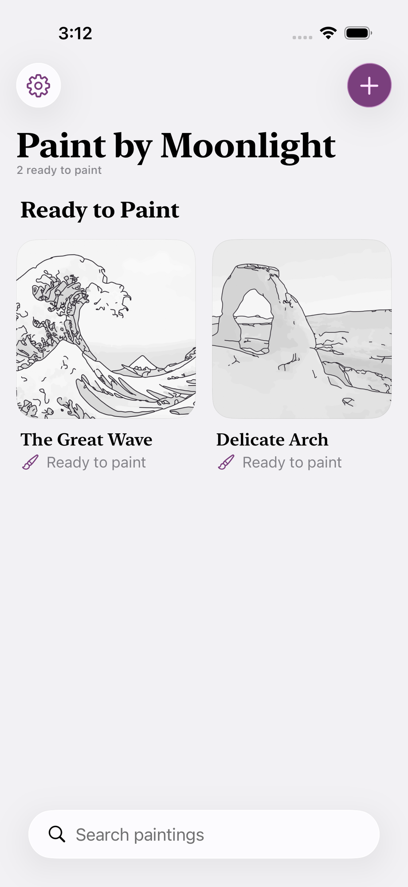
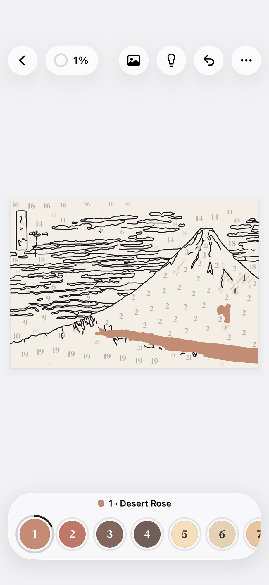
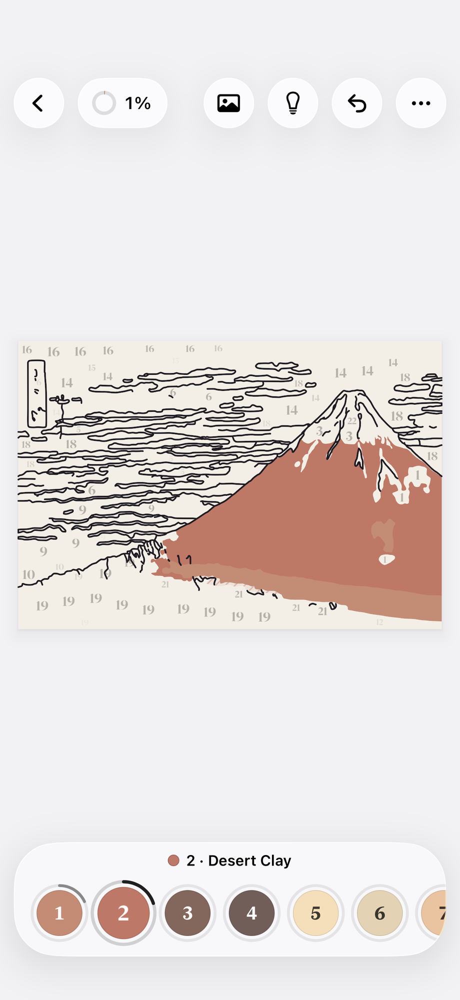

# Agent transcript

- end: success, 60 turns, 7.6 min, estimated $1.0943905999999999
- tool calls: {"mcp__maestro__take_screenshot": 10, "mcp__maestro__inspect_screen": 13, "mcp__maestro__run": 19, "mcp__maestro__read": 1, "Read": 8, "Write": 3}
- images the agent received: 15

**Start**: model claude-opus-5-5, MCP [{"name": "maestro", "status": "connected", "source": "dynamic"}]

→ `mcp__maestro__take_screenshot` `{"device_id": "E839A11B-51B4-4AD3-ACF4-A53B95B7C957"}`

→ `mcp__maestro__inspect_screen` `{"device_id": "E839A11B-51B4-4AD3-ACF4-A53B95B7C957"}`

← mcp__maestro__take_screenshot: image  919x2000

← mcp__maestro__inspect_screen: {"ui_schema":{"platform":"ios","abbreviations":{"b":"bounds","txt":"text","rid":"resource-id","a11y":"accessibilityText","hint":"hintText","val":"value","c":"children"},"defaults":{"enabled":true,"focused":false,"selected":false,"checked":false,"txt":"","hint":"","rid":"","val":"","a11y":""}},"elements":[{"b":"[0,0][402,874]","a11y":"Paint by Moonlight","c":[{"b":"[0,0][402,874]","c":[{"b":"[0,0][ …

> Goal 1: new painting from a sample.

→ `mcp__maestro__run` `{"device_id": "E839A11B-51B4-4AD3-ACF4-A53B95B7C957", "yaml": "appId: com.pbordjadze.paintbynumber\n---\n- tapOn: \"New Painting\"\n- takeScreenshot: /Users/runner/work/_temp/qa/shots/new-sheet"}`

← mcp__maestro__run: {"success":true,"device_id":"E839A11B-51B4-4AD3-ACF4-A53B95B7C957","commands_executed":3,"message":"Flow executed successfully","env_vars":{"MAESTRO_CLI_ANALYSIS_NOTIFICATION_DISABLED":"true","MAESTRO_CLI_NO_ANALYTICS":"1","MAESTRO_DRIVER_STARTUP_TIMEOUT":"240000","MAESTRO_VERSION":"2.11.0"}}

→ `mcp__maestro__inspect_screen` `{"device_id": "E839A11B-51B4-4AD3-ACF4-A53B95B7C957"}`

← mcp__maestro__inspect_screen: {"ui_schema":{"platform":"ios","abbreviations":{"b":"bounds","txt":"text","rid":"resource-id","a11y":"accessibilityText","hint":"hintText","val":"value","c":"children"},"defaults":{"enabled":true,"focused":false,"selected":false,"checked":false,"txt":"","hint":"","rid":"","val":"","a11y":""}},"elements":[{"b":"[0,0][402,874]","a11y":"Paint by Moonlight","c":[{"b":"[0,0][402,874]","c":[{"b":"[0,0][ …

> Nothing opened? Let me look.

→ `mcp__maestro__read` `{"file_path": "/Users/runner/work/_temp/qa/shots/new-sheet.png"}`

← mcp__maestro__read (error): <tool_use_error>Error: No such tool available: mcp__maestro__read</tool_use_error>

→ `Read` `{"file_path": "/Users/runner/work/_temp/qa/shots/new-sheet.png"}`

← Read: image  920x2000

→ `mcp__maestro__run` `{"device_id": "E839A11B-51B4-4AD3-ACF4-A53B95B7C957", "yaml": "appId: com.pbordjadze.paintbynumber\n---\n- tapOn:\n    point: \"364,84\"\n- waitForAnimationToEnd\n- takeScreenshot: /Users/runner/work/_temp/qa/shots/new-sheet2"}`

← mcp__maestro__run: {"success":true,"device_id":"E839A11B-51B4-4AD3-ACF4-A53B95B7C957","commands_executed":4,"message":"Flow executed successfully","env_vars":{"MAESTRO_CLI_ANALYSIS_NOTIFICATION_DISABLED":"true","MAESTRO_CLI_NO_ANALYTICS":"1","MAESTRO_DRIVER_STARTUP_TIMEOUT":"240000","MAESTRO_VERSION":"2.11.0"}}

→ `mcp__maestro__take_screenshot` `{"device_id": "E839A11B-51B4-4AD3-ACF4-A53B95B7C957"}`

← mcp__maestro__take_screenshot: image  919x2000

→ `mcp__maestro__run` `{"device_id": "E839A11B-51B4-4AD3-ACF4-A53B95B7C957", "yaml": "appId: com.pbordjadze.paintbynumber\n---\n- tapOn:\n    point: \"332,190\"\n- tapOn: \"Samples\"\n- waitForAnimationToEnd"}`

→ `mcp__maestro__inspect_screen` `{"device_id": "E839A11B-51B4-4AD3-ACF4-A53B95B7C957"}`

← mcp__maestro__run: {"success":true,"device_id":"E839A11B-51B4-4AD3-ACF4-A53B95B7C957","commands_executed":4,"message":"Flow executed successfully","env_vars":{"MAESTRO_CLI_ANALYSIS_NOTIFICATION_DISABLED":"true","MAESTRO_CLI_NO_ANALYTICS":"1","MAESTRO_DRIVER_STARTUP_TIMEOUT":"240000","MAESTRO_VERSION":"2.11.0"}}

← mcp__maestro__inspect_screen: {"ui_schema":{"platform":"ios","abbreviations":{"b":"bounds","txt":"text","rid":"resource-id","a11y":"accessibilityText","hint":"hintText","val":"value","c":"children"},"defaults":{"enabled":true,"focused":false,"selected":false,"checked":false,"txt":"","hint":"","rid":"","val":"","a11y":""}},"elements":[{"b":"[0,0][402,874]","a11y":"Paint by Moonlight","c":[{"b":"[0,0][402,874]","c":[{"b":"[0,0][ …

→ `mcp__maestro__run` `{"device_id": "E839A11B-51B4-4AD3-ACF4-A53B95B7C957", "yaml": "appId: com.pbordjadze.paintbynumber\n---\n- tapOn: \"Sample: Red Fuji, Katsushika Hokusai\"\n- waitForAnimationToEnd\n- takeScreenshot: /Users/runner/work/_temp/qa/shots/preview"}`

→ `mcp__maestro__inspect_screen` `{"device_id": "E839A11B-51B4-4AD3-ACF4-A53B95B7C957"}`

← mcp__maestro__run: {"success":true,"device_id":"E839A11B-51B4-4AD3-ACF4-A53B95B7C957","commands_executed":4,"message":"Flow executed successfully","env_vars":{"MAESTRO_CLI_ANALYSIS_NOTIFICATION_DISABLED":"true","MAESTRO_CLI_NO_ANALYTICS":"1","MAESTRO_DRIVER_STARTUP_TIMEOUT":"240000","MAESTRO_VERSION":"2.11.0"}}

← mcp__maestro__inspect_screen: {"ui_schema":{"platform":"ios","abbreviations":{"b":"bounds","txt":"text","rid":"resource-id","a11y":"accessibilityText","hint":"hintText","val":"value","c":"children"},"defaults":{"enabled":true,"focused":false,"selected":false,"checked":false,"txt":"","hint":"","rid":"","val":"","a11y":""}},"elements":[{"b":"[0,0][402,874]","a11y":"Paint by Moonlight","c":[{"b":"[0,0][402,874]","c":[{"b":"[0,0][ …

> Preview is open for Red Fuji (22 colors · 248 areas). Starting the painting now.

→ `mcp__maestro__run` `{"device_id": "E839A11B-51B4-4AD3-ACF4-A53B95B7C957", "yaml": "appId: com.pbordjadze.paintbynumber\n---\n- tapOn: \"Start Painting\"\n- extendedWaitUntil:\n    visible: \"Back\"\n    timeout: 90000\n- waitForAnimationToEnd\n- takeScreenshot: /Users/runner/work/_temp/qa/shots/painting-open"}`

← mcp__maestro__run: {"success":true,"device_id":"E839A11B-51B4-4AD3-ACF4-A53B95B7C957","commands_executed":5,"message":"Flow executed successfully","env_vars":{"MAESTRO_CLI_ANALYSIS_NOTIFICATION_DISABLED":"true","MAESTRO_CLI_NO_ANALYTICS":"1","MAESTRO_DRIVER_STARTUP_TIMEOUT":"240000","MAESTRO_VERSION":"2.11.0"}}

→ `mcp__maestro__take_screenshot` `{"device_id": "E839A11B-51B4-4AD3-ACF4-A53B95B7C957"}`

→ `mcp__maestro__inspect_screen` `{"device_id": "E839A11B-51B4-4AD3-ACF4-A53B95B7C957"}`

← mcp__maestro__take_screenshot: image  919x2000

← mcp__maestro__inspect_screen: {"ui_schema":{"platform":"ios","abbreviations":{"b":"bounds","txt":"text","rid":"resource-id","a11y":"accessibilityText","hint":"hintText","val":"value","c":"children"},"defaults":{"enabled":true,"focused":false,"selected":false,"checked":false,"txt":"","hint":"","rid":"","val":"","a11y":""}},"elements":[{"b":"[0,0][402,874]","a11y":"Paint by Moonlight","c":[{"b":"[0,0][402,874]","c":[{"b":"[0,0][ …

> Painting screen open at 0%. Filling two color-1 areas by their VoiceOver centres.

→ `mcp__maestro__run` `{"device_id": "E839A11B-51B4-4AD3-ACF4-A53B95B7C957", "yaml": "appId: com.pbordjadze.paintbynumber\n---\n- tapOn:\n    point: \"336,464\"\n- tapOn:\n    point: \"339,526\"\n- waitForAnimationToEnd\n- takeScreenshot: /Users/runner/work/_temp/qa/shots/fill-1"}`

→ `mcp__maestro__inspect_screen` `{"device_id": "E839A11B-51B4-4AD3-ACF4-A53B95B7C957"}`

← mcp__maestro__run: {"success":true,"device_id":"E839A11B-51B4-4AD3-ACF4-A53B95B7C957","commands_executed":5,"message":"Flow executed successfully","env_vars":{"MAESTRO_CLI_ANALYSIS_NOTIFICATION_DISABLED":"true","MAESTRO_CLI_NO_ANALYTICS":"1","MAESTRO_DRIVER_STARTUP_TIMEOUT":"240000","MAESTRO_VERSION":"2.11.0"}}

← mcp__maestro__inspect_screen: {"ui_schema":{"platform":"ios","abbreviations":{"b":"bounds","txt":"text","rid":"resource-id","a11y":"accessibilityText","hint":"hintText","val":"value","c":"children"},"defaults":{"enabled":true,"focused":false,"selected":false,"checked":false,"txt":"","hint":"","rid":"","val":"","a11y":""}},"elements":[{"b":"[0,0][402,874]","a11y":"Paint by Moonlight","c":[{"b":"[0,0][402,874]","c":[{"b":"[0,0][ …

→ `Read` `{"file_path": "/Users/runner/work/_temp/qa/shots/fill-1.png"}`

← Read: image  920x2000

> Two fills landed correctly in Desert Rose; progress 0% → 1%, swatch 1 ring 18% (2 of 11). Writing an early report.

→ `Write` `{"file_path": "/Users/runner/work/_temp/qa/report.md", "content": "# Paint by Moonlight \u2014 exploratory test report (in progress)\n\n## Summary\nMade a new painting from the Red Fuji sample (22 colors, 248 areas) and painted two color\u20111 areas at the fitted zoom; both filled correctly and progress moved 0% \u2192 1%. No crashes so far.\n\n## Coverage\n1. New painting: done (Samples \u203a Red Fuji \u203a Start Painting).\n2. Paint: partly (2 fills at fitted zoom).\n3\u20136: in progress.\n\n## App bugs (reproduced)\nNone yet.\n\n## Suspicions\n- First tap on the gallery's + (\"New Paint`

← Write: File created successfully at: /Users/runner/work/_temp/qa/report.md (file state is current in your context — no need to Read it back)

→ `mcp__maestro__run` `{"device_id": "E839A11B-51B4-4AD3-ACF4-A53B95B7C957", "yaml": "appId: com.pbordjadze.paintbynumber\n---\n- doubleTapOn:\n    point: \"300,440\"\n- waitForAnimationToEnd\n- takeScreenshot: /Users/runner/work/_temp/qa/shots/zoom-dbl"}`

← mcp__maestro__run: {"success":true,"device_id":"E839A11B-51B4-4AD3-ACF4-A53B95B7C957","commands_executed":4,"message":"Flow executed successfully","env_vars":{"MAESTRO_CLI_ANALYSIS_NOTIFICATION_DISABLED":"true","MAESTRO_CLI_NO_ANALYTICS":"1","MAESTRO_DRIVER_STARTUP_TIMEOUT":"240000","MAESTRO_VERSION":"2.11.0"}}

→ `mcp__maestro__take_screenshot` `{"device_id": "E839A11B-51B4-4AD3-ACF4-A53B95B7C957"}`

← mcp__maestro__take_screenshot: image  919x2000

> Double-tap didn't zoom (known Maestro limitation). Switching to color 2 and using Hint to zoom.

→ `mcp__maestro__run` `{"device_id": "E839A11B-51B4-4AD3-ACF4-A53B95B7C957", "yaml": "appId: com.pbordjadze.paintbynumber\n---\n- tapOn:\n    id: \"swatch-2\"\n    index: 0\n- tapOn: \"Hint\"\n- waitForAnimationToEnd\n- takeScreenshot: /Users/runner/work/_temp/qa/shots/hint-zoom"}`

→ `mcp__maestro__inspect_screen` `{"device_id": "E839A11B-51B4-4AD3-ACF4-A53B95B7C957"}`

← mcp__maestro__run: {"success":true,"device_id":"E839A11B-51B4-4AD3-ACF4-A53B95B7C957","commands_executed":5,"message":"Flow executed successfully","env_vars":{"MAESTRO_CLI_ANALYSIS_NOTIFICATION_DISABLED":"true","MAESTRO_CLI_NO_ANALYTICS":"1","MAESTRO_DRIVER_STARTUP_TIMEOUT":"240000","MAESTRO_VERSION":"2.11.0"}}

← mcp__maestro__inspect_screen: {"ui_schema":{"platform":"ios","abbreviations":{"b":"bounds","txt":"text","rid":"resource-id","a11y":"accessibilityText","hint":"hintText","val":"value","c":"children"},"defaults":{"enabled":true,"focused":false,"selected":false,"checked":false,"txt":"","hint":"","rid":"","val":"","a11y":""}},"elements":[{"b":"[0,0][402,874]","a11y":"Paint by Moonlight","c":[{"b":"[0,0][402,874]","c":[{"b":"[0,0][ …

→ `Read` `{"file_path": "/Users/runner/work/_temp/qa/shots/hint-zoom.png"}`

← Read: image  920x2000

> Hint didn't visibly move the view (the color‑2 area is already in view at fitted zoom — might be expected). Painting the big color‑2 area, then checking the log.

→ `mcp__maestro__run` `{"device_id": "E839A11B-51B4-4AD3-ACF4-A53B95B7C957", "yaml": "appId: com.pbordjadze.paintbynumber\n---\n- tapOn:\n    point: \"276,458\"\n- waitForAnimationToEnd\n- takeScreenshot: /Users/runner/work/_temp/qa/shots/fill-2"}`

→ `Read` `{"file_path": "/Users/runner/work/_temp/qa/app.log"}`

← mcp__maestro__run: {"success":true,"device_id":"E839A11B-51B4-4AD3-ACF4-A53B95B7C957","commands_executed":4,"message":"Flow executed successfully","env_vars":{"MAESTRO_CLI_ANALYSIS_NOTIFICATION_DISABLED":"true","MAESTRO_CLI_NO_ANALYTICS":"1","MAESTRO_DRIVER_STARTUP_TIMEOUT":"240000","MAESTRO_VERSION":"2.11.0"}}

← Read: 1	getpwuid_r did not find a match for uid 501
2	Filtering the log data using "subsystem == "com.pbordjadze.paintbynumber""
3	Timestamp               Ty Process[PID:TID]
4	2026-10-28 03:07:41.908 Df PaintByNumber[28362:13bde] [com.pbordjadze.paintbynumber:tips] offer in shelf: , wanted
5	2026-10-28 03:07:43.300 Df PaintByNumber[28362:13c5c] [com.pbordjadze.paintbynumber:canvas] Making the render co …

→ `Read` `{"file_path": "/Users/runner/work/_temp/qa/shots/fill-2.png"}`

← Read: image  920x2000

> Big Fuji area filled in Desert Clay; 3 of 248 areas → 1% (consistent). Trying Hint again to zoom to a small remaining color‑2 area.

→ `mcp__maestro__run` `{"device_id": "E839A11B-51B4-4AD3-ACF4-A53B95B7C957", "yaml": "appId: com.pbordjadze.paintbynumber\n---\n- tapOn: \"Hint\"\n- waitForAnimationToEnd\n- takeScreenshot: /Users/runner/work/_temp/qa/shots/hint2"}`

→ `mcp__maestro__inspect_screen` `{"device_id": "E839A11B-51B4-4AD3-ACF4-A53B95B7C957"}`

← mcp__maestro__run: {"success":true,"device_id":"E839A11B-51B4-4AD3-ACF4-A53B95B7C957","commands_executed":4,"message":"Flow executed successfully","env_vars":{"MAESTRO_CLI_ANALYSIS_NOTIFICATION_DISABLED":"true","MAESTRO_CLI_NO_ANALYTICS":"1","MAESTRO_DRIVER_STARTUP_TIMEOUT":"240000","MAESTRO_VERSION":"2.11.0"}}

← mcp__maestro__inspect_screen: {"ui_schema":{"platform":"ios","abbreviations":{"b":"bounds","txt":"text","rid":"resource-id","a11y":"accessibilityText","hint":"hintText","val":"value","c":"children"},"defaults":{"enabled":true,"focused":false,"selected":false,"checked":false,"txt":"","hint":"","rid":"","val":"","a11y":""}},"elements":[{"b":"[0,0][402,874]","a11y":"Paint by Moonlight","c":[{"b":"[0,0][402,874]","c":[{"b":"[0,0][ …

→ `Read` `{"file_path": "/Users/runner/work/_temp/qa/shots/hint2.png"}`

← Read: image  920x2000

> Hint zoomed in to the remaining color‑2 strip. Painting area 241 while zoomed.

→ `mcp__maestro__run` `{"device_id": "E839A11B-51B4-4AD3-ACF4-A53B95B7C957", "yaml": "appId: com.pbordjadze.paintbynumber\n---\n- tapOn:\n    point: \"200,572\"\n- waitForAnimationToEnd\n- takeScreenshot: /Users/runner/work/_temp/qa/shots/fill-zoomed"}`

→ `mcp__maestro__inspect_screen` `{"device_id": "E839A11B-51B4-4AD3-ACF4-A53B95B7C957"}`

← mcp__maestro__run: {"success":true,"device_id":"E839A11B-51B4-4AD3-ACF4-A53B95B7C957","commands_executed":4,"message":"Flow executed successfully","env_vars":{"MAESTRO_CLI_ANALYSIS_NOTIFICATION_DISABLED":"true","MAESTRO_CLI_NO_ANALYTICS":"1","MAESTRO_DRIVER_STARTUP_TIMEOUT":"240000","MAESTRO_VERSION":"2.11.0"}}

← mcp__maestro__inspect_screen: {"ui_schema":{"platform":"ios","abbreviations":{"b":"bounds","txt":"text","rid":"resource-id","a11y":"accessibilityText","hint":"hintText","val":"value","c":"children"},"defaults":{"enabled":true,"focused":false,"selected":false,"checked":false,"txt":"","hint":"","rid":"","val":"","a11y":""}},"elements":[{"b":"[0,0][402,874]","a11y":"Paint by Moonlight","c":[{"b":"[0,0][402,874]","c":[{"b":"[0,0][ …

> Zoomed fill worked (swatch 2 → 40%). Now More › Fit to Screen.

→ `mcp__maestro__run` `{"device_id": "E839A11B-51B4-4AD3-ACF4-A53B95B7C957", "yaml": "appId: com.pbordjadze.paintbynumber\n---\n- tapOn: \"More\"\n- tapOn: \"Fit to Screen\"\n- waitForAnimationToEnd\n- takeScreenshot: /Users/runner/work/_temp/qa/shots/fit"}`

← mcp__maestro__run: {"success":true,"device_id":"E839A11B-51B4-4AD3-ACF4-A53B95B7C957","commands_executed":5,"message":"Flow executed successfully","env_vars":{"MAESTRO_CLI_ANALYSIS_NOTIFICATION_DISABLED":"true","MAESTRO_CLI_NO_ANALYTICS":"1","MAESTRO_DRIVER_STARTUP_TIMEOUT":"240000","MAESTRO_VERSION":"2.11.0"}}

→ `mcp__maestro__take_screenshot` `{"device_id": "E839A11B-51B4-4AD3-ACF4-A53B95B7C957"}`

← mcp__maestro__take_screenshot: image  919x2000

> Fit to Screen works; fills intact. Now Back to the gallery and reopen.

→ `mcp__maestro__run` `{"device_id": "E839A11B-51B4-4AD3-ACF4-A53B95B7C957", "yaml": "appId: com.pbordjadze.paintbynumber\n---\n- tapOn: \"Back\"\n- waitForAnimationToEnd\n- takeScreenshot: /Users/runner/work/_temp/qa/shots/gallery-after-back"}`

→ `mcp__maestro__inspect_screen` `{"device_id": "E839A11B-51B4-4AD3-ACF4-A53B95B7C957"}`

← mcp__maestro__run: {"success":true,"device_id":"E839A11B-51B4-4AD3-ACF4-A53B95B7C957","commands_executed":4,"message":"Flow executed successfully","env_vars":{"MAESTRO_CLI_ANALYSIS_NOTIFICATION_DISABLED":"true","MAESTRO_CLI_NO_ANALYTICS":"1","MAESTRO_DRIVER_STARTUP_TIMEOUT":"240000","MAESTRO_VERSION":"2.11.0"}}

← mcp__maestro__inspect_screen: {"ui_schema":{"platform":"ios","abbreviations":{"b":"bounds","txt":"text","rid":"resource-id","a11y":"accessibilityText","hint":"hintText","val":"value","c":"children"},"defaults":{"enabled":true,"focused":false,"selected":false,"checked":false,"txt":"","hint":"","rid":"","val":"","a11y":""}},"elements":[{"b":"[0,0][402,874]","a11y":"Paint by Moonlight","c":[{"b":"[0,0][402,874]","c":[{"b":"[0,0][ …

> Back by label didn't leave the painting — still on the canvas. That's the second time a label tap on a top‑bar button did nothing. Checking the screenshot and log.

→ `mcp__maestro__take_screenshot` `{"device_id": "E839A11B-51B4-4AD3-ACF4-A53B95B7C957"}`

← mcp__maestro__take_screenshot: image  919x2000

→ `Read` `{"file_path": "/Users/runner/work/_temp/qa/app.log", "offset": 30}`

← Read: 30	2026-10-28 03:14:50.557 Df PaintByNumber[28362:13bde] [com.pbordjadze.paintbynumber:tips] offer in bench: benchZoom, wanted
31	2026-10-28 03:14:51.153 Df PaintByNumber[28362:13bde] [com.pbordjadze.paintbynumber:tips] offer in bench: benchZoom, wanted
32	2026-10-28 03:16:11.782 Df PaintByNumber[28362:13bde] [com.pbordjadze.paintbynumber:canvas] Waited 0.315917083 seconds for a drawable
33	2026-1 …

> Retrying Back by point.

→ `mcp__maestro__run` `{"device_id": "E839A11B-51B4-4AD3-ACF4-A53B95B7C957", "yaml": "appId: com.pbordjadze.paintbynumber\n---\n- tapOn:\n    point: \"34,90\"\n- waitForAnimationToEnd\n- takeScreenshot: /Users/runner/work/_temp/qa/shots/gallery-after-back2"}`

→ `mcp__maestro__take_screenshot` `{"device_id": "E839A11B-51B4-4AD3-ACF4-A53B95B7C957"}`

← mcp__maestro__run: {"success":true,"device_id":"E839A11B-51B4-4AD3-ACF4-A53B95B7C957","commands_executed":4,"message":"Flow executed successfully","env_vars":{"MAESTRO_CLI_ANALYSIS_NOTIFICATION_DISABLED":"true","MAESTRO_CLI_NO_ANALYTICS":"1","MAESTRO_DRIVER_STARTUP_TIMEOUT":"240000","MAESTRO_VERSION":"2.11.0"}}

← mcp__maestro__take_screenshot: image  919x2000

> Gallery shows Red Fuji "1% painted" with the fills in its thumbnail. Reopening it, then testing Back once more by label to see whether the first tap is dropped again.

→ `mcp__maestro__run` `{"device_id": "E839A11B-51B4-4AD3-ACF4-A53B95B7C957", "yaml": "appId: com.pbordjadze.paintbynumber\n---\n- tapOn: \"Red Fuji\"\n- extendedWaitUntil:\n    visible: \"Back\"\n    timeout: 20000\n- waitForAnimationToEnd\n- takeScreenshot: /Users/runner/work/_temp/qa/shots/reopen"}`

→ `mcp__maestro__inspect_screen` `{"device_id": "E839A11B-51B4-4AD3-ACF4-A53B95B7C957"}`

← mcp__maestro__run: {"success":true,"device_id":"E839A11B-51B4-4AD3-ACF4-A53B95B7C957","commands_executed":5,"message":"Flow executed successfully","env_vars":{"MAESTRO_CLI_ANALYSIS_NOTIFICATION_DISABLED":"true","MAESTRO_CLI_NO_ANALYTICS":"1","MAESTRO_DRIVER_STARTUP_TIMEOUT":"240000","MAESTRO_VERSION":"2.11.0"}}

← mcp__maestro__inspect_screen: {"ui_schema":{"platform":"ios","abbreviations":{"b":"bounds","txt":"text","rid":"resource-id","a11y":"accessibilityText","hint":"hintText","val":"value","c":"children"},"defaults":{"enabled":true,"focused":false,"selected":false,"checked":false,"txt":"","hint":"","rid":"","val":"","a11y":""}},"elements":[{"b":"[0,0][402,874]","a11y":"Paint by Moonlight","c":[{"b":"[0,0][402,874]","c":[{"b":"[0,0][ …

> Reopen kept everything (1%, swatch 1 at 18%, swatch 2 at 40%, same areas missing from the list). Now quit through Home and relaunch.

→ `mcp__maestro__run` `{"device_id": "E839A11B-51B4-4AD3-ACF4-A53B95B7C957", "yaml": "appId: com.pbordjadze.paintbynumber\n---\n- pressKey: Home"}`

→ `mcp__maestro__take_screenshot` `{"device_id": "E839A11B-51B4-4AD3-ACF4-A53B95B7C957"}`

← mcp__maestro__run: {"success":true,"device_id":"E839A11B-51B4-4AD3-ACF4-A53B95B7C957","commands_executed":2,"message":"Flow executed successfully","env_vars":{"MAESTRO_CLI_ANALYSIS_NOTIFICATION_DISABLED":"true","MAESTRO_CLI_NO_ANALYTICS":"1","MAESTRO_DRIVER_STARTUP_TIMEOUT":"240000","MAESTRO_VERSION":"2.11.0"}}

← mcp__maestro__take_screenshot: image  919x2000

→ `mcp__maestro__run` `{"device_id": "E839A11B-51B4-4AD3-ACF4-A53B95B7C957", "yaml": "appId: com.pbordjadze.paintbynumber\n---\n- stopApp\n- launchApp\n- extendedWaitUntil:\n    visible: \"Back\"\n    timeout: 30000\n- waitForAnimationToEnd\n- takeScreenshot: /Users/runner/work/_temp/qa/shots/relaunch"}`

→ `mcp__maestro__inspect_screen` `{"device_id": "E839A11B-51B4-4AD3-ACF4-A53B95B7C957"}`

← mcp__maestro__run: {"success":true,"device_id":"E839A11B-51B4-4AD3-ACF4-A53B95B7C957","commands_executed":6,"message":"Flow executed successfully","env_vars":{"MAESTRO_CLI_ANALYSIS_NOTIFICATION_DISABLED":"true","MAESTRO_CLI_NO_ANALYTICS":"1","MAESTRO_DRIVER_STARTUP_TIMEOUT":"240000","MAESTRO_VERSION":"2.11.0"}}

← mcp__maestro__inspect_screen: {"ui_schema":{"platform":"ios","abbreviations":{"b":"bounds","txt":"text","rid":"resource-id","a11y":"accessibilityText","hint":"hintText","val":"value","c":"children"},"defaults":{"enabled":true,"focused":false,"selected":false,"checked":false,"txt":"","hint":"","rid":"","val":"","a11y":""}},"elements":[{"b":"[0,0][402,874]","a11y":"Paint by Moonlight","c":[{"b":"[0,0][402,874]","c":[{"b":"[0,0][ …

> Relaunch reopened Red Fuji with progress intact. Now testing Back by label once more (third look at the dropped‑first‑tap pattern).

→ `mcp__maestro__run` `{"device_id": "E839A11B-51B4-4AD3-ACF4-A53B95B7C957", "yaml": "appId: com.pbordjadze.paintbynumber\n---\n- tapOn: \"Back\"\n- waitForAnimationToEnd\n- takeScreenshot: /Users/runner/work/_temp/qa/shots/back-after-relaunch"}`

→ `mcp__maestro__take_screenshot` `{"device_id": "E839A11B-51B4-4AD3-ACF4-A53B95B7C957"}`

← mcp__maestro__run: {"success":true,"device_id":"E839A11B-51B4-4AD3-ACF4-A53B95B7C957","commands_executed":4,"message":"Flow executed successfully","env_vars":{"MAESTRO_CLI_ANALYSIS_NOTIFICATION_DISABLED":"true","MAESTRO_CLI_NO_ANALYTICS":"1","MAESTRO_DRIVER_STARTUP_TIMEOUT":"240000","MAESTRO_VERSION":"2.11.0"}}

← mcp__maestro__take_screenshot: image  919x2000

> Back worked on the first tap this time, so the dropped taps are intermittent (2 of 4 top‑bar taps by label). Updating the report.

→ `Write` `{"file_path": "/Users/runner/work/_temp/qa/report.md", "content": "# Paint by Moonlight \u2014 exploratory test report\n\n## Summary\nMade a new painting from the Red Fuji sample (22 colors, 248 areas), painted four areas in two colors at the fitted zoom and zoomed in through Hint, then left to the gallery and quit/relaunched; every fill and every progress figure survived. Core flows worked. The only odd thing: twice, a single tap on a round top\u2011bar button (gallery +, painting Back) did nothing and a second identical tap worked.\n\n## Coverage\n1. New painting: **done**: + \u203a Samples `

← Write: The file /Users/runner/work/_temp/qa/report.md has been updated successfully. (file state is current in your context — no need to Read it back)

→ `mcp__maestro__run` `{"device_id": "E839A11B-51B4-4AD3-ACF4-A53B95B7C957", "yaml": "appId: com.pbordjadze.paintbynumber\n---\n- tapOn: \"Red Fuji\"\n- extendedWaitUntil:\n    visible: \"Back\"\n    timeout: 20000\n- waitForAnimationToEnd\n- tapOn: \"Undo\"\n- waitForAnimationToEnd\n- takeScreenshot: /Users/runner/work/_temp/qa/shots/undo1"}`

← mcp__maestro__run: {"success":true,"device_id":"E839A11B-51B4-4AD3-ACF4-A53B95B7C957","commands_executed":7,"message":"Flow executed successfully","env_vars":{"MAESTRO_CLI_ANALYSIS_NOTIFICATION_DISABLED":"true","MAESTRO_CLI_NO_ANALYTICS":"1","MAESTRO_DRIVER_STARTUP_TIMEOUT":"240000","MAESTRO_VERSION":"2.11.0"}}

→ `mcp__maestro__inspect_screen` `{"device_id": "E839A11B-51B4-4AD3-ACF4-A53B95B7C957"}`

→ `mcp__maestro__take_screenshot` `{"device_id": "E839A11B-51B4-4AD3-ACF4-A53B95B7C957"}`

← mcp__maestro__inspect_screen: {"ui_schema":{"platform":"ios","abbreviations":{"b":"bounds","txt":"text","rid":"resource-id","a11y":"accessibilityText","hint":"hintText","val":"value","c":"children"},"defaults":{"enabled":true,"focused":false,"selected":false,"checked":false,"txt":"","hint":"","rid":"","val":"","a11y":""}},"elements":[{"b":"[0,0][402,874]","a11y":"Paint by Moonlight","c":[{"b":"[0,0][402,874]","c":[{"b":"[0,0][ …

← mcp__maestro__take_screenshot: image  919x2000

> Undo after the relaunch took back the last fill (area 241; swatch 2 went 40% → 20%), so the undo history survives a quit. Checking for crashes, then finishing the report.

→ `Read` `{"file_path": "/Users/runner/work/_temp/qa/crashes.txt"}`

← Read: <system-reminder>Warning: the file exists but the contents are empty.</system-reminder>

→ `Write` `{"file_path": "/Users/runner/work/_temp/qa/report.md", "content": "# Paint by Moonlight \u2014 exploratory test report\n\n## Summary\nMade a new painting from the Red Fuji sample (22 colors, 248 areas), painted four areas in two colors at the fitted zoom and zoomed in through Hint, then left to the gallery and quit/relaunched; every fill and every progress figure survived. Undo also works after a relaunch. No crashes (crashes.txt is empty). The only odd thing: twice, a single tap on a round top\u2011bar button (gallery +, painting Back) did nothing and a second identical tap worked.\n\n## Cove`

← Write: The file /Users/runner/work/_temp/qa/report.md has been updated successfully. (file state is current in your context — no need to Read it back)

> I found no reproduced app bugs. The core flows all worked: making a new painting, painting, zooming, leaving and reopening, and quitting and relaunching. No crashes (`crashes.txt` is empty). The report is at `/Users/runner/work/_temp/qa/report.md`.
> 
> **What I covered:**
> - **New painting:** made one from the Red Fuji sample (22 colors, 248 areas). It opened at 0%.
> - **Painting:** filled 4 areas in two colors, 3 at the fitted zoom and 1 after Hint zoomed in. Each filled in its swatch's color. Progress went 0% → 1%, and the swatch rings showed 18% (2 of 11 areas) and 40% (2 of 5).
> - **Zoom:** the double tap didn't zoom, as in earlier sessions. Hint zoomed in, and More › Fit to Screen brought back the whole picture with every fill in place.
> - **Back and reopen:** the gallery showed "Red Fuji · 1% painted" with the fills in its thumbnail. Reopening showed the same areas painted and the same percentages.
> - **Quit and relaunch:** I left through Home, then stopped and relaunched the app. It reopened the painting with everything kept.
> - **Undo:** after the relaunch it took back the last fill, so the undo history survives quitting.
> 
> **Suspicions (each needs another look):**
> - **Dropped first tap:** twice, one tap on a round top-bar button did nothing: the gallery's + and the painting's Back. A second tap at the same spot worked both times. That's 2 of 4 such taps; Hint, More and Undo worked first time. I can't tell whether the app or Maestro drops the tap, so it's worth checking on a real device.
> - **Unseen tip:** the log says a tip (`benchTap`) was shown at 03:13:37, but no popover appeared in my screenshots or in `inspect_screen` while it was supposedly up.
> - **Hint did nothing visible:** the first Hint at the fitted zoom left the view unchanged. This is probably by design, since that color's area was already in view.
> 
> **Not tested:** drag painting, pinch and two-finger pan (Maestro can't do them), Settings, the gallery's menus, search, choosing a photo, Give Feedback, finishing a color, and what happens after a crash.
