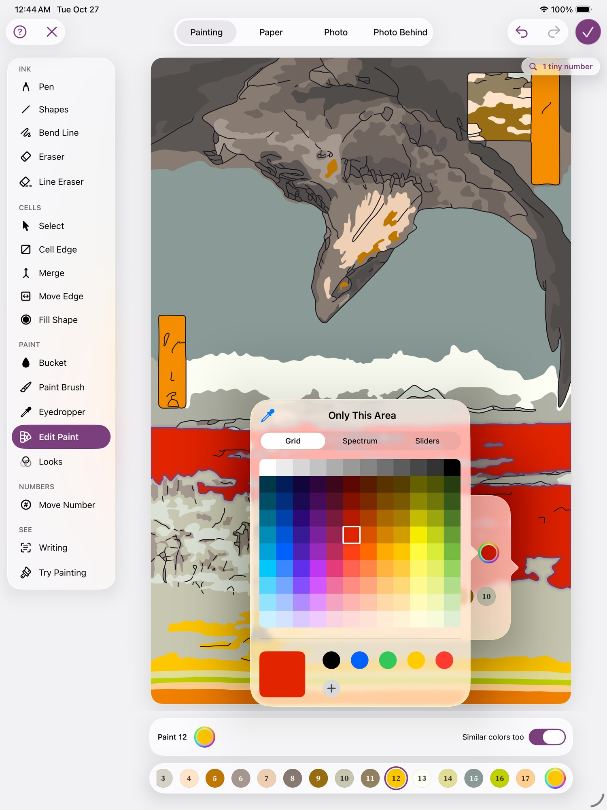
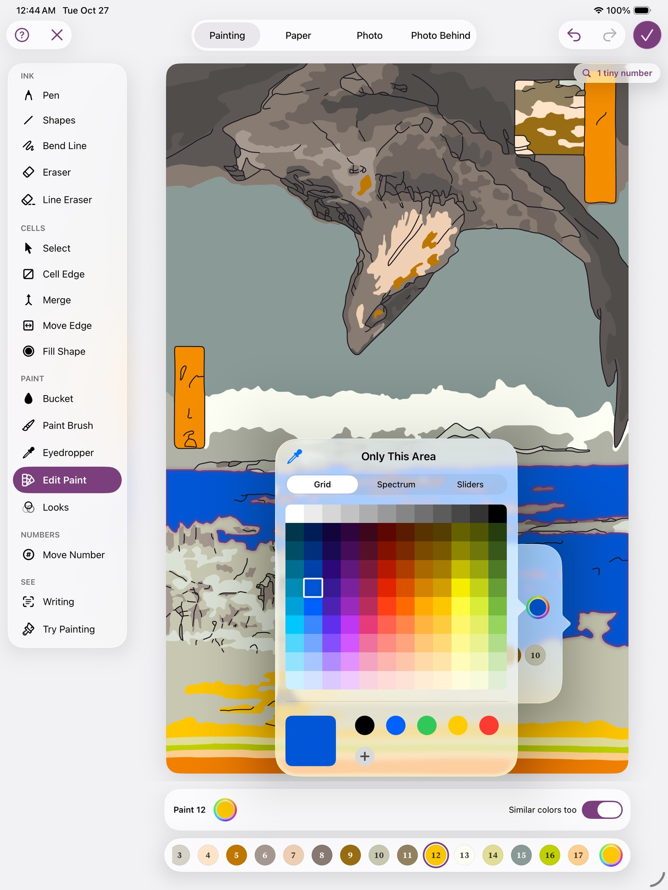
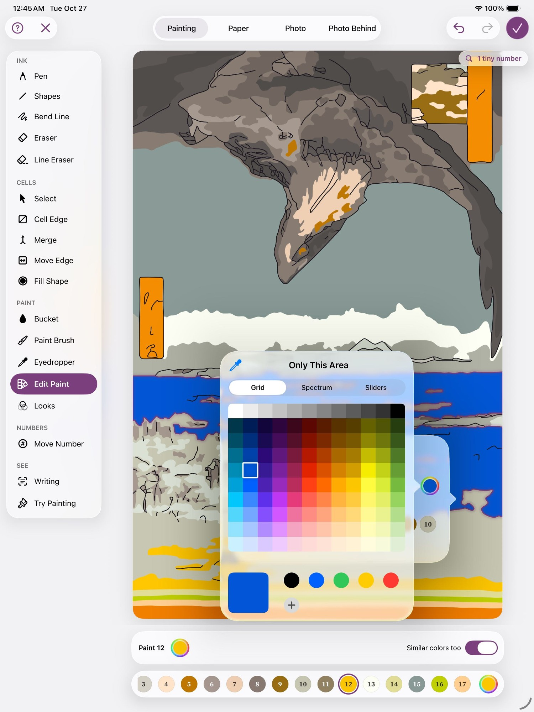
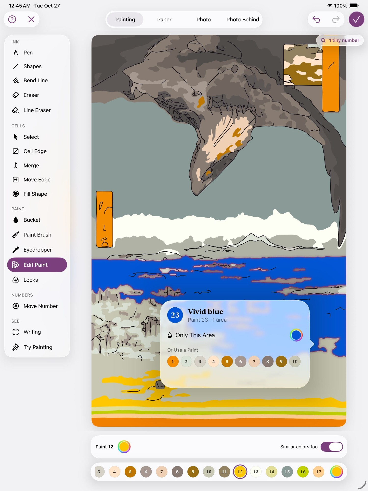
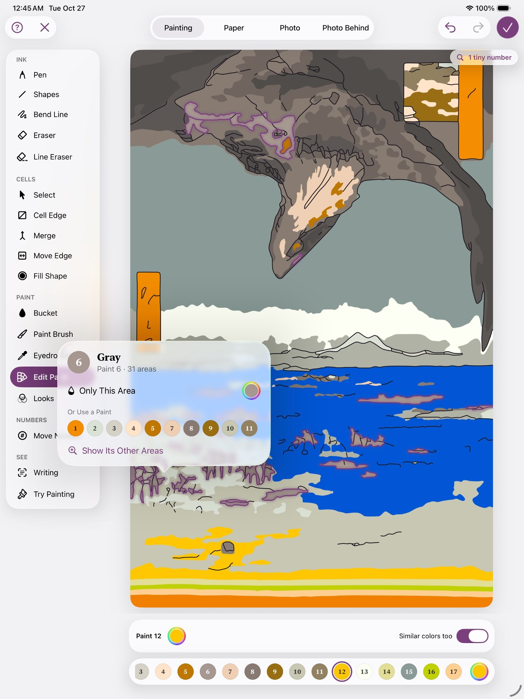
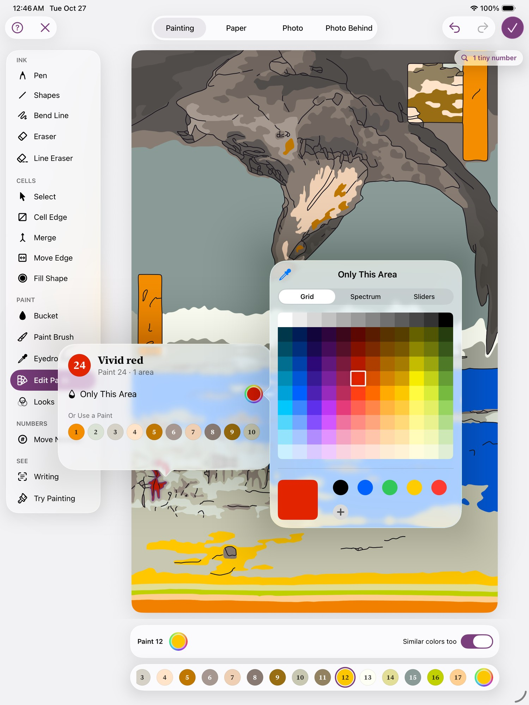
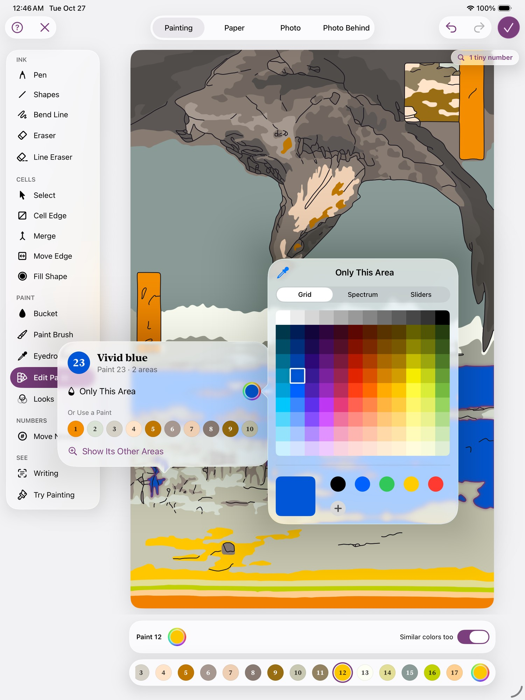
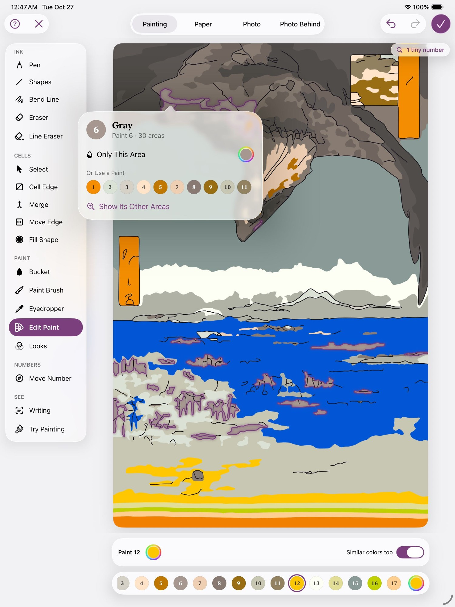
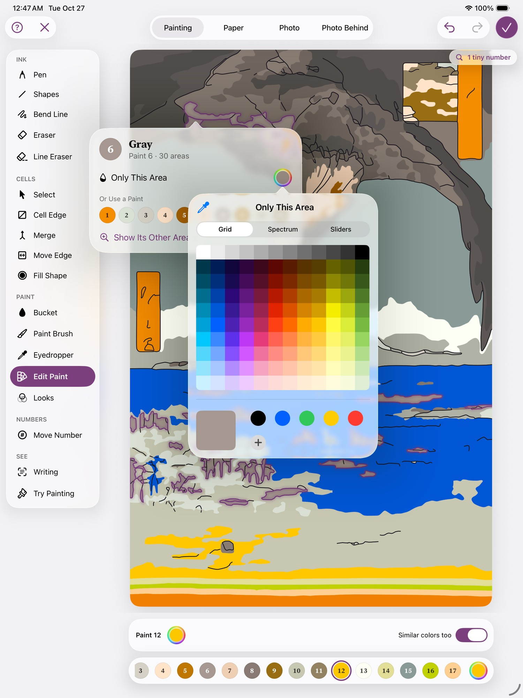
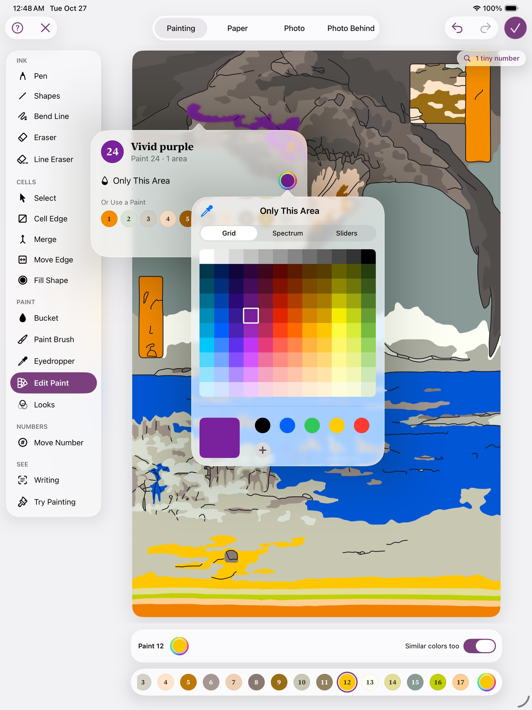

# Agent transcript

- end: success, 123 turns, 16.4 min, estimated $3.4945678
- tool calls: {"mcp__maestro__take_screenshot": 23, "Read": 24, "mcp__maestro__run": 35, "mcp__maestro__inspect_screen": 17, "Write": 3}
- images the agent received: 43

**Start**: model claude-opus-5-5, MCP [{"name": "maestro", "status": "connected", "source": "dynamic"}]

→ `mcp__maestro__take_screenshot` `{"device_id": "687AB7EE-DF9A-4A96-878E-7509AB01A80C"}`

→ `Read` `{"file_path": "/Users/runner/.claude/projects/-Users-runner-work--temp-qa/memory/MEMORY.md"}`

← mcp__maestro__take_screenshot: image  1500x2000

← Read (error): File does not exist. Note: your current working directory is /Users/runner/work/_temp/qa.

→ `mcp__maestro__run` `{"device_id": "687AB7EE-DF9A-4A96-878E-7509AB01A80C", "yaml": "appId: com.pbordjadze.paintbynumber\n---\n- tapOn:\n    point: \"1075,78\"\n- waitForAnimationToEnd"}`

→ `mcp__maestro__inspect_screen` `{"device_id": "687AB7EE-DF9A-4A96-878E-7509AB01A80C"}`

← mcp__maestro__run: {"success":true,"device_id":"687AB7EE-DF9A-4A96-878E-7509AB01A80C","commands_executed":3,"message":"Flow executed successfully","env_vars":{"MAESTRO_CLI_ANALYSIS_NOTIFICATION_DISABLED":"true","MAESTRO_CLI_NO_ANALYTICS":"1","MAESTRO_DRIVER_STARTUP_TIMEOUT":"240000","MAESTRO_VERSION":"2.11.0"}}

← mcp__maestro__inspect_screen: {"ui_schema":{"platform":"ios","abbreviations":{"b":"bounds","txt":"text","rid":"resource-id","a11y":"accessibilityText","hint":"hintText","val":"value","c":"children"},"defaults":{"enabled":true,"focused":false,"selected":false,"checked":false,"txt":"","hint":"","rid":"","val":"","a11y":""}},"elements":[{"b":"[0,0][1032,1376]","a11y":"Paint by Moonlight","c":[{"b":"[0,0][1032,1376]","c":[{"b":"[0 …

→ `mcp__maestro__run` `{"device_id": "687AB7EE-DF9A-4A96-878E-7509AB01A80C", "yaml": "appId: com.pbordjadze.paintbynumber\n---\n- tapOn: \"New Painting\"\n- waitForAnimationToEnd"}`

→ `mcp__maestro__take_screenshot` `{"device_id": "687AB7EE-DF9A-4A96-878E-7509AB01A80C"}`

← mcp__maestro__run: {"success":true,"device_id":"687AB7EE-DF9A-4A96-878E-7509AB01A80C","commands_executed":3,"message":"Flow executed successfully","env_vars":{"MAESTRO_CLI_ANALYSIS_NOTIFICATION_DISABLED":"true","MAESTRO_CLI_NO_ANALYTICS":"1","MAESTRO_DRIVER_STARTUP_TIMEOUT":"240000","MAESTRO_VERSION":"2.11.0"}}

← mcp__maestro__take_screenshot: image  1500x2000

> Jūmantsubo card at ~(1313,1660) px → points (903,1142).

→ `mcp__maestro__run` `{"device_id": "687AB7EE-DF9A-4A96-878E-7509AB01A80C", "yaml": "appId: com.pbordjadze.paintbynumber\n---\n- tapOn:\n    point: \"903,1142\"\n- waitForAnimationToEnd"}`

→ `mcp__maestro__take_screenshot` `{"device_id": "687AB7EE-DF9A-4A96-878E-7509AB01A80C"}`

← mcp__maestro__run: {"success":true,"device_id":"687AB7EE-DF9A-4A96-878E-7509AB01A80C","commands_executed":3,"message":"Flow executed successfully","env_vars":{"MAESTRO_CLI_ANALYSIS_NOTIFICATION_DISABLED":"true","MAESTRO_CLI_NO_ANALYTICS":"1","MAESTRO_DRIVER_STARTUP_TIMEOUT":"240000","MAESTRO_VERSION":"2.11.0"}}

← mcp__maestro__take_screenshot: image  1500x2000

> Close the tip, then Refine.

→ `mcp__maestro__run` `{"device_id": "687AB7EE-DF9A-4A96-878E-7509AB01A80C", "yaml": "appId: com.pbordjadze.paintbynumber\n---\n- tapOn:\n    point: \"456,783\"\n- tapOn: \"Refine\"\n- waitForAnimationToEnd"}`

→ `mcp__maestro__take_screenshot` `{"device_id": "687AB7EE-DF9A-4A96-878E-7509AB01A80C"}`

→ `mcp__maestro__inspect_screen` `{"device_id": "687AB7EE-DF9A-4A96-878E-7509AB01A80C"}`

← mcp__maestro__run: {"success":true,"device_id":"687AB7EE-DF9A-4A96-878E-7509AB01A80C","commands_executed":4,"message":"Flow executed successfully","env_vars":{"MAESTRO_CLI_ANALYSIS_NOTIFICATION_DISABLED":"true","MAESTRO_CLI_NO_ANALYTICS":"1","MAESTRO_DRIVER_STARTUP_TIMEOUT":"240000","MAESTRO_VERSION":"2.11.0"}}

← mcp__maestro__take_screenshot: image  1500x2000

← mcp__maestro__inspect_screen: {"ui_schema":{"platform":"ios","abbreviations":{"b":"bounds","txt":"text","rid":"resource-id","a11y":"accessibilityText","hint":"hintText","val":"value","c":"children"},"defaults":{"enabled":true,"focused":false,"selected":false,"checked":false,"txt":"","hint":"","rid":"","val":"","a11y":""}},"elements":[{"b":"[0,0][1032,1376]","a11y":"Paint by Moonlight","c":[{"b":"[0,0][1032,1376]","c":[{"b":"[0 …

→ `mcp__maestro__run` `{"device_id": "687AB7EE-DF9A-4A96-878E-7509AB01A80C", "yaml": "appId: com.pbordjadze.paintbynumber\n---\n- tapOn: \"Close\"\n- tapOn: \"Edit Paint\"\n- waitForAnimationToEnd"}`

→ `mcp__maestro__take_screenshot` `{"device_id": "687AB7EE-DF9A-4A96-878E-7509AB01A80C"}`

→ `mcp__maestro__inspect_screen` `{"device_id": "687AB7EE-DF9A-4A96-878E-7509AB01A80C"}`

← mcp__maestro__run: {"success":true,"device_id":"687AB7EE-DF9A-4A96-878E-7509AB01A80C","commands_executed":4,"message":"Flow executed successfully","env_vars":{"MAESTRO_CLI_ANALYSIS_NOTIFICATION_DISABLED":"true","MAESTRO_CLI_NO_ANALYTICS":"1","MAESTRO_DRIVER_STARTUP_TIMEOUT":"240000","MAESTRO_VERSION":"2.11.0"}}

← mcp__maestro__take_screenshot: image  1500x2000

← mcp__maestro__inspect_screen: {"ui_schema":{"platform":"ios","abbreviations":{"b":"bounds","txt":"text","rid":"resource-id","a11y":"accessibilityText","hint":"hintText","val":"value","c":"children"},"defaults":{"enabled":true,"focused":false,"selected":false,"checked":false,"txt":"","hint":"","rid":"","val":"","a11y":""}},"elements":[{"b":"[0,0][1032,1376]","a11y":"Paint by Moonlight","c":[{"b":"[0,0][1032,1376]","c":[{"b":"[0 …

→ `mcp__maestro__run` `{"device_id": "687AB7EE-DF9A-4A96-878E-7509AB01A80C", "yaml": "appId: com.pbordjadze.paintbynumber\n---\n- tapOn:\n    id: \"refine-colors-family\"\n- tapOn:\n    point: \"630,1322\"\n- tapOn:\n    id: \"refine-colors-picker\"\n- waitForAnimationToEnd\n- takeScreenshot: /Users/runner/work/_temp/qa/shots/ep1-picker-open"}`

→ `mcp__maestro__inspect_screen` `{"device_id": "687AB7EE-DF9A-4A96-878E-7509AB01A80C"}`

← mcp__maestro__run: {"success":true,"device_id":"687AB7EE-DF9A-4A96-878E-7509AB01A80C","commands_executed":6,"message":"Flow executed successfully","env_vars":{"MAESTRO_CLI_ANALYSIS_NOTIFICATION_DISABLED":"true","MAESTRO_CLI_NO_ANALYTICS":"1","MAESTRO_DRIVER_STARTUP_TIMEOUT":"240000","MAESTRO_VERSION":"2.11.0"}}

← mcp__maestro__inspect_screen: {"ui_schema":{"platform":"ios","abbreviations":{"b":"bounds","txt":"text","rid":"resource-id","a11y":"accessibilityText","hint":"hintText","val":"value","c":"children"},"defaults":{"enabled":true,"focused":false,"selected":false,"checked":false,"txt":"","hint":"","rid":"","val":"","a11y":""}},"elements":[{"b":"[0,0][1032,1376]","a11y":"Paint by Moonlight","c":[{"b":"[0,0][1032,1376]","c":[{"b":"[0 …

→ `mcp__maestro__take_screenshot` `{"device_id": "687AB7EE-DF9A-4A96-878E-7509AB01A80C"}`

← mcp__maestro__take_screenshot: image  1500x2000

→ `mcp__maestro__run` `{"device_id": "687AB7EE-DF9A-4A96-878E-7509AB01A80C", "yaml": "appId: com.pbordjadze.paintbynumber\n---\n- tapOn:\n    point: \"930,1252\"\n- waitForAnimationToEnd"}`

→ `mcp__maestro__take_screenshot` `{"device_id": "687AB7EE-DF9A-4A96-878E-7509AB01A80C"}`

← mcp__maestro__run: {"success":true,"device_id":"687AB7EE-DF9A-4A96-878E-7509AB01A80C","commands_executed":3,"message":"Flow executed successfully","env_vars":{"MAESTRO_CLI_ANALYSIS_NOTIFICATION_DISABLED":"true","MAESTRO_CLI_NO_ANALYTICS":"1","MAESTRO_DRIVER_STARTUP_TIMEOUT":"240000","MAESTRO_VERSION":"2.11.0"}}

← mcp__maestro__take_screenshot: image  1500x2000

→ `Read` `{"file_path": "/Users/runner/work/_temp/qa/app.log"}`

← Read: 1	getpwuid_r did not find a match for uid 501
2	Filtering the log data using "subsystem == "com.pbordjadze.paintbynumber""
3	Timestamp               Ty Process[PID:TID]
4	2026-10-27 00:28:48.395 Df PaintByNumber[21070:fb5d] [com.pbordjadze.paintbynumber:tips] offer in shelf: , wanted
5	2026-10-27 00:28:50.113 Df PaintByNumber[21070:fbf4] [com.pbordjadze.paintbynumber:canvas] Making the render cont …

> Progress so far: I'm in Refine › Edit Paint on Jūmantsubo with Paint 9 selected. Two taps on "Similar colors too" haven't turned it off, so I'm looking into that.

→ `mcp__maestro__run` `{"device_id": "687AB7EE-DF9A-4A96-878E-7509AB01A80C", "yaml": "appId: com.pbordjadze.paintbynumber\n---\n- tapOn:\n    point: \"950,1252\"\n- takeScreenshot: /Users/runner/work/_temp/qa/shots/toggle-try3"}`

→ `mcp__maestro__inspect_screen` `{"device_id": "687AB7EE-DF9A-4A96-878E-7509AB01A80C"}`

← mcp__maestro__run: {"success":true,"device_id":"687AB7EE-DF9A-4A96-878E-7509AB01A80C","commands_executed":3,"message":"Flow executed successfully","env_vars":{"MAESTRO_CLI_ANALYSIS_NOTIFICATION_DISABLED":"true","MAESTRO_CLI_NO_ANALYTICS":"1","MAESTRO_DRIVER_STARTUP_TIMEOUT":"240000","MAESTRO_VERSION":"2.11.0"}}

← mcp__maestro__inspect_screen: {"ui_schema":{"platform":"ios","abbreviations":{"b":"bounds","txt":"text","rid":"resource-id","a11y":"accessibilityText","hint":"hintText","val":"value","c":"children"},"defaults":{"enabled":true,"focused":false,"selected":false,"checked":false,"txt":"","hint":"","rid":"","val":"","a11y":""}},"elements":[{"b":"[0,0][1032,1376]","a11y":"Paint by Moonlight","c":[{"b":"[0,0][1032,1376]","c":[{"b":"[0 …

→ `mcp__maestro__run` `{"device_id": "687AB7EE-DF9A-4A96-878E-7509AB01A80C", "yaml": "appId: com.pbordjadze.paintbynumber\n---\n- tapOn:\n    point: \"342,1252\"\n- waitForAnimationToEnd\n- takeScreenshot: /Users/runner/work/_temp/qa/shots/ep1-picker-open"}`

→ `mcp__maestro__inspect_screen` `{"device_id": "687AB7EE-DF9A-4A96-878E-7509AB01A80C"}`

← mcp__maestro__run: {"success":true,"device_id":"687AB7EE-DF9A-4A96-878E-7509AB01A80C","commands_executed":4,"message":"Flow executed successfully","env_vars":{"MAESTRO_CLI_ANALYSIS_NOTIFICATION_DISABLED":"true","MAESTRO_CLI_NO_ANALYTICS":"1","MAESTRO_DRIVER_STARTUP_TIMEOUT":"240000","MAESTRO_VERSION":"2.11.0"}}

← mcp__maestro__inspect_screen: {"ui_schema":{"platform":"ios","abbreviations":{"b":"bounds","txt":"text","rid":"resource-id","a11y":"accessibilityText","hint":"hintText","val":"value","c":"children"},"defaults":{"enabled":true,"focused":false,"selected":false,"checked":false,"txt":"","hint":"","rid":"","val":"","a11y":""}},"elements":[{"b":"[0,0][1032,1376]","a11y":"Paint by Moonlight","c":[{"b":"[0,0][1032,1376]","c":[{"b":"[0 …

→ `mcp__maestro__take_screenshot` `{"device_id": "687AB7EE-DF9A-4A96-878E-7509AB01A80C"}`

← mcp__maestro__take_screenshot: image  1500x2000

→ `mcp__maestro__run` `{"device_id": "687AB7EE-DF9A-4A96-878E-7509AB01A80C", "yaml": "appId: com.pbordjadze.paintbynumber\n---\n- tapOn:\n    point: \"399,929\"\n- takeScreenshot: /Users/runner/work/_temp/qa/shots/ep1-pick1-orange\n- tapOn:\n    point: \"215,929\"\n- takeScreenshot: /Users/runner/work/_temp/qa/shots/ep1-pick2-blue\n- tapOn:\n    point: \"442,929\"\n- takeScreenshot: /Users/runner/work/_temp/qa/shots/ep1-pick3-yellow"}`

→ `mcp__maestro__take_screenshot` `{"device_id": "687AB7EE-DF9A-4A96-878E-7509AB01A80C"}`

← mcp__maestro__run: {"success":true,"device_id":"687AB7EE-DF9A-4A96-878E-7509AB01A80C","commands_executed":7,"message":"Flow executed successfully","env_vars":{"MAESTRO_CLI_ANALYSIS_NOTIFICATION_DISABLED":"true","MAESTRO_CLI_NO_ANALYTICS":"1","MAESTRO_DRIVER_STARTUP_TIMEOUT":"240000","MAESTRO_VERSION":"2.11.0"}}

← mcp__maestro__take_screenshot: image  1500x2000

> Final state good: Paint 9 is yellow. Let me check the intermediate shots.

→ `Read` `{"file_path": "/Users/runner/work/_temp/qa/shots/ep1-pick1-orange.png"}`

→ `Read` `{"file_path": "/Users/runner/work/_temp/qa/shots/ep1-pick2-blue.png"}`

← Read: image  1500x2000

← Read: image  1500x2000

> Edit Paint run 1 (Similar colors OFF, Paint 9) passed: orange, then blue, then yellow each recolored Paint 9, and the bar kept saying Paint 9. Next I'll close the picker and do run 2 on Paint 13.

→ `mcp__maestro__run` `{"device_id": "687AB7EE-DF9A-4A96-878E-7509AB01A80C", "yaml": "appId: com.pbordjadze.paintbynumber\n---\n- tapOn:\n    point: \"900,1250\"\n- takeScreenshot: /Users/runner/work/_temp/qa/shots/ep1-closed\n- tapOn:\n    point: \"803,1322\"\n- tapOn:\n    point: \"342,1252\"\n- takeScreenshot: /Users/runner/work/_temp/qa/shots/ep2-open\n- tapOn:\n    point: \"343,929\"\n- takeScreenshot: /Users/runner/work/_temp/qa/shots/ep2-pick1-red\n- tapOn:\n    point: \"243,929\"\n- takeScreenshot: /Users/runner/work/_temp/qa/shots/ep2-pick2-purple\n- tapOn:\n    point: \"500,929\"\n- takeScreenshot: /Users/`

→ `mcp__maestro__take_screenshot` `{"device_id": "687AB7EE-DF9A-4A96-878E-7509AB01A80C"}`

← mcp__maestro__run: {"success":true,"device_id":"687AB7EE-DF9A-4A96-878E-7509AB01A80C","commands_executed":12,"message":"Flow executed successfully","env_vars":{"MAESTRO_CLI_ANALYSIS_NOTIFICATION_DISABLED":"true","MAESTRO_CLI_NO_ANALYTICS":"1","MAESTRO_DRIVER_STARTUP_TIMEOUT":"240000","MAESTRO_VERSION":"2.11.0"}}

← mcp__maestro__take_screenshot: image  1500x2000

→ `Read` `{"file_path": "/Users/runner/work/_temp/qa/shots/ep1-closed.png"}`

→ `Read` `{"file_path": "/Users/runner/work/_temp/qa/shots/ep2-pick2-purple.png"}`

← Read: image  1500x2000

← Read: image  1500x2000

→ `mcp__maestro__run` `{"device_id": "687AB7EE-DF9A-4A96-878E-7509AB01A80C", "yaml": "appId: com.pbordjadze.paintbynumber\n---\n- tapOn:\n    id: \"PopoverDismissRegion\"\n- takeScreenshot: /Users/runner/work/_temp/qa/shots/ep-dismiss-try"}`

→ `mcp__maestro__take_screenshot` `{"device_id": "687AB7EE-DF9A-4A96-878E-7509AB01A80C"}`

← mcp__maestro__run: {"success":true,"device_id":"687AB7EE-DF9A-4A96-878E-7509AB01A80C","commands_executed":3,"message":"Flow executed successfully","env_vars":{"MAESTRO_CLI_ANALYSIS_NOTIFICATION_DISABLED":"true","MAESTRO_CLI_NO_ANALYTICS":"1","MAESTRO_DRIVER_STARTUP_TIMEOUT":"240000","MAESTRO_VERSION":"2.11.0"}}

← mcp__maestro__take_screenshot: image  1500x2000

→ `Write` `{"file_path": "/Users/runner/work/_temp/qa/report.md", "content": "# Paint by Moonlight: Refine recheck (debug build), 2026-10-27\n\n## Summary\n(In progress.) I opened Refine on the sample J\u016bmantsubo Plain at Fukagawa Susaki. In Edit Paint with Similar colors too OFF, 6 picks in a row on Paint 9 (3 + 3, with the picker open throughout) each recolored Paint 9, and the bar kept saying \"Paint 9\".\n\n## Coverage\n- Edit Paint, Similar colors too OFF: done once so far (Paint 9, 6 picks).\n- Edit Paint, Similar colors too ON: not yet.\n- Area card, Only This Area picker: not yet.\n\n## App b`

← Write: File created successfully at: /Users/runner/work/_temp/qa/report.md (file state is current in your context — no need to Read it back)

→ `mcp__maestro__run` `{"device_id": "687AB7EE-DF9A-4A96-878E-7509AB01A80C", "yaml": "appId: com.pbordjadze.paintbynumber\n---\n- tapOn:\n    point: \"805,1322\"\n- takeScreenshot: /Users/runner/work/_temp/qa/shots/ep2-selected"}`

→ `mcp__maestro__inspect_screen` `{"device_id": "687AB7EE-DF9A-4A96-878E-7509AB01A80C"}`

← mcp__maestro__run: {"success":true,"device_id":"687AB7EE-DF9A-4A96-878E-7509AB01A80C","commands_executed":3,"message":"Flow executed successfully","env_vars":{"MAESTRO_CLI_ANALYSIS_NOTIFICATION_DISABLED":"true","MAESTRO_CLI_NO_ANALYTICS":"1","MAESTRO_DRIVER_STARTUP_TIMEOUT":"240000","MAESTRO_VERSION":"2.11.0"}}

← mcp__maestro__inspect_screen: {"ui_schema":{"platform":"ios","abbreviations":{"b":"bounds","txt":"text","rid":"resource-id","a11y":"accessibilityText","hint":"hintText","val":"value","c":"children"},"defaults":{"enabled":true,"focused":false,"selected":false,"checked":false,"txt":"","hint":"","rid":"","val":"","a11y":""}},"elements":[{"b":"[0,0][1032,1376]","a11y":"Paint by Moonlight","c":[{"b":"[0,0][1032,1376]","c":[{"b":"[0 …

→ `mcp__maestro__run` `{"device_id": "687AB7EE-DF9A-4A96-878E-7509AB01A80C", "yaml": "appId: com.pbordjadze.paintbynumber\n---\n- tapOn:\n    point: \"348,1252\"\n- takeScreenshot: /Users/runner/work/_temp/qa/shots/ep2-open\n- tapOn:\n    point: \"272,929\"\n- takeScreenshot: /Users/runner/work/_temp/qa/shots/ep2-pick1-purple\n- tapOn:\n    point: \"358,929\"\n- takeScreenshot: /Users/runner/work/_temp/qa/shots/ep2-pick2-orange\n- tapOn:\n    point: \"186,985\"\n- takeScreenshot: /Users/runner/work/_temp/qa/shots/ep2-pick3-cyan\n- tapOn:\n    id: \"PopoverDismissRegion\"\n- takeScreenshot: /Users/runner/work/_temp/q`

→ `mcp__maestro__take_screenshot` `{"device_id": "687AB7EE-DF9A-4A96-878E-7509AB01A80C"}`

← mcp__maestro__run: {"success":true,"device_id":"687AB7EE-DF9A-4A96-878E-7509AB01A80C","commands_executed":11,"message":"Flow executed successfully","env_vars":{"MAESTRO_CLI_ANALYSIS_NOTIFICATION_DISABLED":"true","MAESTRO_CLI_NO_ANALYTICS":"1","MAESTRO_DRIVER_STARTUP_TIMEOUT":"240000","MAESTRO_VERSION":"2.11.0"}}

← mcp__maestro__take_screenshot: image  1500x2000

> Paint 13 ended cyan. Checking the intermediate picks.

→ `Read` `{"file_path": "/Users/runner/work/_temp/qa/shots/ep2-pick1-purple.png"}`

→ `Read` `{"file_path": "/Users/runner/work/_temp/qa/shots/ep2-pick2-orange.png"}`

← Read: image  1500x2000

← Read: image  1500x2000

> Run 2 (Paint 13, OFF) passed: purple, then orange, then cyan, all applied. Next is run 3 on Paint 5.

→ `mcp__maestro__run` `{"device_id": "687AB7EE-DF9A-4A96-878E-7509AB01A80C", "yaml": "appId: com.pbordjadze.paintbynumber\n---\n- tapOn:\n    point: \"452,1322\"\n- tapOn:\n    id: \"refine-colors-picker\"\n- takeScreenshot: /Users/runner/work/_temp/qa/shots/ep3-open\n- tapOn:\n    point: \"300,985\"\n- takeScreenshot: /Users/runner/work/_temp/qa/shots/ep3-pick1\n- tapOn:\n    point: \"420,985\"\n- takeScreenshot: /Users/runner/work/_temp/qa/shots/ep3-pick2\n- tapOn:\n    point: \"215,872\"\n- takeScreenshot: /Users/runner/work/_temp/qa/shots/ep3-pick3\n- tapOn:\n    id: \"PopoverDismissRegion\"\n- takeScreenshot: /`

→ `mcp__maestro__take_screenshot` `{"device_id": "687AB7EE-DF9A-4A96-878E-7509AB01A80C"}`

← mcp__maestro__run: {"success":true,"device_id":"687AB7EE-DF9A-4A96-878E-7509AB01A80C","commands_executed":12,"message":"Flow executed successfully","env_vars":{"MAESTRO_CLI_ANALYSIS_NOTIFICATION_DISABLED":"true","MAESTRO_CLI_NO_ANALYTICS":"1","MAESTRO_DRIVER_STARTUP_TIMEOUT":"240000","MAESTRO_VERSION":"2.11.0"}}

← mcp__maestro__take_screenshot: image  1500x2000

→ `Read` `{"file_path": "/Users/runner/work/_temp/qa/shots/ep3-pick1.png"}`

→ `Read` `{"file_path": "/Users/runner/work/_temp/qa/shots/ep3-pick2.png"}`

← Read: image  1500x2000

← Read: image  1500x2000

> Run 3 (Paint 5, OFF) passed: pink, then yellow, then dark blue. With the switch OFF, all 3 runs worked. Next I'll turn Similar colors too ON and repeat.

→ `mcp__maestro__run` `{"device_id": "687AB7EE-DF9A-4A96-878E-7509AB01A80C", "yaml": "appId: com.pbordjadze.paintbynumber\n---\n- tapOn:\n    point: \"950,1252\"\n- tapOn:\n    point: \"364,1322\"\n- takeScreenshot: /Users/runner/work/_temp/qa/shots/on1-selected"}`

→ `mcp__maestro__inspect_screen` `{"device_id": "687AB7EE-DF9A-4A96-878E-7509AB01A80C"}`

← mcp__maestro__run: {"success":true,"device_id":"687AB7EE-DF9A-4A96-878E-7509AB01A80C","commands_executed":4,"message":"Flow executed successfully","env_vars":{"MAESTRO_CLI_ANALYSIS_NOTIFICATION_DISABLED":"true","MAESTRO_CLI_NO_ANALYTICS":"1","MAESTRO_DRIVER_STARTUP_TIMEOUT":"240000","MAESTRO_VERSION":"2.11.0"}}

← mcp__maestro__inspect_screen: {"ui_schema":{"platform":"ios","abbreviations":{"b":"bounds","txt":"text","rid":"resource-id","a11y":"accessibilityText","hint":"hintText","val":"value","c":"children"},"defaults":{"enabled":true,"focused":false,"selected":false,"checked":false,"txt":"","hint":"","rid":"","val":"","a11y":""}},"elements":[{"b":"[0,0][1032,1376]","a11y":"Paint by Moonlight","c":[{"b":"[0,0][1032,1376]","c":[{"b":"[0 …

→ `mcp__maestro__run` `{"device_id": "687AB7EE-DF9A-4A96-878E-7509AB01A80C", "yaml": "appId: com.pbordjadze.paintbynumber\n---\n- tapOn:\n    id: \"refine-colors-picker\"\n- takeScreenshot: /Users/runner/work/_temp/qa/shots/on1-open\n- tapOn:\n    point: \"330,929\"\n- takeScreenshot: /Users/runner/work/_temp/qa/shots/on1-pick1-red\n- tapOn:\n    point: \"186,901\"\n- takeScreenshot: /Users/runner/work/_temp/qa/shots/on1-pick2-teal\n- tapOn:\n    point: \"272,985\"\n- takeScreenshot: /Users/runner/work/_temp/qa/shots/on1-pick3-purple\n- tapOn:\n    id: \"PopoverDismissRegion\"\n- takeScreenshot: /Users/runner/work/_`

→ `mcp__maestro__take_screenshot` `{"device_id": "687AB7EE-DF9A-4A96-878E-7509AB01A80C"}`

← mcp__maestro__run: {"success":true,"device_id":"687AB7EE-DF9A-4A96-878E-7509AB01A80C","commands_executed":11,"message":"Flow executed successfully","env_vars":{"MAESTRO_CLI_ANALYSIS_NOTIFICATION_DISABLED":"true","MAESTRO_CLI_NO_ANALYTICS":"1","MAESTRO_DRIVER_STARTUP_TIMEOUT":"240000","MAESTRO_VERSION":"2.11.0"}}

← mcp__maestro__take_screenshot: image  1500x2000

→ `Read` `{"file_path": "/Users/runner/work/_temp/qa/shots/on1-pick1-red.png"}`

→ `Read` `{"file_path": "/Users/runner/work/_temp/qa/shots/on1-pick2-teal.png"}`

← Read: image  1500x2000

← Read: image  1500x2000

→ `mcp__maestro__run` `{"device_id": "687AB7EE-DF9A-4A96-878E-7509AB01A80C", "yaml": "appId: com.pbordjadze.paintbynumber\n---\n- tapOn:\n    id: \"refine-undo\"\n- tapOn:\n    id: \"refine-undo\"\n- tapOn:\n    id: \"refine-undo\"\n- takeScreenshot: /Users/runner/work/_temp/qa/shots/on1-undone3"}`

→ `mcp__maestro__take_screenshot` `{"device_id": "687AB7EE-DF9A-4A96-878E-7509AB01A80C"}`

← mcp__maestro__run: {"success":true,"device_id":"687AB7EE-DF9A-4A96-878E-7509AB01A80C","commands_executed":5,"message":"Flow executed successfully","env_vars":{"MAESTRO_CLI_ANALYSIS_NOTIFICATION_DISABLED":"true","MAESTRO_CLI_NO_ANALYTICS":"1","MAESTRO_DRIVER_STARTUP_TIMEOUT":"240000","MAESTRO_VERSION":"2.11.0"}}

← mcp__maestro__take_screenshot: image  1500x2000

> Undo ×3 brought the colors back, but the selection jumped from Paint 3 to Paint 17 and the palette scrolled to it. Next I'll do the ON run 2 on Paint 17.

→ `mcp__maestro__run` `{"device_id": "687AB7EE-DF9A-4A96-878E-7509AB01A80C", "yaml": "appId: com.pbordjadze.paintbynumber\n---\n- tapOn:\n    id: \"refine-colors-picker\"\n- takeScreenshot: /Users/runner/work/_temp/qa/shots/on2-open\n- tapOn:\n    point: \"420,929\"\n- takeScreenshot: /Users/runner/work/_temp/qa/shots/on2-pick1\n- tapOn:\n    point: \"305,985\"\n- takeScreenshot: /Users/runner/work/_temp/qa/shots/on2-pick2\n- tapOn:\n    point: \"500,957\"\n- takeScreenshot: /Users/runner/work/_temp/qa/shots/on2-pick3\n- tapOn:\n    id: \"PopoverDismissRegion\"\n- takeScreenshot: /Users/runner/work/_temp/qa/shots/on`

→ `mcp__maestro__take_screenshot` `{"device_id": "687AB7EE-DF9A-4A96-878E-7509AB01A80C"}`

← mcp__maestro__run: {"success":true,"device_id":"687AB7EE-DF9A-4A96-878E-7509AB01A80C","commands_executed":11,"message":"Flow executed successfully","env_vars":{"MAESTRO_CLI_ANALYSIS_NOTIFICATION_DISABLED":"true","MAESTRO_CLI_NO_ANALYTICS":"1","MAESTRO_DRIVER_STARTUP_TIMEOUT":"240000","MAESTRO_VERSION":"2.11.0"}}

← mcp__maestro__take_screenshot: image  1500x2000

→ `Read` `{"file_path": "/Users/runner/work/_temp/qa/shots/on2-pick1.png"}`

→ `Read` `{"file_path": "/Users/runner/work/_temp/qa/shots/on2-pick2.png"}`

← Read: image  1500x2000

← Read: image  1500x2000

> ON run 2 (Paint 17) passed too: 3 picks applied, and the bar stayed on "Paint 17". Next is ON run 3 on Paint 12.

→ `mcp__maestro__run` `{"device_id": "687AB7EE-DF9A-4A96-878E-7509AB01A80C", "yaml": "appId: com.pbordjadze.paintbynumber\n---\n- tapOn:\n    point: \"662,1322\"\n- takeScreenshot: /Users/runner/work/_temp/qa/shots/on3-selected"}`

→ `mcp__maestro__take_screenshot` `{"device_id": "687AB7EE-DF9A-4A96-878E-7509AB01A80C"}`

← mcp__maestro__run: {"success":true,"device_id":"687AB7EE-DF9A-4A96-878E-7509AB01A80C","commands_executed":3,"message":"Flow executed successfully","env_vars":{"MAESTRO_CLI_ANALYSIS_NOTIFICATION_DISABLED":"true","MAESTRO_CLI_NO_ANALYTICS":"1","MAESTRO_DRIVER_STARTUP_TIMEOUT":"240000","MAESTRO_VERSION":"2.11.0"}}

← mcp__maestro__take_screenshot: image  1500x2000

→ `mcp__maestro__run` `{"device_id": "687AB7EE-DF9A-4A96-878E-7509AB01A80C", "yaml": "appId: com.pbordjadze.paintbynumber\n---\n- tapOn:\n    id: \"refine-colors-picker\"\n- takeScreenshot: /Users/runner/work/_temp/qa/shots/on3-open\n- tapOn:\n    point: \"335,929\"\n- takeScreenshot: /Users/runner/work/_temp/qa/shots/on3-pick1\n- tapOn:\n    point: \"250,957\"\n- takeScreenshot: /Users/runner/work/_temp/qa/shots/on3-pick2\n- tapOn:\n    point: \"420,957\"\n- takeScreenshot: /Users/runner/work/_temp/qa/shots/on3-pick3\n- tapOn:\n    id: \"PopoverDismissRegion\"\n- takeScreenshot: /Users/runner/work/_temp/qa/shots/on`

→ `mcp__maestro__take_screenshot` `{"device_id": "687AB7EE-DF9A-4A96-878E-7509AB01A80C"}`

← mcp__maestro__run: {"success":true,"device_id":"687AB7EE-DF9A-4A96-878E-7509AB01A80C","commands_executed":11,"message":"Flow executed successfully","env_vars":{"MAESTRO_CLI_ANALYSIS_NOTIFICATION_DISABLED":"true","MAESTRO_CLI_NO_ANALYTICS":"1","MAESTRO_DRIVER_STARTUP_TIMEOUT":"240000","MAESTRO_VERSION":"2.11.0"}}

← mcp__maestro__take_screenshot: image  1500x2000

→ `Read` `{"file_path": "/Users/runner/work/_temp/qa/shots/on3-pick2.png"}`

← Read: image  1500x2000

> Edit Paint is 6 of 6 runs fine (3 OFF, 3 ON). I'll update the report, then move on to the area card.

→ `Write` `{"file_path": "/Users/runner/work/_temp/qa/report.md", "content": "# Paint by Moonlight: Refine recheck (debug build), 2026-10-27\n\n## Summary\n(In progress.) I opened Refine on the sample J\u016bmantsubo Plain at Fukagawa Susaki and rechecked Edit Paint's color well: 6 runs of 3 picks each (3 with Similar colors too OFF, 3 with it ON). Every pick recolored the selected paint, each run ended in its 3rd color, and the bar kept naming the paint I had picked. The area card check is next.\n\n## Coverage\n- (1) Edit Paint, Similar colors too OFF: **done, 3 of 3 OK** (Paint 9: 6 picks, since the pi`

← Write: The file /Users/runner/work/_temp/qa/report.md has been updated successfully. (file state is current in your context — no need to Read it back)

→ `mcp__maestro__run` `{"device_id": "687AB7EE-DF9A-4A96-878E-7509AB01A80C", "yaml": "appId: com.pbordjadze.paintbynumber\n---\n- longPressOn:\n    point: \"894,964\"\n- takeScreenshot: /Users/runner/work/_temp/qa/shots/card1-open"}`

→ `mcp__maestro__take_screenshot` `{"device_id": "687AB7EE-DF9A-4A96-878E-7509AB01A80C"}`

← mcp__maestro__run: {"success":true,"device_id":"687AB7EE-DF9A-4A96-878E-7509AB01A80C","commands_executed":3,"message":"Flow executed successfully","env_vars":{"MAESTRO_CLI_ANALYSIS_NOTIFICATION_DISABLED":"true","MAESTRO_CLI_NO_ANALYTICS":"1","MAESTRO_DRIVER_STARTUP_TIMEOUT":"240000","MAESTRO_VERSION":"2.11.0"}}

← mcp__maestro__take_screenshot: image  1500x2000

→ `mcp__maestro__run` `{"device_id": "687AB7EE-DF9A-4A96-878E-7509AB01A80C", "yaml": "appId: com.pbordjadze.paintbynumber\n---\n- tapOn:\n    point: \"830,939\"\n- takeScreenshot: /Users/runner/work/_temp/qa/shots/card1-picker-open"}`

→ `mcp__maestro__inspect_screen` `{"device_id": "687AB7EE-DF9A-4A96-878E-7509AB01A80C"}`

← mcp__maestro__run: {"success":true,"device_id":"687AB7EE-DF9A-4A96-878E-7509AB01A80C","commands_executed":3,"message":"Flow executed successfully","env_vars":{"MAESTRO_CLI_ANALYSIS_NOTIFICATION_DISABLED":"true","MAESTRO_CLI_NO_ANALYTICS":"1","MAESTRO_DRIVER_STARTUP_TIMEOUT":"240000","MAESTRO_VERSION":"2.11.0"}}

← mcp__maestro__inspect_screen: {"ui_schema":{"platform":"ios","abbreviations":{"b":"bounds","txt":"text","rid":"resource-id","a11y":"accessibilityText","hint":"hintText","val":"value","c":"children"},"defaults":{"enabled":true,"focused":false,"selected":false,"checked":false,"txt":"","hint":"","rid":"","val":"","a11y":""}},"elements":[{"b":"[0,0][1032,1376]","a11y":"Paint by Moonlight","c":[{"b":"[0,0][1032,1376]","c":[{"b":"[0 …

→ `Read` `{"file_path": "/Users/runner/work/_temp/qa/shots/card1-picker-open.png"}`

← Read: image  1500x2000

→ `mcp__maestro__run` `{"device_id": "687AB7EE-DF9A-4A96-878E-7509AB01A80C", "yaml": "appId: com.pbordjadze.paintbynumber\n---\n- tapOn:\n    point: \"599,908\"\n- takeScreenshot: /Users/runner/work/_temp/qa/shots/card1-pickA-red"}`

→ `mcp__maestro__inspect_screen` `{"device_id": "687AB7EE-DF9A-4A96-878E-7509AB01A80C"}`

← mcp__maestro__run: {"success":true,"device_id":"687AB7EE-DF9A-4A96-878E-7509AB01A80C","commands_executed":3,"message":"Flow executed successfully","env_vars":{"MAESTRO_CLI_ANALYSIS_NOTIFICATION_DISABLED":"true","MAESTRO_CLI_NO_ANALYTICS":"1","MAESTRO_DRIVER_STARTUP_TIMEOUT":"240000","MAESTRO_VERSION":"2.11.0"}}

← mcp__maestro__inspect_screen: {"ui_schema":{"platform":"ios","abbreviations":{"b":"bounds","txt":"text","rid":"resource-id","a11y":"accessibilityText","hint":"hintText","val":"value","c":"children"},"defaults":{"enabled":true,"focused":false,"selected":false,"checked":false,"txt":"","hint":"","rid":"","val":"","a11y":""}},"elements":[{"b":"[0,0][1032,1376]","a11y":"Paint by Moonlight","c":[{"b":"[0,0][1032,1376]","c":[{"b":"[0 …

→ `Read` `{"file_path": "/Users/runner/work/_temp/qa/shots/card1-pickA-red.png"}`

← Read: image  1500x2000

→ `mcp__maestro__run` `{"device_id": "687AB7EE-DF9A-4A96-878E-7509AB01A80C", "yaml": "appId: com.pbordjadze.paintbynumber\n---\n- tapOn:\n    point: \"485,908\"\n- takeScreenshot: /Users/runner/work/_temp/qa/shots/card1-pickB-blue"}`

→ `mcp__maestro__inspect_screen` `{"device_id": "687AB7EE-DF9A-4A96-878E-7509AB01A80C"}`

← mcp__maestro__run: {"success":true,"device_id":"687AB7EE-DF9A-4A96-878E-7509AB01A80C","commands_executed":3,"message":"Flow executed successfully","env_vars":{"MAESTRO_CLI_ANALYSIS_NOTIFICATION_DISABLED":"true","MAESTRO_CLI_NO_ANALYTICS":"1","MAESTRO_DRIVER_STARTUP_TIMEOUT":"240000","MAESTRO_VERSION":"2.11.0"}}

← mcp__maestro__inspect_screen: {"ui_schema":{"platform":"ios","abbreviations":{"b":"bounds","txt":"text","rid":"resource-id","a11y":"accessibilityText","hint":"hintText","val":"value","c":"children"},"defaults":{"enabled":true,"focused":false,"selected":false,"checked":false,"txt":"","hint":"","rid":"","val":"","a11y":""}},"elements":[{"b":"[0,0][1032,1376]","a11y":"Paint by Moonlight","c":[{"b":"[0,0][1032,1376]","c":[{"b":"[0 …

→ `Read` `{"file_path": "/Users/runner/work/_temp/qa/shots/card1-pickB-blue.png"}`

← Read: image  1500x2000

> Area card run 1 passed: the area turned blue, the picker didn't move between picks, and its title still says "Only This Area". Next I'll close the picker and check the card.

→ `mcp__maestro__run` `{"device_id": "687AB7EE-DF9A-4A96-878E-7509AB01A80C", "yaml": "appId: com.pbordjadze.paintbynumber\n---\n- tapOn:\n    id: \"PopoverDismissRegion\"\n- takeScreenshot: /Users/runner/work/_temp/qa/shots/card1-closed"}`

→ `mcp__maestro__take_screenshot` `{"device_id": "687AB7EE-DF9A-4A96-878E-7509AB01A80C"}`

← mcp__maestro__run: {"success":true,"device_id":"687AB7EE-DF9A-4A96-878E-7509AB01A80C","commands_executed":3,"message":"Flow executed successfully","env_vars":{"MAESTRO_CLI_ANALYSIS_NOTIFICATION_DISABLED":"true","MAESTRO_CLI_NO_ANALYTICS":"1","MAESTRO_DRIVER_STARTUP_TIMEOUT":"240000","MAESTRO_VERSION":"2.11.0"}}

← mcp__maestro__take_screenshot: image  1500x2000

> The dismiss region's centre falls inside this popover, so that tap didn't close it. I'll tap an empty point outside it instead.

→ `mcp__maestro__run` `{"device_id": "687AB7EE-DF9A-4A96-878E-7509AB01A80C", "yaml": "appId: com.pbordjadze.paintbynumber\n---\n- tapOn:\n    point: \"330,250\"\n- takeScreenshot: /Users/runner/work/_temp/qa/shots/card1-closed"}`

→ `mcp__maestro__take_screenshot` `{"device_id": "687AB7EE-DF9A-4A96-878E-7509AB01A80C"}`

← mcp__maestro__run: {"success":true,"device_id":"687AB7EE-DF9A-4A96-878E-7509AB01A80C","commands_executed":3,"message":"Flow executed successfully","env_vars":{"MAESTRO_CLI_ANALYSIS_NOTIFICATION_DISABLED":"true","MAESTRO_CLI_NO_ANALYTICS":"1","MAESTRO_DRIVER_STARTUP_TIMEOUT":"240000","MAESTRO_VERSION":"2.11.0"}}

← mcp__maestro__take_screenshot: image  1500x2000

> Area card run 1 passed. After closing the picker, the card reads "Vivid blue · Paint 23 · 1 area · Only This Area": the area became its own paint, as expected. Next is run 2 on another area.

→ `mcp__maestro__run` `{"device_id": "687AB7EE-DF9A-4A96-878E-7509AB01A80C", "yaml": "appId: com.pbordjadze.paintbynumber\n---\n- tapOn:\n    point: \"330,250\"\n- longPressOn:\n    point: \"323,942\"\n- takeScreenshot: /Users/runner/work/_temp/qa/shots/card2-open"}`

→ `mcp__maestro__take_screenshot` `{"device_id": "687AB7EE-DF9A-4A96-878E-7509AB01A80C"}`

← mcp__maestro__run: {"success":true,"device_id":"687AB7EE-DF9A-4A96-878E-7509AB01A80C","commands_executed":4,"message":"Flow executed successfully","env_vars":{"MAESTRO_CLI_ANALYSIS_NOTIFICATION_DISABLED":"true","MAESTRO_CLI_NO_ANALYTICS":"1","MAESTRO_DRIVER_STARTUP_TIMEOUT":"240000","MAESTRO_VERSION":"2.11.0"}}

← mcp__maestro__take_screenshot: image  1500x2000

→ `mcp__maestro__run` `{"device_id": "687AB7EE-DF9A-4A96-878E-7509AB01A80C", "yaml": "appId: com.pbordjadze.paintbynumber\n---\n- tapOn:\n    point: \"495,770\"\n- takeScreenshot: /Users/runner/work/_temp/qa/shots/card2-picker-open"}`

→ `mcp__maestro__inspect_screen` `{"device_id": "687AB7EE-DF9A-4A96-878E-7509AB01A80C"}`

← mcp__maestro__run: {"success":true,"device_id":"687AB7EE-DF9A-4A96-878E-7509AB01A80C","commands_executed":3,"message":"Flow executed successfully","env_vars":{"MAESTRO_CLI_ANALYSIS_NOTIFICATION_DISABLED":"true","MAESTRO_CLI_NO_ANALYTICS":"1","MAESTRO_DRIVER_STARTUP_TIMEOUT":"240000","MAESTRO_VERSION":"2.11.0"}}

← mcp__maestro__inspect_screen: {"ui_schema":{"platform":"ios","abbreviations":{"b":"bounds","txt":"text","rid":"resource-id","a11y":"accessibilityText","hint":"hintText","val":"value","c":"children"},"defaults":{"enabled":true,"focused":false,"selected":false,"checked":false,"txt":"","hint":"","rid":"","val":"","a11y":""}},"elements":[{"b":"[0,0][1032,1376]","a11y":"Paint by Moonlight","c":[{"b":"[0,0][1032,1376]","c":[{"b":"[0 …

→ `mcp__maestro__run` `{"device_id": "687AB7EE-DF9A-4A96-878E-7509AB01A80C", "yaml": "appId: com.pbordjadze.paintbynumber\n---\n- tapOn:\n    point: \"687,738\"\n- takeScreenshot: /Users/runner/work/_temp/qa/shots/card2-pickA-red"}`

→ `mcp__maestro__inspect_screen` `{"device_id": "687AB7EE-DF9A-4A96-878E-7509AB01A80C"}`

← mcp__maestro__run: {"success":true,"device_id":"687AB7EE-DF9A-4A96-878E-7509AB01A80C","commands_executed":3,"message":"Flow executed successfully","env_vars":{"MAESTRO_CLI_ANALYSIS_NOTIFICATION_DISABLED":"true","MAESTRO_CLI_NO_ANALYTICS":"1","MAESTRO_DRIVER_STARTUP_TIMEOUT":"240000","MAESTRO_VERSION":"2.11.0"}}

← mcp__maestro__inspect_screen: {"ui_schema":{"platform":"ios","abbreviations":{"b":"bounds","txt":"text","rid":"resource-id","a11y":"accessibilityText","hint":"hintText","val":"value","c":"children"},"defaults":{"enabled":true,"focused":false,"selected":false,"checked":false,"txt":"","hint":"","rid":"","val":"","a11y":""}},"elements":[{"b":"[0,0][1032,1376]","a11y":"Paint by Moonlight","c":[{"b":"[0,0][1032,1376]","c":[{"b":"[0 …

→ `Read` `{"file_path": "/Users/runner/work/_temp/qa/shots/card2-pickA-red.png"}`

← Read: image  1500x2000

→ `mcp__maestro__run` `{"device_id": "687AB7EE-DF9A-4A96-878E-7509AB01A80C", "yaml": "appId: com.pbordjadze.paintbynumber\n---\n- tapOn:\n    point: \"573,738\"\n- takeScreenshot: /Users/runner/work/_temp/qa/shots/card2-pickB-blue"}`

→ `mcp__maestro__inspect_screen` `{"device_id": "687AB7EE-DF9A-4A96-878E-7509AB01A80C"}`

← mcp__maestro__run: {"success":true,"device_id":"687AB7EE-DF9A-4A96-878E-7509AB01A80C","commands_executed":3,"message":"Flow executed successfully","env_vars":{"MAESTRO_CLI_ANALYSIS_NOTIFICATION_DISABLED":"true","MAESTRO_CLI_NO_ANALYTICS":"1","MAESTRO_DRIVER_STARTUP_TIMEOUT":"240000","MAESTRO_VERSION":"2.11.0"}}

← mcp__maestro__inspect_screen: {"ui_schema":{"platform":"ios","abbreviations":{"b":"bounds","txt":"text","rid":"resource-id","a11y":"accessibilityText","hint":"hintText","val":"value","c":"children"},"defaults":{"enabled":true,"focused":false,"selected":false,"checked":false,"txt":"","hint":"","rid":"","val":"","a11y":""}},"elements":[{"b":"[0,0][1032,1376]","a11y":"Paint by Moonlight","c":[{"b":"[0,0][1032,1376]","c":[{"b":"[0 …

→ `Read` `{"file_path": "/Users/runner/work/_temp/qa/shots/card2-pickB-blue.png"}`

← Read: image  1500x2000

→ `mcp__maestro__run` `{"device_id": "687AB7EE-DF9A-4A96-878E-7509AB01A80C", "yaml": "appId: com.pbordjadze.paintbynumber\n---\n- tapOn:\n    point: \"330,250\"\n- tapOn:\n    point: \"330,250\"\n- longPressOn:\n    point: \"386,227\"\n- takeScreenshot: /Users/runner/work/_temp/qa/shots/card3-open"}`

→ `mcp__maestro__take_screenshot` `{"device_id": "687AB7EE-DF9A-4A96-878E-7509AB01A80C"}`

← mcp__maestro__run: {"success":true,"device_id":"687AB7EE-DF9A-4A96-878E-7509AB01A80C","commands_executed":5,"message":"Flow executed successfully","env_vars":{"MAESTRO_CLI_ANALYSIS_NOTIFICATION_DISABLED":"true","MAESTRO_CLI_NO_ANALYTICS":"1","MAESTRO_DRIVER_STARTUP_TIMEOUT":"240000","MAESTRO_VERSION":"2.11.0"}}

← mcp__maestro__take_screenshot: image  1500x2000

→ `mcp__maestro__run` `{"device_id": "687AB7EE-DF9A-4A96-878E-7509AB01A80C", "yaml": "appId: com.pbordjadze.paintbynumber\n---\n- tapOn:\n    point: \"557,350\"\n- takeScreenshot: /Users/runner/work/_temp/qa/shots/card3-picker-open"}`

→ `mcp__maestro__inspect_screen` `{"device_id": "687AB7EE-DF9A-4A96-878E-7509AB01A80C"}`

← mcp__maestro__run: {"success":true,"device_id":"687AB7EE-DF9A-4A96-878E-7509AB01A80C","commands_executed":3,"message":"Flow executed successfully","env_vars":{"MAESTRO_CLI_ANALYSIS_NOTIFICATION_DISABLED":"true","MAESTRO_CLI_NO_ANALYTICS":"1","MAESTRO_DRIVER_STARTUP_TIMEOUT":"240000","MAESTRO_VERSION":"2.11.0"}}

← mcp__maestro__inspect_screen: {"ui_schema":{"platform":"ios","abbreviations":{"b":"bounds","txt":"text","rid":"resource-id","a11y":"accessibilityText","hint":"hintText","val":"value","c":"children"},"defaults":{"enabled":true,"focused":false,"selected":false,"checked":false,"txt":"","hint":"","rid":"","val":"","a11y":""}},"elements":[{"b":"[0,0][1032,1376]","a11y":"Paint by Moonlight","c":[{"b":"[0,0][1032,1376]","c":[{"b":"[0 …

→ `Read` `{"file_path": "/Users/runner/work/_temp/qa/shots/card3-picker-open.png"}`

← Read: image  1500x2000

→ `mcp__maestro__run` `{"device_id": "687AB7EE-DF9A-4A96-878E-7509AB01A80C", "yaml": "appId: com.pbordjadze.paintbynumber\n---\n- tapOn:\n    point: \"716,612\"\n- takeScreenshot: /Users/runner/work/_temp/qa/shots/card3-pickA-green"}`

→ `mcp__maestro__inspect_screen` `{"device_id": "687AB7EE-DF9A-4A96-878E-7509AB01A80C"}`

← mcp__maestro__run: {"success":true,"device_id":"687AB7EE-DF9A-4A96-878E-7509AB01A80C","commands_executed":3,"message":"Flow executed successfully","env_vars":{"MAESTRO_CLI_ANALYSIS_NOTIFICATION_DISABLED":"true","MAESTRO_CLI_NO_ANALYTICS":"1","MAESTRO_DRIVER_STARTUP_TIMEOUT":"240000","MAESTRO_VERSION":"2.11.0"}}

← mcp__maestro__inspect_screen: {"ui_schema":{"platform":"ios","abbreviations":{"b":"bounds","txt":"text","rid":"resource-id","a11y":"accessibilityText","hint":"hintText","val":"value","c":"children"},"defaults":{"enabled":true,"focused":false,"selected":false,"checked":false,"txt":"","hint":"","rid":"","val":"","a11y":""}},"elements":[{"b":"[0,0][1032,1376]","a11y":"Paint by Moonlight","c":[{"b":"[0,0][1032,1376]","c":[{"b":"[0 …

> Bounds unchanged after pick A. Pick B:

→ `mcp__maestro__run` `{"device_id": "687AB7EE-DF9A-4A96-878E-7509AB01A80C", "yaml": "appId: com.pbordjadze.paintbynumber\n---\n- tapOn:\n    point: \"486,612\"\n- takeScreenshot: /Users/runner/work/_temp/qa/shots/card3-pickB-purple"}`

→ `mcp__maestro__inspect_screen` `{"device_id": "687AB7EE-DF9A-4A96-878E-7509AB01A80C"}`

← mcp__maestro__run: {"success":true,"device_id":"687AB7EE-DF9A-4A96-878E-7509AB01A80C","commands_executed":3,"message":"Flow executed successfully","env_vars":{"MAESTRO_CLI_ANALYSIS_NOTIFICATION_DISABLED":"true","MAESTRO_CLI_NO_ANALYTICS":"1","MAESTRO_DRIVER_STARTUP_TIMEOUT":"240000","MAESTRO_VERSION":"2.11.0"}}

← mcp__maestro__inspect_screen: {"ui_schema":{"platform":"ios","abbreviations":{"b":"bounds","txt":"text","rid":"resource-id","a11y":"accessibilityText","hint":"hintText","val":"value","c":"children"},"defaults":{"enabled":true,"focused":false,"selected":false,"checked":false,"txt":"","hint":"","rid":"","val":"","a11y":""}},"elements":[{"b":"[0,0][1032,1376]","a11y":"Paint by Moonlight","c":[{"b":"[0,0][1032,1376]","c":[{"b":"[0 …

→ `Read` `{"file_path": "/Users/runner/work/_temp/qa/shots/card3-pickB-purple.png"}`

← Read: image  1500x2000

> Area card: 3 of 3 runs passed. In each, the picker's bounds didn't change between picks A and B, the area ended in B, and the card kept "Only This Area". I'll check the log, then finish the report.

→ `Read` `{"file_path": "/Users/runner/work/_temp/qa/app.log", "offset": 23}`

← Read: 23	2026-10-27 00:34:59.533 Df PaintByNumber[21070:fb5d] [com.pbordjadze.paintbynumber:tips] turn over: refineDraw
24	2026-10-27 00:41:21.769 Df PaintByNumber[21070:fb5d] [com.pbordjadze.paintbynumber:tips] offer in preview: newPaintingDivider, newPaintingSuggested, newPaintingSliders, newPaintingRefine, wanted
25	2026-10-27 00:41:26.566 Df PaintByNumber[21070:fb5d] [com.pbordjadze.paintbynumber:ti …

→ `Read` `{"file_path": "/Users/runner/work/_temp/qa/crashes.txt"}`

← Read: <system-reminder>Warning: the file exists but the contents are empty.</system-reminder>

→ `Write` `{"file_path": "/Users/runner/work/_temp/qa/report.md", "content": "# Paint by Moonlight: Refine recheck (debug build), 2026-10-27\n\n## Summary\nI opened Refine on the sample J\u016bmantsubo Plain at Fukagawa Susaki and ran both rechecks. Neither showed a bug. **Edit Paint, 6 of 6 runs passed:** every pick recolored the selected paint, each run ended in its 3rd color, and the bar kept naming that paint (3 runs with Similar colors too OFF, 3 with it ON). **Area card, 3 of 3 runs passed:** the picker popover had identical bounds before and after pick A, the area ended in color B, and the card ke`

← Write: The file /Users/runner/work/_temp/qa/report.md has been updated successfully. (file state is current in your context — no need to Read it back)

> Both Refine rechecks passed every run, and nothing failed. The report is at `/Users/runner/work/_temp/qa/report.md`.
> 
> **(1) Edit Paint, 6 of 6 runs passed** (3 with Similar colors too OFF, 3 with it ON). Every pick recolored the selected paint and each run ended in its 3rd color. The bar kept naming that paint throughout, including after paints merged and were renumbered. No pick was ignored, and no other paint became the one the picker edits.
> 
> **(2) Area card, 3 of 3 runs passed.** In each run the picker had the same bounds before and after pick A:
> - run 1: `[425,678][813,1200]`
> - run 2: `[513,508][901,1030]`
> - run 3: `[371,368][746,903]`
> 
> The area ended in color B each time, and the card kept saying "Only This Area".
> 
> **Suspicions, each seen once:**
> - **Undo moved the selection:** three Undos after editing Paint 3 restored the colors but selected Paint 17 instead.
> - **Odd log lines:** each of those Undos also logged a New Painting preview tip line ("offer in preview") while Refine was open; no tip appeared.
> - **Similar colors grows with each pick:** with the switch ON, paints that weren't similar at the start (the cyan sky band) got pulled in on later picks. The brief says this group is by design, so I've noted it only as hard to predict.
> - **Shifted layout:** one screenshot caught the colors bar and picker drawn about 135 pt to the left, probably mid-animation.
> - **Unresponsive switch:** "Similar colors too" needed three taps the first time I turned it off; that may have been Maestro's taps.
> 
> **Automation problems:** tapping beside the picker didn't close it, and the next palette and well taps didn't land. Tapping its dismiss region by id closed Edit Paint's picker, but for the area card's picker that tap's centre falls inside the popover, so I tapped the canvas instead.
> 
> There were no crashes. I didn't try Done or Cancel, Show Its Other Areas, the Spectrum or Sliders tabs, or anything outside Refine. Evidence is in `shots/`; the report names the files for each run.
