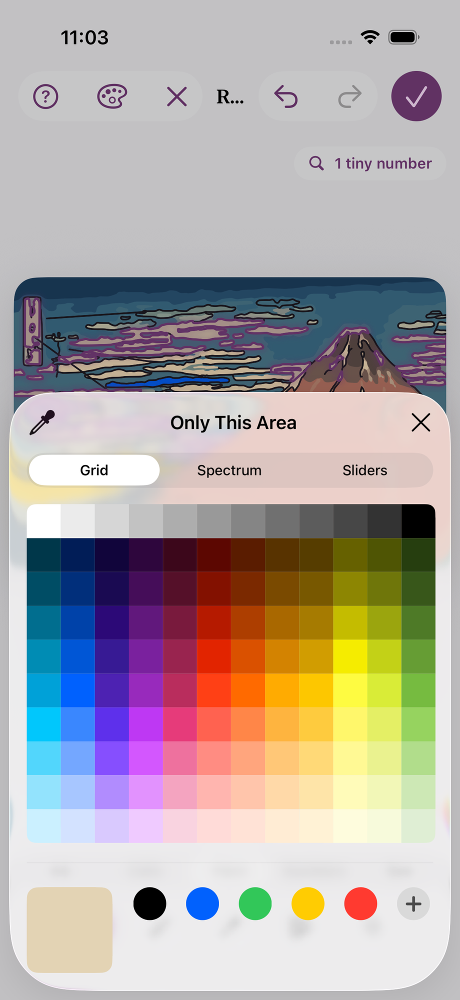
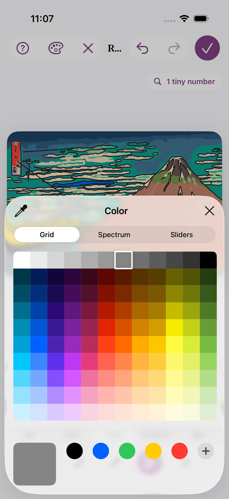
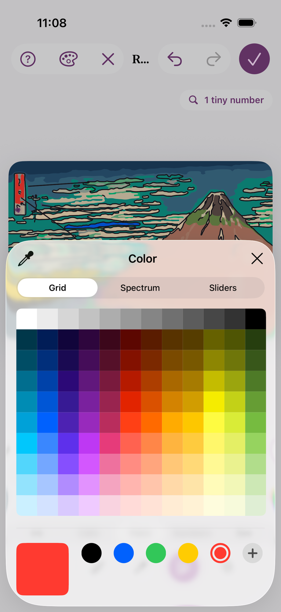
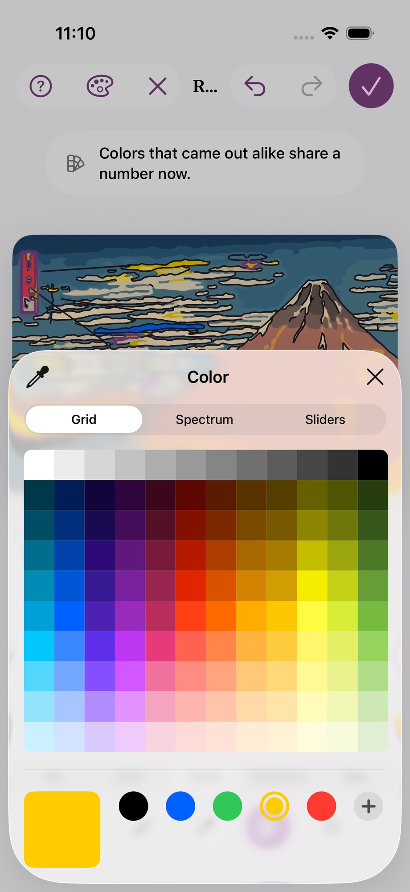
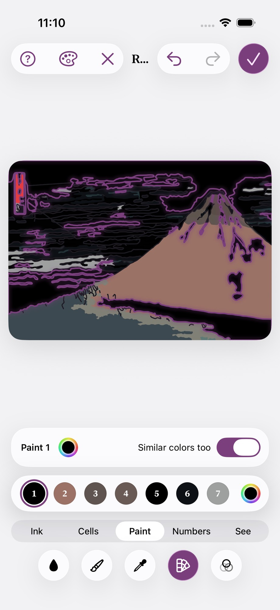
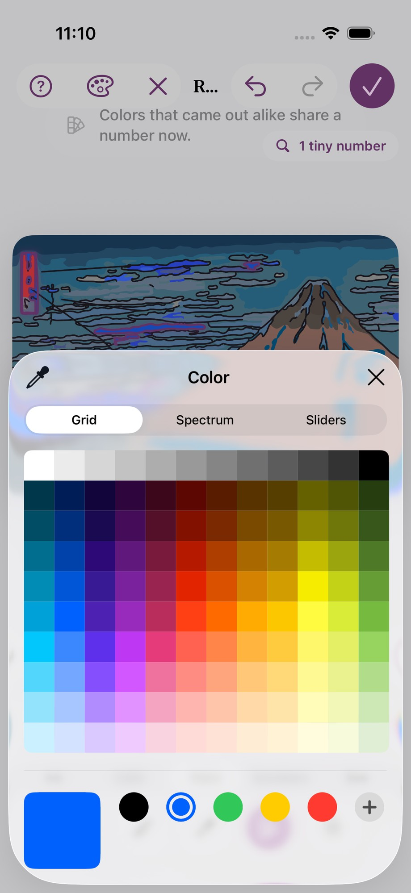

# Agent transcript

- end: success, 143 turns, 18.2 min, estimated $3.462616600000001
- tool calls: {"mcp__maestro__take_screenshot": 33, "Read": 20, "mcp__maestro__run": 47, "mcp__maestro__inspect_screen": 21, "Write": 4}
- images the agent received: 50

**Start**: model claude-opus-5-5, MCP [{"name": "maestro", "status": "connected", "source": "dynamic"}]

→ `mcp__maestro__take_screenshot` `{"device_id": "E839A11B-51B4-4AD3-ACF4-A53B95B7C957"}`

→ `Read` `{"file_path": "/Users/runner/.claude/projects/-Users-runner-work--temp-qa/memory/MEMORY.md"}`

← mcp__maestro__take_screenshot: image  919x2000

← Read (error): File does not exist. Note: your current working directory is /Users/runner/work/_temp/qa.

→ `mcp__maestro__run` `{"device_id": "E839A11B-51B4-4AD3-ACF4-A53B95B7C957", "yaml": "appId: com.pbordjadze.paintbynumber\n---\n- tapOn:\n    point: \"90%,10%\"\n- waitForAnimationToEnd"}`

→ `mcp__maestro__inspect_screen` `{"device_id": "E839A11B-51B4-4AD3-ACF4-A53B95B7C957"}`

← mcp__maestro__run: {"success":true,"device_id":"E839A11B-51B4-4AD3-ACF4-A53B95B7C957","commands_executed":3,"message":"Flow executed successfully","env_vars":{"MAESTRO_CLI_ANALYSIS_NOTIFICATION_DISABLED":"true","MAESTRO_CLI_NO_ANALYTICS":"1","MAESTRO_DRIVER_STARTUP_TIMEOUT":"240000","MAESTRO_VERSION":"2.11.0"}}

← mcp__maestro__inspect_screen: {"ui_schema":{"platform":"ios","abbreviations":{"b":"bounds","txt":"text","rid":"resource-id","a11y":"accessibilityText","hint":"hintText","val":"value","c":"children"},"defaults":{"enabled":true,"focused":false,"selected":false,"checked":false,"txt":"","hint":"","rid":"","val":"","a11y":""}},"elements":[{"b":"[0,0][402,874]","a11y":"Paint by Moonlight","c":[{"b":"[0,0][402,874]","c":[{"b":"[0,0][ …

> Tap didn't open anything. Use the label.

→ `mcp__maestro__run` `{"device_id": "E839A11B-51B4-4AD3-ACF4-A53B95B7C957", "yaml": "appId: com.pbordjadze.paintbynumber\n---\n- tapOn: \"New Painting\"\n- waitForAnimationToEnd"}`

→ `mcp__maestro__take_screenshot` `{"device_id": "E839A11B-51B4-4AD3-ACF4-A53B95B7C957"}`

← mcp__maestro__run: {"success":true,"device_id":"E839A11B-51B4-4AD3-ACF4-A53B95B7C957","commands_executed":3,"message":"Flow executed successfully","env_vars":{"MAESTRO_CLI_ANALYSIS_NOTIFICATION_DISABLED":"true","MAESTRO_CLI_NO_ANALYTICS":"1","MAESTRO_DRIVER_STARTUP_TIMEOUT":"240000","MAESTRO_VERSION":"2.11.0"}}

← mcp__maestro__take_screenshot: image  919x2000

→ `mcp__maestro__run` `{"device_id": "E839A11B-51B4-4AD3-ACF4-A53B95B7C957", "yaml": "appId: com.pbordjadze.paintbynumber\n---\n- tapOn: \"Close\"\n- tapOn: \"Samples\"\n- waitForAnimationToEnd"}`

→ `mcp__maestro__inspect_screen` `{"device_id": "E839A11B-51B4-4AD3-ACF4-A53B95B7C957"}`

← mcp__maestro__run: {"success":true,"device_id":"E839A11B-51B4-4AD3-ACF4-A53B95B7C957","commands_executed":4,"message":"Flow executed successfully","env_vars":{"MAESTRO_CLI_ANALYSIS_NOTIFICATION_DISABLED":"true","MAESTRO_CLI_NO_ANALYTICS":"1","MAESTRO_DRIVER_STARTUP_TIMEOUT":"240000","MAESTRO_VERSION":"2.11.0"}}

← mcp__maestro__inspect_screen: {"ui_schema":{"platform":"ios","abbreviations":{"b":"bounds","txt":"text","rid":"resource-id","a11y":"accessibilityText","hint":"hintText","val":"value","c":"children"},"defaults":{"enabled":true,"focused":false,"selected":false,"checked":false,"txt":"","hint":"","rid":"","val":"","a11y":""}},"elements":[{"b":"[0,0][402,874]","a11y":"Paint by Moonlight","c":[{"b":"[0,0][402,874]","c":[{"b":"[0,0][ …

→ `mcp__maestro__run` `{"device_id": "E839A11B-51B4-4AD3-ACF4-A53B95B7C957", "yaml": "appId: com.pbordjadze.paintbynumber\n---\n- tapOn: \"Sample: Red Fuji, Katsushika Hokusai\"\n- waitForAnimationToEnd"}`

→ `mcp__maestro__take_screenshot` `{"device_id": "E839A11B-51B4-4AD3-ACF4-A53B95B7C957"}`

← mcp__maestro__run: {"success":true,"device_id":"E839A11B-51B4-4AD3-ACF4-A53B95B7C957","commands_executed":3,"message":"Flow executed successfully","env_vars":{"MAESTRO_CLI_ANALYSIS_NOTIFICATION_DISABLED":"true","MAESTRO_CLI_NO_ANALYTICS":"1","MAESTRO_DRIVER_STARTUP_TIMEOUT":"240000","MAESTRO_VERSION":"2.11.0"}}

← mcp__maestro__take_screenshot: image  919x2000

> Writing at top-left — good for the Pen test. Waiting for the preview.

→ `mcp__maestro__run` `{"device_id": "E839A11B-51B4-4AD3-ACF4-A53B95B7C957", "yaml": "appId: com.pbordjadze.paintbynumber\n---\n- extendedWaitUntil:\n    visible:\n      text: \"Start Painting\"\n      enabled: true\n    timeout: 90000\n- waitForAnimationToEnd"}`

→ `mcp__maestro__take_screenshot` `{"device_id": "E839A11B-51B4-4AD3-ACF4-A53B95B7C957"}`

← mcp__maestro__run: {"success":true,"device_id":"E839A11B-51B4-4AD3-ACF4-A53B95B7C957","commands_executed":3,"message":"Flow executed successfully","env_vars":{"MAESTRO_CLI_ANALYSIS_NOTIFICATION_DISABLED":"true","MAESTRO_CLI_NO_ANALYTICS":"1","MAESTRO_DRIVER_STARTUP_TIMEOUT":"240000","MAESTRO_VERSION":"2.11.0"}}

← mcp__maestro__take_screenshot: image  919x2000

→ `mcp__maestro__run` `{"device_id": "E839A11B-51B4-4AD3-ACF4-A53B95B7C957", "yaml": "appId: com.pbordjadze.paintbynumber\n---\n- tapOn: \"Refine\"\n- waitForAnimationToEnd\n- takeScreenshot: /Users/runner/work/_temp/qa/shots/refine-open"}`

→ `mcp__maestro__inspect_screen` `{"device_id": "E839A11B-51B4-4AD3-ACF4-A53B95B7C957"}`

← mcp__maestro__run: {"success":true,"device_id":"E839A11B-51B4-4AD3-ACF4-A53B95B7C957","commands_executed":4,"message":"Flow executed successfully","env_vars":{"MAESTRO_CLI_ANALYSIS_NOTIFICATION_DISABLED":"true","MAESTRO_CLI_NO_ANALYTICS":"1","MAESTRO_DRIVER_STARTUP_TIMEOUT":"240000","MAESTRO_VERSION":"2.11.0"}}

← mcp__maestro__inspect_screen: {"ui_schema":{"platform":"ios","abbreviations":{"b":"bounds","txt":"text","rid":"resource-id","a11y":"accessibilityText","hint":"hintText","val":"value","c":"children"},"defaults":{"enabled":true,"focused":false,"selected":false,"checked":false,"txt":"","hint":"","rid":"","val":"","a11y":""}},"elements":[{"b":"[0,0][402,874]","a11y":"Paint by Moonlight","c":[{"b":"[0,0][402,874]","c":[{"b":"[0,0][ …

→ `mcp__maestro__run` `{"device_id": "E839A11B-51B4-4AD3-ACF4-A53B95B7C957", "yaml": "appId: com.pbordjadze.paintbynumber\n---\n- tapOn: \"Close\"\n- waitForAnimationToEnd"}`

→ `mcp__maestro__inspect_screen` `{"device_id": "E839A11B-51B4-4AD3-ACF4-A53B95B7C957"}`

→ `mcp__maestro__take_screenshot` `{"device_id": "E839A11B-51B4-4AD3-ACF4-A53B95B7C957"}`

← mcp__maestro__run: {"success":true,"device_id":"E839A11B-51B4-4AD3-ACF4-A53B95B7C957","commands_executed":3,"message":"Flow executed successfully","env_vars":{"MAESTRO_CLI_ANALYSIS_NOTIFICATION_DISABLED":"true","MAESTRO_CLI_NO_ANALYTICS":"1","MAESTRO_DRIVER_STARTUP_TIMEOUT":"240000","MAESTRO_VERSION":"2.11.0"}}

← mcp__maestro__inspect_screen: {"ui_schema":{"platform":"ios","abbreviations":{"b":"bounds","txt":"text","rid":"resource-id","a11y":"accessibilityText","hint":"hintText","val":"value","c":"children"},"defaults":{"enabled":true,"focused":false,"selected":false,"checked":false,"txt":"","hint":"","rid":"","val":"","a11y":""}},"elements":[{"b":"[0,0][402,874]","a11y":"Paint by Moonlight","c":[{"b":"[0,0][402,874]","c":[{"b":"[0,0][ …

← mcp__maestro__take_screenshot: image  919x2000

→ `mcp__maestro__run` `{"device_id": "E839A11B-51B4-4AD3-ACF4-A53B95B7C957", "yaml": "appId: com.pbordjadze.paintbynumber\n---\n- swipe:\n    start: \"130,300\"\n    end: \"40,306\"\n    duration: 800\n- waitForAnimationToEnd\n- takeScreenshot: /Users/runner/work/_temp/qa/shots/pen1"}`

→ `mcp__maestro__take_screenshot` `{"device_id": "E839A11B-51B4-4AD3-ACF4-A53B95B7C957"}`

← mcp__maestro__run: {"success":true,"device_id":"E839A11B-51B4-4AD3-ACF4-A53B95B7C957","commands_executed":4,"message":"Flow executed successfully","env_vars":{"MAESTRO_CLI_ANALYSIS_NOTIFICATION_DISABLED":"true","MAESTRO_CLI_NO_ANALYTICS":"1","MAESTRO_DRIVER_STARTUP_TIMEOUT":"240000","MAESTRO_VERSION":"2.11.0"}}

← mcp__maestro__take_screenshot: image  919x2000

→ `mcp__maestro__run` `{"device_id": "E839A11B-51B4-4AD3-ACF4-A53B95B7C957", "yaml": "appId: com.pbordjadze.paintbynumber\n---\n- swipe:\n    start: \"140,345\"\n    end: \"60,333\"\n    duration: 800\n- waitForAnimationToEnd\n- takeScreenshot: /Users/runner/work/_temp/qa/shots/pen2\n- swipe:\n    start: \"110,380\"\n    end: \"30,322\"\n    duration: 800\n- waitForAnimationToEnd\n- takeScreenshot: /Users/runner/work/_temp/qa/shots/pen3"}`

→ `mcp__maestro__take_screenshot` `{"device_id": "E839A11B-51B4-4AD3-ACF4-A53B95B7C957"}`

← mcp__maestro__run: {"success":true,"device_id":"E839A11B-51B4-4AD3-ACF4-A53B95B7C957","commands_executed":7,"message":"Flow executed successfully","env_vars":{"MAESTRO_CLI_ANALYSIS_NOTIFICATION_DISABLED":"true","MAESTRO_CLI_NO_ANALYTICS":"1","MAESTRO_DRIVER_STARTUP_TIMEOUT":"240000","MAESTRO_VERSION":"2.11.0"}}

← mcp__maestro__take_screenshot: image  919x2000

→ `mcp__maestro__run` `{"device_id": "E839A11B-51B4-4AD3-ACF4-A53B95B7C957", "yaml": "appId: com.pbordjadze.paintbynumber\n---\n- tapOn:\n    id: \"refine-backdrop\"\n- waitForAnimationToEnd"}`

→ `mcp__maestro__take_screenshot` `{"device_id": "E839A11B-51B4-4AD3-ACF4-A53B95B7C957"}`

← mcp__maestro__run: {"success":true,"device_id":"E839A11B-51B4-4AD3-ACF4-A53B95B7C957","commands_executed":3,"message":"Flow executed successfully","env_vars":{"MAESTRO_CLI_ANALYSIS_NOTIFICATION_DISABLED":"true","MAESTRO_CLI_NO_ANALYTICS":"1","MAESTRO_DRIVER_STARTUP_TIMEOUT":"240000","MAESTRO_VERSION":"2.11.0"}}

← mcp__maestro__take_screenshot: image  919x2000

> Quick update: Pen fix (4) looks right in 3 of 3 lines so far: none of the ends jumped onto the writing. Moving on to Paper views (3).

→ `mcp__maestro__run` `{"device_id": "E839A11B-51B4-4AD3-ACF4-A53B95B7C957", "yaml": "appId: com.pbordjadze.paintbynumber\n---\n- tapOn: \"Paper\"\n- waitForAnimationToEnd\n- takeScreenshot: /Users/runner/work/_temp/qa/shots/paper1"}`

→ `mcp__maestro__take_screenshot` `{"device_id": "E839A11B-51B4-4AD3-ACF4-A53B95B7C957"}`

← mcp__maestro__run: {"success":true,"device_id":"E839A11B-51B4-4AD3-ACF4-A53B95B7C957","commands_executed":4,"message":"Flow executed successfully","env_vars":{"MAESTRO_CLI_ANALYSIS_NOTIFICATION_DISABLED":"true","MAESTRO_CLI_NO_ANALYTICS":"1","MAESTRO_DRIVER_STARTUP_TIMEOUT":"240000","MAESTRO_VERSION":"2.11.0"}}

← mcp__maestro__take_screenshot: image  919x2000

→ `mcp__maestro__inspect_screen` `{"device_id": "E839A11B-51B4-4AD3-ACF4-A53B95B7C957"}`

← mcp__maestro__inspect_screen: {"ui_schema":{"platform":"ios","abbreviations":{"b":"bounds","txt":"text","rid":"resource-id","a11y":"accessibilityText","hint":"hintText","val":"value","c":"children"},"defaults":{"enabled":true,"focused":false,"selected":false,"checked":false,"txt":"","hint":"","rid":"","val":"","a11y":""}},"elements":[{"b":"[0,0][402,874]","a11y":"Paint by Moonlight","c":[{"b":"[0,0][402,874]","c":[{"b":"[0,0][ …

→ `mcp__maestro__run` `{"device_id": "E839A11B-51B4-4AD3-ACF4-A53B95B7C957", "yaml": "appId: com.pbordjadze.paintbynumber\n---\n- tapOn:\n    id: \"refine-backdrop\"\n- tapOn: \"Photo\"\n- waitForAnimationToEnd\n- takeScreenshot: /Users/runner/work/_temp/qa/shots/view-photo"}`

→ `mcp__maestro__inspect_screen` `{"device_id": "E839A11B-51B4-4AD3-ACF4-A53B95B7C957"}`

← mcp__maestro__run: {"success":true,"device_id":"E839A11B-51B4-4AD3-ACF4-A53B95B7C957","commands_executed":5,"message":"Flow executed successfully","env_vars":{"MAESTRO_CLI_ANALYSIS_NOTIFICATION_DISABLED":"true","MAESTRO_CLI_NO_ANALYTICS":"1","MAESTRO_DRIVER_STARTUP_TIMEOUT":"240000","MAESTRO_VERSION":"2.11.0"}}

← mcp__maestro__inspect_screen: {"ui_schema":{"platform":"ios","abbreviations":{"b":"bounds","txt":"text","rid":"resource-id","a11y":"accessibilityText","hint":"hintText","val":"value","c":"children"},"defaults":{"enabled":true,"focused":false,"selected":false,"checked":false,"txt":"","hint":"","rid":"","val":"","a11y":""}},"elements":[{"b":"[0,0][402,874]","a11y":"Paint by Moonlight","c":[{"b":"[0,0][402,874]","c":[{"b":"[0,0][ …

> Photo: 44 wide again. Now Photo Behind, then Paper again (repeat).

→ `mcp__maestro__run` `{"device_id": "E839A11B-51B4-4AD3-ACF4-A53B95B7C957", "yaml": "appId: com.pbordjadze.paintbynumber\n---\n- tapOn:\n    id: \"refine-backdrop\"\n- tapOn: \"Photo Behind\"\n- waitForAnimationToEnd\n- takeScreenshot: /Users/runner/work/_temp/qa/shots/view-photobehind\n- copyTextFrom:\n    id: \"refine-backdrop\"\n- tapOn:\n    id: \"refine-backdrop\"\n- tapOn: \"Paper\"\n- waitForAnimationToEnd\n- takeScreenshot: /Users/runner/work/_temp/qa/shots/paper2"}`

→ `mcp__maestro__take_screenshot` `{"device_id": "E839A11B-51B4-4AD3-ACF4-A53B95B7C957"}`

← mcp__maestro__run: {"success":true,"device_id":"E839A11B-51B4-4AD3-ACF4-A53B95B7C957","commands_executed":10,"message":"Flow executed successfully","env_vars":{"MAESTRO_CLI_ANALYSIS_NOTIFICATION_DISABLED":"true","MAESTRO_CLI_NO_ANALYTICS":"1","MAESTRO_DRIVER_STARTUP_TIMEOUT":"240000","MAESTRO_VERSION":"2.11.0"}}

← mcp__maestro__take_screenshot: image  919x2000

→ `Read` `{"file_path": "/Users/runner/work/_temp/qa/shots/view-photobehind.png"}`

← Read: image  920x2000

→ `Write` `{"file_path": "/Users/runner/work/_temp/qa/report.md", "content": "# QA report \u2014 Refine recheck (Red Fuji sample, iPhone 17 Pro simulator, debug build)\n\n## Summary\nDraft (in progress). Fix 4 (the Pen line's end doesn't jump onto writing) held in 3 of 3 lines. Fix 3 (Paper view) is partly not fixed: the views symbol moves sideways in the bar as the view changes, because the button's width follows its icon. Fixes 1 and 2 are still being checked.\n\n## Coverage\n- Goal 1 (create): done, up to Refine (Samples \u203a Red Fuji \u203a preview \u203a Refine).\n- Fix 4 Pen near writing: done, 3`

← Write: File created successfully at: /Users/runner/work/_temp/qa/report.md (file state is current in your context — no need to Read it back)

→ `mcp__maestro__run` `{"device_id": "E839A11B-51B4-4AD3-ACF4-A53B95B7C957", "yaml": "appId: com.pbordjadze.paintbynumber\n---\n- tapOn:\n    id: \"refine-backdrop\"\n- tapOn: \"Painting\"\n- waitForAnimationToEnd\n- takeScreenshot: /Users/runner/work/_temp/qa/shots/view-painting2\n- tapOn:\n    id: \"refine-backdrop\"\n- tapOn: \"Paper\"\n- waitForAnimationToEnd\n- takeScreenshot: /Users/runner/work/_temp/qa/shots/paper3"}`

→ `mcp__maestro__inspect_screen` `{"device_id": "E839A11B-51B4-4AD3-ACF4-A53B95B7C957"}`

← mcp__maestro__run: {"success":true,"device_id":"E839A11B-51B4-4AD3-ACF4-A53B95B7C957","commands_executed":9,"message":"Flow executed successfully","env_vars":{"MAESTRO_CLI_ANALYSIS_NOTIFICATION_DISABLED":"true","MAESTRO_CLI_NO_ANALYTICS":"1","MAESTRO_DRIVER_STARTUP_TIMEOUT":"240000","MAESTRO_VERSION":"2.11.0"}}

← mcp__maestro__inspect_screen: {"ui_schema":{"platform":"ios","abbreviations":{"b":"bounds","txt":"text","rid":"resource-id","a11y":"accessibilityText","hint":"hintText","val":"value","c":"children"},"defaults":{"enabled":true,"focused":false,"selected":false,"checked":false,"txt":"","hint":"","rid":"","val":"","a11y":""}},"elements":[{"b":"[0,0][402,874]","a11y":"Paint by Moonlight","c":[{"b":"[0,0][402,874]","c":[{"b":"[0,0][ …

> Paper position reproduced 3 of 3. Now fix 1, the area card. Opening the Paint group.

→ `mcp__maestro__run` `{"device_id": "E839A11B-51B4-4AD3-ACF4-A53B95B7C957", "yaml": "appId: com.pbordjadze.paintbynumber\n---\n- tapOn:\n    id: \"refine-backdrop\"\n- tapOn: \"Painting\"\n- tapOn: \"Paint\"\n- waitForAnimationToEnd"}`

→ `mcp__maestro__take_screenshot` `{"device_id": "E839A11B-51B4-4AD3-ACF4-A53B95B7C957"}`

← mcp__maestro__run: {"success":true,"device_id":"E839A11B-51B4-4AD3-ACF4-A53B95B7C957","commands_executed":5,"message":"Flow executed successfully","env_vars":{"MAESTRO_CLI_ANALYSIS_NOTIFICATION_DISABLED":"true","MAESTRO_CLI_NO_ANALYTICS":"1","MAESTRO_DRIVER_STARTUP_TIMEOUT":"240000","MAESTRO_VERSION":"2.11.0"}}

← mcp__maestro__take_screenshot: image  919x2000

→ `mcp__maestro__run` `{"device_id": "E839A11B-51B4-4AD3-ACF4-A53B95B7C957", "yaml": "appId: com.pbordjadze.paintbynumber\n---\n- longPressOn:\n    point: \"147,333\"\n- waitForAnimationToEnd\n- takeScreenshot: /Users/runner/work/_temp/qa/shots/card1-open"}`

→ `mcp__maestro__take_screenshot` `{"device_id": "E839A11B-51B4-4AD3-ACF4-A53B95B7C957"}`

← mcp__maestro__run: {"success":true,"device_id":"E839A11B-51B4-4AD3-ACF4-A53B95B7C957","commands_executed":4,"message":"Flow executed successfully","env_vars":{"MAESTRO_CLI_ANALYSIS_NOTIFICATION_DISABLED":"true","MAESTRO_CLI_NO_ANALYTICS":"1","MAESTRO_DRIVER_STARTUP_TIMEOUT":"240000","MAESTRO_VERSION":"2.11.0"}}

← mcp__maestro__take_screenshot: image  919x2000

→ `mcp__maestro__take_screenshot` `{"device_id": "E839A11B-51B4-4AD3-ACF4-A53B95B7C957"}`

← mcp__maestro__take_screenshot: image  919x2000

> The card is open (Light beige, Paint 5, 23 areas). Tapping the color well beside Only This Area.

→ `mcp__maestro__run` `{"device_id": "E839A11B-51B4-4AD3-ACF4-A53B95B7C957", "yaml": "appId: com.pbordjadze.paintbynumber\n---\n- tapOn:\n    point: \"361,604\"\n- waitForAnimationToEnd\n- takeScreenshot: /Users/runner/work/_temp/qa/shots/card1-picker"}`

→ `mcp__maestro__inspect_screen` `{"device_id": "E839A11B-51B4-4AD3-ACF4-A53B95B7C957"}`

← mcp__maestro__run: {"success":true,"device_id":"E839A11B-51B4-4AD3-ACF4-A53B95B7C957","commands_executed":4,"message":"Flow executed successfully","env_vars":{"MAESTRO_CLI_ANALYSIS_NOTIFICATION_DISABLED":"true","MAESTRO_CLI_NO_ANALYTICS":"1","MAESTRO_DRIVER_STARTUP_TIMEOUT":"240000","MAESTRO_VERSION":"2.11.0"}}

← mcp__maestro__inspect_screen: {"ui_schema":{"platform":"ios","abbreviations":{"b":"bounds","txt":"text","rid":"resource-id","a11y":"accessibilityText","hint":"hintText","val":"value","c":"children"},"defaults":{"enabled":true,"focused":false,"selected":false,"checked":false,"txt":"","hint":"","rid":"","val":"","a11y":""}},"elements":[{"b":"[0,0][402,874]","a11y":"Paint by Moonlight","c":[{"b":"[0,0][402,874]","c":[{"b":"[0,0][ …

→ `mcp__maestro__take_screenshot` `{"device_id": "E839A11B-51B4-4AD3-ACF4-A53B95B7C957"}`

← mcp__maestro__take_screenshot: image  919x2000

→ `mcp__maestro__run` `{"device_id": "E839A11B-51B4-4AD3-ACF4-A53B95B7C957", "yaml": "appId: com.pbordjadze.paintbynumber\n---\n- tapOn:\n    point: \"360,603\"\n- waitForAnimationToEnd"}`

→ `mcp__maestro__take_screenshot` `{"device_id": "E839A11B-51B4-4AD3-ACF4-A53B95B7C957"}`

← mcp__maestro__run: {"success":true,"device_id":"E839A11B-51B4-4AD3-ACF4-A53B95B7C957","commands_executed":3,"message":"Flow executed successfully","env_vars":{"MAESTRO_CLI_ANALYSIS_NOTIFICATION_DISABLED":"true","MAESTRO_CLI_NO_ANALYTICS":"1","MAESTRO_DRIVER_STARTUP_TIMEOUT":"240000","MAESTRO_VERSION":"2.11.0"}}

← mcp__maestro__take_screenshot: image  919x2000

> Picker open. Picking A = green, a pause, then B = blue, then closing the picker.

→ `mcp__maestro__run` `{"device_id": "E839A11B-51B4-4AD3-ACF4-A53B95B7C957", "yaml": "appId: com.pbordjadze.paintbynumber\n---\n- tapOn:\n    point: \"223,790\"\n- takeScreenshot: /Users/runner/work/_temp/qa/shots/card1-afterA\n- tapOn:\n    point: \"177,790\"\n- takeScreenshot: /Users/runner/work/_temp/qa/shots/card1-afterB\n- tapOn:\n    point: \"367,370\"\n- waitForAnimationToEnd\n- takeScreenshot: /Users/runner/work/_temp/qa/shots/card1-pickerclosed"}`

→ `mcp__maestro__take_screenshot` `{"device_id": "E839A11B-51B4-4AD3-ACF4-A53B95B7C957"}`

← mcp__maestro__run: {"success":true,"device_id":"E839A11B-51B4-4AD3-ACF4-A53B95B7C957","commands_executed":8,"message":"Flow executed successfully","env_vars":{"MAESTRO_CLI_ANALYSIS_NOTIFICATION_DISABLED":"true","MAESTRO_CLI_NO_ANALYTICS":"1","MAESTRO_DRIVER_STARTUP_TIMEOUT":"240000","MAESTRO_VERSION":"2.11.0"}}

← mcp__maestro__take_screenshot: image  919x2000

→ `Read` `{"file_path": "/Users/runner/work/_temp/qa/shots/card1-afterA.png"}`

← Read: image  920x2000

→ `mcp__maestro__run` `{"device_id": "E839A11B-51B4-4AD3-ACF4-A53B95B7C957", "yaml": "appId: com.pbordjadze.paintbynumber\n---\n- swipe:\n    start: \"201,430\"\n    end: \"201,860\"\n    duration: 500\n- waitForAnimationToEnd\n- takeScreenshot: /Users/runner/work/_temp/qa/shots/card1-closed"}`

→ `mcp__maestro__take_screenshot` `{"device_id": "E839A11B-51B4-4AD3-ACF4-A53B95B7C957"}`

← mcp__maestro__run: {"success":true,"device_id":"E839A11B-51B4-4AD3-ACF4-A53B95B7C957","commands_executed":4,"message":"Flow executed successfully","env_vars":{"MAESTRO_CLI_ANALYSIS_NOTIFICATION_DISABLED":"true","MAESTRO_CLI_NO_ANALYTICS":"1","MAESTRO_DRIVER_STARTUP_TIMEOUT":"240000","MAESTRO_VERSION":"2.11.0"}}

← mcp__maestro__take_screenshot: image  919x2000

> Run 1: the area ended blue (B), and the card said "Only This Area" both before and after the picks. Checking the palette for an extra light-beige paint.

→ `mcp__maestro__inspect_screen` `{"device_id": "E839A11B-51B4-4AD3-ACF4-A53B95B7C957"}`

← mcp__maestro__inspect_screen: {"ui_schema":{"platform":"ios","abbreviations":{"b":"bounds","txt":"text","rid":"resource-id","a11y":"accessibilityText","hint":"hintText","val":"value","c":"children"},"defaults":{"enabled":true,"focused":false,"selected":false,"checked":false,"txt":"","hint":"","rid":"","val":"","a11y":""}},"elements":[{"b":"[0,0][402,874]","a11y":"Paint by Moonlight","c":[{"b":"[0,0][402,874]","c":[{"b":"[0,0][ …

> The palette grew by exactly one swatch (content width 994 → 1038 pt) and the change count went from 3 to 4. Scrolling to the palette's end to see the new swatches.

→ `mcp__maestro__run` `{"device_id": "E839A11B-51B4-4AD3-ACF4-A53B95B7C957", "yaml": "appId: com.pbordjadze.paintbynumber\n---\n- swipe:\n    start: \"320,707\"\n    end: \"40,707\"\n    duration: 300\n- swipe:\n    start: \"320,707\"\n    end: \"40,707\"\n    duration: 300\n- swipe:\n    start: \"320,707\"\n    end: \"40,707\"\n    duration: 300\n- waitForAnimationToEnd\n- takeScreenshot: /Users/runner/work/_temp/qa/shots/card1-palette-end"}`

→ `mcp__maestro__inspect_screen` `{"device_id": "E839A11B-51B4-4AD3-ACF4-A53B95B7C957"}`

← mcp__maestro__run: {"success":true,"device_id":"E839A11B-51B4-4AD3-ACF4-A53B95B7C957","commands_executed":6,"message":"Flow executed successfully","env_vars":{"MAESTRO_CLI_ANALYSIS_NOTIFICATION_DISABLED":"true","MAESTRO_CLI_NO_ANALYTICS":"1","MAESTRO_DRIVER_STARTUP_TIMEOUT":"240000","MAESTRO_VERSION":"2.11.0"}}

← mcp__maestro__inspect_screen: {"ui_schema":{"platform":"ios","abbreviations":{"b":"bounds","txt":"text","rid":"resource-id","a11y":"accessibilityText","hint":"hintText","val":"value","c":"children"},"defaults":{"enabled":true,"focused":false,"selected":false,"checked":false,"txt":"","hint":"","rid":"","val":"","a11y":""}},"elements":[{"b":"[0,0][402,874]","a11y":"Paint by Moonlight","c":[{"b":"[0,0][402,874]","c":[{"b":"[0,0][ …

> Run 1 passes: only one new paint (23 · Vivid blue), with no extra beige. Checking the log.

→ `Read` `{"file_path": "/Users/runner/work/_temp/qa/app.log"}`

← Read: 1	getpwuid_r did not find a match for uid 501
2	Filtering the log data using "subsystem == "com.pbordjadze.paintbynumber""
3	Timestamp               Ty Process[PID:TID]
4	2026-10-26 22:48:56.225 Df PaintByNumber[15512:beb3] [com.pbordjadze.paintbynumber:tips] offer in shelf: , wanted
5	2026-10-26 22:48:57.721 Df PaintByNumber[15512:bee2] [com.pbordjadze.paintbynumber:canvas] Making the render cont …

→ `mcp__maestro__run` `{"device_id": "E839A11B-51B4-4AD3-ACF4-A53B95B7C957", "yaml": "appId: com.pbordjadze.paintbynumber\n---\n- longPressOn:\n    point: \"131,284\"\n- waitForAnimationToEnd\n- takeScreenshot: /Users/runner/work/_temp/qa/shots/card2-open"}`

→ `mcp__maestro__take_screenshot` `{"device_id": "E839A11B-51B4-4AD3-ACF4-A53B95B7C957"}`

← mcp__maestro__run: {"success":true,"device_id":"E839A11B-51B4-4AD3-ACF4-A53B95B7C957","commands_executed":4,"message":"Flow executed successfully","env_vars":{"MAESTRO_CLI_ANALYSIS_NOTIFICATION_DISABLED":"true","MAESTRO_CLI_NO_ANALYTICS":"1","MAESTRO_DRIVER_STARTUP_TIMEOUT":"240000","MAESTRO_VERSION":"2.11.0"}}

← mcp__maestro__take_screenshot: image  919x2000

> That area turned out to be Teal, not pale. Closing this card and picking a light-beige area (a "5" from the Paper view).

→ `mcp__maestro__run` `{"device_id": "E839A11B-51B4-4AD3-ACF4-A53B95B7C957", "yaml": "appId: com.pbordjadze.paintbynumber\n---\n- swipe:\n    start: \"201,430\"\n    end: \"201,860\"\n    duration: 500\n- waitForAnimationToEnd\n- longPressOn:\n    point: \"211,349\"\n- waitForAnimationToEnd\n- takeScreenshot: /Users/runner/work/_temp/qa/shots/card2-open"}`

→ `mcp__maestro__take_screenshot` `{"device_id": "E839A11B-51B4-4AD3-ACF4-A53B95B7C957"}`

← mcp__maestro__run: {"success":true,"device_id":"E839A11B-51B4-4AD3-ACF4-A53B95B7C957","commands_executed":6,"message":"Flow executed successfully","env_vars":{"MAESTRO_CLI_ANALYSIS_NOTIFICATION_DISABLED":"true","MAESTRO_CLI_NO_ANALYTICS":"1","MAESTRO_DRIVER_STARTUP_TIMEOUT":"240000","MAESTRO_VERSION":"2.11.0"}}

← mcp__maestro__take_screenshot: image  919x2000

> Hit the sky (Blue, 65 areas). Switching to the large pale area at bottom left (paint 9, beige).

→ `mcp__maestro__run` `{"device_id": "E839A11B-51B4-4AD3-ACF4-A53B95B7C957", "yaml": "appId: com.pbordjadze.paintbynumber\n---\n- swipe:\n    start: \"201,430\"\n    end: \"201,860\"\n    duration: 500\n- waitForAnimationToEnd\n- longPressOn:\n    point: \"44,420\"\n- waitForAnimationToEnd\n- takeScreenshot: /Users/runner/work/_temp/qa/shots/card2-open"}`

→ `mcp__maestro__take_screenshot` `{"device_id": "E839A11B-51B4-4AD3-ACF4-A53B95B7C957"}`

← mcp__maestro__run: {"success":true,"device_id":"E839A11B-51B4-4AD3-ACF4-A53B95B7C957","commands_executed":6,"message":"Flow executed successfully","env_vars":{"MAESTRO_CLI_ANALYSIS_NOTIFICATION_DISABLED":"true","MAESTRO_CLI_NO_ANALYTICS":"1","MAESTRO_DRIVER_STARTUP_TIMEOUT":"240000","MAESTRO_VERSION":"2.11.0"}}

← mcp__maestro__take_screenshot: image  919x2000

> Beige, Paint 9, 13 areas. The outline marks spots across the picture, so it shows the paint's areas, not just the pressed one. That explains run 1's outline, so it's not a bug. Opening the picker.

→ `mcp__maestro__run` `{"device_id": "E839A11B-51B4-4AD3-ACF4-A53B95B7C957", "yaml": "appId: com.pbordjadze.paintbynumber\n---\n- tapOn:\n    point: \"361,604\"\n- waitForAnimationToEnd"}`

→ `mcp__maestro__take_screenshot` `{"device_id": "E839A11B-51B4-4AD3-ACF4-A53B95B7C957"}`

← mcp__maestro__run: {"success":true,"device_id":"E839A11B-51B4-4AD3-ACF4-A53B95B7C957","commands_executed":3,"message":"Flow executed successfully","env_vars":{"MAESTRO_CLI_ANALYSIS_NOTIFICATION_DISABLED":"true","MAESTRO_CLI_NO_ANALYTICS":"1","MAESTRO_DRIVER_STARTUP_TIMEOUT":"240000","MAESTRO_VERSION":"2.11.0"}}

← mcp__maestro__take_screenshot: image  919x2000

> Opened on the first tap this time. Picking red then yellow back to back, closing, and swiping the card down.

→ `mcp__maestro__run` `{"device_id": "E839A11B-51B4-4AD3-ACF4-A53B95B7C957", "yaml": "appId: com.pbordjadze.paintbynumber\n---\n- tapOn:\n    point: \"315,790\"\n    waitToSettleTimeoutMs: 200\n- tapOn:\n    point: \"269,790\"\n    waitToSettleTimeoutMs: 200\n- takeScreenshot: /Users/runner/work/_temp/qa/shots/card2-afterB\n- tapOn:\n    point: \"367,370\"\n- waitForAnimationToEnd\n- takeScreenshot: /Users/runner/work/_temp/qa/shots/card2-pickerclosed\n- swipe:\n    start: \"201,430\"\n    end: \"201,860\"\n    duration: 500\n- waitForAnimationToEnd\n- takeScreenshot: /Users/runner/work/_temp/qa/shots/card2-closed"}`

→ `Read` `{"file_path": "/Users/runner/work/_temp/qa/shots/card2-pickerclosed.png"}`

→ `mcp__maestro__take_screenshot` `{"device_id": "E839A11B-51B4-4AD3-ACF4-A53B95B7C957"}`

← mcp__maestro__run: {"success":true,"device_id":"E839A11B-51B4-4AD3-ACF4-A53B95B7C957","commands_executed":10,"message":"Flow executed successfully","env_vars":{"MAESTRO_CLI_ANALYSIS_NOTIFICATION_DISABLED":"true","MAESTRO_CLI_NO_ANALYTICS":"1","MAESTRO_DRIVER_STARTUP_TIMEOUT":"240000","MAESTRO_VERSION":"2.11.0"}}

← Read: image  920x2000

← mcp__maestro__take_screenshot: image  919x2000

> Run 2: the area ended yellow (B). Checking the palette's contents.

→ `mcp__maestro__run` `{"device_id": "E839A11B-51B4-4AD3-ACF4-A53B95B7C957", "yaml": "appId: com.pbordjadze.paintbynumber\n---\n- swipe:\n    start: \"320,707\"\n    end: \"40,707\"\n    duration: 300\n- waitForAnimationToEnd"}`

→ `mcp__maestro__inspect_screen` `{"device_id": "E839A11B-51B4-4AD3-ACF4-A53B95B7C957"}`

← mcp__maestro__run: {"success":true,"device_id":"E839A11B-51B4-4AD3-ACF4-A53B95B7C957","commands_executed":3,"message":"Flow executed successfully","env_vars":{"MAESTRO_CLI_ANALYSIS_NOTIFICATION_DISABLED":"true","MAESTRO_CLI_NO_ANALYTICS":"1","MAESTRO_DRIVER_STARTUP_TIMEOUT":"240000","MAESTRO_VERSION":"2.11.0"}}

← mcp__maestro__inspect_screen: {"ui_schema":{"platform":"ios","abbreviations":{"b":"bounds","txt":"text","rid":"resource-id","a11y":"accessibilityText","hint":"hintText","val":"value","c":"children"},"defaults":{"enabled":true,"focused":false,"selected":false,"checked":false,"txt":"","hint":"","rid":"","val":"","a11y":""}},"elements":[{"b":"[0,0][402,874]","a11y":"Paint by Moonlight","c":[{"b":"[0,0][402,874]","c":[{"b":"[0,0][ …

> Run 2 passes as well: one new paint (24 · Vivid yellow), change count 4 → 5. Run 3 is next, with a 3 s pause between the picks.

→ `mcp__maestro__run` `{"device_id": "E839A11B-51B4-4AD3-ACF4-A53B95B7C957", "yaml": "appId: com.pbordjadze.paintbynumber\n---\n- longPressOn:\n    point: \"325,348\"\n- waitForAnimationToEnd\n- takeScreenshot: /Users/runner/work/_temp/qa/shots/card3-open"}`

→ `mcp__maestro__take_screenshot` `{"device_id": "E839A11B-51B4-4AD3-ACF4-A53B95B7C957"}`

← mcp__maestro__run: {"success":true,"device_id":"E839A11B-51B4-4AD3-ACF4-A53B95B7C957","commands_executed":4,"message":"Flow executed successfully","env_vars":{"MAESTRO_CLI_ANALYSIS_NOTIFICATION_DISABLED":"true","MAESTRO_CLI_NO_ANALYTICS":"1","MAESTRO_DRIVER_STARTUP_TIMEOUT":"240000","MAESTRO_VERSION":"2.11.0"}}

← mcp__maestro__take_screenshot: image  919x2000

> Got Red (the mountain), not a pale area. Trying a cream cloud near the top.

→ `mcp__maestro__run` `{"device_id": "E839A11B-51B4-4AD3-ACF4-A53B95B7C957", "yaml": "appId: com.pbordjadze.paintbynumber\n---\n- swipe:\n    start: \"201,430\"\n    end: \"201,860\"\n    duration: 500\n- waitForAnimationToEnd\n- longPressOn:\n    point: \"248,265\"\n- waitForAnimationToEnd\n- takeScreenshot: /Users/runner/work/_temp/qa/shots/card3-open"}`

→ `mcp__maestro__take_screenshot` `{"device_id": "E839A11B-51B4-4AD3-ACF4-A53B95B7C957"}`

← mcp__maestro__run: {"success":true,"device_id":"E839A11B-51B4-4AD3-ACF4-A53B95B7C957","commands_executed":6,"message":"Flow executed successfully","env_vars":{"MAESTRO_CLI_ANALYSIS_NOTIFICATION_DISABLED":"true","MAESTRO_CLI_NO_ANALYTICS":"1","MAESTRO_DRIVER_STARTUP_TIMEOUT":"240000","MAESTRO_VERSION":"2.11.0"}}

← mcp__maestro__take_screenshot: image  919x2000

> Sky again; the clouds are too thin to hit reliably. The cartouche at top left is paint 9 (beige, pale, shared), so I'll use that.

→ `mcp__maestro__run` `{"device_id": "E839A11B-51B4-4AD3-ACF4-A53B95B7C957", "yaml": "appId: com.pbordjadze.paintbynumber\n---\n- swipe:\n    start: \"201,430\"\n    end: \"201,860\"\n    duration: 500\n- waitForAnimationToEnd\n- longPressOn:\n    point: \"28,292\"\n- waitForAnimationToEnd\n- takeScreenshot: /Users/runner/work/_temp/qa/shots/card3-open"}`

→ `mcp__maestro__take_screenshot` `{"device_id": "E839A11B-51B4-4AD3-ACF4-A53B95B7C957"}`

← mcp__maestro__run: {"success":true,"device_id":"E839A11B-51B4-4AD3-ACF4-A53B95B7C957","commands_executed":6,"message":"Flow executed successfully","env_vars":{"MAESTRO_CLI_ANALYSIS_NOTIFICATION_DISABLED":"true","MAESTRO_CLI_NO_ANALYTICS":"1","MAESTRO_DRIVER_STARTUP_TIMEOUT":"240000","MAESTRO_VERSION":"2.11.0"}}

← mcp__maestro__take_screenshot: image  919x2000

> Beige, Paint 6, 37 areas: pale. Run 3: pick black, wait 3 s, pick red.

→ `mcp__maestro__run` `{"device_id": "E839A11B-51B4-4AD3-ACF4-A53B95B7C957", "yaml": "appId: com.pbordjadze.paintbynumber\n---\n- tapOn:\n    point: \"361,604\"\n- waitForAnimationToEnd\n- takeScreenshot: /Users/runner/work/_temp/qa/shots/card3-picker\n- tapOn:\n    point: \"131,790\"\n- waitForAnimationToEnd:\n    timeout: 3000\n- takeScreenshot: /Users/runner/work/_temp/qa/shots/card3-afterA\n- tapOn:\n    point: \"315,790\"\n- takeScreenshot: /Users/runner/work/_temp/qa/shots/card3-afterB\n- tapOn:\n    point: \"367,370\"\n- waitForAnimationToEnd\n- takeScreenshot: /Users/runner/work/_temp/qa/shots/card3-pickercl`

→ `mcp__maestro__take_screenshot` `{"device_id": "E839A11B-51B4-4AD3-ACF4-A53B95B7C957"}`

← mcp__maestro__run: {"success":true,"device_id":"E839A11B-51B4-4AD3-ACF4-A53B95B7C957","commands_executed":12,"message":"Flow executed successfully","env_vars":{"MAESTRO_CLI_ANALYSIS_NOTIFICATION_DISABLED":"true","MAESTRO_CLI_NO_ANALYTICS":"1","MAESTRO_DRIVER_STARTUP_TIMEOUT":"240000","MAESTRO_VERSION":"2.11.0"}}

← mcp__maestro__take_screenshot: image  919x2000

→ `Read` `{"file_path": "/Users/runner/work/_temp/qa/shots/card3-afterA.png"}`

← Read: image  920x2000

→ `mcp__maestro__run` `{"device_id": "E839A11B-51B4-4AD3-ACF4-A53B95B7C957", "yaml": "appId: com.pbordjadze.paintbynumber\n---\n- swipe:\n    start: \"201,430\"\n    end: \"201,860\"\n    duration: 500\n- waitForAnimationToEnd\n- swipe:\n    start: \"320,707\"\n    end: \"40,707\"\n    duration: 300\n- waitForAnimationToEnd\n- takeScreenshot: /Users/runner/work/_temp/qa/shots/card3-closed"}`

→ `mcp__maestro__inspect_screen` `{"device_id": "E839A11B-51B4-4AD3-ACF4-A53B95B7C957"}`

← mcp__maestro__run: {"success":true,"device_id":"E839A11B-51B4-4AD3-ACF4-A53B95B7C957","commands_executed":6,"message":"Flow executed successfully","env_vars":{"MAESTRO_CLI_ANALYSIS_NOTIFICATION_DISABLED":"true","MAESTRO_CLI_NO_ANALYTICS":"1","MAESTRO_DRIVER_STARTUP_TIMEOUT":"240000","MAESTRO_VERSION":"2.11.0"}}

← mcp__maestro__inspect_screen: {"ui_schema":{"platform":"ios","abbreviations":{"b":"bounds","txt":"text","rid":"resource-id","a11y":"accessibilityText","hint":"hintText","val":"value","c":"children"},"defaults":{"enabled":true,"focused":false,"selected":false,"checked":false,"txt":"","hint":"","rid":"","val":"","a11y":""}},"elements":[{"b":"[0,0][402,874]","a11y":"Paint by Moonlight","c":[{"b":"[0,0][402,874]","c":[{"b":"[0,0][ …

→ `Read` `{"file_path": "/Users/runner/work/_temp/qa/shots/card3-picker.png"}`

← Read: image  920x2000

→ `mcp__maestro__run` `{"device_id": "E839A11B-51B4-4AD3-ACF4-A53B95B7C957", "yaml": "appId: com.pbordjadze.paintbynumber\n---\n- longPressOn:\n    point: \"105,301\"\n- waitForAnimationToEnd\n- takeScreenshot: /Users/runner/work/_temp/qa/shots/card4-open"}`

→ `mcp__maestro__take_screenshot` `{"device_id": "E839A11B-51B4-4AD3-ACF4-A53B95B7C957"}`

← mcp__maestro__run: {"success":true,"device_id":"E839A11B-51B4-4AD3-ACF4-A53B95B7C957","commands_executed":4,"message":"Flow executed successfully","env_vars":{"MAESTRO_CLI_ANALYSIS_NOTIFICATION_DISABLED":"true","MAESTRO_CLI_NO_ANALYTICS":"1","MAESTRO_DRIVER_STARTUP_TIMEOUT":"240000","MAESTRO_VERSION":"2.11.0"}}

← mcp__maestro__take_screenshot: image  919x2000

> Sky again. Trying the light strip at the far bottom left.

→ `mcp__maestro__run` `{"device_id": "E839A11B-51B4-4AD3-ACF4-A53B95B7C957", "yaml": "appId: com.pbordjadze.paintbynumber\n---\n- swipe:\n    start: \"201,430\"\n    end: \"201,860\"\n    duration: 500\n- waitForAnimationToEnd\n- longPressOn:\n    point: \"24,452\"\n- waitForAnimationToEnd\n- takeScreenshot: /Users/runner/work/_temp/qa/shots/card4-open"}`

→ `mcp__maestro__take_screenshot` `{"device_id": "E839A11B-51B4-4AD3-ACF4-A53B95B7C957"}`

← mcp__maestro__run: {"success":true,"device_id":"E839A11B-51B4-4AD3-ACF4-A53B95B7C957","commands_executed":6,"message":"Flow executed successfully","env_vars":{"MAESTRO_CLI_ANALYSIS_NOTIFICATION_DISABLED":"true","MAESTRO_CLI_NO_ANALYTICS":"1","MAESTRO_DRIVER_STARTUP_TIMEOUT":"240000","MAESTRO_VERSION":"2.11.0"}}

← mcp__maestro__take_screenshot: image  919x2000

> Grayish green, Paint 10, 10 areas, pale enough. Opening the picker and confirming it shows before picking.

→ `mcp__maestro__run` `{"device_id": "E839A11B-51B4-4AD3-ACF4-A53B95B7C957", "yaml": "appId: com.pbordjadze.paintbynumber\n---\n- tapOn:\n    point: \"361,604\"\n- waitForAnimationToEnd"}`

→ `mcp__maestro__take_screenshot` `{"device_id": "E839A11B-51B4-4AD3-ACF4-A53B95B7C957"}`

← mcp__maestro__run: {"success":true,"device_id":"E839A11B-51B4-4AD3-ACF4-A53B95B7C957","commands_executed":3,"message":"Flow executed successfully","env_vars":{"MAESTRO_CLI_ANALYSIS_NOTIFICATION_DISABLED":"true","MAESTRO_CLI_NO_ANALYTICS":"1","MAESTRO_DRIVER_STARTUP_TIMEOUT":"240000","MAESTRO_VERSION":"2.11.0"}}

← mcp__maestro__take_screenshot: image  919x2000

> Picker is open. A = green, 3 s pause, then B = black.

→ `mcp__maestro__run` `{"device_id": "E839A11B-51B4-4AD3-ACF4-A53B95B7C957", "yaml": "appId: com.pbordjadze.paintbynumber\n---\n- tapOn:\n    point: \"223,790\"\n- takeScreenshot: /Users/runner/work/_temp/qa/shots/card4-afterA\n- waitForAnimationToEnd:\n    timeout: 3000\n- tapOn:\n    point: \"131,790\"\n- takeScreenshot: /Users/runner/work/_temp/qa/shots/card4-afterB\n- tapOn:\n    point: \"367,370\"\n- waitForAnimationToEnd\n- takeScreenshot: /Users/runner/work/_temp/qa/shots/card4-pickerclosed"}`

→ `Read` `{"file_path": "/Users/runner/work/_temp/qa/shots/card4-afterA.png"}`

→ `mcp__maestro__take_screenshot` `{"device_id": "E839A11B-51B4-4AD3-ACF4-A53B95B7C957"}`

← mcp__maestro__run: {"success":true,"device_id":"E839A11B-51B4-4AD3-ACF4-A53B95B7C957","commands_executed":9,"message":"Flow executed successfully","env_vars":{"MAESTRO_CLI_ANALYSIS_NOTIFICATION_DISABLED":"true","MAESTRO_CLI_NO_ANALYTICS":"1","MAESTRO_DRIVER_STARTUP_TIMEOUT":"240000","MAESTRO_VERSION":"2.11.0"}}

← Read: image  920x2000

← mcp__maestro__take_screenshot: image  919x2000

> Run 3: the card shows Black, Paint 26, 1 area, still "Only This Area". Swiping the card down and checking the palette.

→ `mcp__maestro__run` `{"device_id": "E839A11B-51B4-4AD3-ACF4-A53B95B7C957", "yaml": "appId: com.pbordjadze.paintbynumber\n---\n- swipe:\n    start: \"201,430\"\n    end: \"201,860\"\n    duration: 500\n- waitForAnimationToEnd\n- swipe:\n    start: \"320,707\"\n    end: \"40,707\"\n    duration: 300\n- waitForAnimationToEnd\n- takeScreenshot: /Users/runner/work/_temp/qa/shots/card4-closed"}`

→ `mcp__maestro__inspect_screen` `{"device_id": "E839A11B-51B4-4AD3-ACF4-A53B95B7C957"}`

← mcp__maestro__run: {"success":true,"device_id":"E839A11B-51B4-4AD3-ACF4-A53B95B7C957","commands_executed":6,"message":"Flow executed successfully","env_vars":{"MAESTRO_CLI_ANALYSIS_NOTIFICATION_DISABLED":"true","MAESTRO_CLI_NO_ANALYTICS":"1","MAESTRO_DRIVER_STARTUP_TIMEOUT":"240000","MAESTRO_VERSION":"2.11.0"}}

← mcp__maestro__inspect_screen: {"ui_schema":{"platform":"ios","abbreviations":{"b":"bounds","txt":"text","rid":"resource-id","a11y":"accessibilityText","hint":"hintText","val":"value","c":"children"},"defaults":{"enabled":true,"focused":false,"selected":false,"checked":false,"txt":"","hint":"","rid":"","val":"","a11y":""}},"elements":[{"b":"[0,0][402,874]","a11y":"Paint by Moonlight","c":[{"b":"[0,0][402,874]","c":[{"b":"[0,0][ …

> Fix 1 passes in all 3 valid runs. Each added exactly one paint (now 26 · Black), with no extra in the old color, and one change each. Updating the report, then on to Edit Paint (fix 2).

→ `Write` `{"file_path": "/Users/runner/work/_temp/qa/report.md", "content": "# QA report: Refine recheck (Red Fuji sample, iPhone 17 Pro simulator, debug build)\n\n## Summary\nDraft, still in progress. Fix 1 (an area's card on iPhone) held in 3 of 3 valid runs, and Fix 4 (Pen line end near writing) held in 3 of 3 lines. Fix 3 is not fully fixed: Paper's numbers look acceptable at the fitted zoom, but the views symbol moves sideways in the bar when the view changes. Fix 2 (Edit Paint with Similar colors too) is next.\n\n## Coverage\n- Goal 1 (create): done, up to Refine (New Painting \u203a Samples \u203`

← Write: The file /Users/runner/work/_temp/qa/report.md has been updated successfully. (file state is current in your context — no need to Read it back)

→ `mcp__maestro__run` `{"device_id": "E839A11B-51B4-4AD3-ACF4-A53B95B7C957", "yaml": "appId: com.pbordjadze.paintbynumber\n---\n- tapOn:\n    id: \"refine-tool-editPaint\"\n- waitForAnimationToEnd\n- takeScreenshot: /Users/runner/work/_temp/qa/shots/edit-open"}`

← mcp__maestro__run: {"success":true,"device_id":"E839A11B-51B4-4AD3-ACF4-A53B95B7C957","commands_executed":4,"message":"Flow executed successfully","env_vars":{"MAESTRO_CLI_ANALYSIS_NOTIFICATION_DISABLED":"true","MAESTRO_CLI_NO_ANALYTICS":"1","MAESTRO_DRIVER_STARTUP_TIMEOUT":"240000","MAESTRO_VERSION":"2.11.0"}}

→ `mcp__maestro__take_screenshot` `{"device_id": "E839A11B-51B4-4AD3-ACF4-A53B95B7C957"}`

→ `mcp__maestro__inspect_screen` `{"device_id": "E839A11B-51B4-4AD3-ACF4-A53B95B7C957"}`

← mcp__maestro__take_screenshot: image  919x2000

← mcp__maestro__inspect_screen: {"ui_schema":{"platform":"ios","abbreviations":{"b":"bounds","txt":"text","rid":"resource-id","a11y":"accessibilityText","hint":"hintText","val":"value","c":"children"},"defaults":{"enabled":true,"focused":false,"selected":false,"checked":false,"txt":"","hint":"","rid":"","val":"","a11y":""}},"elements":[{"b":"[0,0][402,874]","a11y":"Paint by Moonlight","c":[{"b":"[0,0][402,874]","c":[{"b":"[0,0][ …

> The area card is open again (Black, 26) after I tapped Edit Paint. Checking whether it really closed before.

→ `Read` `{"file_path": "/Users/runner/work/_temp/qa/shots/card4-closed.png"}`

← Read: image  920x2000

→ `Read` `{"file_path": "/Users/runner/work/_temp/qa/shots/edit-open.png"}`

← Read: image  920x2000

> The card did not close on that swipe (`card4-closed.png` still shows it), though the same swipe worked in runs 1 and 2. Swiping again.

→ `mcp__maestro__run` `{"device_id": "E839A11B-51B4-4AD3-ACF4-A53B95B7C957", "yaml": "appId: com.pbordjadze.paintbynumber\n---\n- swipe:\n    start: \"201,430\"\n    end: \"201,860\"\n    duration: 500\n- waitForAnimationToEnd\n- takeScreenshot: /Users/runner/work/_temp/qa/shots/card4-closed2"}`

→ `mcp__maestro__take_screenshot` `{"device_id": "E839A11B-51B4-4AD3-ACF4-A53B95B7C957"}`

← mcp__maestro__run: {"success":true,"device_id":"E839A11B-51B4-4AD3-ACF4-A53B95B7C957","commands_executed":4,"message":"Flow executed successfully","env_vars":{"MAESTRO_CLI_ANALYSIS_NOTIFICATION_DISABLED":"true","MAESTRO_CLI_NO_ANALYTICS":"1","MAESTRO_DRIVER_STARTUP_TIMEOUT":"240000","MAESTRO_VERSION":"2.11.0"}}

← mcp__maestro__take_screenshot: image  919x2000

> Closed now. The bottom-left strip is black, as picked. Opening Edit Paint.

→ `mcp__maestro__run` `{"device_id": "E839A11B-51B4-4AD3-ACF4-A53B95B7C957", "yaml": "appId: com.pbordjadze.paintbynumber\n---\n- tapOn:\n    id: \"refine-tool-editPaint\"\n- waitForAnimationToEnd\n- takeScreenshot: /Users/runner/work/_temp/qa/shots/edit-open"}`

→ `mcp__maestro__inspect_screen` `{"device_id": "E839A11B-51B4-4AD3-ACF4-A53B95B7C957"}`

← mcp__maestro__run: {"success":true,"device_id":"E839A11B-51B4-4AD3-ACF4-A53B95B7C957","commands_executed":4,"message":"Flow executed successfully","env_vars":{"MAESTRO_CLI_ANALYSIS_NOTIFICATION_DISABLED":"true","MAESTRO_CLI_NO_ANALYTICS":"1","MAESTRO_DRIVER_STARTUP_TIMEOUT":"240000","MAESTRO_VERSION":"2.11.0"}}

← mcp__maestro__inspect_screen: {"ui_schema":{"platform":"ios","abbreviations":{"b":"bounds","txt":"text","rid":"resource-id","a11y":"accessibilityText","hint":"hintText","val":"value","c":"children"},"defaults":{"enabled":true,"focused":false,"selected":false,"checked":false,"txt":"","hint":"","rid":"","val":"","a11y":""}},"elements":[{"b":"[0,0][402,874]","a11y":"Paint by Moonlight","c":[{"b":"[0,0][402,874]","c":[{"b":"[0,0][ …

> Edit Paint's bar shows "Paint 1", the color well, and Similar colors too (on). Selecting paint 21 · Gray, which sits next to another Gray, so a merge is possible.

→ `mcp__maestro__run` `{"device_id": "E839A11B-51B4-4AD3-ACF4-A53B95B7C957", "yaml": "appId: com.pbordjadze.paintbynumber\n---\n- tapOn:\n    point: \"133,707\"\n- waitForAnimationToEnd\n- takeScreenshot: /Users/runner/work/_temp/qa/shots/edit-select21"}`

→ `mcp__maestro__inspect_screen` `{"device_id": "E839A11B-51B4-4AD3-ACF4-A53B95B7C957"}`

← mcp__maestro__run: {"success":true,"device_id":"E839A11B-51B4-4AD3-ACF4-A53B95B7C957","commands_executed":4,"message":"Flow executed successfully","env_vars":{"MAESTRO_CLI_ANALYSIS_NOTIFICATION_DISABLED":"true","MAESTRO_CLI_NO_ANALYTICS":"1","MAESTRO_DRIVER_STARTUP_TIMEOUT":"240000","MAESTRO_VERSION":"2.11.0"}}

← mcp__maestro__inspect_screen: {"ui_schema":{"platform":"ios","abbreviations":{"b":"bounds","txt":"text","rid":"resource-id","a11y":"accessibilityText","hint":"hintText","val":"value","c":"children"},"defaults":{"enabled":true,"focused":false,"selected":false,"checked":false,"txt":"","hint":"","rid":"","val":"","a11y":""}},"elements":[{"b":"[0,0][402,874]","a11y":"Paint by Moonlight","c":[{"b":"[0,0][402,874]","c":[{"b":"[0,0][ …

> Paint 21 is selected and the bar names "Paint 21". Opening the color well.

→ `mcp__maestro__run` `{"device_id": "E839A11B-51B4-4AD3-ACF4-A53B95B7C957", "yaml": "appId: com.pbordjadze.paintbynumber\n---\n- tapOn:\n    id: \"refine-colors-picker\"\n- waitForAnimationToEnd"}`

→ `mcp__maestro__take_screenshot` `{"device_id": "E839A11B-51B4-4AD3-ACF4-A53B95B7C957"}`

← mcp__maestro__run: {"success":true,"device_id":"E839A11B-51B4-4AD3-ACF4-A53B95B7C957","commands_executed":3,"message":"Flow executed successfully","env_vars":{"MAESTRO_CLI_ANALYSIS_NOTIFICATION_DISABLED":"true","MAESTRO_CLI_NO_ANALYTICS":"1","MAESTRO_DRIVER_STARTUP_TIMEOUT":"240000","MAESTRO_VERSION":"2.11.0"}}

← mcp__maestro__take_screenshot: image  919x2000

> The picker covers the bar, so I'll check the bar after closing. Three picks: green, then a mid gray from the grid (close to paint 20 Gray, to invite a merge), then red.

→ `mcp__maestro__run` `{"device_id": "E839A11B-51B4-4AD3-ACF4-A53B95B7C957", "yaml": "appId: com.pbordjadze.paintbynumber\n---\n- tapOn:\n    point: \"223,790\"\n- takeScreenshot: /Users/runner/work/_temp/qa/shots/edit1-pick1\n- tapOn:\n    point: \"216,455\"\n- takeScreenshot: /Users/runner/work/_temp/qa/shots/edit1-pick2\n- tapOn:\n    point: \"315,790\"\n- takeScreenshot: /Users/runner/work/_temp/qa/shots/edit1-pick3\n- tapOn:\n    point: \"367,370\"\n- waitForAnimationToEnd\n- takeScreenshot: /Users/runner/work/_temp/qa/shots/edit1-closed"}`

→ `mcp__maestro__inspect_screen` `{"device_id": "E839A11B-51B4-4AD3-ACF4-A53B95B7C957"}`

← mcp__maestro__run: {"success":true,"device_id":"E839A11B-51B4-4AD3-ACF4-A53B95B7C957","commands_executed":10,"message":"Flow executed successfully","env_vars":{"MAESTRO_CLI_ANALYSIS_NOTIFICATION_DISABLED":"true","MAESTRO_CLI_NO_ANALYTICS":"1","MAESTRO_DRIVER_STARTUP_TIMEOUT":"240000","MAESTRO_VERSION":"2.11.0"}}

← mcp__maestro__inspect_screen: {"ui_schema":{"platform":"ios","abbreviations":{"b":"bounds","txt":"text","rid":"resource-id","a11y":"accessibilityText","hint":"hintText","val":"value","c":"children"},"defaults":{"enabled":true,"focused":false,"selected":false,"checked":false,"txt":"","hint":"","rid":"","val":"","a11y":""}},"elements":[{"b":"[0,0][402,874]","a11y":"Paint by Moonlight","c":[{"b":"[0,0][402,874]","c":[{"b":"[0,0][ …

→ `Read` `{"file_path": "/Users/runner/work/_temp/qa/shots/edit1-pick1.png"}`

→ `Read` `{"file_path": "/Users/runner/work/_temp/qa/shots/edit1-pick2.png"}`

→ `Read` `{"file_path": "/Users/runner/work/_temp/qa/shots/edit1-closed.png"}`

← Read: image  920x2000

← Read: image  920x2000

← Read: image  920x2000

→ `Read` `{"file_path": "/Users/runner/work/_temp/qa/shots/edit1-pick3.png"}`

← Read: image  920x2000

→ `mcp__maestro__run` `{"device_id": "E839A11B-51B4-4AD3-ACF4-A53B95B7C957", "yaml": "appId: com.pbordjadze.paintbynumber\n---\n- tapOn:\n    id: \"refine-undo\"\n- waitForAnimationToEnd\n- takeScreenshot: /Users/runner/work/_temp/qa/shots/edit1-undone"}`

→ `mcp__maestro__inspect_screen` `{"device_id": "E839A11B-51B4-4AD3-ACF4-A53B95B7C957"}`

← mcp__maestro__run: {"success":true,"device_id":"E839A11B-51B4-4AD3-ACF4-A53B95B7C957","commands_executed":4,"message":"Flow executed successfully","env_vars":{"MAESTRO_CLI_ANALYSIS_NOTIFICATION_DISABLED":"true","MAESTRO_CLI_NO_ANALYTICS":"1","MAESTRO_DRIVER_STARTUP_TIMEOUT":"240000","MAESTRO_VERSION":"2.11.0"}}

← mcp__maestro__inspect_screen: {"ui_schema":{"platform":"ios","abbreviations":{"b":"bounds","txt":"text","rid":"resource-id","a11y":"accessibilityText","hint":"hintText","val":"value","c":"children"},"defaults":{"enabled":true,"focused":false,"selected":false,"checked":false,"txt":"","hint":"","rid":"","val":"","a11y":""}},"elements":[{"b":"[0,0][402,874]","a11y":"Paint by Moonlight","c":[{"b":"[0,0][402,874]","c":[{"b":"[0,0][ …

> Undo brought back both 18 · Blue and 21 · Gray in one step. Repeating (run 2) with about 4 s between picks.

→ `mcp__maestro__run` `{"device_id": "E839A11B-51B4-4AD3-ACF4-A53B95B7C957", "yaml": "appId: com.pbordjadze.paintbynumber\n---\n- tapOn:\n    id: \"refine-colors-picker\"\n- waitForAnimationToEnd\n- takeScreenshot: /Users/runner/work/_temp/qa/shots/edit2-picker\n- tapOn:\n    point: \"223,790\"\n- waitForAnimationToEnd:\n    timeout: 4000\n- takeScreenshot: /Users/runner/work/_temp/qa/shots/edit2-pick1\n- tapOn:\n    point: \"216,455\"\n- waitForAnimationToEnd:\n    timeout: 4000\n- takeScreenshot: /Users/runner/work/_temp/qa/shots/edit2-pick2\n- tapOn:\n    point: \"315,790\"\n- waitForAnimationToEnd:\n    timeout:`

→ `mcp__maestro__inspect_screen` `{"device_id": "E839A11B-51B4-4AD3-ACF4-A53B95B7C957"}`

← mcp__maestro__run: {"success":true,"device_id":"E839A11B-51B4-4AD3-ACF4-A53B95B7C957","commands_executed":16,"message":"Flow executed successfully","env_vars":{"MAESTRO_CLI_ANALYSIS_NOTIFICATION_DISABLED":"true","MAESTRO_CLI_NO_ANALYTICS":"1","MAESTRO_DRIVER_STARTUP_TIMEOUT":"240000","MAESTRO_VERSION":"2.11.0"}}

← mcp__maestro__inspect_screen: {"ui_schema":{"platform":"ios","abbreviations":{"b":"bounds","txt":"text","rid":"resource-id","a11y":"accessibilityText","hint":"hintText","val":"value","c":"children"},"defaults":{"enabled":true,"focused":false,"selected":false,"checked":false,"txt":"","hint":"","rid":"","val":"","a11y":""}},"elements":[{"b":"[0,0][402,874]","a11y":"Paint by Moonlight","c":[{"b":"[0,0][402,874]","c":[{"b":"[0,0][ …

> Same result again (2 of 2): 21 is Vivid green, 18 is Vivid teal, and only one change was recorded. Checking that the later picks registered in the picker this time too.

→ `Read` `{"file_path": "/Users/runner/work/_temp/qa/shots/edit2-pick3.png"}`

→ `Read` `{"file_path": "/Users/runner/work/_temp/qa/shots/edit2-pick2.png"}`

← Read: image  920x2000

← Read: image  920x2000

> Picks 2 and 3 had no visible effect: the canvas is identical before and after each, even though the picker shows each one selected. Saving this to the report before the third run.

→ `Write` `{"file_path": "/Users/runner/work/_temp/qa/report.md", "content": "# QA report: Refine recheck (Red Fuji sample, iPhone 17 Pro simulator, debug build)\n\n## Summary\nOf the four fixes, two held and two did not. Fix 1 (an area's card on iPhone) held in 3 of 3 valid runs, and fix 4 (a Pen line's end near writing) held in 3 of 3 lines. **Fix 2 is not fixed:** in Edit Paint with Similar colors too on, only the first of three picks in a row recolors the paint (2 of 2); the second and third picks show as selected in the picker but change nothing, and the first pick also recolors the sky, paint 18 (B`

← Write: The file /Users/runner/work/_temp/qa/report.md has been updated successfully. (file state is current in your context — no need to Read it back)

> Run 3: undo, then select paint 20 · Gray and pick yellow, blue, black.

→ `mcp__maestro__run` `{"device_id": "E839A11B-51B4-4AD3-ACF4-A53B95B7C957", "yaml": "appId: com.pbordjadze.paintbynumber\n---\n- tapOn:\n    id: \"refine-undo\"\n- waitForAnimationToEnd\n- tapOn:\n    point: \"88,707\"\n- waitForAnimationToEnd\n- takeScreenshot: /Users/runner/work/_temp/qa/shots/edit3-select20"}`

→ `mcp__maestro__inspect_screen` `{"device_id": "E839A11B-51B4-4AD3-ACF4-A53B95B7C957"}`

← mcp__maestro__run: {"success":true,"device_id":"E839A11B-51B4-4AD3-ACF4-A53B95B7C957","commands_executed":6,"message":"Flow executed successfully","env_vars":{"MAESTRO_CLI_ANALYSIS_NOTIFICATION_DISABLED":"true","MAESTRO_CLI_NO_ANALYTICS":"1","MAESTRO_DRIVER_STARTUP_TIMEOUT":"240000","MAESTRO_VERSION":"2.11.0"}}

← mcp__maestro__inspect_screen: {"ui_schema":{"platform":"ios","abbreviations":{"b":"bounds","txt":"text","rid":"resource-id","a11y":"accessibilityText","hint":"hintText","val":"value","c":"children"},"defaults":{"enabled":true,"focused":false,"selected":false,"checked":false,"txt":"","hint":"","rid":"","val":"","a11y":""}},"elements":[{"b":"[0,0][402,874]","a11y":"Paint by Moonlight","c":[{"b":"[0,0][402,874]","c":[{"b":"[0,0][ …

→ `mcp__maestro__run` `{"device_id": "E839A11B-51B4-4AD3-ACF4-A53B95B7C957", "yaml": "appId: com.pbordjadze.paintbynumber\n---\n- tapOn:\n    id: \"refine-colors-picker\"\n- waitForAnimationToEnd\n- takeScreenshot: /Users/runner/work/_temp/qa/shots/edit3-picker\n- tapOn:\n    point: \"269,790\"\n- waitForAnimationToEnd:\n    timeout: 3000\n- takeScreenshot: /Users/runner/work/_temp/qa/shots/edit3-pick1\n- tapOn:\n    point: \"177,790\"\n- waitForAnimationToEnd:\n    timeout: 3000\n- takeScreenshot: /Users/runner/work/_temp/qa/shots/edit3-pick2\n- tapOn:\n    point: \"131,790\"\n- waitForAnimationToEnd:\n    timeout:`

→ `mcp__maestro__inspect_screen` `{"device_id": "E839A11B-51B4-4AD3-ACF4-A53B95B7C957"}`

← mcp__maestro__run: {"success":true,"device_id":"E839A11B-51B4-4AD3-ACF4-A53B95B7C957","commands_executed":16,"message":"Flow executed successfully","env_vars":{"MAESTRO_CLI_ANALYSIS_NOTIFICATION_DISABLED":"true","MAESTRO_CLI_NO_ANALYTICS":"1","MAESTRO_DRIVER_STARTUP_TIMEOUT":"240000","MAESTRO_VERSION":"2.11.0"}}

← mcp__maestro__inspect_screen: {"ui_schema":{"platform":"ios","abbreviations":{"b":"bounds","txt":"text","rid":"resource-id","a11y":"accessibilityText","hint":"hintText","val":"value","c":"children"},"defaults":{"enabled":true,"focused":false,"selected":false,"checked":false,"txt":"","hint":"","rid":"","val":"","a11y":""}},"elements":[{"b":"[0,0][402,874]","a11y":"Paint by Moonlight","c":[{"b":"[0,0][402,874]","c":[{"b":"[0,0][ …

> A large change this time. The palette shrank to about 14 paints. The bar now names "Paint 1" instead of 20, and paints 1, 5 and 6 are all "Black". Looking at the screenshots.

→ `Read` `{"file_path": "/Users/runner/work/_temp/qa/shots/edit3-closed.png"}`

→ `Read` `{"file_path": "/Users/runner/work/_temp/qa/shots/edit3-pick1.png"}`

← Read: image  920x2000

← Read: image  920x2000

→ `Read` `{"file_path": "/Users/runner/work/_temp/qa/shots/edit3-pick2.png"}`

← Read: image  920x2000

→ `Read` `{"file_path": "/Users/runner/work/_temp/qa/app.log", "offset": 24}`

← Read: 24	2026-10-26 22:55:50.609 Df PaintByNumber[15512:beb3] [com.pbordjadze.paintbynumber:tips] offer in refine: refineFill, wanted
25	2026-10-26 22:56:09.525 Df PaintByNumber[15512:beb3] [com.pbordjadze.paintbynumber:tips] offer in refine: refineFill, wanted
26	2026-10-26 22:56:13.106 Df PaintByNumber[15512:beb3] [com.pbordjadze.paintbynumber:tips] offer in refine: refineFill, wanted
27	2026-10-26 23 …

→ `Write` `{"file_path": "/Users/runner/work/_temp/qa/report.md", "content": "# QA report: Refine recheck (Red Fuji sample, iPhone 17 Pro simulator, debug build)\n\n## Summary\nOf the four fixes, two held and two did not. Fix 1 (an area's card on iPhone) held in 3 of 3 valid runs, and fix 4 (a Pen line's end near writing) held in 3 of 3 lines. **Fix 2 is not fixed (3 of 3 runs failed):** in Edit Paint with Similar colors too on, three picks in a row don't simply recolor the selected paint. In 2 runs only the first pick took and it also recolored the sky; in the 3rd run the last pick turned the whole sky `

← Write: The file /Users/runner/work/_temp/qa/report.md has been updated successfully. (file state is current in your context — no need to Read it back)

> Of the four Refine fixes, two hold and two don't. The full report is in `/Users/runner/work/_temp/qa/report.md`, with screenshots in `shots/`.
> 
> **Not fixed**
> - **Fix 2, Edit Paint with Similar colors too on: failed in 3 of 3 runs.**
>   - On paint 21 (Gray), twice: only the first of three picks took (21 became Vivid green). The second and third picks showed as selected in the picker but changed nothing on the canvas. The first pick also recolored the sky, paint 18, from Blue to Vivid teal. One Undo put both back.
>   - On paint 20 (Gray), once: the first two picks recolored it correctly. The third pick (black) turned the whole sky and most of the clouds black. The palette shrank from 26 paints to about 14, and the bar switched to "Paint 1".
> - **Fix 3, Paper: only partly fixed.** Each area's number shows once and looks readable at the fitted zoom, though the scaled screenshots can't rule out small overlaps in the dense clouds. But the views symbol still moves in the bar: in Paper its button is 37 pt wide instead of 44, so the symbol shifts 3.5 pt and Cancel and the title shift 7 pt (3 of 3). The symbol also sits slightly off in Photo Behind.
> 
> **Holding**
> - **Fix 1, the area's card: 3 of 3 valid runs**, with no pause, a pause, and a 3 s wait between picks. Each time:
>   - the area ended in color B;
>   - the card kept saying "Only This Area";
>   - exactly one new paint appeared, in color B, with none in the old color;
>   - the history grew by one step.
> - **Fix 4, Pen near writing: 3 of 3 lines** ended where the finger lifted, to within about 2 pt, and none jumped onto a letter.
> 
> **Suspicions (seen once or twice)**
> - The card's color well needed a second tap, or opened the picker late, in 2 of 5 tries. Once, my first pick landed before the picker appeared, so I redid that run; it isn't counted among the 3.
> - One swipe down didn't close the card; the same swipe worked right after.
> - The log shows tips "offered in preview" while Refine was open.
> - Refine's title is cut to "R…" on this phone.
> 
> Not tried: Edit Paint with Similar colors too off (to compare), Undo after the third Edit Paint run, and finishing with Done or Start Painting. The painting screen, gallery and relaunch were outside this session's scope.
