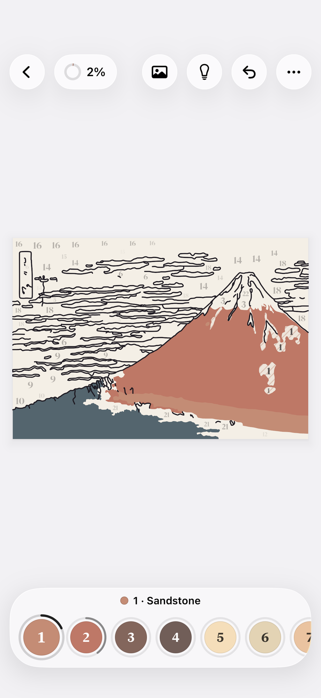
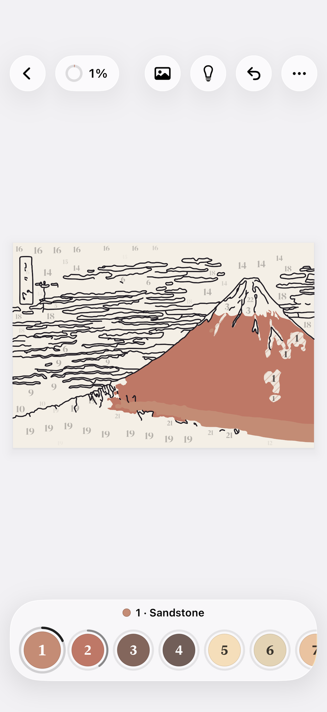
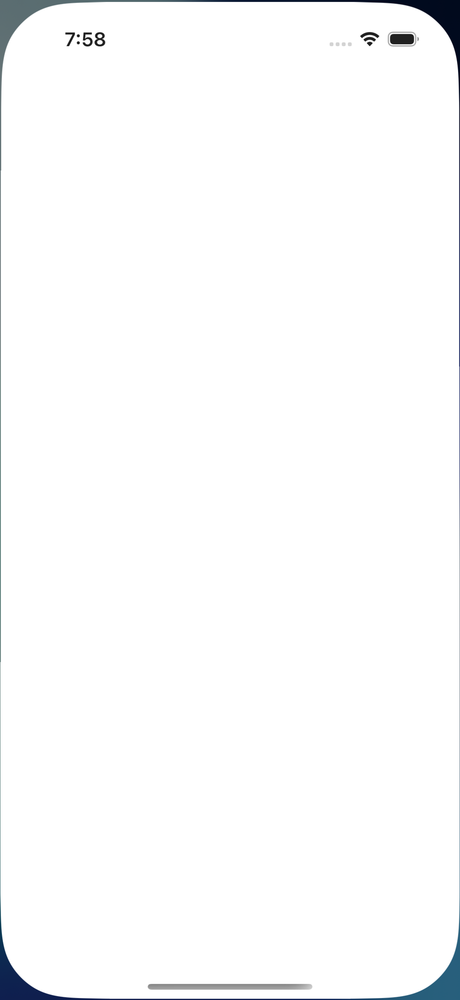
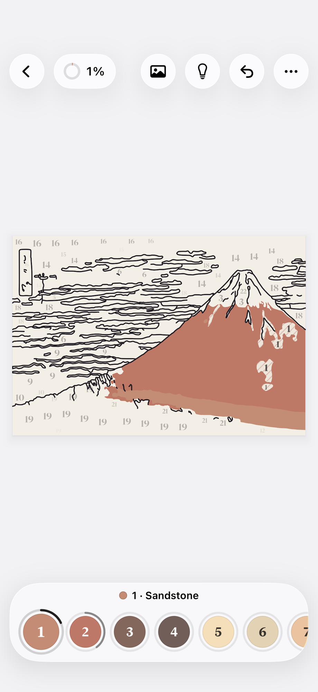
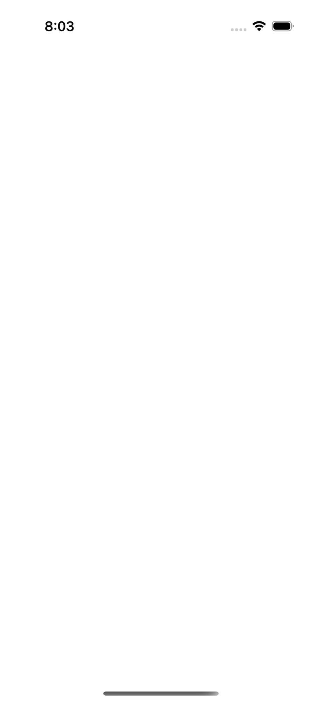
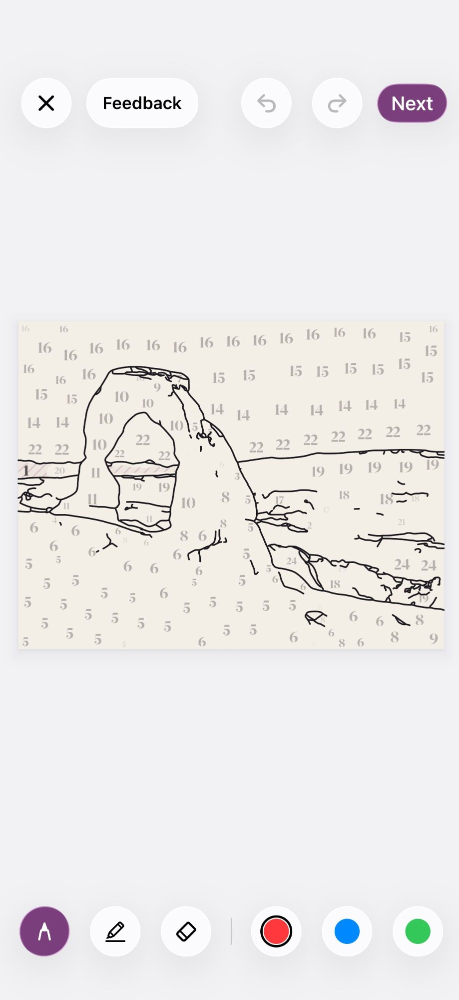

# Agent transcript

- end: success, 155 turns, 28.7 min, estimated $4.4872432
- tool calls: {"mcp__maestro__take_screenshot": 50, "mcp__maestro__inspect_screen": 10, "Read": 21, "mcp__maestro__run": 55, "Write": 4}
- images the agent received: 63

**Start**: model claude-opus-5-5, MCP [{"name": "maestro", "status": "connected", "source": "dynamic"}]

→ `mcp__maestro__take_screenshot` `{"device_id": "E839A11B-51B4-4AD3-ACF4-A53B95B7C957"}`

← mcp__maestro__take_screenshot: image  919x2000

→ `mcp__maestro__inspect_screen` `{"device_id": "E839A11B-51B4-4AD3-ACF4-A53B95B7C957"}`

← mcp__maestro__inspect_screen: {"ui_schema":{"platform":"ios","abbreviations":{"b":"bounds","txt":"text","rid":"resource-id","a11y":"accessibilityText","hint":"hintText","val":"value","c":"children"},"defaults":{"enabled":true,"focused":false,"selected":false,"checked":false,"txt":"","hint":"","rid":"","val":"","a11y":""}},"elements":[{"b":"[0,0][402,874]","a11y":"Paint by Moonlight","c":[{"b":"[0,0][402,874]","c":[{"b":"[0,0][ …

→ `Read` `{"file_path": "/Users/runner/work/_temp/qa/app.log"}`

← Read: 1	getpwuid_r did not find a match for uid 501
2	Filtering the log data using "subsystem == "com.pbordjadze.paintbynumber""
3	Timestamp               Ty Process[PID:TID]
4	2026-10-21 19:37:51.524 Df PaintByNumber[39137:198cf] [com.pbordjadze.paintbynumber:tips] offer in shelf: , wanted
5	2026-10-21 19:37:52.712 Df PaintByNumber[39137:19916] [com.pbordjadze.paintbynumber:canvas] Making the render co …

→ `mcp__maestro__run` `{"device_id": "E839A11B-51B4-4AD3-ACF4-A53B95B7C957", "yaml": "appId: com.pbordjadze.paintbynumber\n---\n- takeScreenshot: /Users/runner/work/_temp/qa/shots/01-gallery-start\n- tapOn: \"New Painting\"\n- waitForAnimationToEnd\n- takeScreenshot: /Users/runner/work/_temp/qa/shots/02-new-painting"}`

→ `mcp__maestro__take_screenshot` `{"device_id": "E839A11B-51B4-4AD3-ACF4-A53B95B7C957"}`

← mcp__maestro__run: {"success":true,"device_id":"E839A11B-51B4-4AD3-ACF4-A53B95B7C957","commands_executed":5,"message":"Flow executed successfully","env_vars":{"MAESTRO_CLI_ANALYSIS_NOTIFICATION_DISABLED":"true","MAESTRO_CLI_NO_ANALYTICS":"1","MAESTRO_DRIVER_STARTUP_TIMEOUT":"240000","MAESTRO_VERSION":"2.11.0"}}

← mcp__maestro__take_screenshot: image  919x2000

→ `mcp__maestro__take_screenshot` `{"device_id": "E839A11B-51B4-4AD3-ACF4-A53B95B7C957"}`

← mcp__maestro__take_screenshot: image  919x2000

> Gallery loaded with the two starter paintings; New Painting opened (after a noticeable pause) with a "No Photo at Hand" tip. Closing it and heading to Samples.

→ `mcp__maestro__run` `{"device_id": "E839A11B-51B4-4AD3-ACF4-A53B95B7C957", "yaml": "appId: com.pbordjadze.paintbynumber\n---\n- takeScreenshot: /Users/runner/work/_temp/qa/shots/03-new-painting-tip\n- tapOn:\n    point: \"83%,22%\"\n- waitForAnimationToEnd\n- tapOn: \"Samples\"\n- waitForAnimationToEnd\n- takeScreenshot: /Users/runner/work/_temp/qa/shots/04-samples"}`

→ `mcp__maestro__take_screenshot` `{"device_id": "E839A11B-51B4-4AD3-ACF4-A53B95B7C957"}`

← mcp__maestro__run: {"success":true,"device_id":"E839A11B-51B4-4AD3-ACF4-A53B95B7C957","commands_executed":7,"message":"Flow executed successfully","env_vars":{"MAESTRO_CLI_ANALYSIS_NOTIFICATION_DISABLED":"true","MAESTRO_CLI_NO_ANALYTICS":"1","MAESTRO_DRIVER_STARTUP_TIMEOUT":"240000","MAESTRO_VERSION":"2.11.0"}}

← mcp__maestro__take_screenshot: image  919x2000

→ `mcp__maestro__run` `{"device_id": "E839A11B-51B4-4AD3-ACF4-A53B95B7C957", "yaml": "appId: com.pbordjadze.paintbynumber\n---\n- tapOn:\n    point: \"72%,47%\"\n- waitForAnimationToEnd\n- takeScreenshot: /Users/runner/work/_temp/qa/shots/05-preview"}`

→ `mcp__maestro__take_screenshot` `{"device_id": "E839A11B-51B4-4AD3-ACF4-A53B95B7C957"}`

← mcp__maestro__run: {"success":true,"device_id":"E839A11B-51B4-4AD3-ACF4-A53B95B7C957","commands_executed":4,"message":"Flow executed successfully","env_vars":{"MAESTRO_CLI_ANALYSIS_NOTIFICATION_DISABLED":"true","MAESTRO_CLI_NO_ANALYTICS":"1","MAESTRO_DRIVER_STARTUP_TIMEOUT":"240000","MAESTRO_VERSION":"2.11.0"}}

← mcp__maestro__take_screenshot: image  919x2000

> Preview shows Colors slider at 24 but the summary says "22 colors" — the mismatch flagged earlier. Confirming via hierarchy.

→ `mcp__maestro__inspect_screen` `{"device_id": "E839A11B-51B4-4AD3-ACF4-A53B95B7C957"}`

← mcp__maestro__inspect_screen: {"ui_schema":{"platform":"ios","abbreviations":{"b":"bounds","txt":"text","rid":"resource-id","a11y":"accessibilityText","hint":"hintText","val":"value","c":"children"},"defaults":{"enabled":true,"focused":false,"selected":false,"checked":false,"txt":"","hint":"","rid":"","val":"","a11y":""}},"elements":[{"b":"[0,0][402,874]","a11y":"Paint by Moonlight","c":[{"b":"[0,0][402,874]","c":[{"b":"[0,0][ …

> Hierarchy confirms Colors "24" vs "22 colors · 248 areas · ~10 min". No Refine button (good). Now trying the Colors slider.

→ `mcp__maestro__run` `{"device_id": "E839A11B-51B4-4AD3-ACF4-A53B95B7C957", "yaml": "appId: com.pbordjadze.paintbynumber\n---\n- swipe:\n    start: \"38%,82%\"\n    end: \"60%,82%\"\n    duration: 800\n- waitForAnimationToEnd\n- takeScreenshot: /Users/runner/work/_temp/qa/shots/06-colors-slider-up"}`

→ `mcp__maestro__inspect_screen` `{"device_id": "E839A11B-51B4-4AD3-ACF4-A53B95B7C957"}`

← mcp__maestro__run: {"success":true,"device_id":"E839A11B-51B4-4AD3-ACF4-A53B95B7C957","commands_executed":4,"message":"Flow executed successfully","env_vars":{"MAESTRO_CLI_ANALYSIS_NOTIFICATION_DISABLED":"true","MAESTRO_CLI_NO_ANALYTICS":"1","MAESTRO_DRIVER_STARTUP_TIMEOUT":"240000","MAESTRO_VERSION":"2.11.0"}}

← mcp__maestro__inspect_screen: {"ui_schema":{"platform":"ios","abbreviations":{"b":"bounds","txt":"text","rid":"resource-id","a11y":"accessibilityText","hint":"hintText","val":"value","c":"children"},"defaults":{"enabled":true,"focused":false,"selected":false,"checked":false,"txt":"","hint":"","rid":"","val":"","a11y":""}},"elements":[{"b":"[0,0][402,874]","a11y":"Paint by Moonlight","c":[{"b":"[0,0][402,874]","c":[{"b":"[0,0][ …

→ `mcp__maestro__take_screenshot` `{"device_id": "E839A11B-51B4-4AD3-ACF4-A53B95B7C957"}`

← mcp__maestro__take_screenshot: image  919x2000

> Colors 53 → "40 colors". Pushing the slider to both ends.

→ `mcp__maestro__run` `{"device_id": "E839A11B-51B4-4AD3-ACF4-A53B95B7C957", "yaml": "appId: com.pbordjadze.paintbynumber\n---\n- swipe:\n    start: \"56%,82%\"\n    end: \"99%,82%\"\n    duration: 800\n- waitForAnimationToEnd\n- takeScreenshot: /Users/runner/work/_temp/qa/shots/07-colors-max"}`

→ `mcp__maestro__inspect_screen` `{"device_id": "E839A11B-51B4-4AD3-ACF4-A53B95B7C957"}`

← mcp__maestro__run: {"success":true,"device_id":"E839A11B-51B4-4AD3-ACF4-A53B95B7C957","commands_executed":4,"message":"Flow executed successfully","env_vars":{"MAESTRO_CLI_ANALYSIS_NOTIFICATION_DISABLED":"true","MAESTRO_CLI_NO_ANALYTICS":"1","MAESTRO_DRIVER_STARTUP_TIMEOUT":"240000","MAESTRO_VERSION":"2.11.0"}}

← mcp__maestro__inspect_screen: {"ui_schema":{"platform":"ios","abbreviations":{"b":"bounds","txt":"text","rid":"resource-id","a11y":"accessibilityText","hint":"hintText","val":"value","c":"children"},"defaults":{"enabled":true,"focused":false,"selected":false,"checked":false,"txt":"","hint":"","rid":"","val":"","a11y":""}},"elements":[{"b":"[0,0][402,874]","a11y":"Paint by Moonlight","c":[{"b":"[0,0][402,874]","c":[{"b":"[0,0][ …

→ `mcp__maestro__run` `{"device_id": "E839A11B-51B4-4AD3-ACF4-A53B95B7C957", "yaml": "appId: com.pbordjadze.paintbynumber\n---\n- swipe:\n    start: \"92%,82%\"\n    end: \"2%,82%\"\n    duration: 800\n- waitForAnimationToEnd\n- takeScreenshot: /Users/runner/work/_temp/qa/shots/08-colors-min"}`

→ `mcp__maestro__take_screenshot` `{"device_id": "E839A11B-51B4-4AD3-ACF4-A53B95B7C957"}`

← mcp__maestro__run: {"success":true,"device_id":"E839A11B-51B4-4AD3-ACF4-A53B95B7C957","commands_executed":4,"message":"Flow executed successfully","env_vars":{"MAESTRO_CLI_ANALYSIS_NOTIFICATION_DISABLED":"true","MAESTRO_CLI_NO_ANALYTICS":"1","MAESTRO_DRIVER_STARTUP_TIMEOUT":"240000","MAESTRO_VERSION":"2.11.0"}}

← mcp__maestro__take_screenshot: image  919x2000

> At minimum the slider reads 8 and summary "8 colors", but the thumb stops well right of the track's left end. Checking whether that's real.

→ `mcp__maestro__run` `{"device_id": "E839A11B-51B4-4AD3-ACF4-A53B95B7C957", "yaml": "appId: com.pbordjadze.paintbynumber\n---\n- swipe:\n    start: \"19%,82%\"\n    end: \"1%,82%\"\n    duration: 1000\n- waitForAnimationToEnd\n- takeScreenshot: /Users/runner/work/_temp/qa/shots/09-colors-min-again"}`

→ `mcp__maestro__take_screenshot` `{"device_id": "E839A11B-51B4-4AD3-ACF4-A53B95B7C957"}`

← mcp__maestro__run: {"success":true,"device_id":"E839A11B-51B4-4AD3-ACF4-A53B95B7C957","commands_executed":4,"message":"Flow executed successfully","env_vars":{"MAESTRO_CLI_ANALYSIS_NOTIFICATION_DISABLED":"true","MAESTRO_CLI_NO_ANALYTICS":"1","MAESTRO_DRIVER_STARTUP_TIMEOUT":"240000","MAESTRO_VERSION":"2.11.0"}}

← mcp__maestro__take_screenshot: image  919x2000

> Min is 6 (first swipe just didn't reach the end). The mismatch shows up at higher values only (24→22, 53→40, 150→97). Resetting and checking the other sliders.

→ `mcp__maestro__run` `{"device_id": "E839A11B-51B4-4AD3-ACF4-A53B95B7C957", "yaml": "appId: com.pbordjadze.paintbynumber\n---\n- tapOn: \"Reset to Suggested\"\n- waitForAnimationToEnd\n- takeScreenshot: /Users/runner/work/_temp/qa/shots/10-reset\n- tapOn: \"Detail\"\n- waitForAnimationToEnd\n- takeScreenshot: /Users/runner/work/_temp/qa/shots/11-detail-tab"}`

→ `mcp__maestro__take_screenshot` `{"device_id": "E839A11B-51B4-4AD3-ACF4-A53B95B7C957"}`

← mcp__maestro__run: {"success":true,"device_id":"E839A11B-51B4-4AD3-ACF4-A53B95B7C957","commands_executed":7,"message":"Flow executed successfully","env_vars":{"MAESTRO_CLI_ANALYSIS_NOTIFICATION_DISABLED":"true","MAESTRO_CLI_NO_ANALYTICS":"1","MAESTRO_DRIVER_STARTUP_TIMEOUT":"240000","MAESTRO_VERSION":"2.11.0"}}

← mcp__maestro__take_screenshot: image  919x2000

> Reset restored "Suggested" and the summary went back to "22 colors · 248 areas". Now the Detail, Smoothness and Lines sliders.

→ `mcp__maestro__run` `{"device_id": "E839A11B-51B4-4AD3-ACF4-A53B95B7C957", "yaml": "appId: com.pbordjadze.paintbynumber\n---\n- swipe:\n    start: \"73%,82%\"\n    end: \"99%,82%\"\n    duration: 800\n- waitForAnimationToEnd\n- takeScreenshot: /Users/runner/work/_temp/qa/shots/12-detail-max\n- swipe:\n    start: \"93%,82%\"\n    end: \"1%,82%\"\n    duration: 1000\n- waitForAnimationToEnd\n- takeScreenshot: /Users/runner/work/_temp/qa/shots/13-detail-min"}`

→ `mcp__maestro__take_screenshot` `{"device_id": "E839A11B-51B4-4AD3-ACF4-A53B95B7C957"}`

← mcp__maestro__run: {"success":true,"device_id":"E839A11B-51B4-4AD3-ACF4-A53B95B7C957","commands_executed":7,"message":"Flow executed successfully","env_vars":{"MAESTRO_CLI_ANALYSIS_NOTIFICATION_DISABLED":"true","MAESTRO_CLI_NO_ANALYTICS":"1","MAESTRO_DRIVER_STARTUP_TIMEOUT":"240000","MAESTRO_VERSION":"2.11.0"}}

← mcp__maestro__take_screenshot: image  919x2000

→ `Read` `{"file_path": "/Users/runner/work/_temp/qa/shots/12-detail-max.png"}`

← Read: image  920x2000

→ `mcp__maestro__run` `{"device_id": "E839A11B-51B4-4AD3-ACF4-A53B95B7C957", "yaml": "appId: com.pbordjadze.paintbynumber\n---\n- tapOn: \"Smoothness\"\n- waitForAnimationToEnd\n- takeScreenshot: /Users/runner/work/_temp/qa/shots/14-smooth-tab\n- swipe:\n    start: \"50%,82%\"\n    end: \"99%,82%\"\n    duration: 1000\n- waitForAnimationToEnd\n- takeScreenshot: /Users/runner/work/_temp/qa/shots/15-smooth-max\n- tapOn: \"Lines\"\n- waitForAnimationToEnd\n- takeScreenshot: /Users/runner/work/_temp/qa/shots/16-lines-tab\n- swipe:\n    start: \"50%,82%\"\n    end: \"1%,82%\"\n    duration: 1000\n- waitForAnimationToEnd\`

← mcp__maestro__run: {"success":true,"device_id":"E839A11B-51B4-4AD3-ACF4-A53B95B7C957","commands_executed":13,"message":"Flow executed successfully","env_vars":{"MAESTRO_CLI_ANALYSIS_NOTIFICATION_DISABLED":"true","MAESTRO_CLI_NO_ANALYTICS":"1","MAESTRO_DRIVER_STARTUP_TIMEOUT":"240000","MAESTRO_VERSION":"2.11.0"}}

→ `Read` `{"file_path": "/Users/runner/work/_temp/qa/shots/15-smooth-max.png"}`

→ `mcp__maestro__take_screenshot` `{"device_id": "E839A11B-51B4-4AD3-ACF4-A53B95B7C957"}`

← Read: image  920x2000

← mcp__maestro__take_screenshot: image  919x2000

> Sliders all respond and update the preview and summary. Resetting, then trying Enlarge Preview.

→ `mcp__maestro__run` `{"device_id": "E839A11B-51B4-4AD3-ACF4-A53B95B7C957", "yaml": "appId: com.pbordjadze.paintbynumber\n---\n- tapOn: \"Reset to Suggested\"\n- waitForAnimationToEnd\n- tapOn: \"Enlarge Preview\"\n- waitForAnimationToEnd\n- takeScreenshot: /Users/runner/work/_temp/qa/shots/18-enlarged"}`

→ `mcp__maestro__take_screenshot` `{"device_id": "E839A11B-51B4-4AD3-ACF4-A53B95B7C957"}`

← mcp__maestro__run: {"success":true,"device_id":"E839A11B-51B4-4AD3-ACF4-A53B95B7C957","commands_executed":6,"message":"Flow executed successfully","env_vars":{"MAESTRO_CLI_ANALYSIS_NOTIFICATION_DISABLED":"true","MAESTRO_CLI_NO_ANALYTICS":"1","MAESTRO_DRIVER_STARTUP_TIMEOUT":"240000","MAESTRO_VERSION":"2.11.0"}}

← mcp__maestro__take_screenshot: image  919x2000

→ `mcp__maestro__inspect_screen` `{"device_id": "E839A11B-51B4-4AD3-ACF4-A53B95B7C957"}`

← mcp__maestro__inspect_screen: {"ui_schema":{"platform":"ios","abbreviations":{"b":"bounds","txt":"text","rid":"resource-id","a11y":"accessibilityText","hint":"hintText","val":"value","c":"children"},"defaults":{"enabled":true,"focused":false,"selected":false,"checked":false,"txt":"","hint":"","rid":"","val":"","a11y":""}},"elements":[{"b":"[0,0][402,874]","a11y":"Paint by Moonlight","c":[{"b":"[0,0][402,874]","c":[{"b":"[0,0][ …

> Confirmed: the image is 370×252 pt both before and after Enlarge. Shrinking, then testing the title field.

→ `mcp__maestro__run` `{"device_id": "E839A11B-51B4-4AD3-ACF4-A53B95B7C957", "yaml": "appId: com.pbordjadze.paintbynumber\n---\n- tapOn: \"Shrink Preview\"\n- waitForAnimationToEnd\n- takeScreenshot: /Users/runner/work/_temp/qa/shots/19-shrunk\n- tapOn:\n    id: \"painting-title\"\n- waitForAnimationToEnd\n- takeScreenshot: /Users/runner/work/_temp/qa/shots/20-title-focus\n- inputText: \"Fuji Test Painting With A Rather Long Title\"\n- waitForAnimationToEnd\n- takeScreenshot: /Users/runner/work/_temp/qa/shots/21-title-typed"}`

→ `mcp__maestro__take_screenshot` `{"device_id": "E839A11B-51B4-4AD3-ACF4-A53B95B7C957"}`

← mcp__maestro__run: {"success":true,"device_id":"E839A11B-51B4-4AD3-ACF4-A53B95B7C957","commands_executed":10,"message":"Flow executed successfully","env_vars":{"MAESTRO_CLI_ANALYSIS_NOTIFICATION_DISABLED":"true","MAESTRO_CLI_NO_ANALYTICS":"1","MAESTRO_DRIVER_STARTUP_TIMEOUT":"240000","MAESTRO_VERSION":"2.11.0"}}

← mcp__maestro__take_screenshot: image  919x2000

→ `Write` `{"file_path": "/Users/runner/work/_temp/qa/report.md", "content": "# Paint by Moonlight: exploratory test report (iPhone 17 Pro simulator, release build)\n\n## Summary\n(In progress.) Creating a painting from a sample works. The New Painting preview has polish problems: the Colors slider value doesn't match the summary's color count, \"Enlarge Preview\" doesn't enlarge anything on iPhone, and the preview is squeezed to an unreadable thumbnail while the title is being edited.\n\n## Coverage\n- Goal 1 (create painting): in progress. Reached the preview for sample \"Red Fuji\" and tried every sli`

← Write: File created successfully at: /Users/runner/work/_temp/qa/report.md (file state is current in your context — no need to Read it back)

→ `mcp__maestro__run` `{"device_id": "E839A11B-51B4-4AD3-ACF4-A53B95B7C957", "yaml": "appId: com.pbordjadze.paintbynumber\n---\n- tapOn:\n    point: \"86%,88%\"\n- waitForAnimationToEnd\n- takeScreenshot: /Users/runner/work/_temp/qa/shots/22-title-done\n- tapOn: \"Start Painting\"\n- takeScreenshot: /Users/runner/work/_temp/qa/shots/23-start-1"}`

→ `mcp__maestro__take_screenshot` `{"device_id": "E839A11B-51B4-4AD3-ACF4-A53B95B7C957"}`

← mcp__maestro__run: {"success":true,"device_id":"E839A11B-51B4-4AD3-ACF4-A53B95B7C957","commands_executed":6,"message":"Flow executed successfully","env_vars":{"MAESTRO_CLI_ANALYSIS_NOTIFICATION_DISABLED":"true","MAESTRO_CLI_NO_ANALYTICS":"1","MAESTRO_DRIVER_STARTUP_TIMEOUT":"240000","MAESTRO_VERSION":"2.11.0"}}

← mcp__maestro__take_screenshot: image  919x2000

> The painting screen opened quickly, at 0% with swatch 1 selected and a "Tap to Paint" tip. Closing the tip and inspecting the screen.

→ `mcp__maestro__run` `{"device_id": "E839A11B-51B4-4AD3-ACF4-A53B95B7C957", "yaml": "appId: com.pbordjadze.paintbynumber\n---\n- takeScreenshot: /Users/runner/work/_temp/qa/shots/24-paint-screen-tip\n- tapOn:\n    point: \"75%,76%\"\n- waitForAnimationToEnd"}`

→ `mcp__maestro__inspect_screen` `{"device_id": "E839A11B-51B4-4AD3-ACF4-A53B95B7C957"}`

← mcp__maestro__run: {"success":true,"device_id":"E839A11B-51B4-4AD3-ACF4-A53B95B7C957","commands_executed":4,"message":"Flow executed successfully","env_vars":{"MAESTRO_CLI_ANALYSIS_NOTIFICATION_DISABLED":"true","MAESTRO_CLI_NO_ANALYTICS":"1","MAESTRO_DRIVER_STARTUP_TIMEOUT":"240000","MAESTRO_VERSION":"2.11.0"}}

← mcp__maestro__inspect_screen: {"ui_schema":{"platform":"ios","abbreviations":{"b":"bounds","txt":"text","rid":"resource-id","a11y":"accessibilityText","hint":"hintText","val":"value","c":"children"},"defaults":{"enabled":true,"focused":false,"selected":false,"checked":false,"txt":"","hint":"","rid":"","val":"","a11y":""}},"elements":[{"b":"[0,0][402,874]","a11y":"Paint by Moonlight","c":[{"b":"[0,0][402,874]","c":[{"b":"[0,0][ …

> The canvas exposes 11 areas of color 1, and the palette has 22 swatches (matching "22 colors"). Painting area 166 by its id.

→ `mcp__maestro__run` `{"device_id": "E839A11B-51B4-4AD3-ACF4-A53B95B7C957", "yaml": "appId: com.pbordjadze.paintbynumber\n---\n- tapOn:\n    point: \"259,405\"\n- waitForAnimationToEnd\n- takeScreenshot: /Users/runner/work/_temp/qa/shots/25-painted-1"}`

→ `mcp__maestro__take_screenshot` `{"device_id": "E839A11B-51B4-4AD3-ACF4-A53B95B7C957"}`

← mcp__maestro__run: {"success":true,"device_id":"E839A11B-51B4-4AD3-ACF4-A53B95B7C957","commands_executed":4,"message":"Flow executed successfully","env_vars":{"MAESTRO_CLI_ANALYSIS_NOTIFICATION_DISABLED":"true","MAESTRO_CLI_NO_ANALYTICS":"1","MAESTRO_DRIVER_STARTUP_TIMEOUT":"240000","MAESTRO_VERSION":"2.11.0"}}

← mcp__maestro__take_screenshot: image  919x2000

> A tiny area 1 got painted (small dot at the tapped spot), swatch 1's ring moved, overall still 0%. Now the big hatched band at the bottom.

→ `mcp__maestro__run` `{"device_id": "E839A11B-51B4-4AD3-ACF4-A53B95B7C957", "yaml": "appId: com.pbordjadze.paintbynumber\n---\n- tapOn:\n    point: \"210,503\"\n- waitForAnimationToEnd\n- takeScreenshot: /Users/runner/work/_temp/qa/shots/26-painted-band"}`

→ `mcp__maestro__take_screenshot` `{"device_id": "E839A11B-51B4-4AD3-ACF4-A53B95B7C957"}`

← mcp__maestro__run: {"success":true,"device_id":"E839A11B-51B4-4AD3-ACF4-A53B95B7C957","commands_executed":4,"message":"Flow executed successfully","env_vars":{"MAESTRO_CLI_ANALYSIS_NOTIFICATION_DISABLED":"true","MAESTRO_CLI_NO_ANALYTICS":"1","MAESTRO_DRIVER_STARTUP_TIMEOUT":"240000","MAESTRO_VERSION":"2.11.0"}}

← mcp__maestro__take_screenshot: image  919x2000

> The band filled in Sandstone, the swatch-1 ring moved, the header still says 0% (2 of 248 areas, plausibly under 1%). Next: swatch 2 and the mountain.

→ `mcp__maestro__run` `{"device_id": "E839A11B-51B4-4AD3-ACF4-A53B95B7C957", "yaml": "appId: com.pbordjadze.paintbynumber\n---\n- tapOn:\n    id: \"swatch-2\"\n    index: 0\n- waitForAnimationToEnd\n- takeScreenshot: /Users/runner/work/_temp/qa/shots/27-swatch2\n- tapOn:\n    point: \"288,437\"\n- waitForAnimationToEnd\n- takeScreenshot: /Users/runner/work/_temp/qa/shots/28-painted-mountain"}`

→ `mcp__maestro__take_screenshot` `{"device_id": "E839A11B-51B4-4AD3-ACF4-A53B95B7C957"}`

← mcp__maestro__run: {"success":true,"device_id":"E839A11B-51B4-4AD3-ACF4-A53B95B7C957","commands_executed":7,"message":"Flow executed successfully","env_vars":{"MAESTRO_CLI_ANALYSIS_NOTIFICATION_DISABLED":"true","MAESTRO_CLI_NO_ANALYTICS":"1","MAESTRO_DRIVER_STARTUP_TIMEOUT":"240000","MAESTRO_VERSION":"2.11.0"}}

← mcp__maestro__take_screenshot: image  919x2000

> A single tap painted the whole mountain, yet progress reads only 1% (progress apparently counts areas, 3 of 248, not painted surface). Now goal (c): tapping a "19" on the canvas while 2 is selected.

→ `mcp__maestro__run` `{"device_id": "E839A11B-51B4-4AD3-ACF4-A53B95B7C957", "yaml": "appId: com.pbordjadze.paintbynumber\n---\n- tapOn:\n    point: \"37,530\"\n- waitForAnimationToEnd\n- takeScreenshot: /Users/runner/work/_temp/qa/shots/29-tap-19"}`

→ `mcp__maestro__take_screenshot` `{"device_id": "E839A11B-51B4-4AD3-ACF4-A53B95B7C957"}`

← mcp__maestro__run: {"success":true,"device_id":"E839A11B-51B4-4AD3-ACF4-A53B95B7C957","commands_executed":4,"message":"Flow executed successfully","env_vars":{"MAESTRO_CLI_ANALYSIS_NOTIFICATION_DISABLED":"true","MAESTRO_CLI_NO_ANALYTICS":"1","MAESTRO_DRIVER_STARTUP_TIMEOUT":"240000","MAESTRO_VERSION":"2.11.0"}}

← mcp__maestro__take_screenshot: image  919x2000

> Nothing happened: the selection stayed on 2 and the palette didn't move. Checking the log, then trying again on a different number.

→ `Read` `{"file_path": "/Users/runner/work/_temp/qa/app.log", "offset": 11}`

← Read: 11	2026-10-21 19:40:21.922 Df PaintByNumber[39137:198cf] [com.pbordjadze.paintbynumber:tips] turn over: shelfStarter
12	2026-10-21 19:44:53.636 Df PaintByNumber[39137:198cf] [com.pbordjadze.paintbynumber:tips] offer in newPainting: newPaintingSamples, wanted newPaintingSamples
13	2026-10-21 19:44:54.955 Df PaintByNumber[39137:198cf] [com.pbordjadze.paintbynumber:tips] turn: newPaintingSamples
14	2 …

> The log has a line worth noting: `19:51:16.998 Hand-off: the painting never drew; the cover fades away` when the painting screen opened. Retrying the off-color tap on a "16" at the top.

→ `mcp__maestro__run` `{"device_id": "E839A11B-51B4-4AD3-ACF4-A53B95B7C957", "yaml": "appId: com.pbordjadze.paintbynumber\n---\n- tapOn:\n    point: \"46,307\"\n- waitForAnimationToEnd\n- takeScreenshot: /Users/runner/work/_temp/qa/shots/30-tap-16"}`

→ `mcp__maestro__take_screenshot` `{"device_id": "E839A11B-51B4-4AD3-ACF4-A53B95B7C957"}`

← mcp__maestro__run: {"success":true,"device_id":"E839A11B-51B4-4AD3-ACF4-A53B95B7C957","commands_executed":4,"message":"Flow executed successfully","env_vars":{"MAESTRO_CLI_ANALYSIS_NOTIFICATION_DISABLED":"true","MAESTRO_CLI_NO_ANALYTICS":"1","MAESTRO_DRIVER_STARTUP_TIMEOUT":"240000","MAESTRO_VERSION":"2.11.0"}}

← mcp__maestro__take_screenshot: image  919x2000

> Still no change. Checking whether the log recorded anything for these taps.

→ `Read` `{"file_path": "/Users/runner/work/_temp/qa/app.log", "offset": 245}`

← Read: 245	2026-10-21 19:51:31.921 Df PaintByNumber[39137:198cf] [com.pbordjadze.paintbynumber:tips] turn over: benchTap
246	2026-10-21 19:51:39.179 Df PaintByNumber[39137:198cf] [com.pbordjadze.paintbynumber:tips] offer in bench: , wanted
247	2026-10-21 19:52:50.869 Df PaintByNumber[39137:198cf] [com.pbordjadze.paintbynumber:tips] offer in bench: benchZen, wanted
248

> Nothing logged for the taps. Trying the same while zoomed in: double-tap near the bottom-left "19"s.

→ `mcp__maestro__run` `{"device_id": "E839A11B-51B4-4AD3-ACF4-A53B95B7C957", "yaml": "appId: com.pbordjadze.paintbynumber\n---\n- doubleTapOn:\n    point: \"80,515\"\n- waitForAnimationToEnd\n- takeScreenshot: /Users/runner/work/_temp/qa/shots/31-doubletap-zoom"}`

→ `mcp__maestro__take_screenshot` `{"device_id": "E839A11B-51B4-4AD3-ACF4-A53B95B7C957"}`

← mcp__maestro__run: {"success":true,"device_id":"E839A11B-51B4-4AD3-ACF4-A53B95B7C957","commands_executed":4,"message":"Flow executed successfully","env_vars":{"MAESTRO_CLI_ANALYSIS_NOTIFICATION_DISABLED":"true","MAESTRO_CLI_NO_ANALYTICS":"1","MAESTRO_DRIVER_STARTUP_TIMEOUT":"240000","MAESTRO_VERSION":"2.11.0"}}

← mcp__maestro__take_screenshot: image  919x2000

> Double-tap didn't zoom, as the earlier session also found (an automation problem). Using Hint to zoom in instead.

→ `mcp__maestro__run` `{"device_id": "E839A11B-51B4-4AD3-ACF4-A53B95B7C957", "yaml": "appId: com.pbordjadze.paintbynumber\n---\n- tapOn: \"Hint\"\n- waitForAnimationToEnd\n- takeScreenshot: /Users/runner/work/_temp/qa/shots/32-hint"}`

→ `mcp__maestro__take_screenshot` `{"device_id": "E839A11B-51B4-4AD3-ACF4-A53B95B7C957"}`

← mcp__maestro__run: {"success":true,"device_id":"E839A11B-51B4-4AD3-ACF4-A53B95B7C957","commands_executed":4,"message":"Flow executed successfully","env_vars":{"MAESTRO_CLI_ANALYSIS_NOTIFICATION_DISABLED":"true","MAESTRO_CLI_NO_ANALYTICS":"1","MAESTRO_DRIVER_STARTUP_TIMEOUT":"240000","MAESTRO_VERSION":"2.11.0"}}

← mcp__maestro__take_screenshot: image  919x2000

> Hint zoomed in to a thin hatched color-2 strip at the base of the mountain. Now tapping a "19" while zoomed in.

→ `mcp__maestro__run` `{"device_id": "E839A11B-51B4-4AD3-ACF4-A53B95B7C957", "yaml": "appId: com.pbordjadze.paintbynumber\n---\n- tapOn:\n    point: \"195,663\"\n- waitForAnimationToEnd\n- takeScreenshot: /Users/runner/work/_temp/qa/shots/33-zoomed-tap-19"}`

→ `mcp__maestro__take_screenshot` `{"device_id": "E839A11B-51B4-4AD3-ACF4-A53B95B7C957"}`

← mcp__maestro__run: {"success":true,"device_id":"E839A11B-51B4-4AD3-ACF4-A53B95B7C957","commands_executed":4,"message":"Flow executed successfully","env_vars":{"MAESTRO_CLI_ANALYSIS_NOTIFICATION_DISABLED":"true","MAESTRO_CLI_NO_ANALYTICS":"1","MAESTRO_DRIVER_STARTUP_TIMEOUT":"240000","MAESTRO_VERSION":"2.11.0"}}

← mcp__maestro__take_screenshot: image  919x2000

> No switch again. One more try on the large "18" in the sea, then a long press to see whether that's the gesture.

→ `mcp__maestro__run` `{"device_id": "E839A11B-51B4-4AD3-ACF4-A53B95B7C957", "yaml": "appId: com.pbordjadze.paintbynumber\n---\n- tapOn:\n    point: \"230,302\"\n- waitForAnimationToEnd\n- takeScreenshot: /Users/runner/work/_temp/qa/shots/34-zoomed-tap-18\n- longPressOn:\n    point: \"195,663\"\n- waitForAnimationToEnd\n- takeScreenshot: /Users/runner/work/_temp/qa/shots/35-longpress-19"}`

→ `mcp__maestro__take_screenshot` `{"device_id": "E839A11B-51B4-4AD3-ACF4-A53B95B7C957"}`

← mcp__maestro__run: {"success":true,"device_id":"E839A11B-51B4-4AD3-ACF4-A53B95B7C957","commands_executed":7,"message":"Flow executed successfully","env_vars":{"MAESTRO_CLI_ANALYSIS_NOTIFICATION_DISABLED":"true","MAESTRO_CLI_NO_ANALYTICS":"1","MAESTRO_DRIVER_STARTUP_TIMEOUT":"240000","MAESTRO_VERSION":"2.11.0"}}

← mcp__maestro__take_screenshot: image  919x2000

> Neither tap nor long press on another color's number does anything. To check the canvas still takes taps, I'll paint the hatched color-2 strip.

→ `mcp__maestro__run` `{"device_id": "E839A11B-51B4-4AD3-ACF4-A53B95B7C957", "yaml": "appId: com.pbordjadze.paintbynumber\n---\n- tapOn:\n    point: \"260,580\"\n- waitForAnimationToEnd\n- takeScreenshot: /Users/runner/work/_temp/qa/shots/36-zoomed-paint-2"}`

→ `mcp__maestro__take_screenshot` `{"device_id": "E839A11B-51B4-4AD3-ACF4-A53B95B7C957"}`

← mcp__maestro__run: {"success":true,"device_id":"E839A11B-51B4-4AD3-ACF4-A53B95B7C957","commands_executed":4,"message":"Flow executed successfully","env_vars":{"MAESTRO_CLI_ANALYSIS_NOTIFICATION_DISABLED":"true","MAESTRO_CLI_NO_ANALYTICS":"1","MAESTRO_DRIVER_STARTUP_TIMEOUT":"240000","MAESTRO_VERSION":"2.11.0"}}

← mcp__maestro__take_screenshot: image  919x2000

> Painting while zoomed works (the strip filled in Desert Rose, swatch-2 ring grew), so the canvas does take taps; only taps on another color's number do nothing. Now scrolling the palette to its end.

→ `mcp__maestro__run` `{"device_id": "E839A11B-51B4-4AD3-ACF4-A53B95B7C957", "yaml": "appId: com.pbordjadze.paintbynumber\n---\n- swipe:\n    start: \"85%,91%\"\n    end: \"10%,91%\"\n    duration: 400\n- waitForAnimationToEnd\n- swipe:\n    start: \"85%,91%\"\n    end: \"10%,91%\"\n    duration: 400\n- waitForAnimationToEnd\n- swipe:\n    start: \"85%,91%\"\n    end: \"10%,91%\"\n    duration: 400\n- waitForAnimationToEnd\n- takeScreenshot: /Users/runner/work/_temp/qa/shots/37-palette-end"}`

→ `mcp__maestro__take_screenshot` `{"device_id": "E839A11B-51B4-4AD3-ACF4-A53B95B7C957"}`

← mcp__maestro__run: {"success":true,"device_id":"E839A11B-51B4-4AD3-ACF4-A53B95B7C957","commands_executed":8,"message":"Flow executed successfully","env_vars":{"MAESTRO_CLI_ANALYSIS_NOTIFICATION_DISABLED":"true","MAESTRO_CLI_NO_ANALYTICS":"1","MAESTRO_DRIVER_STARTUP_TIMEOUT":"240000","MAESTRO_VERSION":"2.11.0"}}

← mcp__maestro__take_screenshot: image  919x2000

> The palette scrolls cleanly to 22. Selecting 19 and painting one of the "19" areas I tapped earlier.

→ `mcp__maestro__run` `{"device_id": "E839A11B-51B4-4AD3-ACF4-A53B95B7C957", "yaml": "appId: com.pbordjadze.paintbynumber\n---\n- tapOn:\n    id: \"swatch-19\"\n    index: 0\n- waitForAnimationToEnd\n- takeScreenshot: /Users/runner/work/_temp/qa/shots/38-swatch19\n- tapOn:\n    point: \"195,663\"\n- waitForAnimationToEnd\n- takeScreenshot: /Users/runner/work/_temp/qa/shots/39-painted-19"}`

→ `mcp__maestro__take_screenshot` `{"device_id": "E839A11B-51B4-4AD3-ACF4-A53B95B7C957"}`

← mcp__maestro__run: {"success":true,"device_id":"E839A11B-51B4-4AD3-ACF4-A53B95B7C957","commands_executed":7,"message":"Flow executed successfully","env_vars":{"MAESTRO_CLI_ANALYSIS_NOTIFICATION_DISABLED":"true","MAESTRO_CLI_NO_ANALYTICS":"1","MAESTRO_DRIVER_STARTUP_TIMEOUT":"240000","MAESTRO_VERSION":"2.11.0"}}

← mcp__maestro__take_screenshot: image  919x2000

> Area 19 filled in Flint and progress went to 2%. With the palette scrolled to the end, I'll tap a "5" (its swatch is off screen) to check (c) once more.

→ `mcp__maestro__run` `{"device_id": "E839A11B-51B4-4AD3-ACF4-A53B95B7C957", "yaml": "appId: com.pbordjadze.paintbynumber\n---\n- tapOn:\n    point: \"160,211\"\n- waitForAnimationToEnd\n- takeScreenshot: /Users/runner/work/_temp/qa/shots/40-tap-5"}`

→ `mcp__maestro__take_screenshot` `{"device_id": "E839A11B-51B4-4AD3-ACF4-A53B95B7C957"}`

← mcp__maestro__run: {"success":true,"device_id":"E839A11B-51B4-4AD3-ACF4-A53B95B7C957","commands_executed":4,"message":"Flow executed successfully","env_vars":{"MAESTRO_CLI_ANALYSIS_NOTIFICATION_DISABLED":"true","MAESTRO_CLI_NO_ANALYTICS":"1","MAESTRO_DRIVER_STARTUP_TIMEOUT":"240000","MAESTRO_VERSION":"2.11.0"}}

← mcp__maestro__take_screenshot: image  919x2000

> Fifth try, still no color switch. Maybe it's behind a setting; I'll check Settings later. Next: More → Fit to Screen, then Back to the gallery.

→ `mcp__maestro__run` `{"device_id": "E839A11B-51B4-4AD3-ACF4-A53B95B7C957", "yaml": "appId: com.pbordjadze.paintbynumber\n---\n- tapOn: \"More\"\n- waitForAnimationToEnd\n- takeScreenshot: /Users/runner/work/_temp/qa/shots/41-more-menu"}`

→ `mcp__maestro__take_screenshot` `{"device_id": "E839A11B-51B4-4AD3-ACF4-A53B95B7C957"}`

← mcp__maestro__run: {"success":true,"device_id":"E839A11B-51B4-4AD3-ACF4-A53B95B7C957","commands_executed":4,"message":"Flow executed successfully","env_vars":{"MAESTRO_CLI_ANALYSIS_NOTIFICATION_DISABLED":"true","MAESTRO_CLI_NO_ANALYTICS":"1","MAESTRO_DRIVER_STARTUP_TIMEOUT":"240000","MAESTRO_VERSION":"2.11.0"}}

← mcp__maestro__take_screenshot: image  919x2000

> Unexpected: opening the More menu brought up the keyboard, with no text field anywhere on screen. Inspecting what has focus.

→ `mcp__maestro__inspect_screen` `{"device_id": "E839A11B-51B4-4AD3-ACF4-A53B95B7C957"}`

← mcp__maestro__inspect_screen: {"ui_schema":{"platform":"ios","abbreviations":{"b":"bounds","txt":"text","rid":"resource-id","a11y":"accessibilityText","hint":"hintText","val":"value","c":"children"},"defaults":{"enabled":true,"focused":false,"selected":false,"checked":false,"txt":"","hint":"","rid":"","val":"","a11y":""}},"elements":[{"b":"[0,0][402,874]","a11y":"Paint by Moonlight","c":[{"b":"[0,0][402,874]","c":[{"b":"[0,0][ …

> No text field in the hierarchy, just the keyboard ("inputView"). Choosing Fit to Screen to see whether the keyboard goes away.

→ `mcp__maestro__run` `{"device_id": "E839A11B-51B4-4AD3-ACF4-A53B95B7C957", "yaml": "appId: com.pbordjadze.paintbynumber\n---\n- tapOn: \"Fit to Screen\"\n- waitForAnimationToEnd\n- takeScreenshot: /Users/runner/work/_temp/qa/shots/42-fit"}`

→ `mcp__maestro__take_screenshot` `{"device_id": "E839A11B-51B4-4AD3-ACF4-A53B95B7C957"}`

← mcp__maestro__run: {"success":true,"device_id":"E839A11B-51B4-4AD3-ACF4-A53B95B7C957","commands_executed":4,"message":"Flow executed successfully","env_vars":{"MAESTRO_CLI_ANALYSIS_NOTIFICATION_DISABLED":"true","MAESTRO_CLI_NO_ANALYTICS":"1","MAESTRO_DRIVER_STARTUP_TIMEOUT":"240000","MAESTRO_VERSION":"2.11.0"}}

← mcp__maestro__take_screenshot: image  919x2000

> Keyboard gone and Fit to Screen shows all fills correctly. Reopening More to see if the keyboard comes back.

→ `mcp__maestro__run` `{"device_id": "E839A11B-51B4-4AD3-ACF4-A53B95B7C957", "yaml": "appId: com.pbordjadze.paintbynumber\n---\n- tapOn: \"More\"\n- waitForAnimationToEnd\n- takeScreenshot: /Users/runner/work/_temp/qa/shots/43-more-menu-2"}`

→ `mcp__maestro__take_screenshot` `{"device_id": "E839A11B-51B4-4AD3-ACF4-A53B95B7C957"}`

← mcp__maestro__run: {"success":true,"device_id":"E839A11B-51B4-4AD3-ACF4-A53B95B7C957","commands_executed":4,"message":"Flow executed successfully","env_vars":{"MAESTRO_CLI_ANALYSIS_NOTIFICATION_DISABLED":"true","MAESTRO_CLI_NO_ANALYTICS":"1","MAESTRO_DRIVER_STARTUP_TIMEOUT":"240000","MAESTRO_VERSION":"2.11.0"}}

← mcp__maestro__take_screenshot: image  919x2000

> The keyboard came up again (2 of 2) and covers the palette. Closing the menu by tapping empty space above the canvas.

→ `mcp__maestro__run` `{"device_id": "E839A11B-51B4-4AD3-ACF4-A53B95B7C957", "yaml": "appId: com.pbordjadze.paintbynumber\n---\n- tapOn:\n    point: \"60,200\"\n- waitForAnimationToEnd\n- takeScreenshot: /Users/runner/work/_temp/qa/shots/44-menu-dismissed"}`

→ `mcp__maestro__take_screenshot` `{"device_id": "E839A11B-51B4-4AD3-ACF4-A53B95B7C957"}`

← mcp__maestro__run: {"success":true,"device_id":"E839A11B-51B4-4AD3-ACF4-A53B95B7C957","commands_executed":4,"message":"Flow executed successfully","env_vars":{"MAESTRO_CLI_ANALYSIS_NOTIFICATION_DISABLED":"true","MAESTRO_CLI_NO_ANALYTICS":"1","MAESTRO_DRIVER_STARTUP_TIMEOUT":"240000","MAESTRO_VERSION":"2.11.0"}}

← mcp__maestro__take_screenshot: image  919x2000

> Menu closed. Going back to the gallery to compare progress (2% here).

→ `mcp__maestro__run` `{"device_id": "E839A11B-51B4-4AD3-ACF4-A53B95B7C957", "yaml": "appId: com.pbordjadze.paintbynumber\n---\n- takeScreenshot: /Users/runner/work/_temp/qa/shots/45-before-back\n- tapOn: \"Back\"\n- waitForAnimationToEnd\n- takeScreenshot: /Users/runner/work/_temp/qa/shots/46-gallery-after-back"}`

→ `mcp__maestro__take_screenshot` `{"device_id": "E839A11B-51B4-4AD3-ACF4-A53B95B7C957"}`

← mcp__maestro__run: {"success":true,"device_id":"E839A11B-51B4-4AD3-ACF4-A53B95B7C957","commands_executed":5,"message":"Flow executed successfully","env_vars":{"MAESTRO_CLI_ANALYSIS_NOTIFICATION_DISABLED":"true","MAESTRO_CLI_NO_ANALYTICS":"1","MAESTRO_DRIVER_STARTUP_TIMEOUT":"240000","MAESTRO_VERSION":"2.11.0"}}

← mcp__maestro__take_screenshot: image  919x2000

> The gallery shows "2% painted" (matches) and the thumbnail shows the fills. Updating the report before reopening.

→ `Write` `{"file_path": "/Users/runner/work/_temp/qa/report.md", "content": "# Paint by Moonlight: exploratory test report (iPhone 17 Pro simulator, release build)\n\n## Summary\n(In progress.) Creating a painting from a sample and filling areas both work, and progress carried over to the gallery. Two bugs reproduced on the painting screen: tapping a number of another color doesn't select that color, and opening the More menu brings up an empty keyboard that covers the palette. The New Painting preview has polish problems: the Colors value disagrees with the summary, Enlarge Preview doesn't enlarge on i`

← Write: The file /Users/runner/work/_temp/qa/report.md has been updated successfully. (file state is current in your context — no need to Read it back)

> Now goal (d): reopen the painting and press Undo right away. The last fill was the big Flint (19) sea, so it should go back to paper.

→ `mcp__maestro__run` `{"device_id": "E839A11B-51B4-4AD3-ACF4-A53B95B7C957", "yaml": "appId: com.pbordjadze.paintbynumber\n---\n- tapOn: \"Fuji Test Painting With A Rather Long Title\"\n- waitForAnimationToEnd\n- takeScreenshot: /Users/runner/work/_temp/qa/shots/47-reopened\n- tapOn: \"Undo\"\n- takeScreenshot: /Users/runner/work/_temp/qa/shots/48-undo-immediate\n- waitForAnimationToEnd\n- takeScreenshot: /Users/runner/work/_temp/qa/shots/49-undo-settled"}`

← mcp__maestro__run: {"success":true,"device_id":"E839A11B-51B4-4AD3-ACF4-A53B95B7C957","commands_executed":8,"message":"Flow executed successfully","env_vars":{"MAESTRO_CLI_ANALYSIS_NOTIFICATION_DISABLED":"true","MAESTRO_CLI_NO_ANALYTICS":"1","MAESTRO_DRIVER_STARTUP_TIMEOUT":"240000","MAESTRO_VERSION":"2.11.0"}}

→ `Read` `{"file_path": "/Users/runner/work/_temp/qa/shots/47-reopened.png"}`

→ `Read` `{"file_path": "/Users/runner/work/_temp/qa/shots/49-undo-settled.png"}`

← Read: image  920x2000

← Read: image  920x2000

→ `Read` `{"file_path": "/Users/runner/work/_temp/qa/shots/48-undo-immediate.png"}`

← Read: image  920x2000

→ `mcp__maestro__run` `{"device_id": "E839A11B-51B4-4AD3-ACF4-A53B95B7C957", "yaml": "appId: com.pbordjadze.paintbynumber\n---\n- stopApp\n- launchApp\n- takeScreenshot: /Users/runner/work/_temp/qa/shots/50-relaunch-t0\n- takeScreenshot: /Users/runner/work/_temp/qa/shots/51-relaunch-t1\n- takeScreenshot: /Users/runner/work/_temp/qa/shots/52-relaunch-t2\n- takeScreenshot: /Users/runner/work/_temp/qa/shots/53-relaunch-t3\n- waitForAnimationToEnd\n- takeScreenshot: /Users/runner/work/_temp/qa/shots/54-relaunch-settled"}`

← mcp__maestro__run: {"success":true,"device_id":"E839A11B-51B4-4AD3-ACF4-A53B95B7C957","commands_executed":9,"message":"Flow executed successfully","env_vars":{"MAESTRO_CLI_ANALYSIS_NOTIFICATION_DISABLED":"true","MAESTRO_CLI_NO_ANALYTICS":"1","MAESTRO_DRIVER_STARTUP_TIMEOUT":"240000","MAESTRO_VERSION":"2.11.0"}}

→ `Read` `{"file_path": "/Users/runner/work/_temp/qa/shots/50-relaunch-t0.png"}`

→ `Read` `{"file_path": "/Users/runner/work/_temp/qa/shots/53-relaunch-t3.png"}`

← Read: image  920x2000

← Read: image  920x2000

> Blank white at t3. Checking the settled shot and the log timing.

→ `Read` `{"file_path": "/Users/runner/work/_temp/qa/shots/54-relaunch-settled.png"}`

← Read: image  920x2000

→ `Read` `{"file_path": "/Users/runner/work/_temp/qa/app.log", "offset": 247}`

← Read: 247	2026-10-21 19:52:50.869 Df PaintByNumber[39137:198cf] [com.pbordjadze.paintbynumber:tips] offer in bench: benchZen, wanted
248	2026-10-21 19:53:11.633 Df PaintByNumber[39137:198cf] [com.pbordjadze.paintbynumber:tips] offer in bench: benchZen, wanted
249	2026-10-21 19:54:40.176 Df PaintByNumber[39137:198cf] [com.pbordjadze.paintbynumber:tips] offer in bench: benchZen, wanted benchZen
250	2026-1 …

→ `mcp__maestro__run` `{"device_id": "E839A11B-51B4-4AD3-ACF4-A53B95B7C957", "yaml": "appId: com.pbordjadze.paintbynumber\n---\n- tapOn: \"Fuji Test Painting With A Rather Long Title\"\n- waitForAnimationToEnd\n- takeScreenshot: /Users/runner/work/_temp/qa/shots/55-reopened-after-relaunch\n- tapOn: \"Undo\"\n- takeScreenshot: /Users/runner/work/_temp/qa/shots/56-relaunch-undo-immediate\n- waitForAnimationToEnd\n- takeScreenshot: /Users/runner/work/_temp/qa/shots/57-relaunch-undo-settled"}`

← mcp__maestro__run: {"success":true,"device_id":"E839A11B-51B4-4AD3-ACF4-A53B95B7C957","commands_executed":8,"message":"Flow executed successfully","env_vars":{"MAESTRO_CLI_ANALYSIS_NOTIFICATION_DISABLED":"true","MAESTRO_CLI_NO_ANALYTICS":"1","MAESTRO_DRIVER_STARTUP_TIMEOUT":"240000","MAESTRO_VERSION":"2.11.0"}}

→ `Read` `{"file_path": "/Users/runner/work/_temp/qa/shots/55-reopened-after-relaunch.png"}`

← Read: image  920x2000

→ `Read` `{"file_path": "/Users/runner/work/_temp/qa/shots/56-relaunch-undo-immediate.png"}`

← Read: image  920x2000

→ `mcp__maestro__take_screenshot` `{"device_id": "E839A11B-51B4-4AD3-ACF4-A53B95B7C957"}`

← mcp__maestro__take_screenshot: image  919x2000

→ `mcp__maestro__run` `{"device_id": "E839A11B-51B4-4AD3-ACF4-A53B95B7C957", "yaml": "appId: com.pbordjadze.paintbynumber\n---\n- tapOn:\n    id: \"swatch-2\"\n    index: 0\n- waitForAnimationToEnd\n- takeScreenshot: /Users/runner/work/_temp/qa/shots/58-relaunch-undo-swatch2"}`

→ `mcp__maestro__inspect_screen` `{"device_id": "E839A11B-51B4-4AD3-ACF4-A53B95B7C957"}`

← mcp__maestro__run: {"success":true,"device_id":"E839A11B-51B4-4AD3-ACF4-A53B95B7C957","commands_executed":4,"message":"Flow executed successfully","env_vars":{"MAESTRO_CLI_ANALYSIS_NOTIFICATION_DISABLED":"true","MAESTRO_CLI_NO_ANALYTICS":"1","MAESTRO_DRIVER_STARTUP_TIMEOUT":"240000","MAESTRO_VERSION":"2.11.0"}}

← mcp__maestro__inspect_screen: {"ui_schema":{"platform":"ios","abbreviations":{"b":"bounds","txt":"text","rid":"resource-id","a11y":"accessibilityText","hint":"hintText","val":"value","c":"children"},"defaults":{"enabled":true,"focused":false,"selected":false,"checked":false,"txt":"","hint":"","rid":"","val":"","a11y":""}},"elements":[{"b":"[0,0][402,874]","a11y":"Paint by Moonlight","c":[{"b":"[0,0][402,874]","c":[{"b":"[0,0][ …

→ `mcp__maestro__take_screenshot` `{"device_id": "E839A11B-51B4-4AD3-ACF4-A53B95B7C957"}`

← mcp__maestro__take_screenshot: image  919x2000

→ `mcp__maestro__run` `{"device_id": "E839A11B-51B4-4AD3-ACF4-A53B95B7C957", "yaml": "appId: com.pbordjadze.paintbynumber\n---\n- tapOn: \"Hint\"\n- waitForAnimationToEnd\n- takeScreenshot: /Users/runner/work/_temp/qa/shots/59-relaunch-undo-hint"}`

→ `mcp__maestro__take_screenshot` `{"device_id": "E839A11B-51B4-4AD3-ACF4-A53B95B7C957"}`

← mcp__maestro__run: {"success":true,"device_id":"E839A11B-51B4-4AD3-ACF4-A53B95B7C957","commands_executed":4,"message":"Flow executed successfully","env_vars":{"MAESTRO_CLI_ANALYSIS_NOTIFICATION_DISABLED":"true","MAESTRO_CLI_NO_ANALYTICS":"1","MAESTRO_DRIVER_STARTUP_TIMEOUT":"240000","MAESTRO_VERSION":"2.11.0"}}

← mcp__maestro__take_screenshot: image  919x2000

→ `mcp__maestro__run` `{"device_id": "E839A11B-51B4-4AD3-ACF4-A53B95B7C957", "yaml": "appId: com.pbordjadze.paintbynumber\n---\n- tapOn: \"Back\"\n- waitForAnimationToEnd\n- takeScreenshot: /Users/runner/work/_temp/qa/shots/60-gallery-after-undos"}`

→ `mcp__maestro__take_screenshot` `{"device_id": "E839A11B-51B4-4AD3-ACF4-A53B95B7C957"}`

← mcp__maestro__run: {"success":true,"device_id":"E839A11B-51B4-4AD3-ACF4-A53B95B7C957","commands_executed":4,"message":"Flow executed successfully","env_vars":{"MAESTRO_CLI_ANALYSIS_NOTIFICATION_DISABLED":"true","MAESTRO_CLI_NO_ANALYTICS":"1","MAESTRO_DRIVER_STARTUP_TIMEOUT":"240000","MAESTRO_VERSION":"2.11.0"}}

← mcp__maestro__take_screenshot: image  919x2000

→ `mcp__maestro__run` `{"device_id": "E839A11B-51B4-4AD3-ACF4-A53B95B7C957", "yaml": "appId: com.pbordjadze.paintbynumber\n---\n- tapOn: \"Fuji Test Painting With A Rather Long Title\"\n- waitForAnimationToEnd\n- swipe:\n    start: \"85%,91%\"\n    end: \"10%,91%\"\n    duration: 400\n- swipe:\n    start: \"85%,91%\"\n    end: \"10%,91%\"\n    duration: 400\n- swipe:\n    start: \"85%,91%\"\n    end: \"10%,91%\"\n    duration: 400\n- waitForAnimationToEnd\n- tapOn:\n    id: \"swatch-19\"\n    index: 0\n- waitForAnimationToEnd\n- tapOn:\n    point: \"60,535\"\n- waitForAnimationToEnd\n- takeScreenshot: /Users/runner/`

→ `mcp__maestro__take_screenshot` `{"device_id": "E839A11B-51B4-4AD3-ACF4-A53B95B7C957"}`

← mcp__maestro__run: {"success":true,"device_id":"E839A11B-51B4-4AD3-ACF4-A53B95B7C957","commands_executed":12,"message":"Flow executed successfully","env_vars":{"MAESTRO_CLI_ANALYSIS_NOTIFICATION_DISABLED":"true","MAESTRO_CLI_NO_ANALYTICS":"1","MAESTRO_DRIVER_STARTUP_TIMEOUT":"240000","MAESTRO_VERSION":"2.11.0"}}

← mcp__maestro__take_screenshot: image  919x2000

> Sea repainted (1%; the strip is still unpainted, so plausible). Waiting a few seconds for the autosave, then quitting from this screen and relaunching.

→ `mcp__maestro__run` `{"device_id": "E839A11B-51B4-4AD3-ACF4-A53B95B7C957", "yaml": "appId: com.pbordjadze.paintbynumber\n---\n- waitForAnimationToEnd:\n    timeout: 5000\n- swipe:\n    start: \"50%,10%\"\n    end: \"50%,10%\"\n    duration: 3000\n- stopApp\n- launchApp\n- takeScreenshot: /Users/runner/work/_temp/qa/shots/62-relaunch2-t0\n- takeScreenshot: /Users/runner/work/_temp/qa/shots/63-relaunch2-t1\n- takeScreenshot: /Users/runner/work/_temp/qa/shots/64-relaunch2-t2\n- waitForAnimationToEnd\n- takeScreenshot: /Users/runner/work/_temp/qa/shots/65-relaunch2-settled"}`

← mcp__maestro__run: {"success":true,"device_id":"E839A11B-51B4-4AD3-ACF4-A53B95B7C957","commands_executed":10,"message":"Flow executed successfully","env_vars":{"MAESTRO_CLI_ANALYSIS_NOTIFICATION_DISABLED":"true","MAESTRO_CLI_NO_ANALYTICS":"1","MAESTRO_DRIVER_STARTUP_TIMEOUT":"240000","MAESTRO_VERSION":"2.11.0"}}

> That 3-second pause was a zero-length swipe at (50%,10%), which may have long-pressed the Photo button. Checking the shots for side effects.

→ `Read` `{"file_path": "/Users/runner/work/_temp/qa/shots/64-relaunch2-t2.png"}`

→ `Read` `{"file_path": "/Users/runner/work/_temp/qa/shots/65-relaunch2-settled.png"}`

← Read: image  920x2000

← Read: image  920x2000

> White screen on relaunch again (2 of 2). The thumbnail is stale in the other direction this time: no sea, though I just painted it. Opening the painting to see whether the sea fill was saved at all.

→ `mcp__maestro__run` `{"device_id": "E839A11B-51B4-4AD3-ACF4-A53B95B7C957", "yaml": "appId: com.pbordjadze.paintbynumber\n---\n- tapOn: \"Fuji Test Painting With A Rather Long Title\"\n- waitForAnimationToEnd\n- takeScreenshot: /Users/runner/work/_temp/qa/shots/66-reopen-after-relaunch2"}`

→ `mcp__maestro__take_screenshot` `{"device_id": "E839A11B-51B4-4AD3-ACF4-A53B95B7C957"}`

← mcp__maestro__run: {"success":true,"device_id":"E839A11B-51B4-4AD3-ACF4-A53B95B7C957","commands_executed":4,"message":"Flow executed successfully","env_vars":{"MAESTRO_CLI_ANALYSIS_NOTIFICATION_DISABLED":"true","MAESTRO_CLI_NO_ANALYTICS":"1","MAESTRO_DRIVER_STARTUP_TIMEOUT":"240000","MAESTRO_VERSION":"2.11.0"}}

← mcp__maestro__take_screenshot: image  919x2000

> The sea was saved; only the gallery thumbnail lagged behind (2 of 2 after quitting from the painting screen). Checking the log around the relaunches.

→ `Read` `{"file_path": "/Users/runner/work/_temp/qa/app.log", "offset": 262}`

← Read: 262	2026-10-21 19:58:07.248 Df PaintByNumber[88434:3732b] [com.pbordjadze.paintbynumber:tips] offer in shelf: shelfNewPainting, wanted
263	2026-10-21 19:58:07.408 Df PaintByNumber[88434:37389] [com.pbordjadze.paintbynumber:canvas] Making the render context took 0.160355542 seconds
264	2026-10-21 19:58:35.151 Df PaintByNumber[88434:3732b] [com.pbordjadze.paintbynumber:library] Opened 1284312B-D14A- …

> The log doesn't show how long the white screen lasted. Each takeScreenshot takes roughly half a second to a second, so it was white for at least about 2 s. Updating the report.

→ `Write` `{"file_path": "/Users/runner/work/_temp/qa/report.md", "content": "# Paint by Moonlight: exploratory test report (iPhone 17 Pro simulator, release build)\n\n## Summary\nThe core loop works. I created a painting from a sample and filled areas at two zoom levels. Every fill and the progress survived going back, reopening and two relaunches. Undo right after reopening and after relaunching redrew at once. Four problems reproduced:\n- Tapping another color's number on the canvas does nothing.\n- Opening the More menu brings up an empty keyboard over the palette.\n- After quitting from the painting`

← Write: The file /Users/runner/work/_temp/qa/report.md has been updated successfully. (file state is current in your context — no need to Read it back)

> Report updated. Next: Settings (looking for anything that controls tap-a-number-to-select) and gallery tips.

→ `mcp__maestro__run` `{"device_id": "E839A11B-51B4-4AD3-ACF4-A53B95B7C957", "yaml": "appId: com.pbordjadze.paintbynumber\n---\n- tapOn: \"Back\"\n- waitForAnimationToEnd\n- takeScreenshot: /Users/runner/work/_temp/qa/shots/67-gallery\n- tapOn: \"Settings\"\n- waitForAnimationToEnd\n- takeScreenshot: /Users/runner/work/_temp/qa/shots/68-settings"}`

→ `mcp__maestro__inspect_screen` `{"device_id": "E839A11B-51B4-4AD3-ACF4-A53B95B7C957"}`

← mcp__maestro__run: {"success":true,"device_id":"E839A11B-51B4-4AD3-ACF4-A53B95B7C957","commands_executed":7,"message":"Flow executed successfully","env_vars":{"MAESTRO_CLI_ANALYSIS_NOTIFICATION_DISABLED":"true","MAESTRO_CLI_NO_ANALYTICS":"1","MAESTRO_DRIVER_STARTUP_TIMEOUT":"240000","MAESTRO_VERSION":"2.11.0"}}

← mcp__maestro__inspect_screen: {"ui_schema":{"platform":"ios","abbreviations":{"b":"bounds","txt":"text","rid":"resource-id","a11y":"accessibilityText","hint":"hintText","val":"value","c":"children"},"defaults":{"enabled":true,"focused":false,"selected":false,"checked":false,"txt":"","hint":"","rid":"","val":"","a11y":""}},"elements":[{"b":"[0,0][402,874]","a11y":"Paint by Moonlight","c":[{"b":"[0,0][402,874]","c":[{"b":"[0,0][ …

> Settings has no option for tap-a-number-to-select, but it has "Show Tips Again", which helps with focus (a). Resetting the tips and going back to the gallery to watch them appear.

→ `mcp__maestro__run` `{"device_id": "E839A11B-51B4-4AD3-ACF4-A53B95B7C957", "yaml": "appId: com.pbordjadze.paintbynumber\n---\n- tapOn: \"Show Tips Again\"\n- waitForAnimationToEnd\n- takeScreenshot: /Users/runner/work/_temp/qa/shots/69-show-tips-again\n- tapOn: \"Done\"\n- waitForAnimationToEnd\n- takeScreenshot: /Users/runner/work/_temp/qa/shots/70-gallery-tips-1"}`

→ `mcp__maestro__take_screenshot` `{"device_id": "E839A11B-51B4-4AD3-ACF4-A53B95B7C957"}`

← mcp__maestro__run: {"success":true,"device_id":"E839A11B-51B4-4AD3-ACF4-A53B95B7C957","commands_executed":7,"message":"Flow executed successfully","env_vars":{"MAESTRO_CLI_ANALYSIS_NOTIFICATION_DISABLED":"true","MAESTRO_CLI_NO_ANALYTICS":"1","MAESTRO_DRIVER_STARTUP_TIMEOUT":"240000","MAESTRO_VERSION":"2.11.0"}}

← mcp__maestro__take_screenshot: image  919x2000

→ `mcp__maestro__run` `{"device_id": "E839A11B-51B4-4AD3-ACF4-A53B95B7C957", "yaml": "appId: com.pbordjadze.paintbynumber\n---\n- waitForAnimationToEnd:\n    timeout: 8000\n- takeScreenshot: /Users/runner/work/_temp/qa/shots/71-gallery-tips-2"}`

→ `Read` `{"file_path": "/Users/runner/work/_temp/qa/app.log", "offset": 282}`

→ `mcp__maestro__take_screenshot` `{"device_id": "E839A11B-51B4-4AD3-ACF4-A53B95B7C957"}`

← mcp__maestro__run: {"success":true,"device_id":"E839A11B-51B4-4AD3-ACF4-A53B95B7C957","commands_executed":3,"message":"Flow executed successfully","env_vars":{"MAESTRO_CLI_ANALYSIS_NOTIFICATION_DISABLED":"true","MAESTRO_CLI_NO_ANALYTICS":"1","MAESTRO_DRIVER_STARTUP_TIMEOUT":"240000","MAESTRO_VERSION":"2.11.0"}}

← Read: 282	2026-10-21 20:01:39.933 Df PaintByNumber[96458:3c80b] [com.pbordjadze.paintbynumber:feedback] Sounds ready in 1.512352917 seconds
283	2026-10-21 20:01:59.820 Df PaintByNumber[96458:3bff6] [com.pbordjadze.paintbynumber:tips] offer in bench: benchZen, wanted
284	2026-10-21 20:02:40.520 Df PaintByNumber[96458:3bff6] [com.pbordjadze.paintbynumber:tips] offer in bench: benchFind, wanted
285	2026-10 …

← mcp__maestro__take_screenshot: image  919x2000

→ `mcp__maestro__run` `{"device_id": "E839A11B-51B4-4AD3-ACF4-A53B95B7C957", "yaml": "appId: com.pbordjadze.paintbynumber\n---\n- stopApp\n- launchApp\n- takeScreenshot: /Users/runner/work/_temp/qa/shots/72-relaunch3-t0\n- takeScreenshot: /Users/runner/work/_temp/qa/shots/73-relaunch3-t1\n- waitForAnimationToEnd\n- takeScreenshot: /Users/runner/work/_temp/qa/shots/74-relaunch3-settled\n- waitForAnimationToEnd:\n    timeout: 5000\n- takeScreenshot: /Users/runner/work/_temp/qa/shots/75-relaunch3-later"}`

→ `mcp__maestro__take_screenshot` `{"device_id": "E839A11B-51B4-4AD3-ACF4-A53B95B7C957"}`

← mcp__maestro__run: {"success":true,"device_id":"E839A11B-51B4-4AD3-ACF4-A53B95B7C957","commands_executed":9,"message":"Flow executed successfully","env_vars":{"MAESTRO_CLI_ANALYSIS_NOTIFICATION_DISABLED":"true","MAESTRO_CLI_NO_ANALYTICS":"1","MAESTRO_DRIVER_STARTUP_TIMEOUT":"240000","MAESTRO_VERSION":"2.11.0"}}

← mcp__maestro__take_screenshot: image  919x2000

→ `Read` `{"file_path": "/Users/runner/work/_temp/qa/shots/72-relaunch3-t0.png"}`

← Read: image  920x2000

→ `Read` `{"file_path": "/Users/runner/work/_temp/qa/app.log", "offset": 285}`

← Read: 285	2026-10-21 20:02:48.418 Df PaintByNumber[96458:3bff6] [com.pbordjadze.paintbynumber:tips] offer in drawer: drawerWorthALook, wanted
286	2026-10-21 20:03:35.726 Df PaintByNumber[3527:3fc99] [com.pbordjadze.paintbynumber:tips] offer in shelf: shelfNewPainting, wanted shelfNewPainting
287	2026-10-21 20:03:35.896 Df PaintByNumber[3527:3fcc9] [com.pbordjadze.paintbynumber:canvas] Making the render  …

→ `mcp__maestro__run` `{"device_id": "E839A11B-51B4-4AD3-ACF4-A53B95B7C957", "yaml": "appId: com.pbordjadze.paintbynumber\n---\n- longPressOn:\n    point: \"105,320\"\n- waitForAnimationToEnd\n- takeScreenshot: /Users/runner/work/_temp/qa/shots/76-card-menu"}`

→ `mcp__maestro__take_screenshot` `{"device_id": "E839A11B-51B4-4AD3-ACF4-A53B95B7C957"}`

← mcp__maestro__run: {"success":true,"device_id":"E839A11B-51B4-4AD3-ACF4-A53B95B7C957","commands_executed":4,"message":"Flow executed successfully","env_vars":{"MAESTRO_CLI_ANALYSIS_NOTIFICATION_DISABLED":"true","MAESTRO_CLI_NO_ANALYTICS":"1","MAESTRO_DRIVER_STARTUP_TIMEOUT":"240000","MAESTRO_VERSION":"2.11.0"}}

← mcp__maestro__take_screenshot: image  919x2000

> The card menu is fine (Favorite, Rename, Share, Restart, Delete). Trying Favorite to see how the gallery rearranges.

→ `mcp__maestro__run` `{"device_id": "E839A11B-51B4-4AD3-ACF4-A53B95B7C957", "yaml": "appId: com.pbordjadze.paintbynumber\n---\n- tapOn: \"Favorite\"\n- waitForAnimationToEnd\n- takeScreenshot: /Users/runner/work/_temp/qa/shots/77-favorited"}`

→ `mcp__maestro__take_screenshot` `{"device_id": "E839A11B-51B4-4AD3-ACF4-A53B95B7C957"}`

← mcp__maestro__run: {"success":true,"device_id":"E839A11B-51B4-4AD3-ACF4-A53B95B7C957","commands_executed":4,"message":"Flow executed successfully","env_vars":{"MAESTRO_CLI_ANALYSIS_NOTIFICATION_DISABLED":"true","MAESTRO_CLI_NO_ANALYTICS":"1","MAESTRO_DRIVER_STARTUP_TIMEOUT":"240000","MAESTRO_VERSION":"2.11.0"}}

← mcp__maestro__take_screenshot: image  919x2000

> A heart badge and a new filter button appeared; that's fine. Next, I'll check bug 1 on a different painting from a fresh state: open Delicate Arch and tap another color's number straight away.

→ `mcp__maestro__run` `{"device_id": "E839A11B-51B4-4AD3-ACF4-A53B95B7C957", "yaml": "appId: com.pbordjadze.paintbynumber\n---\n- tapOn: \"Delicate Arch\"\n- waitForAnimationToEnd\n- takeScreenshot: /Users/runner/work/_temp/qa/shots/78-arch-open"}`

→ `mcp__maestro__take_screenshot` `{"device_id": "E839A11B-51B4-4AD3-ACF4-A53B95B7C957"}`

← mcp__maestro__run: {"success":true,"device_id":"E839A11B-51B4-4AD3-ACF4-A53B95B7C957","commands_executed":4,"message":"Flow executed successfully","env_vars":{"MAESTRO_CLI_ANALYSIS_NOTIFICATION_DISABLED":"true","MAESTRO_CLI_NO_ANALYTICS":"1","MAESTRO_DRIVER_STARTUP_TIMEOUT":"240000","MAESTRO_VERSION":"2.11.0"}}

← mcp__maestro__take_screenshot: image  919x2000

> Delicate Arch opens with swatch 1 selected. Tapping a "15", then a "24" (near the palette's end).

→ `mcp__maestro__run` `{"device_id": "E839A11B-51B4-4AD3-ACF4-A53B95B7C957", "yaml": "appId: com.pbordjadze.paintbynumber\n---\n- tapOn:\n    point: \"257,324\"\n- waitForAnimationToEnd\n- takeScreenshot: /Users/runner/work/_temp/qa/shots/79-arch-tap-15\n- tapOn:\n    point: \"372,494\"\n- waitForAnimationToEnd\n- takeScreenshot: /Users/runner/work/_temp/qa/shots/80-arch-tap-24"}`

→ `mcp__maestro__take_screenshot` `{"device_id": "E839A11B-51B4-4AD3-ACF4-A53B95B7C957"}`

← mcp__maestro__run: {"success":true,"device_id":"E839A11B-51B4-4AD3-ACF4-A53B95B7C957","commands_executed":7,"message":"Flow executed successfully","env_vars":{"MAESTRO_CLI_ANALYSIS_NOTIFICATION_DISABLED":"true","MAESTRO_CLI_NO_ANALYTICS":"1","MAESTRO_DRIVER_STARTUP_TIMEOUT":"240000","MAESTRO_VERSION":"2.11.0"}}

← mcp__maestro__take_screenshot: image  919x2000

> Same on Delicate Arch: tapping "15" and "24" with 1 selected does nothing (now 7 of 7 across two paintings). Checking the More-menu keyboard on this painting, and the Palette submenu.

→ `mcp__maestro__run` `{"device_id": "E839A11B-51B4-4AD3-ACF4-A53B95B7C957", "yaml": "appId: com.pbordjadze.paintbynumber\n---\n- tapOn: \"More\"\n- waitForAnimationToEnd\n- takeScreenshot: /Users/runner/work/_temp/qa/shots/81-arch-more\n- tapOn: \"Palette\"\n- waitForAnimationToEnd\n- takeScreenshot: /Users/runner/work/_temp/qa/shots/82-arch-palette-submenu"}`

→ `mcp__maestro__take_screenshot` `{"device_id": "E839A11B-51B4-4AD3-ACF4-A53B95B7C957"}`

← mcp__maestro__run: {"success":true,"device_id":"E839A11B-51B4-4AD3-ACF4-A53B95B7C957","commands_executed":7,"message":"Flow executed successfully","env_vars":{"MAESTRO_CLI_ANALYSIS_NOTIFICATION_DISABLED":"true","MAESTRO_CLI_NO_ANALYTICS":"1","MAESTRO_DRIVER_STARTUP_TIMEOUT":"240000","MAESTRO_VERSION":"2.11.0"}}

← mcp__maestro__take_screenshot: image  919x2000

> Keyboard again (3 of 3, now on a second painting). Opening Palette → Rows.

→ `mcp__maestro__run` `{"device_id": "E839A11B-51B4-4AD3-ACF4-A53B95B7C957", "yaml": "appId: com.pbordjadze.paintbynumber\n---\n- tapOn: \"Rows\"\n- waitForAnimationToEnd\n- takeScreenshot: /Users/runner/work/_temp/qa/shots/83-rows"}`

→ `mcp__maestro__inspect_screen` `{"device_id": "E839A11B-51B4-4AD3-ACF4-A53B95B7C957"}`

← mcp__maestro__run: {"success":true,"device_id":"E839A11B-51B4-4AD3-ACF4-A53B95B7C957","commands_executed":4,"message":"Flow executed successfully","env_vars":{"MAESTRO_CLI_ANALYSIS_NOTIFICATION_DISABLED":"true","MAESTRO_CLI_NO_ANALYTICS":"1","MAESTRO_DRIVER_STARTUP_TIMEOUT":"240000","MAESTRO_VERSION":"2.11.0"}}

← mcp__maestro__inspect_screen: {"ui_schema":{"platform":"ios","abbreviations":{"b":"bounds","txt":"text","rid":"resource-id","a11y":"accessibilityText","hint":"hintText","val":"value","c":"children"},"defaults":{"enabled":true,"focused":false,"selected":false,"checked":false,"txt":"","hint":"","rid":"","val":"","a11y":""}},"elements":[{"b":"[0,0][402,874]","a11y":"Paint by Moonlight","c":[{"b":"[0,0][402,874]","c":[{"b":"[0,0][ …

→ `mcp__maestro__run` `{"device_id": "E839A11B-51B4-4AD3-ACF4-A53B95B7C957", "yaml": "appId: com.pbordjadze.paintbynumber\n---\n- tapOn: \"All at Once\"\n- waitForAnimationToEnd\n- takeScreenshot: /Users/runner/work/_temp/qa/shots/84-palette-all-at-once"}`

→ `mcp__maestro__take_screenshot` `{"device_id": "E839A11B-51B4-4AD3-ACF4-A53B95B7C957"}`

← mcp__maestro__run: {"success":true,"device_id":"E839A11B-51B4-4AD3-ACF4-A53B95B7C957","commands_executed":4,"message":"Flow executed successfully","env_vars":{"MAESTRO_CLI_ANALYSIS_NOTIFICATION_DISABLED":"true","MAESTRO_CLI_NO_ANALYTICS":"1","MAESTRO_DRIVER_STARTUP_TIMEOUT":"240000","MAESTRO_VERSION":"2.11.0"}}

← mcp__maestro__take_screenshot: image  919x2000

> "All at Once" lays out all 24 swatches in a grid and the canvas moved up to make room; that works. With every swatch visible I'll tap a "15" on the canvas once more for bug 1.

→ `mcp__maestro__run` `{"device_id": "E839A11B-51B4-4AD3-ACF4-A53B95B7C957", "yaml": "appId: com.pbordjadze.paintbynumber\n---\n- tapOn:\n    point: \"257,240\"\n- waitForAnimationToEnd\n- takeScreenshot: /Users/runner/work/_temp/qa/shots/85-allatonce-tap-15"}`

→ `mcp__maestro__take_screenshot` `{"device_id": "E839A11B-51B4-4AD3-ACF4-A53B95B7C957"}`

← mcp__maestro__run: {"success":true,"device_id":"E839A11B-51B4-4AD3-ACF4-A53B95B7C957","commands_executed":4,"message":"Flow executed successfully","env_vars":{"MAESTRO_CLI_ANALYSIS_NOTIFICATION_DISABLED":"true","MAESTRO_CLI_NO_ANALYTICS":"1","MAESTRO_DRIVER_STARTUP_TIMEOUT":"240000","MAESTRO_VERSION":"2.11.0"}}

← mcp__maestro__take_screenshot: image  919x2000

> No selection change again (8 of 8). Restoring Palette → Rows → Auto, then a quick look at Give Feedback (I won't send anything).

→ `mcp__maestro__run` `{"device_id": "E839A11B-51B4-4AD3-ACF4-A53B95B7C957", "yaml": "appId: com.pbordjadze.paintbynumber\n---\n- tapOn: \"More\"\n- waitForAnimationToEnd\n- tapOn: \"Palette\"\n- waitForAnimationToEnd\n- tapOn: \"Rows\"\n- waitForAnimationToEnd\n- tapOn: \"Auto\"\n- waitForAnimationToEnd\n- takeScreenshot: /Users/runner/work/_temp/qa/shots/86-rows-auto\n- tapOn: \"More\"\n- waitForAnimationToEnd\n- tapOn: \"Give Feedback\u2026\"\n- waitForAnimationToEnd\n- takeScreenshot: /Users/runner/work/_temp/qa/shots/87-feedback"}`

→ `mcp__maestro__take_screenshot` `{"device_id": "E839A11B-51B4-4AD3-ACF4-A53B95B7C957"}`

← mcp__maestro__run: {"success":true,"device_id":"E839A11B-51B4-4AD3-ACF4-A53B95B7C957","commands_executed":15,"message":"Flow executed successfully","env_vars":{"MAESTRO_CLI_ANALYSIS_NOTIFICATION_DISABLED":"true","MAESTRO_CLI_NO_ANALYTICS":"1","MAESTRO_DRIVER_STARTUP_TIMEOUT":"240000","MAESTRO_VERSION":"2.11.0"}}

← mcp__maestro__take_screenshot: image  919x2000

> The Give Feedback markup screen opens fine. Closing it with X (not Next) and going back to the gallery.

→ `mcp__maestro__run` `{"device_id": "E839A11B-51B4-4AD3-ACF4-A53B95B7C957", "yaml": "appId: com.pbordjadze.paintbynumber\n---\n- tapOn:\n    point: \"40,90\"\n- waitForAnimationToEnd\n- takeScreenshot: /Users/runner/work/_temp/qa/shots/88-feedback-closed"}`

→ `mcp__maestro__take_screenshot` `{"device_id": "E839A11B-51B4-4AD3-ACF4-A53B95B7C957"}`

← mcp__maestro__run: {"success":true,"device_id":"E839A11B-51B4-4AD3-ACF4-A53B95B7C957","commands_executed":4,"message":"Flow executed successfully","env_vars":{"MAESTRO_CLI_ANALYSIS_NOTIFICATION_DISABLED":"true","MAESTRO_CLI_NO_ANALYTICS":"1","MAESTRO_DRIVER_STARTUP_TIMEOUT":"240000","MAESTRO_VERSION":"2.11.0"}}

← mcp__maestro__take_screenshot: image  919x2000

> Back on the painting, nothing changed. Checking the crashes folder.

→ `Read` `{"file_path": "/Users/runner/work/_temp/qa/crashes"}`

← Read (error): EISDIR: illegal operation on a directory, read '/Users/runner/work/_temp/qa/crashes'

> I can't list the crashes folder with my tools, but the app never quit unexpectedly. Writing the final report.

→ `Write` `{"file_path": "/Users/runner/work/_temp/qa/report.md", "content": "# Paint by Moonlight: exploratory test report (iPhone 17 Pro simulator, release build, 2026-10-21 19:44\u201320:08)\n\n## Summary\nThe core loop works. I created a painting from a sample and filled areas at two zoom levels. Every fill and the progress survived going back, reopening and three relaunches. Undo right after reopening and after relaunching redrew at once. Four problems reproduced:\n- Tapping another color's number on the canvas does nothing (8 of 8, on two paintings).\n- Opening the More menu brings up an empty keyb`

← Write: The file /Users/runner/work/_temp/qa/report.md has been updated successfully. (file state is current in your context — no need to Read it back)

> I found five problems that happened every time I tried them. The basics hold up: I made a painting from a sample and painted at two zoom levels, and every fill and the progress survived going back to the gallery, reopening and three relaunches. The full report with steps, screenshots and log times is in `/Users/runner/work/_temp/qa/report.md`.
> 
> **Bugs I saw every time:**
> 1. **Tapping another color's number on the canvas does nothing.** The color isn't selected and the palette doesn't move (8 of 8 tries, on two paintings). So I couldn't check (c), whether the swatch comes fully into view.
> 2. **A blank white screen for about 2 seconds or more after every relaunch** (3 of 3). This is the problem behind (e).
> 3. **The gallery picture goes out of date if you quit the app from the painting screen** (2 of 2). The fills and the percentage are saved, but the gallery picture shows an earlier state. It stays wrong, even after opening the painting and leaving with Back, until the painting is changed again.
> 4. **Opening the More menu brings up a keyboard** with no text field, covering the palette (3 of 3, on two paintings).
> 5. **The Colors number in the New Painting preview doesn't match the summary line under it** (b). At 24 the summary says 22 colors, at 53 it says 40, at 150 it says 97; at 6 and 8 they match. The other sliders also change the summary's count while Colors stays put.
> 
> **Smaller things I saw once, or that may be on purpose:**
> - **Enlarge Preview** doesn't make the picture any bigger on iPhone. It only hides the controls and leaves empty space.
> - **Editing the title** shrinks the preview to an unreadable thumbnail.
> - **A tip popped up mid-drag** and covered half the preview while I was moving a slider.
> - **Your selected color** isn't remembered when you reopen a painting.
> - **Progress counts areas, not surface:** painting the whole mountain moved it only from 0% to 1%.
> 
> **Checked and fine:** (d) Undo right after reopening and right after a relaunch redrew the canvas at once both times; the area the earlier session saw stay painted didn't happen here. There's no Refine button, as intended.
> 
> **Not checked:**
> - **(a) Gallery tip cards:** none appeared while I watched. The first one ran before my session started, and "Show Tips Again" in Settings didn't bring one back, so I couldn't judge their layout.
> - **Gestures Maestro can't do:** drag painting, pinch and two-finger pan. Double-tap zoom didn't work through Maestro, so I zoomed with Hint instead.
