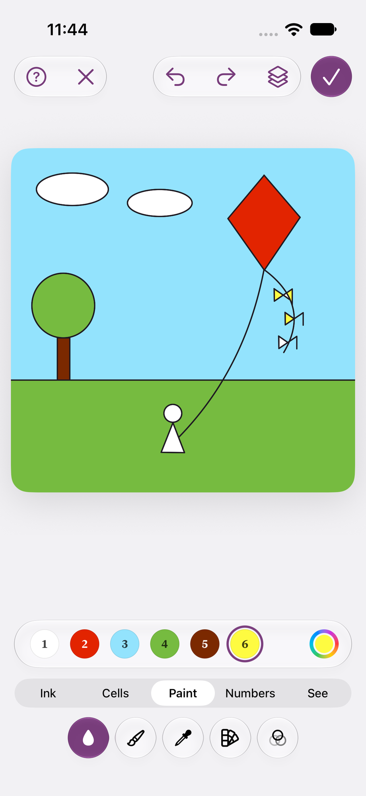

# Agent transcript

- end: success, 128 turns, 21.0 min, estimated $3.1990634
- tool calls: {"mcp__maestro__take_screenshot": 44, "mcp__maestro__run": 58, "mcp__maestro__inspect_screen": 20, "Write": 2, "Read": 2}
- images the agent received: 45

**Start**: model claude-opus-5-5, MCP [{"name": "maestro", "status": "connected", "source": "dynamic"}]

→ `mcp__maestro__take_screenshot` `{"device_id": "BE47EE94-B33A-4F37-85F2-060D68DAFCDA"}`

← mcp__maestro__take_screenshot: image  919x2000

→ `mcp__maestro__run` `{"device_id": "BE47EE94-B33A-4F37-85F2-060D68DAFCDA", "yaml": "appId: com.pbordjadze.paintbynumber\n---\n- tapOn:\n    point: \"90%,10%\"\n- waitForAnimationToEnd\n- takeScreenshot: /Users/runner/work/_temp/qa/shots/plan-1"}`

→ `mcp__maestro__inspect_screen` `{"device_id": "BE47EE94-B33A-4F37-85F2-060D68DAFCDA"}`

← mcp__maestro__run: {"success":true,"device_id":"BE47EE94-B33A-4F37-85F2-060D68DAFCDA","commands_executed":4,"message":"Flow executed successfully","env_vars":{"MAESTRO_CLI_ANALYSIS_NOTIFICATION_DISABLED":"true","MAESTRO_CLI_NO_ANALYTICS":"1","MAESTRO_DRIVER_STARTUP_TIMEOUT":"240000","MAESTRO_VERSION":"2.11.0"}}

← mcp__maestro__inspect_screen: {"ui_schema":{"platform":"ios","abbreviations":{"b":"bounds","txt":"text","rid":"resource-id","a11y":"accessibilityText","hint":"hintText","val":"value","c":"children"},"defaults":{"enabled":true,"focused":false,"selected":false,"checked":false,"txt":"","hint":"","rid":"","val":"","a11y":""}},"elements":[{"b":"[0,0][402,874]","a11y":"Paint by Moonlight","c":[{"b":"[0,0][402,874]","c":[{"b":"[0,0][ …

→ `mcp__maestro__run` `{"device_id": "BE47EE94-B33A-4F37-85F2-060D68DAFCDA", "yaml": "appId: com.pbordjadze.paintbynumber\n---\n- tapOn: \"Close\"\n- waitForAnimationToEnd"}`

→ `mcp__maestro__take_screenshot` `{"device_id": "BE47EE94-B33A-4F37-85F2-060D68DAFCDA"}`

← mcp__maestro__run: {"success":true,"device_id":"BE47EE94-B33A-4F37-85F2-060D68DAFCDA","commands_executed":3,"message":"Flow executed successfully","env_vars":{"MAESTRO_CLI_ANALYSIS_NOTIFICATION_DISABLED":"true","MAESTRO_CLI_NO_ANALYTICS":"1","MAESTRO_DRIVER_STARTUP_TIMEOUT":"240000","MAESTRO_VERSION":"2.11.0"}}

← mcp__maestro__take_screenshot: image  919x2000

> "From Scratch" is right there.

→ `mcp__maestro__run` `{"device_id": "BE47EE94-B33A-4F37-85F2-060D68DAFCDA", "yaml": "appId: com.pbordjadze.paintbynumber\n---\n- tapOn: \"From Scratch\"\n- waitForAnimationToEnd\n- takeScreenshot: /Users/runner/work/_temp/qa/shots/plan-2"}`

→ `mcp__maestro__inspect_screen` `{"device_id": "BE47EE94-B33A-4F37-85F2-060D68DAFCDA"}`

← mcp__maestro__run: {"success":true,"device_id":"BE47EE94-B33A-4F37-85F2-060D68DAFCDA","commands_executed":4,"message":"Flow executed successfully","env_vars":{"MAESTRO_CLI_ANALYSIS_NOTIFICATION_DISABLED":"true","MAESTRO_CLI_NO_ANALYTICS":"1","MAESTRO_DRIVER_STARTUP_TIMEOUT":"240000","MAESTRO_VERSION":"2.11.0"}}

← mcp__maestro__inspect_screen: {"ui_schema":{"platform":"ios","abbreviations":{"b":"bounds","txt":"text","rid":"resource-id","a11y":"accessibilityText","hint":"hintText","val":"value","c":"children"},"defaults":{"enabled":true,"focused":false,"selected":false,"checked":false,"txt":"","hint":"","rid":"","val":"","a11y":""}},"elements":[{"b":"[0,0][402,874]","a11y":"Paint by Moonlight","c":[{"b":"[0,0][402,874]","c":[{"b":"[0,0][ …

→ `mcp__maestro__take_screenshot` `{"device_id": "BE47EE94-B33A-4F37-85F2-060D68DAFCDA"}`

← mcp__maestro__take_screenshot: image  919x2000

→ `mcp__maestro__run` `{"device_id": "BE47EE94-B33A-4F37-85F2-060D68DAFCDA", "yaml": "appId: com.pbordjadze.paintbynumber\n---\n- tapOn:\n    id: \"refine-tool-shapes\"\n- waitForAnimationToEnd"}`

→ `mcp__maestro__take_screenshot` `{"device_id": "BE47EE94-B33A-4F37-85F2-060D68DAFCDA"}`

← mcp__maestro__run: {"success":true,"device_id":"BE47EE94-B33A-4F37-85F2-060D68DAFCDA","commands_executed":3,"message":"Flow executed successfully","env_vars":{"MAESTRO_CLI_ANALYSIS_NOTIFICATION_DISABLED":"true","MAESTRO_CLI_NO_ANALYTICS":"1","MAESTRO_DRIVER_STARTUP_TIMEOUT":"240000","MAESTRO_VERSION":"2.11.0"}}

← mcp__maestro__take_screenshot: image  919x2000

→ `mcp__maestro__inspect_screen` `{"device_id": "BE47EE94-B33A-4F37-85F2-060D68DAFCDA"}`

← mcp__maestro__inspect_screen: {"ui_schema":{"platform":"ios","abbreviations":{"b":"bounds","txt":"text","rid":"resource-id","a11y":"accessibilityText","hint":"hintText","val":"value","c":"children"},"defaults":{"enabled":true,"focused":false,"selected":false,"checked":false,"txt":"","hint":"","rid":"","val":"","a11y":""}},"elements":[{"b":"[0,0][402,874]","a11y":"Paint by Moonlight","c":[{"b":"[0,0][402,874]","c":[{"b":"[0,0][ …

→ `mcp__maestro__run` `{"device_id": "BE47EE94-B33A-4F37-85F2-060D68DAFCDA", "yaml": "appId: com.pbordjadze.paintbynumber\n---\n- swipe:\n    start: \"14,440\"\n    end: \"388,440\"\n    duration: 800\n- waitForAnimationToEnd"}`

→ `mcp__maestro__take_screenshot` `{"device_id": "BE47EE94-B33A-4F37-85F2-060D68DAFCDA"}`

← mcp__maestro__run: {"success":true,"device_id":"BE47EE94-B33A-4F37-85F2-060D68DAFCDA","commands_executed":3,"message":"Flow executed successfully","env_vars":{"MAESTRO_CLI_ANALYSIS_NOTIFICATION_DISABLED":"true","MAESTRO_CLI_NO_ANALYTICS":"1","MAESTRO_DRIVER_STARTUP_TIMEOUT":"240000","MAESTRO_VERSION":"2.11.0"}}

← mcp__maestro__take_screenshot: image  919x2000

→ `mcp__maestro__run` `{"device_id": "BE47EE94-B33A-4F37-85F2-060D68DAFCDA", "yaml": "appId: com.pbordjadze.paintbynumber\n---\n- swipe:\n    start: \"290,215\"\n    end: \"330,262\"\n    duration: 600\n- swipe:\n    start: \"330,262\"\n    end: \"290,320\"\n    duration: 600\n- swipe:\n    start: \"290,320\"\n    end: \"250,262\"\n    duration: 600\n- swipe:\n    start: \"250,262\"\n    end: \"290,215\"\n    duration: 600\n- waitForAnimationToEnd"}`

→ `mcp__maestro__take_screenshot` `{"device_id": "BE47EE94-B33A-4F37-85F2-060D68DAFCDA"}`

← mcp__maestro__run: {"success":true,"device_id":"BE47EE94-B33A-4F37-85F2-060D68DAFCDA","commands_executed":6,"message":"Flow executed successfully","env_vars":{"MAESTRO_CLI_ANALYSIS_NOTIFICATION_DISABLED":"true","MAESTRO_CLI_NO_ANALYTICS":"1","MAESTRO_DRIVER_STARTUP_TIMEOUT":"240000","MAESTRO_VERSION":"2.11.0"}}

← mcp__maestro__take_screenshot: image  919x2000

> Drawing is going well so far: "From Scratch" opened an empty page right away, and the horizon and the kite's diamond each worked on the first try. Next I'll try the Curve tool for the tail.

→ `mcp__maestro__run` `{"device_id": "BE47EE94-B33A-4F37-85F2-060D68DAFCDA", "yaml": "appId: com.pbordjadze.paintbynumber\n---\n- tapOn:\n    id: \"refine-shape-curve\"\n- waitForAnimationToEnd\n- swipe:\n    start: \"290,320\"\n    end: \"300,415\"\n    duration: 800\n- waitForAnimationToEnd"}`

→ `mcp__maestro__take_screenshot` `{"device_id": "BE47EE94-B33A-4F37-85F2-060D68DAFCDA"}`

← mcp__maestro__run: {"success":true,"device_id":"BE47EE94-B33A-4F37-85F2-060D68DAFCDA","commands_executed":5,"message":"Flow executed successfully","env_vars":{"MAESTRO_CLI_ANALYSIS_NOTIFICATION_DISABLED":"true","MAESTRO_CLI_NO_ANALYTICS":"1","MAESTRO_DRIVER_STARTUP_TIMEOUT":"240000","MAESTRO_VERSION":"2.11.0"}}

← mcp__maestro__take_screenshot: image  919x2000

→ `mcp__maestro__inspect_screen` `{"device_id": "BE47EE94-B33A-4F37-85F2-060D68DAFCDA"}`

← mcp__maestro__inspect_screen: {"ui_schema":{"platform":"ios","abbreviations":{"b":"bounds","txt":"text","rid":"resource-id","a11y":"accessibilityText","hint":"hintText","val":"value","c":"children"},"defaults":{"enabled":true,"focused":false,"selected":false,"checked":false,"txt":"","hint":"","rid":"","val":"","a11y":""}},"elements":[{"b":"[0,0][402,874]","a11y":"Paint by Moonlight","c":[{"b":"[0,0][402,874]","c":[{"b":"[0,0][ …

→ `mcp__maestro__run` `{"device_id": "BE47EE94-B33A-4F37-85F2-060D68DAFCDA", "yaml": "appId: com.pbordjadze.paintbynumber\n---\n- tapOn:\n    id: \"refine-undo\"\n- waitForAnimationToEnd\n- takeScreenshot: /Users/runner/work/_temp/qa/shots/plan-3-after-undo"}`

→ `mcp__maestro__inspect_screen` `{"device_id": "BE47EE94-B33A-4F37-85F2-060D68DAFCDA"}`

← mcp__maestro__run: {"success":true,"device_id":"BE47EE94-B33A-4F37-85F2-060D68DAFCDA","commands_executed":4,"message":"Flow executed successfully","env_vars":{"MAESTRO_CLI_ANALYSIS_NOTIFICATION_DISABLED":"true","MAESTRO_CLI_NO_ANALYTICS":"1","MAESTRO_DRIVER_STARTUP_TIMEOUT":"240000","MAESTRO_VERSION":"2.11.0"}}

← mcp__maestro__inspect_screen: {"ui_schema":{"platform":"ios","abbreviations":{"b":"bounds","txt":"text","rid":"resource-id","a11y":"accessibilityText","hint":"hintText","val":"value","c":"children"},"defaults":{"enabled":true,"focused":false,"selected":false,"checked":false,"txt":"","hint":"","rid":"","val":"","a11y":""}},"elements":[{"b":"[0,0][402,874]","a11y":"Paint by Moonlight","c":[{"b":"[0,0][402,874]","c":[{"b":"[0,0][ …

→ `mcp__maestro__run` `{"device_id": "BE47EE94-B33A-4F37-85F2-060D68DAFCDA", "yaml": "appId: com.pbordjadze.paintbynumber\n---\n- swipe:\n    start: \"290,297\"\n    end: \"312,388\"\n    duration: 800\n- waitForAnimationToEnd\n- swipe:\n    start: \"301,342\"\n    end: \"322,338\"\n    duration: 800\n- waitForAnimationToEnd"}`

→ `mcp__maestro__take_screenshot` `{"device_id": "BE47EE94-B33A-4F37-85F2-060D68DAFCDA"}`

← mcp__maestro__run: {"success":true,"device_id":"BE47EE94-B33A-4F37-85F2-060D68DAFCDA","commands_executed":5,"message":"Flow executed successfully","env_vars":{"MAESTRO_CLI_ANALYSIS_NOTIFICATION_DISABLED":"true","MAESTRO_CLI_NO_ANALYTICS":"1","MAESTRO_DRIVER_STARTUP_TIMEOUT":"240000","MAESTRO_VERSION":"2.11.0"}}

← mcp__maestro__take_screenshot: image  919x2000

→ `mcp__maestro__run` `{"device_id": "BE47EE94-B33A-4F37-85F2-060D68DAFCDA", "yaml": "appId: com.pbordjadze.paintbynumber\n---\n- tapOn:\n    id: \"refine-shape-line\"\n- waitForAnimationToEnd\n- takeScreenshot: /Users/runner/work/_temp/qa/shots/plan-4-line-tool"}`

→ `mcp__maestro__inspect_screen` `{"device_id": "BE47EE94-B33A-4F37-85F2-060D68DAFCDA"}`

← mcp__maestro__run: {"success":true,"device_id":"BE47EE94-B33A-4F37-85F2-060D68DAFCDA","commands_executed":4,"message":"Flow executed successfully","env_vars":{"MAESTRO_CLI_ANALYSIS_NOTIFICATION_DISABLED":"true","MAESTRO_CLI_NO_ANALYTICS":"1","MAESTRO_DRIVER_STARTUP_TIMEOUT":"240000","MAESTRO_VERSION":"2.11.0"}}

← mcp__maestro__inspect_screen: {"ui_schema":{"platform":"ios","abbreviations":{"b":"bounds","txt":"text","rid":"resource-id","a11y":"accessibilityText","hint":"hintText","val":"value","c":"children"},"defaults":{"enabled":true,"focused":false,"selected":false,"checked":false,"txt":"","hint":"","rid":"","val":"","a11y":""}},"elements":[{"b":"[0,0][402,874]","a11y":"Paint by Moonlight","c":[{"b":"[0,0][402,874]","c":[{"b":"[0,0][ …

→ `mcp__maestro__run` `{"device_id": "BE47EE94-B33A-4F37-85F2-060D68DAFCDA", "yaml": "appId: com.pbordjadze.paintbynumber\n---\n- swipe:\n    start: \"301,317\"\n    end: \"321,331\"\n    duration: 600\n- swipe:\n    start: \"321,331\"\n    end: \"321,317\"\n    duration: 600\n- swipe:\n    start: \"321,317\"\n    end: \"301,331\"\n    duration: 600\n- swipe:\n    start: \"301,331\"\n    end: \"301,317\"\n    duration: 600\n- waitForAnimationToEnd\n- takeScreenshot: /Users/runner/work/_temp/qa/shots/plan-5-bow1"}`

→ `mcp__maestro__take_screenshot` `{"device_id": "BE47EE94-B33A-4F37-85F2-060D68DAFCDA"}`

← mcp__maestro__run: {"success":true,"device_id":"BE47EE94-B33A-4F37-85F2-060D68DAFCDA","commands_executed":7,"message":"Flow executed successfully","env_vars":{"MAESTRO_CLI_ANALYSIS_NOTIFICATION_DISABLED":"true","MAESTRO_CLI_NO_ANALYTICS":"1","MAESTRO_DRIVER_STARTUP_TIMEOUT":"240000","MAESTRO_VERSION":"2.11.0"}}

← mcp__maestro__take_screenshot: image  919x2000

> First bow drawn (a bow-tie of 4 straight lines). The tail curve cuts through its right half, splitting it into two small pieces. I'll add two more bows, then write a first report.

→ `mcp__maestro__run` `{"device_id": "BE47EE94-B33A-4F37-85F2-060D68DAFCDA", "yaml": "appId: com.pbordjadze.paintbynumber\n---\n- swipe:\n    start: \"313,343\"\n    end: \"333,357\"\n    duration: 600\n- swipe:\n    start: \"333,357\"\n    end: \"333,343\"\n    duration: 600\n- swipe:\n    start: \"333,343\"\n    end: \"313,357\"\n    duration: 600\n- swipe:\n    start: \"313,357\"\n    end: \"313,343\"\n    duration: 600\n- swipe:\n    start: \"306,369\"\n    end: \"326,383\"\n    duration: 600\n- swipe:\n    start: \"326,383\"\n    end: \"326,369\"\n    duration: 600\n- swipe:\n    start: \"326,369\"\n    end: \"`

→ `mcp__maestro__take_screenshot` `{"device_id": "BE47EE94-B33A-4F37-85F2-060D68DAFCDA"}`

← mcp__maestro__run: {"success":true,"device_id":"BE47EE94-B33A-4F37-85F2-060D68DAFCDA","commands_executed":11,"message":"Flow executed successfully","env_vars":{"MAESTRO_CLI_ANALYSIS_NOTIFICATION_DISABLED":"true","MAESTRO_CLI_NO_ANALYTICS":"1","MAESTRO_DRIVER_STARTUP_TIMEOUT":"240000","MAESTRO_VERSION":"2.11.0"}}

← mcp__maestro__take_screenshot: image  919x2000

→ `Write` `{"file_path": "/Users/runner/work/_temp/qa/report.md", "content": "# Refine from scratch \u2014 red kite over a park (iPhone 17 Pro, debug build)\n\n**Verdict**: In progress (the report is written early in case the session stops).\n\n**What I meant to draw**: A red diamond kite in a blue sky, top right, with a curved tail of three bows (yellow), a string down to a small child (a round head and a triangle body) standing on green grass below a horizon line, a tree on the left (brown trunk, green round crown), and two white clouds.\n\n## The steps (so far)\n| Step | Tries | Stuck | What worked | `

← Write: File created successfully at: /Users/runner/work/_temp/qa/report.md (file state is current in your context — no need to Read it back)

→ `mcp__maestro__run` `{"device_id": "BE47EE94-B33A-4F37-85F2-060D68DAFCDA", "yaml": "appId: com.pbordjadze.paintbynumber\n---\n- tapOn:\n    id: \"refine-shape-oval\"\n- waitForAnimationToEnd\n- takeScreenshot: /Users/runner/work/_temp/qa/shots/plan-7-oval"}`

→ `mcp__maestro__inspect_screen` `{"device_id": "BE47EE94-B33A-4F37-85F2-060D68DAFCDA"}`

← mcp__maestro__run: {"success":true,"device_id":"BE47EE94-B33A-4F37-85F2-060D68DAFCDA","commands_executed":4,"message":"Flow executed successfully","env_vars":{"MAESTRO_CLI_ANALYSIS_NOTIFICATION_DISABLED":"true","MAESTRO_CLI_NO_ANALYTICS":"1","MAESTRO_DRIVER_STARTUP_TIMEOUT":"240000","MAESTRO_VERSION":"2.11.0"}}

← mcp__maestro__inspect_screen: {"ui_schema":{"platform":"ios","abbreviations":{"b":"bounds","txt":"text","rid":"resource-id","a11y":"accessibilityText","hint":"hintText","val":"value","c":"children"},"defaults":{"enabled":true,"focused":false,"selected":false,"checked":false,"txt":"","hint":"","rid":"","val":"","a11y":""}},"elements":[{"b":"[0,0][402,874]","a11y":"Paint by Moonlight","c":[{"b":"[0,0][402,874]","c":[{"b":"[0,0][ …

→ `mcp__maestro__run` `{"device_id": "BE47EE94-B33A-4F37-85F2-060D68DAFCDA", "yaml": "appId: com.pbordjadze.paintbynumber\n---\n- swipe:\n    start: \"180,444\"\n    end: \"200,464\"\n    duration: 600\n- waitForAnimationToEnd\n- swipe:\n    start: \"40,190\"\n    end: \"120,226\"\n    duration: 600\n- waitForAnimationToEnd\n- swipe:\n    start: \"140,208\"\n    end: \"212,238\"\n    duration: 600\n- waitForAnimationToEnd\n- swipe:\n    start: \"35,300\"\n    end: \"105,372\"\n    duration: 600\n- waitForAnimationToEnd"}`

→ `mcp__maestro__take_screenshot` `{"device_id": "BE47EE94-B33A-4F37-85F2-060D68DAFCDA"}`

← mcp__maestro__run: {"success":true,"device_id":"BE47EE94-B33A-4F37-85F2-060D68DAFCDA","commands_executed":9,"message":"Flow executed successfully","env_vars":{"MAESTRO_CLI_ANALYSIS_NOTIFICATION_DISABLED":"true","MAESTRO_CLI_NO_ANALYTICS":"1","MAESTRO_DRIVER_STARTUP_TIMEOUT":"240000","MAESTRO_VERSION":"2.11.0"}}

← mcp__maestro__take_screenshot: image  919x2000

→ `mcp__maestro__run` `{"device_id": "BE47EE94-B33A-4F37-85F2-060D68DAFCDA", "yaml": "appId: com.pbordjadze.paintbynumber\n---\n- tapOn:\n    id: \"refine-shape-rectangle\"\n- waitForAnimationToEnd\n- swipe:\n    start: \"63,371\"\n    end: \"77,418\"\n    duration: 600\n- waitForAnimationToEnd\n- tapOn:\n    id: \"refine-shape-line\"\n- waitForAnimationToEnd\n- swipe:\n    start: \"190,464\"\n    end: \"177,497\"\n    duration: 600\n- swipe:\n    start: \"177,497\"\n    end: \"203,497\"\n    duration: 600\n- swipe:\n    start: \"203,497\"\n    end: \"190,464\"\n    duration: 600\n- waitForAnimationToEnd\n- takeScre`

→ `mcp__maestro__take_screenshot` `{"device_id": "BE47EE94-B33A-4F37-85F2-060D68DAFCDA"}`

← mcp__maestro__run: {"success":true,"device_id":"BE47EE94-B33A-4F37-85F2-060D68DAFCDA","commands_executed":12,"message":"Flow executed successfully","env_vars":{"MAESTRO_CLI_ANALYSIS_NOTIFICATION_DISABLED":"true","MAESTRO_CLI_NO_ANALYTICS":"1","MAESTRO_DRIVER_STARTUP_TIMEOUT":"240000","MAESTRO_VERSION":"2.11.0"}}

← mcp__maestro__take_screenshot: image  919x2000

> The tree, child and clouds came out as planned. Now the string, using a bent curve.

→ `mcp__maestro__run` `{"device_id": "BE47EE94-B33A-4F37-85F2-060D68DAFCDA", "yaml": "appId: com.pbordjadze.paintbynumber\n---\n- tapOn:\n    id: \"refine-shape-curve\"\n- waitForAnimationToEnd\n- takeScreenshot: /Users/runner/work/_temp/qa/shots/plan-9-curve-tool"}`

→ `mcp__maestro__inspect_screen` `{"device_id": "BE47EE94-B33A-4F37-85F2-060D68DAFCDA"}`

← mcp__maestro__run: {"success":true,"device_id":"BE47EE94-B33A-4F37-85F2-060D68DAFCDA","commands_executed":4,"message":"Flow executed successfully","env_vars":{"MAESTRO_CLI_ANALYSIS_NOTIFICATION_DISABLED":"true","MAESTRO_CLI_NO_ANALYTICS":"1","MAESTRO_DRIVER_STARTUP_TIMEOUT":"240000","MAESTRO_VERSION":"2.11.0"}}

← mcp__maestro__inspect_screen: {"ui_schema":{"platform":"ios","abbreviations":{"b":"bounds","txt":"text","rid":"resource-id","a11y":"accessibilityText","hint":"hintText","val":"value","c":"children"},"defaults":{"enabled":true,"focused":false,"selected":false,"checked":false,"txt":"","hint":"","rid":"","val":"","a11y":""}},"elements":[{"b":"[0,0][402,874]","a11y":"Paint by Moonlight","c":[{"b":"[0,0][402,874]","c":[{"b":"[0,0][ …

→ `mcp__maestro__run` `{"device_id": "BE47EE94-B33A-4F37-85F2-060D68DAFCDA", "yaml": "appId: com.pbordjadze.paintbynumber\n---\n- swipe:\n    start: \"289,298\"\n    end: \"197,479\"\n    duration: 900\n- waitForAnimationToEnd\n- swipe:\n    start: \"243,389\"\n    end: \"256,397\"\n    duration: 800\n- waitForAnimationToEnd"}`

→ `mcp__maestro__take_screenshot` `{"device_id": "BE47EE94-B33A-4F37-85F2-060D68DAFCDA"}`

← mcp__maestro__run: {"success":true,"device_id":"BE47EE94-B33A-4F37-85F2-060D68DAFCDA","commands_executed":5,"message":"Flow executed successfully","env_vars":{"MAESTRO_CLI_ANALYSIS_NOTIFICATION_DISABLED":"true","MAESTRO_CLI_NO_ANALYTICS":"1","MAESTRO_DRIVER_STARTUP_TIMEOUT":"240000","MAESTRO_VERSION":"2.11.0"}}

← mcp__maestro__take_screenshot: image  919x2000

> Line drawing is done: a kite with a curved tail and 3 bows, a curved string to the child, a tree and 2 clouds, all on the first try except the tail. Next: color.

→ `mcp__maestro__run` `{"device_id": "BE47EE94-B33A-4F37-85F2-060D68DAFCDA", "yaml": "appId: com.pbordjadze.paintbynumber\n---\n- takeScreenshot: /Users/runner/work/_temp/qa/shots/plan-10-lines-done\n- tapOn: \"Paint\"\n- waitForAnimationToEnd"}`

→ `mcp__maestro__take_screenshot` `{"device_id": "BE47EE94-B33A-4F37-85F2-060D68DAFCDA"}`

← mcp__maestro__run: {"success":true,"device_id":"BE47EE94-B33A-4F37-85F2-060D68DAFCDA","commands_executed":4,"message":"Flow executed successfully","env_vars":{"MAESTRO_CLI_ANALYSIS_NOTIFICATION_DISABLED":"true","MAESTRO_CLI_NO_ANALYTICS":"1","MAESTRO_DRIVER_STARTUP_TIMEOUT":"240000","MAESTRO_VERSION":"2.11.0"}}

← mcp__maestro__take_screenshot: image  919x2000

→ `mcp__maestro__inspect_screen` `{"device_id": "BE47EE94-B33A-4F37-85F2-060D68DAFCDA"}`

← mcp__maestro__inspect_screen: {"ui_schema":{"platform":"ios","abbreviations":{"b":"bounds","txt":"text","rid":"resource-id","a11y":"accessibilityText","hint":"hintText","val":"value","c":"children"},"defaults":{"enabled":true,"focused":false,"selected":false,"checked":false,"txt":"","hint":"","rid":"","val":"","a11y":""}},"elements":[{"b":"[0,0][402,874]","a11y":"Paint by Moonlight","c":[{"b":"[0,0][402,874]","c":[{"b":"[0,0][ …

→ `mcp__maestro__run` `{"device_id": "BE47EE94-B33A-4F37-85F2-060D68DAFCDA", "yaml": "appId: com.pbordjadze.paintbynumber\n---\n- tapOn:\n    id: \"refine-palette-new\"\n- waitForAnimationToEnd"}`

→ `mcp__maestro__take_screenshot` `{"device_id": "BE47EE94-B33A-4F37-85F2-060D68DAFCDA"}`

← mcp__maestro__run: {"success":true,"device_id":"BE47EE94-B33A-4F37-85F2-060D68DAFCDA","commands_executed":3,"message":"Flow executed successfully","env_vars":{"MAESTRO_CLI_ANALYSIS_NOTIFICATION_DISABLED":"true","MAESTRO_CLI_NO_ANALYTICS":"1","MAESTRO_DRIVER_STARTUP_TIMEOUT":"240000","MAESTRO_VERSION":"2.11.0"}}

← mcp__maestro__take_screenshot: image  919x2000

→ `mcp__maestro__take_screenshot` `{"device_id": "BE47EE94-B33A-4F37-85F2-060D68DAFCDA"}`

← mcp__maestro__take_screenshot: image  919x2000

→ `mcp__maestro__inspect_screen` `{"device_id": "BE47EE94-B33A-4F37-85F2-060D68DAFCDA"}`

← mcp__maestro__inspect_screen: {"ui_schema":{"platform":"ios","abbreviations":{"b":"bounds","txt":"text","rid":"resource-id","a11y":"accessibilityText","hint":"hintText","val":"value","c":"children"},"defaults":{"enabled":true,"focused":false,"selected":false,"checked":false,"txt":"","hint":"","rid":"","val":"","a11y":""}},"elements":[{"b":"[0,0][402,874]","a11y":"Paint by Moonlight","c":[{"b":"[0,0][402,874]","c":[{"b":"[0,0][ …

→ `mcp__maestro__run` `{"device_id": "BE47EE94-B33A-4F37-85F2-060D68DAFCDA", "yaml": "appId: com.pbordjadze.paintbynumber\n---\n- waitForAnimationToEnd:\n    timeout: 5000\n- takeScreenshot: /Users/runner/work/_temp/qa/shots/plan-11-colorpicker-blank"}`

→ `mcp__maestro__take_screenshot` `{"device_id": "BE47EE94-B33A-4F37-85F2-060D68DAFCDA"}`

← mcp__maestro__run: {"success":true,"device_id":"BE47EE94-B33A-4F37-85F2-060D68DAFCDA","commands_executed":3,"message":"Flow executed successfully","env_vars":{"MAESTRO_CLI_ANALYSIS_NOTIFICATION_DISABLED":"true","MAESTRO_CLI_NO_ANALYTICS":"1","MAESTRO_DRIVER_STARTUP_TIMEOUT":"240000","MAESTRO_VERSION":"2.11.0"}}

← mcp__maestro__take_screenshot: image  919x2000

> The color picker took a few seconds to fill in (it was blank at first). Picking red for the kite.

→ `mcp__maestro__run` `{"device_id": "BE47EE94-B33A-4F37-85F2-060D68DAFCDA", "yaml": "appId: com.pbordjadze.paintbynumber\n---\n- tapOn:\n    point: \"187,669\"\n- waitForAnimationToEnd\n- swipe:\n    start: \"201,425\"\n    end: \"201,860\"\n    duration: 500\n- waitForAnimationToEnd"}`

→ `mcp__maestro__take_screenshot` `{"device_id": "BE47EE94-B33A-4F37-85F2-060D68DAFCDA"}`

← mcp__maestro__run: {"success":true,"device_id":"BE47EE94-B33A-4F37-85F2-060D68DAFCDA","commands_executed":5,"message":"Flow executed successfully","env_vars":{"MAESTRO_CLI_ANALYSIS_NOTIFICATION_DISABLED":"true","MAESTRO_CLI_NO_ANALYTICS":"1","MAESTRO_DRIVER_STARTUP_TIMEOUT":"240000","MAESTRO_VERSION":"2.11.0"}}

← mcp__maestro__take_screenshot: image  919x2000

→ `mcp__maestro__run` `{"device_id": "BE47EE94-B33A-4F37-85F2-060D68DAFCDA", "yaml": "appId: com.pbordjadze.paintbynumber\n---\n- tapOn:\n    point: \"290,245\"\n- waitForAnimationToEnd"}`

→ `mcp__maestro__take_screenshot` `{"device_id": "BE47EE94-B33A-4F37-85F2-060D68DAFCDA"}`

← mcp__maestro__run: {"success":true,"device_id":"BE47EE94-B33A-4F37-85F2-060D68DAFCDA","commands_executed":3,"message":"Flow executed successfully","env_vars":{"MAESTRO_CLI_ANALYSIS_NOTIFICATION_DISABLED":"true","MAESTRO_CLI_NO_ANALYTICS":"1","MAESTRO_DRIVER_STARTUP_TIMEOUT":"240000","MAESTRO_VERSION":"2.11.0"}}

← mcp__maestro__take_screenshot: image  919x2000

→ `mcp__maestro__run` `{"device_id": "BE47EE94-B33A-4F37-85F2-060D68DAFCDA", "yaml": "appId: com.pbordjadze.paintbynumber\n---\n- tapOn:\n    id: \"refine-palette-new\"\n- waitForAnimationToEnd:\n    timeout: 6000\n- takeScreenshot: /Users/runner/work/_temp/qa/shots/plan-12-picker2"}`

→ `mcp__maestro__take_screenshot` `{"device_id": "BE47EE94-B33A-4F37-85F2-060D68DAFCDA"}`

← mcp__maestro__run: {"success":true,"device_id":"BE47EE94-B33A-4F37-85F2-060D68DAFCDA","commands_executed":4,"message":"Flow executed successfully","env_vars":{"MAESTRO_CLI_ANALYSIS_NOTIFICATION_DISABLED":"true","MAESTRO_CLI_NO_ANALYTICS":"1","MAESTRO_DRIVER_STARTUP_TIMEOUT":"240000","MAESTRO_VERSION":"2.11.0"}}

← mcp__maestro__take_screenshot: image  919x2000

→ `mcp__maestro__run` `{"device_id": "BE47EE94-B33A-4F37-85F2-060D68DAFCDA", "yaml": "appId: com.pbordjadze.paintbynumber\n---\n- tapOn:\n    point: \"38,794\"\n- waitForAnimationToEnd\n- swipe:\n    start: \"201,425\"\n    end: \"201,860\"\n    duration: 500\n- waitForAnimationToEnd\n- tapOn:\n    point: \"200,270\"\n- waitForAnimationToEnd"}`

→ `mcp__maestro__take_screenshot` `{"device_id": "BE47EE94-B33A-4F37-85F2-060D68DAFCDA"}`

← mcp__maestro__run: {"success":true,"device_id":"BE47EE94-B33A-4F37-85F2-060D68DAFCDA","commands_executed":7,"message":"Flow executed successfully","env_vars":{"MAESTRO_CLI_ANALYSIS_NOTIFICATION_DISABLED":"true","MAESTRO_CLI_NO_ANALYTICS":"1","MAESTRO_DRIVER_STARTUP_TIMEOUT":"240000","MAESTRO_VERSION":"2.11.0"}}

← mcp__maestro__take_screenshot: image  919x2000

> Kite red and sky blue, each in one bucket tap. Next: green grass and tree crown.

→ `mcp__maestro__run` `{"device_id": "BE47EE94-B33A-4F37-85F2-060D68DAFCDA", "yaml": "appId: com.pbordjadze.paintbynumber\n---\n- tapOn:\n    id: \"refine-palette-new\"\n- waitForAnimationToEnd:\n    timeout: 6000\n- tapOn:\n    point: \"365,706\"\n- waitForAnimationToEnd\n- takeScreenshot: /Users/runner/work/_temp/qa/shots/plan-13-green-pick"}`

→ `mcp__maestro__take_screenshot` `{"device_id": "BE47EE94-B33A-4F37-85F2-060D68DAFCDA"}`

← mcp__maestro__run: {"success":true,"device_id":"BE47EE94-B33A-4F37-85F2-060D68DAFCDA","commands_executed":6,"message":"Flow executed successfully","env_vars":{"MAESTRO_CLI_ANALYSIS_NOTIFICATION_DISABLED":"true","MAESTRO_CLI_NO_ANALYTICS":"1","MAESTRO_DRIVER_STARTUP_TIMEOUT":"240000","MAESTRO_VERSION":"2.11.0"}}

← mcp__maestro__take_screenshot: image  919x2000

→ `mcp__maestro__run` `{"device_id": "BE47EE94-B33A-4F37-85F2-060D68DAFCDA", "yaml": "appId: com.pbordjadze.paintbynumber\n---\n- swipe:\n    start: \"201,425\"\n    end: \"201,860\"\n    duration: 500\n- waitForAnimationToEnd\n- tapOn:\n    point: \"100,500\"\n- waitForAnimationToEnd\n- tapOn:\n    point: \"70,336\"\n- waitForAnimationToEnd"}`

→ `mcp__maestro__take_screenshot` `{"device_id": "BE47EE94-B33A-4F37-85F2-060D68DAFCDA"}`

← mcp__maestro__run: {"success":true,"device_id":"BE47EE94-B33A-4F37-85F2-060D68DAFCDA","commands_executed":7,"message":"Flow executed successfully","env_vars":{"MAESTRO_CLI_ANALYSIS_NOTIFICATION_DISABLED":"true","MAESTRO_CLI_NO_ANALYTICS":"1","MAESTRO_DRIVER_STARTUP_TIMEOUT":"240000","MAESTRO_VERSION":"2.11.0"}}

← mcp__maestro__take_screenshot: image  919x2000

→ `mcp__maestro__run` `{"device_id": "BE47EE94-B33A-4F37-85F2-060D68DAFCDA", "yaml": "appId: com.pbordjadze.paintbynumber\n---\n- tapOn:\n    id: \"refine-palette-new\"\n- waitForAnimationToEnd:\n    timeout: 6000\n- tapOn:\n    point: \"217,617\"\n- waitForAnimationToEnd\n- swipe:\n    start: \"201,425\"\n    end: \"201,860\"\n    duration: 500\n- waitForAnimationToEnd\n- tapOn:\n    point: \"70,395\"\n- waitForAnimationToEnd\n- tapOn:\n    id: \"refine-palette-new\"\n- waitForAnimationToEnd:\n    timeout: 6000\n- tapOn:\n    point: \"306,706\"\n- waitForAnimationToEnd\n- swipe:\n    start: \"201,425\"\n    end: \"`

→ `mcp__maestro__take_screenshot` `{"device_id": "BE47EE94-B33A-4F37-85F2-060D68DAFCDA"}`

← mcp__maestro__run: {"success":true,"device_id":"BE47EE94-B33A-4F37-85F2-060D68DAFCDA","commands_executed":16,"message":"Flow executed successfully","env_vars":{"MAESTRO_CLI_ANALYSIS_NOTIFICATION_DISABLED":"true","MAESTRO_CLI_NO_ANALYTICS":"1","MAESTRO_DRIVER_STARTUP_TIMEOUT":"240000","MAESTRO_VERSION":"2.11.0"}}

← mcp__maestro__take_screenshot: image  919x2000

→ `mcp__maestro__run` `{"device_id": "BE47EE94-B33A-4F37-85F2-060D68DAFCDA", "yaml": "appId: com.pbordjadze.paintbynumber\n---\n- tapOn:\n    point: \"304,324\"\n- tapOn:\n    point: \"319,322\"\n- tapOn:\n    point: \"317,350\"\n- tapOn:\n    point: \"331,350\"\n- tapOn:\n    point: \"309,376\"\n- tapOn:\n    point: \"324,376\"\n- waitForAnimationToEnd\n- takeScreenshot: /Users/runner/work/_temp/qa/shots/plan-15-bows-yellow"}`

→ `mcp__maestro__take_screenshot` `{"device_id": "BE47EE94-B33A-4F37-85F2-060D68DAFCDA"}`

← mcp__maestro__run: {"success":true,"device_id":"BE47EE94-B33A-4F37-85F2-060D68DAFCDA","commands_executed":9,"message":"Flow executed successfully","env_vars":{"MAESTRO_CLI_ANALYSIS_NOTIFICATION_DISABLED":"true","MAESTRO_CLI_NO_ANALYTICS":"1","MAESTRO_DRIVER_STARTUP_TIMEOUT":"240000","MAESTRO_VERSION":"2.11.0"}}

← mcp__maestro__take_screenshot: image  919x2000

> A bucket tap meant for a tiny bow hit the sky and turned it all yellow, and the blue paint disappeared from the palette. Undoing step by step to see what happened.

→ `mcp__maestro__run` `{"device_id": "BE47EE94-B33A-4F37-85F2-060D68DAFCDA", "yaml": "appId: com.pbordjadze.paintbynumber\n---\n- tapOn:\n    id: \"refine-undo\"\n- waitForAnimationToEnd"}`

→ `mcp__maestro__take_screenshot` `{"device_id": "BE47EE94-B33A-4F37-85F2-060D68DAFCDA"}`

← mcp__maestro__run: {"success":true,"device_id":"BE47EE94-B33A-4F37-85F2-060D68DAFCDA","commands_executed":3,"message":"Flow executed successfully","env_vars":{"MAESTRO_CLI_ANALYSIS_NOTIFICATION_DISABLED":"true","MAESTRO_CLI_NO_ANALYTICS":"1","MAESTRO_DRIVER_STARTUP_TIMEOUT":"240000","MAESTRO_VERSION":"2.11.0"}}

← mcp__maestro__take_screenshot: image  919x2000

→ `mcp__maestro__run` `{"device_id": "BE47EE94-B33A-4F37-85F2-060D68DAFCDA", "yaml": "appId: com.pbordjadze.paintbynumber\n---\n- tapOn:\n    id: \"refine-undo\"\n- waitForAnimationToEnd\n- takeScreenshot: /Users/runner/work/_temp/qa/shots/undo2\n- tapOn:\n    id: \"refine-undo\"\n- waitForAnimationToEnd\n- takeScreenshot: /Users/runner/work/_temp/qa/shots/undo3"}`

→ `Read` `{"file_path": "/Users/runner/work/_temp/qa/shots/undo2.png"}`

→ `mcp__maestro__take_screenshot` `{"device_id": "BE47EE94-B33A-4F37-85F2-060D68DAFCDA"}`

← mcp__maestro__run: {"success":true,"device_id":"BE47EE94-B33A-4F37-85F2-060D68DAFCDA","commands_executed":7,"message":"Flow executed successfully","env_vars":{"MAESTRO_CLI_ANALYSIS_NOTIFICATION_DISABLED":"true","MAESTRO_CLI_NO_ANALYTICS":"1","MAESTRO_DRIVER_STARTUP_TIMEOUT":"240000","MAESTRO_VERSION":"2.11.0"}}

← Read: image  920x2000

← mcp__maestro__take_screenshot: image  919x2000

→ `mcp__maestro__run` `{"device_id": "BE47EE94-B33A-4F37-85F2-060D68DAFCDA", "yaml": "appId: com.pbordjadze.paintbynumber\n---\n- tapOn:\n    id: \"refine-redo\"\n- waitForAnimationToEnd\n- tapOn:\n    point: \"329,350\"\n- waitForAnimationToEnd\n- takeScreenshot: /Users/runner/work/_temp/qa/shots/plan-16-bow2-right"}`

→ `mcp__maestro__take_screenshot` `{"device_id": "BE47EE94-B33A-4F37-85F2-060D68DAFCDA"}`

← mcp__maestro__run: {"success":true,"device_id":"BE47EE94-B33A-4F37-85F2-060D68DAFCDA","commands_executed":6,"message":"Flow executed successfully","env_vars":{"MAESTRO_CLI_ANALYSIS_NOTIFICATION_DISABLED":"true","MAESTRO_CLI_NO_ANALYTICS":"1","MAESTRO_DRIVER_STARTUP_TIMEOUT":"240000","MAESTRO_VERSION":"2.11.0"}}

← mcp__maestro__take_screenshot: image  919x2000

→ `mcp__maestro__run` `{"device_id": "BE47EE94-B33A-4F37-85F2-060D68DAFCDA", "yaml": "appId: com.pbordjadze.paintbynumber\n---\n- tapOn:\n    id: \"refine-undo\"\n- waitForAnimationToEnd\n- tapOn: \"Ink\"\n- waitForAnimationToEnd\n- takeScreenshot: /Users/runner/work/_temp/qa/shots/plan-17-back-to-ink"}`

→ `mcp__maestro__inspect_screen` `{"device_id": "BE47EE94-B33A-4F37-85F2-060D68DAFCDA"}`

← mcp__maestro__run: {"success":true,"device_id":"BE47EE94-B33A-4F37-85F2-060D68DAFCDA","commands_executed":6,"message":"Flow executed successfully","env_vars":{"MAESTRO_CLI_ANALYSIS_NOTIFICATION_DISABLED":"true","MAESTRO_CLI_NO_ANALYTICS":"1","MAESTRO_DRIVER_STARTUP_TIMEOUT":"240000","MAESTRO_VERSION":"2.11.0"}}

← mcp__maestro__inspect_screen: {"ui_schema":{"platform":"ios","abbreviations":{"b":"bounds","txt":"text","rid":"resource-id","a11y":"accessibilityText","hint":"hintText","val":"value","c":"children"},"defaults":{"enabled":true,"focused":false,"selected":false,"checked":false,"txt":"","hint":"","rid":"","val":"","a11y":""}},"elements":[{"b":"[0,0][402,874]","a11y":"Paint by Moonlight","c":[{"b":"[0,0][402,874]","c":[{"b":"[0,0][ …

→ `mcp__maestro__run` `{"device_id": "BE47EE94-B33A-4F37-85F2-060D68DAFCDA", "yaml": "appId: com.pbordjadze.paintbynumber\n---\n- tapOn:\n    id: \"refine-shape-line\"\n- waitForAnimationToEnd\n- swipe:\n    start: \"333,339\"\n    end: \"333,361\"\n    duration: 600\n- swipe:\n    start: \"326,365\"\n    end: \"326,387\"\n    duration: 600\n- waitForAnimationToEnd\n- tapOn: \"Paint\"\n- waitForAnimationToEnd\n- tapOn:\n    point: \"329,350\"\n- waitForAnimationToEnd\n- takeScreenshot: /Users/runner/work/_temp/qa/shots/plan-18-bow2-retry"}`

→ `mcp__maestro__take_screenshot` `{"device_id": "BE47EE94-B33A-4F37-85F2-060D68DAFCDA"}`

← mcp__maestro__run: {"success":true,"device_id":"BE47EE94-B33A-4F37-85F2-060D68DAFCDA","commands_executed":11,"message":"Flow executed successfully","env_vars":{"MAESTRO_CLI_ANALYSIS_NOTIFICATION_DISABLED":"true","MAESTRO_CLI_NO_ANALYTICS":"1","MAESTRO_DRIVER_STARTUP_TIMEOUT":"240000","MAESTRO_VERSION":"2.11.0"}}

← mcp__maestro__take_screenshot: image  919x2000

→ `mcp__maestro__run` `{"device_id": "BE47EE94-B33A-4F37-85F2-060D68DAFCDA", "yaml": "appId: com.pbordjadze.paintbynumber\n---\n- tapOn:\n    id: \"refine-undo\"\n- waitForAnimationToEnd\n- tapOn: \"Numbers\"\n- waitForAnimationToEnd\n- takeScreenshot: /Users/runner/work/_temp/qa/shots/plan-19-numbers"}`

→ `mcp__maestro__take_screenshot` `{"device_id": "BE47EE94-B33A-4F37-85F2-060D68DAFCDA"}`

← mcp__maestro__run: {"success":true,"device_id":"BE47EE94-B33A-4F37-85F2-060D68DAFCDA","commands_executed":6,"message":"Flow executed successfully","env_vars":{"MAESTRO_CLI_ANALYSIS_NOTIFICATION_DISABLED":"true","MAESTRO_CLI_NO_ANALYTICS":"1","MAESTRO_DRIVER_STARTUP_TIMEOUT":"240000","MAESTRO_VERSION":"2.11.0"}}

← mcp__maestro__take_screenshot: image  919x2000

→ `mcp__maestro__run` `{"device_id": "BE47EE94-B33A-4F37-85F2-060D68DAFCDA", "yaml": "appId: com.pbordjadze.paintbynumber\n---\n- tapOn: \"Cells\"\n- waitForAnimationToEnd"}`

→ `mcp__maestro__inspect_screen` `{"device_id": "BE47EE94-B33A-4F37-85F2-060D68DAFCDA"}`

← mcp__maestro__run: {"success":true,"device_id":"BE47EE94-B33A-4F37-85F2-060D68DAFCDA","commands_executed":3,"message":"Flow executed successfully","env_vars":{"MAESTRO_CLI_ANALYSIS_NOTIFICATION_DISABLED":"true","MAESTRO_CLI_NO_ANALYTICS":"1","MAESTRO_DRIVER_STARTUP_TIMEOUT":"240000","MAESTRO_VERSION":"2.11.0"}}

← mcp__maestro__inspect_screen: {"ui_schema":{"platform":"ios","abbreviations":{"b":"bounds","txt":"text","rid":"resource-id","a11y":"accessibilityText","hint":"hintText","val":"value","c":"children"},"defaults":{"enabled":true,"focused":false,"selected":false,"checked":false,"txt":"","hint":"","rid":"","val":"","a11y":""}},"elements":[{"b":"[0,0][402,874]","a11y":"Paint by Moonlight","c":[{"b":"[0,0][402,874]","c":[{"b":"[0,0][ …

→ `mcp__maestro__run` `{"device_id": "BE47EE94-B33A-4F37-85F2-060D68DAFCDA", "yaml": "appId: com.pbordjadze.paintbynumber\n---\n- tapOn:\n    id: \"refine-tool-fill\"\n- waitForAnimationToEnd"}`

→ `mcp__maestro__take_screenshot` `{"device_id": "BE47EE94-B33A-4F37-85F2-060D68DAFCDA"}`

← mcp__maestro__run: {"success":true,"device_id":"BE47EE94-B33A-4F37-85F2-060D68DAFCDA","commands_executed":3,"message":"Flow executed successfully","env_vars":{"MAESTRO_CLI_ANALYSIS_NOTIFICATION_DISABLED":"true","MAESTRO_CLI_NO_ANALYTICS":"1","MAESTRO_DRIVER_STARTUP_TIMEOUT":"240000","MAESTRO_VERSION":"2.11.0"}}

← mcp__maestro__take_screenshot: image  919x2000

> No hint appears for Make Cell, so I'm opening the Tool Guide.

→ `mcp__maestro__run` `{"device_id": "BE47EE94-B33A-4F37-85F2-060D68DAFCDA", "yaml": "appId: com.pbordjadze.paintbynumber\n---\n- tapOn:\n    id: \"refine-guide\"\n- waitForAnimationToEnd\n- takeScreenshot: /Users/runner/work/_temp/qa/shots/plan-20-guide"}`

→ `mcp__maestro__inspect_screen` `{"device_id": "BE47EE94-B33A-4F37-85F2-060D68DAFCDA"}`

← mcp__maestro__run: {"success":true,"device_id":"BE47EE94-B33A-4F37-85F2-060D68DAFCDA","commands_executed":4,"message":"Flow executed successfully","env_vars":{"MAESTRO_CLI_ANALYSIS_NOTIFICATION_DISABLED":"true","MAESTRO_CLI_NO_ANALYTICS":"1","MAESTRO_DRIVER_STARTUP_TIMEOUT":"240000","MAESTRO_VERSION":"2.11.0"}}

← mcp__maestro__inspect_screen: {"ui_schema":{"platform":"ios","abbreviations":{"b":"bounds","txt":"text","rid":"resource-id","a11y":"accessibilityText","hint":"hintText","val":"value","c":"children"},"defaults":{"enabled":true,"focused":false,"selected":false,"checked":false,"txt":"","hint":"","rid":"","val":"","a11y":""}},"elements":[{"b":"[0,0][402,874]","a11y":"Paint by Moonlight","c":[{"b":"[0,0][402,874]","c":[{"b":"[0,0][ …

> The guide explained Make Cell clearly, but that tool doesn't fit this problem: the ink itself has a gap. I'll close the bows by redrawing their right-hand diagonals with Snap off so they overshoot.

→ `mcp__maestro__run` `{"device_id": "BE47EE94-B33A-4F37-85F2-060D68DAFCDA", "yaml": "appId: com.pbordjadze.paintbynumber\n---\n- tapOn:\n    id: \"refine-guide-done\"\n- waitForAnimationToEnd\n- tapOn: \"Ink\"\n- waitForAnimationToEnd\n- tapOn:\n    id: \"refine-shape-line\"\n- waitForAnimationToEnd\n- tapOn:\n    id: \"refine-snap\"\n- waitForAnimationToEnd\n- takeScreenshot: /Users/runner/work/_temp/qa/shots/plan-21-snap-off"}`

→ `mcp__maestro__inspect_screen` `{"device_id": "BE47EE94-B33A-4F37-85F2-060D68DAFCDA"}`

← mcp__maestro__run: {"success":true,"device_id":"BE47EE94-B33A-4F37-85F2-060D68DAFCDA","commands_executed":10,"message":"Flow executed successfully","env_vars":{"MAESTRO_CLI_ANALYSIS_NOTIFICATION_DISABLED":"true","MAESTRO_CLI_NO_ANALYTICS":"1","MAESTRO_DRIVER_STARTUP_TIMEOUT":"240000","MAESTRO_VERSION":"2.11.0"}}

← mcp__maestro__inspect_screen: {"ui_schema":{"platform":"ios","abbreviations":{"b":"bounds","txt":"text","rid":"resource-id","a11y":"accessibilityText","hint":"hintText","val":"value","c":"children"},"defaults":{"enabled":true,"focused":false,"selected":false,"checked":false,"txt":"","hint":"","rid":"","val":"","a11y":""}},"elements":[{"b":"[0,0][402,874]","a11y":"Paint by Moonlight","c":[{"b":"[0,0][402,874]","c":[{"b":"[0,0][ …

→ `mcp__maestro__run` `{"device_id": "BE47EE94-B33A-4F37-85F2-060D68DAFCDA", "yaml": "appId: com.pbordjadze.paintbynumber\n---\n- tapOn:\n    point: \"166,716\"\n- waitForAnimationToEnd"}`

→ `mcp__maestro__take_screenshot` `{"device_id": "BE47EE94-B33A-4F37-85F2-060D68DAFCDA"}`

← mcp__maestro__run: {"success":true,"device_id":"BE47EE94-B33A-4F37-85F2-060D68DAFCDA","commands_executed":3,"message":"Flow executed successfully","env_vars":{"MAESTRO_CLI_ANALYSIS_NOTIFICATION_DISABLED":"true","MAESTRO_CLI_NO_ANALYTICS":"1","MAESTRO_DRIVER_STARTUP_TIMEOUT":"240000","MAESTRO_VERSION":"2.11.0"}}

← mcp__maestro__take_screenshot: image  919x2000

→ `mcp__maestro__run` `{"device_id": "BE47EE94-B33A-4F37-85F2-060D68DAFCDA", "yaml": "appId: com.pbordjadze.paintbynumber\n---\n- swipe:\n    start: \"319,350\"\n    end: \"337,340\"\n    duration: 600\n- swipe:\n    start: \"319,350\"\n    end: \"337,361\"\n    duration: 600\n- swipe:\n    start: \"314,376\"\n    end: \"330,366\"\n    duration: 600\n- swipe:\n    start: \"314,376\"\n    end: \"330,387\"\n    duration: 600\n- waitForAnimationToEnd\n- tapOn: \"Numbers\"\n- waitForAnimationToEnd\n- takeScreenshot: /Users/runner/work/_temp/qa/shots/plan-22-bows-closed"}`

→ `mcp__maestro__take_screenshot` `{"device_id": "BE47EE94-B33A-4F37-85F2-060D68DAFCDA"}`

← mcp__maestro__run: {"success":true,"device_id":"BE47EE94-B33A-4F37-85F2-060D68DAFCDA","commands_executed":9,"message":"Flow executed successfully","env_vars":{"MAESTRO_CLI_ANALYSIS_NOTIFICATION_DISABLED":"true","MAESTRO_CLI_NO_ANALYTICS":"1","MAESTRO_DRIVER_STARTUP_TIMEOUT":"240000","MAESTRO_VERSION":"2.11.0"}}

← mcp__maestro__take_screenshot: image  919x2000

> Lines added (they overshoot). Testing a fill on bow 2's right half; I'll undo if the sky floods again.

→ `mcp__maestro__run` `{"device_id": "BE47EE94-B33A-4F37-85F2-060D68DAFCDA", "yaml": "appId: com.pbordjadze.paintbynumber\n---\n- tapOn: \"Paint\"\n- waitForAnimationToEnd\n- tapOn:\n    point: \"328,350\"\n- waitForAnimationToEnd\n- takeScreenshot: /Users/runner/work/_temp/qa/shots/plan-23-bow2-fill"}`

→ `mcp__maestro__take_screenshot` `{"device_id": "BE47EE94-B33A-4F37-85F2-060D68DAFCDA"}`

← mcp__maestro__run: {"success":true,"device_id":"BE47EE94-B33A-4F37-85F2-060D68DAFCDA","commands_executed":6,"message":"Flow executed successfully","env_vars":{"MAESTRO_CLI_ANALYSIS_NOTIFICATION_DISABLED":"true","MAESTRO_CLI_NO_ANALYTICS":"1","MAESTRO_DRIVER_STARTUP_TIMEOUT":"240000","MAESTRO_VERSION":"2.11.0"}}

← mcp__maestro__take_screenshot: image  919x2000

> Same flood. With cells this small I can't place a bucket tap reliably. Undoing, then I'll leave bows 2 and 3 as they are and move on.

→ `mcp__maestro__run` `{"device_id": "BE47EE94-B33A-4F37-85F2-060D68DAFCDA", "yaml": "appId: com.pbordjadze.paintbynumber\n---\n- tapOn:\n    id: \"refine-undo\"\n- waitForAnimationToEnd\n- tapOn:\n    point: \"308,377\"\n- waitForAnimationToEnd\n- takeScreenshot: /Users/runner/work/_temp/qa/shots/plan-24-bow3-left"}`

→ `mcp__maestro__take_screenshot` `{"device_id": "BE47EE94-B33A-4F37-85F2-060D68DAFCDA"}`

← mcp__maestro__run: {"success":true,"device_id":"BE47EE94-B33A-4F37-85F2-060D68DAFCDA","commands_executed":6,"message":"Flow executed successfully","env_vars":{"MAESTRO_CLI_ANALYSIS_NOTIFICATION_DISABLED":"true","MAESTRO_CLI_NO_ANALYTICS":"1","MAESTRO_DRIVER_STARTUP_TIMEOUT":"240000","MAESTRO_VERSION":"2.11.0"}}

← mcp__maestro__take_screenshot: image  919x2000

> Bow 3's left half is yellow now. Next the child: peach head, purple body.

→ `mcp__maestro__run` `{"device_id": "BE47EE94-B33A-4F37-85F2-060D68DAFCDA", "yaml": "appId: com.pbordjadze.paintbynumber\n---\n- tapOn:\n    id: \"refine-palette-new\"\n- waitForAnimationToEnd:\n    timeout: 6000\n- tapOn:\n    point: \"247,794\"\n- waitForAnimationToEnd\n- swipe:\n    start: \"201,425\"\n    end: \"201,860\"\n    duration: 500\n- waitForAnimationToEnd\n- tapOn:\n    point: \"190,454\"\n- waitForAnimationToEnd\n- tapOn:\n    id: \"refine-palette-new\"\n- waitForAnimationToEnd:\n    timeout: 6000\n- tapOn:\n    point: \"127,676\"\n- waitForAnimationToEnd\n- swipe:\n    start: \"201,425\"\n    end: \`

→ `mcp__maestro__take_screenshot` `{"device_id": "BE47EE94-B33A-4F37-85F2-060D68DAFCDA"}`

← mcp__maestro__run: {"success":true,"device_id":"BE47EE94-B33A-4F37-85F2-060D68DAFCDA","commands_executed":18,"message":"Flow executed successfully","env_vars":{"MAESTRO_CLI_ANALYSIS_NOTIFICATION_DISABLED":"true","MAESTRO_CLI_NO_ANALYTICS":"1","MAESTRO_DRIVER_STARTUP_TIMEOUT":"240000","MAESTRO_VERSION":"2.11.0"}}

← mcp__maestro__take_screenshot: image  919x2000

> The picture is colored. Saving the final Refine shot and tapping Done.

→ `mcp__maestro__run` `{"device_id": "BE47EE94-B33A-4F37-85F2-060D68DAFCDA", "yaml": "appId: com.pbordjadze.paintbynumber\n---\n- takeScreenshot: /Users/runner/work/_temp/qa/shots/final-refine\n- tapOn:\n    id: \"refine-done\"\n- waitForAnimationToEnd:\n    timeout: 15000"}`

→ `mcp__maestro__take_screenshot` `{"device_id": "BE47EE94-B33A-4F37-85F2-060D68DAFCDA"}`

← mcp__maestro__run: {"success":true,"device_id":"BE47EE94-B33A-4F37-85F2-060D68DAFCDA","commands_executed":4,"message":"Flow executed successfully","env_vars":{"MAESTRO_CLI_ANALYSIS_NOTIFICATION_DISABLED":"true","MAESTRO_CLI_NO_ANALYTICS":"1","MAESTRO_DRIVER_STARTUP_TIMEOUT":"240000","MAESTRO_VERSION":"2.11.0"}}

← mcp__maestro__take_screenshot: image  919x2000

> Preview reads "8 colors · 21 areas · ~5 min". Starting the painting.

→ `mcp__maestro__run` `{"device_id": "BE47EE94-B33A-4F37-85F2-060D68DAFCDA", "yaml": "appId: com.pbordjadze.paintbynumber\n---\n- tapOn: \"Start Painting\"\n- waitForAnimationToEnd:\n    timeout: 20000"}`

→ `mcp__maestro__take_screenshot` `{"device_id": "BE47EE94-B33A-4F37-85F2-060D68DAFCDA"}`

← mcp__maestro__run: {"success":true,"device_id":"BE47EE94-B33A-4F37-85F2-060D68DAFCDA","commands_executed":3,"message":"Flow executed successfully","env_vars":{"MAESTRO_CLI_ANALYSIS_NOTIFICATION_DISABLED":"true","MAESTRO_CLI_NO_ANALYTICS":"1","MAESTRO_DRIVER_STARTUP_TIMEOUT":"240000","MAESTRO_VERSION":"2.11.0"}}

← mcp__maestro__take_screenshot: image  919x2000

> The template looks right: numbered areas, and the sky (3) hatched as the selected paint. Closing the tip and saving final-template.

→ `mcp__maestro__run` `{"device_id": "BE47EE94-B33A-4F37-85F2-060D68DAFCDA", "yaml": "appId: com.pbordjadze.paintbynumber\n---\n- tapOn: \"Close\"\n- waitForAnimationToEnd\n- takeScreenshot: /Users/runner/work/_temp/qa/shots/final-template\n- tapOn:\n    point: \"200,400\"\n- waitForAnimationToEnd"}`

→ `mcp__maestro__inspect_screen` `{"device_id": "BE47EE94-B33A-4F37-85F2-060D68DAFCDA"}`

← mcp__maestro__run: {"success":true,"device_id":"BE47EE94-B33A-4F37-85F2-060D68DAFCDA","commands_executed":6,"message":"Flow executed successfully","env_vars":{"MAESTRO_CLI_ANALYSIS_NOTIFICATION_DISABLED":"true","MAESTRO_CLI_NO_ANALYTICS":"1","MAESTRO_DRIVER_STARTUP_TIMEOUT":"240000","MAESTRO_VERSION":"2.11.0"}}

← mcp__maestro__inspect_screen: {"ui_schema":{"platform":"ios","abbreviations":{"b":"bounds","txt":"text","rid":"resource-id","a11y":"accessibilityText","hint":"hintText","val":"value","c":"children"},"defaults":{"enabled":true,"focused":false,"selected":false,"checked":false,"txt":"","hint":"","rid":"","val":"","a11y":""}},"elements":[{"b":"[0,0][402,874]","a11y":"Paint by Moonlight","c":[{"b":"[0,0][402,874]","c":[{"b":"[0,0][ …

> Sky painted (4%). Color 3 has 4 tiny leftover areas around the bows (the slivers left by my extra lines). Tapping them by their VoiceOver ids.

→ `mcp__maestro__run` `{"device_id": "BE47EE94-B33A-4F37-85F2-060D68DAFCDA", "yaml": "appId: com.pbordjadze.paintbynumber\n---\n- tapOn:\n    id: \"canvas-area-18\"\n- waitForAnimationToEnd\n- tapOn:\n    id: \"canvas-area-16\"\n- waitForAnimationToEnd"}`

→ `mcp__maestro__inspect_screen` `{"device_id": "BE47EE94-B33A-4F37-85F2-060D68DAFCDA"}`

← mcp__maestro__run: {"success":true,"device_id":"BE47EE94-B33A-4F37-85F2-060D68DAFCDA","commands_executed":5,"message":"Flow executed successfully","env_vars":{"MAESTRO_CLI_ANALYSIS_NOTIFICATION_DISABLED":"true","MAESTRO_CLI_NO_ANALYTICS":"1","MAESTRO_DRIVER_STARTUP_TIMEOUT":"240000","MAESTRO_VERSION":"2.11.0"}}

← mcp__maestro__inspect_screen: {"ui_schema":{"platform":"ios","abbreviations":{"b":"bounds","txt":"text","rid":"resource-id","a11y":"accessibilityText","hint":"hintText","val":"value","c":"children"},"defaults":{"enabled":true,"focused":false,"selected":false,"checked":false,"txt":"","hint":"","rid":"","val":"","a11y":""}},"elements":[{"b":"[0,0][402,874]","a11y":"Paint by Moonlight","c":[{"b":"[0,0][402,874]","c":[{"b":"[0,0][ …

→ `mcp__maestro__run` `{"device_id": "BE47EE94-B33A-4F37-85F2-060D68DAFCDA", "yaml": "appId: com.pbordjadze.paintbynumber\n---\n- tapOn:\n    id: \"canvas-area-19\"\n- waitForAnimationToEnd\n- tapOn:\n    id: \"canvas-area-15\"\n- waitForAnimationToEnd"}`

→ `mcp__maestro__take_screenshot` `{"device_id": "BE47EE94-B33A-4F37-85F2-060D68DAFCDA"}`

← mcp__maestro__run: {"success":true,"device_id":"BE47EE94-B33A-4F37-85F2-060D68DAFCDA","commands_executed":5,"message":"Flow executed successfully","env_vars":{"MAESTRO_CLI_ANALYSIS_NOTIFICATION_DISABLED":"true","MAESTRO_CLI_NO_ANALYTICS":"1","MAESTRO_DRIVER_STARTUP_TIMEOUT":"240000","MAESTRO_VERSION":"2.11.0"}}

← mcp__maestro__take_screenshot: image  919x2000

> Color 3 is done and the palette moved on to 4. Painting the larger areas now.

→ `mcp__maestro__run` `{"device_id": "BE47EE94-B33A-4F37-85F2-060D68DAFCDA", "yaml": "appId: com.pbordjadze.paintbynumber\n---\n- tapOn:\n    point: \"77,560\"\n- waitForAnimationToEnd\n- tapOn:\n    point: \"72,400\"\n- waitForAnimationToEnd\n- tapOn:\n    id: \"swatch-1\"\n    index: 0\n- waitForAnimationToEnd\n- tapOn:\n    point: \"82,283\"\n- waitForAnimationToEnd\n- tapOn:\n    point: \"176,298\"\n- waitForAnimationToEnd\n- tapOn:\n    id: \"swatch-2\"\n    index: 0\n- waitForAnimationToEnd\n- tapOn:\n    point: \"288,316\"\n- waitForAnimationToEnd\n- tapOn:\n    id: \"swatch-5\"\n    index: 0\n- waitForAnimat`

→ `mcp__maestro__take_screenshot` `{"device_id": "BE47EE94-B33A-4F37-85F2-060D68DAFCDA"}`

← mcp__maestro__run: {"success":true,"device_id":"BE47EE94-B33A-4F37-85F2-060D68DAFCDA","commands_executed":19,"message":"Flow executed successfully","env_vars":{"MAESTRO_CLI_ANALYSIS_NOTIFICATION_DISABLED":"true","MAESTRO_CLI_NO_ANALYTICS":"1","MAESTRO_DRIVER_STARTUP_TIMEOUT":"240000","MAESTRO_VERSION":"2.11.0"}}

← mcp__maestro__take_screenshot: image  919x2000

> The canvas zoomed in partway through (one of my taps was probably read as a double tap). Red, green and one cloud are painted. Continuing at this zoom.

→ `mcp__maestro__run` `{"device_id": "BE47EE94-B33A-4F37-85F2-060D68DAFCDA", "yaml": "appId: com.pbordjadze.paintbynumber\n---\n- tapOn:\n    point: \"129,430\"\n- waitForAnimationToEnd\n- tapOn:\n    id: \"swatch-7\"\n    index: 0\n- waitForAnimationToEnd"}`

→ `mcp__maestro__take_screenshot` `{"device_id": "BE47EE94-B33A-4F37-85F2-060D68DAFCDA"}`

← mcp__maestro__run: {"success":true,"device_id":"BE47EE94-B33A-4F37-85F2-060D68DAFCDA","commands_executed":5,"message":"Flow executed successfully","env_vars":{"MAESTRO_CLI_ANALYSIS_NOTIFICATION_DISABLED":"true","MAESTRO_CLI_NO_ANALYTICS":"1","MAESTRO_DRIVER_STARTUP_TIMEOUT":"240000","MAESTRO_VERSION":"2.11.0"}}

← mcp__maestro__take_screenshot: image  919x2000

→ `mcp__maestro__run` `{"device_id": "BE47EE94-B33A-4F37-85F2-060D68DAFCDA", "yaml": "appId: com.pbordjadze.paintbynumber\n---\n- tapOn:\n    point: \"364,545\"\n- waitForAnimationToEnd\n- tapOn:\n    id: \"swatch-8\"\n    index: 0\n- waitForAnimationToEnd\n- tapOn:\n    point: \"362,612\"\n- waitForAnimationToEnd"}`

→ `mcp__maestro__take_screenshot` `{"device_id": "BE47EE94-B33A-4F37-85F2-060D68DAFCDA"}`

← mcp__maestro__run: {"success":true,"device_id":"BE47EE94-B33A-4F37-85F2-060D68DAFCDA","commands_executed":7,"message":"Flow executed successfully","env_vars":{"MAESTRO_CLI_ANALYSIS_NOTIFICATION_DISABLED":"true","MAESTRO_CLI_NO_ANALYTICS":"1","MAESTRO_DRIVER_STARTUP_TIMEOUT":"240000","MAESTRO_VERSION":"2.11.0"}}

← mcp__maestro__take_screenshot: image  919x2000

→ `mcp__maestro__run` `{"device_id": "BE47EE94-B33A-4F37-85F2-060D68DAFCDA", "yaml": "appId: com.pbordjadze.paintbynumber\n---\n- tapOn:\n    point: \"201,612\"\n- waitForAnimationToEnd\n- tapOn:\n    id: \"swatch-6\"\n    index: 0\n- waitForAnimationToEnd"}`

→ `mcp__maestro__inspect_screen` `{"device_id": "BE47EE94-B33A-4F37-85F2-060D68DAFCDA"}`

← mcp__maestro__run: {"success":true,"device_id":"BE47EE94-B33A-4F37-85F2-060D68DAFCDA","commands_executed":5,"message":"Flow executed successfully","env_vars":{"MAESTRO_CLI_ANALYSIS_NOTIFICATION_DISABLED":"true","MAESTRO_CLI_NO_ANALYTICS":"1","MAESTRO_DRIVER_STARTUP_TIMEOUT":"240000","MAESTRO_VERSION":"2.11.0"}}

← mcp__maestro__inspect_screen: {"ui_schema":{"platform":"ios","abbreviations":{"b":"bounds","txt":"text","rid":"resource-id","a11y":"accessibilityText","hint":"hintText","val":"value","c":"children"},"defaults":{"enabled":true,"focused":false,"selected":false,"checked":false,"txt":"","hint":"","rid":"","val":"","a11y":""}},"elements":[{"b":"[0,0][402,874]","a11y":"Paint by Moonlight","c":[{"b":"[0,0][402,874]","c":[{"b":"[0,0][ …

> 61% painted. Yellow bows are out of view; using Hint to fly to them.

→ `mcp__maestro__run` `{"device_id": "BE47EE94-B33A-4F37-85F2-060D68DAFCDA", "yaml": "appId: com.pbordjadze.paintbynumber\n---\n- tapOn:\n    id: \"lightbulb\"\n- waitForAnimationToEnd"}`

→ `mcp__maestro__inspect_screen` `{"device_id": "BE47EE94-B33A-4F37-85F2-060D68DAFCDA"}`

← mcp__maestro__run: {"success":true,"device_id":"BE47EE94-B33A-4F37-85F2-060D68DAFCDA","commands_executed":3,"message":"Flow executed successfully","env_vars":{"MAESTRO_CLI_ANALYSIS_NOTIFICATION_DISABLED":"true","MAESTRO_CLI_NO_ANALYTICS":"1","MAESTRO_DRIVER_STARTUP_TIMEOUT":"240000","MAESTRO_VERSION":"2.11.0"}}

← mcp__maestro__inspect_screen: {"ui_schema":{"platform":"ios","abbreviations":{"b":"bounds","txt":"text","rid":"resource-id","a11y":"accessibilityText","hint":"hintText","val":"value","c":"children"},"defaults":{"enabled":true,"focused":false,"selected":false,"checked":false,"txt":"","hint":"","rid":"","val":"","a11y":""}},"elements":[{"b":"[0,0][402,874]","a11y":"Paint by Moonlight","c":[{"b":"[0,0][402,874]","c":[{"b":"[0,0][ …

→ `mcp__maestro__run` `{"device_id": "BE47EE94-B33A-4F37-85F2-060D68DAFCDA", "yaml": "appId: com.pbordjadze.paintbynumber\n---\n- tapOn:\n    id: \"canvas-area-5\"\n- waitForAnimationToEnd\n- tapOn:\n    id: \"canvas-area-3\"\n- waitForAnimationToEnd\n- tapOn:\n    id: \"canvas-area-6\"\n- waitForAnimationToEnd\n- tapOn:\n    id: \"canvas-area-17\"\n- waitForAnimationToEnd\n- tapOn:\n    id: \"canvas-area-8\"\n- waitForAnimationToEnd"}`

→ `mcp__maestro__take_screenshot` `{"device_id": "BE47EE94-B33A-4F37-85F2-060D68DAFCDA"}`

← mcp__maestro__run: {"success":true,"device_id":"BE47EE94-B33A-4F37-85F2-060D68DAFCDA","commands_executed":11,"message":"Flow executed successfully","env_vars":{"MAESTRO_CLI_ANALYSIS_NOTIFICATION_DISABLED":"true","MAESTRO_CLI_NO_ANALYTICS":"1","MAESTRO_DRIVER_STARTUP_TIMEOUT":"240000","MAESTRO_VERSION":"2.11.0"}}

← mcp__maestro__take_screenshot: image  919x2000

> The zoomed view shows the bow problem clearly: the right halves of bows 2 and 3 are open, with crossing overshoot lines. One white sliver is left inside bow 1, plus a cloud.

→ `mcp__maestro__run` `{"device_id": "BE47EE94-B33A-4F37-85F2-060D68DAFCDA", "yaml": "appId: com.pbordjadze.paintbynumber\n---\n- takeScreenshot: /Users/runner/work/_temp/qa/shots/plan-26-bows-zoomed\n"}`

← mcp__maestro__run: {"success":true,"device_id":"BE47EE94-B33A-4F37-85F2-060D68DAFCDA","commands_executed":2,"message":"Flow executed successfully","env_vars":{"MAESTRO_CLI_ANALYSIS_NOTIFICATION_DISABLED":"true","MAESTRO_CLI_NO_ANALYTICS":"1","MAESTRO_DRIVER_STARTUP_TIMEOUT":"240000","MAESTRO_VERSION":"2.11.0"}}

→ `mcp__maestro__inspect_screen` `{"device_id": "BE47EE94-B33A-4F37-85F2-060D68DAFCDA"}`

← mcp__maestro__inspect_screen: {"ui_schema":{"platform":"ios","abbreviations":{"b":"bounds","txt":"text","rid":"resource-id","a11y":"accessibilityText","hint":"hintText","val":"value","c":"children"},"defaults":{"enabled":true,"focused":false,"selected":false,"checked":false,"txt":"","hint":"","rid":"","val":"","a11y":""}},"elements":[{"b":"[0,0][402,874]","a11y":"Paint by Moonlight","c":[{"b":"[0,0][402,874]","c":[{"b":"[0,0][ …

→ `mcp__maestro__run` `{"device_id": "BE47EE94-B33A-4F37-85F2-060D68DAFCDA", "yaml": "appId: com.pbordjadze.paintbynumber\n---\n- tapOn:\n    id: \"canvas-area-4\"\n- waitForAnimationToEnd\n- tapOn:\n    id: \"canvas-area-20\"\n- waitForAnimationToEnd"}`

→ `mcp__maestro__inspect_screen` `{"device_id": "BE47EE94-B33A-4F37-85F2-060D68DAFCDA"}`

← mcp__maestro__run: {"success":true,"device_id":"BE47EE94-B33A-4F37-85F2-060D68DAFCDA","commands_executed":5,"message":"Flow executed successfully","env_vars":{"MAESTRO_CLI_ANALYSIS_NOTIFICATION_DISABLED":"true","MAESTRO_CLI_NO_ANALYTICS":"1","MAESTRO_DRIVER_STARTUP_TIMEOUT":"240000","MAESTRO_VERSION":"2.11.0"}}

← mcp__maestro__inspect_screen: {"ui_schema":{"platform":"ios","abbreviations":{"b":"bounds","txt":"text","rid":"resource-id","a11y":"accessibilityText","hint":"hintText","val":"value","c":"children"},"defaults":{"enabled":true,"focused":false,"selected":false,"checked":false,"txt":"","hint":"","rid":"","val":"","a11y":""}},"elements":[{"b":"[0,0][402,874]","a11y":"Paint by Moonlight","c":[{"b":"[0,0][402,874]","c":[{"b":"[0,0][ …

→ `mcp__maestro__run` `{"device_id": "BE47EE94-B33A-4F37-85F2-060D68DAFCDA", "yaml": "appId: com.pbordjadze.paintbynumber\n---\n- tapOn: \"Close\"\n- waitForAnimationToEnd\n- tapOn:\n    id: \"canvas-area-7\"\n- waitForAnimationToEnd\n- takeScreenshot: /Users/runner/work/_temp/qa/shots/plan-27-last-area"}`

→ `mcp__maestro__take_screenshot` `{"device_id": "BE47EE94-B33A-4F37-85F2-060D68DAFCDA"}`

← mcp__maestro__run: {"success":true,"device_id":"BE47EE94-B33A-4F37-85F2-060D68DAFCDA","commands_executed":6,"message":"Flow executed successfully","env_vars":{"MAESTRO_CLI_ANALYSIS_NOTIFICATION_DISABLED":"true","MAESTRO_CLI_NO_ANALYTICS":"1","MAESTRO_DRIVER_STARTUP_TIMEOUT":"240000","MAESTRO_VERSION":"2.11.0"}}

← mcp__maestro__take_screenshot: image  919x2000

> Finished at 100%. Saving the final shot and checking for crashes.

→ `mcp__maestro__run` `{"device_id": "BE47EE94-B33A-4F37-85F2-060D68DAFCDA", "yaml": "appId: com.pbordjadze.paintbynumber\n---\n- takeScreenshot: /Users/runner/work/_temp/qa/shots/final-painting"}`

← mcp__maestro__run: {"success":true,"device_id":"BE47EE94-B33A-4F37-85F2-060D68DAFCDA","commands_executed":2,"message":"Flow executed successfully","env_vars":{"MAESTRO_CLI_ANALYSIS_NOTIFICATION_DISABLED":"true","MAESTRO_CLI_NO_ANALYTICS":"1","MAESTRO_DRIVER_STARTUP_TIMEOUT":"240000","MAESTRO_VERSION":"2.11.0"}}

→ `Read` `{"file_path": "/Users/runner/work/_temp/qa/crashes.txt"}`

← Read: <system-reminder>Warning: the file exists but the contents are empty.</system-reminder>

→ `Write` `{"file_path": "/Users/runner/work/_temp/qa/report.md", "content": "# Refine from scratch: a red kite over a park (iPhone 17 Pro, debug build)\n\n**Verdict**: Partly. The kite, sky, park, tree, child, string and clouds came out as I meant, but only one of the three bows is whole: two are half-open, with stray crossing lines, and half of each is left sky-blue.\n\n**What I meant to draw**: A red diamond kite in a pale-blue sky, top right, with a curved tail of three yellow bow-ties, a curved string down to a small child (peach round head, purple triangle body) on green grass below a straight hori`

← Write: The file /Users/runner/work/_temp/qa/report.md has been updated successfully. (file state is current in your context — no need to Read it back)

> I got the picture I wanted only in part. The kite, sky, park, tree, child, string and clouds all came out as planned, and I painted all 21 areas to 100%. But only one of the three bows on the kite's tail is a whole yellow bow-tie: the other two are half yellow, half sky-blue, with stray lines next to them. No crashes were recorded.
> 
> **What worked well, mostly on the first try:**
> - **Getting started:** + › From Scratch opened an empty page right away.
> - **Shapes:** the Line, Oval, Rectangle and Curve tools behaved as expected, and Snap joined corners and carried lines to the edges. The Curve tool (drag end to end, then drag the middle to bend it) gave a smooth tail and string.
> - **Color and handoff:** adding paints and filling shapes with the Bucket was easy, and Done › Start Painting gave a clean template ("8 colors · 21 areas").
> 
> **Where I got stuck, worst first:**
> 1. **The small bow-ties wouldn't close, and nothing showed me why.** Each bow is four short lines about 20 points across. On two of them the right half stayed open. I suspect Snap joined the line ends to the nearby tail instead of to each other, but that's not proven. I only found out by filling them, and later from the Numbers tab, which shows open shapes as having no number. Extra lines drawn with Snap off didn't close them; they only left stray strokes.
> 2. **A bucket tap on a tiny open shape filled the whole sky with yellow.** This happened three times. The blue paint also disappeared from the palette and the numbers shifted. Undo fixed it every time, but it's alarming the first time.
> 3. **The canvas moved 23 points when I picked the Curve tool,** so my first tail landed below the kite. This goes against the design note that the picture never moves as tools change; after that it stayed put.
> 
> **Smaller things:**
> - The color picker opened blank for about 5 seconds the first time (probably just a slow simulator).
> - Once, while painting, the canvas zoomed in on its own. Most likely two of my taps counted as a double tap.
> 
> **What Maestro couldn't do:** pinch or pan, so I couldn't zoom Refine to draw or fix the small bows, and curved freehand strokes, which the Curve tool made up for.
> 
> **Not tested:** most of the Cells tools, Looks, Layers, drag painting, and quitting and relaunching to check the finished painting is kept.
> 
> The report has the plan line, a step-by-step table and evidence for each point. The key screenshots are `final-refine`, `final-template`, `final-painting` and `plan-26-bows-zoomed` (the bow problem, zoomed in).
> 
> Files are in `/Users/runner/work/_temp/qa`:
> - report.md
> - shots/
